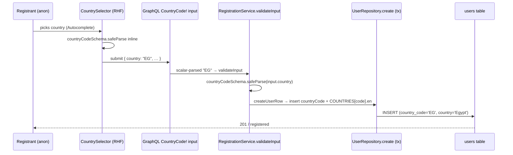

# Design — Issue #230: Country Selector Component

## Document Information

- **Feature Name**: No Country Selector Component (country input with flag + validation + `CountryCode` scalar + shared zod schema)
- **Issue**: GitHub issue #230 (not a milestone ticket — milestone dir is `issue_230`)
- **Plan Directory**: `ai/plans/issue_230/no_country_selector_component/`
- **Outcome Directory**: `ai/plans/issue_230/no_country_selector_component/outcome/`
- **Sibling Artifacts**: `specs.md` (requirements/REQ-1..REQ-11), `tasks.md` (task pipeline), `deferred-items.md` (deferral ledger)
- **Version**: 1.0
- **Date**: 2026-09-30
- **Related Documents**: `docs/domain/graphql-scalars.md` (created by REQ-10), `docs/DATABASE_MIGRATIONS.md`, `docs/billing/paymob-gateway.md` (scalar precedent pattern)

---

## 1. Overview

Issue #230 asks for a country input component with a flag (start adornment), validation on
both frontend and backend, a new custom GraphQL scalar, and a shared zod schema. Today the
`/register` form renders a free-text `TextField` for `country`
(`frontend/views/auth/register/RegisterIdentityFields.tsx:86-101`), and the backend only checks
that the string is non-empty (`backend/services/auth/registration.service.ts:221-223` and
`backend/services/admin/user-management.helpers.ts:173-177`). A user can therefore persist
`"asdf"` as their country. There is no canonical country identifier shared across tiers.

This design introduces **ISO 3166-1 alpha-2 uppercase** (`^[A-Z]{2}$`) as the canonical country
identifier (D1), backed by:

1. a **generated, committed dataset** `shared/constants/countries.ts` (ISO codes + ar/en names +
   flag emoji) built by a new `scripts/country-data-generator/` mirroring the existing
   `scripts/iana-timezone-generator/` (REQ-1);
2. a **shared zod schema + guards** in `shared/lib/country-code.ts` usable by both tiers (REQ-2);
3. a **`CountryCode` GraphQL scalar** registered from `graphql-scalars` `CountryCodeResolver`
   (REQ-3);
4. a **reusable `CountrySelector`** MUI v9 Autocomplete component (REQ-5) wired into `/register`
   (REQ-6);
5. **localized ar/en labels** through the compile-time i18n system (REQ-7);
6. a **nullable `country_code varchar(2)`** column so the ISO code is persisted alongside the
   legacy free-text `country` display name (REQ-8).

Everything is additive and backward compatible: the existing `country` column keeps its meaning
(free text / display name) and every existing consumer stays untouched (deferrals D-2/D-3 in
`deferred-items.md`).

### Design Goals

- One canonical country identifier shared by frontend, backend, and GraphQL wire.
- No new npm dependency (D10) — reuse installed `zod`, `graphql-scalars`, and CLDR devDeps.
- Reuse existing infrastructure patterns: the iana-timezone generator, the scalar registry, the
  `ApiFieldErrorType` projection, and the compile-time locale namespace recipe.
- Zero UX churn outside `/register`: no new routes, nav, or pages.
- Backward-compatible data model: legacy `country` values remain readable everywhere.

### Key Design Decisions

The frozen decision set is D1–D12. Full rationale for the three highest-impact decisions follows
the summary table.

| ID | Decision | Anchor |
|----|----------|--------|
| D1 | Canonical identifier = ISO 3166-1 alpha-2 uppercase, `^[A-Z]{2}$` | `shared/lib/country-code.ts` |
| D2 | New `CountryCode` scalar via `graphql-scalars` `CountryCodeResolver` | `backend/graphql/pothos/shared/scalar.pothos.ts` |
| D3 | Shared zod schema + guards in `shared/lib/country-code.ts` | cross-tier |
| D4 | Generated committed dataset `shared/constants/countries.ts` + `scripts/country-data-generator/` | REQ-1 |
| D5 | Reusable `CountrySelector` in `frontend/components/ui/` | REQ-5 |
| D6 | Register integrates the selector; RHF inline validation via `safeParse` (no resolver dep) | REQ-6 |
| D7 | Backend validates with `countryCodeSchema.safeParse`; emits `COUNTRY_CODE_REQUIRED`/`COUNTRY_CODE_INVALID` | REQ-4 |
| D8 | Add nullable `country_code varchar(2)`; retain `country` for display | REQ-8 |
| D9 | New `countrySelector` namespace + `AuthLabels.countryCodeRequired/countryCodeInvalid` | REQ-7 |
| D10 | No new npm dependency (dial codes deferred) | constraint |
| D11 | Test coverage across shared/db/service/GraphQL/frontend; no journey test | REQ-9 |
| D12 | `docs/domain/graphql-scalars.md` knowledge propagation | REQ-10 |

#### Decision A — New `country_code` column vs. repurpose the existing `country` column

**Context**: `users.country` is `varchar("country", { length: 100 })`
(`backend/db/schema/users/users.ts:22`), populated today with free-text values
(`backend/services/auth/registration.service.ts:268` writes `input.country` verbatim; the raw-SQL
SELECT blocks in `backend/db/repo/users/user.repository.ts:51-58,83-90` name `country`
explicitly). Several read-side consumers use it for display or exact-match filtering: the admin
directory filter and broadcast `audienceCountry` cohort. Existing rows hold human strings like
`"Egypt"`.

| Option | Pros | Cons |
|--------|------|------|
| (A1) Repurpose `country` to hold the ISO code | No new column; single source of truth | Breaks every existing display/filter consumer; silently corrupts legacy rows; violates backward-compat |
| (A2) Add nullable `country_code`, keep `country` for display | Fully backward compatible; ISO code queryable; graceful for legacy rows (null) | Two country-ish columns until D-2 normalization lands |

**Decision**: **A2**. Add `countryCode: varchar("country_code", { length: 2 })` (nullable) and keep
`country` untouched.

**Rationale**: The repo convention for schema change is additive-first with an explicit defers
ledger; repurposing a populated display column would force a data backfill that cannot be derived
(`"Egypt"` → `"EG"` needs a mapping table) and would break the admin/broadcast consumers inside
this change. Adding a nullable ISO column gives correctness now with zero consumer churn, and the
legacy-normalization backfill is recorded as deferral **D-2** with a concrete revisit trigger.

#### Decision B — `graphql-scalars` `CountryCodeResolver` vs. a hand-rolled scalar

**Context**: `graphql-scalars` `^2.0.0` is already a dependency (`package.json:104`) and is the
source of the project's only existing custom scalar, `DateTimeResolver`
(`backend/graphql/pothos/shared/scalar.pothos.ts:24`). The package exports `CountryCodeResolver`
(ISO-3166 alpha-2) and `CountryNameResolver`.

| Option | Pros | Cons |
|--------|------|------|
| (B1) Use `CountryCodeResolver` from `graphql-scalars` | Follows the exact `DateTime` precedent; battle-tested parse/serialize; zero new code; no new dep | Validator is the library's, not membership-checked against our generated `COUNTRY_CODES` dataset |
| (B2) Hand-roll a `GraphQLScalarType` | Full control over membership validation against `COUNTRY_CODES` | Reinvents ISO-2 validation; diverges from the `DateTime` pattern; more surface to test |

**Decision**: **B1** for the *scalar*; membership against `COUNTRY_CODES` stays in the **service
layer** via `countryCodeSchema.safeParse` (D7).

**Rationale**: The scalar's job is wire integrity against the library's **hardcoded full
ISO 3166-1 alpha-2 list** (anchored regex, case-insensitive; the resolver
`~/.bun/install/cache/graphql-scalars@2.0.0@@@1/esm/scalars/CountryCode.js` rejects anything
outside that list and returns the value **unchanged** — no normalization). The dataset's job is
business membership against the curated `COUNTRY_CODES` set. Keeping them separate avoids
coupling the GraphQL wire scalar to a generated file's contents and mirrors how `DateTime` is a
thin `graphql-scalars` wrapper. Because the library list includes codes we may curate out
(`IL`, `XK`, `PS`), those codes still pass the scalar and are rejected only by the service's
`countryCodeSchema` membership check — so the service is the sole membership + normalization
gate. The `schema-surface.test.ts` pin (REQ-3) plus service-level `countryCodeSchema` tests
(REQ-2/REQ-4) give the combined guarantee.

#### Decision C — Generated dataset via script vs. committed hand list vs. runtime CLDR

**Context**: The repo already generates locale data at build time:
`shared/constants/iana-timezone-*.ts` are produced by `scripts/iana-timezone-generator/`
(`cli.ts`, `cldr-data.ts`, `labels.ts`, `territories.ts`, `file-builders.ts`, `paths.ts`,
`index.ts`) from `cldr-localenames-full`, which is already installed (`package.json:147-149`).
Files carry an `// AUTO-GENERATED by ... do not edit manually` header and are committed.

| Option | Pros | Cons |
|--------|------|------|
| (C1) New generator script + committed output | Matches the iana precedent exactly; reproducible; refreshable via `generate:countries`; ar/en names from the same CLDR source the app already trusts | One more script to maintain |
| (C2) Hand-written committed list | Trivial | ~250 entries with ar/en names + flags hand-maintained is error-prone and unverifiable |
| (C3) Runtime CLDR / `Intl.DisplayNames` | No committed data | Adds runtime bundle weight + a non-generated dependency; `Intl.DisplayNames` usage is currently absent from the repo (fragile across runtimes) |

**Decision**: **C1**.

**Rationale**: The iana-timezone generator is the established, working template for exactly this
kind of "static locale data derived from CLDR" need, including a curation precedent
(`EXCLUDED_TERRITORY_CODES = new Set(["IL"])`, `IL → "PS"` remap in
`scripts/iana-timezone-generator/territories.ts`). Reusing it keeps one mental model for
generated locale data, and `generate:countries` gives a deterministic refresh path.

---

## 2. Data Models

### 2.1 Generated dataset — `shared/constants/countries.ts` (REQ-1)

```typescript
// AUTO-GENERATED by scripts/country-data-generator — do not edit manually.
// Run `bun run generate:countries` to regenerate.

/** ISO 3166-1 alpha-2 codes, uppercase, curated subset (see generator). */
export const COUNTRY_CODES = [
  "AE", "EG", "SA", "US", /* … */
] as const;

/** Union of every valid ISO-3166-1 alpha-2 code in the committed dataset. */
export type CountryCode = (typeof COUNTRY_CODES)[number];

/** Per-code localized display name + flag emoji (regional-indicator derived). */
export const COUNTRIES: Record<CountryCode, { en: string; ar: string; flag: string }> = {
  AE: { en: "United Arab Emirates", ar: "الإمارات العربية المتحدة", flag: "🇦🇪" },
  EG: { en: "Egypt", ar: "مصر", flag: "🇪🇬" },
  /* … */
};
```

**Validation / generation rules**:
- `COUNTRY_CODES` entries are uppercase `[A-Z]{2}`, sorted deterministically by the generator.
- `flag` is derived mechanically from the code (two `U+1F1E6`-based regional-indicator symbols),
  never hand-typed.
- `en`/`ar` names come from `cldr-localenames-full/main/{en,ar}/territories.json` (same CLDR
  package the iana generator consumes via `scripts/iana-timezone-generator/paths.ts`).
- Curation (excluded/remapped territories) follows the iana `territories.ts` precedent and is
  documented in the generator, not in this file (the file is machine-owned).
- Deep-import only; **not** re-exported from `shared/constants/index.ts` (matches the iana files).

### 2.2 Shared identifier/guard module — `shared/lib/country-code.ts` (REQ-2)

```typescript
import { z } from "zod";
import { COUNTRY_CODES, type CountryCode } from "@/shared/constants/countries";

export const COUNTRY_CODE_PATTERN = /^[A-Z]{2}$/;

export function normalizeCountryCode(raw: string): string; // trim + uppercase
export function isValidCountryCode(value: unknown): value is CountryCode;
export const countryCodeSchema: z.ZodType<CountryCode>;      // normalize → membership check
export const countryCodeShapeSchema: z.ZodType<string>;      // regex-only ISO-shape pre-check
```

`shared/` may not import `@/frontend/**`, `@/backend/**`, or `@/app/**`; importing the `zod` npm
package is permitted (only cross-layer aliases are restricted). This is the first zod usage in
`shared/`, with precedent in `backend/types/classes/admin-session-governance.types.ts:1`.

### 2.3 Persistence — `users` schema column (REQ-8, D8)

`backend/db/schema/users/users.ts` gains one nullable column next to `country`:

```typescript
country: varchar("country", { length: 100 }),          // unchanged — display name / legacy
countryCode: varchar("country_code", { length: 2 }),   // NEW — nullable ISO-3166-1 alpha-2
```

**Rules**:
- Nullable (no `.notNull()`) so existing rows and every non-registration write path remain valid.
- Length 2 matches the fixed ISO alpha-2 width.
- Drizzle `$inferSelect` propagates `countryCode: string | null` into `UserSelectType`; the two
  raw-SQL SELECT blocks in `backend/db/repo/users/user.repository.ts:51-58,83-90` MUST add
  `country_code AS "countryCode"` or the non-transactional read path will silently drop the field
  (the transactional Drizzle path picks it up automatically). This mismatch is a known trap and
  is called out in `tasks.md` Phase 3.1.
- Migration: `bun drizzle-kit generate` → `backend/drizzle/<timestamp>_add_users_country_code/`
  (snapshot + `.sql`); apply with `bun db migrate`. Local dev sync via `bun db push`. Never
  `CREATE INDEX CONCURRENTLY`. See `docs/DATABASE_MIGRATIONS.md`.

### 2.4 Legacy `country` — retained (deferred normalization)

`users.country` keeps its current free-text semantics for all existing and new rows written by
other paths. Consumers NOT changed by this plan: broadcast `audienceCountry` exact-match cohort,
admin directory country filter, profile display. Normalizing legacy values and repointing those
consumers is deferral **D-2 / D-3** in `deferred-items.md`. Registration is the only writer that
now also populates `country_code` and the canonical display name (D7).

### 2.5 Data Flow



---

## 3. API Contracts

### 3.1 GraphQL scalar — new `scalar CountryCode` (REQ-3, D2)

Generated SDL (`frontend/graphql/generated/schema.graphql`) gains:

```graphql
scalar CountryCode
```

Registration input field is retyped from `String!` to `CountryCode!`:

```graphql
input RegisterInput {
  country: CountryCode!   # was: String!
  …
}
```

### 3.2 Exact NEW / CHANGED signature blocks

**`backend/graphql/pothos/shared/scalar.pothos.ts`** (registry — add second scalar):

```typescript
import { CountryCodeResolver, DateTimeResolver } from "graphql-scalars";
import { gqlSchemaBuilder } from "@/backend/graphql/pothos/builder";

gqlSchemaBuilder.addScalarType("DateTime", DateTimeResolver, {});
gqlSchemaBuilder.addScalarType("CountryCode", CountryCodeResolver, {});   // NEW
```

Header "Registered scalars" list gains `CountryCode — CountryCodeResolver from graphql-scalars
(ISO 3166-1 alpha-2; validates against the library's full-country list, case-insensitive, returns the value unchanged — normalization + curated-set membership stay in the service; frontend codegen maps it to `string`)`.

**`backend/graphql/pothos/builder.ts`** — `Scalars` slot (currently `:78-84`) gains a member:

```typescript
Scalars: {
  DateTime: { Input: Date; Output: Date | string };
  CountryCode: { Input: string; Output: string };   // NEW
};
```

**`codegen.ts`** — `sharedGqlConfig.config.scalars` map (`:20-29`) gains:

```typescript
CountryCode: "string",
```

(`strictScalars: true` at `:18` means a missing mapping is a compile error — so this entry is
mandatory, not optional.)

**`backend/graphql/pothos/shared/userFieldHelpers.ts`** (`:104`, shared by public register +
admin-create inputs):

```typescript
country: t.string({ required: true }),   // was
country: t.field({ type: "CountryCode", required: true }),   // NEW
```

**Public/admin input + mutation wiring**: `backend/graphql/pothos/auth/register-input.pothos.ts`
(public `RegisterUserInput`) and `backend/graphql/pothos/admin/admin-user.pothos.ts:313`
(`AdminCreateUserInput` = `{ ...userRegistrationInputFields(t) }`) both inherit the retyped
`country` from `userFieldHelpers.ts:104`. The pass-through call sites
`backend/graphql/mutation/auth.mutation.ts:67` and
`backend/graphql/mutation/admin/admin-users.mutation.ts:83` carry the field through unchanged
in *name* (`country`) — only its scalar type changes; the mutation variable types flow from
the input object. The admin directory **filter** (`AdminUserFiltersInput.country`,
`admin-user.pothos.ts:302`) and the admin **update** input
(`AdminUpdateUserInput.country`, `admin-user.pothos.ts:327`) deliberately stay `String` on
legacy free text (deferred D-4; §2.4) and are NOT retyped.

**`backend/types/users/registration.types.ts`** — `RegistrationSubmitInput.country` (`:48`) and
`AdminRegistrationSubmitInput.country` (`:75`) stay `string` at the service boundary (the scalar
serializes to a string; the ISO membership check happens in the service, D7). A comment records
that the value is expected to be a `CountryCode`.

**`backend/services/auth/registration.service.ts`** — validation branch (replaces `:221-223`):

```typescript
// before
if (!input.country || input.country.trim().length === 0) {
  entries.push({ field: "country", code: "COUNTRY_REQUIRED", message: t.countryRequired });
}

// after — draft, in the same entries-collection style
const countryResult = countryCodeSchema.safeParse(input.country);
if (!input.country || input.country.trim().length === 0) {
  entries.push({ field: "country", code: "COUNTRY_CODE_REQUIRED", message: t.countryCodeRequired });
} else if (!countryResult.success) {
  entries.push({ field: "country", code: "COUNTRY_CODE_INVALID", message: t.countryCodeInvalid });
}
// normalized code captured for the insert:
const countryCode = countryResult.success ? countryResult.data : null;
```

`createUserRow` (`:249-280`) keeps its explicit field-by-field `UserInsertType` map and adds two
lines (no spread — BOPLA):

```typescript
country: countryCode ? COUNTRIES[countryCode].en : input.country,   // canonical display name
countryCode,                                                        // ISO-3166-1 alpha-2
```

**`backend/services/admin/user-management.helpers.ts`** — `validateCreateInput` country branch
(`:173-177`) mirrors the registration change (same codes/field path); `validateUpdatePatch`
(`:220-225`) applies `countryCodeSchema.safeParse` when `patch.countryCode` is a string and
`patch.country` remains a free-text display field (see Phase 3.4 in `tasks.md`).

**`frontend/components/ui/CountrySelector.tsx`** — public props interface (D5):

```typescript
export interface CountrySelectorProps {
  id?: string;
  name?: string;
  label: string;
  value: CountryCode | "";
  onChange: (code: string) => void;       // "" when cleared; ISO code otherwise
  onBlur?: () => void;
  error?: boolean;
  helperText?: React.ReactNode;
  required?: boolean;
  disabled?: boolean;
}
```

The component reads its own UI text (`placeholder`, `noOptionsText`) via
`useAppTranslation(CountrySelector)` (REQ-7) and emits the stable `id`/`name` so RHF can bind it.
No view-specific logic lives in the component.

### 3.3 Permission matrix (validation-only change)

The change is validation-only, but the two entry points differ in authorization; recording the
matrix prevents an accidental new privilege.

| Entry point | Caller | Auth scope (existing) | Field written | Notes |
|-------------|--------|-----------------------|---------------|-------|
| `register` mutation (`auth.mutation.ts:67`) | **Anonymous** registrant | none (public) | `country`, `country_code` | Role restricted to `student/teacher/parent` by `RegisterPublicRolePothosEnum` (BFLA) |
| `createAdminUser` (`admin-users.mutation.ts:58`, country arg `:83`) | Admin | existing admin **role** gate `authScopes: { $all: { authenticated: true, role: [UserRole.Admin] } }` (`admin-users.mutation.ts:64-67`) — not a permission check (the builder `permission` scope is a placeholder) | `country`, `country_code` | `role: "admin"` reachable only here |
| `CountrySelector` UI | Anyone on `/register` | none | n/a (client only) | Reusable later; no gating added |

No new route, permission, or scope is introduced. The scalar tightens the accepted wire value for
both entry points equally (via the `graphql-scalars` full-ISO list); curated-dataset membership and
normalization are enforced in the service for both.

---

## 4. Services / Repository

### 4.1 Changed functions (signature-level)

| File | Function (existing signature) | Change |
|------|-------------------------------|--------|
| `backend/services/auth/registration.service.ts` | `validateInput(input: RegistrationSubmitInput, locale: string): void` | country branch → `countryCodeSchema.safeParse`; codes `COUNTRY_CODE_REQUIRED` / `COUNTRY_CODE_INVALID`; unchanged `ValidationError` throw at `:244-246` |
| `backend/services/auth/registration.service.ts` | `createUserRow(input, passwordHash: string, tx: DBTransaction)` | add `countryCode` + canonical `country` display name to the explicit `UserInsertType` map; still `UserRepository.create(insert, tx)` |
| `backend/services/admin/user-management.helpers.ts` | `validateCreateInput(...)` (country branch `:173-177`) | same schema-driven check |
| `backend/services/admin/user-management.helpers.ts` | `validateUpdatePatch(patch: AdminUserUpdateDbPatch, locale: string): void` (`:207`) | **unchanged** — the admin update patch (`country` free text, `:220-225`) stays legacy display text (deferred D-4; §2.4) |
| `backend/db/repo/users/user.repository.ts` | `create(insert: UserInsertType, tx: DBTransaction)` (`:106`) | **unchanged signature**; picks up `countryCode` via the type; raw-SQL SELECT blocks at `:51-58,83-90` add `country_code AS "countryCode"` |
| `shared/lib/country-code.ts` | new module | guards + zod schemas (see 2.2) |

No repository method signature changes. No new repository method is required — the ISO column
rides through the existing `create` insert type.

### 4.2 Concurrency & Race Condition Assessment

**Concurrency Model**: This feature is **validation + a single `INSERT`**. `validateInput` is a
pure function of `input` (no DB read, no shared mutable state). `createUserRow` performs one
`UserRepository.create(insert, tx)` inside the registration transaction that already exists.

**Race Condition Scenarios**:

| Scenario | Actors | Risk | Mitigation |
|----------|--------|------|------------|
| Two registrants submit same email concurrently | 2 anon users | duplicate email | pre-existing `users_email_unique` constraint (`users.ts:44`) — unchanged by this plan |
| Country dataset read vs. write | none | none | `COUNTRY_CODES`/`COUNTRIES` are frozen module constants |

**TOCTOU windows**: **None.** There is no read-then-write of country data: the membership check
runs against an in-process constant set, not a DB lookup that could change between check and
insert. No advisory lock, `SELECT FOR UPDATE`, or optimistic-versioning field is needed.

**Migration transactionality**: the `drizzle-kit generate` migration in
`backend/drizzle/<timestamp>_add_users_country_code/` is a single additive `ALTER TABLE … ADD
COLUMN country_code varchar(2)` — applied transactionally by `bun db migrate`; no data backfill
and no index, so no lock escalation beyond the additive DDL lock.

### 4.3 Cross-Actor Journey Design — N/A (single-actor feature)

**Ruling: there is NO cross-actor journey and NO `test/workflows/` test for this feature.**

Rationale: the entire change is exercised by **one actor** — an anonymous registrant (or an
admin performing a create) — completing a single form submission whose only new behavior is
field-shape validation and one extra column write. There is no shared entity with a multi-state
lifecycle, no second actor observing a state change, no notification side effect, and no
cross-actor visibility transition. The requirements (`specs.md`) therefore record the Journey
capture section as "N/A + rationale", and `tasks.md` deliberately omits any workflow-tier task.
Per root `AGENTS.md`, journey tests (`test/workflows/`) are reserved for genuine cross-actor
workflows; forcing one here would assert a single request/response, which the GraphQL integration
tier (`testClient`) already covers (REQ-9).

---

## 5. UX / Navigation Specification

**Prominent ruling (REQUIRED):**

> **NO new routes. NO sidebar navigation entries. NO bottom-nav items. NO permission-gated
> pages.** The `CountrySelector` is embedded inside the **existing** `/register` form
> (`frontend/views/auth/register/RegisterIdentityFields.tsx`) and is designed to be reusable
> elsewhere later — but this plan wires it into `/register` only.

### 5.1 New Routes & URLs

| Route | Purpose | Permission Required | Roles with Access |
|-------|---------|---------------------|-------------------|
| *(none)* | — | — | — |

`/register` already exists and is public; this plan does not add or move it.

### 5.2 Sidebar Navigation Integration

- **Group**: N/A — no nav change.
- **Parent Item**: N/A.
- **Children**: N/A.
- **Mobile Bottom Nav**: N/A — explicitly no bottom-nav entry.

### 5.3 Role-Based Access Matrix

| Role | Routes Accessible (delta) | Permissions Granted (delta) |
|------|---------------------------|-----------------------------|
| Anonymous (Guest/Registrant) | `/register` (existing) | none — public |
| `admin` (`UserRole.Admin`, create-user flow) | existing admin users page | existing admin **role** gate (unchanged): `$all` authenticated + `role: [UserRole.Admin]` |
| `teacher` / `student` / `parent` | none | none |

No role gains any route or permission; the only change is the widget rendered for the `country`
field on `/register`.

### 5.4 Per-Audience Rendering

| Audience | Prominent Content / Differences |
|----------|----------------------------------|
| Anonymous registrant | `CountrySelector` replaces the free-text country `TextField`; flag emoji start adornment; localized ar/en names; inline helperText from `countryCodeSchema.safeParse` |
| Admin/Staff | No UI change this plan. The admin **create** wire input is tightened to `CountryCode` (in scope, REQ-4), so the admin create form must submit an ISO code; making the admin country input a `CountrySelector` — and retyping the admin directory **filter** / **update** inputs — is deferral D-4 |
| Parent / Student / Teacher | No rendering change on any of their pages |

### 5.5 RTL / Mobile / Desktop behavior

- **RTL**: the start adornment flag follows MUI's logical `start`/`end` placement automatically,
  so in `ar` the flag appears on the right without a manual swap. Option rows use logical spacing
  (`me`/`ms` via `sx`, not `mr`/`ml`). No fixed `dir` attributes are set.
- **Desktop**: `Autocomplete` renders a dropdown listbox of localized country names with the flag
  prefix per option.
- **Mobile**: the MUiv9 `Autocomplete` Popper is viewport-aware; option rows keep a ≥44px touch
  target (`minHeight: 44`) and the input keeps `fullWidth`.

### 5.6 Accessibility

- Uses MUI `Autocomplete`, which supplies the ARIA `combobox`/`listbox`/`option` roles and
  `aria-activedescendant` wiring.
- `aria-invalid` is mirrored from the RHF error state (matching the existing fields' pattern at
  `RegisterIdentityFields.tsx:78,94`).
- Helper text is a **polite live region** (`formHelperText: { "aria-live": "polite" }`) so the
  inline validation message is announced after a failed submit.
- `renderInput` merges `params.slotProps.htmlInput` (D5) so MUI's own ARIA props are preserved —
  any `aria-label` added must be merged into the same object, exactly as
  `OnboardStudentParentSection.tsx:86-101` and `WalletPickerHeader.tsx:61-72` demonstrate.
- The selector is keyboard-navigable (type-to-filter, arrow keys, Enter to select, Esc/Backspace
  to clear), consistent with MUI defaults.

### 5.7 Translation System Requirements (compile-time i18n, correct handles)

All user-facing strings use the compile-time TypeScript i18n in `shared/locale/` — **never**
hardcoded strings, `next-intl`, or dynamic-string APIs.

```typescript
// Client component (CountrySelector.tsx):
import { useAppTranslation } from "@/shared/locale/client";
import { CountrySelector as CountrySelectorNs } from "@/shared/locale/namespaces";
const t = useAppTranslation(CountrySelectorNs);   // handle object, not a string literal
const placeholder = t.placeholder;

// Server / service (registration.service.ts):
const t = getServerTranslations(locale).authTranslations;
const msg = t.countryCodeRequired;

// Resolver (ctx already bound to locale; `ctx.t` returns a Promise):
const tErrors = await ctx.t("errorsTranslations");
const fallback = tErrors.validation;
```

New namespace `countrySelector` (labels `placeholder`, `noOptionsText`, `fieldLabel`) and two new
`AuthLabels` keys (`countryCodeRequired`, `countryCodeInvalid`) are registered per the recipe in
`shared/AGENTS.md` (types → en → ar → namespace handle → registry + index → `Translations` type +
bundle slices → colocated parity test). Forbidden: hardcoded strings in the component, string
literals where a namespace handle is expected, and two-argument `getTranslations`.

---

## 6. Security / Tenancy Mitigations

| Concern | Mitigation |
|---------|------------|
| **BOPLA / mass assignment** | `createUserRow` keeps its explicit field-by-field `UserInsertType` map (`registration.service.ts:260-278`) — **never** `{ ...input }`. Only `country` + `countryCode` are added, both derived from validated input. |
| **Input normalization before membership** | `normalizeCountryCode` trims + uppercases **before** the `COUNTRY_CODES` membership check, so `" eg "` is accepted as `EG` and `"zz"` is rejected as not-a-member. |
| **Unsupported ISO codes** | The `graphql-scalars` `CountryCodeResolver` rejects values outside its hardcoded full ISO 3166-1 list at the wire; codes in that list but curated out of `COUNTRY_CODES` (e.g. `IL`, `XK`) pass the scalar and are rejected by the service membership check → `COUNTRY_CODE_INVALID`. The scalar enforces the library's ISO list; the service enforces the curated dataset. |
| **Scalar smuggling** | `CountryCode` is a scalar, not an object — it cannot carry undeclared subfields. Service still re-validates the scalar's output (defense in depth: a tampered scalar path cannot bypass membership). |
| **XSS in labels** | Names/flags come from the generated `COUNTRIES` constant rendered as React text nodes (auto-escaped); never `dangerouslySetInnerHTML`. |
| **Generator / CLDR injection** | The generator reads pinned local CLDR JSON off disk (no network); `file-builders.ts` writes values through a deterministic serializer; the output is committed and reviewable. |
| **Tenancy scoping** | Registration is anonymous and inherently tenant-scoped by the existing auth flow; admin-create continues through the **existing** admin role gate (`$all` authenticated + `role: [UserRole.Admin]`, `admin-users.mutation.ts:64-67`). No new scope, route, or permission is added, so no new tenancy surface. |
| **Error payload integrity** | Error entries are built explicitly (field/code/message), never echoed from client input — extending the existing BOPLA discipline on error payloads (`registration.service.ts:190-197`). |
| **Backward compat** | Legacy `country` column untouched → no consumer is silently broken by this change. |

---

## 7. Testing Strategy

Four tiers (D11). Every implementation subtask in `tasks.md` carries a `.TE` step covering the
applicable tier(s).

### Tier 1 — Shared unit tests

- `shared/lib/country-code.test.ts` (colocated, per repo convention): `normalizeCountryCode`
  (trim/uppercase), `isValidCountryCode` (membership + type guard), `countryCodeSchema` (accepts
  `EG`/` eg `, rejects empty/`ZZ`/`XX`/non-string/digits), `countryCodeShapeSchema` (regex only).
- `shared/locale/countrySelector-namespace.parity.test.ts`: ar/en key parity for the new namespace.
- Framework: Bun test runner (`bun test` via `test/scripts/run-test.ts`).

### Tier 2 — DB / repository tests

- Extend `backend/db/test/repo/users/*` with a create case asserting `country_code` round-trips
  through both the transactional (Drizzle) and non-transactional (raw-SQL) read paths.
- **MUST** use the `runInRollback` wrapper and pass `tx` to **every** repository call inside the
  transaction (mixing `tx` and `db` repos deadlocks). Never assert `rejects.toThrow()` inside
  `runInRollback` — use the try/catch helper. Never query seed data; create entities via helpers
  in `entity-setup.ts`.
- Runner: `bun run test/scripts/run-test.ts <path>` (mandatory for DB tests).

### Tier 3 — Service tests

- `backend/services/auth/*` tests: `validateInput` emits `COUNTRY_CODE_REQUIRED` for empty and
  `COUNTRY_CODE_INVALID` for `ZZ`/`XX`/garbage; valid `EG` writes `country_code='EG'` and
  `country='Egypt'`.
- Admin helper tests: `validateCreateInput` / `validateUpdatePatch` country branches.

### Tier 4 — GraphQL integration + frontend

- GraphQL: register mutation via `testClient` / `setupTestServerLifecycle` (NOT raw fetch) —
  malformed country rejected with the field error projection; valid country accepted.
- `backend/graphql/test/schema-surface.test.ts` pins `scalar CountryCode` and the retyped input.
- Frontend: the known-field-path list `REGISTER_FIELD_PATHS`
  (`frontend/views/auth/register/registerFormUtils.ts:20-31`) already includes `country` (the
  plan keeps the field path `country`, so the projection is unchanged); extend
  `frontend/lib/mutationFieldErrors.test.ts` for the new `country` field-path codes alongside the
  existing `REUSE_SET` audit (`:238-249`); `CountrySelector.stories.tsx` provides a Storybook
  render story.
- `@hookform/resolvers` is intentionally **not** used (D6/D10): the register form validates the
  country with `countryCodeSchema.safeParse` inline.

### Journey testing — deliberately N/A

**No `test/workflows/` test is added**, per §4.3: this is a single-actor, single-request feature
with no shared-entity state machine and no second actor. The GraphQL integration test (Tier 4)
exercises the full request path.

---

## 8. Risks / Rollback

### Risks

| Risk | Likelihood | Impact | Mitigation |
|------|-----------|--------|------------|
| Raw-SQL read path drops `country_code` | Medium | Silent data loss on reads | Add `country_code AS "countryCode"` to both SELECT blocks in `user.repository.ts:51-58,83-90`; Tier-2 read-back test covers both paths |
| Client sends a legacy free-text country | Low | Rejected with `COUNTRY_CODE_INVALID` | Register form now emits ISO codes only; other writers are out of scope (D-2) |
| Admin create form still submits free text while its wire input is now `CountryCode` | Medium | Admin create rejected at the scalar with a malformed-code error | The admin create form must emit an ISO code (in scope via REQ-4); the admin directory filter/update inputs deliberately stay `String` on legacy free text (D-4) |
| `strictScalars` codegen failure after scalar add | Medium | Build break | Add `CountryCode: "string"` to `codegen.ts` before running `bun codegen` (Phase 2) |
| Dataset drift from CLDR | Low | Stale names | `generate:countries` refresh path; file is committed + AUTO-GENERATED header |
| Generated dataset excluded a needed country | Low | Missing option | Curation is explicit and reviewable in the generator (`territories.ts` precedent) |
| i18n parity break | Low | `tsgo`/parity test failure | Colocated parity test + `bun tsgo` gate (REQ-7) |

### Rollback

- **Code**: revert the feature branch; the scalar, component, namespace, and dataset are additive.
- **Schema**: the migration adds a nullable column with no backfill and no index — a reverse
  `ALTER TABLE users DROP COLUMN country_code` is safe and loses only ISO codes written by this
  feature; legacy `country` values are unaffected.
- **GraphQL**: removing the scalar + reverting the input field to `String!` restores the prior
  wire contract; clients that already send ISO codes remain valid `String`s.

### Traceability Matrix

| REQ | Requirement | Design section(s) |
|-----|-------------|-------------------|
| REQ-1 | Generated country dataset | §1 (D4), §2.1 |
| REQ-2 | Shared zod schema & guards | §1 (D3), §2.2 |
| REQ-3 | `CountryCode` GraphQL scalar | §1 (D2), §3.1–§3.2 |
| REQ-4 | Backend validation | §1 (D7), §3.2, §4.1 |
| REQ-5 | `CountrySelector` component | §1 (D5), §3.2, §5.5–§5.6 |
| REQ-6 | Register form integration | §1 (D6), §3.3, §5 |
| REQ-7 | i18n labels (ar/en) | §1 (D9), §5.7 |
| REQ-8 | Persistence (`country_code`) | §1 (D8), §2.3–§2.4 |
| REQ-9 | Test coverage | §1 (D11), §7 |
| REQ-10 | Documentation & knowledge propagation | §1 (D12), `docs/domain/graphql-scalars.md` |
| REQ-11 | Outcome knowledge base & progress tracking | `outcome/` protocol (§ below) |

### Outcome & Knowledge Transfer Protocol

- **BEFORE execution**: executing agents MUST read ALL existing files in
  `ai/plans/issue_230/no_country_selector_component/outcome/`.
- **AFTER execution**: write `outcome/<task-id>-outcome.md` (findings, implementation details,
  cross-file dependencies, carry-over points).
- **PROGRESS TRACKING**: update `[ ]` → `[x]` in `tasks.md`.

### Design Review Checklist

- [x] Architecture / component responsibilities specified
- [x] Data models complete (dataset, schema column, legacy note)
- [x] API contracts exact (scalar SDL, signatures, permission matrix)
- [x] Security mitigations enumerated (BOPLA, normalization, membership)
- [x] UX/Navigation ruling recorded (no routes/nav/bottom-nav/gated pages)
- [x] Testing strategy per tier + explicit no-journey ruling
- [x] Traceability REQ-1..REQ-11 → sections
- [x] Rollback path documented
