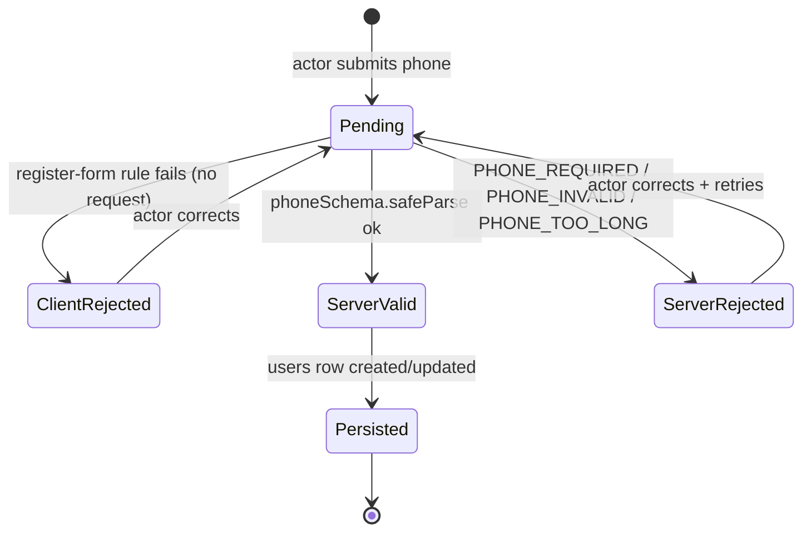

# Design — No Phone Input Component

> **Plan directory (verbatim):** `ai/plans/milestone_0_foundation/#229 — No Phone Input Component  -no_phone_input_component/`
> **GitHub issue:** #229 — "No Phone Input Component" ("Reusable Phone input component with validation at both frontend and backend, with shared Zod schema")
> **Milestone:** `milestone_0_foundation` (DERIVED — see §Milestone Derivation immediately below; the GitHub issue carries NO milestone label)
> **Specs of record:** `specs.md` (REQ-1..REQ-9) · **Siblings:** `tasks.md`, `outcome/`, `deferred-items.md`
> **Plan kind:** cross-layer foundation slice — one new shared Zod module, one new MUI input component, four frontend integration sites, one new backend validation helper, two backend service wirings, one i18n leaf, four test tiers. **Zero schema delta; zero GraphQL SDL delta (D7); zero new dependency (D3).**

## Milestone Derivation

The GitHub issue #229 carries **no milestone label**. `milestone_0_foundation` is **DERIVED** by the following reasoning, and this derivation is authoritative for all sibling artifacts (`specs.md`, `tasks.md`):

1. **Cross-layer shared infrastructure.** The deliverable is a *shared* Zod schema (`shared/lib/phone.ts`) consumed by BOTH `frontend/` and `backend/`. Milestone 1 (`milestone_1_core_domain_mvp`) and Milestone 2 (`milestone_2_matching_notifications_escrow`) both assume a working shared-validation substrate; this ticket *is* that substrate for phone.
2. **Foundation precedent.** `shared/lib/email.ts` (the direct analogy, `shared/lib/email.ts:9`) already lives in the foundation layer and was consumed by registration before any M1 domain slice. The phone schema is its structural peer.
3. **No domain ownership.** The ticket touches registration (`backend/services/auth/registration.service.ts`) and admin user-management (`backend/services/admin/user-management.helpers.ts`) — both foundation-level surfaces, not a single M1/M2 bounded context.
4. **Blocking posture.** `frontend/views/admin/users/dialogs/CreateUserDialog.tsx:23-27` documents the ABSENCE of country→dial-code data as a known gap; a canonical phone validator is the prerequisite primitive the future CountrySelector ticket (#230, explicitly out of scope, D10) composes.

Consequence: this plan lives under `ai/plans/milestone_0_foundation/`, and `specs.md` MUST carry a matching "Milestone Derivation" note.

## Document Information

| Field | Value |
|---|---|
| Version / Date | 1.0 · 2026-09-30 |
| Ground truth — schema | `backend/db/schema/users/users.ts:17` (`phone varchar(20)`, nullable) · `:22` (`country varchar(100)`) · `:44` (only constraint `unique("users_email_unique").on(t.email)`) |
| Ground truth — GraphQL inputs | `backend/graphql/pothos/shared/userFieldHelpers.ts:97-107` (`userRegistrationInputFields` → `phone: t.string({ required: true })`) · `backend/graphql/pothos/admin/admin-user.pothos.ts:326` (`phone: t.string({ required: false })`) · `backend/graphql/pothos/admin/admin-student-onboarding.pothos.ts:58-61` |
| Ground truth — services | `backend/services/auth/registration.service.ts:80` (`registerUser`) · `:134` (`createAdminUser`) · `:199-247` (`validateInput`, phone check `:213-215`) · `backend/services/admin/user-management.helpers.ts:30` (`MAX_PHONE_LENGTH = 20`) · `:147` (`validateCreateInput`, phone `:163-167`) · `:207` (`validateUpdatePatch`, phone `:217-218`) |
| Ground truth — errors | `backend/lib/errors.ts:65` (`ValidationError`; overloads `:78-120`) · `backend/types/errors/api-error.types.ts:55` (`ApiFieldErrorType = { readonly field; readonly code; readonly message }`) |
| Ground truth — i18n | `shared/locale/types/auth/index.ts:12` (`AuthLabels`) · `:36` (`phoneRequired`) · `:18` (`phone`) · `:35` (`emailInvalid`) · en `shared/locale/en/auth/index.ts:25` · ar `shared/locale/ar/auth/index.ts:25` · `shared/locale/types/errors/labels.ts:104` (`errors.validation`) · `shared/locale/namespaces/auth/auth.namespace.ts:4` (`Auth`) — **no `phoneInvalid` key exists anywhere** |
| Ground truth — frontend | register `frontend/views/auth/register/RegisterIdentityFields.tsx:69-85` · email analogy `:49-68` · values `registerFormUtils.ts:63-72` · whitelist `REGISTER_FIELD_PATHS` `:20-29` · admin create `frontend/views/admin/users/dialogs/CreateUserFormGrid.tsx:79-89` (`dir: ltr`) · admin edit `EditUserFormFields.tsx:63-75` · onboarding `OnboardStudentProfileSection.tsx:87-93` |
| Ground truth — zod | `package.json:116` `"zod": "^4.6.2"` (bun.lock resolves 4.6.2) · only **production** usage `backend/types/classes/admin-session-governance.types.ts:1` (docblock `:25-28`) consumed `backend/services/classes/session-admin-governance.ts:153`/`:247` (also a type-only import in `admin-session-governance.types.test.ts:14`) |
| Related docs | `docs/validation/phone-validation.md` (NEW — REQ-8.1) · `frontend/COMPONENT_PATTERNS.md:257` (stale PhoneInput mention) |

## 1. Overview, Design Goals & Key Design Decisions

### 1.1 Overview

Today phone is the **only** registration identity field with **no shape validation** on either side of the wire: the frontend rule is `required: t.phoneRequired` only (`frontend/views/auth/register/RegisterIdentityFields.tsx:69-85`), the backend check is a bare presence check emitting `PHONE_REQUIRED` (`backend/services/auth/registration.service.ts:213-215`), and the admin path enforces only `MAX_PHONE_LENGTH = 20` (`backend/services/admin/user-management.helpers.ts:30,163-167,217-218`). Any non-empty string ≤ 20 chars is accepted end-to-end; the DB column is `varchar(20)` with no format constraint (`backend/db/schema/users/users.ts:17`). Email, by contrast, has a shared predicate (`shared/lib/email.ts:9`), a client rule (`...:49-68`), and a dedicated `EMAIL_INVALID` code (`registration.service.ts:210-211`).

This design closes that gap with **one canonical, layer-neutral contract** for phone — a Zod schema plus two pure predicates in a NEW `shared/lib/phone.ts` — and propagates it to every phone surface through a reusable `PhoneInput` component (frontend) and one backend validation helper (backend). The schema is the single source of truth; the component renders; the helper produces localized `ApiFieldErrorType` entries. Strict E.164 (`+[1-9]\d{7,14}`) becomes the accepted format because it is the only internationally unambiguous, dial-code-independent shape available before the CountrySelector ticket (#230, D10) ships a code→format dataset.

### 1.2 Design Goals

1. **Single source of truth for phone shape** — exactly one regex/schema (`PHONE_E164_PATTERN` / `phoneSchema`) defines validity; frontend and backend both import it, so they can never drift.
2. **Client and server parity without a new dependency** — frontend uses the shared predicate inside RHF inline `validate` rules (the established pattern, `RegisterIdentityFields.tsx:52`); no `@hookform/resolvers` (D3).
3. **Reusable, validation-free input** — `PhoneInput` owns rendering/bidi/a11y only; validation stays in the caller's RHF rule and in the server (REQ-9.1).
4. **Localized, machine-coded errors** — one new `phoneInvalid` leaf; codes `PHONE_REQUIRED`/`PHONE_INVALID`/`PHONE_TOO_LONG` map to localized copy at the producer (REQ-5).
5. **Zero migration, zero build regeneration** — no DB column change, no GraphQL SDL change (phone stays `String` / `String!`), so no `generate:gqlSchema`/`codegen` step (D7).
6. **Legacy-safety** — the new strict rule applies to *new writes only*; existing rows are neither migrated nor backfilled (D10 → `deferred-items.md`).

### 1.3 Key Design Decisions

Each of D1–D10 is stated with **Context / Options Considered / Decision / Rationale**.

#### D1 — Plan directory & milestone

- **Context:** The issue has no milestone label; the work is shared cross-layer foundation infrastructure.
- **Options Considered:** (1) place under `milestone_1_core_domain_mvp`; (2) place under a new `milestone_0_foundation`; (3) leave unplaced at `ai/plans/`.
- **Decision:** `ai/plans/milestone_0_foundation/#229 — No Phone Input Component  -no_phone_input_component/`.
- **Rationale:** See §Milestone Derivation — the schema is consumed by both layers and blocks the future CountrySelector (#230); foundation placement matches the `shared/lib/email.ts` precedent. The literal directory name (including the double space and `#229) is used verbatim in every self-reference.

#### D2 — Shared Zod schema in NEW `shared/lib/phone.ts`

- **Context:** REQ-1 requires one E.164 schema + constants + two predicates. Zod 4.6.2 is already a dependency (`package.json:116`) but has **never** been used in `shared/` or `frontend/` — its only **production** usage is `backend/types/classes/admin-session-governance.types.ts:1` (plus a type-only import in `admin-session-governance.types.test.ts:14`).
- **Options Considered:** (1) predicate-only (mirror `shared/lib/email.ts`, no zod); (2) predicate + zod schema; (3) put the schema in `backend/types/` and duplicate a predicate in `shared/`.
- **Decision:** (2). `shared/lib/phone.ts` exports `PHONE_E164_PATTERN = /^\+[1-9]\d{7,14}$/`, `PHONE_MAX_LENGTH = 16`, `isValidPhone(value: string): boolean`, `normalizePhone(value: string): string`, and `phoneSchema = z.string().trim().min(1, { message: "PHONE_REQUIRED" }).max(PHONE_MAX_LENGTH, { message: "PHONE_TOO_LONG" }).regex(PHONE_E164_PATTERN, { message: "PHONE_INVALID" })`.
- **Rationale:** Zod has **no layer dependencies**, so importing it in `shared/` violates no ESLint rule (`shared/` may not import `@/frontend`, `@/backend`, `@/app`; zod is a bare package). A zod schema gives `safeParse`-based structured codes for free and is the shape the rest of the repo already validates with (`session-admin-governance.ts:153`). The `message` fields carry **MACHINE CODES** (`PHONE_REQUIRED`/`PHONE_TOO_LONG`/`PHONE_INVALID`), not user copy — the producer translates the code to localized text (documented convention; the schema itself is i18n-free so it stays layer-neutral). `PHONE_MAX_LENGTH = 16` is the exact E.164 wire ceiling (`+` + up to 15 digits), safe under the `varchar(20)` column.

#### D3 — No `@hookform/resolvers`; validate via shared predicate in inline rules

- **Context:** The register form uses RHF with **no resolver** (`frontend/views/auth/register/useRegisterFormState.ts:29-40`); email already validates via an inline `validate:` rule (`RegisterIdentityFields.tsx:52`).
- **Options Considered:** (1) add `@hookform/resolvers` + `zodResolver`; (2) call `isValidPhone` inside an inline RHF `validate` rule.
- **Decision:** (2).
- **Rationale:** The repo has **no** `@hookform/resolvers` dependency and REQ/D3 forbids adding one. The inline-rule pattern is already established for email and keeps the shared predicate as the single source of truth. Introducing a resolver would be an unrequested new dependency and would change RHF wiring across the form (blast radius). Consequence: `PHONE_E164_PATTERN`/`isValidPhone` are the frontend contract; the zod `phoneSchema` is the backend contract — both derive from the same constants, so parity holds.

#### D4 — Reusable component NEW `frontend/components/ui/PhoneInput.tsx`

- **Context:** REQ-2 asks for a reusable phone input. A reusable field precedent exists (`frontend/components/AuthFormShared.tsx:77-153` `PasswordField`) and a flat-file UI-module precedent (`frontend/components/ui/fieldError.ts`, `focusRing.ts`).
- **Options Considered:** (1) inline `TextField` at each site (status quo); (2) a flat `frontend/components/ui/PhoneInput.tsx` with `forwardRef`; (3) extend `AuthFormShared.tsx`.
- **Decision:** (2). `React.forwardRef<HTMLInputElement, PhoneInputProps>`, explicit `Readonly<PhoneInputProps>`: `label?, value?, onChange?, onBlur?, name?, required?, fullWidth?, error?, helperText?, autoComplete? ("tel"), disabled?, id?, startAdornment?, "aria-invalid"?, inputRef?` (refs land on MUI `TextField`'s top-level `inputRef`, not `slotProps.input`).
- **Rationale:** A flat file matches the `fieldError.ts`/`focusRing.ts` convention (no barrel for UI utilities). `forwardRef` is required for RHF `register()` ref forwarding; the prop surface supports BOTH `{...register("phone")}` spread and controlled usage. Renders MUI `TextField` `type="tel"`, `inputMode="tel"`, `slotProps={{ htmlInput: { dir: "ltr" } }}` for bidi safety (admin create site already pins `dir: ltr` at `CreateUserFormGrid.tsx:79-89`), `helperText ?? " "` with `aria-live="polite"` (matching `RegisterIdentityFields.tsx:46`), and `aria-invalid` wiring. **No validation logic inside** (REQ-9.1). Story at `frontend/stories/ui/PhoneInput.stories.tsx` (`title: "Form/PhoneInput"`).

#### D5 — Backend validation helper NEW `backend/services/shared/phone-validation.helpers.ts`

- **Context:** Phone checks are duplicated across `registration.service.ts:213-215` and `user-management.helpers.ts:163-167,217-218` with divergent behavior (registration: presence only; admin create: presence + length; admin update: length only).
- **Options Considered:** (1) edit each call site with inline `isValidPhone` checks; (2) one shared backend helper built on `phoneSchema`.
- **Decision:** (2). Export `validatePhoneField(value: string, locale: string): ApiFieldErrorType | null`, built on `phoneSchema.safeParse`; maps the machine code → localized message; returns `null` when valid.
- **Rationale:** One helper keeps codes/messages consistent and centralizes the code→copy mapping (REQ-5.2). Wiring **replaces** `registration.service.ts:213-215`, `user-management.helpers.ts:163-167`, and `:217-218` — collapsing three divergent checks onto one contract. `PHONE_TOO_LONG` keeps the generic `errors.validation` message (admin precedent, `user-management.helpers.ts:163-167`); `PHONE_INVALID` uses the new `auth.phoneInvalid`; `PHONE_REQUIRED` keeps `auth.phoneRequired`.

#### D6 — i18n: one new `phoneInvalid` leaf in `AuthLabels` (en + ar)

- **Context:** `AuthLabels` (`shared/locale/types/auth/index.ts:12`) has `phoneRequired` (`:36`) but **no** `phoneInvalid`; `errors.validation` exists (`shared/locale/types/errors/labels.ts:104`).
- **Options Considered:** (1) reuse `errors.validation` for the invalid case; (2) add a dedicated `phoneInvalid` leaf; (3) add a whole new namespace.
- **Decision:** (2). Add `phoneInvalid: string` to `AuthLabels` + en (`shared/locale/en/auth/index.ts`) + ar (`shared/locale/ar/auth/index.ts`). en `"Please enter a valid phone number."`; ar `"يرجى إدخال رقم هاتف صحيح."`.
- **Rationale:** REQ-5.1 asks for a specific, actionable phone-format message (the email precedent is `emailInvalid` at `:35`, surfaced client-side). The generic `errors.validation` ("validation") is unhelpful for a shape error. No new namespace — `Auth` (`shared/locale/namespaces/auth/auth.namespace.ts:4`) already carries all register/admin-facing auth copy.

#### D7 — No GraphQL SDL change; no schema regen / codegen

- **Context:** Phone is exposed as `String!` on the inputs (`userFieldHelpers.ts:97-107`) and nullable `String` on read (`user.pothos.ts:37`), and as `phone: t.string({ required: false })` on admin update (`admin-user.pothos.ts:326`).
- **Options Considered:** (1) introduce a scalar/refined input type for phone; (2) keep `String`/`String!` and validate in services.
- **Decision:** (2). **Phone stays `String` / `String!`.**
- **Rationale:** Validation belongs in the service layer (REQ-9.1); a GraphQL scalar change would force `bun run generate:gqlSchema` + `bun codegen`, regenerate `frontend/graphql/generated/`, and risk cache-normalization churn — all for zero behavioral gain. Explicitly: **this ticket requires NO schema regeneration and NO codegen run.** The wire contract is byte-identical; only service-level acceptance tightens (a strict-E.164 behavior change, see §13).

#### D8 — Frontend integration swaps the raw `TextField` for `PhoneInput`

- **Context:** Four phone sites exist: register (`RegisterIdentityFields.tsx:69-85`), admin create (`CreateUserFormGrid.tsx:79-89`), admin edit (`EditUserFormFields.tsx:63-75`), onboarding (`OnboardStudentProfileSection.tsx:87-93`).
- **Options Considered:** (1) leave sites untouched and only ship the component; (2) swap all four and add the client `validate` rule at register.
- **Decision:** (2). Register form swaps to `PhoneInput` and adds `validate: v => (isValidPhone(v) ? true : t.phoneInvalid)` (mirroring the email rule at `:52`); the three admin sites swap to `PhoneInput`. `REGISTER_FIELD_PATHS` keeps `"phone"` (`registerFormUtils.ts:20-29`) and the server-error projection (`useRegisterSubmit.ts:48,66-79`) is unchanged.
- **Rationale:** Leaves no phone surface on the old raw `TextField`, guaranteeing bidi/a11y consistency (REQ-2/REQ-3). Keeping the RHF field path `"phone"` means the server error projection (`projectMutationFieldErrors`/`applyProjectedFieldErrors`, `frontend/lib/mutationFieldErrors.ts:125,147`) and `TextField` error contract (`frontend/components/ui/fieldError.ts:80`) continue to work with zero change.

#### D9 — Tests: four tiers (shared 4-tier, backend service, GraphQL wire, workflow journey)

- **Context:** `shared/lib/email.test.ts` is a 4-tier bun:test file (branch/boundary/hostile/property); services run via `bun run test:services`; GraphQL wire tests use `testClient` + `setupTestServerLifecycle`; workflow journeys live in `test/workflows/`.
- **Options Considered:** (1) shared tests only; (2) all four tiers.
- **Decision:** (2). `shared/lib/phone.test.ts` (REQ-6.1), backend service tests colocated under `backend/services/**/*.test.ts` (REQ-6.2), GraphQL wire test `frontend/graphql/test/auth/` asserting a `PHONE_INVALID` field error (REQ-6.3), workflow journey `test/workflows/auth/registration-phone.journey.test.ts` (REQ-6.4).
- **Rationale:** Matches repo tiers. **No frontend render test** — the repo has **no render tier** (UI is E2E-only; documented at `frontend/components/ui/fieldError.test.ts:2-13` and confirmed by the absence of a `test/ui` component tier — `test/ui/` is E2E-only). The journey uses **real services + real DB** with a tracked `afterAll` cleanup and **NO** `runInRollback` (journey tests exercise real commits).

#### D10 — Out of scope (→ `deferred-items.md`)

- **Context:** Several adjacent capabilities were considered and deferred.
- **Decision:** Out of scope: **CountrySelector (#230)**; a country→dial-code dataset (documented absent at `CreateUserDialog.tsx:23-27`); E.164 auto-formatting/masking UI; `libphonenumber`; any DB column change; **legacy phone backfill/migration**.
- **Rationale:** Each expands the blast radius beyond the ticket ("reusable component + shared validation"). Deferring the backfill is critical because existing rows may hold non-E.164 values; tightening validation must never block reads of legacy data (§13).

## 2. Data Models

### 2.1 Shared schema module contract — NEW `shared/lib/phone.ts`

```typescript
import { z } from "zod";                              // bare package — no layer deps (D2; `package.json:116`)

/** Strict E.164: leading `+`, non-zero country digit, 8–15 total digits. */
export const PHONE_E164_PATTERN: RegExp = /^\+[1-9]\d{7,14}$/;

/** E.164 wire ceiling (`+` + up to 15 digits) — safely under the varchar(20) column. */
export const PHONE_MAX_LENGTH: number = 16;

/** True when `value` is a valid E.164 string (after no normalization). Pure. */
export function isValidPhone(value: string): boolean;

/** Trim + strip spaces/dashes/parens; keep a single leading `+`. Pure. */
export function normalizePhone(value: string): string;

/**
 * Canonical shape contract. `message` carries a MACHINE CODE
 * (`PHONE_REQUIRED` | `PHONE_TOO_LONG` | `PHONE_INVALID`) — NOT user copy.
 * Producers translate the code to localized text (backend: `auth.phone*`);
 * the schema stays i18n-free so it remains layer-neutral.
 */
export const phoneSchema = z
  .string()
  .trim()
  .min(1, { message: "PHONE_REQUIRED" })
  .max(PHONE_MAX_LENGTH, { message: "PHONE_TOO_LONG" })
  .regex(PHONE_E164_PATTERN, { message: "PHONE_INVALID" });
```

**Contract notes**
- **No barrel:** `shared/lib/` has NO `index.ts` (`shared/lib/email.ts` is imported deeply); consumers import `@/shared/lib/phone` directly.
- **Purity:** all four exports are pure/stateless (no I/O, no clock, no module-level mutable state) — the basis for the §6 no-concurrency-risk finding.
- **Predicate/schema parity:** `isValidPhone` accepts exactly the strings `phoneSchema` accepts at the regex step; `normalizePhone` is a precondition helper a caller MAY apply before either check (the register flow does not auto-normalize — D10).

### 2.2 Drizzle `users` column — UNCHANGED (`backend/db/schema/users/users.ts`)

```typescript
export const users = pgTable("users", {
  // ...
  phone: varchar("phone", { length: 20 }),                    // :17 — nullable, no format constraint
  country: varchar("country", { length: 100 }),               // :22 — nullable
  // ...
}, t => [
  unique("users_email_unique").on(t.email),                   // :44 — the ONLY unique constraint
]);
```

**No schema change.** The column stays `varchar(20)` nullable with no CHECK constraint. `PHONE_MAX_LENGTH = 16` is enforced in the application layer only (REQ-9.1). No unique index is added on phone (the issue does not request one; existing duplicates, if any, are left untouched — D10).

### 2.3 GraphQL input/output types — UNCHANGED (D7)

```graphql
# Inputs — phone stays `String!` (registration family, shared by RegisterUserInput + AdminCreateUserInput)
input RegisterUserInput { phone: String!  # ... }
input AdminCreateUserInput { phone: String!  # ... }
input AdminUpdateUserInput { phone: String  # backend/graphql/pothos/admin/admin-user.pothos.ts:326 (optional) }
# Onboarding input (admin-student-onboarding.pothos.ts:58-61) — phone as already declared

# Output — nullable read exposure (backend/graphql/pothos/users/user.pothos.ts:37)
type User { phone: String  # ... }
```

No SDL regeneration, no codegen (D7). Pothos sources remain byte-identical: `userFieldHelpers.ts:97-107`, `admin-user.pothos.ts:326`, `admin-student-onboarding.pothos.ts:58-61`, `user.pothos.ts:37`.

## 3. API Contracts

### 3.1 Operations touched (GraphQL — code-first Pothos; no `.graphql` SDL files under `backend/`)

| Operation | Kind | Source | Phone impact |
|---|---|---|---|
| `registerUser` | Mutation | `backend/graphql/mutation/auth/*` (Pothos) → `RegistrationService.registerUser` (`registration.service.ts:80`) | input `phone: String!` — service validation tightens to E.164 (D5/REQ-4.2) |
| `adminCreateUser` | Mutation | admin Pothos → `UserManagementService.createUser` (`user-management.service.ts:261`) | input `phone: String!` — service validation tightens (REQ-4.3) |
| `adminUpdateUser` | Mutation | admin Pothos → `UserManagementService.updateUser` (`user-management.service.ts:331`) | input `phone: String` (optional) — length-only → E.164-when-present (REQ-4.3) |
| `adminOnboardStudentWithOfflinePayment` | Mutation | onboarding Pothos → `StudentOnboardingService` (`student-onboarding.service.ts:293`) | **no code change** — delegates to `createUser` at `:322`, inheriting validation (REQ-4.4) |

### 3.2 SDL excerpt (UNCHANGED — D7)

```graphql
extend type Mutation {
  registerUser(input: RegisterUserInput!): AuthPayload!          # phone: String! — unchanged
  adminCreateUser(input: AdminCreateUserInput!): User!           # phone: String! — unchanged
  adminUpdateUser(id: Int!, patch: AdminUpdateUserInput!): User! # phone: String  — unchanged
  adminOnboardStudentWithOfflinePayment(input: AdminOnboardStudentInput!): OnboardResult!  # unchanged
}
```

> **D7 — explicit no-change ruling.** No scalar, input type, or field is added/changed/removed. `phone` remains `String` / `String!`. **No `bun run generate:gqlSchema`; no `bun codegen`.** The generated schema (`frontend/graphql/generated/schema.graphql`) and generated TypeScript types are untouched. The only observable change is *which non-empty strings the service accepts*.

### 3.3 Permission matrix (rows = operations; columns = actors; cell = allow/deny + guard)

| Operation | Guest (unauth) | Admin | Student | Teacher | Parent |
|---|---|---|---|---|---|
| `registerUser` | ✅ **allow** (public registration) | ✅ allow | ✅ allow | ✅ allow | ✅ allow |
| `adminCreateUser` | ❌ 401 | ✅ allow | ❌ 403 | ❌ 403 | ❌ 403 |
| `adminUpdateUser` | ❌ 401 | ✅ allow | ❌ 403 | ❌ 403 | ❌ 403 |
| `adminOnboardStudentWithOfflinePayment` | ❌ 401 | ✅ allow | ❌ 403 | ❌ 403 | ❌ 403 |

**Guard source:** admin mutations use `adminOnlyAuthScopes` = `{ $all: { authenticated: true, role: [UserRole.Admin] } }` (`backend/graphql/shared/admin-prelude.ts:24`). The `$all` conjunction is load-bearing: anonymous → 401 (the `authenticated` scope throws before any DB read), non-admin → 403. `registerUser` intentionally has no role scope (a Guest must register). **This ticket changes no guard** — the matrix is recorded to bound the blast radius (validation is inside the already-guarded resolvers).

### 3.4 Request / response shape (registerUser — representative)

**Request (unchanged wire):**
```graphql
mutation Register($input: RegisterUserInput!) {
  registerUser(input: $input) { user { id phone } token }
}
```

**Response on invalid phone (field-error payload):** a `ValidationError` carrying `entries: ApiFieldErrorType[]` (`backend/types/errors/api-error.types.ts:55`), one entry `{ field: "phone", code: "PHONE_INVALID", message: <localized> }`. The frontend projects it onto the `phone` RHF path via `projectMutationFieldErrors` (`frontend/lib/mutationFieldErrors.ts:125`). See §8 for the full code→message table.

## 4. Service & Component Signatures (EXACT)

### 4.1 NEW — `shared/lib/phone.ts`

```typescript
export const PHONE_E164_PATTERN: RegExp;
export const PHONE_MAX_LENGTH: number;                 // 16
export function isValidPhone(value: string): boolean;
export function normalizePhone(value: string): string;
export const phoneSchema: z.ZodString;                 // the refined chain in §2.1
```

### 4.2 NEW — `frontend/components/ui/PhoneInput.tsx`

```typescript
import { forwardRef } from "react";
import TextField from "@mui/material/TextField";

export interface PhoneInputProps {
  readonly label?: string;                // OPTIONAL — admin sites render an external AdminDialogFieldLabel
  readonly value?: string;
  readonly onChange?: React.ChangeEventHandler<HTMLInputElement | HTMLTextAreaElement>;
  readonly onBlur?: React.FocusEventHandler<HTMLInputElement | HTMLTextAreaElement>;
  readonly name?: string;
  readonly required?: boolean;
  readonly fullWidth?: boolean;
  readonly error?: boolean;
  readonly helperText?: React.ReactNode;
  readonly autoComplete?: string;      // default "tel"
  readonly disabled?: boolean;
  readonly id?: string;
  readonly startAdornment?: React.ReactNode;   // register site passes a PhoneIcon (RegisterIdentityFields.tsx:79-82)
  readonly "aria-invalid"?: boolean | "false" | "true" | "grammar" | "spelling";
  readonly inputRef?: React.Ref<HTMLInputElement>;
}

export const PhoneInput = forwardRef<HTMLInputElement, PhoneInputProps>(
  function PhoneInput(props, ref) {
    // Renders MUI <TextField type="tel" inputMode="tel"
    //   slotProps={{ htmlInput: { dir: "ltr" }, formHelperText: { "aria-live": "polite" } }}
    //   helperText={props.helperText ?? " "} error={props.error}
    //   aria-invalid={props["aria-invalid"]} ref={ref} {...} />
    // Refs land on MUI TextField's top-level `inputRef` (NOT slotProps.input).
    // NO validation logic — rendering only (REQ-9.1).
  }
);
```

- **Supports both usages:** `{...register("phone")}` (name/onChange/onBlur/ref) and controlled (`value`/`onChange`).
- **`label` is OPTIONAL** — the admin create/edit sites render a sibling `AdminDialogFieldLabel`, so `PhoneInput` must not force a label.
- **`startAdornment`** preserves the `PhoneIcon` adornment currently passed at `RegisterIdentityFields.tsx:79-82`.
- **Refs** are forwarded to MUI `TextField`'s top-level `inputRef` (the `forwardRef` ref is wired to it) — `slotProps.input` is not used for refs.
- `inputRef` is provided for callers that already own an explicit ref alongside the `forwardRef` ref.
- Consumers: `frontend/stories/ui/PhoneInput.stories.tsx` (`title: "Form/PhoneInput"`), RegisterIdentityFields, CreateUserFormGrid, EditUserFormFields, OnboardStudentProfileSection.

### 4.3 NEW — `backend/services/shared/phone-validation.helpers.ts`

```typescript
import type { ApiFieldErrorType } from "@/backend/types/errors/api-error.types"; // :55

/**
 * Validate one phone value against the shared schema and map the schema's
 * machine code to a localized message. Returns `null` when valid.
 * Pure (no I/O) — reads only the passed `locale`.
 */
export function validatePhoneField(
  value: string,
  locale: string
): ApiFieldErrorType | null {
  // parsed = phoneSchema.safeParse(value)  (shared/lib/phone)
  // if (parsed.success) return null;
  // code = parsed.error.issues[0].message            // "PHONE_REQUIRED" | "PHONE_TOO_LONG" | "PHONE_INVALID"
  // t    = getServerTranslations(locale).authTranslations
  //   PHONE_REQUIRED → message: t.phoneRequired
  //   PHONE_INVALID  → message: t.phoneInvalid       (NEW leaf, D6)
  //   PHONE_TOO_LONG → message: getServerTranslations(locale).errorsTranslations.validation
  // return { field: "phone", code, message };
}
```

- `field` is the constant `"phone"`; **never** an echo of `value` (REQ-9.2/REQ-9.3 — no raw input in the payload).
- Imports `getServerTranslations` from `@/shared/locale/server-graphql` (single-arg, property access).

### 4.4 MODIFIED — `backend/services/auth/registration.service.ts`

```typescript
// EXISTING signature (unchanged): :80
registerUser(input: RegistrationSubmitInput, locale: string, outerTx?: DBTransaction): Promise<...>
// EXISTING internal (unchanged signature): :199
function validateInput(input: RegistrationSubmitInput, locale: string): void
```

**Change (inside `validateInput`):** replace the presence-only block at `:213-215`

```typescript
// BEFORE (:213-215)
if (!input.phone || input.phone.trim().length === 0) {
  entries.push({ field: "phone", code: "PHONE_REQUIRED", message: t.phoneRequired });
}

// AFTER
const phoneError = validatePhoneField(input.phone ?? "", locale);
if (phoneError) entries.push(phoneError);
```

The final `throw new ValidationError(entries[0].message, entries)` (`:244-246`) is UNCHANGED. Signature, ordering of entries, and the `t`/`tErrors` bindings are unchanged.

### 4.5 MODIFIED — `backend/services/admin/user-management.helpers.ts`

```typescript
// EXISTING — :30 (private, non-exported const, referenced only in-file at :165 and :217)
const MAX_PHONE_LENGTH: number = 20;   // superseded at phone sites by PHONE_MAX_LENGTH

// EXISTING signatures (unchanged): :147
export function validateCreateInput(input: AdminCreateUserSubmitInput, locale: string): void
// EXISTING signatures (unchanged): :207
export function validateUpdatePatch(patch: AdminUserUpdateDbPatch, locale: string): void
```

**Change 1 — `validateCreateInput` (replace phone block `:163-167`):**

```typescript
// BEFORE (:163-167): presence → PHONE_REQUIRED (tErrors.validation); length > 20 → PHONE_TOO_LONG (tErrors.validation)
// AFTER:
const phoneError = validatePhoneField(input.phone ?? "", locale);
if (phoneError) entries.push(phoneError);
```

**Change 2 — `validateUpdatePatch` (replace phone block `:217-218`):**

```typescript
// BEFORE (:217-218): length-only check — a present-but-invalid phone passed
// AFTER — guard mirrors :217 (`typeof patch.phone === "string"`); validate ONLY when non-empty
// (an empty string still CLEARS the phone — it is not re-validated):
if (typeof patch.phone === "string" && patch.phone.length > 0) {
  const phoneError = validatePhoneField(patch.phone, locale);
  if (phoneError) entries.push(phoneError);
}
```

- `MAX_PHONE_LENGTH` is a private, non-exported const referenced only in-file (`:165`, `:217`); after the wiring it becomes unused in the phone blocks and knip (`bun run check:unused`) will flag it — remove it in the same change (do NOT add disable comments).
- Both functions' signatures and their `entries`-throw tail are unchanged; only the phone `entries` source changes (REQ-4.3).
- `validatePhoneField` is imported from `@/backend/services/shared` (exported through the live `backend/services/shared/index.ts` barrel — add `export * from "./phone-validation.helpers"` there; C6).

### 4.6 UNCHANGED — onboarding inherits (REQ-4.4, verified)

`backend/services/admin/student-onboarding.service.ts:293` → delegates to `UserManagementService.createUser` at `:322`. Because `createUser` calls `validateCreateInput` (§4.5, Change 1), onboarding **inherits** the stricter phone validation with **no code change**. This is verified by the journey/wire tests (§10/REQ-6.4), not by editing the onboarding file.

## 5. Concurrency & Race Condition Assessment

**Finding: there is NO concurrency risk in this ticket.** Validation is pure, stateless, and per-request; no shared mutable state, no counters, no read-then-write sequence, no optimistic-locking surface is introduced or touched.

| Concern (from the conditional checklist) | Present? | Why / mitigation |
|---|---|---|
| Shared mutable state (counters, balances, quotas) | **No** | §4.1 exports are pure functions + frozen constants; `phoneSchema` is immutable. |
| Multiple concurrent actors modifying the same record | **No (new)** | This ticket adds no write path; it only changes *whether an existing write path proceeds*. Two concurrent registrations cannot collide via phone (no unique index — §2.2). |
| Optimistic locking / version fields | **No** | No version column is read or written. |
| Transaction-isolation-dependent correctness | **No** | `validatePhoneField` runs entirely in memory **before** any `withTransaction` boundary; its result never depends on concurrent commits. |
| TOCTOU (read-then-write) | **No** | There is no read-then-write: validation consumes only the in-request argument, then throws or returns before the insert/update. |
| `SELECT FOR UPDATE` / row locks needed | **No** | No repository method is added or modified. |

**Mechanism:** strict E.164 validation is a deterministic predicate on the request payload alone. The same payload produces the same verdict regardless of any other in-flight transaction, so no locking, ordering, or idempotency key is warranted. The existing guarded predicates on the touched write paths (e.g. `createUser`/`updateUser`) are unchanged and continue to own any real concurrency discipline.

## 6. Cross-Actor Journey Design (the assertion set for REQ-6.4)

### 6.1 Shared-Entity State Flow — phone validation on the registration/creation journey

The "entity" here is the **submitted phone value** as it flows across actors; the persisted state is the `users` row create/update outcome.

| Step | Actor | Action | Validation state | Next |
|---|---|---|---|---|
| 1 | Guest / Admin | types + submits a phone value | `PENDING` (client rule may pre-flag) | submit |
| 2 | System | client-side `validate` (register only) | valid → proceed; invalid → `CLIENT_REJECTED` (no request) | if client passes |
| 3 | System | server `validatePhoneField` | `SERVER_VALID` \| `SERVER_REJECTED` (field error) | terminal either way |
| 4 | System | `createUser` / `registerUser` DB write | on `SERVER_VALID` only | `PERSISTED` |
| 5 | Guest / Admin | reads projected error | `SERVER_REJECTED` → inline `phone` error | correct + retry |



### 6.2 Side-Effect Matrix (validation outcome → effects)

| Validation outcome | Rows created/updated | Field-error payload | Notifications | Idempotency |
|---|---|---|---|---|
| `SERVER_VALID` (register) | `users` INSERT (phone as submitted) | none | existing registration flows (unchanged) | n/a (existing) |
| `SERVER_VALID` (admin create / onboarding) | `users` INSERT | none | existing admin flows (unchanged) | n/a (existing) |
| `SERVER_VALID` (admin update) | `users` UPDATE (only provided columns) | none | none | n/a (existing) |
| `PHONE_REQUIRED` | **none** | `{ field:"phone", code:"PHONE_REQUIRED", message: t.phoneRequired }` | none | n/a (rejected pre-write) |
| `PHONE_INVALID` | **none** | `{ field:"phone", code:"PHONE_INVALID", message: t.phoneInvalid }` | none | n/a |
| `PHONE_TOO_LONG` | **none** | `{ field:"phone", code:"PHONE_TOO_LONG", message: errors.validation }` | none | n/a |

**No notifications are introduced or altered** — this ticket emits none. Rejection occurs *before* any write, so the side-effect matrix has no partial-write branch.

### 6.3 Cross-Actor Visibility

| Observer | On `SERVER_REJECTED` | On `SERVER_VALID` |
|---|---|---|
| **Guest (registrant)** | inline error under the phone field ("Please enter a valid phone number." / Arabic), focusing is unchanged (RHF helper is the live region, `RegisterIdentityFields.tsx:46`) | registration proceeds; no phone-format feedback shown |
| **Admin (create/edit/onboarding)** | inline error under the phone field in the dialog/section; the create/edit dialog remains open | row written; dialog closes (existing behavior) |
| **Registrant roles (Student/Teacher/Parent)** | N/A — they are the Guest during registration; post-registration they do not re-submit phone via these surfaces | their stored phone is readable (unchanged) |
| **System/Backend** | logs domain rejection via `logger.logDomainError` (ValidationError path) — no raw input echoed (REQ-9.3) | normal write logging (unchanged) |

The error is visible **only to the submitting actor** — it is a per-request field error, never a shared/global state, and it is never broadcast to other roles.

## 7. UX / Navigation Specification

### 7.1 New Routes & URLs — **NONE**

| Route | Purpose | Permission | Roles |
|---|---|---|---|
| — (NONE) | — | — | — |

**Explicit: no new `app/` route, page, layout, or middleware change.** The phone input is rendered inside existing screens.

### 7.2 Sidebar / Navigation Integration — **UNTouched**

- `frontend/views/dashboard/nav/navItems.ts` — **untouched**.
- Mobile bottom nav — **N/A** (the repo has no bottom-nav surface; consistent with sibling plans).

### 7.3 Exact component usage sites (REQ-3)

| # | File | Current | After | REQ |
|---|---|---|---|---|
| 1 | `frontend/views/auth/register/RegisterIdentityFields.tsx:69-85` | raw `TextField` `type="tel"` + `required: t.phoneRequired`; `PhoneIcon` `startAdornment` (`:79-82`) | `<PhoneInput {...register("phone", { required: t.phoneRequired, validate: v => isValidPhone(v) ? true : t.phoneInvalid })} startAdornment={<PhoneIcon … />} … />` — RHF mode; `t` from `useAppTranslation(Auth)` (namespace **handle**, C9); the `PhoneIcon` adornment is preserved via `startAdornment`; message from `Auth.phoneInvalid` | REQ-3.1 |
| 2 | `frontend/views/admin/users/dialogs/CreateUserFormGrid.tsx:79-89` | raw `TextField` (`dir: ltr`) | **controlled mode — NO RHF.** The dialog uses `form`/`setForm`/`fieldErrors` state (no `useForm`/`register`/`validate`): `<PhoneInput value={form.phone} onChange={…} error={…} helperText={…} … />`; `error` computed from the shared `isValidPhone` predicate on change/blur; the server `fieldErrors.phone` projection stays authoritative; `label` omitted (site renders an external `AdminDialogFieldLabel`); message from `AdminUsers.createDialog.phoneInvalid` | REQ-3.2 |
| 3 | `frontend/views/admin/users/dialogs/EditUserFormFields.tsx:63-75` | raw `TextField` | **controlled mode — NO RHF**, same integration as row 2 (`form`/`setForm`/`fieldErrors`; `error` from `isValidPhone`; server projection authoritative); message from `AdminUsers.editDialog.phoneInvalid` | REQ-3.3 |
| 4 | `frontend/views/admin/students/onboarding/OnboardStudentProfileSection.tsx` (data array `:87-93`; render loop `:110-127`) | raw `TextField` rendered via `identityFields.map(...)` | **BRANCH INSIDE `identityFields.map(...)` (`:110-127`)** on `field.errorKey === "phone"` → render `<PhoneInput>` (controlled; `error` from `isValidPhone`), else the existing `TextField`; do **NOT** replace `:87-93` (that is the data array, not the render); message from `StudentOnboarding.fields.phoneInvalid` | REQ-3.4 |

**Preserved invariants:** RHF field path stays `"phone"` at register (`REGISTER_FIELD_PATHS` `registerFormUtils.ts:20-29`); values (`:63-72`) and the server-error projection (`useRegisterSubmit.ts:48,66-79` + `projectMutationFieldErrors`) are unchanged — the shared error contract (`frontend/components/ui/fieldError.ts:80`) still maps a `phone` entry onto the field. The three admin/onboarding surfaces are **controlled** (not RHF): `error`/`helperText` derive from `isValidPhone` + the server `fieldErrors.phone`, never an RHF `validate` rule. Per-surface i18n namespace: register → `Auth`, admin create/edit → `AdminUsers`, onboarding → `StudentOnboarding` (C1/C2/C3).

### 7.4 Per-Audience Rendering

| Audience | Surface | Difference |
|---|---|---|
| Guest | `/register` | phone input with client-side E.164 `validate` rule + inline localized error |
| Admin | Create User dialog, Edit User dialog, Onboard Student section | controlled `PhoneInput` (`value`/`onChange`; `error` from `isValidPhone` + the server `fieldErrors.phone`); no RHF rule — the server is the trust boundary; the component renders identically |
| Student / Teacher / Parent | — | **no phone input surface** (read-only exposure of their own stored phone only) |

### 7.5 RTL / LTR & bidi handling

- Phone is a left-to-right, dial-code-prefixed string; the component forces `slotProps={{ htmlInput: { dir: "ltr" } }}` so the `+` prefix renders correctly under an RTL (`ar`) UI. This centralizes the `dir: ltr` hack currently inlined at `CreateUserFormGrid.tsx:79-89`.
- The **label** and **helper text** stay in the ambient locale direction (Arabic label, LTR value) — standard bidi-safe field behavior.

### 7.6 Mobile / Desktop

- No layout change: the component is a `fullWidth` MUI `TextField` by default at desktop and inherits responsive container widths, matching the replaced raw fields. `inputMode="tel"` triggers the numeric/phone keypad on mobile.

### 7.7 Accessibility

- `type="tel"` + `inputMode="tel"` (correct semantic + keypad).
- `helperText ?? " "` reserves the error line (no layout shift), and `slotProps.formHelperText` carries `aria-live="polite"` so screen readers announce the error without moving focus (matching `RegisterIdentityFields.tsx:46`).
- `aria-invalid` is wired through from the RHF `errors.phone` boolean (REQ-2.3).

### 7.8 Permission mapping

| Component / Site | Required permission (API guard) | Source |
|---|---|---|
| `PhoneInput` (register) | none (public registration) | `registerUser` has no role scope |
| `PhoneInput` (admin create/edit) | `ADMIN` role | `adminOnlyAuthScopes` (`admin-prelude.ts:24`) on `adminCreateUser` / `adminUpdateUser` |
| `PhoneInput` (onboarding) | `ADMIN` role | `adminOnlyAuthScopes` on `adminOnboardStudentWithOfflinePayment` |

**The component itself carries no permission logic** — authorization stays at the resolver (`authScopes`). The mapping is recorded to show every usage site sits behind an appropriate guard on the server.

## 8. Error Handling

### 8.1 Code → message → transport mapping

| Machine code | Trigger | Localized message | i18n source | Payload shape |
|---|---|---|---|---|
| `PHONE_REQUIRED` | absent/empty | `t.phoneRequired` — en "Phone number is required." (`shared/locale/en/auth/index.ts:25`) / ar "رقم الهاتف مطلوب." (`ar/…:25`) | `AuthLabels.phoneRequired` (`types/auth/index.ts:36`) | `ApiFieldErrorType` |
| `PHONE_INVALID` | present but not E.164 | `t.phoneInvalid` — en "Please enter a valid phone number." / ar "يرجى إدخال رقم هاتف صحيح." | **NEW** `AuthLabels.phoneInvalid` (D6) | `ApiFieldErrorType` |
| `PHONE_TOO_LONG` | length > 16 | `errors.validation` (`shared/locale/types/errors/labels.ts:104`) | errors namespace | `ApiFieldErrorType` |

Each maps to `ApiFieldErrorType = { readonly field: "phone"; readonly code; readonly message }` (`backend/types/errors/api-error.types.ts:55`). The `message` is fully localized **at the producer** (the service), per the established contract — the client never translates server errors.

### 8.2 Throw shape and client projection

- Backend: entries accumulate into `entries: ApiFieldErrorType[]`; the terminal throw is `new ValidationError(entries[0].message, entries)` (`registration.service.ts:244-246`; `ValidationError` at `backend/lib/errors.ts:65`, overloads `:78-120`). `code` stays as the per-entry machine code.
- Frontend: the error travels as a GraphQL error; `projectMutationFieldErrors` (`frontend/lib/mutationFieldErrors.ts:125`) turns entries into RHF errors, applied via `applyProjectedFieldErrors` (`:147`) → `setError("phone", …)`. The pure projection (`frontend/components/ui/fieldError.ts:80`) maps the `phone` field onto `TextField` error props.
- Client-side twin: the register rule `validate: v => (isValidPhone(v) ? true : t.phoneInvalid)` surfaces the same `PhoneInput` inline error **before** the request; the server re-checks regardless (REQ-9.1).

### 8.3 Logging

Domain rejections flow through `logger.logDomainError` (the `ValidationError` path) — logged as `debug` under `TEST_SERVER=1`, `warn` in production. **No raw phone value is logged** (REQ-9.3); only the field name + code.

## 9. Security & Tenancy Mitigations (REQ-9)

### 9.1 REQ-9.1 — Server is the trust boundary

- The client `validate` rule is **UX only**; it is trivially bypassable (transport tamper). Every write path re-validates server-side via `validatePhoneField` (`registration.service.ts`, `user-management.helpers.ts`). The component contains **no** validation logic (D4) so there is no false impression of client-enforced integrity.
- Guard proof: the admin write paths sit behind `adminOnlyAuthScopes` (`admin-prelude.ts:24`); `registerUser` is public but its input is fully re-validated in `validateInput` before the `users` INSERT.

### 9.2 REQ-9.2 — No input spread into DB updates (BOPLA)

- `validateUpdatePatch` validates `patch.phone` **only when the key is present** (§4.5) and the update path writes explicit columns — never `{ ...patch }` (the existing discipline; unchanged). Validation adds a gate, it never widens the write set.
- `validatePhoneField` returns a **freshly constructed** `{ field, code, message }`; it does not echo or spread the input object.

### 9.3 REQ-9.3 — Validation errors never echo raw input

- The `field` is the constant `"phone"`; `message` is a fixed localized string selected by `code`. The raw (possibly hostile) phone value is **never** placed into the error payload or logs. This mirrors the BOPLA note in `registration.service.ts:195-198` ("never an echo/spread of client input").
- The E.164 regex `^\+[1-9]\d{7,14}$` is anchored and linear (no nested quantifiers / no catastrophic backtracking) — the same rationale documented for the email predicate (`shared/lib/email.ts:1-8`).

### 9.4 Tenancy

- Phone is a single-user attribute; there is no cross-tenant selector in any changed signature. The `phone` field errors are scoped to the submitting request only (§6.3). No tenancy surface is added or weakened.

### 9.5 Drizzle SQL template anti-pattern (still applies)

No new `sql\`\`` template is authored in this ticket (no repository change). If any wiring touch introduces one, **never place inline `--` comments inside `sql\`\``** (they shift parameter bindings). Keep parameterized values as bound params.

## 10. Testing Strategy (REQ-6)

### 10.1 Tiers, files, runners

| Tier | REQ | File | Runner | Key assertions |
|---|---|---|---|---|
| Shared unit (4-tier) | REQ-6.1 | `shared/lib/phone.test.ts` | `bun run test/scripts/run-test.ts shared/lib/phone.test.ts` | **branch**: valid/invalid E.164, missing `+`, `+0…` country digit; **boundary**: 7/8 digits, 15/16 max chars, `PHONE_MAX_LENGTH`; **hostile**: empty, whitespace, emoji, SQL-ish, 10k-char, unicode; **property**: every `isValidPhone` true ⇒ `phoneSchema.safeParse` success; `normalizePhone` idempotent; strips spaces/dashes/parens; preserves single leading `+` |
| Backend service | REQ-6.2 | colocated `backend/services/**/*.test.ts` (registration + user-management) | `bun run test:services` | registration: `PHONE_INVALID` entry for non-E.164, `PHONE_REQUIRED` for empty; user-management create: same; update: invalid *present* phone rejected, *absent* phone allowed; entries carry correct `code` + localized `message`; no raw input in payload |
| GraphQL wire | REQ-6.3 | `frontend/graphql/test/auth/*.test.ts` | `testClient` + `setupTestServerLifecycle` (`@/test/helpers`) | `registerUser` with a non-E.164 phone returns a GraphQL error whose field entry is `{ field:"phone", code:"PHONE_INVALID" }`; valid E.164 succeeds; documents added under `frontend/graphql/sharedDocuments/auth/auth.documents.ts` (existing) |
| Workflow journey | REQ-6.4 | `test/workflows/auth/registration-phone.journey.test.ts` | `bun run test` | real services + **real DB**, tracked `afterAll` cleanup deleting created `users`, **NO `runInRollback`**: Guest registers with valid E.164 → row persisted; Guest registers with invalid phone → rejected, no row; Admin creates/updates a user through the same tightening |

### 10.2 Coverage mapping

- REQ-1 → §10.1 row 1 (all four tiers in `phone.test.ts`).
- REQ-2 → covered structurally (component has no logic) + Storybook story (`frontend/stories/ui/PhoneInput.stories.tsx`) compiled by Storybook; no render test (repo has **no frontend render tier** — UI is E2E-only, documented at `frontend/components/ui/fieldError.test.ts:2-13`).
- REQ-3 → journey + wire tests exercise the shared error path; the swap is verified by the component rendering (Storybook) and the retained RHF path `"phone"`.
- REQ-4 → §10.1 rows 2–4; onboarding (REQ-4.4) inherits via `createUser` (journey asserts it).
- REQ-5 → the compile-time `*Labels` type gate (both en/ar `phoneInvalid` keys required) + the wire test asserting the localized message. **There is no existing `auth` parity test**, so parity is enforced by the `*Labels` interfaces, not a runtime test.

### 10.3 Per-file quality gate (mandatory before completion)

Run `bun run scripts/health/sub-loop.ts <file> --lifecycle duplicates` (exit 0) on every new/modified file, then `bun quality-gate` for the full sweep (`tsgo → oxlint → biome → lint → duplicates`).

## 11. Outcome & Knowledge Transfer Protocol (REQ-7 / REQ-8)

### 11.1 Outcome directory (REQ-7)

- **BEFORE execution (REQ-7.1):** read ALL existing files in `ai/plans/milestone_0_foundation/#229 — No Phone Input Component  -no_phone_input_component/outcome/` to avoid re-analysis.
- **AFTER execution (REQ-7.2):** write `outcome/<task-id>-outcome.md` for each task, recording research/doc findings, implementation details, **cross-file dependencies**, and carry-over points.
- **PROGRESS TRACKING (REQ-7.3):** update task checkboxes `[ ]` → `[x]` in `tasks.md` as tasks complete.

### 11.2 Knowledge propagation (REQ-8)

- **REQ-8.1 — canonical doc:** author `docs/validation/phone-validation.md` documenting: the E.164 contract + pattern, `PHONE_MAX_LENGTH`, the machine-code convention (`message` carries a code, not copy), the code→i18n mapping table (§8.1), the client/server parity rule (D3), and the D10 scope boundary.
- **REQ-8.2 — skills:** update relevant `.agents/skills/*/SKILL.md` **only if applicable**. Assessment: neither `drizzle-*` (no schema change) nor `paymob-payments` applies; if any skill documents form-field/i18n conventions, add a one-line pointer to `docs/validation/phone-validation.md`. Otherwise record "no applicable skill" in the outcome file.

## 12. Risks & Mitigations

| # | Risk | Likelihood | Impact | Mitigation |
|---|---|---|---|---|
| R1 | **Strict-E.164 behavior change** — inputs previously accepted (e.g. `01012345678`, `+20 10 1234 5678`, `0123456789`) are now rejected on new writes | High | Medium | Intentional (the issue's purpose). Document in `docs/validation/phone-validation.md` and the release notes; the localized `phoneInvalid` message tells the actor the required shape; `normalizePhone` is available for callers that opt into coercion (register does not, D10). |
| R2 | **Legacy rows** hold non-E.164 phones; tightening reads/updates could break edits | Medium | Medium | Validation applies to **writes only**; reads are unchanged. Admin **edit**: validation fires only when `patch.phone` is present — an admin editing a legacy user's *other* fields is unaffected, and a legacy phone is only re-checked if the admin actively changes it. No backfill (D10 → `deferred-items.md`). |
| R3 | **`varchar(20)` ceiling** — a stored value longer than the column would fail at the DB | Low | Low | `PHONE_MAX_LENGTH = 16` (exact E.164 wire max) is strictly below 20, so any schema-valid value fits. The `PHONE_TOO_LONG` branch gives a clean localized error before the insert. |
| R4 | **Client/server drift** — frontend predicate and backend schema disagree | Low | High | Both derive from the SAME constants/pattern in `shared/lib/phone.ts`; a property test asserts `isValidPhone(x) ⇔ phoneSchema.safeParse(x).success` (§10.1 row 1). |
| R5 | Zod is used in `shared/` for the first time | Low | Low | Zod has no layer deps (bare package); no ESLint layer rule applies. Add a colocated test proving the module imports cleanly under the shared layer's constraints. |
| R6 | Missing/out-of-sync `phoneInvalid` translation | Medium | Medium | The compile-time `*Labels` type gate fails to typecheck if en/ar diverge (there is **no existing `auth` parity test**); both locales ship in the same change (D6). |
| R7 | `MAX_PHONE_LENGTH` becomes unused after wiring | Low | Low | It is a **private, non-exported** const referenced only in-file (`:165`, `:217`); remove it in the same change once the phone blocks are wired, and update any in-file reference — do NOT add disable comments. |
| R8 | Regex backtracking / ReDoS on hostile input | Very Low | Medium | The pattern `^\+[1-9]\d{7,14}$` is linear/anchored with no nested quantifiers (same discipline as `shared/lib/email.ts:1-8`); a 10k-char hostile case is in the shared test tier. |
| R9 | Unrequested scope creep (CountrySelector, auto-formatting) | Medium | Low | Explicitly out of scope (D10); parked in `deferred-items.md`. |

## 13. Design Review Checklist

- [x] High-level architecture, component responsibilities, and interfaces described (§1 Overview + §2 data models + §4 signatures)
- [x] Technology choices justified — zod allowed in `shared/` (D2), no `@hookform/resolvers` (D3), flat-file component (D4), no GraphQL scalar (D7)
- [x] Design addresses all functional requirements: REQ-1 (§2.1, §4.1), REQ-2 (§4.2, §7.3/7.5/7.7), REQ-3 (§7.3), REQ-4 (§4.3–4.6), REQ-5 (§8.1, D6), REQ-6 (§10), REQ-7 (§11.1), REQ-8 (§11.2), REQ-9 (§9)
- [x] Every cross-actor journey has a state machine + side-effect matrix + cross-actor visibility table (§6.1/6.2/6.3)
- [x] Concurrency assessed and explicitly cleared as no-risk with reasoning (§5)
- [x] Data models complete — shared schema contract, unchanged Drizzle column, unchanged GraphQL types (§2), all cited `path:line`
- [x] UX/Navigation completeness — no new routes/sidebar (§7.1/7.2), all four usage sites (§7.3), per-audience (§7.4), RTL/LTR (§7.5), mobile/desktop (§7.6), a11y (§7.7), permission mapping (§7.8)
- [x] Security & tenancy mitigations for REQ-9.1/9.2/9.3 (§9)
- [x] Error handling: codes → messages → transport → RHF projection (§8), logging (§8.3)
- [x] Testing strategy across four tiers + per-file gate (§10)
- [x] Outcome & knowledge-transfer protocol recorded (§11)
- [x] Risks & mitigations incl. strict-E.164 behavior change, legacy rows, varchar(20) ceiling (§12 R1–R3)
- [x] Every EXISTING code claim verified with `path:line` (verified against `RegisterIdentityFields.tsx:40-94`, `registration.service.ts:195-247`, `shared/locale/types/auth/index.ts:10-54`, `shared/lib/email.ts:9`)
