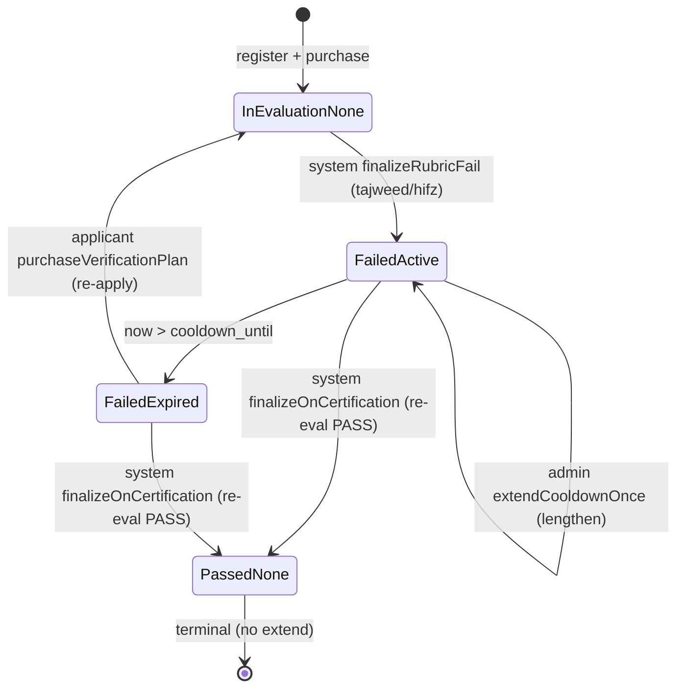

# Design — Cooldown State Machine (1-Month Tajweed / 3-Month Hifz)

> **Plan directory (verbatim):** `ai/plans/milestone_1_core_domain_mvp/cooldown_state_machine_1_month_tajweed_3_month_hifz/`
> **Specs of record:** `specs.md` (REQ-001..REQ-011) · **Ticket:** `docs/planning/TICKETS.md:818-868` — Dev 2 · M1 · 5 SP · Blocked By Evaluation Rubric Scoring (SHIPPED)
> **Plan kind:** backend-only slice — zero schema delta; one new admin service method + GraphQL mutation, one derived read-model field + Pothos enum, one guarded repo method, one journey test; no frontend files.

## Supersession Note

This plan (v2.0) supersedes the earlier draft that previously lived in this directory, which interpreted the cooldown as a dual-deny design stamping `users.suspended = true` alongside `applicants.cooldown_until`. The ticket Gherkin's `users.suspended = true` acceptance criterion is superseded by the binding vocabulary reconciliation at `docs/teachers/applicant-lifecycle.md:154`, on top of the two-source split at `docs/teachers/applicant-lifecycle.md:60` (§2.3): the cooldown lives ONLY in `applicants.cooldown_until`, and `users.suspended*` is NEVER written (D6). INV-TV6 (student privileges during cooldown) is satisfied structurally — login/session access stays available during cooldown; re-purchase is denied via `assertCanPurchaseVerification` (`backend/services/teachers/applicant-lifecycle.service.ts:204`), not via session invalidation. The dual-deny draft's race-scenario analysis and multi-tier test-matrix discipline are ported forward below (§6, §7.4), adapted to this single-source architecture.

## Document Information

| Field | Value |
|---|---|
| Version / Date | 2.0 · 2026-09-27 (supersedes the dual-deny draft; PR #250 base + ported race/test-matrix sections) |
| Ground-truth schema | `backend/db/schema/users/users.ts:32-36` (suspended family — NOT touched) · `backend/db/schema/teachers/applicants.ts:17-30` (cooldown_until, status — EXISTING) · `backend/db/schema/enums.ts:53` (rubricWeaknessArea) · `backend/db/schema/audit/audit-logs.ts:30-47` (audit_logs — EXISTING) |
| Existing cooldown write path (consumed, zero delta) | `backend/services/teachers/evaluation-rubric.helpers.ts:327` (resolveFinalizationCooldownUntil — durations) · `:377-383` (finalizeRubricFail — the zero-delta contract) · `shared/constants/evaluation-rubric.constants.ts:21,24` (tajweed 30d / hifz 90d) · `backend/db/repo/teachers/applicant.repository.ts:468-485` (transitionToFailed) · `:507-530` (finalizeOnCertification — clears cooldown) |
| Existing cooldown read/gate path (consumed + EXTENDED) | `backend/services/teachers/applicant-lifecycle.service.ts:142-181` (getMyApplicantProfile — EXTEND with cooldownState) · `:204` (assertCanPurchaseVerification — zero delta; wired in-tx at `backend/services/teachers/verification-purchase.service.ts:319`) · `:263-281` (recordReapplication — zero delta) |
| New write path (this ticket) | `ApplicantLifecycleService.extendApplicantCooldown` (NEW) → `ApplicantRepository.extendCooldownOnce` (NEW guarded repo method) + `AuditService.createAuditLog` (`backend/services/admin/audit.service.ts:82` — EXISTING, consumed) |
| Hook points | `backend/graphql/pothos/teachers/applicant.pothos.ts:33` (object) · `:51-52` (EXTEND with the `cooldownState` field) · `backend/graphql/mutation/admin/admin-governance.mutation.ts` (APPEND `adminExtendApplicantCooldown` mutation, sibling of `adminSetUserSuspended` at `:45`) |
| Clone lineage | `applicant-lifecycle.service.ts:204` (assert/gate shape, captured-now, logDomainError discipline) · `applicant.repository.ts:468-485` (guarded UPDATE returning pattern) · `audit.service.ts:82-90` (in-transaction audit append) · `admin-governance.mutation.ts:45-72` (admin-scoped mutation shape) |
| Related docs | `docs/specs/state-machine-invariants.md` §2 (INV-TV3/4/6) · `docs/specs/functional-requirements.md` §3 (FR-3.6/3.7) · `docs/teachers/applicant-lifecycle.md` §2.3/§2.4/§7.3 (two-source split + duration-agnostic guard + reconciliation) |

## 1. Overview & Key Design Decisions

### Overview

The blocker ticket (Evaluation Rubric Scoring) shipped the **mechanical** cooldown: the failure writer stamps `applicants.cooldown_until` (`finalizeRubricFail` → `transitionToFailed`) and the re-purchase guard rejects with `APPLICANT_COOLDOWN_ACTIVE` → HTTP 422 (`assertCanPurchaseVerification`). This design adds the **state-machine formalization layer** on top of that shipped substrate — without re-implementing any of it. Three additions close the gap to the ticket's full acceptance criteria:

1. An **admin cooldown-extension primitive** (`extendApplicantCooldown` service + `adminExtendApplicantCooldown` mutation + `extendCooldownOnce` repo method) satisfying INV-TV4 "These are minimums" and the "can be extended by admin" test scenario — the low-level primitive the Admin Override child ticket composes.
2. A **derived `cooldownState` read-model** (`None | Active | Expired` on the wire; real TS enum per D1) on `ApplicantProfile` so the expired state is explicitly observable instead of inferred from `cooldownActive=false && cooldownUntil !== null`.
3. A **two-source-split test-lock** + journey test asserting the cooldown writes ONLY `applicants.cooldown_until` and NEVER `users.suspended` — binding the reconciliation at `docs/teachers/applicant-lifecycle.md:154` against regression.

No new tables, no new columns, no new pgEnums, no UI, no audit-row writers (the existing `AuditService.createAuditLog` is consumed).

### Design Goals

1. **Zero-delta consumption of the shipped cooldown substrate** — the write-on-fail and reject-on-repurchase paths are formalized, not re-implemented; this ticket's diff touches ONLY the read-model derivation, the new admin primitive, and the journey test.
2. **Single-transaction atomicity** for the admin extension: the cooldown write + the audit append share one `withTransaction` boundary (the audit row never survives a rolled-back cooldown write).
3. **Read-model honesty** — `cooldownState` is pure compute against the same captured `now` already driving `cooldownActive`; zero extra queries, zero drift between the two derivations.
4. **Two-source-split enforcement** — grep-verifiable absence of `users.suspended` writes in the new code path; test-locked in the journey.

### Key Design Decisions

- **D1 — `cooldownState` is a derived read-model, not a stored column.** *Context:* REQ-008 asks for an explicit `none | active | expired` enumeration. *Options:* (1) add a `cooldown_state` pgEnum column on `applicants`; (2) derive it in the service from `cooldown_until` + `now` and expose a Pothos enum on the wire. *Decision:* (2). *Rationale:* zero schema delta (the 5-SP scope forbids migrations); `cooldown_until` already encodes the full state (NULL → none, future → active, past → expired); a stored column would introduce a second source of truth that could drift from `cooldown_until` (exactly the anti-pattern REQ-006 forbids for `users.suspended`). Consequence (accepted): `cooldownState` is recomputed on every read — which is free (pure compute against the already-captured `now`). The state is exposed via a real TS enum `ApplicantCooldownState` in `backend/enum/teachers/applicant-cooldown-state.enum.ts` (mirroring `ApplicantStatus` at `backend/enum/teachers/applicant-status.enum.ts:12`: PascalCase members = lowercase values, plus a fail-closed `isApplicantCooldownState` guard), registered as a Pothos enum by passing the enum OBJECT — the `ApplicantStatusPothosEnum` idiom at `backend/graphql/pothos/shared/enum.pothos.ts:116-119` — NOT as a pgEnum and NOT as a string-literal union (the superseded draft's union prescription violated the backend/graphql enum rule).

- **D2 — Admin extension base = `max(currentCooldownUntil, now)`, never `currentCooldownUntil` alone.** *Context:* REQ-007.1 computes the new expiry. *Options:* (1) `new = currentCooldownUntil + additionalDays`; (2) `new = max(currentCooldownUntil, now) + additionalDays`. *Decision:* (2). *Rationale:* if the current cooldown has already expired (`cooldown_until <= now`), option (1) would stamp an expiry in the past (extending a 30-day-old expiry by 60 days yields "10 days ago") — a no-op extension. Option (2) starts the extension from NOW when the original has lapsed, matching the admin's intent ("extend the lock") and the FR-3.8 override lineage. When the cooldown is still active, `max(currentCooldownUntil, now) === currentCooldownUntil` so option (2) reduces to option (1) for the active case — no behavior change there. The `additionalDays` is ADDED to the base, not replacing it (LENGTHEN-only, INV-TV4 minimums).

- **D3 — `extendCooldownOnce` is a guarded single-statement UPDATE, predicate `status IN ('pending','failed','in_evaluation')`.** *Context:* the existing `transitionToFailed` (`applicant.repository.ts:468-485`) guards on `status = 'in_evaluation'` (its only legal pre-state). *Decision:* the extension repo method guards on the THREE non-terminal statuses because an admin may extend a cooldown on a `failed` applicant (the common case) OR preemptively on a `pending`/`in_evaluation` applicant (FR-3.8 override lineage — the admin is adjudicating before the cycle ends). The `passed` status is EXCLUDED from the predicate (terminal — REQ-007.7 rejects with `APPLICANT_ALREADY_CERTIFIED`); a zero-row match on `passed` surfaces the same certified-rejection at the service layer. Returns the updated row (for the audit `from`/`to` ISOs) or `null` on miss. Parameterized always; `id`, `cooldownUntil` are bound values.

- **D4 — Audit `actionType = AuditActionType.Adjust`, NOT `Suspend`/`Reactivate`.** *Context:* the `AuditActionType` vocabulary includes `suspend`, `reactivate`, `override`, `adjust` (`AuditActionType.Adjust` at `backend/enum/audit/audit-action-type.enum.ts:11`). *Options:* (1) `suspend`/`reactivate` (the cooldown is a kind of suspension); (2) `adjust` (a field-level modification); (3) `override` (FR-3.8 lineage). *Decision:* (2) `adjust`. *Rationale:* `suspend`/`reactivate` are semantically reserved for the `users.suspended` governance axis (the `adminSetUserSuspended` writer at `user-governance.helpers.ts:230`); using them for `applicants.cooldown_until` would conflate the two-source split (REQ-006). `override` is reserved for the Admin Override child ticket's certify/reject/re-evaluation actions (FR-3.8). `adjust` is the precise verb: a field-level modification of `cooldown_until` by an admin. `entityType = "applicant"` (lowercase, per `audit.service.ts:74`).

- **D5 — `cooldownState` derivation lives in `getMyApplicantProfile`, NOT in a new helper module.** *Context:* the existing profile shaper at `applicant-lifecycle.service.ts:142-181` already computes `cooldownActive` (:165) and `canPurchaseVerification` (:166) from one captured `now` (:164). *Decision:* extend the SAME return-shaping block with `cooldownState` — a `deriveCooldownState(cooldownUntil, now)` pure function (module-private, sibling of the existing `resolveLocaleTag`/`formatCooldownExpiry` helpers at `:67-125`) called from `getMyApplicantProfile`. *Rationale:* avoids a second read (D1), keeps the captured-now discipline atomic across all three derivations (no drift), and mirrors the existing "pure compute after one read" pattern documented in the service docblock (`:26-38`). The function is exported module-private (not namespace-public) — only the profile shaper calls it.

- **D6 — No `users.suspended` write anywhere in the new code path (two-source split).** *Context:* the ticket's draft-era Gherkin says `users.suspended = true`, but the binding reconciliation (`docs/teachers/applicant-lifecycle.md:154`) supersedes it. *Decision:* the new `extendApplicantCooldown` service + `extendCooldownOnce` repo method write ONLY `applicants.cooldown_until` (+ `updated_at`); they import NOTHING from `users` and never touch `users.suspended*`. The journey test (REQ-011 step 2) asserts `users.suspended === false` after the cooldown stamp, grep-locking the split. *Rationale:* coupling the cooldown to `users.suspended` would make a cooldown-active applicant fail the `assertActorGovernanceClean` session-class gate (`session-lifecycle.governance.ts:47`) — blocking their student privileges (INV-TV6) — which is exactly the regression the two-source split prevents.

- **D7 — i18n: one new errors leaf `applicantCooldownExtensionInvalid` + reuse.** *Context:* REQ-002.1 requires new user-facing strings in the `errorsTranslations` namespace. *Decision:* add ONE leaf `applicantCooldownExtensionInvalid` (the bounds-rejection copy) to the existing `applicant` errors group; the `APPLICANT_NOT_FOUND` and `APPLICANT_ALREADY_CERTIFIED` codes reuse the existing localized keys (already shipped by the blocker ticket — `applicant-lifecycle.service.ts:168` error contract table). The admin mutation's success path emits a structured `logger` log (NFR-Observability), NOT a user-facing string. No `Translation.` enum (no frontend), no two-arg `getTranslations`.

## 2. UX / Navigation Specification (Explicit No-UI Ruling)

### 2.1 New Routes & URLs

| Route | Purpose | Permission | Roles |
|---|---|---|---|
| — (NONE) | — | — | — |

No `app/` route, page, or layout changes. The only new surfaces are the GraphQL field `cooldownState` on `ApplicantProfile` (§4) and the admin mutation `adminExtendApplicantCooldown` (§4).

### 2.2 Sidebar / Navigation Integration

- `frontend/views/dashboard/nav/navItems.ts` — **untouched**.
- Mobile bottom nav: **N/A** — the repo has no bottom-nav surface anywhere (verified across shipped plans).

### 2.3 Role-Based Access Matrix (API level — the only surface that exists)

| Role | `myApplicantProfile` (existing + new `cooldownState`) | `adminExtendApplicantCooldown` (new) | Notes |
|---|---|---|---|
| `admin` | reads own profile (rarely an applicant) | ✅ any applicant | `adminOnlyAuthScopes` (`backend/graphql/shared/admin-prelude.ts:24`) |
| `teacher` (applicant) | ✅ self only (zero-arg, identity from `ctx.user.id`) | ❌ 403 at scope layer | the applicant observes their own `cooldownState` |
| `student` | ❌ 403 at scope layer | ❌ 403 | students have no applicant profile |
| `parent` | ❌ 403 at scope layer | ❌ 403 | parents have no applicant profile |
| anonymous | ❌ 401 (`authenticated` scope throws before DB) | ❌ 401 | — |

### 2.4 Per-Audience Rendering

| Audience | Rendering |
|---|---|
| Applicant (teacher) | `myApplicantProfile.cooldownState` drives the "cooldown active (until {date})" / "cooldown expired — you may re-apply" affordance — the consuming UI arrives with the child tickets; this ticket ships only the field. |
| Admin | `adminExtendApplicantCooldown` mutation exposed for the admin governance surface (the Admin Override child ticket builds the inspect/extend UI on top). |
| Parent / Student | No surface — neither role has an applicant profile. |

## 3. Data Models (EXISTING + NEW TYPES — zero schema delta)

### 3.1 `applicants` (consumed-write + NEW repo method, `backend/db/schema/teachers/applicants.ts:17-30`) — UNCHANGED schema

```typescript
export const applicants = pgTable("applicants", {
  id: integer("id").primaryKey().references(() => users.id, { onDelete: "cascade" }),
  verificationAttempts: integer("verification_attempts").default(0),
  lastAttemptAt: timestamp("last_attempt_at"),
  cooldownUntil: timestamp("cooldown_until"),                       // EXISTING — the cooldown home
  status: varchar("status", { length: 50 }).default("pending"),      // EXISTING — varchar (no pgEnum)
  createdAt: timestamp("created_at").defaultNow().notNull(),
  updatedAt: timestamp("updated_at").defaultNow().notNull().$onUpdate(() => new Date()),
});
```

**No schema change.** The `cooldownUntil` column (line 23) and `status` varchar (line 24) already exist; the new `extendCooldownOnce` repo method (§5) writes ONLY these two columns (+ `updated_at`). The two-source split (REQ-006) means NO `users.suspended*` column is touched by this ticket.

### 3.2 `audit_logs` (consumed-write, `backend/db/schema/audit/audit-logs.ts:30-47`) — UNCHANGED schema

```typescript
export const auditLogs = pgTable("audit_logs", {
  id: integer("id").primaryKey().generatedAlwaysAsIdentity(),
  actorId: integer("actor_id").notNull().references(() => users.id, { onDelete: "restrict" }),
  actionType: auditActionType("action_type").notNull(),   // AuditActionType.Adjust (D4)
  entityType: varchar("entity_type", { length: 100 }).notNull(),  // "applicant"
  entityId: integer("entity_id"),                          // the applicant's users.id
  details: varchar("details", { length: 2000 }),           // JSON: {field,from,to,additionalDays}
  createdAt: timestamp("created_at").defaultNow().notNull(),
}, t => [
  index("audit_logs_actor_id_idx").on(t.actorId),
  index("audit_logs_entity_type_entity_id_idx").on(t.entityType, t.entityId),
]);
```

**No schema change.** Consumed via `AuditService.createAuditLog(input, tx)` (`backend/services/admin/audit.service.ts:82`); the `actionType` value `AuditActionType.Adjust` already exists (`backend/enum/audit/audit-action-type.enum.ts:11`).

### 3.3 Type layer (NEW + EXTENDED) — `backend/types/teachers/applicant.types.ts`

```typescript
// EXISTING (verify exact name in the file before editing):
export type ApplicantSelectType = typeof applicants.$inferSelect;

export interface ApplicantProfileReturnType {
  readonly id: number;
  readonly status: ApplicantStatus;
  readonly verificationAttempts: number;
  readonly lastAttemptAt: Date | null;
  readonly cooldownUntil: Date | null;
  readonly cooldownActive: boolean;
  readonly canPurchaseVerification: boolean;
  readonly cooldownState: ApplicantCooldownState;   // NEW (REQ-008.2)
}

// NEW — the derived read-model vocabulary is a REAL TS enum living in
// backend/enum/teachers/applicant-cooldown-state.enum.ts (mirrors applicant-status.enum.ts:12):
//   export enum ApplicantCooldownState { None = "none", Active = "active", Expired = "expired"; }
// plus an isApplicantCooldownState fail-closed guard + pre-allocated members set.
// The Pothos registration passes the enum OBJECT (backend/graphql/AGENTS.md enum rule —
// string-literal unions and hardcoded value arrays in Pothos files are prohibited); NO pgEnum.

// NEW — the admin-extension audit contract (composed by the service, persisted by AuditService):
export interface ApplicantCooldownExtensionAudit {
  readonly field: "cooldown_until";
  readonly from: string | null;   // ISO of prior cooldown_until (null when none)
  readonly to: string;           // ISO of new cooldown_until
  readonly additionalDays: number;
}
```

Barrel `backend/types/teachers/index.ts` gains the named exports if not already present (verify before editing; no collision expected). The `AuditLogWriteContract` type (`backend/types/audit/audit.types.ts`, consumed by `AuditService`) is UNCHANGED — the service composes a plain object satisfying its shape.

## 4. API Contracts (GraphQL — additions only; code-first Pothos, no `.graphql` SDL files in `backend/`)

### 4.1 SDL (additions only — generated into `frontend/graphql/generated/schema.graphql`)

```graphql
# NEW enum — derived read-model (NO backing pgEnum; D1). Wire names follow the TS enum
# member names (the ApplicantStatus precedent exposes Failed/InEvaluation/Passed/Pending):
enum ApplicantCooldownState {
  None
  Active
  Expired
}

# EXTEND existing type — one new non-nullable field
type ApplicantProfile {
  id: Int!
  status: ApplicantStatus!
  verificationAttempts: Int!
  lastAttemptAt: DateTime
  cooldownUntil: DateTime
  cooldownActive: Boolean!
  canPurchaseVerification: Boolean!
  cooldownState: ApplicantCooldownState!      # NEW (REQ-008)
}

# NEW mutation — admin-scoped cooldown extension (REQ-007)
extend type Mutation {
  adminExtendApplicantCooldown(
    applicantId: Int!
    additionalDays: Int!
  ): ApplicantProfile!
}
```

### 4.2 Permission / Scope Matrix

| Field / Mutation | `authScopes` | Deny behavior | Source pattern |
|---|---|---|---|
| `ApplicantProfile.cooldownState` (field on existing query `myApplicantProfile`) | `{ $all: { authenticated: true, role: [UserRole.Teacher] } }` | anonymous → 401; non-teacher → 403 | `backend/graphql/query/teachers/applicant.query.ts:56-60` (UNCHANGED) |
| `adminExtendApplicantCooldown` (new mutation) | `adminOnlyAuthScopes` = `{ $all: { authenticated: true, role: [UserRole.Admin] } }` | anonymous → 401; non-admin → 403 | `backend/graphql/shared/admin-prelude.ts:24` (mirror `adminSetUserSuspended` at `backend/graphql/mutation/admin/admin-governance.mutation.ts:45`) |

> **Note:** this codebase has NO `requirePermission`/`requirePermissionForPage`/`RequirePermission` helper — authorization is Pothos `authScopes` with the load-bearing `$all` conjunction only.

### 4.3 Request / Response — `adminExtendApplicantCooldown`

**Request:**
```graphql
mutation Extend($applicantId: Int!, $additionalDays: Int!) {
  adminExtendApplicantCooldown(applicantId: $applicantId, additionalDays: $additionalDays) {
    id status cooldownUntil cooldownActive canPurchaseVerification cooldownState
  }
}
```

**Response (success — 200):** the full `ApplicantProfile!` (post-extension), sourced from `ApplicantLifecycleService.extendApplicantCooldown`'s return value (which delegates to `getMyApplicantProfile`'s shaping — D5 — so the wire shape match). The returned `cooldownState` is `"Active"` (wire member name) and `cooldownUntil` is the new extended instant.

**Error responses (GraphQL errors with `extensions.code`):**

| `extensions.code` | HTTP | Trigger | i18n key |
|---|---|---|---|
| `APPLICANT_NOT_FOUND` | 404 | applicant row missing | `applicantNotFound` (EXISTING) |
| `APPLICANT_ALREADY_CERTIFIED` | 422 | `status === 'passed'` (terminal) | `applicantAlreadyCertified` (EXISTING) |
| `APPLICANT_COOLDOWN_EXTENSION_INVALID` | 422 | `additionalDays` ∉ [1, 3650] | `applicantCooldownExtensionInvalid` (NEW — D7) |
| `FORBIDDEN` | 403 | non-admin caller (authScopes) | `forbidden` (EXISTING) |
| `UNAUTHORIZED` | 401 | anonymous caller (authScopes) | `unauthorized` (EXISTING) |

> HTTP status mapping: `VALIDATION → 422`, `NOT_FOUND → 404`, `FORBIDDEN → 403`, `UNAUTHORIZED → 401` (`backend/lib/errors/error-code-taxonomy.ts:47`).

### 4.4 Resolver (NEW) — `backend/graphql/mutation/admin/admin-governance.mutation.ts` (APPEND)

```typescript
gqlSchemaBuilder.mutationField("adminExtendApplicantCooldown", t =>
  t.field({
    type: ApplicantProfilePothosObject,
    args: {
      applicantId: t.arg.int({ required: true }),
      additionalDays: t.arg.int({ required: true }),
    },
    authScopes: adminOnlyAuthScopes,
    resolve: async (_root, args, ctx) => {
      requireAdminUser(ctx);  // narrows ctx.user for the admin path
      return ApplicantLifecycleService.extendApplicantCooldown(
        args.applicantId,
        args.additionalDays,
        ctx.user.id,        // actorId — from ctx, NEVER from input
        ctx.locale,
      );
    },
  })
);
```

The resolver carries NO try/catch (domain errors propagate uncaught to the masking boundary — `docs/teachers/applicant-lifecycle.md:97`). `requireAdminUser` is the existing narrowing helper at `backend/graphql/shared/admin-prelude.ts:31`.

## 5. Services & Repository Signatures

### 5.1 EXISTING (consumed with ZERO delta — formalize ownership, do not re-implement)

```typescript
// backend/db/repo/teachers/applicant.repository.ts — EXISTING (blocker ticket)
ApplicantRepository.transitionToFailed(userId, cooldownUntil, tx): Promise<ApplicantSelectType | null>   // :468-485
ApplicantRepository.finalizeOnCertification(userId, tx?): Promise<boolean>                                // :507-530  (clears cooldown_until → NULL)
ApplicantRepository.transitionToInEvaluation(userId, tx): Promise<ApplicantSelectType | null>            // :407
ApplicantRepository.recordVerificationAttempt(userId, tx): Promise<ApplicantSelectType | null>            // :234
ApplicantRepository.findByUserId(userId, tx?): Promise<ApplicantSelectType | null>                        // read

// backend/services/teachers/applicant-lifecycle.service.ts — EXISTING (blocker ticket)
ApplicantLifecycleService.getMyApplicantProfile(userId, locale, tx?): Promise<ApplicantProfileReturnType | null>  // :142-181
ApplicantLifecycleService.assertCanPurchaseVerification(userId, locale, tx?): Promise<void>                         // :204
ApplicantLifecycleService.recordReapplication(userId, locale, tx?): Promise<ApplicantSelectType>                   // :263-281

// backend/services/admin/audit.service.ts — EXISTING (consumed)
AuditService.createAuditLog(input: AuditLogWriteContract, tx: DBTransaction): Promise<void>                        // :82-90

// backend/services/teachers/evaluation-rubric.helpers.ts — EXISTING (blocker ticket, the cooldown WRITER)
finalizeRubricFail(applicantUserId, cooldownUntil, tx, t): Promise<void>                                            // :377-383  → transitionToFailed
resolveFinalizationCooldownUntil(area, now): Date                                                                  // :327       (TAJWEED/HIFZ durations; constants `shared/constants/evaluation-rubric.constants.ts:21,24`)
```

### 5.2 NEW — `ApplicantRepository.extendCooldownOnce` (`backend/db/repo/teachers/applicant.repository.ts` — APPEND)

```typescript
/**
 * Guarded single-statement extension of an applicant's cooldown. Sets
 * `cooldown_until = <newExpiry>` (the caller-computed base+days) with the
 * non-terminal statuses folded into the WHERE predicate — a `passed`
 * (certified) applicant matches zero rows (terminal guard, REQ-007.7).
 * Writes ONLY `cooldown_until` + `updated_at` — NEVER `users.suspended*`
 * (two-source split, REQ-006). The `users` table is NOT imported here.
 *
 * @returns The updated row (for audit from/to ISOs), or `null` on zero-row
 *          match (applicant missing OR status === 'passed').
 */
export async function extendCooldownOnce(
  userId: number,
  newExpiry: Date,
  tx: DBTransaction
): Promise<ApplicantSelectType | null> {
  const [row] = await tx
    .update(applicants)
    .set({
      cooldownUntil: newExpiry,
      updatedAt: sql`now()`,
    })
    .where(
      and(
        eq(applicants.id, userId),
        inArray(applicants.status, [
          ApplicantStatus.Pending,
          ApplicantStatus.InEvaluation,
          ApplicantStatus.Failed,
        ])
      )
    )
    .returning();
  return row ?? null;
}
```

Parameterized always; `id`, `newExpiry`, and the three `ApplicantStatus` members are bound values (never concatenated). No prepared statement (writes excluded — `docs/drizzle/prepared-statements.md`). `ApplicantStatus` imported as a VALUE (REQ-002.3). `sql`, `and`, `eq`, `inArray` from `drizzle-orm`.

### 5.3 NEW — `ApplicantLifecycleService.extendApplicantCooldown` (`backend/services/teachers/applicant-lifecycle.service.ts` — APPEND to namespace)

```typescript
/**
 * Admin cooldown-extension primitive (INV-TV4 "minimums"). Computes the new
 * expiry as max(currentCooldownUntil, now) + additionalDays (D2), writes it
 * via `extendCooldownOnce` (guarded), appends exactly ONE audit row via
 * `AuditService.createAuditLog`, all inside ONE transaction. Writes ONLY
 * `applicants.cooldown_until` — NEVER `users.suspended*` (two-source split,
 * REQ-006.2). The `users` table is NOT imported here.
 *
 * @throws ValidationError  code `APPLICANT_COOLDOWN_EXTENSION_INVALID` when
 *     additionalDays ∉ [1, 3650] (bounds, REQ-007.3).
 * @throws NotFoundError    code `APPLICANT_NOT_FOUND` when the applicant row
 *     is missing OR status === 'passed' (the guarded repo update matched zero
 *     rows — the terminal-certified case collapses onto the same miss).
 * @throws ValidationError  code `APPLICANT_ALREADY_CERTIFIED` — surfaced when
 *     the repo miss is due to status === 'passed' (distinguished by a prior
 *     findByUserId read that returned status === 'passed'); the missing-row
 *     arm surfaces `APPLICANT_NOT_FOUND` instead.
 */
export async function extendApplicantCooldown(
  applicantId: number,
  additionalDays: number,
  actorId: number,
  locale: string
): Promise<ApplicantProfileReturnType> {
  // ... bounds validation → ValidationError("APPLICANT_COOLDOWN_EXTENSION_INVALID")
  // ... withTransaction(async tx => {
  //       row = findByUserId(applicantId, tx);  // for status guard + old expiry
  //       if (!row) throw NotFoundError("APPLICANT", …);
  //       if (row.status === ApplicantStatus.Passed) throw ValidationError("APPLICANT_ALREADY_CERTIFIED", …);
  //       const base = max(row.cooldownUntil ?? epochPast, now);
  //       const newExpiry = new Date(base.getTime() + additionalDays * MS_PER_DAY);
  //       const updated = await extendCooldownOnce(applicantId, newExpiry, tx);
  //       await AuditService.createAuditLog(composeAuditContract(actorId, applicantId, row.cooldownUntil, newExpiry, additionalDays), tx);
  //     });
  // ... logger.logDomainError("APPLICANT_COOLDOWN_EXTENDED", { applicantId, additionalDays, oldExpiry, newExpiry });
  // ... return getMyApplicantProfile(applicantId, locale);  // reuse the shaper (D5)
}
```

**Discipline notes:**
- `actorId` comes exclusively from the resolver's `ctx.user.id` — never from the mutation input (the resolver passes `ctx.user.id`, not `args.actorId`; there is no `actorId` arg).
- `MS_PER_DAY = 24 * 60 * 60 * 1000` — module-private constant (sibling of `COOLDOWN_FORMATTERS` at `:84`); NOT imported from the shared constants file (which ships only day-counts, not millisecond conversions — `shared/constants/evaluation-rubric.constants.ts:21,24`).
- `withTransaction` is the existing helper (`backend/lib/db/with-transaction.ts` — the established transaction boundary).
- The `max(currentCooldownUntil ?? epochPast, now)` uses a sentinel `epochPast = new Date(0)` so a NULL cooldown_until collapses to `now` (D2: expired/none → fresh from today).

### 5.4 NEW — `deriveCooldownState` (module-private helper in `applicant-lifecycle.service.ts`)

```typescript
/** Pure compute — the derived cooldown state from cooldown_until + one captured now. */
function deriveCooldownState(
  cooldownUntil: Date | null,
  now: Date
): ApplicantCooldownState {
  if (cooldownUntil === null) return ApplicantCooldownState.None;
  return cooldownUntil > now ? ApplicantCooldownState.Active : ApplicantCooldownState.Expired;   // strict > — matches cooldownActive (:165)
}
```

Called from `getMyApplicantProfile` (`:142-181`, EXTENDED) right after the existing `cooldownActive`/`canPurchaseVerification` derivations (`:164-166`), against the SAME captured `now` (`:164`) — zero drift (D5). The `cooldownActive` boolean is retained (back-compat for any consumer reading it); `cooldownState` is the new explicit enumeration.

## 6. Concurrency & Race Condition Assessment

**Concurrency Model:** the admin extension runs inside one `withTransaction` boundary; the cooldown write (`extendCooldownOnce`) and the audit append (`AuditService.createAuditLog`) share the transaction's commit/rollback fate. The existing cooldown-on-fail path (`finalizeRubricFail` → `transitionToFailed`) and the re-purchase path (`assertCanPurchaseVerification` → `purchaseVerificationInTx`) are unchanged.

**Concurrency Mechanism (v1):** guarded WHERE-predicates ARE the concurrency mechanism in v1 — every cooldown write folds its full legal pre-state into the UPDATE's WHERE (`status IN ('pending','in_evaluation','failed')` in `extendCooldownOnce`; `status = 'in_evaluation'` in `transitionToFailed`; the strict-`>` cooldown check in the purchase gate), so a stale advisory read degrades to a zero-row no-op or a typed conflict — never an illegal transition, never a shortened cooldown.

**Race Condition Scenarios (ported from the superseded dual-deny draft, adapted to the single-source architecture — all `users` write-race rows dropped):**

| Scenario | Actors | Risk | Mitigation |
|---|---|---|---|
| Extend-vs-extend (two concurrent admins) | admin A vs admin B | double-apply or lost update on `cooldown_until` | Both compute from their own read; last-write-wins on the computed `GREATEST(currentCooldownUntil, now()) + additionalDays` value — monotonic by construction (never shortens: every candidate value extends past the then-current expiry or `now`). Each attempt is audit-observable (one `AuditActionType.Adjust` row per extension, with from/to ISOs). v1 ACCEPTS this: no `SELECT FOR UPDATE` — deferred to the deferred-items ledger (D4) if stricter ordering is ever needed. |
| Extend-vs-repurchase (expiry boundary) | admin extension vs applicant re-purchase at `cooldown_until` | extension lands after the purchase guard read → re-purchase slips through | The extension only WIDENS the window; the purchase gate reads `cooldown_until` at its own snapshot inside the purchase `tx` (`assertCanPurchaseVerification` — `backend/services/teachers/applicant-lifecycle.service.ts:204`, wired in-tx at `backend/services/teachers/verification-purchase.service.ts:319`). Worst case the gate sees the PRE-extension expiry (a more permissive read — exactly what it would have seen with no extension in flight); an extension can never RESURRECT a denied purchase because denial is decided inside the purchase transaction, not from the extended value. |
| Extend-vs-status-transition (fail-while-extending) | admin extension vs `transitionToFailed` | the guarded pre-states disagree mid-flight | `extendCooldownOnce`'s WHERE predicate `status IN ('pending','in_evaluation','failed')` re-evaluates the status atomically at write time: a `passed` flip zero-rows the extension → the service surfaces `APPLICANT_ALREADY_CERTIFIED`; conversely a concurrent `transitionToFailed` whose `status = 'in_evaluation'` pre-state was already consumed matches zero rows and surfaces the typed `APPLICANT_ALREADY_FINALIZED` conflict — no stale write in either order. |
| Purchase-gate TOCTOU (cooldown flip mid-purchase) | cooldown writer vs purchase flow | stale guard read admits an in-cooldown purchase | UNCHANGED existing mitigation, pinned not altered: the gate predicate and the purchase's cooldown-consuming write share the SAME purchase `tx` with one captured `now` and strict `>` (`backend/services/teachers/verification-purchase.service.ts:319`). Extension writes are independent and monotonic, so no interleaving can SHORTEN a cooldown — the worst interleaving leaves the gate reading a pre-extension (more permissive) snapshot, which is the no-extension baseline. |

**SELECT FOR UPDATE / locks:** NONE in this ticket — v1's concurrency discipline is the guarded WHERE-predicate above (the `transitionToFailed` precedent: the lifecycle pre-state IS the WHERE predicate, `backend/db/repo/teachers/applicant.repository.ts:468-485`). No new `FOR UPDATE` repo variant is added.

## 7. Cross-Actor Journey Design (REQ-011 — the journey test assertion set)

### 7.1 Shared-Entity State Machine — `applicants` cooldown axis

The cooldown state machine is a DERIVED view over `(applicants.status, applicants.cooldown_until, now)`. The stored transitions are the existing lifecycle transitions; the cooldown READ-MODEL is the new `cooldownState` enumeration.

| Current (status, cooldownState) | Trigger (actor + action) | Next (status, cooldownState) | Guard / Permission |
|---|---|---|---|
| `(in_evaluation, none)` | System → `finalizeRubricFail` (FAIL verdict, tajweed) | `(failed, active)` | rubric finalization (blocker ticket) |
| `(in_evaluation, none)` | System → `finalizeRubricFail` (FAIL verdict, hifz) | `(failed, active)` | rubric finalization (blocker ticket) |
| `(failed, active)` | Admin → `adminExtendApplicantCooldown` | `(failed, active)` — `cooldown_until` lengthened | `adminOnlyAuthScopes` (REQ-007.6) |
| `(failed, active)` | Time → `now` passes `cooldown_until` | `(failed, expired)` | none (pure time) |
| `(failed, expired)` | Applicant → `purchaseVerificationPlan` | `(in_evaluation, none)` | `assertCanPurchaseVerification` permits (REQ-004.3) |
| `(failed, *)` | System → `finalizeOnCertification` (re-evaluation PASS) | `(passed, none)` | certification (blocker ticket) |
| `(passed, none)` | Admin → `adminExtendApplicantCooldown` | REJECTED `APPLICANT_ALREADY_CERTIFIED` | terminal guard (REQ-007.7) |



### 7.2 Side-Effect Matrix (per transition)

| Transition | Rows Created/Updated | Notifications | Audit | Idempotency |
|---|---|---|---|---|
| → `FailedActive` (finalizeRubricFail) | `applicants` UPDATE (status, cooldown_until) | `evaluation_result` notification → applicant (`emitFinalizationReceipt`, `evaluation-rubric.helpers.ts:406-429`) | none (rubric finalization) | guarded predicate `status = 'in_evaluation'` (zero-row → `APPLICANT_ALREADY_FINALIZED`) |
| → `FailedActive` (admin extend) | `applicants` UPDATE (cooldown_until) + `audit_logs` INSERT | none (admin action; the applicant observes via the next `myApplicantProfile` read) | `AuditActionType.Adjust`, `entityType: "applicant"`, details `{field,from,to,additionalDays}` | guarded predicate `status IN (pending, in_evaluation, failed)`; `passed` → zero-row → `APPLICANT_ALREADY_CERTIFIED` |
| → `FailedExpired` (time) | none (pure read-model transition) | none | none | n/a (time-derived) |
| → `InEvaluationNone` (re-purchase on expired) | `applicants` UPDATE (status, verification_attempts+1, last_attempt_at, cooldown_until → via the purchase flow) | none (purchase flow owns its own receipts) | none in this ticket (purchase flow's own audit, if any) | `assertCanPurchaseVerification` strict-`>` + `recordVerificationAttempt` atomic increment |
| → `PassedNone` (finalizeOnCertification) | `applicants` UPDATE (status → passed, cooldown_until → NULL) + `teacher` row INSERT (blocker ticket) | certification notification (blocker ticket) | none in this ticket | unguarded supersede (terminal) |

### 7.3 Cross-Actor Visibility

| State | Applicant (teacher) sees | Admin sees | Parent/Student sees |
|---|---|---|---|
| `FailedActive` (just stamped) | `myApplicantProfile`: `status=failed`, `cooldownState=active`, `cooldownUntil=<future>`, `canPurchaseVerification=false` | admin applicant queue + the `audit_logs` (for the finalization, if audited by the rubric ticket) | nothing (no applicant profile for their role) |
| `FailedActive` (admin-extended) | `myApplicantProfile`: `cooldownUntil=<extended future>`, `cooldownState=active` | the `audit_logs` row (`Adjust`, `entityType=applicant`) — the extension is attributable | nothing |
| `FailedExpired` | `myApplicantProfile`: `cooldownState=expired`, `cooldownActive=false`, `canPurchaseVerification=true` | the applicant is now re-purchase-eligible (admin observes via the queue) | nothing |
| `InEvaluationNone` (re-applied) | `myApplicantProfile`: `status=in_evaluation`, `cooldownState=none`, `verificationAttempts+1` | the new evaluation cycle in the queue | nothing |
| `PassedNone` (certified) | `myApplicantProfile`: returns `null` (certified — the no-oracle rule, `docs/teachers/applicant-lifecycle.md:96`) | the `teacher` row exists (blocker ticket); applicant no longer in the failed queue | nothing |

### 7.4 Multi-Tier Test Matrix (discipline — the detailed per-tier matrices live in `tasks.md`)

The verification strategy keeps the superseded draft's multi-tier discipline, re-pointed at this plan's task structure; `tasks.md` carries the full per-tier case matrices. DB tiers run under `runInRollback` with `tx` passed to EVERY repository call, via `bun run test/scripts/run-test.ts <path>` (log capture — never raw `bun test`).

| Tier | Scope | Runner |
|---|---|---|
| Repo unit | `backend/db/test/repo/teachers/` — `extendCooldownOnce`: eligible-status guard set, `passed` zero-row, missing-row, never-shorten math, and a write-set assertion that ONLY `cooldown_until`/`updated_at` are touched (no `users` import) | `runInRollback` + captured logs |
| Service | `backend/services/teachers/` — `extendApplicantCooldown`: bounds 1..3650, `APPLICANT_ALREADY_CERTIFIED` vs `APPLICANT_NOT_FOUND` arms, audit contract composition; `deriveCooldownState`: none/active/expired at the strict-`>` expiry boundary | same |
| GraphQL | `frontend/graphql/test/` — permission matrix (UNAUTHORIZED / FORBIDDEN / admin-allowed), error codes on the wire | same |
| Journey | `test/workflows/teachers/cooldown-state-machine.test.ts` (CREATE, ~12 steps, REQ-011): fail → cooldown stamped → the `users.suspended === false` two-source-split lock → expiry boundary (strict `>`) → gate denial + permit → admin extension incl. never-shorten | `bun run test/scripts/run-test.ts test/workflows` |
| Locale parity | the new `applicantCooldownExtensionInvalid` leaf in en + ar (`shared/locale/errors-namespace.parity.test.ts`) | same |

## 8. Security & Tenancy Mitigations

### 8.1 Authentication & Authorization
- `myApplicantProfile` (existing + new `cooldownState` field): `authScopes: { $all: { authenticated: true, role: [UserRole.Teacher] } }` — the `$all` conjunction is load-bearing (anonymous → 401, non-teacher → 403; verified at `docs/teachers/applicant-lifecycle.md:91-95`). Identity from `ctx.user.id` only (zero-arg query — BOLA-safe).
- `adminExtendApplicantCooldown` (new): `authScopes: adminOnlyAuthScopes` = `{ $all: { authenticated: true, role: [UserRole.Admin] } }` (`backend/graphql/shared/admin-prelude.ts:24`). Non-admin → 403 before any DB read.
- The admin mutation's `actorId` (for the audit row) comes exclusively from `ctx.user.id` via the resolver — NEVER from the mutation input (`audit.service.ts:14-15`); a forged `actorId` field in the input is structurally ignored (the resolver does not read it).

### 8.2 Data Protection & PII
- The audit `details` JSON carries field NAMES + old/new expiry ISOs + `additionalDays` only — NEVER contact PII, credentials, or token values (`audit.service.ts:74-77`). The writer truncates defensively to `varchar(2000)` (`audit.service.ts:51-63`).
- The `ApplicantProfileReturnType` is field-picked (no `{ ...row }` spread — BOPLA, `applicant.pothos.ts:6-10`); `cooldownState` is a derived string, not a column passthrough.

### 8.3 Input Validation
- `applicantId` / `additionalDays` are `Int!` (non-nullable GraphQL args); the resolver's `t.arg.int({ required: true })` enforces non-null at the schema layer.
- `additionalDays` bounds `[1, 3650]` validated in the service (REQ-007.3) → `ValidationError("APPLICANT_COOLDOWN_EXTENSION_INVALID")` (HTTP 422). Bounds mirror the suspension-window max (`backend/services/admin/user-governance.helpers.ts:169-170`).
- `applicantId` is a resource selector; the service re-reads the row via `findByUserId` (within the transaction) before writing — a non-existent id surfaces `APPLICANT_NOT_FOUND` (404).

### 8.4 Tenancy
- The cooldown state machine is single-tenant by construction (the applicant's `users.id` IS the tenant key; `applicants.id` is a shared PK with `users.id` — `applicants.ts:18-20`). There is no cross-tenant leakage surface: `extendCooldownOnce`'s WHERE clause binds `applicants.id = userId` (parameterized); the audit `entityId` is the same `userId`.

## 9. Translation System Requirements (CRITICAL — REQ-002)

This ticket ships ZERO frontend code (no `Translation.` enum, no `useAppTranslation`). Backend i18n discipline only:

**Backend (server-side):**
```typescript
// ✅ CORRECT — single-arg getServerTranslations + property access
import { getServerTranslations } from "@/shared/locale/server-graphql";
const t = getServerTranslations(locale).errorsTranslations;
throw new ValidationError("APPLICANT_COOLDOWN_EXTENSION_INVALID", t.applicantCooldownExtensionInvalid);

// ❌ WRONG — two args
const t = await getServerTranslations(locale, "errors");

// ❌ WRONG — hardcoded English
throw new ValidationError("APPLICANT_COOLDOWN_EXTENSION_INVALID", "Additional days must be 1..3650");
```

**Enum imports (value, not type):**
```typescript
// ✅ CORRECT — value import for runtime use (cast, conditional, object literal)
import { ApplicantStatus } from "@/backend/enum/teachers/applicant-status.enum";
import { AuditActionType } from "@/backend/enum/audit/audit-action-type.enum";
if (row.status === ApplicantStatus.Passed) { ... }
actionType: AuditActionType.Adjust,

// ❌ WRONG — type import for runtime use
import type { ApplicantStatus } from "@/backend/enum/teachers/applicant-status.enum";
```

**New i18n leaf (D7):** add `applicantCooldownExtensionInvalid` to the existing `applicant` errors group in `shared/locale/types/errors/labels.ts` + `shared/locale/en/errors/index.ts` + `shared/locale/ar/errors/index.ts` (parity test green). Copy: "Cooldown extension days must be between 1 and 3650." / "يجب أن تكون أيام تمديد فترة التبريد بين 1 و3650." (formal MSA, no ids in copy).

### 9.1 Drizzle SQL Template Anti-Patterns (CRITICAL)

**NEVER use inline `--` comments inside `sql\`\`` templates** — they break parameter binding (`docs/specs/` anti-pattern, design template §Drizzle).

```typescript
// ✅ CORRECT — no inline comment
const [row] = await tx
  .update(applicants)
  .set({ cooldownUntil: newExpiry, updatedAt: sql`now()` })
  .where(and(eq(applicants.id, userId), inArray(applicants.status, [...])))
  .returning();
```

### 9.2 Outcome & Knowledge Transfer Protocol (`ai/plans/milestone_1_core_domain_mvp/cooldown_state_machine_1_month_tajweed_3_month_hifz/outcome/`)
- **BEFORE Execution:** executing agents MUST read ALL existing files in the plan's `outcome/` directory to avoid re-analysis.
- **AFTER Execution:** executing agents MUST write `outcome/<task-id>-outcome.md` with research/doc findings, implementation details, cross-file dependencies, and carry-over points.
- **PROGRESS TRACKING:** executing agents MUST update task checkboxes `[ ]` → `[x]` in `tasks.md`.

---

## Design Review Checklist

- [x] High-level architecture, component responsibilities, and interfaces clearly described (§1 Overview + the three-additions model; §4 GraphQL contracts + §5 service/repo signatures)
- [x] Technology choices justified (Pothos enum vs pgEnum — D1; guarded-predicate vs FOR UPDATE — §6); non-functional requirements considered (§specs NFRs; §6 concurrency; §8 security)
- [x] Design addresses all functional requirements — REQ-001 (baseline, tasks.md §Phase 0), REQ-002 (translation/enum, §9), REQ-003 (cooldown write-on-fail, §5.1 EXISTING + §7.2 side-effect), REQ-004 (re-purchase gate, §5.1 EXISTING), REQ-005 (expiry → re-apply, §7.1 state machine + §7.3 visibility), REQ-006 (two-source split, D6 + §5.2/§5.3 docblocks + §8.1), REQ-007 (admin extension, §5.2/§5.3 + §4), REQ-008 (cooldownState read-model, §5.4 + §3.3 + §4.1), REQ-009 (audit logging, §5.3 + §7.2), REQ-010 (student privileges, §7.3 + D6), REQ-011 (journey, §7.1/§7.2/§7.3)
- [x] Every cross-actor journey has a state machine + side-effect matrix + cross-actor visibility table + multi-tier test matrix (§7.1, §7.2, §7.3, §7.4); security considerations addressed (§8.1–§8.4)
- [x] Data models complete and validated (§3 — zero schema delta, all columns cited with `path:line`); API specifications detailed (§4 — SDL, permission matrix, request/response, error table)
- [x] UX/Navigation completeness: no-UI ruling with per-role access matrix (§2); two-source split enforced (D6, §5.2/§5.3 docblocks, REQ-006 test-lock)
- [x] Every EXISTING code claim verified with `path:line` (no invented symbols; `LocaleType`-style failures avoided)
