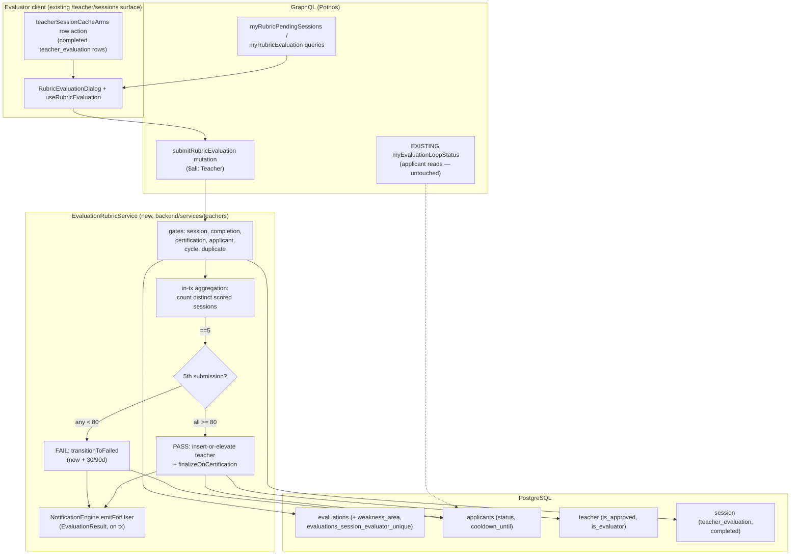

# Design: DEV2-007 — Evaluation Rubric Scoring (≥80% Threshold)

> **Date**: 2026-09-21 · **Plan directory**: `ai/plans/milestone_1_core_domain_mvp/evaluation_rubric_scoring/`
> **Specs**: `specs.md` (this directory) · **Tasks**: `tasks.md` (this directory) · **Ledger**: `deferred-items.md` (this directory) · **Outcome**: `outcome/` (this directory)
> Grounded entirely in the verified inventory at `specs.md` §4 (G1-G38). Decisions record the ONE schema delta and its sketch, the same-transaction aggregation engine, the concurrency knife-edge cases, and the no-new-route UX ruling. Every `path:line` below was re-verified against the working tree on branch `plans` at design time.

## 1. Overview

DEV2-007 implements the terminal half of the verification loop: each of the 5 DISTINCT certified evaluators booked by DEV2-006 submits a rubric evaluation — integer score 0-100 plus qualitative notes, plus a weakness area (`tajweed`/`hifz`) iff the score is below the pass threshold — against their OWN completed `teacher_evaluation` session. The system aggregates deterministically inside the 5th submission's own transaction: PASS (all 5 scores ≥ 80) creates the `teacher` row (`is_approved=true`, `is_evaluator=false`) and flips `applicants.status='passed'`; FAIL (any score < 80) flips `applicants.status='failed'` and stamps `cooldown_until = now + 30/90 days` derived from the deterministic primary failure area. The applicant is notified on both outcomes through the existing `NotificationEngine` on the existing `EvaluationResult` type.

The central design problem is trigger discipline, not arithmetic: session completion writes NO evaluations row (`SessionLifecycleService.completeSessionWithReceipt`, `backend/services/classes/session-lifecycle.service.ts:377`, is a pure status transition), so "5 sessions complete" is NOT a finalization trigger — a session can complete before its rubric is submitted. The ONLY deterministic trigger is the 5th distinct scored, session-linked, cycle-scoped submission, and it fires INSIDE its own transaction (REQ-5.2), locked on the applicant row so the verdict commits against a frozen status. Everything downstream (Cooldown State Machine, DEV2-009 conversion, Admin Override) consumes the two terminal states this plan writes — and nothing more: `users.suspended*` writes and the failed-applicant `students` row are explicit ledger deferrals D1/D2, not silent scope grabs.

### Design Goals

- **G1: Verdict atomicity** — the 5th submission's transaction is the only finalizer; the verdict commits with its submission or not at all (REQ-15.4, NFR-R2).
- **G2: Threshold truthfulness** — per-evaluation minimum ≥ 80 (80 passes, 79 fails), derived server-side, never client-supplied and never a mean (B.1, REQ-5.3/5.4).
- **G3: Write-once by construction** — the existing `evaluations_session_evaluator_unique` index is the arbiter; the service pre-check is an optimization (REQ-3, C9).
- **G4: Minimal schema ripple** — ONE pgEnum + ONE nullable column + ONE constants file; no new table, no pass/fail column, no index changes (REQ-4.5, NFR-P2).
- **G5: Zero new routes or nav items** — the evaluator surface attaches to the existing `/teacher/sessions` row actions; the applicant result UX is the existing `ApplicantStatusResolution` branches (G28/G31, REQ-12.4).

### Key Design Decisions

**D1 — Per-evaluation minimum, derived verdict (REQ-1.7, REQ-5.3).**
PASS iff ALL 5 scores are `>= RUBRIC_PASS_THRESHOLD (80)`; FAIL iff ANY score is `< 80`. This is NOT an average — B.1 pins "score ≥ 80 out of 100 on each evaluation session" (`docs/specs/open-decisions-and-gaps.md:75-79`) and FR-3.5's "passing 3 and failing 2 results in automated fail" agrees (`docs/specs/functional-requirements.md:106-110`). The per-evaluation pass/fail verdict is DERIVED (`score >= 80`), so the ticket's "pass/fail" input field is redundant: NO pass/fail column and no client flag (REQ-4.5). Boundary is exact: 80 passes, 79 fails (Tier-2 pair, REQ-14.2).

**D2 — The schema delta is exactly one enum + one nullable column + one constants file (REQ-4).**
New pgEnum `rubric_weakness_area` (`["tajweed","hifz"]`) in `backend/db/schema/enums.ts` + TS mirror `RubricWeaknessArea` with fail-closed guard + colocated `.enum.test.ts` under `backend/enum/teachers/` (the `applicant-status.enum.ts` convention, `backend/enum/teachers/applicant-status.enum.ts:12-27`). `evaluations` gains a nullable `weakness_area` column (nullable because the student-rating flow shares the table and never records one — the rubric service enforces the iff rule). New `shared/constants/evaluation-rubric.constants.ts`: `RUBRIC_PASS_THRESHOLD = 80`, `TAJWEED_COOLDOWN_DAYS = 30`, `HIFZ_COOLDOWN_DAYS = 90` (day-count form per the ticket's own parenthetical; A4 pins NO calendar-month arithmetic). `session_intent`'s `hifz`/`tajweed` are NOT reused — a session classification is not a failure-area vocabulary (G8). Applied via `bun run db push` only; no hand-written migration.

**D3 — Aggregation runs inside the rubric-submit transaction, locked on the applicant row (REQ-5).**
On every submission the service counts the applicant's current-cycle scored submissions linked to DISTINCT completed `teacher_evaluation` sessions; count < 5 → the transaction commits the submission alone. Count == 5 → threshold evaluation, primary-failure derivation, verdict writes, and the in-tx notification ALL happen in the SAME transaction (`withTransaction(outerTx, ...)` from `backend/lib/db/with-transaction.ts:42`). The applicant's row is locked (`ApplicantRepository.findForBookingGate`, FOR UPDATE, `backend/db/repo/teachers/applicant.repository.ts:216`) from the status read onward, serializing any two near-simultaneous 5th submissions (REQ-5.6). NO background job, NO cron, NO session-completion trigger.

**D4 — PASS finalization reuses the cold-start repo primitives, with a demotion guard (REQ-7).**
The teacher row is created by `TeacherRepository.insertColdStartCertified(applicantUserId, false, tx)` (`backend/db/repo/teachers/teacher.repository.ts:286` — inserts `{id, isApproved: true, isEvaluator: false}`, B.7). On a duplicate-PK 23505 (defense-in-depth: a teacher row already exists), the service locks the row via `TeacherRepository.findForEvaluationGateById` (`teacher.repository.ts:254`) and: if already `is_approved=true` → no-op (already certified); else elevates via `elevateToCertified(id, row.isEvaluator === true, tx)` (`teacher.repository.ts:319`) — the `makeEvaluator` argument is the row's OWN locked value, because `elevateToCertified` writes `isEvaluator: makeEvaluator` unconditionally and passing a blind `false` would DEMOTE a pre-existing evaluator. The applicants write is the EXISTING `ApplicantRepository.finalizeOnCertification` (`applicant.repository.ts:459`): `status='passed'`, `cooldown_until=NULL`.

**D5 — FAIL finalization is ONE new guarded repo write; everything else is deferred (REQ-8).**
New `ApplicantRepository.transitionToFailed(userId, cooldownUntil, tx)` — a single guarded UPDATE setting `status='failed'` + `cooldown_until` with the pre-state `status='in_evaluation'` folded into the WHERE (modeled on `transitionToInEvaluation`, `applicant.repository.ts:407`); 0 rows matched → `[APPLICANT_ALREADY_FINALIZED]` and the whole transaction rolls back. This and `finalizeOnCertification` are the ONLY applicants writes this ticket owns. `users.suspended`/`suspended_at`/`suspended_period_days` (Cooldown State Machine ticket — ledger D1) and the failed-applicant `students` row (DEV2-009 — ledger D2) are NOT designed here.

**D6 — Primary failure area is deterministic, never client-chosen (REQ-6).**
On FAIL: the `weakness_area` of the single lowest-scoring failing evaluation; ties broken by earliest `created_at`. The derivation is total (every failing submission carries a weakness by REQ-1.4). The area drives the duration: `tajweed` → 30 days, `hifz` → 90 days, computed against a transaction-captured `now` and stored verbatim — the strict-boundary read side (`assertCanPurchaseVerification`, `cooldownUntil > capturedNow`, `backend/services/teachers/applicant-lifecycle.service.ts:185-190`) honors the instant with no additional enforcement (REQ-8.4).

**D7 — Write-once by construction; no idempotency-key machinery (REQ-3, C9).**
The database is the replay arbiter: a second submission for the same (session, evaluator) fails `evaluations_session_evaluator_unique` (`backend/db/schema/teachers/evaluations.ts:61`) with raw 23505, which the service maps to `[EVALUATION_ALREADY_SUBMITTED]`. The service ALSO pre-checks via a new `EvaluationRepository.findBySessionAndEvaluator` for the clean typed error on the common path, but correctness never depends on it. The mutation therefore consumes NO `ctx.idempotencyKey` claim: a claim key would add bookkeeping that the unique index already guarantees (DEV2-006 needed claims because it MINTS rows; DEV2-007's replay is index-arrested — G11/G12).

**D8 — Minimal GraphQL surface, one new read-model type (REQ-11, G16).**
One flat root mutation file `backend/graphql/mutation/evaluation-rubric.mutation.ts` exposing `submitRubricEvaluation` (Teacher-only `$all` scope, the `submitTeacherEvaluation` precedent at `backend/graphql/mutation/classes/student-evaluation.mutation.ts:54-69`), and one query file `backend/graphql/query/teachers/evaluation-rubric.query.ts` exposing `myRubricPendingSessions` (the evaluator's not-yet-scored completed evaluation sessions — final name pinned here per REQ-11.3) and `myRubricEvaluation` (an evaluator's own submission for one session). All three are backed by a NEW `RubricEvaluationReturnType` + Pothos object in `backend/types/teachers/evaluation.types.ts` + `backend/graphql/pothos/teachers/evaluation-rubric.pothos.ts`; the canonical `Evaluation` object and `EvaluationReturnType` are deliberately UNTOUCHED and the rubric read-model deliberately OMITS `notes` (server-side detail; D3-G16 posture; evaluator-visibility is a ledger deferral per G16). The applicant consumes aggregated loop state via the EXISTING `myEvaluationLoopStatus` (`backend/graphql/query/teachers/evaluation-booking.query.ts:80`) and `myApplicantProfile` — no duplication (REQ-11.4). NO cross-applicant introspection field exists: the service resolves the evaluated applicant from the session, never from client args.

**D9 — Notifications ride the existing engine and the existing `EvaluationResult` type (REQ-9).**
`NotificationType.EvaluationResult` (`backend/enum/notifications/notification-type.enum.ts:14`) is a fitting value for BOTH outcomes — no enum addition. The service composes title/body in the APPLICANT'S persisted locale (the recipient-locale composition obligation, `backend/services/classes/session-request-notification.service.ts:30-33` — `users.locale` is nullable, fallback `defaultLocale`), emits via `NotificationEngine.emitForUser(input, locale, tx)` (`backend/services/notifications/notification-engine.service.ts:42`) INSIDE the finalizing transaction, and publishes via `NotificationEngine.publishReceipts` (`notification-engine.service.ts:116`) strictly POST-COMMIT (the cold-start discipline, `backend/services/admin/cold-start-certification.service.ts:216-237`): `withTransaction` returns the receipt; any throw leaves zero residual rows and zero pushes.

**D10 — No new routes, no nav change; the sessions-namespace copy decision (REQ-12).**
`navItems.ts` is untouched; there is no bottom nav in this project (mobile bottom navigation was A3-deferred). The evaluator surface is a row action on completed `teacher_evaluation` rows in `/teacher/sessions` (the `Completed` affordance matrix at `frontend/views/teacher/sessions/teacherSessionCacheArms.ts:132-165` — currently `report` only) plus a new dialog + hook under the same directory. Dialog copy lives in the EXISTING `sessions` namespace: the rubric dialog is teacher-session-surface copy exactly like the report/rate-teacher dialogs (RateTeacherDialog draws `sessions.rateTeacherSuccess` from `shared/locale/types/sessions/labels.ts:192`), and a ~10-key dialog does not justify fragmenting the session-surface convention with a new namespace + parity test file. New keys go in `types + en + ar + parity test` for `sessions` (dialog), `applicant` (notification copy), and `errors` (§5.3).

## 2. Architecture


### Component Inventory

| Component | Path | Change |
|---|---|---|
| pgEnum registry | `backend/db/schema/enums.ts:43` (after `sessionIntent`) | UPDATE — add `rubricWeaknessArea = pgEnum("rubric_weakness_area", ["tajweed", "hifz"])` |
| `evaluations` table | `backend/db/schema/teachers/evaluations.ts:34-62` | UPDATE — add nullable `weakness_area` column (`evaluations.ts:44-47` region, after `notes`) + correct the header docblock (`evaluations.ts:9-13`) to name DEV2-007 as its writer |
| Weakness TS enum | `backend/enum/teachers/rubric-weakness-area.enum.ts` | CREATE — `RubricWeaknessArea` enum + fail-closed `isRubricWeaknessArea` guard, the `applicant-status.enum.ts:12-27` pattern |
| Weakness enum test | `backend/enum/teachers/rubric-weakness-area.enum.test.ts` | CREATE — colocated guard tests (`applicant-status.enum.test.ts` convention) |
| Enum barrel | `backend/enum/teachers/index.ts` | UPDATE — re-export the new enum + guard |
| Rubric constants | `shared/constants/evaluation-rubric.constants.ts` | CREATE — `RUBRIC_PASS_THRESHOLD`, `TAJWEED_COOLDOWN_DAYS`, `HIFZ_COOLDOWN_DAYS` (+ optional `RUBRIC_NOTES_MAX_LENGTH = 2000`) |
| Constants barrel | `shared/constants/index.ts` | UPDATE — `export * from "./evaluation-rubric.constants"` (the `verification-plan.constants.ts` re-export at `index.ts:6`) |
| Evaluation types | `backend/types/teachers/evaluation.types.ts` | UPDATE — add `RubricEvaluationSubmitInput`, `RubricSubmissionInsertInput`, `RubricEvaluationReturnType`, `RubricCycleSubmissionRow` (canonical `Evaluation` types untouched) |
| Evaluation repository | `backend/db/repo/teachers/evaluation.repository.ts` | EXTEND — widen the `insertOnce` Pick (`evaluation.repository.ts:89-98`) with `notes`/`weaknessArea`; add `findBySessionAndEvaluator`, `listCycleRubricSubmissions` |
| Applicant repository | `backend/db/repo/teachers/applicant.repository.ts` | EXTEND — add `transitionToFailed` (near `transitionToInEvaluation`, `applicant.repository.ts:407`); `findForBookingGate` (`:216`) and `finalizeOnCertification` (`:459`) REUSED unchanged |
| Teacher repository | `backend/db/repo/teachers/teacher.repository.ts` | REUSE — `findForEvaluationGateById` (`:254`), `insertColdStartCertified` (`:286`), `elevateToCertified` (`:319`) unchanged |
| Session evaluation helpers | `backend/db/repo/classes/session.repository.evaluation.helpers.ts` | EXTEND — namespace delegate `listCompletedRubricPendingSessions` + `countScoredRubricSessionsForApplicant` (beside `resolveCurrentEvaluationCycle` `:138` / `countEvaluationBookingsInCycle` `:180` / `listEvaluationSessionsForApplicant` `:225`) |
| Session repository | `backend/db/repo/classes/session.repository.ts` | REUSE — `findById` (`:140`) for the gated session read |
| Rubric service | `backend/services/teachers/evaluation-rubric.service.ts` | CREATE — `EvaluationRubricService.submitRubricEvaluation` + `myRubricPendingSessions` + `myRubricEvaluation` |
| Rubric service helpers | `backend/services/teachers/evaluation-rubric.helpers.ts` | CREATE — in-tx pipeline `submitRubricEvaluationInTx`, `deriveRubricVerdict`, `derivePrimaryFailureArea`, `resolveFinalizationCooldownUntil` (the `evaluation-booking.helpers.ts:254-285` convention) |
| Pothos rubric defs | `backend/graphql/pothos/teachers/evaluation-rubric.pothos.ts` | CREATE — `RubricEvaluationSubmitPothosInput` + `RubricEvaluationPothosObject` (no local types; `@/backend/types` only) |
| Pothos enum registration | `backend/graphql/pothos/shared/enum.pothos.ts:158` region | UPDATE — `RubricWeaknessAreaPothosEnum = gqlSchemaBuilder.enumType(RubricWeaknessArea, ...)` (the `SessionTypePothosEnum` pattern) |
| Mutation file | `backend/graphql/mutation/evaluation-rubric.mutation.ts` | CREATE — flat root, side-effect `gqlSchemaBuilder.mutationField`, NO named exports |
| Mutation barrel | `backend/graphql/mutation/index.ts` | UPDATE — one side-effect `import "./evaluation-rubric.mutation"` (regenerates `bun run generate:gqlSchema`) |
| Query file | `backend/graphql/query/teachers/evaluation-rubric.query.ts` | CREATE — `myRubricPendingSessions` + `myRubricEvaluation` (Teacher-scoped) |
| Query barrel | `backend/graphql/query/teachers/index.ts` | UPDATE — side-effect import for the new query file |
| i18n — errors namespace | `shared/locale/types/errors/labels.ts` + `shared/locale/en/errors/` + `shared/locale/ar/errors/` + `shared/locale/errors-namespace.parity.test.ts` | UPDATE — 7 new keys beside the existing rubric-adjacent block (`labels.ts:298-312`) |
| i18n — applicant namespace | `shared/locale/types/applicant/index.ts` + en + ar + `applicant-namespace.parity.test.ts` | UPDATE — 4 new notification keys (cold-start compose precedent) |
| i18n — sessions namespace | `shared/locale/types/sessions/labels.ts` + en + ar + `sessions-namespace.parity.test.ts` | UPDATE — ~10 dialog keys (D10) |
| Notification engine | `backend/services/notifications/notification-engine.service.ts` | REUSE — `emitForUser` (`:42`) + `publishReceipts` (`:116`) unchanged |
| Frontend documents | `frontend/graphql/sharedDocuments/teachers/evaluation-rubric.documents.ts` | CREATE — `submitRubricEvaluationMutationDocument`, `myRubricPendingSessionsQueryDocument`, `myRubricEvaluationQueryDocument` (+ `sharedDocuments/teachers` barrel import row) |
| Apollo error map | `frontend/providers/apollo/error-link.map.ts` | UPDATE — map the 7 new codes to `Errors` namespace keys |
| Row actions | `frontend/views/teacher/sessions/teacherSessionCacheArms.ts` | UPDATE — `teacherActionsForSession` gains a `submitEvaluation` affordance on completed `teacher_evaluation` rows (`:132-165`) + `TeacherActionsWiring` extension |
| Row actions test | `frontend/views/teacher/sessions/teacherSessionCacheArms.test.ts` | UPDATE — affordance matrix rows for the new action |
| Rubric dialog | `frontend/views/teacher/sessions/RubricEvaluationDialog.tsx` | CREATE — MUI v9 dialog (score 0-100, notes, conditional weakness select) |
| Rubric hook | `frontend/views/teacher/sessions/useRubricEvaluation.ts` | CREATE — mutation arm + pending-query arm + cache harmonics |
| Sessions container wiring | `frontend/views/teacher/sessions/TeacherSessionsContainer.tsx` + `useTeacherLifecycleMutations.ts` | UPDATE — open the dialog from the new row action; refetch pending list on success |
| Storybook story | `frontend/stories/teachers/RubricEvaluationDialog.stories.tsx` | CREATE — default/pass-eligible/below-threshold/error states (existing `frontend/stories/teachers/` convention) |
| Repo tests | `backend/db/test/repo/teachers/evaluation.repository.test.ts` · `applicant.repository.transition.test.ts` | EXTEND — new-method coverage in the `runInRollback` + `expectRepoError` convention |
| Service test | `backend/services/teachers/evaluation-rubric.service.test.ts` | CREATE — gate matrix + threshold + cooldown derivation |
| GraphQL test | `frontend/graphql/test/teachers/evaluation-rubric.test.ts` | CREATE — `testClient` integration (the `evaluation-booking.test.ts` convention) |
| Journey test | `test/workflows/teachers/evaluation-rubric-scoring.journey.test.ts` | CREATE — REQ-13 Tier-4 contract |
| DBML mirror | `db/schema.dbml:348-365` | UPDATE — add `rubric_weakness_area` enum + `weakness_area` column (Drizzle remains canonical) |

**Tech stack** — unchanged: Bun runtime, Drizzle schema → `db push`, Pothos → `generate:gqlSchema` + `bun codegen`, Apollo Client v4 hooks from `@apollo/client/react`, Zustand stores untouched (all new state is server state via Apollo cache), MUI v9 `sx`-only styling, compile-time i18n in `shared/locale/`.

## 3. Data Models

### 3.1 Schema delta (the ONLY DDL)

`backend/db/schema/enums.ts` — one new pgEnum (registered after `sessionIntent`, `enums.ts:42`):

```diff
+export const rubricWeaknessArea = pgEnum("rubric_weakness_area", ["tajweed", "hifz"]);
```

`backend/db/schema/teachers/evaluations.ts:34-62` — one nullable column (after `notes`, `evaluations.ts:46`):

```diff
     sessionId: integer("session_id").references(() => session.id, { onDelete: "set null" }),
     score: integer("score"),
     notes: text("notes"),
+    weaknessArea: rubricWeaknessArea("weakness_area"),
     isDeleted: boolean("is_deleted").default(false),
```

Nothing else changes: no new table, no pass/fail column, no index, no constraint, no DEFAULT. The student-rating flow (the table's other writer, `backend/services/teachers/student-evaluation.service.ts:248`) keeps writing `weakness_area = NULL` implicitly — nullable-by-design because both flows share the table and only the rubric service enforces the iff rule (REQ-4.2). The schema header docblock (`evaluations.ts:9-13`) is corrected in the same task: rubric rows are session-linked (session_id NOT NULL for rubric submissions) and `evaluations_session_evaluator_unique` is the write-once arbiter for BOTH flows (G2, REQ-3.4).

`shared/constants/evaluation-rubric.constants.ts` (NEW — all values as const, `verification-plan.constants.ts:18,21` convention):

```ts
/** B.1: minimum score per evaluation session; 80 passes, 79 fails. */
export const RUBRIC_PASS_THRESHOLD = 80 as const;
/** Ticket AC: "1-month Tajweed" cooldown pinned to the day-count form (A4). */
export const TAJWEED_COOLDOWN_DAYS = 30 as const;
/** Ticket AC: "3-month Hifz" cooldown pinned to the day-count form (A4). */
export const HIFZ_COOLDOWN_DAYS = 90 as const;
/** Bounded qualitative-observations field ("notes contains qualitative observations"). */
export const RUBRIC_NOTES_MAX_LENGTH = 2000 as const;
```

### 3.2 Tables touched

| Table | Read / Write | How |
|---|---|---|
| `evaluations` | write (one INSERT per submission) + read | `insertOnce` with `session_id` set, `evaluated_id = session.studentId`, `evaluator_id = caller`, `score`, `notes`, `weakness_area` (REQ-3.1) — 23505 on the unique index is the duplicate arbiter |
| `evaluations` (read) | read | duplicate pre-check + the cycle quorum read (`listCycleRubricSubmissions`) + pending-sessions anti-join |
| `applicants` | read (FOR UPDATE) + write | `findForBookingGate` lock (`applicant.repository.ts:216`); PASS: `finalizeOnCertification` (`:459`); FAIL: `transitionToFailed` (new) — the ONLY applicants writes (D5) |
| `teacher` | read (FOR UPDATE) + write | certification gate (`findForEvaluationGateById` `teacher.repository.ts:254`); PASS: `insertColdStartCertified` (`:286`) / `elevateToCertified` (`:319`) — existing row writes NOT owned by this ticket |
| `session` | read only | gated session read (`SessionRepository.findById`, `session.repository.ts:140`) + pending-sessions read; the session row is never written here |
| `subscriptions` / `plans` | read only | cycle window via the EXISTING `resolveCurrentEvaluationCycle` (`session.repository.evaluation.helpers.ts:138`) |
| `users` | read only | applicant's persisted locale for notification composition (`users.locale`, D9) |

### 3.3 Types (all canonical, `backend/types/teachers/evaluation.types.ts`)

| Type | File | Status |
|---|---|---|
| `RubricWeaknessArea` + `isRubricWeaknessArea` guard | `backend/enum/teachers/rubric-weakness-area.enum.ts` | CREATE (value imports everywhere — REQ-0.5.2) |
| `RubricEvaluationSubmitInput` (service input) | `backend/types/teachers/evaluation.types.ts` | CREATE |
| `RubricSubmissionInsertInput` (narrow sealed insert payload) | `backend/types/teachers/evaluation.types.ts` | CREATE |
| `RubricEvaluationReturnType` (read-model) | `backend/types/teachers/evaluation.types.ts` | CREATE |
| `RubricCycleSubmissionRow` (quorum read row) | `backend/types/teachers/evaluation.types.ts` | CREATE |
| `EvaluationSelectType` / `EvaluationInsertType` | `backend/types/teachers/evaluation.types.ts:3,5` | DERIVED-UPDATE (the new column flows in via `$inferSelect`/`$inferInsert`) |
| `EvaluationReturnType` / `EvaluationSubmitInput` | `backend/types/teachers/evaluation.types.ts:14,32` | UNTOUCHED (student-rating surface; notes stay omitted — D8) |
| `SessionSelectType` / `SessionReturnType` / `SessionPageReturnType` | `backend/types/classes/session.types.ts` | REUSE |
| `ApplicantSelectType` | `backend/types/teachers/applicant.types.ts` | REUSE |

**BOPLA discipline:** the mutation input is the SEALED `RubricEvaluationSubmitInput { score, notes, weaknessArea }` — the client controls exactly those three fields plus `sessionId` (arg, not input). `evaluatedId`, `evaluatorId`, the session link, and the finalization side-effects are ALL resolved server-side (REQ-3.1, NFR-S1).

## 4. Components & Interfaces (exact signatures)

### 4.1 Types — `backend/types/teachers/evaluation.types.ts` (appended) and `backend/enum/teachers/rubric-weakness-area.enum.ts` (NEW)

```ts
// backend/enum/teachers/rubric-weakness-area.enum.ts — NEW
// Mirrors the `rubric_weakness_area` pgEnum in backend/db/schema/enums.ts.
export enum RubricWeaknessArea {
  Tajweed = "tajweed",
  Hifz = "hifz",
}
export function isRubricWeaknessArea(value: unknown): value is RubricWeaknessArea {
  return typeof value === "string"
    && (Object.values(RubricWeaknessArea) as string[]).includes(value);
}
```

```ts
// backend/types/teachers/evaluation.types.ts — appended types
import { RubricWeaknessArea } from "@/backend/enum/teachers/rubric-weakness-area";
import { ApplicantStatus } from "@/backend/enum/teachers/applicant-status";

/** The evaluator's rubric submission. `weaknessArea` is required iff score < RUBRIC_PASS_THRESHOLD. */
export interface RubricEvaluationSubmitInput {
  /** Integer 0..100 (INV-E1: the DB check is the last-resort backstop, not the gate). */
  readonly score: number;
  /** Trimmed-non-empty qualitative observations, <= RUBRIC_NOTES_MAX_LENGTH (2000). */
  readonly notes: string;
  /** Failure-area iff failing; the isRubricWeaknessArea guard rejects foreign values pre-DB. */
  readonly weaknessArea: RubricWeaknessArea | null;
}

/** Sealed insert payload the service assembles — never spread from client input. */
export interface RubricSubmissionInsertInput {
  readonly evaluatedId: number;      /* = session.studentId — server-resolved */
  readonly evaluatorId: number;      /* = ctx.user.id — server-resolved */
  readonly sessionId: number;        /* the completed teacher_evaluation session */
  readonly score: number;
  readonly notes: string;
  readonly weaknessArea: RubricWeaknessArea | null;
}

/** One quorum-read row: a scored rubric submission of the current cycle. */
export interface RubricCycleSubmissionRow {
  readonly id: number;
  readonly sessionId: number;
  readonly evaluatorId: number;
  readonly score: number;
  readonly weaknessArea: RubricWeaknessArea | null;
  readonly createdAt: Date;
}

/**
 * Rubric read-model (the `RubricEvaluation` GraphQL object's backing type).
 * `notes` stays server-side: the G16/D3 posture keeps evaluator notes out of
 * every transport until the Admin Override ticket owns their visibility.
 */
export interface RubricEvaluationReturnType {
  readonly id: number;
  readonly sessionId: number | null;
  readonly evaluatedId: number;
  readonly evaluatorId: number;
  readonly score: number | null;
  readonly weaknessArea: RubricWeaknessArea | null;
  readonly createdAt: Date;
  /**
   * LIVE post-write applicant status — 'passed'/'failed' when THIS submission
   * finalized the cycle, 'in_evaluation' while the quorum is pending. Lets the
   * evaluator's UI (and the journey test) observe finalization on the 5th
   * submit without any new applicant read surface.
   */
  readonly applicantStatus: ApplicantStatus;
}
```

### 4.2 Repository extensions

`backend/db/repo/teachers/evaluation.repository.ts` (append; `insertOnce` Pick widened — the new members are optional in `EvaluationInsertType`, so the student-rating call site `student-evaluation.service.ts:180` stays type-compatible):

```ts
export async function insertOnce(
  values: Pick<EvaluationInsertType,
    "evaluatedId" | "evaluatorId" | "sessionId" | "score"
    | "notes" | "weaknessArea">,               /* was: 4-member Pick (:89-98) */
  tx: DBTransaction
): Promise<EvaluationSelectType>

export async function findBySessionAndEvaluator(
  sessionId: number,
  evaluatorId: number,
  tx: DBTransaction
): Promise<EvaluationSelectType | null>
/* Single indexed read on evaluations_session_evaluator_unique — the service's
   duplicate PRE-CHECK (an optimization; the index is the arbiter). */

export async function listCycleRubricSubmissions(
  applicantUserId: number,
  cycleStart: Date,
  tx: DBTransaction
): Promise<readonly RubricCycleSubmissionRow[]>
/* evaluations INNER JOIN session ON evaluations.session_id = session.id WHERE
   session.student_id = applicant AND session.session_type = 'teacher_evaluation'
   AND session.status = 'completed' AND evaluations.score IS NOT NULL
   AND session.created_at >= cycleStart — bounded by the 5-credit ceiling (NFR-P3). */
```

`backend/db/repo/teachers/applicant.repository.ts` (append; the ONLY new applicants write — D5):

```ts
export async function transitionToFailed(
  userId: number,
  cooldownUntil: Date,
  tx: DBTransaction
): Promise<ApplicantSelectType | null>
/* Single guarded UPDATE: status='failed', cooldown_until=<arg>, updated_at=now()
   with the pre-state `status='in_evaluation'` folded into the WHERE (the
   transitionToInEvaluation pattern, :407). tx is REQUIRED: the write exists
   solely inside the finalization transaction — the atomicity IS the contract.
   Returns null on 0 rows (a concurrent finalization won) — the service maps
   that to APPLICANT_ALREADY_FINALIZED and rolls the whole transaction back. */
```

`backend/db/repo/classes/session.repository.evaluation.helpers.ts` (append + namespace delegate in `session.repository.ts`):

```ts
export async function listCompletedRubricPendingSessions(
  evaluatorUserId: number,
  filter: { page: number; pageSize: number },
  tx: DBTransaction
): Promise<{ items: SessionSelectType[]; totalCount: number }>
/* session LEFT JOIN evaluations ON evaluations.session_id = session.id AND
   evaluations.evaluator_id = evaluatorUserId WHERE evaluations.id IS NULL
   AND session.teacher_id = evaluator AND session.session_type =
   'teacher_evaluation' AND session.status = 'completed' — the evaluator's
   own not-yet-scored rows. Pagination normalized per listEvaluationSessions-
   ForApplicant (:225): defaults page=1, pageSize=25, pageSize max 100. */
```

### 4.3 Service: `EvaluationRubricService` (`backend/services/teachers/evaluation-rubric.service.ts` + `.helpers.ts`)

```ts
export namespace EvaluationRubricService {
  export async function submitRubricEvaluation(
    evaluatorUserId: number,
    sessionId: number,
    input: RubricEvaluationSubmitInput,
    locale: string,
    outerTx?: DBTransaction
  ): Promise<RubricEvaluationReturnType>;

  export async function myRubricPendingSessions(
    callerUserId: number,
    page: number,
    pageSize: number,
    locale: string,
    outerTx?: DBTransaction
  ): Promise<SessionPageReturnType>;

  export async function myRubricEvaluation(
    callerUserId: number,
    sessionId: number,
    locale: string,
    outerTx?: DBTransaction
  ): Promise<RubricEvaluationReturnType>;
}
```

`submitRubricEvaluation` — submission gates + same-tx aggregation. ALL in ONE transaction unless noted (REQ-2, REQ-5):

1. Resolve `t = getServerTranslations(locale).errorsTranslations`; `isPositiveSafeInteger(evaluatorUserId)` and `isPositiveSafeInteger(sessionId)` else `ValidationError` — pre-DB, zero reads.
2. **Pre-DB validation (REQ-1, zero DB reads):** `Number.isInteger(input.score) && score >= 0 && score <= 100` else `[RUBRIC_SCORE_INVALID]`; trimmed `notes` non-empty and `<= RUBRIC_NOTES_MAX_LENGTH` else `[RUBRIC_NOTES_REQUIRED]`; `score < RUBRIC_PASS_THRESHOLD && weaknessArea == null` → `[RUBRIC_WEAKNESS_REQUIRED]`; `score >= RUBRIC_PASS_THRESHOLD && weaknessArea != null` → `[RUBRIC_WEAKNESS_NOT_ALLOWED]`; `weaknessArea != null && !isRubricWeaknessArea(weaknessArea)` → `[RUBRIC_WEAKNESS_INVALID]`.
3. `assertActorGovernanceClean(evaluatorUserId, t, outerTx)` — deleted/blocked/suspended callers never score (REQ-2.6; the `backend/services/classes/session-lifecycle.governance.ts:47` seam).
4. `withTransaction(outerTx, tx => submitRubricEvaluationInTx(...))` (REQ-15.4: the transaction owns everything below).

In-transaction order (fixed):

5. **Session gate:** `SessionRepository.findById(sessionId, tx)` (`session.repository.ts:140`) → row null, OR `sessionType !== SessionType.TeacherEvaluation`, OR `intent !== SessionIntent.Evaluation`, OR `teacherId !== evaluatorUserId` → `NotFoundError` `[SESSION_NOT_FOUND]` — unknown, foreign, and untyped are indistinguishable (REQ-2.2, NFR-S3).
6. `session.status !== SessionStatus.Completed` → `ConflictError` `[RUBRIC_SESSION_NOT_COMPLETED]` (REQ-2.3).
7. **Certification re-check, fresh in tx:** `TeacherRepository.findForEvaluationGateById(evaluatorUserId, tx)` (`teacher.repository.ts:254`, FOR UPDATE + governance projection) → null, `isApproved !== true`, or `isEvaluator !== true` → `ConflictError` `[TEACHER_NOT_CERTIFIED]` (REQ-2.1) — re-verified at submission time, never at booking time.
8. **Applicant lock + status gate:** `ApplicantRepository.findForBookingGate(session.studentId, tx)` (`applicant.repository.ts:216`, FOR UPDATE) → null OR `status !== ApplicantStatus.InEvaluation` → `ConflictError` `[APPLICANT_NOT_IN_EVALUATION]` (REQ-2.4). The evaluated subject is ALWAYS `session.studentId` — never client-supplied.
9. **Cycle membership:** `resolveCurrentEvaluationCycle(session.studentId, tx)` (`session.repository.evaluation.helpers.ts:138`) → `cycleStart === null` OR `session.createdAt < cycleStart` → `NotFoundError` `[SESSION_NOT_FOUND]` (a prior-cycle session is indistinguishable from an unknown one — REQ-2.4 cycle membership, NFR-S3).
10. **Duplicate pre-check:** `EvaluationRepository.findBySessionAndEvaluator(sessionId, evaluatorUserId, tx)` → row exists → `ConflictError` `[EVALUATION_ALREADY_SUBMITTED]` (REQ-3.2).
11. **Insert the submission:** `EvaluationRepository.insertOnce({ evaluatedId: session.studentId, evaluatorId: evaluatorUserId, sessionId, score, notes, weaknessArea }, tx)` — a 23505 in the cause-chain maps to `[EVALUATION_ALREADY_SUBMITTED]` (the index-arbiter race path, REQ-3.3).
12. **Quorum read (same tx, under the applicant lock):** `listCycleRubricSubmissions(session.studentId, cycleStart, tx)` → count DISTINCT sessions/evaluators (the unique index already guarantees per-pair uniqueness). **count < 5** → return the submission read-model with `applicantStatus: ApplicantStatus.InEvaluation` — NO verdict writes (REQ-5.1).
13. **count == 5 → finalize in the SAME tx (REQ-5.2):** verdict = PASS iff every `score >= RUBRIC_PASS_THRESHOLD` else FAIL (D1).
    - **PASS:** (a) `TeacherRepository.insertColdStartCertified(session.studentId, false, tx)`; on 23505 → `findForEvaluationGateById(session.studentId, tx)` → already `isApproved === true` → no-op; else `elevateToCertified(session.studentId, row.isEvaluator === true, tx)` (D4: the locked row's own evaluator flag — never a blind false). (b) `ApplicantRepository.finalizeOnCertification(session.studentId, tx)` (`applicant.repository.ts:459`) → `false` → `ConflictError` `[APPLICANT_ALREADY_FINALIZED]` + rollback (defense-in-depth; REQ-7.3).
    - **FAIL:** primary area = `derivePrimaryFailureArea(submissions)` (lowest score < 80; ties → earliest `createdAt` — REQ-6.1/6.2); `cooldownUntil = deriveFinalizationCooldownUntil(area, capturedNow)` (30/90 days — D6); `ApplicantRepository.transitionToFailed(session.studentId, cooldownUntil, tx)` → `null` → `ConflictError` `[APPLICANT_ALREADY_FINALIZED]` + rollback (REQ-8.1/8.2). NO `users.suspended*` write, NO `students` row, NO role flip (REQ-8.3/8.5).
14. **In-tx notification (finalizing submissions only, REQ-9.1):** compose title/body in the APPLICANT'S persisted locale (users.locale, fallback `defaultLocale` — D9) from the `applicant` namespace keys; `NotificationEngine.emitForUser({ userId: session.studentId, type: NotificationType.EvaluationResult, title, body, relatedEntityType: "session", relatedEntityId: sessionId }, recipientLocale, tx)` → receipt.
15. Return the submission read-model with the post-verdict `applicantStatus` (`Passed`/`Failed`) and the receipt OUT of the transaction.
16. **Post-commit (outside the tx):** `NotificationEngine.publishReceipts([receipt], recipientLocale)` — strictly after `withTransaction` resolves (REQ-9.2); a publish failure is logged by the engine and NEVER rolls back or retries the verdict (NFR-R1). If the tx threw, the receipt is never published and the in-tx insert rolled back with it (REQ-9.3).

`myRubricPendingSessions`: certification gate (`findForEvaluationGateById`, non-locking `tx`-bound read via `queryDb(tx)`) then `listCompletedRubricPendingSessions` — the caller's OWN rows by construction. `myRubricEvaluation`: `findBySessionAndEvaluator(sessionId, callerUserId)` → null (unknown OR foreign — indistinguishable) → `NotFoundError` `[SESSION_NOT_FOUND]`; a hit returns the read-model (notes omitted, D8).

## 5. API Contract (GraphQL SDL + Permission Matrix)

### 5.1 New Pothos types (`backend/graphql/pothos/teachers/evaluation-rubric.pothos.ts`) + root fields

```graphql
enum RubricWeaknessArea { Tajweed Hifz }

input RubricEvaluationSubmitInput {
  "Integer 0..100 — the per-evaluation verdict is DERIVED (score >= 80), never supplied."
  score: Int!
  "Qualitative observations (trimmed non-empty, <= 2000 chars)."
  notes: String!
  "Failure area — required iff score < 80, forbidden otherwise."
  weaknessArea: RubricWeaknessArea
}

type RubricEvaluation {
  id: ID!
  sessionId: ID
  evaluatedId: ID!
  evaluatorId: ID!
  score: Int
  weaknessArea: RubricWeaknessArea
  createdAt: DateTime!
  "LIVE applicant status at read time — 'passed'/'failed' once the cycle finalized."
  applicantStatus: ApplicantStatus!
}

extend type Mutation {
  "Submit the calling evaluator's rubric for one of their completed teacher_evaluation sessions. Write-once per (session, evaluator). Teacher-only."
  submitRubricEvaluation(sessionId: ID!, input: RubricEvaluationSubmitInput!): RubricEvaluation!
}

extend type Query {
  "The calling certified evaluator's completed evaluation sessions with NO rubric submission yet (paged)."
  myRubricPendingSessions(page: Int, pageSize: Int): SessionPage!
  "The calling evaluator's own rubric submission for one session (unknown/foreign -> SESSION_NOT_FOUND)."
  myRubricEvaluation(sessionId: ID!): RubricEvaluation
}
```

All three root fields live in `backend/graphql/mutation/evaluation-rubric.mutation.ts` (flat root, NO named exports, side-effect barrel import in `backend/graphql/mutation/index.ts`) and `backend/graphql/query/teachers/evaluation-rubric.query.ts` (barrel: `backend/graphql/query/teachers/index.ts`). Resolver shape: `authScopes: { $all: { authenticated: true, role: [UserRole.Teacher] } }` (the conjunction form — `student-evaluation.mutation.ts:64-69`); resolver i18n via `const tErrors = await ctx.t("errorsTranslations")` (`evaluation-booking.mutation.ts:74`); delegate with `ctx.user.id` + `ctx.locale` only. **`ctx.idempotencyKey` is deliberately NOT consumed** — D7. The pending read reuses the canonical `SessionPage` (`backend/graphql/pothos/classes/session.pothos.ts:2-7`); the mutation returns the NEW `RubricEvaluation` object (notes deliberately absent, D8). `RubricWeaknessAreaPothosEnum` registers once in `backend/graphql/pothos/shared/enum.pothos.ts` (`enumType(RubricWeaknessArea, ...)`). SDL changes require `bun run generate:gqlSchema` + `bun codegen` (REQ-11.5).

### 5.2 Permission Matrix

| Field | Scope | Granted to | Denied to |
|---|---|---|---|
| `submitRubricEvaluation` | `$all: { authenticated: true, role: [UserRole.Teacher] }` | the session's OWN certified evaluator (`teacher.is_approved && is_evaluator`, re-checked in-tx) | anonymous → `UNAUTHORIZED`; authenticated non-teacher (student/parent/admin) → FORBIDDEN at the scope (BFLA, REQ-2.5); a Teacher-role user without the teacher row/flags → `[TEACHER_NOT_CERTIFIED]`; non-assigned certified evaluator → `[SESSION_NOT_FOUND]` (indistinguishable) |
| `myRubricPendingSessions` | same `$all` conjunction | certified evaluators (their OWN rows by construction) | non-certified teachers → empty page + `logDomainError` (oracle-safe: nothing revealed); anonymous/non-teacher at the scope |
| `myRubricEvaluation` | same `$all` conjunction | the caller's OWN (session, evaluator) row | unknown OR foreign session → `SESSION_NOT_FOUND` (identical denial — no oracle) |
| Applicant reads | — | EXISTING `myEvaluationLoopStatus` + `myApplicantProfile` | NO new applicant-facing read surface (REQ-11.4) |

No permission strings exist anywhere in the codebase and none are invented (G33): the "full teaching permissions" the ticket grants on PASS is realized as `teacher.is_approved = true` (REQ-7.2).

### 5.3 Error codes (all via GraphQL 200 + `errors[].extensions.code`; the ticket's "422" prose is code-level truth, never a REST status)

| Code | Class | Trigger | i18n key (errors namespace) |
|---|---|---|---|
| `RUBRIC_SCORE_INVALID` | ValidationError | score not an integer in [0,100] — pre-DB, zero reads | `rubricScoreInvalid` (NEW) |
| `RUBRIC_NOTES_REQUIRED` | ValidationError | notes missing/empty-after-trim/over 2000 — pre-DB | `rubricNotesRequired` (NEW) |
| `RUBRIC_WEAKNESS_REQUIRED` | ValidationError | score < 80 without a weakness | `rubricWeaknessRequired` (NEW) |
| `RUBRIC_WEAKNESS_NOT_ALLOWED` | ValidationError | score >= 80 with a weakness | `rubricWeaknessNotAllowed` (NEW) |
| `RUBRIC_WEAKNESS_INVALID` | ValidationError | weakness value fails the fail-closed guard | `rubricWeaknessInvalid` (NEW) |
| `RUBRIC_SESSION_NOT_COMPLETED` | ConflictError | session owned/typed correctly but not `completed` | `rubricSessionNotCompleted` (NEW) |
| `APPLICANT_ALREADY_FINALIZED` | ConflictError | guarded verdict write matched 0 rows (concurrent finalization won) | `applicantAlreadyFinalized` (NEW) |
| `SESSION_NOT_FOUND` | NotFoundError('SESSION') | unknown, foreign, untyped, OR prior-cycle session — indistinguishable | `sessionNotFound` (existing, `labels.ts:225`) |
| `TEACHER_NOT_CERTIFIED` | ConflictError | caller's teacher row missing, `is_approved != true`, or `is_evaluator != true` | `teacherNotCertified` (existing, `labels.ts:229`) |
| `EVALUATION_ALREADY_SUBMITTED` | ConflictError | duplicate (service pre-check OR 23505 on `evaluations_session_evaluator_unique`) | `evaluationAlreadySubmitted` (existing, `labels.ts:300`) |
| `APPLICANT_NOT_IN_EVALUATION` | ConflictError | no applicants row / status != `in_evaluation` at lock time | `applicantNotInEvaluation` (existing, `labels.ts:310`) |

One code per distinct denial — a non-evaluation session type, a foreign session, and an unknown session all fold into `SESSION_NOT_FOUND` (REQ-2.2); a non-certified caller folds into `TEACHER_NOT_CERTIFIED` (REQ-2.1). Every NEW key lands as type leaf + en + ar + `errors-namespace.parity.test.ts` extension in the same task beside the existing rubric-adjacent block (`shared/locale/types/errors/labels.ts:298-312`) — REQ-10.3. The frontend map (`frontend/providers/apollo/error-link.map.ts`) gains one row per new code; toast copy resolves from the `errors.errors` namespace via the existing action listener seam.

### 5.4 Concurrency & Race Assessment (REQUIRED — the quorum and write-once are state-bound)

| Scenario | Actors | Mitigation |
|---|---|---|
| TOCTOU: two evaluators submit near-simultaneously as #4 and #5 of the same applicant | E4, E5 | Both transactions take the applicant-row FOR UPDATE (`findForBookingGate`) before the quorum read; they SERIALIZE. Exactly one observes count=5 and finalizes; the other commits its submission alone with `applicantStatus='in_evaluation'` (REQ-15.1). No double verdict is reachable. |
| Same evaluator double-submits the same session concurrently | E5 ×2 | `evaluations_session_evaluator_unique` (23505) collapses the race to one row + `[EVALUATION_ALREADY_SUBMITTED]`; the service pre-check is an optimization, the index is the arbiter (REQ-15.2, D7). |
| Late submission after the verdict committed | Ei, post-finalization | The `in_evaluation` gate (step 8) fires first → `[APPLICANT_NOT_IN_EVALUATION]`; if the status raced past the gate, the guarded WHERE in `transitionToFailed`/`finalizeOnCertification`'s caller-side false-branch fires `[APPLICANT_ALREADY_FINALIZED]` and rolls back (REQ-15.3). |
| Evaluator decertified mid-request | admin + evaluator submit | The gate reads the teacher row FOR UPDATE (`findForEvaluationGateById`): either the submission commits against the locked certified value or the next attempt sees `false` → `[TEACHER_NOT_CERTIFIED]` (REQ-2.1). |
| Session completed/cancelled mid-request | lifecycle + submit | The status gate reads the session inside the same tx; a concurrent flip serializes on the session row the same way the student-rating gate does (REQ-2.3). |
| Status-check → insert TOCTOU | modal | Closed by construction: every read and write of one submission lives in ONE `withTransaction` (REQ-15.4). |
| Verdict tx aborts anywhere (insert, verdict writes, notification emit) | system | Whole-transaction rollback — no evaluation row, no teacher row, no status flip, no notification row (NFR-R2, REQ-15.4). |

`SELECT FOR UPDATE` usage (all pre-verified precedents): `ApplicantRepository.findForBookingGate` (`applicant.repository.ts:216`, REUSED — the per-applicant finalization mutex), `TeacherRepository.findForEvaluationGateById` (`teacher.repository.ts:254`, REUSED — the certification gate + PASS-branch lock read). **TOCTOU windows:** none outside the single transaction; the only deliberate advisory read (certification) is re-checked fresh in-tx.

### 5.5 Journey design (maps specs §6 onto `test/workflows/teachers/evaluation-rubric-scoring.journey.test.ts`)

**Shared-entity state machine** (the applicant's cycle as cross-actor visible state):

| State | Trigger (actor + action) | Next | Guard / observer effect |
|---|---|---|---|
| `in_evaluation` | Ei submits rubric on a completed session | `evaluations` +1 (quorum k/5) | evaluator's row leaves `myRubricPendingSessions`; applicant still `in_evaluation` |
| `in_evaluation`, quorum == 5 | 5th distinct scored submission lands | `passed` (all ≥ 80) | teacher row minted (`is_approved=true, is_evaluator=false`), `cooldown_until=NULL`, `CertifiedNarrative` branch + one `evaluation_result` notification — no further action by anyone |
| `in_evaluation`, quorum == 5 | 5th submission with any score < 80 | `failed` (+ cooldown) | `cooldown_until = now+30d/90d`; `CooldownZone` branch; re-purchase denied `APPLICANT_COOLDOWN_ACTIVE` immediately (strict boundary, `applicant-lifecycle.service.ts:185-190`) |
| `passed` / `failed` | any further rubric submission attempt | rejected | `[APPLICANT_NOT_IN_EVALUATION]` / `[APPLICANT_ALREADY_FINALIZED]` — terminal for the cycle |
| any | non-assigned teacher / student / duplicate submissions | rejected, zero rows | `[SESSION_NOT_FOUND]` / scope FORBIDDEN / `[EVALUATION_ALREADY_SUBMITTED]`; the assigned evaluator learns nothing |

**Side-effect matrix per transition:**

| Transition | Rows written | Notifications | Idempotency |
|---|---|---|---|
| submission (quorum < 5) | +1 `evaluations` row (session-linked, weakness iff failing) | none | `evaluations_session_evaluator_unique` |
| 5th submission → PASS | +1 `evaluations`; +1 `teacher` (or guarded elevate); `applicants.status='passed'`, `cooldown_until=NULL` | `evaluation_result` → applicant (in-tx emit, post-commit publish) | guarded single-statement writes; exactly one finalization per cycle |
| 5th submission → FAIL | +1 `evaluations`; `applicants.status='failed'` + `cooldown_until=now+30/90d` | `evaluation_result` → applicant (fail copy, expiry interpolated) | guarded WHERE pre-state (`in_evaluation`) |
| denials | none | none | typed codes only |

**Cross-actor visibility:**

| State | Applicant sees | Evaluator sees | Others |
|---|---|---|---|
| quorum pending | `InEvaluation` zone unchanged | own completed row still in `myRubricPendingSessions` | nothing |
| after own submission | unchanged | row gone from pending read; own submission via `myRubricEvaluation` (no notes) | nothing |
| finalized (PASS) | `CertifiedNarrative` + notification | `applicantStatus='passed'` on the 5th submit's return | nothing |
| finalized (FAIL) | `CooldownZone` (`cooldownExpiryLine` interpolated) + notification | `applicantStatus='failed'` on the 5th submit's return | nothing |
| denial attempts | nothing | nothing (silent, zero rows) | nothing |

**Race proofs driving the journey's multi-request legs (REQ-15):** (1) concurrent #4/#5 submissions — exactly one finalizes; (2) duplicate concurrent submission — one row + typed error; (3) post-verdict submission — rejected with zero rows.

## 6. UX / Navigation Specification (explicit no-new-route ruling)

**No new routes, no new nav items, no bottom-nav (the project has none).** The evaluator submission surface attaches to the existing `/teacher/sessions` row actions; the applicant-side result UX is the EXISTING `ApplicantStatusResolution` Failed/CooldownZone and Passed/CertifiedNarrative branches (`frontend/views/teachers/dashboard/ApplicantStatusResolution.tsx:85-153`), which light up on the status flip with zero applicant-UI work in this ticket (G28, REQ-12.4).

| Surface | Path | Change |
|---|---|---|
| Teacher sessions page | `app/(dashboard)/teacher/sessions/page.tsx` | UNCHANGED (existing `withPageAuth` Teacher gate) |
| Row affordances | `frontend/views/teacher/sessions/teacherSessionCacheArms.ts:132-165` | UPDATE — completed `teacher_evaluation` rows gain a `submitEvaluation` action descriptor (appended after the existing `report` descriptor at `:160-164`); `TeacherActionsWiring` gains the rubric intent handler |
| Rubric dialog | `frontend/views/teacher/sessions/RubricEvaluationDialog.tsx` | CREATE — score 0-100 field, notes field, weakness select rendered ONLY while the entered score < 80 (client mirrors the iff rule; the server stays the authority) |
| Dialog hook | `frontend/views/teacher/sessions/useRubricEvaluation.ts` | CREATE — mutation + pending-read arm, error-code mapping, post-success refetch |
| Container wiring | `frontend/views/teacher/sessions/TeacherSessionsContainer.tsx` + `useTeacherLifecycleMutations.ts` | UPDATE — mount the dialog keyed by session id (the report-dialog mounting pattern), route the new action intent |
| Frontend GraphQL docs | `frontend/graphql/sharedDocuments/teachers/evaluation-rubric.documents.ts` | CREATE — `submitRubricEvaluationMutationDocument`, `myRubricPendingSessionsQueryDocument`, `myRubricEvaluationQueryDocument` (`id` first in every selection; `{verb}MutationDocument`/`{entity}QueryDocument` naming per `sharedDocuments/AGENTS.md`) |
| Teacher nav | `frontend/views/dashboard/nav/navItems.ts:141-148` | UNCHANGED — zero new entries, zero `NavLabelKey` churn |
| Applicant dashboard | `frontend/views/teachers/dashboard/*` | UNCHANGED — existing branches render the new states |
| Admin surfaces | — | UNCHANGED (rubric visibility is the Admin Override ticket — ledger D3) |

**Dialog behavior** (RateTeacherDialog/`EvaluationBookingDialog` conventions):

- Opened from the row action on a completed `teacher_evaluation` row that carries no submission yet; the row-set gate uses `Record<string, …>` lookup over the session payload's existing `sessionType`/`intent` fields (`frontend/graphql/sharedDocuments/scheduling/session-reads.documents.ts:126-127`) — no unsafe enum comparison.
- Fields: `TextField type="number"` for score 0-100 (client clamps, server validates), multiline notes, and the Tajweed/Hifz `Select` shown only while `Number(score) < 80`; `aria-invalid` on validation errors; MUI v9 `Dialog fullWidth maxWidth="xs"`, `sx`-only, theme-palette callbacks, `*Outlined` icons — zero hardcoded colors.
- Confirm fires `submitRubricEvaluation`; on success the dialog closes, `myRubricPendingSessions` refetches (the row loses its action — REQ-12.2) and a localized success snackbar renders.
- Typed denials map through `error-link.map.ts` rows to localized toasts (`[EVALUATION_ALREADY_SUBMITTED]`, `[RUBRIC_SESSION_NOT_COMPLETED]`, the five validation codes); the dialog stays open for retry.
- NO `useLazyQuery` anywhere — the pending read is a stateful `useQuery` from `@apollo/client/react`.

**Role-Based Access Matrix (real model — no permission strings, G33):**

| Audience | Mechanism | What they see |
|---|---|---|
| Certified evaluator | page `withPageAuth` Teacher + service certification gate | submit-evaluation action + dialog on OWN completed evaluation rows |
| Teacher (non-evaluator) | service gate `[TEACHER_NOT_CERTIFIED]` | nothing new (empty pending read) |
| Applicant (in_evaluation/passed/failed) | existing branches | existing dashboard; verdict notification |
| Student / Parent | mutation/query `$all` role scope | FORBIDDEN (never reaches the service) |
| Admin | scope FORBIDDEN on rubric fields | nothing in this plan (ledger D3) |

### 6.1 Storybook stories (visual QA only — no UI/E2E test layer exists)

The project has NO component-unit or E2E UI test layer (Playwright is reserved exclusively for the Paymob checkout suite). Frontend correctness is asserted at the GraphQL integration layer (§13) plus one story: `frontend/stories/teachers/RubricEvaluationDialog.stories.tsx` covering the state matrix — pristine form, passing-score draft (weakness select hidden), failing-score draft (select visible + required), typed-denial state — following `frontend/stories/teachers/EvaluationBookingDialog.stories.tsx`.

### 6.2 i18n Spec (exact keys — type leaf + en + ar + parity test per namespace, same task)

| Key | Namespace | en example | placeholders |
|---|---|---|---|
| `rubricScoreInvalid` | errors | "Score must be a whole number from 0 to 100." | none |
| `rubricNotesRequired` | errors | "Observations are required (up to 2000 characters)." | none |
| `rubricWeaknessRequired` | errors | "A weakness area is required for a score below 80." | none |
| `rubricWeaknessNotAllowed` | errors | "A weakness area applies only to scores below 80." | none |
| `rubricWeaknessInvalid` | errors | "The weakness area must be Tajweed or Hifz." | none |
| `rubricSessionNotCompleted` | errors | "This evaluation session is not completed yet." | none |
| `applicantAlreadyFinalized` | errors | "The application was already finalized." | none |
| `evaluationPassedTitle` | applicant | "You are a certified teacher" | none |
| `evaluationPassedBody` | applicant | "You passed all 5 evaluation sessions. Your teacher record is active." | none |
| `evaluationFailedTitle` | applicant | "Evaluation result" | none |
| `evaluationFailedBody` | applicant | function: `(cooldownUntil) => … "You can re-apply after {cooldownUntil}."` | `{cooldownUntil}` (parity test pins template ORDER) |
| `submitEvaluationAction` | sessions | "Submit evaluation" | none |
| `rubricDialogTitle` | sessions | "Evaluation rubric" | none |
| `rubricScoreLabel` | sessions | "Score (0-100)" | none |
| `rubricNotesLabel` | sessions | "Observations" | none |
| `rubricWeaknessLabel` | sessions | "Primary weakness area" | none |
| `rubricWeaknessTajweed` | sessions | "Tajweed" | none |
| `rubricWeaknessHifz` | sessions | "Hifz" | none |
| `rubricWeaknessHelper` | sessions | "Shown for scores below 80 — the area drives the re-apply cooldown." | none |
| `rubricSubmitCta` | sessions | "Submit evaluation" | none |
| `rubricSubmittedSuccess` | sessions | "Evaluation submitted." | none |

Copy is resolved via `useAppTranslation(Sessions)` / `useAppTranslation(Errors)` handle + property access (client) and `getServerTranslations(locale)` (service) — never string literals, never a `Translation` enum, never two-arg `getTranslations`, never `next-intl`. The applicant notification copy composes in the RECIPIENT'S locale (D9).

## 7. Security / Tenancy

- **BOPLA / bound-input discipline (REQ-3.1, NFR-S1):** the mutation accepts ONLY `sessionId` + `{score, notes, weaknessArea}` — a SEALED `RubricEvaluationSubmitInput`. `evaluatedId`, `evaluatorId`, the verdict, the teacher write, and the applicant write are ALL server-resolved. There is no admin-side rubric mutation (ledger D3).
- **BOLA:** object-level authorization is the in-tx gate chain — `session.teacherId === ctx.user.id` (step 5) and `findBySessionAndEvaluator(sessionId, ctx.user.id)` (myRubricEvaluation) bind every read/write to the caller's OWN rows; unknown/foreign sessions share the `SESSION_NOT_FOUND` denial (REQ-2.2, NFR-S3). NO cross-applicant introspection field exists.
- **BFLA:** function-level authorization is the `$all: { authenticated, role: [Teacher] }` conjunction at the GraphQL scope (B1-era ruling; anonymous → UNAUTHORIZED, authenticated non-teacher → FORBIDDEN) — the journey pins an actual student denial attempt.
- **Injection:** all repo methods take typed args and parameterized Drizzle queries; the enum guard (`isRubricWeaknessArea`, fail-closed) rejects foreign weakness strings before any SQL; `isPositiveSafeInteger` rejects non-positive ids (`backend/services/classes/session-lifecycle.guards.ts:97`).
- **Data exposure / tenancy:** `notes` NEVER cross the GraphQL boundary in this ticket — the read-model type omits it server-side (D8), so no projection mistake is possible. Scores are per-evaluator private; aggregation outcomes are exposed to the applicant via EXISTING self-scoped surfaces (`myEvaluationLoopStatus`, `myApplicantProfile`).
- **Server-side invariants:** no repository write in this ticket is single-tenant (`finalizeOnCertification` / `transitionToFailed`) or multi-tenant (`insertOnce`) — every write path lives inside `withTransaction(outerTx, ...)` (`backend/lib/db/with-transaction.ts:42`), so DB-invariant or commit failures roll back completely (REQ-3.5, REQ-15.4).
- **Auth boundary integrity:** the GraphQL operation is private (not added to `backend/lib/gateway/public-operations.ts` — that allowlist is default-deny and stays untouched); `ctx.idempotencyKey` is not consumed (D7).

## 8. Error Handling & Logging

- **Typed domain errors only** — `NotFoundError` / `ConflictError` / `ValidationError` from `@/backend/lib/errors`, thrown from the service with the PRE-RESOLVED localized message (`getServerTranslations(locale).errorsTranslations`), mapped to GraphQL 200 + `errors[].extensions.code` by the existing error-link seam. Never raw throws, never string messages (REQ-10).
- **Denials are information-free:** unknown, foreign, untyped, and prior-cycle sessions are ALL `SESSION_NOT_FOUND`; non-certified callers are all `TEACHER_NOT_CERTIFIED` (REQ-2.2, NFR-S3). A probing client learns nothing from the denial SHAPE.
- **`logger.logDomainError(msg, ctx)`** for every expected rejection (gates, duplicates, BFLA denials) — auto-demoted to debug in test mode; `logger.error` + `logDomainError` for unexpected ones. The frontend arm uses `@/frontend/utils/logger`; the backend arm uses `@/backend/lib/logger` — never `console.*`, never the frontend logger in backend code (G35).
- **Post-commit notification failure:** a `publishReceipts` throw after commit is logged and swallowed by the existing engine path — the verdict is already durable; NFR-R1 forbids compensating transactions (and `verdict_service` is the wrong layer for them anyway).
- **Test expectation discipline:** NO `rejects.toThrow` inside `runInRollback` wrappers (deadlock rule) — repo/service tests use the try/catch helper pattern (AGENTS).

## 9. Performance

- **NFR-P1 — O(1) reads:** `insertOnce`, `findBySessionAndEvaluator`, `findById` are single-statement indexed reads (`evaluations_evaluated_id_idx`/`evaluations_evaluator_id_idx`/`evaluations_session_id_idx`/PK; the unique index backs the duplicate pre-check — `evaluations.ts:57-61`). No full scans, no `ILIKE`, no N+1.
- **NFR-P2 — bounded quorum read:** `listCycleRubricSubmissions` returns at most 5 rows by construction (the 5-credit ceiling enforced by DEV2-006's `countEvaluationBookingsInCycle`, `session.repository.evaluation.helpers.ts:180`); threshold evaluation, primary-area derivation, and duration choice are ≤5-element loops in code, not SQL.
- **NFR-P3 — no application-lock-in-transaction:** `SELECT FOR UPDATE` locks exactly two rows (applicant, teacher-gate) and is held for the short finalization tail — same shape as the cold-start certification lock window. No advisory locks.
- **NFR-P4 — no SELECT *:** every read selects explicit columns (typed projections); the quorum read returns a sealed `RubricCycleSubmissionRow[]`, not raw rows.
- **NFR-P5 — connection budget:** ONE transaction per submission (max 3 writes + 5-row read); reads use `queryDb(tx)` inside the tx. No cross-request fan-out.
- **Frontend:** one Apollo mutation + one stateful pending query; cache updates are normalized merges over the existing `Session:<id>` entities — no cache surgery, no refetchQueries spray.

## 10. Migration & Compatibility

- **Delivery:** `bun run db push` ONLY — add pgEnum `rubric_weakness_area`, then the nullable `weakness_area` column (rollback-safe: NULLs everywhere, no DEFAULT, no backfill needed; no existing row's meaning changes — student-rating rows keep NULL forever). `drizzle-kit generate` (migration files) and `drizzle-kit pull` are intentionally NOT used (G2, REQ-4.4); a ticket requires no BACKOUT step because the push is purely additive.
- **No destructive changes:** the single ALTER is ADD COLUMN on a nullable enum (NULLs allowed; existing data untouched). The FK on the existing `evaluations.session_id` is NOT modified (NOT NULL hardening for rubric rows is a code-level fact, not a DB-level constraint — both flows share the table; REQ-4.2).
- **Code compatibility:** `insertOnce`'s widened Pick keeps the student-rating call site type-compatible (all added members are optional in `EvaluationInsertType`, `student-evaluation.service.ts:180`); `Application` stays production-compatible because the rubric mutation resolves `evaluated_id` from `session.studentId` — never trusts the client (NFR-S1); users of the canonical `Evaluation` GraphQL object are untouched (the new read-model is a SEPARATE type — G16).
- **Downstream unlocks (informational):** Cooldown State Machine consumes `cooldown_until` written here; DEV2-009 consumes `status='failed'`; Admin Override consumes the rubric rows + notes (ledger D1/D2/D3 keep their seams explicit).
- **Docs/DBML parity (knowledge task):** update `db/schema.dbml:348-365` (enum + column mirror — Drizzle stays canonical, DBML is a mirror) and the `evaluations.ts:9-13` header docblock; `bun run generate:gqlSchema` + `bun codegen` are part of the SAME task as the schema delta (REQ-11.5).

## 11. Knowledge Propagation Plan

| Destination | Update type | Content |
|---|---|---|
| `docs/teachers/evaluation-rubric-scoring.md` | CREATE | Canonical rubric domain doc: the 5th-submission trigger (D3), per-evaluation ≥80 semantics (D1), failure-area derivation + 30/90 cooldown (D6), the error-code table (§5.3), the teacher insert-or-elevate PASS path with the isEvaluator demotion guard (D4), and the two pre-existing evaluation-table write paths (student rating vs rubric) |
| `docs/teachers/applicant-lifecycle.md` | UPDATE | §5 cooldown row: replace the "cool-down writer" TODO with the `transitionToFailed` pointer (`backend/db/repo/teachers/applicant.repository.ts`), 30/90 day values, and the strict-boundary read at `applicant-lifecycle.service.ts:185-190` — this ticket becomes the writer, not the border guard |
| `docs/graphql/domain-error-extensions-code.md` | UPDATE | Add the 7 new DEV2-007 codes to the global code registry |
| `docs/planning/TICKETS.md` | UPDATE (process) | DEV2-007 row → Finished per the close-issue skill, once verified |
| `AGENTS.md` files | NEVER | Per the AI Agent Communication Rules |
| `db/schema.dbml` + `evaluations.ts:9-13` docblock | UPDATE | Mirror-only parity (Drizzle canonical — G2) |

## 12. Outcome Protocol (execution honesty)

Every task's completion claim requires **EVIDENCE** in `outcome/` (this directory), not narrative. A task is done when its `bun run test/scripts/run-test.ts` (or `bun run test:db` / `bun run test:services` / `bun run test:graphql`) invocation exits 0 — or the task documents a **DEVIATION** with the failing command's actual output and an explicit scope claim (task needs work / scenario blocked). The implementer agent completes `outcome/<task-id>/` verification files before marking done; plain-language claims are never the bar — a command + exit code is.

**Self-Verification Line (the plan's honesty device):**
`____ out of 15 REQs implemented and verified · BUN cmd(s) that passed: ____ · requirements deferred (IDs): ____`

**Deferred out-of-scope work** (ledger `deferred-items.md` — listed, not designed): D1 Cooldown State Machine enforcement wave (`users.suspended*` writes), D2 Failed Applicant → Student Record Conversion (DEV2-009, `docs/planning/TICKETS.md:872+`), D3 admin visibility of rubric detail (per-evaluation scores & notes) and result override (Admin Override of Evaluation Results, `docs/planning/TICKETS.md:916+`), D4 `teacher.average_rating` recompute / any average-rating semantics tied to evaluation rows, plus the admin-ordered re-evaluation loop (`session_type='re_evaluation'`; Milestone 3, `docs/planning/TICKETS.md:2143+`). Each is listed in `deferred-items.md` with its follow-up ticket pointer and this plan's seam line. **No shared secret ledger** — nothing in DEV2-007 needs one.

## 13. Testing Strategy

| Layer | File(s) | Runner |
|---|---|---|
| Enum guard | `backend/enum/teachers/rubric-weakness-area.enum.test.ts` | `bun run test/scripts/run-test.ts backend/enum/teachers/rubric-weakness-area.enum.test.ts` |
| i18n parity | `shared/locale/errors-namespace.parity.test.ts` · `applicant-namespace.parity.test.ts` · `sessions-namespace.parity.test.ts` | `bun run test/scripts/run-test.ts <each>` |
| Repository | `backend/db/test/repo/teachers/evaluation.repository.test.ts` · `applicant.repository.transition.test.ts` | `bun run test:db` (runInRollback + tx + expectRepoError — never expect.rejects inside rollback) |
| Service | `backend/services/teachers/evaluation-rubric.service.test.ts` | `bun run test:services` (real DB services layer, runInRollback tx pattern) |
| GraphQL integration | `frontend/graphql/test/teachers/evaluation-rubric.test.ts` | `bun run test:graphql` (testClient, dev-server lifecycle) |
| Journey | `test/workflows/teachers/evaluation-rubric-scoring.journey.test.ts` | `bun run test/scripts/run-test.ts test/workflows/teachers/evaluation-rubric-scoring.journey.test.ts` |
| UI | — NONE | Playwright is reserved exclusively for the Paymob checkout suite (`test/ui/e2e`); no component/E2E test layer exists — visual QA is Storybook-only (§6.1) |

**4-Tier Contract** (each tier's fixtures consumed by the next):

1. **Schema/fixtures** — `bun run db push` applied to the dev DB; the new enum registered in the TS guard; real users/applicants/sessions/evaluations created via entity-setup helpers (journey uses `createJourneyFixtures`, `test/workflows/helpers/journey-actor-fixtures.ts:141`).
2. **Repositories** — `insertOnce` writes a row with `weaknessArea` + 23505 on duplicates; `findBySessionAndEvaluator` + `listCycleRubricSubmissions` (count correctness incl. `score IS NOT NULL` and DISTINCT sessions); `transitionToFailed` flips `in_evaluation → failed` + stamps `cooldown_until`, and returns null on 0 rows.
3. **GraphQL** — `submitRubricEvaluation` + `myRubricPendingSessions` + `myRubricEvaluation` over `testClient` (auth/session/applicant/role fixtures; Teacher role for the evaluator, Student role for BFLA denials; sandboxing to an in-flight dev server per the existing `evaluation-booking.test.ts` convention); error codes round-trip through `errors[].extensions.code` with localized messages.
4. **Journey** — the multi-actor E2E proof: one committed (NON-rollback) journey through booking fixtures → 5 rubric submissions → terminal state, covering the §5.5 state machine and the REQ-13 scenarios below. Journey tests run real services against the dev DB with real transactions (no `runInRollback`), tracked fixture cleanup (`registry.trackUserId`), and **notifications spied** (never published) to keep test runs side-effect-free.

**Journey scenario coverage (REQ-13.1, mandatory):**
(1) happy path: 5 distinct evaluators submit 5 scores all ≥ 80 → `passed`, teacher row exists, cooldown NULL, one `evaluation_result` notification; (2) single 79 among five → `failed` + cooldown — both area variants assert duration correctness: tajweed-79 → `now+30d` strict-boundary alignment (early re-purchase denied, boundary instant passes) and hifz-79 → `now+90d`; (3) boundary: exactly 80 passes (`>= 80`, not `> 80`); (4) distinct-evaluator enforcement: the same evaluator cannot cover two slots (`evaluations_session_evaluator_unique` + duplicate rejection across two sessions); (5) duplicate submission rejection: same (session, evaluator) → `[EVALUATION_ALREADY_SUBMITTED]`, zero new rows; (6) non-assigned teacher denial: certified non-assignee → `[SESSION_NOT_FOUND]`; (7) BFLA: student-role client → FORBIDDEN at the scope, zero rows.

**Behavior-lock claims (MUST ship as explicit assertions, Tier-2/3/4):**

- **80 passes** — a cycle of five 80s finalizes `passed` (boundary IS the threshold, `>=` not `>`).
- **79 fails** — a cycle containing one 79 finalizes `failed` + cooldown, even with four 100s.
- **All-5-≥80 semantics** — NOT an average: five scores `{100, 100, 79, 100, 100}` (mean 95.8) FAILS; asserted alongside the boundary pair to pin the per-evaluation-minimum reading against any future "mean" regression.
- **Same-tx atomicity** — on the 5th submission the verdict, the teacher row (PASS), the cooldown stamp (FAIL), and the notification row are observable ONLY after the transaction commits: an induced mid-tx failure (repo 23505 replay, forced notification-emit throw) leaves `applicants` untouched and zero `evaluations` rows.
- **Write-once** — every duplicate path (service pre-check AND 23505 race) yields exactly one `evaluations` row per (session, evaluator) and the typed `[EVALUATION_ALREADY_SUBMITTED]`.
- **Cooldown strict-boundary alignment** — `transitionToFailed`'s stamped instant is honored VERBATIM by the existing strict-`>` read (`applicant-lifecycle.service.ts:185-190`): at `now+30d - 1s` re-purchase is denied `APPLICANT_COOLDOWN_ACTIVE`; at exactly `now+30d` it is allowed.
- **Deterministic failure area** — lowest-score-then-earliest-`created_at` ties: `{65 tajweed, 65 hifz (earlier)}` → 30 days (tajweed loses only if later); asserted in the service tier with fixed `created_at` ordering.
- **`isEvaluator` demotion guard** — PASS on a user whose pre-existing teacher row has `is_evaluator=true` preserves the flag (D4).

## 14. Requirements Traceability

| REQ | Design sections |
|---|---|
| REQ-1 (input contract) | §4.1, §4.3 steps 1-2 (§5.3 codes 1-5) |
| REQ-2 (identity & ownership gates) | §4.3 steps 3-9, §5.2, §5.3 |
| REQ-3 (session-linkage & write-once) | §3.1 docblock fix, §4.2 `insertOnce`/`findBySessionAndEvaluator`, §4.3 steps 10-11, §5.4 |
| REQ-4 (schema delta) | §3.1 |
| REQ-5 (aggregation engine) | §4.3 steps 12-13, D1, D3 |
| REQ-6 (failure area & cooldown) | D6, §4.3 step 13 FAIL branch |
| REQ-7 (PASS finalization) | D4, §4.3 step 13 PASS branch |
| REQ-8 (FAIL finalization) | D5, §4.2 `transitionToFailed`, §4.3 step 13 |
| REQ-9 (notifications) | D9, §4.3 steps 14-16 |
| REQ-10 (error-code contract) | §5.3, §6.2 |
| REQ-11 (GraphQL contract) | §5.1, §5.2, D8 |
| REQ-12 (evaluator UI) | §6, §6.1, §6.2, D10 |
| REQ-13 (journey) | §5.5, §13 |
| REQ-14 (test tiers) | §13 |
| REQ-15 (idempotency & concurrency) | §5.4, D7 |

## 15. Plan-Invariant Map (normative anchors)

| Invariant / decision | Where it shows up here |
|---|---|
| B.1 (per-evaluation ≥80) | D1, REQ-5/§4.3 step 13, behavior-lock claims |
| B.7 (teacher row only after pass) | D4, §4.3 step 13 PASS branch |
| C.3 (evaluated_id/evaluator_id both FK `users.id`) | §3.1 (schema untouched on both legs), §4.1 `RubricSubmissionInsertInput` |
| INV-E1 (score 0-100 check) | `evaluations_score_check` (`evaluations.ts:56`) stays the last-resort backstop; §4.3 step 2 is the gate |
| G16 posture (notes stay server-side) | D8, §4.1 read-model omissions |
| G21/G22 (EvaluationResult + post-commit publish) | D9, §4.3 steps 14-16 |
| G26 (strict-boundary cooldown read) | D6, behavior-lock claim (write aligns to `applicant-lifecycle.service.ts:185-190`) |
| G28/G31 (existing applicant UX / no nav) | §6, D10 |
| G33 (role-based only; no permission strings) | §5.2, §7 |
| Ledger D1/D2/D3/D4 (specs §11) | §1, D5, §10, §12 |

## 16. Drizzle SQL Template Anti-Patterns (binding for every new repo method)

- **NEVER inline `--` comments inside `sql` templates** — they shift parameter binding positions (the historical cron failure mode). File-level explanations live in docblocks OUTSIDE the template.
- **`listCycleRubricSubmissions`** uses a Drizzle inner-join with typed `eq`/`and` predicates and bound ids — no raw string interpolation, no `sql` fragment for the join; the `score IS NOT NULL` and `session_type`/`status` members arrive as typed enum/boolean expressions (`SessionType.TeacherEvaluation`, `SessionStatus.Completed`, `isNotNull(evaluations.score)`), never literals.
- **`transitionToFailed`** is a single-statement guarded UPDATE with the pre-state folded into `.where(and(eq(...), eq(applicants.status, ApplicantStatus.InEvaluation)))` — the `transitionToInEvaluation`/`finalizeOnCertification` pattern (`applicant.repository.ts:407,459`); `.returning()` supplies the updated row; NO read-modify-write, no prepared statement (writes are excluded from prepared-statement policy).
- **`bun run db push` is the ONLY migration mechanism** in this ticket (D2) — no hand-written SQL files, no `drizzle-kit generate`, no data backfill.
- **Money/rating columns untouched** — `evaluations.score` is the rubric's own integer; `teacher.average_rating` is neither read nor written by the rubric flow (ledger D4); `students.*` balance lanes are never touched.

---

*End of plan.md. Next: `tasks.md` (implementation queue + traceability matrix) in `ai/plans/milestone_1_core_domain_mvp/evaluation_rubric_scoring/` (this directory).*
