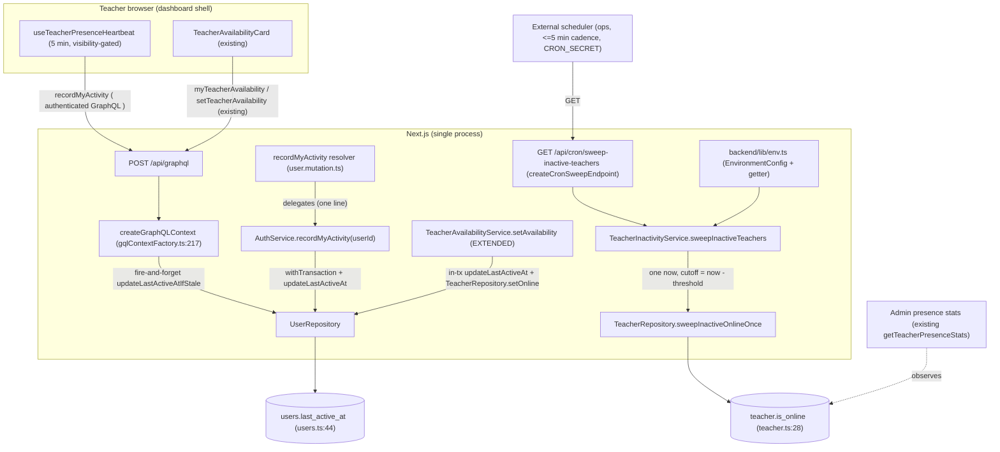
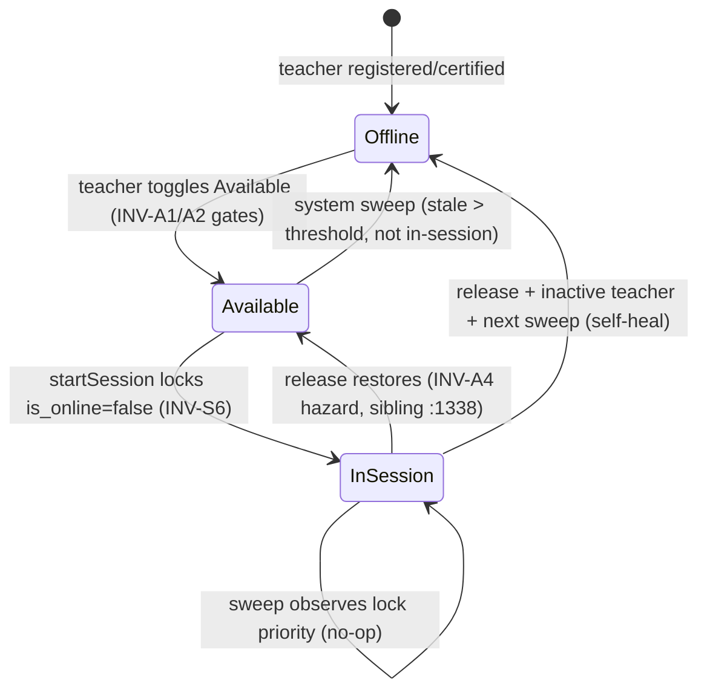

# Technical Architecture & Implementation Design: 15-Minute Inactivity Auto-Offline

> **Plan directory (verbatim — every header, ledger path, and self-reference in this plan uses this exact string):** `ai/plans/milestone_2_matching_notifications_escrow/15_minute_inactivity_auto_offline_m2_auto_offline`
> **Specs of record:** `ai/plans/milestone_2_matching_notifications_escrow/15_minute_inactivity_auto_offline_m2_auto_offline/specs.md` (REQ-001..REQ-095, banded)
> **Ticket:** `15-Minute Inactivity Auto-Offline` — Dev 2, Milestone 2, 5 SP; Decision Refs B.15, A.7, FR-4.2 (`docs/planning/TICKETS.md:1298-1334`).
> **Canonical refs:** `docs/specs/open-decisions-and-gaps.md:159-163` (B.15) + `:47-51` (A.7) · `docs/specs/state-machine-invariants.md:47` (INV-S6) + `:117-125` (INV-A1..A4) · `docs/teachers/teacher-availability.md:313-315` (§6.3 — this ticket is the named sole owner of the sweep) + `:14-19` + `:174` + `:297` · `docs/sessions/session-lifecycle.md:46` (guarded-transition discipline) + `:81` (INV-S6 seam) · `docs/billing/subscription-validity-window-expiry.md:226-244` (cron contract + ops runbook) · `docs/notifications/realtime-engine.md:197` (sidecar boundary) · `docs/testing/workflow-journey-tests.md` (journey rules) · `docs/planning/TEAM_ALLOCATION.md:123` (Dev 2 guarantee).
> **Blocking dependency:** `Teacher Availability Toggle (Available/Unavailable)` — **SHIPPED** (commit `1775142f`): `TeacherAvailabilityService` (`backend/services/teachers/teacher-availability.service.ts:85`), `setTeacherAvailability` mutation (`backend/graphql/mutation/teachers/teacher-availability.mutation.ts:53`), `myTeacherAvailability` query (`backend/graphql/query/teachers/teacher-availability.query.ts:50`), `TeacherAvailabilityCard` (`frontend/views/teachers/dashboard/TeacherAvailabilityCard.tsx:62`), `availability` locale namespace (`shared/locale/namespaces/availability/availability.namespace.ts:4`). This ticket CONSUMES those seams; it does not rebuild them.
> **Forward consumers (NOT built here):** "In-Session Locking (Hide from Directory)" (`TICKETS.md:1338` — INV-A4 release gating; verified unimplemented) and Dev 3's directory/matching (`TICKETS.md:1457`, `:1509` — INV-A3). Both are resolved-pointer deferred items (DEF-1, DEF-2).

---

## 1. System Overview & Architecture Diagram

### 1.1 Scope Statement

This ticket ships the **B.15 inactivity timeout** as four cooperating additions over a ZERO-DRIFT schema baseline (both state columns already exist — no migration, no enum, no index):

1. **Activity writers (backend):** two monotonic `UserRepository` stamp primitives; a fire-and-forget per-request stamp in `createGraphQLContext`; an in-transaction intent stamp composed into `TeacherAvailabilityService.setAvailability`; the login touch consolidated onto the repo primitive (private raw-db helper deleted).
2. **Heartbeat (GraphQL + frontend):** argless `recordMyActivity: Boolean!` mutation + `recordMyActivityMutationDocument` + `useTeacherPresenceHeartbeat` hook mounted in `DashboardLayout` for teachers (5-min cadence, visibility-gated).
3. **Sweep (backend):** `TeacherRepository.sweepInactiveOnlineOnce` (single guarded batch UPDATE with in-session NOT EXISTS exemption) + `TeacherInactivityService.sweepInactiveTeachers` + `TeacherInactivitySweepReturnType`.
4. **Trigger & config (route + env):** `/api/cron/sweep-inactive-teachers` via `createCronSweepEndpoint` + `ROUTE_INVENTORY` row + `TEACHER_INACTIVITY_TIMEOUT_MINUTES` (default 15) in `backend/lib/env.ts` + `.env.example`.

**Explicit non-goals:** INV-A4 release gating (`:1338`), INV-A3 directory (Dev 3), any `backend/ws/` change, any in-process scheduler/cron-worker/`vercel.json`, any schema/locale/UI-surface addition, auto-restore on activity.

### 1.2 Architecture Diagram



The WS sidecar (`backend/ws/`) is deliberately absent from the write path: it stays byte-untouched (D2, REQ-034).

### 1.3 Technology Stack (deltas only)

| Layer | Technology | Rationale |
|---|---|---|
| Activity hook | `createGraphQLContext` fire-and-forget + `UserRepository` | The ONE point every authenticated request resolves a verified user (`gqlContextFactory.ts:250-274`); repo-from-factory precedent at `:259` |
| Heartbeat | GraphQL mutation + client hook | Preserves push-only WS contract (`notification-ws-server-handlers.ts:74-77`) and sidecar boundary (`realtime-engine.md:197`) |
| Sweep | Guarded batch UPDATE via Drizzle + `withTransaction` | Matches `sweepExpiredSessions` (`session-lifecycle.service.ts:776-808`) and repo guarded-write rule (`backend/db/repo/AGENTS.md`) |
| Trigger | `createCronSweepEndpoint` (`backend/lib/gateway/cron-endpoint.ts:103`) | The only shipped sweep doctrine; fail-closed, replay-safe, secret-gated |
| Config | `EnvironmentConfig` member + typed getter (`backend/lib/env.ts`) | `PAYMOB_RECONCILE_PENDING_MINUTES` precedent (`:126-127`); single `resetEnvironmentCache()` invalidator (`:441-443`) |

---

## 2. Design Goals & Key Design Decisions

### Design Goals

1. **Truthful availability:** `is_online` is accurate within threshold + one sweep cadence of the teacher's last activity (TEAM_ALLOCATION `:123`).
2. **Zero new truth:** no new state columns — `users.last_active_at` is the single activity ledger; `teacher.is_online` the single availability flag.
3. **Boundary preservation:** the WS sidecar, the push-only protocol, and the single-writer repo discipline all survive unchanged.
4. **Ops-idiomatic trigger:** the sweep rides the exact contract of the three shipped cron sweeps.

### Decision D1: Zero-Drift Schema Ruling (no migration, no index)

**Context:** B.15/A.7 name `users.last_active_at`; the ticket needs a sweep over it.
**Options:** (1) add columns/indexes now; (2) use the existing columns, no DDL.
**Decision:** (2). Both columns exist and are migrated: `lastActiveAt: timestamp("last_active_at")` (`backend/db/schema/users/users.ts:44`; initial migration `backend/drizzle/20260904084151_omniscient_karen_page/migration.sql:344`) and `isOnline: boolean("is_online").default(false)` (`backend/db/schema/teachers/teacher.ts:28`).
**Rationale:** the teacher table is population-bounded (hundreds of rows); the sweep's EXISTS subqueries hit `users.id` (PK) and the existing `session_teacher_id_idx` (`backend/db/schema/classes/session.ts:88`) — no index is warranted. Schema work would violate the "verify-then-claim" baseline and add migration risk for zero benefit. **Consequence:** no `bun run db push`/`db migrate` step exists in this plan's tasks.

### Decision D2: The Activity Model — What Counts as "Activity"

**Context:** B.15 says "no WebSocket heartbeat or API call"; ground truth shows no client WS heartbeat exists and none may be added (push-only protocol; sidecar presence ban).
**Options considered:**
1. Sidecar writes `last_active_at` on pong receipts — rejected: violates `docs/notifications/realtime-engine.md:197` and the sidecar's process isolation (registry is in-memory, unreachable; sidecar imports no repo code today).
2. Client WS heartbeat frames — rejected: `message()` discards all client frames by contract (`notification-ws-server-handlers.ts:74-77`, REQ-034 of the realtime engine).
3. **Activity = authenticated GraphQL requests + explicit-intent stamps + login; heartbeat implemented as an API call** — chosen.
**Decision & rationale:** every authenticated request already lands in exactly one place (`createGraphQLContext`, `gqlContextFactory.ts:217`) where a verified user exists — stamp there (throttled, fire-and-forget). "App open" freshness is maintained by a client hook that issues a tiny authenticated mutation while the app is visible. The B.15 disjunction collapses to one measurable signal — staleness of `users.last_active_at` — which the sweep reads. SSR is NOT stamped: every authenticated client page immediately issues Apollo operations, and the heartbeat covers the idle case; stamping inside `getServerUserContext` (`backend/lib/auth/server-auth.ts:119`) would add a second write path for no observable gain.

### Decision D3: Heartbeat-as-API-Call (client cadence contract)

**Context:** A teacher with the app open must never be swept; a teacher who closes/backgrounds must be swept after the threshold.
**Decision:** `useTeacherPresenceHeartbeat` fires `recordMyActivity` every `TEACHER_PRESENCE_HEARTBEAT_INTERVAL_MS = 5 * 60_000` while `document.visibilityState === "visible"`, teacher-gated. Cadence rule: interval < threshold / 2 (one missed beat tolerated). Hidden/closed tabs go silent → swept after 15 min.
**Rationale:** visible-tab = plausibly responsive teacher (matches "app opened" in the state machine, `docs/workflows/02-on-demand-matching-workflow.md:25`); backgrounded tab = "goes inactive" per FR-4.2 (`docs/specs/functional-requirements.md:140-142`); silent failure keeps the dashboard UX untouched (REQ-062 zero-UI ruling).

### Decision D4: Monotonic `last_active_at` Discipline

**Context:** stamps arrive from fire-and-forget paths on concurrent requests; out-of-order commits could regress the timestamp.
**Options:** (1) unconditional `SET last_active_at = now`; (2) guarded `SET … WHERE last_active_at IS NULL OR last_active_at < now`.
**Decision:** (2) everywhere — both repo primitives and every explicit-intent stamp compose the monotonic predicate. Strict `<` makes an equal-timestamp re-stamp a no-op miss.
**Rationale:** with (1), a slow request captured at `t1` committing after a `t2 > t1` stamp would move activity backwards and could orphan a fresh teacher at the sweep boundary; (2) makes every interleaving safe with zero coordination (REQ-041). One-way door: the predicate lives in the single repo method, so the guarantee is central.

### Decision D5: Throttle Folded into the WHERE (write amplification bound)

**Context:** stamping on EVERY authenticated GraphQL request means one UPDATE per request per user.
**Decision:** the per-request stamp uses `updateLastActiveAtIfStale(userId, staleBefore, now)` with `staleBefore = now − USER_ACTIVITY_COALESCE_WINDOW_MS` (60s) — the throttle is a WHERE predicate, not a read-then-write. Worst case: ≤ 1 committing write per user per minute per instance; skipped attempts are zero-row PK probes.
**Rationale:** a read-then-write throttle would open a TOCTOU window and double the round trips; a predicate costs nothing extra in the same statement. 60s coarsens `last_active_at` to at most one minute — irrelevant against a 15-minute threshold, and still accurate enough for the 24h recently-active analytics window (`platform-analytics.repository.ts:87-88`).

### Decision D6: Sweep Shape — One Guarded Batch Statement

**Context:** the sweep must flip stale online teachers offline without racing any writer.
**Options:** (1) SELECT stale teachers then per-row `setOnline`; (2) one guarded batch UPDATE…RETURNING with all predicates in the WHERE.
**Decision:** (2) — `TeacherRepository.sweepInactiveOnlineOnce(now, cutoff, tx)`:
```sql
UPDATE teacher
SET is_online = false, updated_at = <now>
WHERE teacher.is_online = true
  AND EXISTS (SELECT 1 FROM users
              WHERE users.id = teacher.id
                AND (users.last_active_at IS NULL OR users.last_active_at < <cutoff>))
  AND NOT EXISTS (SELECT 1 FROM session
                  WHERE session.teacher_id = teacher.id
                    AND session.status = 'started')
RETURNING teacher.id;
```
**Rationale:** predicate + mutation share one statement under the row lock — zero TOCTOU (`docs/sessions/session-lifecycle.md:46`; `backend/db/repo/AGENTS.md` "Guarded transition writes"); honest count from `RETURNING`; matches the `sweepExpiredScheduledOnce` batch precedent (`backend/db/repo/classes/session.repository.ts:565-572`). NULL activity ⇒ swept (REQ-052): `is_online = true` with no recorded activity cannot satisfy "accurate within 15 minutes of last activity".

### Decision D7: In-Session Belt-and-Braces (why NOT EXISTS when is_online=true already skips them)

**Context:** AC-3 demands in-session teachers are never auto-offlined. INV-S6 already forces `is_online = false` at session start (`session-lifecycle.service.ts:283`), so the primary predicate excludes them — except in the documented sub-second toggle↔lifecycle race where `is_online` may transiently read `true` with a started session (`docs/teachers/teacher-availability.md:297`).
**Decision:** keep BOTH guards. The `NOT EXISTS (started session)` predicate makes the sweep structurally unable to touch an in-session teacher even inside that window — the lock takes priority, unconditionally (bulletproofs the AC, costs one indexed probe).
**Rationale:** without it, a sweep landing in the race window would "correct" a stale flag the lifecycle is about to write — defensible, but it violates the ticket's letter ("lock takes priority"). With it, the exemption is provable at the journey tier (REQ-092) rather than argued.

### Decision D8: Sweep Trigger — External Cron Route (no scheduler code)

**Context:** something must call the sweep periodically; no in-repo scheduler exists.
**Options:** (1) in-process `setInterval`/instrumentation ticker; (2) cron-worker script; (3) `vercel.json`; (4) the shipped external cron-route contract.
**Decision:** (4) — `app/api/cron/sweep-inactive-teachers/route.ts` via `createCronSweepEndpoint` (`backend/lib/gateway/cron-endpoint.ts:103-105`), registered in `ROUTE_INVENTORY` (`backend/lib/gateway/route-inventory.ts:62-79`), scheduled by ops at ≤5-minute cadence.
**Rationale:** (1)-(3) are verified phantom anti-patterns (`scripts/cron-worker.ts` — MISSING, dead `package.json:65` script; `backend/services/cron/` — MISSING; `vercel.json` — MISSING); the externally-triggered doctrine is canonical (`docs/billing/subscription-validity-window-expiry.md:226-229`) and the factory already provides mode-gate bare-404, timing-safe bearer, rate limiting, and honest-counts envelope. Replay is a zero-row no-op (D6 predicate) so scheduler overlap is safe. The flip therefore lands in `[threshold, threshold + cadence]` — never early, bounded late.

### Decision D9: Threshold Configurability via the Environment Snapshot

**Context:** 15 minutes is the B.15 default, but ops tuning should not require deploys.
**Decision:** `TEACHER_INACTIVITY_TIMEOUT_MINUTES` registered the `PAYMOB_RECONCILE_PENDING_MINUTES` way: `DEFAULT_TEACHER_INACTIVITY_TIMEOUT_MINUTES = 15` const, `parsePositiveIntegerEnv` parse (`backend/lib/env.ts:187-194`), `EnvironmentConfig` member `teacherInactivityTimeoutMinutes` (`:274`), assignment in `readEnvironment()` (`:372`), typed getter, `.env.example` entry.
**Rationale:** the PAYMOB precedent is the closest analog (a sweep window knob on the cached snapshot); raw `getEnv` (the CRON_* style) is reserved for per-invocation gate reads inside route handlers — the threshold is a service-level knob, and tests stub it with `resetEnvironmentCache()` (`:441-443`), the single invalidator (no per-key resets exist — semantic checklist "all resolveX covered" satisfied by design).

### Decision D10: INV-A4 Interplay — Sweep Self-Heals Resurrections; Release Seams Stay Untouched

**Context:** `releaseTeacherInSessionLock` restores `is_online = true` unconditionally on session conclusion (`session-lifecycle.transitions.ts:249-257`) — a teacher inactive for hours can be resurrected Available. The never-resurrect gating (persisted prior-online marker) is sibling `:1338` scope (verified unimplemented; no marker column exists, `backend/db/schema/teachers/teacher.ts:22-35`).
**Decision:** this ticket does NOT touch the release path. The sweep treats a resurrected-but-inactive teacher like any other stale online teacher: the next pass flips them offline. Net observable guarantee: `is_online` is accurate within threshold + cadence regardless of release behavior.
**Rationale:** modifying the release path would absorb sibling scope and require a schema marker (contradicting D1); sweeping resurrected teachers is exactly FR-4.2's intent ("closes the app … status is set to Unavailable"). The interplay is pinned as journey assertion J-IO-3 step 5 (observable-only) and recorded as deferred pointer DEF-1.

---

## 3. Data Models

### 3.1 Carried-Over State (VERBATIM, zero drift)

`users` (`backend/db/schema/users/users.ts`):
```ts
// users.ts:44
lastActiveAt: timestamp("last_active_at"),
```
Nullable, no default, no index; readers today: `user.repository.ts:60/:94` (SELECT aliases), admin GraphQL (`backend/graphql/pothos/admin/admin-user.pothos.ts:81-84`), analytics (`platform-analytics.repository.ts:117`). After this ticket: written ONLY via `UserRepository` (two new primitives + consolidated login touch).

`teacher` (`backend/db/schema/teachers/teacher.ts`):
```ts
// teacher.ts:28
isOnline: boolean("is_online").default(false),
```
Written today by exactly three production callers through `TeacherRepository.setOnline` (`teacher.repository.ts:512-522`): session lock (`session-lifecycle.service.ts:283`), session release (`session-lifecycle.transitions.ts:250`), manual toggle (`teacher-availability.service.ts:230`). This ticket adds the fourth writer — the batch sweep primitive — INSIDE the same repository file (single-writer rule preserved, `docs/teachers/teacher-availability.md:174`).

`session` (`backend/db/schema/classes/session.ts:54`; `teacher_id` `:58`, `status` `:64`, `session_teacher_id_idx` `:88`; status enum `backend/enum/scheduling/session-status.enum.ts:7-13`) — read-only context for the NOT EXISTS exemption; never written by this feature.

### 3.2 New Types (additive, canonical location only)

`backend/types/teachers/teacher.types.ts` (today `:1-8` plus `TeacherAvailabilityReturnType` at `:24-28`):
```ts
/** Honest-counts result of the inactivity sweep — identities never cross the cron boundary. */
export interface TeacherInactivitySweepReturnType {
  readonly offlined: number;
}
```

### 3.3 New Environment Configuration

| Key | Default | Parse | Consumer |
|---|---|---|---|
| `TEACHER_INACTIVITY_TIMEOUT_MINUTES` | `15` (`DEFAULT_TEACHER_INACTIVITY_TIMEOUT_MINUTES`) | `parsePositiveIntegerEnv` (`env.ts:187-194`) | `TeacherInactivityService.sweepInactiveTeachers` via typed getter |

Registration checklist (per the PAYMOB precedent `env.ts:126-127`, `:349-350`, `:409-412`): default const → `EnvironmentConfig` member → `readEnvironment()` assignment → typed getter → `.env.example` row (WS section area, `:74-103`). No cache changes: `resetEnvironmentCache()` (`:441-443`) already covers every snapshot key.

### 3.4 Data Flow (one sweep pass)

```mermaid
sequenceDiagram
    participant OPS as External scheduler
    participant CR as GET /api/cron/sweep-inactive-teachers
    participant SW as TeacherInactivityService
    participant TR as TeacherRepository
    participant DB as PostgreSQL
    OPS->>CR: GET + Bearer CRON_SECRET
    CR->>CR: mode gates + rate limit + timing-safe bearer
    CR->>SW: sweepInactiveTeachers()
    SW->>SW: withTransaction; now = new Date(); cutoff = now - threshold
    SW->>TR: sweepInactiveOnlineOnce(now, cutoff, tx)
    TR->>DB: UPDATE teacher ... WHERE is_online AND stale AND NOT in-session RETURNING id
    DB-->>TR: rows
    TR-->>SW: count
    SW-->>CR: { offlined }
    CR-->>OPS: 200 envelope { offlined } (bare 404 if gates off; 401 if bad bearer)
```

---

## 4. Repository & Service Signatures (exact contracts)

### 4.1 `UserRepository` — `backend/db/repo/users/user.repository.ts` (EXTEND; today 8 methods: `findByEmail :44`, `findById :78`, `create :111`, `updateLocale :135`, `updatePassword :171`, `findLocalesByIds :199`, `findNamesByIds :248`, `transitionRoleOnce :315`)

```ts
/**
 * Coalesce window for per-request activity stamps — a request only commits a
 * write when the stored stamp is older than this (throttle folded into the
 * UPDATE predicate, never a read-then-write).
 */
export const USER_ACTIVITY_COALESCE_WINDOW_MS = 60_000;

/** Monotonic activity stamp — never regresses last_active_at; strict `<` (equal = miss). */
export async function updateLastActiveAt(
  userId: number,
  now: Date,
  tx?: DBQueryExecutor
): Promise<boolean>;

/** Throttled variant — additionally requires the stored stamp be older than staleBefore. */
export async function updateLastActiveAtIfStale(
  userId: number,
  staleBefore: Date,
  now: Date,
  tx?: DBQueryExecutor
): Promise<boolean>;
```

Both take the optional dual-branch executor (a bare single-row UPDATE needs no wrapping transaction; in-tx callers pass their `innerTx` and get same-transaction atomicity): `UPDATE users SET last_active_at = <now> WHERE users.id = <userId> AND (last_active_at IS NULL OR last_active_at < <now>) [AND (last_active_at IS NULL OR last_active_at < <staleBefore>)] RETURNING users.id` → `return row !== undefined`. Optional-executor shape follows the `queryDb`/`db` fallback pattern (`platform-analytics.repository.ts:117-140` — a read there, but the same dual-branch convention); the write-side guarded-statement discipline is `sweepExpiredScheduledOnce` (`backend/db/repo/classes/session.repository.ts:565-572`). `DBTransaction`/`DBQueryExecutor` from `@/backend/types` (`backend/types/db.types.ts:23`, `:30`). `USER_ACTIVITY_COALESCE_WINDOW_MS` is EXPORTED (unlike its module-private inspiration `RECENT_ACTIVITY_WINDOW_MS`, `platform-analytics.repository.ts:88`) because `gqlContextFactory.ts` consumes it — an exported const with an in-tree consumer is knip-safe.

### 4.2 `TeacherRepository` — `backend/db/repo/teachers/teacher.repository.ts` (EXTEND; `setOnline :512`, `lockForCertificationCheck :217`, `findById :172` consumed as-is)

```ts
/**
 * Inactivity sweep primitive — single guarded batch transition.
 * Flips online → offline for teachers whose last activity is strictly older
 * than cutoff (NULL activity = expired) and who hold no started session.
 * tx REQUIRED (batch transitions are always caller-transacted, like setOnline).
 */
export async function sweepInactiveOnlineOnce(
  now: Date,
  cutoff: Date,
  tx: DBTransaction
): Promise<number>;
```

Composition (Drizzle, plain guarded style matching `setOnline` `:512-522`; NO prepared statement; NO inline `--` comments inside `sql` templates):

```ts
const rows = await tx
  .update(teacher)
  .set({ isOnline: false, updatedAt: now })
  .where(
    and(
      eq(teacher.isOnline, true),
      sql`EXISTS (SELECT 1 FROM ${users} WHERE ${users.id} = ${teacher.id} AND (${users.lastActiveAt} IS NULL OR ${users.lastActiveAt} < ${cutoff}))`,
      sql`NOT EXISTS (SELECT 1 FROM ${session} WHERE ${session.teacherId} = ${teacher.id} AND ${session.status} = ${SessionStatus.Started})`
    )
  )
  .returning({ id: teacher.id });
return rows.length;
```

Imports: `users` from `@/backend/db/schema/users/users`, `session` from `@/backend/db/schema/classes/session`, `SessionStatus` as VALUE import from `@/backend/enum/scheduling/session-status.enum` (runtime enum member, never a string literal).

### 4.3 `TeacherInactivityService` — NEW `backend/services/teachers/teacher-inactivity.service.ts`

```ts
export namespace TeacherInactivityService {
  /** One transaction, one captured now — cutoff derived, never re-read. */
  export async function sweepInactiveTeachers(
    outerTx?: DBTransaction
  ): Promise<TeacherInactivitySweepReturnType>;
}
```

Body: `withTransaction(outerTx, async tx => { const now = new Date(); const cutoff = new Date(now.getTime() - getTeacherInactivityTimeoutMinutes() * 60_000); const offlined = await TeacherRepository.sweepInactiveOnlineOnce(now, cutoff, tx); return { offlined }; })` — mirrors `sweepExpiredSessions` (`session-lifecycle.service.ts:776-808`) and `sweepExpiredRequests` (`backend/services/parents/parent-link-request.service.ts:424-428`). Logging: `logger.info` on completion counts; `logger.logDomainError` never needed (no denial path — the sweep denies no one).

### 4.4 `TeacherAvailabilityService.setAvailability` — EXTEND (`backend/services/teachers/teacher-availability.service.ts:178-183`)

Inside the existing `withTransaction(tx, async innerTx => …)` (`:189`), AFTER the existing write `TeacherRepository.setOnline(teacherId, isOnline, innerTx)` (`:230`) and BEFORE the return build (`:244`), compose:

```ts
// One captured now for the whole transaction (one-now discipline).
const activityNow = new Date();
await UserRepository.updateLastActiveAt(teacherId, activityNow, innerTx);
```

The certification gate (`:209-217`), in-session gate (`:223`), zero-row guard (`:231-242`), and error codes (VALIDATION 422 / TEACHER_NOT_FOUND 404 / FORBIDDEN 403 / TEACHER_IN_ACTIVE_SESSION 409) remain byte-identical. Imports: `UserRepository` from `@/backend/db/repo` (top-level barrel per repo AGENTS import convention).

### 4.5 `AuthService` — EXTEND (`backend/services/auth/auth.service.ts`)

**4.5.1 Login-touch consolidation** (`login :169`, fire-and-forget block `:203-216`): replace the private raw-db helper call with `UserRepository.updateLastActiveAt(user.id, new Date())` (optional-executor form, no transaction needed for the fire-and-forget bump) and DELETE the private `touchLastActiveAt` (`:514-515`) plus its now-unused `db`/`users`/`eq` imports if they become dead (verify no other in-file use before removing — dead-import rule). The fire-and-forget `.catch` logging contract stays verbatim in shape (login never fails on stamp errors).

**4.5.2 The heartbeat's service method** (resolver-delegation rule: mutation resolvers never call repositories directly — `backend/graphql/mutation/AGENTS.md`):

```ts
/**
 * Heartbeat server leg — stamps the caller's last-activity timestamp.
 * Argless by contract: identity is always the authenticated caller.
 */
export async function recordMyActivity(userId: number): Promise<boolean> {
  const now = new Date();
  return withTransaction(undefined, async tx => {
    await UserRepository.updateLastActiveAt(userId, now, tx);
    return true;
  });
}
```

One captured `now`; one guarded write; returns `true`. `AuthService` is the lightest compliant home: it is the service `user.mutation.ts` already imports (its existing fields delegate there, `user.mutation.ts:101`), and the "I am alive" signal is a session-activity concern.

---

## 5. API Contracts

### 5.1 GraphQL Mutation `recordMyActivity`

**File:** `backend/graphql/mutation/user.mutation.ts` (EXTEND — the caller-scoped user-mutations file; already side-effect-imported by `backend/graphql/mutation/index.ts`).

**SDL (after regeneration):**
```graphql
type Mutation {
  recordMyActivity: Boolean!
}
```

**Pothos shape (resolver DELEGATES to the service — never to repositories directly, per `backend/graphql/mutation/AGENTS.md`; the sibling toggle it mirrors also delegates, `teacher-availability.mutation.ts:86`):**
```ts
gqlSchemaBuilder.mutationField("recordMyActivity", t =>
  t.field({
    type: "Boolean",
    // Argless by design (BOPLA): identity is server-derived from ctx.user.id;
    // there is no client-owned value and no input object to seal.
    authScopes: { authenticated: true },
    resolve: async (_root, _args, ctx) => AuthService.recordMyActivity(ctx.user.id),
  })
);
```

The transaction composition, `now` capture, and `UserRepository.updateLastActiveAt` call all live in `AuthService.recordMyActivity` (§4.5.2) — the resolver is a one-line delegation with zero inline business logic.

**Error contract (domain-error extensions, `docs/graphql/domain-error-extensions-code.md`):**

| Case | Code | HTTP | Notes |
|---|---|---|---|
| Unauthenticated | auth-scope denial | 401 | Rejected BEFORE the resolver (no repo call) — REQ-014.3 |
| Success | — | 200 | `true`; `users.last_active_at` monotonic-stamped |
| Repo failure | `INTERNAL` | 500 | Propagates through the standard error finalizer; client hook logs and retries next beat |

**SDL regeneration steps:** `bun run generate:gqlSchema` then `bun codegen`; commit `frontend/graphql/generated/schema.graphql` + regenerated types; register `USER_ACTIVITY_MUTATION_FIELDS = ["recordMyActivity"] as const` in `backend/graphql/test/schema-surface.test.ts` mutation assertions (sibling precedent: `TEACHER_AVAILABILITY_MUTATION_FIELDS` const at `:944`, spread in the single mutation-assertion block at `:1279`).

### 5.2 Cron Route `/api/cron/sweep-inactive-teachers`

**File:** NEW `app/api/cron/sweep-inactive-teachers/route.ts` — byte-for-byte the factory shape (`app/api/cron/sweep-sessions/route.ts:29-32`):
```ts
export const GET = createCronSweepEndpoint({
  run: () => TeacherInactivityService.sweepInactiveTeachers(),
  payload: result => ({ offlined: result.offlined }),
});
```

**Contract (inherited verbatim from `backend/lib/gateway/cron-endpoint.ts`):**

| Aspect | Behavior | Evidence |
|---|---|---|
| Method | GET only | factory `:103-105` |
| Mode gates | bare **404** unless `CRON_EXECUTION_MODE === "external"` AND `CRON_EXTERNAL_ENABLED === "true"` (per-request raw `getEnv`) | `:112-116`, `:70` |
| Auth | `Authorization: Bearer ${CRON_SECRET}`; timing-safe SHA-256 compare; unconfigured secret ⇒ 401 always | `:143-148`; `backend/lib/api/cron-auth.ts:34-51` |
| Rate limit | `cron-sweep` limiter, 100 req / 60s | `:79-83`, `:126-134` |
| Success 200 | honest-counts envelope `{ data: { offlined: number } }` | factory payload contract |
| Replay | zero-row no-op ⇒ `{ offlined: 0 }` | D6 predicate |
| Registration | `ROUTE_INVENTORY` row (classification `envelope`) + registry↔tree static assertions | `backend/lib/gateway/route-inventory.ts:62-79`; `route-inventory.test.ts:135-160` |
| Ops wiring | external scheduler ≤5-min cadence; runbook = `docs/billing/subscription-validity-window-expiry.md:232-244` (env arming + curl + kill switch) | D8 |

### 5.3 Permission Matrix (all new surfaces)

| Surface | authenticated | Teacher | Student | Parent | Admin | Ops (CRON_SECRET) |
|---|---|---|---|---|---|---|
| `recordMyActivity` | ✅ | ✅ | ✅ | ✅ | ✅ | — |
| Per-request context stamp | automatic (any authenticated request) | ✅ | ✅ | ✅ | ✅ | — |
| `/api/cron/sweep-inactive-teachers` | ❌ | ❌ | ❌ | ❌ | ❌ | ✅ only |

No GraphQL surface can reach the sweep (BFLA — REQ-031.2/031.4); no user token of any role can influence another user's stamp (BOLA — REQ-030).

---

## 6. Concurrency & Race Condition Assessment (REQUIRED) & Journey Design

### 6.1 Concurrency Model

All writes are single-statement guarded UPDATEs (predicate + mutation under one row lock — `docs/sessions/session-lifecycle.md:46`), coordinated only by PostgreSQL row locks; there is no application-level locking, no advisory locks, and no module-level mutable state. The only multi-statement composition is `TeacherInactivityService.sweepInactiveTeachers` (one `withTransaction` around one repo call) and the `setAvailability` EXTEND (stamp joins the toggle's existing transaction via SAVEPOINT-compatible `innerTx`).

### 6.2 Race Condition Scenarios & Mitigations

| # | Scenario | Actors | Risk | Mitigation (grounded) |
|---|---|---|---|---|
| R1 | Sweep vs. manual toggle-to-Available | sweep tx ↔ `setAvailability` tx | fresh toggle falsely swept | In-tx intent stamp (§4.4): toggle commits `last_active_at = now` atomically with `is_online = true`; whichever tx commits first leaves the sweep's staleness predicate false (REQ-042.1/042.2) |
| R2 | Sweep vs. `startSession` lock write | sweep tx ↔ lifecycle tx | in-session teacher touched | Both write `is_online = false` (idempotent-compatible, REQ-042.3); belt-and-braces `NOT EXISTS started` predicate skips even the sub-second stale-`true` window (`docs/teachers/teacher-availability.md:297`; REQ-042.5, D7) |
| R3 | Sweep vs. `releaseTeacherInSessionLock` | sweep tx ↔ lifecycle tx | resurrected-then-swept oscillation | Accepted and self-healing by design (D10): release restores `true`; next sweep re-offlines if still inactive. Net invariant: accurate within threshold + cadence |
| R4 | Out-of-order fire-and-forget stamps | context stamp ↔ mutation stamp on same request | `last_active_at` regresses | Monotonic predicate in every stamp (D4, REQ-041.2): older-`now` write is a zero-row miss |
| R5 | Write amplification / stamp storm | N concurrent requests per user | DB write load | Coalesce window folded into the WHERE (D5): ≤1 committing write/user/minute; misses are zero-row PK probes |
| R6 | Overlapping cron invocations | ops scheduler double-fire | double-offline counts | Guarded predicate on `is_online = true`: second run is a zero-row no-op (REQ-043.1) |
| R7 | Clock skew app↔DB | stamp `now` vs DB now | boundary off-by-skew | One JS-captured `now` per operation (one-now discipline, REQ-041.3); threshold granularity (minutes) dwarfs realistic skew; boundary tests use frozen clock + backdated rows (REQ-071.2) |

### 6.3 SELECT FOR UPDATE Usage & TOCTOU Windows

- **No SELECT FOR UPDATE is introduced.** The batch sweep needs no prior lock: the guarded `UPDATE … WHERE <3 predicates> RETURNING` is the atomic unit (repo AGENTS "Guarded transition writes"; `sweepExpiredScheduledOnce` precedent `session.repository.ts:565-572`). Per-row stamps are guarded UPDATEs on the PK.
- **TOCTOU windows:** zero by construction for every new write (predicate and mutation share the statement). The read-then-write pattern is explicitly absent: `updateLastActiveAtIfStale` folds the throttle INTO the predicate (D5). The pre-existing lock-vs-INSERT caveat (`docs/sessions/session-lifecycle.md:184`) is not exercised by this design (the sweep never INSERTs and never locks session rows).
- **Module-level mutable state:** none introduced (the heartbeat's `setInterval` handle is component-scoped React state, cleaned on unmount/visibility loss).

### 6.4 Boundary Semantics (consolidated)

| Input state | Sweep outcome | Rule |
|---|---|---|
| `last_active_at = cutoff` (exactly threshold old) | NOT swept | strict `<` (REQ-050.1) |
| `last_active_at` 14:59 old | NOT swept | REQ-050.2 |
| `last_active_at` 15:01 old | swept | REQ-050.3 |
| `last_active_at IS NULL` + `is_online = true` | swept | REQ-052 |
| `is_online = false` (already offline / in-session) | skipped (zero-row) | REQ-018.1a |
| `started` session exists (even if `is_online` transiently `true`) | skipped | REQ-018.1c, D7 |
| Replay immediately after sweep | `{ offlined: 0 }` | REQ-043.1 |

### 6.5 Cross-Actor Journey Design (assertion set for `test/workflows/teachers/teacher-inactivity-auto-offline.journey.test.ts`)

**Shared-Entity State Machine (teacher availability over `teacher.is_online` + `users.last_active_at`):**

| Current State | Trigger (actor + action) | Next State | Guard / Permission |
|---|---|---|---|
| Offline (`is_online = false`) | Teacher toggles Available | Available (`is_online = true`) | INV-A1 certified + INV-A2 not-in-session (`teacher-availability.service.ts:209-217`, `:223`) |
| Available | System sweep (cron bearer), activity strictly older than cutoff | Offline (`is_online = false`) | D6 predicates (online + stale + not-in-session) |
| Available | Teacher goes silent < threshold, sweep runs | Available (unchanged) | staleness predicate fails |
| Available | Teacher accepts session (`startSession`) | In-Session (`is_online = false`) | INV-S6 (`session-lifecycle.service.ts:283`) |
| In-Session | Sweep runs | In-Session (unchanged) | lock priority (REQ-018.1c) |
| In-Session | Session concludes (`releaseTeacherInSessionLock`) | Available (unconditional — INV-A4 hazard, sibling scope) | none today (`session-lifecycle.transitions.ts:249-257`); sweep self-heals (D10) |



**Side-Effect Matrix (per transition):**

| Transition | Rows Created/Updated | Notifications (channel → recipient) | Idempotency Key |
|---|---|---|---|
| Toggle ON | `teacher.is_online = true`, `teacher.updated_at`, `users.last_active_at` (in-tx stamp) | none (existing behavior unchanged) | n/a (user intent) |
| Sweep | `teacher.is_online = false`, `teacher.updated_at` per matched row; `users` untouched | none — the sweep sends no notifications (by design; notifications are the engine's concern) | replay-safe predicate (`is_online = true`) |
| Start session (existing) | `teacher.is_online = false` (INV-S6) | existing session-request chain (untouched) | existing |
| Heartbeat beat | `users.last_active_at` (monotonic) | none | monotonic predicate |

**Cross-Actor Visibility:**

| State | Teacher sees | Admin sees | Student sees |
|---|---|---|---|
| Swept offline | own card Unavailable on next `myTeacherAvailability` fetch | `onlineNowCount` decremented (`platform-analytics.repository.ts:320`) | nothing (no directory exists — INV-A3 sibling) |
| Exempt (in-session) | own card Unavailable (locked) | unchanged online count | nothing |
| Re-toggled Available | own card Available | online count restored | nothing |

These tables are the journey's assertion set; steps and denial legs are specified in `specs.md` §5.2 (REQ-090..095).

---

## 7. UX/Navigation Specification (REQUIRED — explicit no-UI ruling)

#### New Routes & URLs

| Route | Purpose | Permission Required | Roles with Access |
|---|---|---|---|
| *(none — zero page routes)* | — | — | — |
| `/api/cron/sweep-inactive-teachers` (GET, non-page) | ops sweep trigger | `CRON_SECRET` bearer + mode gates | ops scheduler only |

#### Sidebar Navigation Integration

- **Group:** none. **Parent Item:** none. **Children:** none. **Mobile navigation:** untouched — no nav surface is added anywhere.

#### Role-Based Access Matrix

| Role | Routes Accessible | Permissions Granted |
|---|---|---|
| SUPER_ADMIN/ACADEMY_ADMIN (`UserRole.Admin`) | existing dashboard routes only | `recordMyActivity` (self-scope); observes presence stats (existing) |
| TEACHER | existing dashboard routes only | `recordMyActivity` (self-scope); heartbeat mounted; existing toggle unchanged |
| STUDENT / PARENT | existing routes only | `recordMyActivity` (self-scope) |
| Unauthenticated / GUEST | none | denied 401 |

#### Per-Audience Rendering

| Audience | Prominent Content / Differences |
|---|---|
| Student | none |
| Parent | none |
| Teacher | none visible — the heartbeat is silent; the shipped `TeacherAvailabilityCard` (`frontend/views/teachers/dashboard/TeacherAvailabilityCard.tsx:62`) remains the only availability surface and truthfully shows Unavailable after a sweep |
| Supervisor / Admin | none in-app; `getTeacherPresenceStats` consumers become accurate automatically |

#### Permission Mapping

| Component/Route | Required Permission | Source |
|---|---|---|
| `recordMyActivity` mutation | `authenticated: true` | Pothos `authScopes` (no permission string, no role gate) |
| `useTeacherPresenceHeartbeat` mount | client role check `user?.role === UserRole.Teacher` | `useAuth()` (`frontend/hooks/auth/useAuth.ts:6`) consumed in `DashboardLayout` (`frontend/views/dashboard/layout/DashboardLayout.tsx:71`) |
| `/api/cron/sweep-inactive-teachers` | `CRON_SECRET` bearer (timing-safe) + `CRON_EXECUTION_MODE=external` + `CRON_EXTERNAL_ENABLED=true` | `createCronSweepEndpoint` gate chain |

#### Translation System Requirements

No user-facing strings are introduced; ZERO new locale keys (REQ-003.2). If implementation discovers a need for copy, the compile-time system is mandatory: `useAppTranslation(<NamespaceHandle>)` (`shared/locale/client/use-app-translation.ts:8-16`), one-arg `getTranslations(locale)` (`shared/locale/server.ts:15`), one-arg `getServerTranslations(locale)` (`shared/locale/server-graphql.ts:3`) — never string-arg calls, never a `Translation` enum (none exists), never `next-intl`/`getBackendTranslations`/`shared/messages/` (all removed).

---

## 8. Zero-Drift Baseline & Migration Posture

| Concern | Ruling | Evidence |
|---|---|---|
| Drizzle schema change | NONE — no `bun run db push`, no `db migrate` step exists in any task | D1; columns verified (`users.ts:44`, `teacher.ts:28`) |
| New enum | NONE — `SessionStatus`, `UserRole` consumed as-is (value imports) | `backend/enum/scheduling/session-status.enum.ts:7-13`, `backend/enum/users/user-role.enum.ts:5-9` |
| New index | NONE — teacher table population-bounded; NOT EXISTS probe rides `session_teacher_id_idx` | `backend/db/schema/classes/session.ts:88`; D1 |
| Backward compatibility | additive-only: two repo methods, one service, one mutation, one route, one env key with safe default; no existing signature narrows; `getAvailability` 3-param shipped form (`teacher-availability.service.ts:103-107`) is cited as ground truth, not "fixed" | blocker-plan deviation note (specs-of-record lesson) |
| Data migration | NONE — NULL `last_active_at` rows are valid and handled by sweep semantics (REQ-052) | D6 |
| Generated artifacts | `frontend/graphql/generated/schema.graphql` + codegen outputs MUST be regenerated and committed with the mutation (REQ-060.1) | sibling precedent |

---

## 9. Security & Tenancy Mitigations (BOLA / BOPLA / BFLA / injection)

| Threat class | Surface | Mitigation |
|---|---|---|
| BOLA / IDOR | activity stamps, sweep | Identity is always server-derived (`ctx.user.id` / captured teacher id); the sweep is predicate-driven with no client parameters and no GraphQL exposure (REQ-030). No LIKE/search surface is introduced ⇒ no wildcard-escape concern. |
| BOPLA / mass assignment | `recordMyActivity`, stamps | Argless mutation; explicit-field `.set()` everywhere; no `{ ...input }` spreads (REQ-032). |
| BFLA / privilege escalation | sweep trigger | Cron route only: mode-gate bare-404 + timing-safe bearer + rate limit (REQ-031.2/031.3); zero GraphQL exposure of the sweep; low-privilege tokens get 404/401, never the sweep. |
| Tenant isolation | all-roles stamping | Stamps are per-user PK-scoped; presence stats read aggregated counts only — no cross-teacher identity leaks (J-IO-1 observer leg asserts counts, not identities). |
| Secret handling | `CRON_SECRET` | Timing-safe SHA-256 compare (`backend/lib/api/cron-auth.ts:34-51`); unconfigured secret ⇒ always 401 (never an empty-string accept). |
| WS boundary | sidecar | Byte-untouched (REQ-034) — the attack/abuse surface of the sidecar does not grow. |

---

## 10. Error Handling & Logging

| Event | Handling | Log call (module) |
|---|---|---|
| Per-request stamp failure | swallowed; request proceeds | `logger.warn`/`debug` inside `.catch` in `gqlContextFactory.ts` (backend logger `@/backend/lib/logger`) — mirror `auth.service.ts:203-216` shape |
| Login stamp failure | swallowed; login proceeds | existing `.catch` logging preserved verbatim (`auth.service.ts:206`) |
| Sweep failure | whole transaction rolls back; the cron endpoint's sweep invocation + error envelope (`backend/lib/gateway/cron-endpoint.ts:152-157`) owns failure surfacing and logging — the service body itself adds no catch | cron route envelope (backend logger `@/backend/lib/logger`); never `console.*` |
| Heartbeat beat failure | logged; schedule continues | `@/frontend/lib/logger` meta-first `logger.warn({ … }, msg)` (`frontend/lib/logger.ts:109-127`) |
| Denials (none new) | — | the sweep denies nobody; the mutation's only denial is the auth-scope 401 (framework-logged) |

`logger.logDomainError` is reserved for 4xx-equivalent business rejections (`backend/lib/logger.ts:92`) — this feature adds no new denial paths, so it appears only in unchanged existing gates.

---

## 11. Testing Strategy

### 11.1 Layer Map (runner: `bun run test/scripts/run-test.ts <path>` — never raw `bun test`)

| Tier | File (NEW = ✚, EXTEND = ✚ on existing) | Key assertions |
|---|---|---|
| Repo (DB) | ✚ `backend/db/test/repo/users/user.repository.test.ts` | both stamp primitives: 100% branch; NULL-flip; monotonic no-op; equal-timestamp miss; stale-window hit/miss; unknown-id zero-row — `runInRollback` + `tx` everywhere |
| Repo (DB) | ✚ `backend/db/test/repo/teachers/teacher.repository.test.ts` | `sweepInactiveOnlineOnce`: 100% branch across D6 predicate matrix (§6.4) — `runInRollback` |
| Service | ✚ NEW `backend/services/teachers/teacher-inactivity.service.test.ts` | env resolution + `resetEnvironmentCache()`; cutoff arithmetic; one-tx composition (repo spy receives `(now, cutoff, tx)`); zero-count pass-through; `outerTx` join vs own |
| Service | ✚ `backend/services/teachers/teacher-availability.service.test.ts` | existing matrix stays green; + in-tx stamp assertions (rollback rolls the stamp) |
| Service | ✚ `backend/services/auth/auth.service.test.ts` (extend if a login-touch test exists; else add) | login still stamps via repo primitive; helper deletion verified by grep-clean; NEW `recordMyActivity(userId)` legs — success stamps via one-tx spy, returns `true` (covered with Task 10's `.TE`) |
| GraphQL wire | ✚ NEW `backend/graphql/test/user-activity.integration.test.ts` | `describeGraphqlSuite` + `setupTestServerLifecycle` + `testClient`: teacher `true` + DB fresh; 401 anonymous; 4 roles accepted; scalar-only response |
| GraphQL wire | ✚ NEW `backend/graphql/test/context-activity-stamp.test.ts` | DB-free factory test (model: `context-keys.test.ts`): exactly one `updateLastActiveAtIfStale` on authenticated construction; zero on anonymous; rejection swallowed |
| Cron route | ✚ NEW `app/api/cron/sweep-inactive-teachers/test/sweep-inactive-teachers-route.test.ts` | mode-gate 404 / bad bearer 401 / 200 `{ offlined }`; env stubs restored `afterEach` (model: `sweep-sessions-route.test.ts:41-78`) |
| Schema surface | ✚ `backend/graphql/test/schema-surface.test.ts` | `USER_ACTIVITY_MUTATION_FIELDS` registered; SDL equality |
| Journey | ✚ NEW `test/workflows/teachers/teacher-inactivity-auto-offline.journey.test.ts` | J-IO-1..6 (REQ-090..095): backdated rows, real services, `TrackedFixtures` cleanup + `verifyAllAbsent`, admin presence-count observer leg, INV-A2 denial leg |
| Frontend | ✚ NEW `frontend/hooks/presence/use-teacher-presence-heartbeat.test.ts` | role gating, cadence, visibility gating, failure silence (stubbed globals) |
| Frontend | ✚ `frontend/graphql/sharedDocuments/documents.contract.test.ts` | stays green with the new document |

### 11.2 Time-Handling Rules per Tier

- **Repo/service tests:** frozen clock via `setSystemTime` (`bun:test`) for boundary legs; restore in `finally` (template `session-admin-governance.service.test.ts:727-738`); fixtures backdated through `createTestUser(tx, { lastActiveAt })` (`backend/db/test/entity-setup.ts:74`, `:90`).
- **Journey tests:** NEVER fake timers — backdate rows via direct update, second-precision (`docs/testing/workflow-journey-tests.md:159-166`; helper `test/workflows/helpers/second-precision.ts:21`; precedent `test/workflows/teachers/cooldown-state-machine.test.ts:504`).

### 11.3 Coverage Targets

100% branch + statement for the two user-repo primitives and the teacher sweep primitive (repo tier); service tier pins composition and boundaries; integration + journey tiers pin contracts and cross-actor visibility. Negative-path DB tests use the `expectRepoError` try/catch helper (`backend/db/test/test-utils.ts:77`) — never `.rejects.toThrow()` inside `runInRollback`.

### 11.4 4-Tier Framework Mapping (per tasks pipeline `.TE`)

- **Tier 1 (branch/statement):** every predicate leg of §6.4 matrix.
- **Tier 2 (boundary):** 14:59 / exactly-15:00 / 15:01; NULL vs 0-epoch; equal timestamps; second-precision truncation.
- **Tier 3 (monkey/chaos):** overlapping sweeps (`Promise.allSettled` double-invocation ⇒ counts sum to single-pass); out-of-order stamp ordering (older-`now` after newer-`now`); concurrent toggle-vs-sweep serialization probes.
- **Tier 4 (security/abuse):** anonymous mutation 401; low-privilege cron probes (404/401); garbage env values; heartbeat failure storms (beats keep failing ⇒ no crash, no unhandled rejection).

---

## 12. Documentation & Knowledge Transfer Protocol (`…/outcome/`)

- **BEFORE any task:** the executing agent MUST read ALL files in `ai/plans/milestone_2_matching_notifications_escrow/15_minute_inactivity_auto_offline_m2_auto_offline/outcome/` — start with `0-ground-truth-outcome.md` (the generation-time evidence digest: verified paths, line anchors, signature census; do NOT re-derive).
- **AFTER each task:** write `outcome/<task-id>-outcome.md` (research, docs consulted, changes, cross-file dependencies, carry-overs). No task is `[x]` without it (REQ-002, REQ-080).
- **PROGRESS:** update `[ ]` → `[x]` in `tasks.md` per completed subtask.
- **Knowledge propagation (Phase 7):** consolidate into `docs/teachers/teacher-availability.md` (§6.3 rewrite + stale `users.ts:37` → `:44` citation fix, REQ-081) — the canonical availability doc is the propagation target for this domain; AGENTS.md and `.agents/instructions/**` are hand-curated and MUST NOT be touched by plan work (REQ-083).

---

## 13. Deferred-Items Ledger Seeds

Seeded into `deferred-items.md` at Task 0.1; every row is a resolved-pointer (owner named) or an explicit in-plan target — never an open ❌ at final gate.

| ID | Item | Owner / Target | Status |
|---|---|---|---|
| DEF-1 | INV-A4 never-resurrect release gating (`releaseTeacherInSessionLock` unconditional restore; needs persisted prior-online marker) | "In-Session Locking (Hide from Directory)" (`docs/planning/TICKETS.md:1338`) | ✅ resolved-pointer (sweep self-heals; D10) |
| DEF-2 | INV-A3 directory appearance/hiding (consumer of truthful `is_online`) | Dev 3 — On-Demand Matching (`TICKETS.md:1457`) + Teacher Directory Browse (`TICKETS.md:1509`) | ✅ resolved-pointer |
| DEF-3 | Heartbeat mounts for non-teacher audiences (parent/student last-seen freshness while idle) | future UX ticket (this ticket ships the role-agnostic mutation + teacher mount only) | ✅ resolved-pointer |
| DEF-4 | External scheduler cadence wiring (≤5-min cron schedule for `/api/cron/sweep-inactive-teachers`) | ops runbook (`docs/billing/subscription-validity-window-expiry.md:232-244` pattern); no in-repo artifact permitted (D8) | ✅ resolved-pointer |
| DEF-5 | `.env.example:155` stale `CRON_EXECUTION_MODE=vercel-daily` residue (shipped gate accepts only `external`) | repo hygiene — out of ticket scope; recorded for the next docs/env sweep | ✅ resolved-pointer |
| DEF-6 | `docs/teachers/teacher-availability.md:315` stale citation `users.ts:37` (real line `:44`) | in-plan Task 6.1 (REQ-081.1) — fixed by this ticket | 🔄 in-plan |

---

## Design Review Checklist (self-check)

- [x] Every requirement band has a design home (§4 signatures, §5 contracts, §6 concurrency + journeys, §7 UX, §8 zero-drift, §9 security, §10 testing, §11 errors, §12 protocol, §13 ledger)
- [x] Journey design complete: shared-entity state machine + per-transition side-effect matrix + cross-actor visibility (§6.5)
- [x] Concurrency assessment: 7 scenarios with grounded mitigations; TOCTOU stance explicit (no new SELECT FOR UPDATE; zero windows by construction) (§6.1-6.3)
- [x] UX/Navigation complete (no-UI ruling, role matrix, permission mapping, per-audience) (§7)
- [x] Zero-drift schema ruling with evidence (§8)
- [x] Security mitigations cover BOLA/BOPLA/BFLA/tenancy/secrets (§9)
- [x] Testing strategy covers all four tiers + time-handling rules per tier (§10, §11)
- [x] All cited `path:line` anchors verified against the working tree at plan-generation time (see `outcome/0-ground-truth-outcome.md`)
