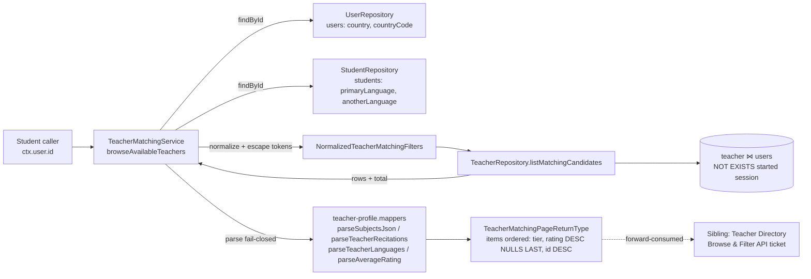

# Technical Architecture & Implementation Design: On-Demand Matching Algorithm (Filter/Sort Pipeline)

> **Plan directory (verbatim):** `ai/plans/milestone_2_matching_notifications_escrow/on_demand_matching_algorithm_filter_sort_pipeline`
> **Specs of record:** `specs.md` REQ-001…REQ-021 (requirements) · this document D1–D14 (design decisions) · `tasks.md` (execution) · `deferred-items.md` (ledger).
> **Ticket:** `docs/planning/TICKETS.md:1457-1505` — Dev 3, Milestone 2, 8 SP; decision refs B.10, A.6, FR-4.4. Blocked-by already satisfied in-tree (availability toggle shipped via `TeacherAvailabilityService`; session lifecycle shipped via `SessionLifecycleService`).
> **Governing ruling (from specs.md §"Load-bearing scope reconciliation"):** this ticket ships the ALGORITHM — storage columns, parsers, canonical types, one repo read, one service, INV-A3 read-side predicate, canonical empty-state copy, full test locks. The GraphQL query + pagination surface + teacher-profile projection + student UI belong to the sibling `Teacher Directory Browse & Filter API` (`docs/planning/TICKETS.md:1509-1549`, Blocked By this ticket).

---

## 1. System Overview & Architecture

### 1.1 Scope Statement

A student-authenticated, read-only matching pipeline. One service method (`TeacherMatchingService.browseAvailableTeachers`) resolves the caller's own profile (country + languages), validates the per-browse choices (recitation, intent), normalizes every match token (escape + JSON-quote + `%…%` wrap), delegates to ONE repository read (`TeacherRepository.listMatchingCandidates`) that applies ALL filters in SQL — eligibility booleans, governance, in-session NOT EXISTS, token LIKEs — and sorts by country tier → rating → id, then maps raw rows through fail-closed parsers into the canonical page envelope. No writes, no notifications, no GraphQL, no UI.

### 1.2 Data Flow



Read sequence per browse: `UserRepository.findById` → `StudentRepository.findById` → validation/normalization (pure) → `listMatchingCandidates` (2 sibling SQL queries via `Promise.all`: rows + `count(*)::int`) → mapper projection → envelope. Zero N+1: the in-session check is a correlated `NOT EXISTS` inside the single candidate query, NOT a per-teacher `assertTeacherNotInActiveSession` loop.

### 1.3 Key Design Decisions Table

| # | Decision | Rationale (evidence) |
|---|----------|----------------------|
| D1 | Service-level algorithm only; NO GraphQL/UI in this slice | Sibling ticket `:1509` is Blocked By this one and owns the API+UI; milestone DoD splits them (`MILESTONE_PLAN.md:206` vs `:207`); availability-ticket precedent for sibling-boundary discipline |
| D2 | Student Qira'ah is a per-browse INPUT; teacher recitations get a new `teacher.recitations` JSON-in-varchar column | Post-C.5 the `recitation` table is session-linked 1:1 (`backend/db/schema/classes/recitation.ts:15-30`); user-side preference is explicitly non-persisted (`docs/auth/qiraah-selection-and-c5.md:501-531`); A.6 `teacher.subjects` is the resolved multi-value precedent (`teacher.ts:29`) |
| D3 | Teacher fluency gets a new `teacher.languages` JSON-in-varchar column; student side resolves `primaryLanguage ?? anotherLanguage` from the caller's own rows | No teacher-side language storage exists; `TeacherMatchingLanguagesInput` in the Dev2→Dev3 contract already models the student side (`backend/types/contracts/teacher-availability.contract.types.ts:25`) |
| D4 | Eligibility = `is_online AND is_approved AND not-governed AND NOT EXISTS started session` | Ticket AC + compose rule forward contract (`docs/teachers/teacher-availability.md:297` — MUST NOT rely on `is_online` alone) + governance safety (`users.ts:37,39,42` nullable flags) |
| D5 | Bulk `NOT EXISTS` (teacher_id, status='started') instead of looping the per-teacher oracle | N+1-hostile at page scale; oracle-parity TEST-locked (same table, same status value as `assertTeacherNotInActiveSession`, `session-lifecycle.enforcement.ts:200-214`); new composite index serves it (risk pre-authorized, `MILESTONE_PLAN.md:244`) |
| D6 | All token filters in SQL via quoted-token `ilike` with `escapeLikeWildcards` | Paginated correctness demands SQL-side filtering; JSON quotes anchor token boundaries (`"hifz"` never matches `"hifz_jadid"`); one-escape-point rule (service escapes+wraps, repo binds — admin precedent `teacher-directory.service.ts:66-78`) |
| D7 | Country = ORDER BY tier (0/1), NEVER a WHERE | FR-4.4 P3 "prioritize… fallback" (`functional-requirements.md:148-155`); Egypt AC demands tier-before-rating |
| D8 | Rating = `average_rating DESC NULLS LAST` + `id DESC` tiebreak | Postgres DESC defaults NULLS FIRST (wrong for unrated); honest-null ≠ 0 preserves new-teacher discoverability; deterministic tiebreak per house convention (`teacher.repository.ts:461`) |
| D9 | Language filter only for non-Arabic speakers (Arabic baseline = no filter) | FR-4.4 P4 "for non-Arabic speakers"; Quran teaching is Arabic-native; platform Arabic-first default |
| D10 | Empty result = honest empty page (total 0), no error; canonical copy in a new `teacherDirectory` namespace | Ticket AC 4; zero-matches is a valid state; no `noTeachersAvailable`-style key exists today (verified) |
| D11 | Reuse `resolvePageBounds` + admin page-envelope shape | Verified canonical bounds discipline (`user-management.query.helpers.ts:45-62`: reject out-of-range with localized VALIDATION); `AdminTeacherPage` shape precedent (`admin-teachers.pothos.ts:68-81`) |
| D12 | Extract `parseSubjectsJson`/`parseAverageRating` to `backend/services/teachers/teacher-profile.mappers.ts`; admin mapper imports from there | Dedup: matching needs both parsers verbatim; no re-export shims (rule); admin file keeps `mapTeacherDirectoryRow` and consumes imports |
| D13 | Consume + export the contract type `TeacherMatchingLanguagesInput`; reuse `TeacherSubjectsParsed` | The Dev2→Dev3 contract becomes load-bearing instead of forked (`teacher-availability.contract.types.ts:22,25`) |
| D14 | `bun run db push` only; no migration files, no codegen | Drizzle schema convention (root AGENTS.md); zero GraphQL change ⇒ `generate:gqlSchema`/`bun codegen` not required by this slice |

---

## 2. Data Models & Database Schema

### 2.1 Existing Schema Verification (ZERO-DRIFT baseline — all verified in-tree)

| Fact | Evidence |
|---|---|
| `teacher` shared PK = `users.id`, cascade; `isApproved`/`isOnline`/`isEvaluator` nullable bools default false; `averageRating` `decimal(3,2)` nullable with CHECK 0..5; `subjects` `varchar(255)` JSON array; `requestPreference` enum default `queue`; NO indexes on this table | `backend/db/schema/teachers/teacher.ts:19-38` |
| `users`: `country` varchar(100) nullable (legacy free text), `countryCode` varchar(2) nullable (ISO alpha-2; new writes populate both — `backend/services/auth/registration.service.ts:273-276`), governance `isDeleted`/`suspended`/`isBlocked` nullable bools default false, `locale` = UI preference only | `backend/db/schema/users/users.ts:14-44` |
| `students`: `primaryLanguage`/`anotherLanguage` varchar(100) nullable free text; NO recitation/intent column | `backend/db/schema/students/students.ts:29-30` |
| `session`: `teacherId` NOT NULL FK teacher (restrict), `status` pgEnum default `scheduled`, `intent` pgEnum nullable; indexes: `session_teacher_id_idx`, `session_student_id_idx`, `session_teacher_id_student_id_idx` — NO (teacher_id, status) composite | `backend/db/schema/classes/session.ts:57-91` |
| `session_status` = scheduled/started/completed/cancelled/disputed; `session_intent` = hifz/tajweed/evaluation | `backend/db/schema/enums.ts:23,42`; TS mirrors `backend/enum/scheduling/session-status.enum.ts:7-13`, `session-intent.enum.ts:6-10` |
| `recitation` table is session-linked 1:1 (`sessionId` NOT NULL UNIQUE) — post-C.5; NOT a user-preference home | `backend/db/schema/classes/recitation.ts:15-30` |
| `RecitationReading` = shared TS-only catalog of 10 values + `isRecitationReading` guard | `shared/constants/recitation-reading.enum.ts:37-58`, `:81-83` |
| Rating single-writer: `StudentEvaluationService` recomputes via `EvaluationRepository.aggregateLiveRatings` → `TeacherRepository.updateAverageRating` | `backend/services/teachers/student-evaluation.service.ts:189-197`; `docs/teachers/teacher-average-rating.md:26,50` |
| Contract types: `TeacherSubjectsParsed` (exported), `TeacherMatchingLanguagesInput` (currently NOT exported — D13 exports it) | `backend/types/contracts/teacher-availability.contract.types.ts:22,25` |
| No matching/browse code exists anywhere (service, repo read, root field, document) | verified by repo-wide grep; `docs/teachers/teacher-availability.md:291` + `docs/teachers/teacher-average-rating.md:90` confirm |

### 2.2 Schema Additions (task 1.1 — `bun run db push`)

`backend/db/schema/teachers/teacher.ts` — add after `subjects` (`:29`), same doc-comment discipline as the A.6 column:

```ts
    /**
     * JSON array of RecitationReading values this teacher is certified to
     * teach (e.g. ["hafs_an_asim"]). varchar(255) JSON-in-varchar — the
     * A.6 `subjects` pattern; parsed fail-closed (corrupt payload reads as
     * "no certification" and excludes the teacher from recitation-filtered
     * matching). No production writer ships with the matcher; population
     * flows through the certification/profile surface (deferred pointer).
     */
    recitations: varchar("recitations", { length: 255 }),
    /**
     * JSON array of lowercase language tokens the teacher is fluent in
     * beyond Arabic (e.g. ["english","french"]). Same fail-closed parse
     * discipline; the language hard-filter applies only to non-Arabic
     * students (FR-4.4 Priority 4).
     */
    languages: varchar("languages", { length: 255 }),
```

`backend/db/schema/classes/session.ts` — append to the index list (`:87-91`):

```ts
    index("session_teacher_id_status_idx").on(t.teacherId, t.status),
```

No other schema file changes. `TeacherSelectType` grows automatically via `$inferSelect` (`backend/types/teachers/teacher.types.ts:3`). Capacity check (recorded for the reviewer): serializing ALL 10 catalog recitation values as JSON ≈ 196 chars < 255.

### 2.3 Canonical Types (task 1.2 — `backend/types/teachers/teacher-matching.types.ts`)

```ts
import type { SessionIntent } from "@/backend/enum/scheduling/session-intent.enum";
import type {
  TeacherMatchingLanguagesInput,
  TeacherSubjectsParsed,
} from "@/backend/types/contracts/teacher-availability.contract.types";
import type { RecitationReading } from "@/shared/constants/recitation-reading.enum";

export type TeacherMatchingIntent = Exclude<SessionIntent, SessionIntent.Evaluation>;

export interface TeacherMatchingSubmitInput {
  readonly recitation: RecitationReading;
  readonly intent: TeacherMatchingIntent;
  readonly page: number | null;
  readonly pageSize: number | null;
}

export interface TeacherMatchingItemReturnType {
  readonly id: number;
  readonly fullName: string;
  readonly country: string | null;
  readonly countryCode: string | null;
  readonly subjects: TeacherSubjectsParsed;
  readonly recitations: readonly RecitationReading[];
  readonly languages: readonly string[];
  readonly averageRating: number | null;
  readonly isOnline: boolean;
}

export interface TeacherMatchingPageReturnType {
  readonly items: readonly TeacherMatchingItemReturnType[];
  readonly total: number;
  readonly page: number;
  readonly pageSize: number;
  readonly pageCount: number;
}

export interface TeacherMatchingStudentContext extends TeacherMatchingLanguagesInput {
  readonly countryCode: string | null;
  readonly country: string | null;
}
```

Contract edit (same task): add `export` to the existing `type TeacherMatchingLanguagesInput` (`backend/types/contracts/teacher-availability.contract.types.ts:25`) — additive keyword only; run the contracts test suites (`contracts.static-assertions.test.ts`, `contracts.conformance.test-d.ts`) to prove zero shape drift.

Static-assertion pins (task 1.2, colocated `teacher-matching.types.static-assertions.test.ts`): exact-keyof equality on `TeacherMatchingItemReturnType` and compile-time absence of `email`/`phone`/`passwordHash`/`createdAt` — mirroring `teacher-availability.types.static-assertions.test.ts:31-47`.

### 2.4 i18n Additions (task 1.4 — new `teacherDirectory` namespace)

| File | Action | Content |
|---|---|---|
| `shared/locale/types/teacherDirectory/labels.ts` | CREATE | `export interface TeacherDirectoryLabels { /** Empty-state line rendered when a browse returns zero eligible teachers (rendered by the sibling directory UI). */ readonly noTeachersAvailable: string; }` |
| `shared/locale/types/teacherDirectory/index.ts` | CREATE | `export * from "./labels";` (directory barrel — every existing namespace dir carries one, e.g. `types/availability/index.ts`) |
| `shared/locale/en/teacherDirectory/labels.ts` | CREATE | `export const teacherDirectoryEn: TeacherDirectoryLabels = { noTeachersAvailable: "No teachers available" };` |
| `shared/locale/en/teacherDirectory/index.ts` | CREATE | `export * from "./labels";` |
| `shared/locale/ar/teacherDirectory/labels.ts` | CREATE | `export const teacherDirectoryAr: TeacherDirectoryLabels = { noTeachersAvailable: "لا يوجد معلمون متاحون" };` |
| `shared/locale/ar/teacherDirectory/index.ts` | CREATE | `export * from "./labels";` |
| `shared/locale/namespaces/teacherDirectory/teacherDirectory.namespace.ts` | CREATE | `export const TeacherDirectory = defineNamespace<TeacherDirectoryLabels>("teacherDirectory.teacherDirectory", translations => translations.teacherDirectoryTranslations);` (pattern: `shared/locale/namespaces/availability/availability.namespace.ts:4-7`) |
| `shared/locale/namespaces/teacherDirectory/index.ts` | CREATE | `export * from "./teacherDirectory.namespace";` — the target of the `namespaces/index.ts` re-export below |
| `shared/locale/namespaces/registry.ts` | UPDATE | add `TeacherDirectory,` member (insert per existing ordering at `:39-71` — registry order is not strictly alphabetical) |
| `shared/locale/namespaces/index.ts` | UPDATE | `export * from "./teacherDirectory";` (barrel, `./` relative only) |
| `shared/locale/types/message.ts` | UPDATE | add `teacherDirectoryTranslations: TeacherDirectoryLabels;` to `Translations` (near `:64` `availabilityTranslations`; import from `@/shared/locale/types/teacherDirectory`) |
| `shared/locale/en/messages.ts` + `ar/messages.ts` | UPDATE | import leaf const from the namespace directory + wire `teacherDirectoryTranslations` slice (pattern: `en/messages.ts:11,65`) |
| `shared/locale/teacherDirectory-namespace.parity.test.ts` | CREATE | en/ar parity per the colocated parity-test convention (e.g. `shared/locale/adminTeachers-namespace.parity.test.ts`) |

NO error-labels changes: `ValidationError` copy uses the existing `errorsTranslations.validation`; the caller-miss uses the existing `studentHandshakeNotFound` (`shared/locale/types/errors/labels.ts:254-255`).

---

## 3. API Contracts (Service Tier) & Pothos Forward Contract

### 3.1 The NO-SDL ruling + the service API contract

**This slice ships ZERO GraphQL surface.** `git diff backend/graphql/** frontend/graphql/**` MUST be empty (D1). The service contract below is the WHOLE public surface the sibling wraps:

```ts
// backend/services/teachers/teacher-matching.service.ts
export namespace TeacherMatchingService {
  /** On-demand matching browse (FR-4.4): eligibility + P1/P2/P4 hard filters,
   * P3 tiering, P5 rating sort. Pure read — point-in-time snapshot; the
   * session-request flow re-asserts availability under lock. */
  export async function browseAvailableTeachers(
    studentUserId: number,
    input: TeacherMatchingSubmitInput,
    locale: string,
    tx?: DBQueryExecutor
  ): Promise<TeacherMatchingPageReturnType>;
}
```

Behavioral contract (service tier, resolver-independent):

| Input state | Outcome |
|---|---|
| `recitation` not a `RecitationReading` (checked via `isRecitationReading`) | `ValidationError(t.validation)` |
| `intent` not `hifz`/`tajweed` (evaluation or non-member) | `ValidationError(t.validation)` |
| `page`/`pageSize` out of bounds | `ValidationError(t.validation)` via `resolvePageBounds` |
| caller has no `users` row (unreachable via auth boundary; defensive) | `NotFoundError("STUDENT", t.studentHandshakeNotFound)` |
| caller has no `students` row (teacher/parent/admin user) | `NotFoundError("STUDENT", t.studentHandshakeNotFound)` |
| zero eligible teachers | `{ items: [], total: 0, page, pageSize, pageCount: 0 }` — NO error |
| success | ordered page per REQ-006…REQ-012 |

### 3.2 Forward SDL contract (sibling `Teacher Directory Browse & Filter API` — NOT built here)

For the record (the sibling designs its own SDL): one student-only root field, e.g. `availableTeachers(recitation: RecitationReading!, intent: TeacherMatchingIntent!, page: Int, pageSize: Int): TeacherMatchingPage`, gated `authScopes: { $all: { authenticated: true, role: [UserRole.Student] } }` (idiom verified at `backend/graphql/mutation/classes/student-evaluation.mutation.ts:66-71`), delegating to this service with `ctx.user.id` + `ctx.locale` — resolver does NO business logic. NOT registered in `PUBLIC_OPERATION_NAMES` (`backend/lib/gateway/public-operations.ts:36-46` stays frozen).

### 3.3 Permission Matrix (service-tier callership — the full route matrix is the sibling's)

| Caller (role) | `browseAvailableTeachers` | Evidence / rationale |
|---|---|---|
| `student` (with `students` row) | ✅ allowed — the sole authorized subject | FR-4.4; ticket AC |
| `teacher` | ❌ denied — `NotFoundError("STUDENT")` (caller-miss; no `students` row) | honest-role denial; resolver-level 403 comes with the sibling |
| `parent` / `admin` / governed users | ❌ same caller-miss denial | auth boundary suspends/deletes; service stays id-scoped |
| Anonymous | ❌ unreachable at service tier; future resolver requires authentication | public-operations frozen |

### 3.4 Error/Code Contract

| Denial | Error class + code | Localized key (existing — verified) |
|---|---|---|
| Invalid recitation/intent/page bounds | `ValidationError` → `VALIDATION` | `errorsTranslations.validation` |
| Caller is not a student (no `students` row) | `NotFoundError("STUDENT")` → `STUDENT_NOT_FOUND` | `errorsTranslations.studentHandshakeNotFound` (`shared/locale/types/errors/labels.ts:254-255`; usage precedent `backend/services/students/student-handshake.service.ts:85`) |

No `ConflictError`, no `ForbiddenError`, no new error keys, no new taxonomy rows. Bounded `logger.logDomainError` on the caller-miss only (happy path silent — mirrors `teacher-availability.service.ts:115-120`).

---

## 4. Backend Services, Repositories & Concurrency Model

### 4.1 `TeacherMatchingService` — normalization pipeline (task 2.3)

```ts
// Pure constants (module-level, frozen):
const ARABIC_LANGUAGE_TOKENS: ReadonlySet<string> = new Set(["arabic", "ar", "عربي", "العربية"]);
const MAX_LANGUAGE_TOKEN_LENGTH = 50;
const INTENT_TOKENS: readonly TeacherMatchingIntent[] = [SessionIntent.Hifz, SessionIntent.Tajweed];

// Token normalizer (validation BEFORE any SQL pattern is built):
// trim → lowercase → reject when empty, > MAX_LANGUAGE_TOKEN_LENGTH,
// or containing '"' | '\\' (quote/backslash would break quoted-token anchoring).

// Pattern builders (ONE escape point — service escapes + wraps, repo binds):
const recitationPattern = `%${escapeLikeWildcards(`"${input.recitation}"`)}%`;
const subjectPattern    = `%${escapeLikeWildcards(`"${input.intent}"`)}%`;
const languagePattern  = needsLanguageFilter
  ? `%${escapeLikeWildcards(`"${requestedLanguage}"`)}%`
  : null;
```

Ordered steps: (1) `getServerTranslations(locale).errorsTranslations`; (2) validate `recitation` via `isRecitationReading` and `intent` via `INTENT_TOKENS`; (3) `resolvePageBounds(input.page ?? 1, input.pageSize ?? undefined, locale)` (`backend/services/admin/user-management.query.helpers.ts:45-62`); (4) `UserRepository.findById(studentUserId, tx)` then `StudentRepository.findById(studentUserId, tx)` — either miss ⇒ `NotFoundError("STUDENT", t.studentHandshakeNotFound)` + bounded `logger.logDomainError`; (5) build `TeacherMatchingStudentContext` from the two rows; (6) resolve language (primary ?? another → normalized; null/Arabic ⇒ `languagePattern = null`); (7) build the three patterns; (8) `TeacherRepository.listMatchingCandidates(filters, resolvedPageSize, offset, tx)`; (9) map rows through `teacher-profile.mappers`; (10) return the envelope with `pageCount = Math.ceil(total / resolvedPageSize)`.

Language resolution truth table (Tier-1 test matrix):

| primaryLanguage | anotherLanguage | Resolved | P4 filter |
|---|---|---|---|
| null | null | null | none (Arabic baseline default) |
| `"Arabic "` / `"ar"` | any | Arabic | none |
| `"French"` | null | `french` | hard filter on `"french"` |
| null | `"English"` | `english` | hard filter on `"english"` |
| `"french"` | `"arabic"` | `french` (primary wins) | hard filter on `"french"` |

### 4.2 `TeacherRepository.listMatchingCandidates` (task 2.2)

Repo-file-local shapes + method, added to the EXISTING namespace (`backend/db/repo/teachers/teacher.repository.ts`, mirroring `listDirectory` `:432-471`):

```ts
export interface NormalizedTeacherMatchingFilters {
  recitationPattern: string;
  subjectPattern: string;
  languagePattern: string | null;
  studentCountryCode: string | null;
  studentCountryText: string | null;
}

export interface TeacherMatchingRowType {
  id: number;
  fullName: string;
  country: string | null;
  countryCode: string | null;
  subjects: string | null;
  recitations: string | null;
  languages: string | null;
  averageRating: string | null;
  isOnline: boolean | null;
}

export async function listMatchingCandidates(
  filters: NormalizedTeacherMatchingFilters,
  limit: number,
  offset: number,
  tx?: DBQueryExecutor
): Promise<{ rows: TeacherMatchingRowType[]; total: number }>;
```

Filter chain (pure SQL builder, mirrors `buildTeacherDirectoryFilterChain` `:137-160`; NO inline `--` comments inside `sql` templates — known parameter-binding hazard):

```ts
const conditions: SQL[] = [
  eq(teacher.isOnline, true),          // nullable bool: eq(true) is fail-closed
  eq(teacher.isApproved, true),
  sql`${users.isDeleted} is distinct from true`,
  sql`${users.suspended} is distinct from true`,
  sql`${users.isBlocked} is distinct from true`,
  ilike(teacher.recitations, filters.recitationPattern),
  ilike(teacher.subjects, filters.subjectPattern),
  sql`not exists (select 1 from ${session} where ${session.teacherId} = ${teacher.id} and ${session.status} = ${SessionStatus.Started})`,
];
if (filters.languagePattern !== null) {
  conditions.push(ilike(teacher.languages, filters.languagePattern));
}
const where = and(...conditions) ?? sql`true`;
```

Country tier + ordering (single source of truth for REQ-009/REQ-011):

```ts
const countryTier = filters.studentCountryCode !== null
  ? sql`case when ${users.countryCode} = ${filters.studentCountryCode} then 0 else 1 end`
  : filters.studentCountryText !== null
    ? sql`case when lower(${users.country}) = lower(${filters.studentCountryText}) then 0 else 1 end`
    : sql`1`;

// orderBy:
sql`${countryTier} asc`,
sql`${teacher.averageRating} desc nulls last`,
desc(teacher.id),
```

Row + count sibling queries via `Promise.all` — same `where`, same join (`innerJoin(users, eq(users.id, teacher.id))`), count as `count(*)::int` (verbatim `listDirectory` discipline `:455-469`). Read executes on `(tx ?? db)` per the same-file precedent; `SessionStatus` is a VALUE import at the repo (REQ-002.3).

**Corrupt-JSON edge (documented, benign):** a row like `["hifz"` (unparseable tail) still matches the quoted-token LIKE — eligibility decided on raw tokens — while the projection parser degrades its array to `[]`. Eligibility is never weakened by projection parsing; display shows an empty array. Covered by a Tier-2 repo test.

**Oracle parity (test-locked):** the NOT EXISTS predicate uses the same table + status value as `assertTeacherNotInActiveSession` (`backend/services/classes/session-lifecycle.enforcement.ts:200-214`); the parity test proves exclusion-set equality on a mixed fixture cast.

### 4.3 Mapper projection (task 1.3 — `backend/services/teachers/teacher-profile.mappers.ts`)

```ts
export function parseSubjectsJson(raw: string | null): string[];        // moved verbatim from admin mapper :17-30
export function parseAverageRating(raw: string | null): number | null;  // moved verbatim from admin mapper :38-44
export function parseTeacherRecitations(raw: string | null): RecitationReading[]; // new: JSON array ∩ isRecitationReading
export function parseTeacherLanguages(raw: string | null): string[];     // new: parseSubjectsJson shape, string members
```

The admin mapper (`backend/services/admin/teacher-directory.mappers.ts`) drops its two local copies and imports from the canonical home (it keeps `mapTeacherDirectoryRow` — no shim, no re-export). The matching row mapper (service-local, non-types runtime code) composes: `subjects: parseSubjectsJson(row.subjects)`, `recitations: parseTeacherRecitations(row.recitations)`, `languages: parseTeacherLanguages(row.languages)`, `averageRating: parseAverageRating(row.averageRating)`, `isOnline: row.isOnline ?? false` (missing-value-reads-as-false discipline).

### 4.4 Concurrency & Race Condition Assessment

| Scenario | Actors | Risk | Mitigation |
|---|---|---|---|
| Teacher toggles Available while a browse page is mid-flight | teacher toggle ∥ student browse | Stale page content | Accepted: browse is a point-in-time SNAPSHOT; the session-request flow re-asserts `isOnline` + `is_approved` under `SELECT FOR UPDATE` per the contract TOCTOU rule (`teacher-availability.contract.types.ts:8-14`; `docs/backend/cross-stream-contracts.md:117-119`) — owned by the session-request tickets, disclosed here |
| INV-A4 release race: `releaseTeacherInSessionLock` resurrects `is_online = true` while a session… actually still `started` | lifecycle release ∥ browse | Stale-true `is_online` surfacing an in-session teacher | THE compose rule: the NOT EXISTS session predicate excludes the teacher regardless of the flag (REQ-006.4); the root fix (prior-online marker) is the In-Session Locking sibling's (`:1338`, hazard documented at `docs/teachers/teacher-availability.md:299-311`) |
| Two students browse concurrently | 2 students | None — read-only, no shared mutable state | `Promise.allSettled` Tier-3 test; no locks needed |
| Rating recompute during browse | evaluation submit ∥ browse | Page shows pre- or post-recompute rating | Accepted snapshot semantics; `average_rating` has a single writer (`docs/teachers/teacher-average-rating.md:26`) and the DB CHECK clamps bounds |

No SELECT FOR UPDATE usage — the path is 100% reads. No advisory locks, no module-level mutable state beyond frozen constants.

### 4.5 Cross-Actor Journey Design (assertion set for `test/workflows/teachers/on-demand-matching.journey.test.ts`)

**Shared-Entity State Machine** (the availability lifecycle this feature OBSERVES — owned by the toggle/lifecycle tickets; states from `docs/specs/state-machine-invariants.md:100-115`):

| Teacher state | `is_online` | live `started` session? | Browse visibility (THIS ticket's predicate) |
|---|---|---|---|
| Available (certified, toggled on) | `true` | no | **visible** (subject to token filters) |
| Unavailable (manual toggle off / auto-offline) | `false` | no | hidden |
| In-Session | `false` (INV-S6) — or stale-`true` in the release-race window | yes | **hidden** (NOT EXISTS dominates) |
| Uncertified (`is_approved = false`) | any | any | hidden |
| Governed user (deleted/suspended/blocked) | any | any | hidden |

**Side-Effect Matrix (per journey step):** every BROWSE step creates/updates ZERO rows and dispatches ZERO notifications (asserted via row-count deltas scoped to fixture ids); the lifecycle steps carry their own SHIPPED side effects, which the journey intercepts and tracks rather than denies: `startSession` writes only the INV-S6 `is_online` lock; `completeSession` additionally inserts a student confirm-prompt notification row on the completion transaction and publishes its receipt via `NotificationEngine.publishReceipts` after commit (`backend/services/classes/session-lifecycle.service.ts:402-418`) — the journey spies `NotificationEngine.publishReceipts` (precedent `spyPublication`, `test/workflows/sessions/session-lifecycle.journey.test.ts:238-244`), asserts the receipt targets the session's student, and registers the notification row for tracked teardown (`test/workflows/AGENTS.md` Rules 2 + 5, fixture-registry `track`). This ticket's own code composes none of those writers.

**Cross-Actor Visibility (who observes what):**

| After step | Student observes | Teacher observes | System state |
|---|---|---|---|
| T1 toggles Available | T1 appears in browse | own availability card `isOnline: true` | `teacher.is_online = true` |
| T1 toggles Unavailable | T1 disappears | card `isOnline: false` | `is_online = false` |
| T2's session starts | T2 disappears (INV-A3) | availability locked (403 on toggle-to-Available) | `is_online = false` + `status = started` |
| T2's session completes | T2 reappears | card `isOnline: true` | lock released |
| Non-student browses | — | — | `STUDENT_NOT_FOUND` denial, zero disclosure |

---

## 5. Frontend UX & Navigation Specification (Explicit No-UI Ruling)

### 5.1 New Routes & URLs

| Route | Purpose | Permission | Roles | Shipped here? |
|---|---|---|---|---|
| — none — | Student browse surface | — | — | **NO** — sibling `Teacher Directory Browse & Filter API` (`docs/planning/TICKETS.md:1509`) owns route + UI |

### 5.2 Sidebar/Navigation Integration

No changes. Student nav list (`frontend/views/dashboard/nav/navItems.ts:129-142`) and the role dashboard slot (`frontend/views/dashboard/home/RoleDashboardPage.tsx:93-99`) are untouched. No mobile bottom-nav entry.

### 5.3 Per-Audience Rendering

| Audience | What changes for them in THIS slice |
|---|---|
| Student | Nothing yet — their future browse page (sibling) renders this ticket's page envelope + `noTeachersAvailable` empty state |
| Teacher | Nothing — availability card already shipped by the toggle ticket |
| Parent/Admin/Supervisor | Nothing |

### 5.4 Forward-consumed UI contract

The sibling's UI receives: an ordered page (`items` ordered by country tier → rating → id), a flat item projection with parsed arrays + float rating (REQ-004.3), an honest empty page for the empty state, and `teacherDirectory.noTeachersAvailable` copy. The item `id` + the browse `intent` are exactly the `SessionSubmitInput { teacherId, intent }` booking inputs (`backend/types/classes/session.types.ts:39-42`).

---

## 6. Security, Authorization & Tenancy Mitigations

| Threat | Mitigation (this slice) |
|---|---|
| BOLA / IDOR | Caller identity = `studentUserId` param ONLY (resolver passes `ctx.user.id`); input carries NO ids; teacher rows are surfaced as a page, never addressable by client-supplied teacher id |
| BOPLA / mass assignment | Strict field-by-field DTO → `NormalizedTeacherMatchingFilters`; NO `{ ...input }` spread into any builder; the input type is a closed 4-field interface |
| BFLA | Student-only callership (§3.3); future resolver uses the `$all` conjunction idiom; `PUBLIC_OPERATION_NAMES` frozen (`backend/lib/gateway/public-operations.ts:36-46` — byte-identical diff required) |
| SQL/LIKE injection | Enum-validated tokens (recitation/intent) + character/length-gated free-text tokens (language) + `escapeLikeWildcards` at ONE point + parameterized `ilike` binding; Tier-4 probes with `%`/`_`/`\` payloads |
| PII leakage | Item type pinned PII-free by static assertions (REQ-004.6): no email, phone, password hash, timestamps; teacher existence is public-by-directory per the sanctioned ruling (`docs/sessions/session-lifecycle.md:167`) |
| Governance evasion | `is distinct from true` on `is_deleted`/`suspended`/`is_blocked` — deleted/suspended/blocked teachers never surface (NULL-safe for legacy rows) |
| Resource abuse | Page bounds 1..100 with localized `VALIDATION` rejection (`resolvePageBounds`); count query shares the predicate so `total` is honest |

---

## Verification Anchors (implementation-time gates)

1. `bun run db push` succeeds; `git diff backend/db/migration/**` EMPTY (push-only, REQ-003.4).
2. Contracts suites still green after the additive `export` (`backend/types/contracts/contracts.static-assertions.test.ts`, `contracts.conformance.test-d.ts`).
3. `bun run test/scripts/run-test.ts backend/db/test/repo/teachers/teacher.repository.test.ts` — new `listMatchingCandidates` suite green.
4. `bun run test/scripts/run-test.ts backend/services/teachers/teacher-matching.service.test.ts` — 4 tiers green.
5. `bun run test/scripts/run-test.ts test/workflows/teachers/on-demand-matching.journey.test.ts` — journey green; then the whole layer via the approved runner: `bun run test/scripts/run-test.ts test/workflows` (`test/workflows/AGENTS.md:94-97`).
6. `bun run test/scripts/run-test.ts shared/locale/teacherDirectory-namespace.parity.test.ts` + existing locale suites green.
7. `bun run scripts/health/sub-loop.ts <file> --lifecycle duplicates` exit 0 per touched file; `bun quality-gate` green; ledger gate `grep -cE '^\s*\|.*(❌|⚠️)' deferred-items.md` = 0.
8. Ruling diffs: `git diff backend/graphql/ frontend/ app/ backend/lib/gateway/` EMPTY.

## Deferred-Items Ledger Pointers (resolved-pointer seeds — full table in `deferred-items.md`)

| Pointer | Owning ticket |
|---|---|
| GraphQL browse query + SDL + teacher-profile projection + student UI | `Teacher Directory Browse & Filter API` (`docs/planning/TICKETS.md:1509`) |
| Teacher-side write path for `recitations`/`languages` (certification-time capture or profile editing) | candidate: `Cold-Start Bootstrapping (Direct Sheikh Certification)` (`docs/planning/TICKETS.md:2314`) — no dedicated profile ticket exists at plan time |
| Student durable recitation preference (`setMyPreferredRecitation` + persistence home) | deferred program documented at `docs/auth/qiraah-selection-and-c5.md:501-531` |
| INV-A4 never-resurrect release gating (prior-online marker) | `In-Session Locking (Hide from Directory)` (`docs/planning/TICKETS.md:1338`) |
| 15-minute inactivity auto-offline (keeps `is_online` truthful between toggles) | `15-Minute Inactivity Auto-Offline` (`docs/planning/TICKETS.md:1298`) |
| Browse-time TOCTOU re-assert at session creation (`SELECT FOR UPDATE`) | session-request flow tickets (`Session Request Notification to Teacher`, `:1601` + session engine) |
