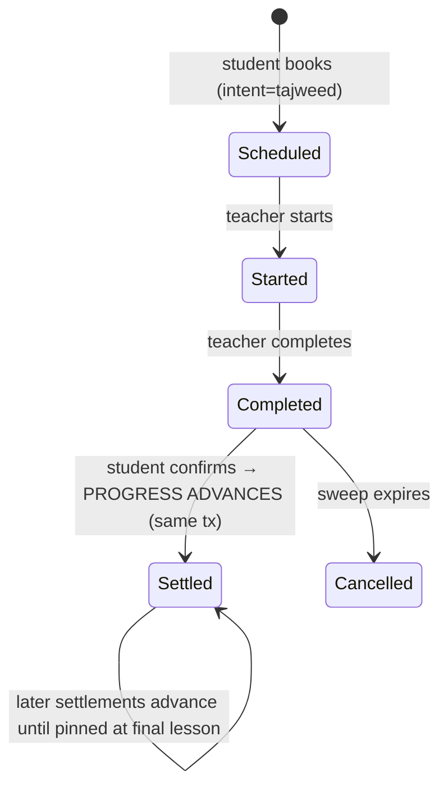

# Design — Student Progress Tracking & Increment

> **Plan directory (verbatim):** `ai/plans/milestone_2_matching_notifications_escrow/student_progress_tracking_&_increment-progress_tracking_increment/`
> **Specs of record:** `specs.md` (REQ-001..REQ-012) · **Ticket:** `docs/planning/TICKETS.md:1180-1217` — Dev 1 · M2 · 5 SP · Blocked By Tajweed Curriculum Lessons CRUD (SHIPPED)
> **Plan kind:** backend-only slice — zero schema delta; one new service, one new query, one hook line on the shipped dual-confirmation path; no frontend files.

## Document Information

| Field | Value |
|---|---|
| Version / Date | 1.1 · 2026-09-21 (R2: post-review patched) |
| Ground-truth schema | `backend/db/schema/classes/progress.ts:19-34` · `backend/db/schema/classes/lessons.ts:17-30` · `backend/db/schema/classes/session.ts:54-93` · `backend/db/schema/billing/subscriptions.ts:28-52` · `backend/db/schema/billing/plans.ts:20-43` |
| Hook point | `backend/services/classes/session-lifecycle.confirmation.ts:129-130` (after `creditTeacherEarning`, inside the exactly-once arm of `confirmCompletionInTx`) |
| Clone lineage | `lesson.service.ts` (service shape, error translation, audit hygiene) · `subscription.repository.ts:453-483` (lane-keyed joins) · `parent-monitoring.service.ts:210-238` (gated read composition) |
| Related docs | `docs/specs/state-machine-invariants.md` §9.2 (INV-PR1..3) · `docs/specs/functional-requirements.md` §6 (FR-6.1..6.3) · `docs/parents/monitoring-portal.md` (untouched consumer) |

## 1. Overview & Key Design Decisions

### Overview

One teacher + one student drive a session through the shipped lifecycle (`started --completeSession--> completed --confirmSessionCompletion--> completed + settled`). This design adds exactly one more side effect to the **settled** arm: advance the student's single per-plan `progress` row to the next lesson in the plan's `id ASC` sequence — and exactly one read surface (`studentProgress`) that composes the pointer, the lesson list, and a floor-computed percentage into a DTO. No new tables, no new columns, no UI, no audit rows, no event system.

### Design Goals

1. Exactly-once progress movement, anchored on the already exactly-once settlement guarded statement.
2. Zero blast radius on the escrow path: curriculum-context misses no-op loudly but never roll back settlement for absent context; genuine DB errors fail closed (whole confirmation rolls back).
3. Read honesty: the API reports position and percentage derivable from real rows only — `hasProgress: false` instead of fabrication.
4. Pattern isomorphism: every new file mirrors its shipped lessons/plans sibling so review is diff-mechanical.

### Key Design Decisions

- **D1 — Pointer-row model (one row per (student, plan); `lesson_id` = current lesson).** *Context:* INV-PR2 says "progress is updated (incremented)" and the ticket Gherkin says "their progress record is updated AND progress.lesson_id is incremented to the next lesson" — both describe an UPDATE of one record. *Options:* (1) append one row per completed lesson (history log); (2) pointer row with `lesson_id` = current lesson. *Decision:* (2). *Rationale:* matches the canonical Gherkin/INV wording literally; zero schema delta (no unique/append constraints, no `completed_at`); the cap rule "progress remains at the last lesson" is naturally a no-op UPDATE. Consequence (accepted): percentage at the pinned end-state reads `(N−1)/N` — the zero-column model cannot distinguish "on final lesson" from "finished"; `isOnFinalLesson` communicates exactly what the data knows. History-per-lesson is deferred item D6.
- **D2 — Trigger = the settled arm of dual confirmation, nothing else.** *Context:* three paths write `completed`: teacher `completeSessionWithReceipt` (:332/:377), student `confirmSessionCompletion` (:721 → `confirmCompletionInTx` :112), admin arbitration (`resolveDisputeCompleteOnce`/`resolveConsumedDisputeOnce`). *Decision:* only the student-confirmed arm, hooked at `session-lifecycle.confirmation.ts:129-130`. *Rationale:* INV-PR2's "successful completion" is the endorsed, financially-settled state; reusing `confirmStudentCompletionOnce`'s zero-row guard gives exactly-once for free — replay arms (`resolveSettledOrConflict`) return without touching progress. Arbitration-path advancement = deferred item D2.
- **D3 — Gate on `session.intent`, never on the balance lane.** `intentLaneFor` maps BOTH tajweed and evaluation to the tajweed lane (`session-lifecycle.guards.ts:92-94`); the lane is financial, not semantic. Trigger predicate: `confirmed.intent === SessionIntent.Tajweed` read off the row already in hand — zero extra queries, evaluation sessions provably excluded (REQ-007).
- **D4 — Plan resolution via latest active tajweed-lane subscription; road-tested join shape.** New repo read mirrors the `hasUncoveredExpiredLane` precedent (`subscription.repository.ts:453-483`): `subscriptions ⋈ plans ON plan_id`, `user_id = student`, status bound as `SubscriptionStatus.Active` (enum member, never a literal — §5.3), lane bound as parameter, `ORDER BY start_date DESC, id DESC LIMIT 1`. Miss → no-op + structured log (REQ-008.2). Trial-only students therefore accumulate no progress — documented; trial-lane progress = deferred item D5.
- **D5 — Lazy initialization at first settled completion.** The first dual-confirmed completion INSERTS the row (pointing at lesson 2, or lesson 1 for single-lesson plans). *Rejected alternatives:* initialize at subscription activation (touches the shipped settlement slice `subscription-activation-credit.helpers.ts` — out-of-scope blast radius) and initialize at booking (creates rows for students who never finish anything; contradicts REQ-005's cleanliness and the portal's "no recorded progress yet" honesty).
- **D6 — Read authorization: role scope + relationship check in the service.** Scope layer `$all { authenticated, role: [admin, teacher, student] }` stops parents with a generic 403 before DB reads. Inside: student self only; teacher requires `countTeacherStudentSessions(teacherId, studentId) ≥ 1` (ANY status — relationship, not outcome); admin unrestricted. *Oracle:* foreign teachers get the constant-shape `ForbiddenError`; distinguishing "student does not exist" is impossible for them by construction (denial precedes any student lookup).
- **D7 — i18n: one new errors leaf group.** `ErrorsLabels.studentProgress` = `{ studentNotFound }` in `shared/locale/types/errors/labels.ts` + en/ar copies, modeled on `lessonCatalog` (`labels.ts:16-22,116`). All other strings reuse existing keys (`forbidden`, session family untouched).
- **D8 — Parent portal untouched.** `ParentMonitoringService.getChildProgress` keeps using `countForStudent`; under the pointer model a student on a curriculum shows row-count 1 (honest "tracking exists" signal, matching that service's documented semantics: zero = none recorded). Portal upgrade to percentage = deferred item D4. No behavior change, no test churn there.
- **D9 — No audit rows for increments.** Progress movement is fully derivable from the settlement record (session confirmation is already logged); structured logs carry the no-op reasons (specs.md NFRs → Observability).

## 2. UX / Navigation Specification (Explicit No-UI Ruling)

### 2.1 New Routes & URLs

| Route | Purpose | Permission | Roles |
|---|---|---|---|
| — (NONE) | — | — | — |

No `app/` route, page, or layout changes. The only new surface is the GraphQL query `studentProgress` (§4).

### 2.2 Sidebar / Navigation Integration

- `frontend/views/dashboard/nav/navItems.ts` — **untouched** (verified: flat `NAV_ITEMS_BY_ROLE`, admin block `:155-183`; nothing added).
- Mobile bottom nav: **N/A** — the repo has no bottom-nav surface anywhere (confirmed during the lessons ticket, D9 there).

### 2.3 Role-Based Access Matrix (API level — the only surface that exists)

| Role | `studentProgress` query | Notes |
|---|---|---|
| `admin` | ✅ any student | role scope + service bypass |
| `teacher` | ✅ students sharing ≥1 session row | service-level count gate (BOLA) |
| `student` | ✅ self only | arg forced to `ctx.user.id`-scoped comparison in service |
| `parent` | ❌ 403 at scope layer | parent surface remains `parentChildProgress` (unchanged) |
| anonymous | ❌ 401 | `authenticated` scope throws before DB |

### 2.4 Per-Audience Rendering

| Audience | Rendering |
|---|---|
| All | No rendering in this ticket. Consumers arrive with the Teacher Preparation View ticket (this plan's DTO already carries everything that ticket needs: `hasProgress`, current lesson fields, `completionPercent`). |
| Parent portal | Unchanged rendering of the raw row count (value now turns `1` once tracking begins — D8). |

## 3. Data Models (EXISTING + NEW TYPES — zero schema delta)

### 3.1 `progress` (consumed-write, `backend/db/schema/classes/progress.ts:19-34`) — UNCHANGED

```typescript
export const progress = pgTable("progress", {
  id: integer("id").primaryKey().generatedAlwaysAsIdentity(),
  studentId: integer("student_id").notNull().references(() => students.id, { onDelete: "cascade" }),
  lessonId: integer("lesson_id").references(() => lessons.id, { onDelete: "set null" }),
  createdAt: timestamp("created_at").defaultNow().notNull(),
  updatedAt: timestamp("updated_at").defaultNow().notNull().$onUpdate(() => new Date()),
}, t => [index("progress_student_id_idx").on(t.studentId), index("progress_lesson_id_idx").on(t.lessonId)]);
```

Semantics NEW (writer-side contract, this ticket): at most one row per (student, governing plan); `lesson_id` = current lesson pointer. NOT enforced by a unique constraint (v1 discipline: single writer + a lock on the always-existing student row — `StudentRepository.findByIdForUpdate`, precedent `backend/db/repo/students/student.repository.ts:299` — makes the cardinality true transactionally INCLUDING the first-insert race, where a `FOR UPDATE` on the not-yet-existing pointer row would lock nothing; a composite unique index is revisited only if a second writer ever ships — deferred item D6 context).

### 3.2 Type layer (NEW) — `backend/types/classes/progress.types.ts`

```typescript
export type ProgressSelectType = typeof progress.$inferSelect;
export type ProgressInsertType = typeof progress.$inferInsert;
export type ProgressReturnType = ProgressSelectType;

/** Read-model DTO for the studentProgress query — computed, never a row spread. */
export interface StudentProgressReturnType {
  readonly hasProgress: boolean;
  readonly studentId: number;
  readonly planId: number | null;
  readonly planTitle: string | null;
  readonly totalLessons: number;
  readonly currentLessonId: number | null;
  readonly currentLessonTitle: string | null;
  /** 1-based position in the plan's id-ASC sequence; null when hasProgress=false. */
  readonly currentLessonPosition: number | null;
  readonly lessonsCompleted: number;
  /** integer, floor(lessonsCompleted * 100 / totalLessons); 0 when totalLessons = 0. */
  readonly completionPercent: number;
  readonly isOnFinalLesson: boolean;
}
```

Barrels: `backend/types/classes/index.ts` gains `export * from "./progress.types";` (named export only if a TS2308 collision appears; none expected).

## 4. API Contracts (GraphQL)

### 4.1 SDL (additions only)

```graphql
type StudentProgress {
  hasProgress: Boolean!
  studentId: Int!
  planId: Int
  planTitle: String
  totalLessons: Int!
  currentLessonId: Int
  currentLessonTitle: String
  currentLessonPosition: Int
  lessonsCompleted: Int!
  completionPercent: Int!
  isOnFinalLesson: Boolean!
}

extend type Query {
  studentProgress(studentId: Int!): StudentProgress!
}
```

No mutations, no inputs, no enums added. Enum registry (`backend/graphql/pothos/shared/enum.pothos.ts`) untouched. After wiring: `bun run generate:gqlSchema` + `bun codegen`; schema-surface assertions updated (see tasks).

### 4.2 Pothos Definition (NEW) — `backend/graphql/pothos/classes/student-progress.pothos.ts`

```typescript
export const StudentProgressPothosObject = gqlSchemaBuilder
  .objectRef<StudentProgressReturnType>("StudentProgress")
  .implement({
    fields: t => ({
      hasProgress: t.exposeBoolean("hasProgress"),
      studentId: t.exposeInt("studentId"),
      planId: t.exposeInt("planId", { nullable: true }),
      planTitle: t.exposeString("planTitle", { nullable: true }),
      totalLessons: t.exposeInt("totalLessons"),
      currentLessonId: t.exposeInt("currentLessonId", { nullable: true }),
      currentLessonTitle: t.exposeString("currentLessonTitle", { nullable: true }),
      currentLessonPosition: t.exposeInt("currentLessonPosition", { nullable: true }),
      lessonsCompleted: t.exposeInt("lessonsCompleted"),
      completionPercent: t.exposeInt("completionPercent"),
      isOnFinalLesson: t.exposeBoolean("isOnFinalLesson"),
    }),
  });
```

Pattern source: `backend/graphql/pothos/classes/lesson.pothos.ts:25`. Flat root query with no per-parent fan-out — no DataLoader (`t.loadable`) needed.

### 4.3 Query Field (NEW) — `backend/graphql/query/classes/student-progress.query.ts`

```typescript
gqlSchemaBuilder.queryField("studentProgress", t =>
  t.field({
    type: StudentProgressPothosObject,
    authScopes: { $all: { authenticated: true, role: [UserRole.Admin, UserRole.Teacher, UserRole.Student] } },
    args: { studentId: t.arg.int({ required: true }) },
    resolve: (_root, args, ctx) => {
      if (!ctx.user || !ctx.role) throw new UnauthorizedError("Authentication required.");
      return StudentProgressService.getStudentProgress(ctx.user.id, ctx.role, args.studentId, ctx.locale);
    },
  })
);
```

`ctx.role` is the converted `UserRole | null` (`gqlContextFactory.ts:82`, via `toUserRole`) — `ctx.user.role` is the raw pgEnum string union and MUST NOT be passed to `UserRole`-typed parameters (review finding R1-6).
Registration: add `import "./student-progress.query";` to `backend/graphql/query/classes/index.ts` (side-effect barrel; the top-level `backend/graphql/query/index.ts` already imports the classes barrel — `lesson.query.ts` rides exactly this path).

### 4.4 Error Surface & HTTP↔GraphQL Mapping

| Situation | Thrown | `extensions.code` | Copy source |
|---|---|---|---|
| Anonymous | scope throw | `UNAUTHORIZED` (401) | builder `authenticated` scope |
| Parent role | scope throw | `FORBIDDEN` (403) | builder `role` scope (`forbidden`) |
| Teacher w/o shared session | `ForbiddenError` | `FORBIDDEN` (403) | constant-shape generic (no oracle) |
| Student `/= caller.id` | `ForbiddenError` | `FORBIDDEN` (403) | same |
| Admin target student missing, or malformed id | `NotFoundError("STUDENT", …)` | `NOT_FOUND` (404 semantics) | NEW `errorsTranslations.studentProgress.studentNotFound` |

`studentId` arg is `Int!` (Pothos `t.arg.int`) — GraphQL rejects non-ints at parse; the service still re-validates `Number.isInteger(id) && id >= 1` (mirrors `coerceLessonId`, `lesson.service.ts:83`).

## 5. Services & Repositories

### 5.1 NEW `backend/services/classes/student-progress.service.ts` — `namespace StudentProgressService`

```typescript
export async function getStudentProgress(
  callerId: number, callerRole: UserRole, studentId: number,
  locale: string, outerTx?: DBTransaction
): Promise<StudentProgressReturnType>;
```
Read path (single `withTransaction(outerTx, …)`):
1. Validate `studentId` integer ≥ 1 else `NotFoundError("STUDENT", t.studentProgress.studentNotFound)`.
2. Authorization: `admin` → pass; `student` → require `studentId === callerId` else `ForbiddenError`; `teacher` → `SessionRepository.countTeacherStudentSessions(callerId, studentId, tx) ≥ 1` else `ForbiddenError`; any other role → `ForbiddenError`.
3. `StudentRepository.findById(studentId, tx)` — null → `NotFoundError("STUDENT", …)` (admin path only in practice; teacher/student paths already imply existence).
4. `SubscriptionRepository.findLatestActivePlanIdForLane(studentId, SubscriptionCreditLane.Tajweed, tx)` → null ⇒ `emptyProgress(studentId)` (`hasProgress: false`, null plan/lesson fields, zeroes).
5. `PlanRepository.findById(planId, tx)` (title for the DTO) + `LessonRepository.listByPlanId(planId, tx)` (id ASC contract) → `totalLessons`; `0` ⇒ `emptyProgress(studentId)` with plan fields populated.
6. Compose the DTO via helper over a plain `ProgressRepository.findRowForStudentPlan(studentId, planId, tx)` read (no locking on the read path): row null ⇒ `hasProgress: false`; row present ⇒ locate `row.lessonId` in the lesson list (null/not-found ⇒ position of lesson[0] with `lessonsCompleted: 0`), else `position = idx + 1`, `lessonsCompleted = idx`, `completionPercent = Math.floor(idx * 100 / total)`, `isOnFinalLesson = idx === total - 1`.

```typescript
export async function incrementForConfirmedSession(session: SessionReturnType, tx: DBTransaction): Promise<void>;
```
Write path (no transaction management — caller owns `tx`; NEVER throws for context misses):
1. `if (session.intent !== SessionIntent.Tajweed) return;` (REQ-007).
2. `findLatestActivePlanIdForLane(session.studentId, SubscriptionCreditLane.Tajweed, tx)`; null ⇒ `logSkip("no-active-tajweed-subscription", session)` and return.
3. `LessonRepository.listByPlanId(planId, tx)`; empty ⇒ `logSkip("no-lessons", …)` and return.
4. `StudentRepository.findByIdForUpdate(session.studentId, tx)` FIRST — locks the always-existing student row; this serializes ALL increments for the student (a `FOR UPDATE` on a not-yet-existing pointer row locks nothing — the first-insert race, review finding R1-5). Then `ProgressRepository.findRowForStudentPlan(studentId, planId, tx)` (plain read under the lock).
5. Compute the current pointer: row absent or `lessonId` null or lesson no longer in the plan's list ⇒ behave as if positioned on `lessons[0]` pre-completion (REQ-005.3 re-anchor semantics). Rule table:
   - total = 1: pointer target = `lessons[0]` (insert if no row; no-op if row already points there).
   - pointer at `idx < total - 1`: target = `lessons[idx + 1]` → row exists ? `updateRowLesson(row.id, target.id, tx)` : `insertRow({ studentId, lessonId: target.id }, tx)`.
   - pointer at last (idx = total - 1): row exists ⇒ no-op (cap, REQ-006); (row-absent case is already handled by the first two rules).
6. One structured log per skip/re-anchor via `logSkip`; no locale needed (system log, never user copy).

### 5.2 NEW `backend/services/classes/student-progress.helpers.ts`

| Helper | Signature | Purpose |
|---|---|---|
| `emptyProgress` | `(studentId: number, plan?: { id: number; title: string \| null } \| null, totalLessons?: number) => StudentProgressReturnType` | honest zero DTO |
| `computePosition` | `(lessons: readonly LessonReturnType[], row: ProgressSelectType \| null) => { idx: number }` | null/missing-pointer recovery to `idx = 0` (`lessonsCompleted = 0` on the read path) |
| `computePercent` | `(lessonsCompleted: number, totalLessons: number) => number` | `totalLessons === 0 ? 0 : Math.floor((lessonsCompleted * 100) / totalLessons)` — single definition for read + journey expectations |
| `logSkip` | `(reason: "no-active-tajweed-subscription" \| "no-lessons" \| "pointer-reanchored", ctx: { sessionId?: number; studentId: number }) => void` | the ONE logging shape for all no-ops |

### 5.3 REPO additions

**`ProgressRepository`** (`backend/db/repo/classes/progress.repository.ts` — existing `countForStudent` untouched):
```typescript
export async function findRowForStudentPlan(studentId: number, planId: number, tx?: DBQueryExecutor): Promise<ProgressSelectType | null>;
export async function insertRow(insert: ProgressInsertType, tx: DBTransaction): Promise<ProgressSelectType>;
export async function updateRowLesson(id: number, lessonId: number, tx: DBTransaction): Promise<ProgressSelectType | null>;
```
Row-for-plan reads join `lessons` on `progress.lesson_id = lessons.id AND lessons.plan_id = $2` (a row whose lesson moved plans is invisible here → treated as no-row → REQ-005.3 recovery), newest `progress.id DESC` first for determinism. Writes throw — callers fail closed (design goal 2). NOTE: no `…ForUpdate` variant exists here — write-path serialization is the student-row lock taken by the service (§5.1 step 4), which also closes the first-insert race that a row lock on a non-existent pointer cannot.

**`SubscriptionRepository`** (`backend/db/repo/billing/subscription.repository.ts`):
```typescript
export async function findLatestActivePlanIdForLane(studentId: number, lane: SubscriptionCreditLane, tx?: DBQueryExecutor): Promise<number | null>;
```
`SELECT s.plan_id FROM subscriptions s JOIN plans p ON p.id = s.plan_id WHERE s.user_id = $1 AND s.status = $2 AND p.balance_lane = $3 ORDER BY s.start_date DESC, s.id DESC LIMIT 1` bound as `(studentId, SubscriptionStatus.Active, lane)` — enum members as bound parameters, NEVER literals (REQ-002.3; the sibling `findActiveWithPlan` binds `SubscriptionStatus.Active` the same way at :322-325) — join shape mirrors `hasUncoveredExpiredLane` (:453-483).

**`SessionRepository`** (`backend/db/repo/classes/session.repository.ts`):
```typescript
export async function countTeacherStudentSessions(teacherId: number, studentId: number, tx?: DBQueryExecutor): Promise<number>;
```
Mirrors the count family at :649/:661; rides `session_teacher_id_student_id_idx` (composite index exists, `session.ts`).

### 5.4 Hook edit (THE only edit to shipped behavior)

`backend/services/classes/session-lifecycle.confirmation.ts`, inside `confirmCompletionInTx` between :129 and :130:

```typescript
await creditTeacherEarning(confirmed, confirmed.fee, tx);
await StudentProgressService.incrementForConfirmedSession(confirmed, tx);   // ← new line
return confirmed;
```

Import hygiene: confirmation.ts currently imports repos + errors + guards only; it gains `import { StudentProgressService } from "@/backend/services/classes/student-progress.service"`. Cycle check: student-progress.service imports repos + types + enums + logger + server-graphql only — it does NOT import session-lifecycle.* — no cycle.

## 6. Concurrency & Race-Condition Assessment

**Concurrency model:** the increment inherits the settlement transaction's isolation. Every increment takes `StudentRepository.findByIdForUpdate(session.studentId, tx)` before reading the pointer — the always-existing students row is the per-student serializer (a row lock on the pointer itself cannot exist before the first insert; review finding R1-5 fixed this). The exactly-once predicate (`confirmStudentCompletionOnce`, zero-row on replay) additionally guarantees the increment arm runs at most once per session even under retry or double-click.

| Scenario | Actors | Risk | Mitigation |
|---|---|---|---|
| Same session confirmed twice concurrently | student double-click / retry | double advance | `confirmStudentCompletionOnce` matches one tx only; the loser enters `resolveSettledOrConflict` (already `completed` ⇒ returns row untouched, zero progress writes) |
| Two DIFFERENT sessions of one student settle concurrently | student + back-to-back sessions | lost update / duplicate first insert | student-row lock serializes both increments; the second blocks, then reads the committed pointer (or the committed first insert) — advances exactly one slot per settlement, duplicate pointer rows impossible |
| Lesson deleted between read & write | admin UI | FK set-null / dangling pointer | `ON DELETE SET NULL` + REQ-005.3 re-anchor on next increment; read path re-anchors to position 1 for display |
| Plan changed (renewal to a new tajweed plan) | billing | pointer references old plan's lesson | `findRowForStudentPlan` scopes by current plan id — old-plan row simply doesn't match; new plan starts from no-row rules |
| Ratchet relative-order anomaly | none seedable | pointer could move backward if lessons re-seeded | lessons are append-only via the admin API (no reorder mutation exists); `id ASC` is stable |

**Locking inventory:** `StudentRepository.findByIdForUpdate` (precedent `backend/db/repo/students/student.repository.ts:299`), taken once per increment inside the settlement tx. The lessons list (`listByPlanId`) is read-consistent within the same tx — no lock needed (curriculum edits are rare admin actions; worst case is a logged re-anchor next time).

**TOCTOU:** the read API is read-only (no check-then-act). The write path is lock(student)-then-read-then-write in one tx. No advisory locks beyond the student row lock.

## 7. Cross-Actor Journey Design (drives `test/workflows/classes/tajweed-progress-increment.test.ts`)

### Shared-entity state machine (session — existing, unmodified) + progress side effect

| Session state | Trigger (actor) | Next state | Progress side effect |
|---|---|---|---|
| `scheduled` | teacher `startSession` | `started` | none |
| `started` | teacher `completeSession` | `completed` (fee held) | NONE — pointer frozen until endorsement |
| `completed` | student `confirmSessionCompletion` | `completed` + settled (`fee_held=false`, wallet credited) | **ADVANCE pointer (exactly once) — or insert, or pin** |
| `completed` | 24h sweep → cancelled | `cancelled` | none (never endorsed) |
| `disputed` → arbitration | admin | `completed`/`cancelled` | none in this ticket (deferred D2) |



### Side-effect matrix (the one transition this plan touches)

| Transition | Rows written | Notifications | Idempotency |
|---|---|---|---|
| `completed → settled` (student confirm) | session (stamp + `fee_held`), wallet row + ONE `earning` ledger row (existing), **`progress` insert-or-guarded-update (NEW)** | none new | `confirmStudentCompletionOnce` zero-row guard; progress piggybacks on it |

### Cross-actor visibility

| State | Student sees (self read) | Linked teacher sees | Foreign teacher | Parent | Admin |
|---|---|---|---|---|---|
| pre-settlement | `hasProgress: false` (or current pointer) | same payload | 403 | portal count (unchanged surface) | full payload |
| post-settlement | pointer + 1 / percent recomputed | same | 403 | count flips 0 → 1 (D8) | full payload |

Journey assertions = REQ-010 steps 1–10, executed test-first (Task 5 lands the file red on advance assertions before Task 6's hook turns it green), including the two concurrency legs (same-session double-confirm; two different sessions settling concurrently).

## 8. Security & Tenancy Mitigations

| Vector | Mitigation | Where |
|---|---|---|
| BOLA/IDOR on read | role-derived rules; teacher↔student pair count on the SAME tx; student arg forced to caller | `getStudentProgress` steps 1–2 |
| BOPLA | DTO assembled field-by-field; writer input contains zero client-controlled fields (only ids computed in-service) | service + repo signatures |
| BFLA | no progress mutation is exposed through GraphQL at all; the only writer is the internal settlement path | §4 (no mutation) |
| Info oracle | parent/foreign-teacher denials are constant-shape 403s; teacher denial precedes any existence probe | D6 |
| Injection | all raw-SQL branches parameterized (`$1`…); ids are server-coerced ints; no LIKE anywhere in this feature | repo conventions |
| Escrow safety | increment strictly AFTER `creditTeacherEarning`; unexpected errors roll back the whole confirmation (fail-closed); context misses log-and-skip (never block settlement) | D2, REQ-004.4, REQ-008 |

## 9. Testing Strategy

| Layer | File(s) | Approach |
|---|---|---|
| Repo unit | `backend/db/test/repo/classes/progress.repository.test.ts` (extend) + `backend/db/test/logic/billing/subscription.repository.test.ts` (its real home — logic/, not repo/) + `backend/db/test/repo/classes/session.repository.test.ts` (pair count) | `runInRollback` + `tx`-everywhere; try/catch `expectRepoError` discipline (never `.rejects` inside rollback) |
| Service logic | `backend/db/test/logic/classes/student-progress.service.test.ts` | rollback-based logic tests (sibling precedent `lesson.service.test.ts`); increment permutations + read authorization matrix |
| Hook regression | extend `session-lifecycle.service.test.ts` (confirm path) | dual-confirm moves pointer; replay does not; evaluation intent does not |
| GraphQL | `backend/graphql/test/student-progress.wire.test.ts` + role tests | `setupTestServerLifecycle` + `testClient`; SDL assertions updated in `backend/graphql/test/schema-surface.test.ts` + `sdl-static-assertions.test.ts` |
| Journey | `test/workflows/classes/tajweed-progress-increment.test.ts` (TEST-FIRST) | conventions per `test/workflows/AGENTS.md`: committed fixtures + tracked `afterAll` cleanup, NO `runInRollback`, honest roles, spied transport; run via `bun run test/scripts/run-test.ts` |
| i18n parity | existing errors-namespace parity harness | new key set identical in both locales |

4-tier per task: T1 branch/statement 100% on new methods · T2 boundary (0 lessons, 1-lesson plan, missing row, null pointer, floor math at the 1/3 and 2/3 boundaries) · T3 chaos (concurrent double-confirm; two-session settlement race) · T4 abuse (parent/foreign-teacher/anon denials, malformed ids).

## 10. Deployment & Rollback

- Schema: untouched — no `db push`/`db migrate`. GraphQL: `bun run generate:gqlSchema` + `bun codegen` artifacts committed.
- Rollback: revert the one hook line in `session-lifecycle.confirmation.ts` to stop writes; the query is additive and harmless left in. No data migration to reverse.
- Compatibility: `parentChildProgress` output shape unchanged; SDL additions are purely additive.

## Outcome & Knowledge Transfer Protocol

- BEFORE any task: read everything under `ai/plans/milestone_2_matching_notifications_escrow/student_progress_tracking_&_increment-progress_tracking_increment/outcome/`.
- AFTER any task: write `outcome/<task-id>-outcome.md`; flip the checkbox in `tasks.md`.
- Knowledge propagation target: `docs/curriculum/progress-tracking.md` (final task) — domain mapping per the tasks template.
