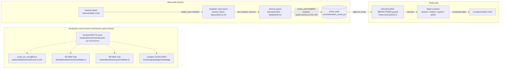

# Design — Surah/Juz Enum Homework Tracking

**Plan Directory:** `ai/plans/milestone_2_matching_notifications_escrow/surah_juz_enum_homework_tracking/`
**Specs of record:** `specs.md` (REQ-0 … REQ-10)
**Ledger:** `deferred-items.md`
**Outcome Directory:** `outcome/`
**Tickets:** Surah/Juz Enum Homework Tracking — `docs/planning/TICKETS.md:1422-1453`; blocking ticket (implemented) — `docs/planning/TICKETS.md:1376-1418`
**Decision Refs:** B.11 — `docs/specs/open-decisions-and-gaps.md:135-139`
**Version:** 1.0 · 2026-10-04

## 1. System Overview & Architecture Diagram

The homework vocabulary is a closed enum mirrored across five surfaces. Today every mirror
carries 35 members (5 surahs + 30 juz); this plan widens them to 144 (114 surahs + 30 juz) in
lockstep, refactors the two mappers that cannot scale, and adds the parity guards that make the
mirror set drift-proof. No table, column, operation, route, or permission changes.



Layer flow is unchanged from the shipped pipeline (`session-report.service.ts:357-394`):
Client Component → Apollo mutation → Pothos resolver (teacher role gate) → service guard →
repository insert — all inside one `withTransaction`, notifications after commit.

## 2. Design Goals

1. **Complete the B.11 contract**: all 114 surahs + 30 juz available for homework assignment,
   additively, with zero regression on the shipped 35.
2. **Make the mirror set machine-locked**: pgEnum ↔ TS ↔ codegen ↔ labels parity tests so the
   next vocabulary change (if any) cannot land half-applied.
3. **Keep every fail-closed posture**: unknown values still throw at mappers, still deny at
   three tiers, labels still ride the raw ref — no new silent paths.
4. **Keep teacher UX fast at 144 options**: grouped, searchable picker; localized labels.
5. **Zero scope creep**: no routes, no permissions, no schema objects beyond enum values; the
   carried-over display adoption stays with its owner ticket (ledger D1).

## 3. Key Design Decisions

| # | Decision | Options Considered | Rationale |
|---|---|---|---|
| D1 | **Verify-then-extend posture** — treat the ticket's four scenarios as shipped behavior to lock, not re-implement; the expansion is the new work | (a) fresh re-implementation of tracking; (b) verify-then-extend | The blocking plan's ledger row D1 states verbatim: "Enum expansion is that ticket's core; its other listed scenarios (valid/invalid enum values, non-contiguous tracks) are ALREADY shipped by M1's guards — the plan for that ticket should verify-then-extend". All four scenarios verified shipped (specs.md baseline table). |
| D2 | **Hand-authored expansion from the plan's canonical dataset — NO generator script** | (a) generator script (precedents: `scripts/country-data-generator`, `scripts/iana-timezone-generator`); (b) hand-author + parity tests | The Quranic canon is immutable — a generator would run exactly once, so its machinery is pure cost; the country/IANA generators exist because their datasets are large AND externally updated (tzdata). Drift risk is neutralized by the three NEW parity tests (REQ-5) instead. The canonical dataset lives in §9 and is the reviewed source. |
| D3 | **Refactor the two exhaustive mappers to guard-based lookups** instead of growing the switches | (a) grow switches to 144 cases; (b) guard/Map lookup + parity tests | (a) is impossible: `max-switch-cases` ≤ 30 (documented `sessionReportConversions.ts:30-31`) and the function-size ceiling (documented `home-work.pothos.ts:45-47`) already forced the shipped 35-member split. The compile-time `never` guard retires; its protection is replaced — and improved — by parity tests that catch TS-side additions too, which the `never` guard never did. |
| D4 | **DB delivery: `db push` locally + committed drizzle-generated migration** (`db` → generate) | (a) push only; (b) push + committed migration; (c) hand-written custom migration | `backend/db/schema/AGENTS.md`: "use `db push` for schema changes and `db migrate` for migration management". The repo's committed-migration chain must carry the `ADD VALUE` statements for fresh databases; drizzle-generated enum-value precedent exists (`backend/drizzle/20260907182455_ancient_scarecrow/migration.sql` — `ALTER TYPE "payment_gateway" ADD VALUE 'mock'`). 109 statements, catalog-only, no rewrite. |
| D5 | **Locale leaves hold a module-scope `Record<string,string>` literal + `?? ref` fallback** | (a) inline if/switch grown to 144 (impossible — lint ceilings); (b) sibling data modules per locale; (c) module-scope Record in each leaf | (c) keeps one leaf file per locale (no new files for knip to track), honors "leaf modules contain no logic — only plain literals" (`shared/locale/AGENTS.md:27-31`) better than today's 75-line if/switch, and the single `?? ref` fallback preserves the shipped fail-closed raw-ref passthrough (parity-tested at `sessions-namespace.parity.test.ts:635-639`). The Record stays unexported (`shared/locale/AGENTS.md:27-29` single-export rule). |
| D6 | **Teacher picker: grouped, searchable MUI `Autocomplete`** replacing the flat `Select` | (a) keep `Select` with 144 `MenuItem`s; (b) `Autocomplete` with `groupBy` + filtering | (a) leaves teachers scrolling an unsearchable 144-item menu — a real usability regression vs. the ticket AC "When they select a Surah or Juz". MUI v9.4 `Autocomplete` is already used in-repo (`OnboardStudentParentSection.tsx`, `WalletPickerHeader.tsx`); two new flat group-label keys (REQ-4.3) keep it localized. |
| D7 | **Read-surface label adoption (parent/admin/student display) stays deferred** (ledger D1) | (a) fold into this plan; (b) keep with the parent-portal display ticket per the blocking plan's ledger | The blocking plan's ledger D2 assigned it to "next parent-portal display ticket". The regex `formatSurahJuzRef` (`parentMonitoringDisplay.ts:52-56`) keeps mechanically splitting the new CamelCase keys — no breakage, only non-localized display, which is the pre-existing state. Folding in would widen a 3-SP ticket across three read surfaces and 8 consumer files. |
| D8 | **Naming convention pinned by the §9 table** — `Surah<Pascal>` / `surah_<snake>` from the transliterated name, sun-letter assimilation preserved (An-, Ash-, Aṣ-, Aḍ-, Aṭ-, Adh-, Az-, Ar-, As-, At-), specials: #3 `SurahAalImran` (frozen), #20 `SurahTaHa`/`surah_ta_ha`, #36 `SurahYaSin`/`surah_ya_sin`, #38 `SurahSad`, #50 `SurahQaf`, #71 `surah_nuh` (NOT `surah_an_nuh` — keeps the journey's hostile fixture invalid) | (a) free-form per-implementer naming; (b) pinned table + naming rules | 109 new identifiers × 5 mirrors cannot be invented ad-hoc without near-collision hazards against existing hostile test fixtures (`surah_an_nuh`, `surah_al_furqan` — the latter becomes VALID as surah 25). §9 is authoritative; the fixture audit (REQ-2.4) sweeps against it. |

## 4. UX/Navigation Specification

**Ruling: no new routes, no sidebar changes, no mobile bottom-nav entries, no permission
changes.** (Explicit no-new-UI ruling: the feature is a vocabulary expansion over existing
surfaces.)

### New Routes & URLs

| Route | Purpose | Permission | Roles |
|---|---|---|---|
| — none — | The expansion rides existing routes | unchanged | unchanged |

### Sidebar Navigation Integration

- **Group:** none — no navigation object is added, moved, or re-ordered.
- **Mobile Bottom Nav:** none (explicitly out — no bottom-nav exists for these surfaces and
  none is introduced).

### Affected Existing Surfaces

| Surface | Route (shipped) | Access | Change |
|---|---|---|---|
| Teacher report/homework dialog | `/teacher/sessions` (`app/(dashboard)/teacher/sessions/page.tsx:33`, Teacher-only) | `withPageAuth({ roles: [UserRole.Teacher] })` | `AssignmentBlock` picker: flat `Select` → grouped/searchable `Autocomplete` (144 options, REQ-7) |
| Student sessions read | `/student/sessions` (`app/(dashboard)/student/sessions/page.tsx:33`, Student-only) | participant gate (service-side) | none (new members flow through existing shapes) |
| Student homework page | `/homework` (`app/(dashboard)/homework/page.tsx:35`, Student-only) | unchanged | none structural; display adoption = ledger D1 |
| Parent monitoring portal | `/parent/children/[studentId]` (`app/(dashboard)/parent/children/[studentId]/page.tsx:64`, Parent-only) | requireLinkedChild gate | none structural; display adoption = ledger D1 |
| Admin academic tracking | `/admin/academic-tracking`, `/admin/academic-tracking/[studentId]` (`app/(dashboard)/admin/academic-tracking/page.tsx:37`) | Admin-only | none structural; display adoption = ledger D1 |

### Role-Based Access Matrix (all unchanged)

| Role | Routes accessible | Homework permissions |
|---|---|---|
| Teacher | `/teacher/sessions` | submit own completed-session reports + homework; read own students' history |
| Student | `/student/sessions`, `/homework` | read own |
| Parent | `/parent/children/[studentId]` | read linked child |
| Admin | `/admin/academic-tracking*` | read models |
| Superadmin / Supervisor / Staff | n/a | no homework surface |

### Per-Audience Rendering

| Audience | Rendering |
|---|---|
| Teacher | Active: picks any of 144 members, grouped "Surahs"/"Juzs", localized labels via `t.surahJuzLabel` |
| Student | Read-only; labels via shipped shapes (localized adoption deferred, ledger D1) |
| Parent | Read-only (monitoring tab); same deferred display surface |
| Admin | Read-only (position lanes); same deferred display surface |

## 5. Translation System Requirements

All new copy goes through the compile-time locale system — verified signatures only:

- **Client components** (`TeacherSessionReportDialog.parts.tsx`): labels arrive as the
  `SessionsLabels` prop `t` (resolved upstream via the `Sessions` namespace handle,
  `shared/locale/namespaces/sessions/sessions.namespace.ts`; hook contract at
  `shared/locale/client/use-app-translation.ts:8-10`). New keys are flat strings accessed as
  properties (`t.surahJuzSurahGroupLabel`).
- **Server components**: `getTranslations(locale)` — single argument, full typed bundle
  (`shared/locale/server.ts:15-17`).
- **Services / tests / scripts**: `getServerTranslations(locale)`
  (`shared/locale/server-graphql.ts:3-5`) — the guard denial copy `homeworkSurahJuzInvalid`
  already exists in both locales (`shared/locale/en/errors/index.ts:136`,
  `shared/locale/ar/errors/index.ts:134`) and is REUSED — no new error keys.
- **Resolvers**: thread `ctx.locale` (precedent `session-report.mutation.ts:120`); no resolver
  copy.
- **New keys (sessions namespace, REQ-4.3)**: `surahJuzSurahGroupLabel`, `surahJuzJuzGroupLabel`
  — type contract (`shared/locale/types/sessions/labels.ts`), en leaf, ar leaf, and the
  key-set parity belt picks them up automatically. Namespace rules live in
  `shared/locale/AGENTS.md` (leaf purity, single exported const, typed contract).

**Forbidden (do not introduce):** `Translation.` enum (does not exist), two-argument
`getTranslations(locale, "ns")` (real signature is single-arg), `useAppTranslation("string")`,
`t('key')` calls, `next-intl`, hardcoded UI strings, string literals where `SurahJuzRef` is
expected, `import type` for runtime enum use.

## 6. Concurrency & Race Condition Assessment

**Scope: enum-value addition only — no shared mutable state, no counter, no balance, no
read-then-write sequence is introduced or altered.** The shipped write path is frozen
(`session-report.service.ts:357-394`: single `withTransaction`, one-shot guarded grade UPDATE,
unique-arbiter INSERT). The assessment therefore covers only the migration and vocabulary
rollout:

| Scenario | Actors | Risk | Mitigation |
|---|---|---|---|
| Migration applies while sessions run | migration vs. live traffic | brief catalog lock on `surah_juz_ref` | `ALTER TYPE … ADD VALUE` is catalog-only — no row rewrite, no reindex; lock duration is milliseconds; shipped readers/writers of the OLD 35 members are untouched by added values |
| Old code reads a NEW value | pre-deploy app vs. post-migration DB | old exhaustive mapper hits its fail-closed throw | Deploy migration + code together (single release). No stored row can hold a new member until the new code accepts a teacher's selection, so the transitional window is empty by construction. |
| Two surfaces updated out of order within the release | enum vs. pgEnum vs. labels vs. codegen | partial-vocabulary drift | All structural mirrors land in ONE task (Task 2) before any UI work; the three parity tests (REQ-5) fail any partial state; codegen regen is the last mechanical step inside Task 2 |
| Enum growth vs. prepared statements | repo raw-SQL branches (`home-work.repository.ts`) | stale enum value lists in SQL text | No SQL text embeds enum literals — values are bound parameters throughout (raw branches alias columns only, `home-work.repository.ts:102,104,160,162,263,265`) |

**SELECT FOR UPDATE usage: none added** (none needed — no locking semantics change). TOCTOU
windows: none added. Module-level mutable state: the new lookup maps are read-only
`ReadonlyMap`/`ReadonlySet`/`Record` built once at module scope (constant, bounded).

## 7. Cross-Actor Journey Design

**No new state machine.** The shared entity (`home_work` row) keeps its shipped lifecycle:

| Current State | Trigger (actor + action) | Next State | Guard / Permission |
|---|---|---|---|
| (none) | teacher submits report+homework for own `completed` session | assigned (grades NULL) | Teacher role + session ownership (`SESSION_NOT_FOUND` oracle) |
| assigned | teacher submits NEXT session's report with `previousGrades` | graded (one-shot) | guarded UPDATE, `homeworkAlreadyGraded` on re-grade |
| assigned / graded | — | terminal (append-only; surah/juz columns never rewritten) | — |

**Side-effect matrix (unchanged, re-asserted by the journey):** submission creates exactly one
`reports` row + at most one `home_work` row in one transaction; notifications publish after
commit; denials create zero rows (side-effect oracle `expectNoDeltas`).

**Journey test mapping:** extend the EXISTING
`test/workflows/classes/session-report-homework.journey.test.ts` with one far-vocabulary
accepted step (REQ-9.1: jadid `surah_an_nasr` #110 + madi `juz_3`) — resolver → service → repo
→ DB → participant read round-trip for a post-expansion member, side-effect-oracle-checked. No
new journey file.

**Cross-actor visibility (per state, unchanged):**

| State | Teacher sees | Student sees | Parent sees | Admin sees |
|---|---|---|---|---|
| assigned | own submission + history | participant homework read | monitoring homework tab | academic-tracking lane position |
| graded | graded history rows | graded marks | graded marks | latest graded position |
| denial | localized error, zero writes | unchanged state | unchanged | unchanged |

## 8. Architecture / Components (exact signatures)

### A. Enum module — `backend/enum/shared/surah-juz-ref.enum.ts` (EXTEND)

File doc reworded from "5 surahs (al_fatihah..al_maidah)" to the 114-surah mushaf canon.
Declaration order is load-bearing (order-sensitive parity tests + enum unit suite pin it):

```ts
export enum SurahJuzRef {
  // 1..114 — mushaf order, values from plan.md §9 (keys/values of the
  // existing 5 members are byte-frozen)
  SurahAlFatihah = "surah_al_fatihah",   // #1  (unchanged)
  SurahAlBaqarah = "surah_al_baqarah",   // #2  (unchanged)
  SurahAalImran = "surah_aal_imran",     // #3  (unchanged)
  SurahAnNisa = "surah_an_nisa",         // #4  (unchanged)
  SurahAlMaidah = "surah_al_maidah",     // #5  (unchanged)
  SurahAlAnam = "surah_al_anam",          // #6  … through …
  SurahAnNas = "surah_an_nas",            // #114
  Juz1 = "juz_1",                         // unchanged, #115
  …                                       // (Juz2..Juz29 unchanged)
  Juz30 = "juz_30",                        // unchanged, #144
}
```

`SURAH_JUZ_REF_MEMBERS` (`:47`) and `isSurahJuzRef` (`:55-57`) are UNCHANGED — both derive
from `Object.values(SurahJuzRef)` and therefore automatically cover the 144 members.

### B. Schema pgEnum — `backend/db/schema/enums.ts:124-160` (EXTEND) + migration

The value array grows from 35 to the byte-identical 144 in the same order as the TS enum
(existing 35 entries untouched in place; 109 additions inserted between `surah_al_maidah` and
`juz_1`). Per `backend/db/schema/AGENTS.md`: apply with `bun run db push` (local), commit the
migration via `bun run db` → generate (drizzle-kit). Expected emitted SQL shape (precedent:
`backend/drizzle/20260907182455_ancient_scarecrow/migration.sql`):

```sql
ALTER TYPE "surah_juz_ref" ADD VALUE 'surah_al_anam'; --> × 109 (one per new member)
```

Verify the generated migration runs against the repo's PG major (the custom-migration
precedent `backend/drizzle/20260915232949_custom_6-…/migration.sql` documents the
transactional restriction on older majors; drizzle's generate path already ships `ADD VALUE`
in this repo, so the standard flow applies). No `home_work` DDL of any kind.

### C. Pothos output mapper — `backend/graphql/pothos/classes/home-work.pothos.ts:54-127` (REFACTOR)

The 5-guard + 30-case exhaustive switch (with its `never` guard) is REPLACED by:

```ts
import { isSurahJuzRef, SurahJuzRef } from "@/backend/enum/shared/surah-juz-ref.enum";

/**
 * Maps the `surah_juz_ref` pgEnum value carried by the canonical row onto
 * the `SurahJuzRef` TS enum. The shipped pgEnum string union and the TS
 * enum values are byte-identical, so the fail-closed vocabulary guard is
 * the whole mapping; an unrecognized value (a DB enum ahead of the TS
 * vocabulary) surfaces as a resolver error instead of passing through.
 * Vocabulary totality is enforced by the pgEnum↔TS parity test and the
 * locale-completeness conformance test.
 */
function toSurahJuzRef(value: NonNullable<HomeWorkReturnType["currentSurahJuz"]>): SurahJuzRef {
  if (isSurahJuzRef(value)) {
    return value;
  }
  throw new Error(`Unexpected surah/juz ref: ${value}`);
}
```

The import becomes a value import (adds `isSurahJuzRef`); no `String()` wrapper on the throw
path — after the failed guard the scrutinee is still the string-literal pgEnum union, so a
`String()` call would trip oxlint `no-unnecessary-type-conversion`. Both field resolvers
(`:151-158`, `:163-170`) and their call sites are untouched. File-header doc (lines 15-24)
reworded: "exhaustive, type-safe mapping helper" → "fail-closed vocabulary guard"; the
mapper's retired never-guard paragraph (`:35-53`) is rewritten to describe the parity-test
compensation.

### D. Frontend conversion — `frontend/views/teacher/sessions/sessionReportConversions.ts:27-104` (REFACTOR)

The 5-guard + 30-case switch is REPLACED by a module-scope map + membership guard + fail-closed
throw. Type guards are the sanctioned `no-unsafe-type-assertion` escape hatch — the design uses
ZERO type assertions (a bare `string → enum` cast trips type-aware oxlint exactly like the
`as unknown as` double cast the file header forbids at `:7-8`):

```ts
/** Wire values for SurahJuzRef are the TS enum KEYS (Pothos enumType maps
 * keys to the wire; the codegen enum mirrors them). Object.entries yields
 * [memberName, snakeRef] pairs, so the map must be INVERTED to ref → member
 * name: the lookup key is the snake_case ref, the value is the PascalCase
 * wire name. The explicit [string, string] tuple annotation keeps the flip
 * cast-free. */
const CODEGEN_MEMBERS: ReadonlySet<string> = new Set(Object.values(CodegenSurahJuzRef));

function isCodegenSurahJuzRef(value: unknown): value is CodegenSurahJuzRef {
  return typeof value === "string" && CODEGEN_MEMBERS.has(value);
}

const CODEGEN_WIRE_BY_REF = new Map<string, string>(
  Object.entries(BackendSurahJuzRef).map(([member, ref]): [string, string] => [ref, member]),
);

function toCodegenSurahJuzRef(value: BackendSurahJuzRef): CodegenSurahJuzRef {
  const wire = CODEGEN_WIRE_BY_REF.get(value);
  if (wire !== undefined && isCodegenSurahJuzRef(wire)) {
    return wire;
  }
  throw new Error(`Unmapped SurahJuzRef value: ${value}`);
}
```

The map is built once at module scope (read-only, bounded); `Object.entries` of a string enum
yields exactly its `[memberName, value]` pairs (string enums carry no reverse-mapping
entries), and the inversion above is what makes the ref-keyed lookup total. The map's
totality is pinned by the order-insensitive codegen key-parity test (§8.G) AND the
round-trip test that exercises every member.
`toCodegenBlock` / `toCodegenAssignment` / `toCodegenGradeFields` / `toCodegenSubmitInput`
(`:107-142`) are UNCHANGED.

### E. Locale contract + leaves (EXTEND)

Type contract — `shared/locale/types/sessions/labels.ts:383-390` — doc reworded from
"exhaustive over the 35-member vocabulary (5 surahs + 30 juz)" to "exhaustive over the
144-member vocabulary (114 surahs + 30 juz)"; two new members added next to `surahJuzLabel`:

```ts
/** Option-group headings for the 144-member Surah/Juz picker. */
readonly surahJuzSurahGroupLabel: string;
readonly surahJuzJuzGroupLabel: string;
```

Each leaf replaces its 75-line if/switch body with a module-scope literal + one-line fallback
(en shown; ar mirrors with "سورة "/"الجزء " + Arabic-Indic digits, entries from §9):

```ts
/** Localized labels for every SurahJuzRef member (plan §9 dataset). */
const SURAH_JUZ_LABELS: Readonly<Record<string, string>> = {
  surah_al_fatihah: "Surah Al-Fātihah",
  // … 112 more surah entries + juz_1..juz_30 …
  juz_30: "Juz 30",
};

surahJuzLabel: (ref: string): string => SURAH_JUZ_LABELS[ref] ?? ref,
surahJuzSurahGroupLabel: "Surahs",
surahJuzJuzGroupLabel: "Juzs",
```

The Record stays unexported — `shared/locale/AGENTS.md:27-31` mandates one exported const per
leaf and leaf modules with no logic beyond plain literals.

### F. Teacher picker — `frontend/views/teacher/sessions/TeacherSessionReportDialog.parts.tsx` (UPDATE)

`SURAH_JUZ_OPTIONS` stays `Object.values(SurahJuzRef)` (now 144; the "35-member" comment at
`:18` is reworded — REQ-7.3). The `FormControl`+`InputLabel`+`Select` block (`:70-84`) becomes a
grouped, searchable `Autocomplete` (MUI v9.4; in-repo precedents
`frontend/views/admin/students/onboarding/OnboardStudentParentSection.tsx`,
`frontend/views/admin/finances/WalletPickerHeader.tsx`):

- `options={SURAH_JUZ_OPTIONS}` · `groupBy` → `t.surahJuzSurahGroupLabel` for
  `surah_*` members, `t.surahJuzJuzGroupLabel` for `juz_*` members
- `getOptionLabel={(option) => t.surahJuzLabel(option)}` · value = `block?.surahJuz ?? null`
- `onChange` maps `null` → clear the block (preserves the shipped clear contract,
  `handleSurahChange` `:106-117`); picking a member keeps the snake_case form-state value
- `renderInput` keeps the shipped `surahJuzPickerLabel` as the floating label (the
  FormControl+InputLabel pairing rationale comment at `:66-69` moves onto the TextField)
- `AssignmentBlockProps` gains the two group-label strings (threaded from the dialog's
  sessions labels like the existing label props)

Form-state contract, `normalizeBlock`'s `isSurahJuzRef` pre-submit guard
(`teacherSessionReportDialog.helpers.ts:68,78`), and the submit payload builder are UNTOUCHED.

### G. Test surfaces (exact deltas)

| File | Delta |
|---|---|
| `backend/enum/shared/surah-juz-ref.enum.test.ts` | Frozen-member test: 35 → 144, first-114 slice = §9 surah values in mushaf order, last-30 = `juz_1..juz_30`; **fixture audit**: `surah_al_furqan` moves from the invalid-fixtures test into a valid-member expectation (it is §9 #25); invalid probes stay `juz_31`, `juz_0`, `page_1`, `surah_an_nuh`; ADD the NEW parity describe: `surah_juz_ref` pgEnum ↔ `SurahJuzRef` mirror parity (order-sensitive, byte-identical, 144 — pattern of `backend/enum/notifications/notification-type.enum.test.ts:53-67`) |
| `backend/enum/shared/surah-juz-ref.locale-conformance.test.ts` (NEW) | For EVERY `Object.values(SurahJuzRef)` member: EN label non-empty + Latin script + `"Surah "`/`"Juz "` prefix; AR label non-empty + Arabic script + `"سورة "`/`"الجزء "` prefix (imports both leaves backend-side — legal direction) |
| `shared/locale/sessions-namespace.parity.test.ts:594-653` | `SURAH_JUZ_REFS` grows 5 → 114 surah entries + the 30 juz; describe title 35 → 144; prefix-guard slices become 114/30; NEW flat-key assertions for `surahJuzSurahGroupLabel` / `surahJuzJuzGroupLabel` |
| `frontend/views/teacher/sessions/sessionReportConversions.test.ts` (NEW) | Round-trip ALL members backend→codegen (map totality — auto-grows via `Object.values`); unknown value (`"surah_an_nuh"`-style) throws fail-closed; **order-insensitive** key-parity assertion: sorted `Object.keys(BackendSurahJuzRef)` ≡ sorted `Object.keys(CodegenSurahJuzRef)` (codegen emits alphabetically, the backend enum declares mushaf order — a naive order-sensitive compare fails both before and after expansion) |
| `backend/graphql/test/session-report.wire.test.ts` | NEW invalid-enum-VALUE probes over BOTH closed channels per the suite's documented preset contract (`:26-31`, `:919-946`): (a) variables JSON carrying `surahJuz: "Juz99"` + a `SurahAlFurqanTypo`-style near-miss → `BAD_USER_INPUT` (Apollo variable-coercion preset), `data` absent, zero side effects; (b) document-literal variant (invalid enum literal inside the raw document text) → `GRAPHQL_VALIDATION_FAILED` (validation preset). Raw documents via the suite's `postDocument` helper — a TypedDocumentNode would reject the hostile value at compile time. Existing `SIGMA_SUBMIT_INPUT` (`:229-230`) + row assertions (`:482-485`) unchanged (the ticket's literal AC pair) |
| `test/workflows/classes/session-report-homework.journey.test.ts` | NEW accepted step: jadid `SurahAnNasr` (#110) + madi `Juz3` — far-vocabulary E2E with `sideEffectSnapshot`/`expectNoDeltas` around it; hostile `surah_an_nuh` payload (`:748-749`) unchanged, its window comment (`:746-747`) reworded to the 144-member reality |
| `backend/services/classes/session-report.guards.test.ts` | "accepts EVERY shipped SurahJuzRef member (enum-value integration, 35/35)" (`:447`) → 144/144 title/count (body already iterates `Object.values`); invalid-fixture audit sweep (`:438` and every hostile string checked against §9) |
| `backend/db/test/repo/classes/home-work.repository.test.ts` | No expectation changes (22P02 probe `juz_99`-style at `:465` stays invalid); re-run to confirm |
| `backend/graphql/test/schema-surface.test.ts`, `sdl-static-assertions.test.ts`, `session-sdl.test.ts` | No pin edits (containment/exactly-once/field-order are member-agnostic); must keep passing after SDL regen |
| `backend/types/classes/report-home-work.types.conformance.test-d.ts` | No edits (pgEnum-union type-level pins regenerate; only existing-member fixtures); re-run after codegen |

## 9. Data Models

### `surah_juz_ref` vocabulary — canonical dataset (AUTHORITATIVE)

Columns: mushaf # · TS member key · DB value · EN label (academic transliteration extending the
shipped style: macrons `ā ī ū`, `ʿ` ayn, `ʾ` hamza — as in the five shipped labels — plus the
standard emphatic set with dot-below consonants `ḥ ṣ ṭ ḍ Ṣ Ṭ Ḥ Ḍ` where the surah name requires
it, e.g. #15 Al-Ḥijr, #37 Aṣ-Ṣāffāt, #93 Aḍ-Ḍuḥā) · AR label
("سورة " + canonical name). **Naming rules (decision D8):** `Surah<Pascal>` / `surah_<snake>`
from the transliterated name with sun-letter assimilation; specials: #3 `SurahAalImran`
(frozen), #20 `surah_ta_ha`, #36 `surah_ya_sin`, #38 `SurahSad`, #50 `SurahQaf`, #71
`surah_nuh` (NOT `surah_an_nuh`). Rows #1-#5 are FROZEN shipped members (byte-identical).
The 30 juz are unchanged: keys `Juz1..Juz30`, values `juz_1..juz_30`, EN `"Juz N"`, AR
`"الجزء ١".."الجزء ٣٠"` (Arabic-Indic digits).

| # | TS key | DB value | EN label | AR label |
|---|---|---|---|---|
| 1 | SurahAlFatihah | surah_al_fatihah | Surah Al-Fātihah | سورة الفاتحة |
| 2 | SurahAlBaqarah | surah_al_baqarah | Surah Al-Baqarah | سورة البقرة |
| 3 | SurahAalImran | surah_aal_imran | Surah Āl ʿImrān | سورة آل عمران |
| 4 | SurahAnNisa | surah_an_nisa | Surah An-Nisāʾ | سورة النساء |
| 5 | SurahAlMaidah | surah_al_maidah | Surah Al-Māʾidah | سورة المائدة |
| 6 | SurahAlAnam | surah_al_anam | Surah Al-Anʿām | سورة الأنعام |
| 7 | SurahAlAraf | surah_al_araf | Surah Al-Aʿrāf | سورة الأعراف |
| 8 | SurahAlAnfal | surah_al_anfal | Surah Al-Anfāl | سورة الأنفال |
| 9 | SurahAtTawbah | surah_at_tawbah | Surah At-Tawbah | سورة التوبة |
| 10 | SurahYunus | surah_yunus | Surah Yūnus | سورة يونس |
| 11 | SurahHud | surah_hud | Surah Hūd | سورة هود |
| 12 | SurahYusuf | surah_yusuf | Surah Yūsuf | سورة يوسف |
| 13 | SurahArRad | surah_ar_rad | Surah Ar-Raʿd | سورة الرعد |
| 14 | SurahIbrahim | surah_ibrahim | Surah Ibrāhīm | سورة إبراهيم |
| 15 | SurahAlHijr | surah_al_hijr | Surah Al-Ḥijr | سورة الحجر |
| 16 | SurahAnNahl | surah_an_nahl | Surah An-Naḥl | سورة النحل |
| 17 | SurahAlIsra | surah_al_isra | Surah Al-Isrāʾ | سورة الإسراء |
| 18 | SurahAlKahf | surah_al_kahf | Surah Al-Kahf | سورة الكهف |
| 19 | SurahMaryam | surah_maryam | Surah Maryam | سورة مريم |
| 20 | SurahTaHa | surah_ta_ha | Surah Ṭā-Hā | سورة طه |
| 21 | SurahAlAnbiya | surah_al_anbiya | Surah Al-Anbiyāʾ | سورة الأنبياء |
| 22 | SurahAlHajj | surah_al_hajj | Surah Al-Ḥajj | سورة الحج |
| 23 | SurahAlMuminun | surah_al_muminun | Surah Al-Muʾminūn | سورة المؤمنون |
| 24 | SurahAnNur | surah_an_nur | Surah An-Nūr | سورة النور |
| 25 | SurahAlFurqan | surah_al_furqan | Surah Al-Furqān | سورة الفرقان |
| 26 | SurahAshShuara | surah_ash_shuara | Surah Ash-Shuʿarāʾ | سورة الشعراء |
| 27 | SurahAnNaml | surah_an_naml | Surah An-Naml | سورة النمل |
| 28 | SurahAlQasas | surah_al_qasas | Surah Al-Qaṣaṣ | سورة القصص |
| 29 | SurahAlAnkabut | surah_al_ankabut | Surah Al-ʿAnkabūt | سورة العنكبوت |
| 30 | SurahArRum | surah_ar_rum | Surah Ar-Rūm | سورة الروم |
| 31 | SurahLuqman | surah_luqman | Surah Luqmān | سورة لقمان |
| 32 | SurahAsSajdah | surah_as_sajdah | Surah As-Sajdah | سورة السجدة |
| 33 | SurahAlAhzab | surah_al_ahzab | Surah Al-Aḥzāb | سورة الأحزاب |
| 34 | SurahSaba | surah_saba | Surah Sabaʾ | سورة سبأ |
| 35 | SurahFatir | surah_fatir | Surah Fāṭir | سورة فاطر |
| 36 | SurahYaSin | surah_ya_sin | Surah Yā-Sīn | سورة يس |
| 37 | SurahAsSaffat | surah_as_saffat | Surah Aṣ-Ṣāffāt | سورة الصافات |
| 38 | SurahSad | surah_sad | Surah Ṣād | سورة ص |
| 39 | SurahAzZumar | surah_az_zumar | Surah Az-Zumar | سورة الزمر |
| 40 | SurahGhafir | surah_ghafir | Surah Ghāfir | سورة غافر |
| 41 | SurahFussilat | surah_fussilat | Surah Fuṣṣilat | سورة فصلت |
| 42 | SurahAshShura | surah_ash_shura | Surah Ash-Shūrā | سورة الشورى |
| 43 | SurahAzZukhruf | surah_az_zukhruf | Surah Az-Zukhruf | سورة الزخرف |
| 44 | SurahAdDukhan | surah_ad_dukhan | Surah Ad-Dukhān | سورة الدخان |
| 45 | SurahAlJathiyah | surah_al_jathiyah | Surah Al-Jāthiyah | سورة الجاثية |
| 46 | SurahAlAhqaf | surah_al_ahqaf | Surah Al-Aḥqāf | سورة الأحقاف |
| 47 | SurahMuhammad | surah_muhammad | Surah Muḥammad | سورة محمد |
| 48 | SurahAlFath | surah_al_fath | Surah Al-Fatḥ | سورة الفتح |
| 49 | SurahAlHujurat | surah_al_hujurat | Surah Al-Ḥujurāt | سورة الحجرات |
| 50 | SurahQaf | surah_qaf | Surah Qāf | سورة ق |
| 51 | SurahAdDhariyat | surah_ad_dhariyat | Surah Adh-Dhāriyāt | سورة الذاريات |
| 52 | SurahAtTur | surah_at_tur | Surah Aṭ-Ṭūr | سورة الطور |
| 53 | SurahAnNajm | surah_an_najm | Surah An-Najm | سورة النجم |
| 54 | SurahAlQamar | surah_al_qamar | Surah Al-Qamar | سورة القمر |
| 55 | SurahArRahman | surah_ar_rahman | Surah Ar-Raḥmān | سورة الرحمن |
| 56 | SurahAlWaqiah | surah_al_waqiah | Surah Al-Wāqiʿah | سورة الواقعة |
| 57 | SurahAlHadid | surah_al_hadid | Surah Al-Ḥadīd | سورة الحديد |
| 58 | SurahAlMujadilah | surah_al_mujadilah | Surah Al-Mujādilah | سورة المجادلة |
| 59 | SurahAlHashr | surah_al_hashr | Surah Al-Ḥashr | سورة الحشر |
| 60 | SurahAlMumtahanah | surah_al_mumtahanah | Surah Al-Mumtaḥanah | سورة الممتحنة |
| 61 | SurahAsSaff | surah_as_saff | Surah Aṣ-Ṣaff | سورة الصف |
| 62 | SurahAlJumuah | surah_al_jumuah | Surah Al-Jumuʿah | سورة الجمعة |
| 63 | SurahAlMunafiqun | surah_al_munafiqun | Surah Al-Munāfiqūn | سورة المنافقون |
| 64 | SurahAtTaghabun | surah_at_taghabun | Surah At-Taghābun | سورة التغابن |
| 65 | SurahAtTalaq | surah_at_talaq | Surah Aṭ-Ṭalāq | سورة الطلاق |
| 66 | SurahAtTahrim | surah_at_tahrim | Surah At-Taḥrīm | سورة التحريم |
| 67 | SurahAlMulk | surah_al_mulk | Surah Al-Mulk | سورة الملك |
| 68 | SurahAlQalam | surah_al_qalam | Surah Al-Qalam | سورة القلم |
| 69 | SurahAlHaqqah | surah_al_haqqah | Surah Al-Ḥāqqah | سورة الحاقة |
| 70 | SurahAlMaarij | surah_al_maarij | Surah Al-Maʿārij | سورة المعارج |
| 71 | SurahNuh | surah_nuh | Surah Nūḥ | سورة نوح |
| 72 | SurahAlJinn | surah_al_jinn | Surah Al-Jinn | سورة الجن |
| 73 | SurahAlMuzzammil | surah_al_muzzammil | Surah Al-Muzzammil | سورة المزمل |
| 74 | SurahAlMuddaththir | surah_al_muddaththir | Surah Al-Muddaththir | سورة المدثر |
| 75 | SurahAlQiyamah | surah_al_qiyamah | Surah Al-Qiyāmah | سورة القيامة |
| 76 | SurahAlInsan | surah_al_insan | Surah Al-Insān | سورة الإنسان |
| 77 | SurahAlMursalat | surah_al_mursalat | Surah Al-Mursalāt | سورة المرسلات |
| 78 | SurahAnNaba | surah_an_naba | Surah An-Nabaʾ | سورة النبأ |
| 79 | SurahAnNaziat | surah_an_naziat | Surah An-Nāziʿāt | سورة النازعات |
| 80 | SurahAbasa | surah_abasa | Surah ʿAbasa | سورة عبس |
| 81 | SurahAtTakwir | surah_at_takwir | Surah At-Takwīr | سورة التكوير |
| 82 | SurahAlInfitar | surah_al_infitar | Surah Al-Infiṭār | سورة الانفطار |
| 83 | SurahAlMutaffifin | surah_al_mutaffifin | Surah Al-Muṭaffifīn | سورة المطففين |
| 84 | SurahAlInshiqaq | surah_al_inshiqaq | Surah Al-Inshiqāq | سورة الانشقاق |
| 85 | SurahAlBuruj | surah_al_buruj | Surah Al-Burūj | سورة البروج |
| 86 | SurahAtTariq | surah_at_tariq | Surah Aṭ-Ṭāriq | سورة الطارق |
| 87 | SurahAlAla | surah_al_ala | Surah Al-Aʿlā | سورة الأعلى |
| 88 | SurahAlGhashiyah | surah_al_ghashiyah | Surah Al-Ghāshiyah | سورة الغاشية |
| 89 | SurahAlFajr | surah_al_fajr | Surah Al-Fajr | سورة الفجر |
| 90 | SurahAlBalad | surah_al_balad | Surah Al-Balad | سورة البلد |
| 91 | SurahAshShams | surah_ash_shams | Surah Ash-Shams | سورة الشمس |
| 92 | SurahAlLayl | surah_al_layl | Surah Al-Layl | سورة الليل |
| 93 | SurahAdDuha | surah_ad_duha | Surah Aḍ-Ḍuḥā | سورة الضحى |
| 94 | SurahAshSharh | surah_ash_sharh | Surah Ash-Sharḥ | سورة الشرح |
| 95 | SurahAtTin | surah_at_tin | Surah At-Tīn | سورة التين |
| 96 | SurahAlAlaq | surah_al_alaq | Surah Al-ʿAlaq | سورة العلق |
| 97 | SurahAlQadr | surah_al_qadr | Surah Al-Qadr | سورة القدر |
| 98 | SurahAlBayyinah | surah_al_bayyinah | Surah Al-Bayyinah | سورة البينة |
| 99 | SurahAzZalzalah | surah_az_zalzalah | Surah Az-Zalzalah | سورة الزلزلة |
| 100 | SurahAlAdiyat | surah_al_adiyat | Surah Al-ʿĀdiyāt | سورة العاديات |
| 101 | SurahAlQariah | surah_al_qariah | Surah Al-Qāriʿah | سورة القارعة |
| 102 | SurahAtTakathur | surah_at_takathur | Surah At-Takāthur | سورة التكاثر |
| 103 | SurahAlAsr | surah_al_asr | Surah Al-ʿAṣr | سورة العصر |
| 104 | SurahAlHumazah | surah_al_humazah | Surah Al-Humazah | سورة الهمزة |
| 105 | SurahAlFil | surah_al_fil | Surah Al-Fīl | سورة الفيل |
| 106 | SurahQuraysh | surah_quraysh | Surah Quraysh | سورة قريش |
| 107 | SurahAlMaun | surah_al_maun | Surah Al-Māʿūn | سورة الماعون |
| 108 | SurahAlKawthar | surah_al_kawthar | Surah Al-Kawthar | سورة الكوثر |
| 109 | SurahAlKafirun | surah_al_kafirun | Surah Al-Kāfirūn | سورة الكافرون |
| 110 | SurahAnNasr | surah_an_nasr | Surah An-Naṣr | سورة النصر |
| 111 | SurahAlMasad | surah_al_masad | Surah Al-Masad | سورة المسد |
| 112 | SurahAlIkhlas | surah_al_ikhlas | Surah Al-Ikhlāṣ | سورة الإخلاص |
| 113 | SurahAlFalaq | surah_al_falaq | Surah Al-Falaq | سورة الفلق |
| 114 | SurahAnNas | surah_an_nas | Surah An-Nās | سورة الناس |
| 115–144 | `Juz1..Juz30` | `juz_1..juz_30` | `"Juz 1".."Juz 30"` | `"الجزء ١".."الجزء ٣٠"` |

Dataset review note (assumption → verification step in Task 2.1): the implementer verifies
each transliteration and Arabic name against a canonical mushaf listing before landing; the
five frozen rows and the exact `ʿ`/`ʾ`/macron glyphs are copied from the shipped entries.

### Entity shape (unchanged, restated as frozen contract)

`home_work` (`backend/db/schema/classes/home-work.ts:23-50`): PK `id` (identity);
`sessionId` FK → `session` (UNIQUE `home_work_session_id_unique` `:45`, cascade);
`currentFromAyah/ToAyah/Grade` + `currentSurahJuz` (`:33`, nullable pgEnum);
`revisionFromAyah/ToAyah/Grade` + `revisionSurahJuz` (`:37`, nullable pgEnum);
0-100 CHECKs (`:46-47`); `createdAt/updatedAt`. Types (`backend/types/classes/home-work.types.ts`):
`HomeWorkSelectType`/`HomeWorkInsertType`/`HomeWorkReturnType` derive from the schema — the
surah/juz select fields are the raw pgEnum string union plus `null`; the TS-enum boundary is
only the GraphQL mapper (§8.C) and input types
(`backend/types/classes/report.types.ts:29` — `HomeWorkBlockInput.surahJuz: SurahJuzRef`).
No type file edits are required: the widened pgEnum union flows through `$inferSelect`
automatically.

## 10. API Contracts

### SDL delta

Exactly one schema object changes — the enum value list. No operation, field, input, or
object-type changes. (The block below lists the SET of wire values in mushaf order for review;
the regenerated SDL orders them alphabetically, as the shipped SDL does today — the pin suites
are containment/exactly-once and are order-agnostic.)

```graphql
enum SurahJuzRef {
  # existing 35 wire values retained verbatim: Juz1..Juz30 (30),
  # SurahAalImran, SurahAlBaqarah, SurahAlFatihah, SurahAlMaidah, SurahAnNisa (5)
  # + 109 NEW wire values (PascalCase TS keys from §9), all listed:
  SurahAlAnam SurahAlAraf SurahAlAnfal SurahAtTawbah SurahYunus SurahHud
  SurahYusuf SurahArRad SurahIbrahim SurahAlHijr SurahAnNahl SurahAlIsra
  SurahAlKahf SurahMaryam SurahTaHa SurahAlAnbiya SurahAlHajj SurahAlMuminun
  SurahAnNur SurahAlFurqan SurahAshShuara SurahAnNaml SurahAlQasas SurahAlAnkabut
  SurahArRum SurahLuqman SurahAsSajdah SurahAlAhzab SurahSaba SurahFatir SurahYaSin
  SurahAsSaffat SurahSad SurahAzZumar SurahGhafir SurahFussilat SurahAshShura
  SurahAzZukhruf SurahAdDukhan SurahAlJathiyah SurahAlAhqaf SurahMuhammad SurahAlFath
  SurahAlHujurat SurahQaf SurahAdDhariyat SurahAtTur SurahAnNajm SurahAlQamar
  SurahArRahman SurahAlWaqiah SurahAlHadid SurahAlMujadilah SurahAlHashr
  SurahAlMumtahanah SurahAsSaff SurahAlJumuah SurahAlMunafiqun SurahAtTaghabun
  SurahAtTalaq SurahAtTahrim SurahAlMulk SurahAlQalam SurahAlHaqqah SurahAlMaarij
  SurahNuh SurahAlJinn SurahAlMuzzammil SurahAlMuddaththir SurahAlQiyamah SurahAlInsan
  SurahAlMursalat SurahAnNaba SurahAnNaziat SurahAbasa SurahAtTakwir SurahAlInfitar
  SurahAlMutaffifin SurahAlInshiqaq SurahAlBuruj SurahAtTariq SurahAlAla SurahAlGhashiyah
  SurahAlFajr SurahAlBalad SurahAshShams SurahAlLayl SurahAdDuha SurahAshSharh SurahAtTin
  SurahAlAlaq SurahAlQadr SurahAlBayyinah SurahAzZalzalah SurahAlAdiyat SurahAlQariah
  SurahAtTakathur SurahAlAsr SurahAlHumazah SurahAlFil SurahQuraysh SurahAlMaun
  SurahAlKawthar SurahAlKafirun SurahAnNasr SurahAlMasad SurahAlIkhlas SurahAlFalaq SurahAnNas
}
```

Regeneration: `bun run generate:gqlSchema` + `bun codegen` (committed SDL +
`frontend/graphql/generated/`). Consumers of the enum on the wire —
`SessionHomeWork.currentSurahJuz/revisionSurahJuz`, `HomeWorkBlockInput.surahJuz`,
`ParentHomeworkTrack.surahJuz`, `AdminAcademicHomeworkTrack.surahJuz` — change shape in no
way; existing wire values stay valid, so no frontend document edits.

### Permission matrix (unchanged — re-verified)

| Operation | Auth | Role gate | Tenancy |
|---|---|---|---|
| `Mutation.submitSessionReport` | authenticated | `[Teacher]` (`session-report.mutation.ts:77-82`) | caller = session's teacher (`ctx.user.id` threaded, `:120`); foreign → `SESSION_NOT_FOUND` |
| `Query.sessionReport` / `sessionHomework` | authenticated | participant gate (service-side) | session actors only |
| `Query.studentHomeworkHistory` | authenticated | `[Teacher]` | teacher-relationship EXISTS gate |
| `Query.myHomework` | authenticated | `[Student]` | own rows only |
| Parent monitoring five-query set / admin academic tracking | authenticated | `[Parent]` / admin | linked-child / admin scope |

### Error code contract (unchanged — zero new codes)

| Condition | Code | Copy |
|---|---|---|
| Non-member surah/juz in variables JSON | `BAD_USER_INPUT` (variable-coercion preset — `session-report.wire.test.ts:26-31,919-946`) | protocol-level; pre-resolver, zero side effects; not localized copy |
| Non-member surah/juz as a document literal | `GRAPHQL_VALIDATION_FAILED` (validation preset) | protocol-level; pre-resolver, zero side effects |
| Non-member value reaching service | `VALIDATION` | `t.homeworkSurahJuzInvalid` (en/ar exist) |
| Out-of-enum value reaching DB | SQLSTATE `22P02` (backstop; unreachable in practice) | — |
| Corrupt stored value on read | resolver error via mapper throw (fail-closed) | — |

## 11. Security & Tenancy Mitigations

- **Closed vocabulary, no injection surface**: enum values are non-freeform identifiers;
  the GraphQL input field is a registered enum type (`session-report-input.pothos.ts:42`) so
  hostile values die pre-resolver on BOTH closed channels (variables coercion AND document
  validation); the service guard is the fail-closed backstop
  (`session-report.guards.ts:157-159`); the pgEnum is the final DB backstop. The existing
  SQL/LIKE/metacharacter suites stay green unchanged.
- **BOLA/IDOR — unchanged and re-asserted**: caller identity is always `ctx.user.id`
  threaded by the resolver (`session-report.mutation.ts:120`); no client-supplied teacher
  identity exists; tenancy predicates are fused in the shipped ownership/EXISTS gates. The
  expansion adds no ID-taking operation.
- **BOPLA — unchanged**: submission DTO mapping stays field-by-field
  (`wireBlockToInput`, `session-report.mutation.ts:60-62`); homework INSERT mapping is
  field-by-field (`homeWorkInsertOf`, `session-report.service.ts:131-144`). No `{ ...input }`
  spread anywhere on the path; none is introduced.
- **BFLA — unchanged**: the only homework write remains Teacher-role-gated
  (`session-report.mutation.ts:77-82`); students/parents/admins cannot invoke it (wire 403
  matrix already pinned in `session-report.wire.test.ts`).
- **New-value rollout safety**: additive-only enum growth cannot rewrite existing rows;
  stored values can only widen when a teacher actively selects a new member through the
  validated pipeline. Old readers never encounter unknown values (deploy migration + code
  together — §6).
- **Corruption honesty preserved**: the fail-closed read narrowers
  (`narrowSurahJuzRef`, `backend/db/repo/admin/academic-tracking-query-helpers.ts:281-289`;
  `toSurahJuzRef` in parent-monitoring helpers) still throw on unknown stored values —
  widening the vocabulary never widens what they accept beyond the TS enum.

## 12. Testing Strategy

| Suite | File(s) | Tier rules | Run via |
|---|---|---|---|
| Enum unit + NEW pgEnum parity | `backend/enum/shared/surah-juz-ref.enum.test.ts` | pure unit, 4-tier | `bun run test/scripts/run-test.ts backend/enum/shared/surah-juz-ref.enum.test.ts` |
| NEW locale conformance | `backend/enum/shared/surah-juz-ref.locale-conformance.test.ts` | pure unit (imports locale leaves) | run-test wrapper |
| Locale parity belt | `shared/locale/sessions-namespace.parity.test.ts` | shared unit | run-test wrapper |
| Service guards (144/144 + audit) | `backend/services/classes/session-report.guards.test.ts` | unit; localized-copy parity pins | run-test wrapper |
| Service submission | `backend/services/classes/session-report.service.test.ts` | unit, mocked externals | run-test wrapper |
| Repo (22P02 backstop) | `backend/db/test/repo/classes/home-work.repository.test.ts` | `runInRollback` + `tx` everywhere; try/catch error helper; SAVEPOINT bracket around constraint probes | `bun run test:db` / run-test wrapper |
| GraphQL wire (NEW dual-channel invalid-value probes) | `backend/graphql/test/session-report.wire.test.ts` | dev server; `setupTestServerLifecycle` + `testClient`; raw documents via `postDocument`; translated copy from `getServerTranslations` | `bun run test:graphql` |
| SDL pins | `schema-surface.test.ts`, `sdl-static-assertions.test.ts`, `session-sdl.test.ts` | committed-SDL containment/exactly-once/field-order | `bun run test:graphql` |
| Journey (far-vocabulary step) | `test/workflows/classes/session-report-homework.journey.test.ts` | real services + real DB; committed fixtures + tracked `afterAll`; NO `runInRollback`; side-effect oracle | `bun run test/scripts/run-test.ts test/workflows/classes/session-report-homework.journey.test.ts` (never raw `bun test`) |
| Cross-actor journeys re-run | `test/workflows/classes/session-report-cross-teacher.journey.test.ts`, `test/workflows/parents/parent-monitoring.journey.test.ts`, `test/workflows/admin/academic-tracking.journey.test.ts` | same journey rules | run-test wrapper per file |
| Frontend conversions (NEW) | `frontend/views/teacher/sessions/sessionReportConversions.test.ts` | pure unit | run-test wrapper |
| Type-level pins | `backend/types/classes/report-home-work.types.conformance.test-d.ts` | compile-time | tsgo run |

4-Tier emphasis for the new tests: Tier 1 exercises all 144 members and both guard arms;
Tier 2 pins boundary near-misses (`juz_31`, `surah_an_nuh`, case/whitespace variants —
existing suites already cover these patterns; audit keeps them valid); Tier 3 keeps the
deterministic fuzz + unicode/RTL suites (invalid outcomes unchanged); Tier 4 keeps the
coercion/prototype/`__proto__` probes and adds the wire-tier invalid-VALUE denials (asserting
zero side effects — pre-resolver death on both channels).

## 13. Drizzle Anti-Pattern Reminder

- NEVER inline `--` comments inside `sql\`\`` templates — they shift parameter bindings;
  comments live outside the template.
- Schema changes (enum values) apply via `bun run db push`; the committed migration is
  produced by the dbActions generate flow (`bun run db` → "Generate Drizzle Schema");
  `db migrate` runs the committed chain — `db reset` / `db cleanGenerate` are disabled by
  repo policy (`backend/db/schema/AGENTS.md`).
- The migration is additive-only: `ALTER TYPE "surah_juz_ref" ADD VALUE …` — never a table
  rewrite, never a column type change, never a data backfill.
- After any schema/codegen change: `bun run generate:gqlSchema` then `bun codegen` —
  committed SDL and generated types are part of the deliverable.

## 14. Outcome & Knowledge Transfer Protocol

- **BEFORE each task**: read ALL files in `outcome/` (this plan's own knowledge base).
- **AFTER each task**: write `outcome/<task-id>-outcome.md` — research, changes,
  cross-file dependencies, carry-over points, deferred-item updates.
- **PROGRESS**: mark subtask checkboxes `[x]` in `tasks.md` as they complete.
- **Final task**: synthesize learnings into `docs/curriculum/surah-juz-ref-vocabulary.md`
  (canonical vocabulary reference: naming rules, mirror map, parity guards, fixture
  near-collision rules) and update the canonical doc rows
  (`docs/sessions/session-report-homework.md:89` — "5 surahs + 30 juz" → "114 surahs + 30
  juz"; `:119` created-row wording), B.11 runtime status
  (`docs/specs/open-decisions-and-gaps.md:135-139`), and tick
  `docs/planning/PRODUCTION_READINESS.md:328` row 8.21. AGENTS.md and
  `.agents/instructions/` files are NEVER updated from plan outcomes.

---

## Design Review Checklist

- [x] Architecture described; component responsibilities defined (§8 exact signatures)
- [x] All REQ-0…REQ-10 addressed (§mapping: REQ-1→§8.A/B/§9; REQ-2→§8.G; REQ-3→§7; REQ-4→§8.E; REQ-5→§8.G; REQ-6→§8.C/D; REQ-7→§8.F; REQ-8→§10; REQ-9→§8.G; REQ-10→§14)
- [x] Error handling comprehensive (§10 error contract; fail-closed postures preserved)
- [x] Security & tenancy addressed (§11)
- [x] UX/Navigation spec complete — explicit no-new-route ruling, affected-route table, role matrix, per-audience rendering (§4)
- [x] Cross-actor journey design complete — state machine unchanged + side-effect matrix + visibility table (§7)
- [x] Concurrency assessment (§6 — migration/rollout focused; no TOCTOU added)
- [x] Data models complete (§9 canonical 144-row dataset + frozen entity shape)
- [x] API contracts: SDL delta + permission matrix + error codes (§10)
- [x] Testing strategy comprehensive with per-layer run commands (§12)
- [x] Drizzle conventions (§13); outcome protocol (§14)

**END OF plan.md — Surah/Juz Enum Homework Tracking — v1.0 (2026-10-04)**
