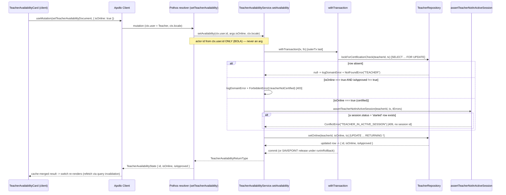
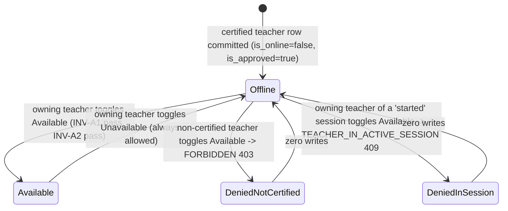

# Technical Architecture & Implementation Design: Teacher Availability Toggle (Available/Unavailable)

> **Plan directory (verbatim — every header, ledger path, and self-reference in this plan uses this exact string):** `ai/plans/milestone_2_matching_notifications_escrow/teacher_availability_toggle_available_unavailable_m2_availability_toggle`
> **Specs of record:** `ai/plans/milestone_2_matching_notifications_escrow/teacher_availability_toggle_available_unavailable_m2_availability_toggle/specs.md` (REQ-001..REQ-095)
> **Ticket:** `Teacher Availability Toggle (Available/Unavailable)` — Dev 2, Milestone 2, 3 SP; Decision Refs INV-A1, INV-A2, FR-4.1, FR-4.3 (`docs/planning/TICKETS.md:1253-1294`).
> **Canonical refs:** `docs/specs/state-machine-invariants.md:120-123` (INV-A1..A4) · `docs/sessions/session-lifecycle.md:81` (INV-S6 in-session seam) and `docs/sessions/session-lifecycle.md:169-171` (§8 `is_online` deferral note — THIS ticket is the manual-toggle surface that note reserves) · `docs/sessions/session-lifecycle.md:182` (lock-vs-INSERT concurrency caveat) · `docs/graphql/domain-error-extensions-code.md` · `docs/testing/workflow-journey-tests.md`.
> **Blocking dependency:** Cooldown State Machine (1-Month Tajweed / 3-Month Hifz) (`TICKETS.md:818`) — **scheduling/lineage only**: that ticket writes `applicants.cooldown_until` and never `teacher.is_online` (grep-verified), so it mints NO code dependency (D10).
> **Forward consumers (NOT built here):** "In-Session Locking (Hide from Directory)" (`TICKETS.md:1338`, refs INV-A2/A3/A4) and "15-Minute Inactivity Auto-Offline" (`TICKETS.md:1298`) are BOTH `Blocked By` THIS ticket; the student-facing Available Teachers directory (INV-A3) is Dev 3 (`TICKETS.md:1457`, `TICKETS.md:1509`).

---

## 1. System Overview & Architecture Diagram

### 1.1 Scope Statement

This ticket ships the **manual availability toggle** for a certified teacher: a NEW backend service, a GraphQL query+mutation over the EXISTING `teacher.is_online` column, and a MINIMAL teacher-facing availability card on the existing `/teacher/dashboard` (D1). Net-new artifacts:

1. **`TeacherAvailabilityService`** — NEW `backend/services/teachers/teacher-availability.service.ts` (`getAvailability` + `setAvailability`, D2).
2. **GraphQL surface** — query `myTeacherAvailability` + mutation `setTeacherAvailability(isOnline: Boolean!)`, both `Teacher`-scoped (D6).
3. **ONE additive canonical type** — `TeacherAvailabilityReturnType` in `backend/types/teachers/teacher.types.ts` (`:1-8` today) (D5).
4. **ONE new locale namespace** `availability` (UI copy only; ALL error copy is REUSED — D9).
5. **ONE teacher-dashboard card** (`TeacherAvailabilityCard`) + its two Apollo documents + one Pothos object (D7).

**Explicit non-goals (OUT of scope — pointers, never absorbed):**

| Non-goal | Owning ticket / rationale |
|---|---|
| Student-facing "Available Teachers directory" appearance (INV-A3) | Dev 3 — On-Demand Matching (`TICKETS.md:1457`) + Teacher Directory Browse & Filter (`TICKETS.md:1509`) — D1 |
| In-session auto-lock on accept + release-path never-resurrect restore (INV-A4) | "In-Session Locking (Hide from Directory)" (`TICKETS.md:1338`), Blocked By THIS ticket — D8 |
| 15-minute inactivity auto-offline (`users.last_active_at`) | "15-Minute Inactivity Auto-Offline" (`TICKETS.md:1298`), Blocked By THIS ticket |
| Any schema/migration/new enum change | Zero-drift gate (REQ-016) — `teacher.is_online` already exists (`backend/db/schema/teachers/teacher.ts:28`) |
| Any new repository method | Consume `setOnline` / `lockForCertificationCheck` / `findById` verbatim (REQ-004/043) |
| Public-operation allowlist entry | The toggle is AUTHENTICATED; the frozen six (`backend/lib/gateway/public-operations.ts:36-46`) stays byte-unchanged (REQ-030) |
| New route / nav item | Card mounts in the existing teacher dashboard slot (D7) |
| `TEACHER_NOT_CERTIFIED` code | The INV-A1 denial is `FORBIDDEN`/403 — custom codes cannot yield 403 (D3, REQ-014) |

### 1.2 Data Flow



**Prose.** The client card issues the zero-argument-shape `myTeacherAvailability` query on mount and the `setTeacherAvailability` mutation on toggle. The resolver is THIN delegation: it derives the actor id from `ctx.user.id` (never an argument) and forwards `ctx.locale`, satisfying the backend GraphQL contract (`backend/graphql/AGENTS.md:14`, REQ-031). `setAvailability` opens ONE `withTransaction` (`backend/lib/db/with-transaction.ts:42`; `outerTx` LAST per house convention). Inside it: (1) a `SELECT … FOR UPDATE` lock proves row identity AND serializes against every other teacher-row writer (REQ-043); (2) the INV-A1 certification gate fires ONLY on the Available direction; (3) the INV-A2 in-session gate — the EXISTING `assertTeacherNotInActiveSession` (`backend/services/classes/session-lifecycle.enforcement.ts:200-214`) — fires ONLY on the Available direction; (4) `TeacherRepository.setOnline` writes the flag and returns the canonical projection. The read path `getAvailability` is a single non-locking `findById` (no transaction). No new repository method and no schema change exist anywhere in the flow.

### 1.3 Key Design Decisions Table

| # | Decision | Options Considered | Pros / Cons | Rationale (Maintainability, Scalability, Reliability) |
|---|---|---|---|---|
| D1 | **Scope = backend toggle (service + query + mutation) + a MINIMAL teacher-dashboard card**; the student-facing directory appearance (INV-A3) is OUT | (a) ship the directory too; (b) backend + teacher card only | (a) INV-A3 belongs to the matching/directory Dev-3 tickets (`TICKETS.md:1457/:1509`); a student browse surface with no matching pipeline is dead UI. (b) Honours the ticket AC at the observable this ticket owns. | (b). Keeps the 3-SP envelope; the AC's "appear in the Available Teachers directory" is a *consequence* of the flag being true, consumed by the future directory. |
| D2 | **NEW `TeacherAvailabilityService` namespace** at `backend/services/teachers/teacher-availability.service.ts` with `getAvailability(teacherId, locale)` and `setAvailability(teacherId, isOnline, locale, tx?)` | (a) extend `ApplicantLifecycleService`; (b) new service file | (a) mixes availability with the applicant-verification lifecycle (different gate, different actors). (b) One cohesive availability surface the sibling tickets extend. | (b). Namespace + per-domain barrel match every sibling (`backend/services/teachers/index.ts:1-5`). |
| D3 | **INV-A1 denial = `ForbiddenError(t.teacherNotCertified)` → `FORBIDDEN`/403** | (a) `ConflictError("TEACHER_NOT_CERTIFIED")` (the booking code); (b) `ForbiddenError` | (a) The taxonomy maps custom SCREAMING codes to `null` status; only `FORBIDDEN` yields 403 (`backend/lib/errors/error-code-taxonomy.ts:44`), so (a) CANNOT satisfy the AC's "403 Not certified". (b) Reuses the existing `teacherNotCertified` key. | (b). The AC pins 403; only `ForbiddenError` produces it (REQ-014, REQ-051). |
| D4 | **INV-A2 denial = reuse `assertTeacherNotInActiveSession` verbatim** → `ConflictError("TEACHER_IN_ACTIVE_SESSION")` 409, no session id | (a) re-implement the probe inline; (b) reuse the shipped gate | (a) Forks the oracle ruling and the log line. (b) One gate, one message, one CONFLICT class. | (b). The gate is already the ticket's named seam (`session-lifecycle.enforcement.ts:180-214`; exported at `backend/services/classes/index.ts:6`) — REQ-004/015. |
| D5 | **Zero schema/enum drift; ONE additive type `TeacherAvailabilityReturnType { id; isOnline; isApproved }`** | (a) new enum/column; (b) additive type only | (a) Violates the zero-drift gate for no gain — the column exists. (b) Total. | (b). `teacher.is_online` (`teacher.ts:28`) is the toggle column; REQ-016. |
| D6 | **GraphQL**: query `myTeacherAvailability: TeacherAvailabilityState!` + mutation `setTeacherAvailability(isOnline: Boolean!): TeacherAvailabilityState!`, both `$all { authenticated, role: [Teacher] }` | (a) a single mutation with an optional target id; (b) self-scoped pair | (a) An id argument is an IDOR surface. (b) Identity is server-derived; the boolean is the ONLY field. | (b). BOLA/BOPLA-safe by construction (REQ-030/031/032). |
| D7 | **NO new route and NO new nav item**; a `TeacherAvailabilityCard` mounts in the teacher slot of `RoleDashboardPage.tsx:72-78` | (a) a `/teacher/availability` route + nav entry; (b) dashboard card | (a) A nav item needs a label key owned by `DashboardLabels`/`HandshakeCodeLabels` (`navItems.ts:59-65`) and a route guard. (b) Additive, zero nav churn. | (b). Mirrors the shipped `ApplicantStatusCard`/`TeacherUpNextCard` composition (`RoleDashboardPage.tsx:12`). |
| D8 | **INV-A4 never-resurrect release gating DEFERRED** to "In-Session Locking (Hide from Directory)" (`TICKETS.md:1338`) with an explicit hazard note | (a) attempt release-path gating here; (b) resolved-pointer deferral | (a) Requires the session-lifecycle RELEASE transaction (`session-lifecycle.transitions.ts:250`) plus a persisted prior-online marker that does NOT exist (`setOnline` is unconditional, `teacher.repository.ts:397-447`) — a foreign-scope edit. (b) Honest boundary. | (b). The deferral is recorded with the hazard that today a release unconditionally restores `true` (REQ-042). |
| D9 | **Reuse existing error keys** `teacherNotCertified`/`teacherInActiveSession`/`teacherNotFound`; add ONLY the `availability` UI namespace | (a) new error keys; (b) reuse | (a) Duplicate copy for identical denials. (b) The keys already exist (`shared/locale/types/errors/labels.ts:243,247,249`). | (b). Zero error-copy churn; parity suites stay green (REQ-052). |
| D10 | **Cooldown "Blocked By" is lineage, not code** | (a) treat as a code dependency; (b) verify | Verified: `TICKETS.md:818` cooldown writes only `applicants.cooldown_until`; grep confirms no `is_online` write outside the teacher/session paths. | (b). No coordination needed; recorded for reviewers. |

---

## 2. Data Models & Database Schema

### 2.1 Existing Schema Verification (READ-ONLY — zero-drift gate REQ-016)

| Element | Verified anchor | Consumed as |
|---|---|---|
| `teacher.isOnline` (`is_online boolean default false`, nullable) | `backend/db/schema/teachers/teacher.ts:28` | THE toggle column — read + written |
| `teacher.isApproved` (`is_approved boolean default false`, nullable) | `backend/db/schema/teachers/teacher.ts:25` | INV-A1 source of truth (via the FOR UPDATE lock) |
| `teacher` shared PK = FK→`users.id` cascade | `backend/db/schema/teachers/teacher.ts:22-24` | identity joins (`teacher.id = users.id`) |
| `teacher.updatedAt` (`$onUpdate` stamp) | `backend/db/schema/teachers/teacher.ts:32-35` | bumped by `setOnline` (`teacher.repository.ts:443`) |
| `session.status` (`session_status notNull default 'scheduled'`) + index `session_teacher_id_idx` | `backend/db/schema/classes/session.ts:64`, `:88` | INV-A2 probe (`listForTeacher` filters `status = 'started'`) |
| `session.teacherId` (FK→`teacher.id`, restrict) / `session.studentId` (FK→`users.id`, restrict) | `backend/db/schema/classes/session.ts:58-63` | probe predicate |
| `SessionStatus.Started = "started"` | `backend/enum/scheduling/session-status.enum.ts:9` | the active-session status |
| `users.last_active_at` EXISTS (read-only sibling context) | `backend/db/schema/users/users.ts:37` | NOT touched here (15-min auto-offline ticket) |
| `teacher.is_online` in the DBML mirror | `db/schema.dbml:220` | documentation parity only |

**Zero-drift gate:** `git diff -- backend/db/schema/** backend/db/migration/**` MUST be EMPTY at completion. No `bun run db push`, no migration file, no new column, no new enum, no new index (REQ-016).

### 2.2 Canonical Types — ONE Additive Type (REQ-003/013)

**EDIT `backend/types/teachers/teacher.types.ts`** (today `:1-8` — `TeacherSelectType` + `TeacherColdStartCertificationInput`) by APPENDING exactly one exported interface:

```typescript
/**
 * The availability-toggle projection — the closed answer the availability
 * query and mutation both return.
 *
 * Deliberately minimal: the teacher id (stable identity), the toggle flag
 * (`is_online`, coerced to a total boolean), and the certification flag
 * (`is_approved`, coerced to a total boolean — the column is nullable, so a
 * `null` is reported as `false` = "not certified"). No added/updated stamps,
 * no applicant lifecycle fields, no subjects/rating — BOPLA whitelist.
 */
export interface TeacherAvailabilityReturnType {
  readonly id: number;
  readonly isOnline: boolean;
  readonly isApproved: boolean;
}
```

No service-layer `.types.ts` file is created; the input is a bare `boolean` argument (D6), so no submit-input type is minted. `TeacherSelectType` (`teacher.types.ts:3`) remains the raw row type. The existing types barrel (`backend/types/teachers/index.ts` — verify before editing) re-exports the file so `@/backend/types` resolves the new interface with no barrel edit if the file is already a `export *` target.

### 2.3 i18n Additions (REQ-002/052 — reuse + one new namespace)

**(a) Error copy — REUSE, do NOT add.** All three denial messages already exist and are consumed through `getServerTranslations(locale).errorsTranslations` (ONE arg, `shared/locale/server-graphql.ts:3`):

| Denial | Existing key (type) | en | ar |
|---|---|---|---|
| INV-A1 not certified | `teacherNotCertified` (`shared/locale/types/errors/labels.ts:243`) | `shared/locale/en/errors/index.ts:108` | `shared/locale/ar/errors/index.ts:106` |
| INV-A2 in active session | `teacherInActiveSession` (`shared/locale/types/errors/labels.ts:247`) | `shared/locale/en/errors/index.ts:110` | `shared/locale/ar/errors/index.ts:108` |
| teacher row absent | `teacherNotFound` (`shared/locale/types/errors/labels.ts:249`) | `shared/locale/en/errors/index.ts:111` | `shared/locale/ar/errors/index.ts:109` |

The `errors`-namespace parity suite (`shared/locale/errors-namespace.parity.test.ts`) therefore stays green UNMODIFIED.

**(b) UI copy — ONE new `availability` namespace** (mirrors the `applicant` namespace file set exactly — `shared/locale/namespaces/applicant/{applicant.namespace.ts,index.ts}`):

| Artifact | Path (all NEW) |
|---|---|
| Label type | `shared/locale/types/availability/labels.ts` (`AvailabilityLabels`) + `shared/locale/types/availability/index.ts` (`export * from "./labels";`) |
| en leaf | `shared/locale/en/availability/labels.ts` (`availabilityEn`) + `shared/locale/en/availability/index.ts` (`export * from "./labels";`) |
| ar leaf | `shared/locale/ar/availability/labels.ts` (`availabilityAr`) + `shared/locale/ar/availability/index.ts` (`export * from "./labels";`) |
| defineNamespace handle | `shared/locale/namespaces/availability/availability.namespace.ts` + `.../index.ts` |
| Registry entry | `shared/locale/namespaces/registry.ts` (+ `Availability` import & member) |
| Messages slices | `shared/locale/en/messages.ts` (+ `availabilityTranslations: availabilityEn`), `shared/locale/ar/messages.ts` (+ `availabilityTranslations: availabilityAr`) |
| Parity test | `shared/locale/availability-namespace.parity.test.ts` |

Frozen key set (EXACTLY these 8 string slots, identical in en/ar and pinned by the parity test): `cardTitle`, `toggleToAvailableCta`, `toggleToUnavailableCta`, `certificationRequiredHint`, `inSessionLockedHint`, `updateSuccess`, `updateGenericError`, `loadErrorNotice`. The parity test asserts key-set + type parity across `en`/`ar` and Arabic-script presence in every `ar` slot (mirroring `namespace-parity.helpers.ts`).

---

## 3. API Contracts & Pothos Resolvers

### 3.1 GraphQL SDL (REQ-060, REQ-061; D6)

```graphql
type TeacherAvailabilityState {
  id: Int!
  isOnline: Boolean!
  isApproved: Boolean!
}

type Query {
  myTeacherAvailability: TeacherAvailabilityState!
}

type Mutation {
  setTeacherAvailability(isOnline: Boolean!): TeacherAvailabilityState!
}
```

| Artifact | Path | Notes |
|---|---|---|
| Pothos object | `backend/graphql/pothos/teachers/teacher-availability.pothos.ts` (NEW) | `gqlSchemaBuilder.objectRef<TeacherAvailabilityReturnType>("TeacherAvailabilityState")`; `id: t.exposeInt("id")` FIRST (Apollo normalization), then `isOnline: t.exposeBoolean("isOnline")`, `isApproved: t.exposeBoolean("isApproved")`. Registered TRANSITIVELY via the resolver imports (teachers-domain convention — `backend/graphql/pothos/teachers/evaluation.pothos.ts:28-32`; the top Pothos barrel `backend/graphql/pothos/index.ts` deliberately omits teachers). |
| Query resolver | `backend/graphql/query/teachers/teacher-availability.query.ts` (NEW) | Registered by adding `import "./teacher-availability.query";` to `backend/graphql/query/teachers/index.ts` (`:18-21`). `gqlSchemaBuilder.queryField("myTeacherAvailability", …)`; `authScopes: { $all: { authenticated: true, role: [UserRole.Teacher] } }`; `resolve: (_r,_a,ctx) => TeacherAvailabilityService.getAvailability(ctx.user.id, ctx.locale)`. |
| Mutation resolver | `backend/graphql/mutation/teachers/teacher-availability.mutation.ts` (NEW) + NEW barrel `backend/graphql/mutation/teachers/index.ts` | `gqlSchemaBuilder.mutationField("setTeacherAvailability", t => t.field({ type: TeacherAvailabilityPothosObject, args: { isOnline: t.arg.boolean({ required: true }) }, authScopes, resolve }))`; resolve calls `setAvailability(ctx.user.id, args.isOnline, ctx.locale)`. NEW barrel wired by adding `import "./teachers";` to `backend/graphql/mutation/index.ts` (currently has NO `./teachers` entry). |
| Codegen | — | `bun run generate:gqlSchema && bun codegen` regenerates `frontend/graphql/generated/gql/graphql.ts`. |

`UserRole` is a VALUE import from `@/backend/enum/users/user-role.enum`. Both resolvers declare `$all` scope (NOT a bare scope map — `@pothos/plugin-scope-auth` combines map keys with ANY semantics, per `backend/graphql/mutation/classes/student-evaluation.mutation.ts:15-25`). No `inputType` is minted (the single `Boolean!` argument IS the BOPLA whitelist).

**Gate updates (REQ-062):** `backend/graphql/test/schema-surface.test.ts` PINS both roots via exact `toEqual` — the Query root at `:972-1006` and the Mutation root at `:1097-1120`. This ticket MUST add `TEACHER_AVAILABILITY_QUERY_FIELDS = ["myTeacherAvailability"] as const` and `TEACHER_AVAILABILITY_MUTATION_FIELDS = ["setTeacherAvailability"] as const` and spread them into the respective exact-match arrays. `frontend/graphql/test/gateway/allowlist-coverage.test.ts` (`:135,142,158`) requires every root field to declare `authScopes` OR be allowlisted — the `$all` scopes satisfy it; `backend/lib/gateway/public-operations.ts:36-46` (frozen six) is NOT edited.

### 3.2 Permission Matrix (REQ-030)

| Caller | `myTeacherAvailability` | `setTeacherAvailability` |
|---|---|---|
| Anonymous | `UNAUTHORIZED` 401 (scope throws) | `UNAUTHORIZED` 401 |
| Student / Parent / Admin | `FORBIDDEN` 403 (role leg) | `FORBIDDEN` 403 |
| Certified Teacher (`is_approved = true`) | own state | allowed (subject to INV-A1/A2) |
| Teacher row PRESENT but not certified (`is_approved = false`) | own state (`isApproved: false`) | Available → `FORBIDDEN` 403 (INV-A1); Unavailable → allowed |
| NO teacher row | `TEACHER_NOT_FOUND` 404 | `TEACHER_NOT_FOUND` 404 |
| Teacher in a `started` session | own state | Available → `TEACHER_IN_ACTIVE_SESSION` 409 (INV-A2); Unavailable → allowed |

### 3.3 Error/Code Contract (REQ-051; D3/D4)

| `extensions.code` | Producer branch | Error class (anchor) | HTTP | Locale key |
|---|---|---|---|---|
| `FORBIDDEN` | Available + `isApproved !== true` (INV-A1) | `new ForbiddenError(t.teacherNotCertified)` (`backend/lib/errors.ts:51-55`) | 403 | `teacherNotCertified` |
| `TEACHER_IN_ACTIVE_SESSION` | Available + a `started` session exists (INV-A2) | `new ConflictError("TEACHER_IN_ACTIVE_SESSION", t.teacherInActiveSession)` (reused gate, `session-lifecycle.enforcement.ts:212`) | 409 | `teacherInActiveSession` |
| `TEACHER_NOT_FOUND` | `lockForCertificationCheck` → `null` | `new NotFoundError("TEACHER", t.teacherNotFound)` (`errors.ts:37-41`) | 404 | `teacherNotFound` |
| `VALIDATION` | defensive non-boolean guard on `isOnline` | `new ValidationError(t.validation)` (`errors.ts:65-130`) | 422 | `validation` |
| `UNAUTHORIZED` | Pothos `authenticated` scope | scope-auth throw | 401 | client `unauthorized` |

**Client mapping nuance (REQ-034/053).** The card surfaces denials through the Apollo error-link map: task 1.3 adds the `TEACHER_IN_ACTIVE_SESSION` → `teacherInActiveSession` inline-notice row in `frontend/providers/apollo/error-link.map.ts`, and `FORBIDDEN` on a mutation maps to the generic `forbidden` toast (`:219-235,429`). The `TEACHER_NOT_CERTIFIED` row (`:360`) is NOT emitted by this ticket (D3) and stays untouched.

---

## 4. Backend Services, Repositories & Concurrency Model

### 4.1 EXISTING Repository Primitives Consumed (REQ-004/043 — no new repo method)

| Primitive | Exact signature (anchor) | Required-tx semantics | Consumed for |
|---|---|---|---|
| `TeacherRepository.setOnline` | `(id: number, online: boolean, tx: DBTransaction) => Promise<TeacherSelectType \| null>` (`backend/db/repo/teachers/teacher.repository.ts:437-447`) | `tx` REQUIRED; `UPDATE teacher SET is_online, updated_at = now() WHERE id = ? RETURNING *`; NO precondition beyond row identity; `null` on zero rows; idempotent on same value. | the ONLY write. Docstring (`:397-447`) explicitly reserves "WHEN" and the never-resurrect gating to the SERVICE / future availability work. |
| `TeacherRepository.lockForCertificationCheck` | `(teacherId: number, tx: DBTransaction) => Promise<{ id: number; isApproved: boolean \| null } \| null>` (`teacher.repository.ts:217-227`) | `tx` REQUIRED; `SELECT id, is_approved … FOR UPDATE`; `null` ⇒ no teacher row; `isApproved === null` ⇒ treat as NOT certified. | row-existence proof + INV-A1 read + the serializing row lock. |
| `TeacherRepository.findById` | `(id: number, tx?: DBQueryExecutor) => Promise<TeacherSelectType \| null>` (`teacher.repository.ts:172-193`) | `tx` optional (non-tx path uses `queryDb`). | read-only `getAvailability`. |
| `assertTeacherNotInActiveSession` | `(teacherId: number, tx: DBTransaction, t?: ErrorsTranslations) => Promise<void>` (`backend/services/classes/session-lifecycle.enforcement.ts:200-214`; re-exported `backend/services/classes/index.ts:6`) | `tx` REQUIRED; probes `SessionRepository.listForTeacher(teacherId, { status: SessionStatus.Started }, 1, 0, tx)`; throws `ConflictError("TEACHER_IN_ACTIVE_SESSION", t.teacherInActiveSession)`; NO session id disclosed. | the INV-A2 gate (reused verbatim — D4). |
| `SessionRepository.listForTeacher` | `(teacherId, filter, limit, offset, tx?) => Promise<SessionSelectType[]>` (`backend/db/repo/classes/session.repository.ts:635-643`) | `tx` optional. | transitively via the gate; NOT called directly. |
| `withTransaction` | `(outerTx: DBTransaction \| undefined, fn: (tx) => Promise<T>, config?) => Promise<T>` (`backend/lib/db/with-transaction.ts:42-51`) | `outerTx` LAST; SAVEPOINT under an outer tx (tests), top-level `db.transaction` otherwise. | the ONE atomic unit of work. |

**Docstring discrepancy (recorded, not fixed here).** The gate docstring calls the denial `FORBIDDEN-class` (`session-lifecycle.enforcement.ts:186-188`) while the code throws `ConflictError` → 409. The CODE is authoritative; D4 pins 409. Correcting that foreign docstring is OUT of this ticket's file scope (ledger pointer).

### 4.2 NEW `TeacherAvailabilityService` (REQ-010/011/012/017)

NEW `backend/services/teachers/teacher-availability.service.ts`, registered by appending `export * from "./teacher-availability.service";` to `backend/services/teachers/index.ts` (`:1-5`).

```typescript
export namespace TeacherAvailabilityService {
  /** Read-only, no transaction: one PK read. */
  export async function getAvailability(
    teacherId: number,
    locale: string
  ): Promise<TeacherAvailabilityReturnType>;

  /** The toggle: ONE withTransaction; gates compose INSIDE it. */
  export async function setAvailability(
    teacherId: number,
    isOnline: boolean,
    locale: string,
    tx?: DBTransaction
  ): Promise<TeacherAvailabilityReturnType>;
}
```

**`getAvailability` (REQ-013):**

```text
1. t = getServerTranslations(locale).errorsTranslations
2. row = await TeacherRepository.findById(teacherId)          [no tx — read-only]
   row === null -> ONE logger.logDomainError("Teacher availability read denied: teacher not found",
                    { code: "TEACHER_NOT_FOUND", entity: "teacher", entityId: teacherId, locale })
                 -> throw new NotFoundError("TEACHER", t.teacherNotFound)
3. return { id: row.id, isOnline: row.isOnline ?? false, isApproved: row.isApproved ?? false }
```

**`setAvailability` (REQ-011/012/017 — the ordered gate composition; `isOnline === true` = Available):**

```text
1. t = getServerTranslations(locale).errorsTranslations
2. if (typeof isOnline !== "boolean") -> throw new ValidationError(t.validation)      [pre-DB, defensive]
3. return withTransaction(tx, async (tx) => {
     a. locked = await TeacherRepository.lockForCertificationCheck(teacherId, tx)     [SELECT ... FOR UPDATE]
        locked === null -> ONE logDomainError("Teacher availability toggle denied: teacher not found",
                            { code:"TEACHER_NOT_FOUND", entity:"teacher", entityId: teacherId, locale })
                          -> throw new NotFoundError("TEACHER", t.teacherNotFound)
     b. if (isOnline === true && locked.isApproved !== true)                          [INV-A1 — AVAILABLE ONLY]
            -> ONE logDomainError("Teacher availability toggle denied: teacher not certified",
                 { code:"FORBIDDEN", entity:"teacher", entityId: teacherId, locale })
            -> throw new ForbiddenError(t.teacherNotCertified)
     c. if (isOnline === true)                                                        [INV-A2 — AVAILABLE ONLY]
            -> await assertTeacherNotInActiveSession(teacherId, tx, t)                [reused gate; logs internally]
     d. updated = await TeacherRepository.setOnline(teacherId, isOnline, tx)
        updated === null -> ONE logDomainError("Teacher availability toggle denied: teacher row vanished",
                              { code:"TEACHER_NOT_FOUND", entity:"teacher", entityId: teacherId, locale })
                          -> throw new NotFoundError("TEACHER", t.teacherNotFound)   [row deleted concurrently]
     e. return { id: updated.id, isOnline: updated.isOnline ?? false, isApproved: updated.isApproved ?? false }
   })
```

**Contract notes the tasks phase MUST honor verbatim:**

- **Gate order is deterministic:** existence → INV-A1 → INV-A2 → write. A non-certified teacher AND in-session resolves to `FORBIDDEN` (INV-A1 first), pinned by test (REQ-050/051).
- **Unavailable is UNCONDITIONAL** (REQ-012): steps (b) and (c) execute only when `isOnline === true`; a certified/in-session/non-certified teacher can ALWAYS go offline.
- **`lockForCertificationCheck` is used on BOTH directions** — it is the teacher-row `FOR UPDATE` primitive AND the row-existence proof (uniform lock ordering, §4.3). It is NOT a certification assertion on the Unavailable path.
- **No spread:** the return object is assembled field-by-field (BOPLA, REQ-032). No local type aliases; return type is the canonical `TeacherAvailabilityReturnType`.
- **Logging:** exactly ONE `logger.logDomainError(<pinned message>, { code, entity: "teacher", entityId, locale })` per expected rejection (message-first shape, `backend/lib/logger.ts:92`); the reused gate logs its OWN denial line internally (yielding exactly one line total on the INV-A2 path). Happy paths log NOTHING (REQ-053). `console.*` forbidden.
- **No module-level mutable state**; no try/catch inside the service — `DomainError`s propagate uncaught to the boundary.

### 4.3 Concurrency & Race Condition Assessment (REQ-040, REQ-041, REQ-042, REQ-043)

| Scenario | Actors | Risk | Mitigation |
|---|---|---|---|
| Two concurrent Available toggles for the same teacher | double-click / retry | duplicated work, torn read | `SELECT … FOR UPDATE` on the teacher row serializes both; the second observes the committed result; the write itself is idempotent on same value (REQ-017). |
| Toggle-to-Available races a concurrent **session start** for that teacher | teacher + session engine | teacher ends Available *while* a session is `started` (INV-A2 breach) | lock ordering + the lock-held gate read (below) — the session-start write to `teacher.is_online` cannot commit without the SAME teacher-row lock the toggle holds. |
| Toggle-to-Available races a concurrent **certification change** (decertification) | teacher + admin | teacher set Available on a stale `isApproved` | the FOR UPDATE lock read IS the certification value the write commits against; a decertification must wait for the lock, and the NEXT toggle re-reads (no stale window). |
| Teacher row deleted between gate and write | admin/governance | zero-row `UPDATE` | `setOnline` returns `null` → `TEACHER_NOT_FOUND`, whole tx rolls back (step 3d). |
| Two Unavailable toggles | double-click | none | serialized + idempotent. |
| Same-value toggle (idempotency, REQ-017) | any | redundant write | `setOnline` still returns the row; result is identical; a redundant `updated_at` bump is acceptable and NOT treated as an error. |

**Lock ordering (no deadlock):**

- **This ticket's write path:** `lockForCertificationCheck(teacherId, tx)` takes the `teacher` row `FOR UPDATE` FIRST; the INV-A2 gate then runs a NON-LOCKING `SELECT` over `session` (`listForTeacher`); then `setOnline` updates the already-locked teacher row. The path NEVER takes a lock on a `session` row.
- **Session-start path:** `SessionLifecycleService.startSession` (`backend/services/classes/session-lifecycle.service.ts:249-292`) transitions the `session` row via a guarded `UPDATE` (locks the session row) → reads the teacher NON-locking (`findById`, `:274`) → `setOnline(teacherId, false, tx)` (locks the teacher row).
- **Ordering:** session-start acquires session→teacher; the toggle acquires teacher→(non-locking session read). Because the toggle's session access is a non-locking `SELECT` under READ COMMITTED (which does not wait on row locks — `docs/sessions/session-lifecycle.md:182`), the toggle NEVER waits on a session row lock, so no `teacher ↔ session` cycle can form. No advisory lock, no Redis lock introduced.

**TOCTOU assessment (the INV-A2 guarantee):** the toggle holds the teacher-row lock across BOTH the session-state probe and the `setOnline(true)` write. A concurrent `startSession` must transition the session and then write `teacher.is_online = false` — and that write REQUIRES the same teacher-row lock the toggle holds. Therefore either (a) the start committed before the toggle's gate read (the gate sees `started` → `TEACHER_IN_ACTIVE_SESSION`), or (b) the start is blocked and commits AFTER the toggle, re-applying `is_online = false`. The final state is always consistent with INV-A2. Residual honesty: the toggle's probe is a window-of-one existence read — a session that starts and completes entirely between the lock and the read leaves the teacher Available (correct: no active session).

### 4.4 Cross-Actor Journey Design (specs.md §2.9 ⇢ assertion set; REQ-090..093)

**Target file (TEST-FIRST):** `test/workflows/teachers/teacher-availability.journey.test.ts` — REAL services, REAL test DB, committed fixtures in `beforeAll` via ONE committing `db.transaction` using `provisionCertifiedTeacherActor` (`test/workflows/helpers/actor-context.ts:105-116`) + `buildSessionJourneyCast` (`test/workflows/helpers/session-cast.ts:280`) and a directly-inserted `started` session row; `TrackedFixtures` teardown with zero-residue re-probes; `runInRollback` FORBIDDEN; unique `jrn_avail_<uuid8>` prefix; NO `expect(...).rejects.toThrow()` (use the try/catch helper). Run via `bun run test/scripts/run-test.ts test/workflows/teachers/teacher-availability.journey.test.ts` (REQ-073).

**Shared-entity state machine (the `teacher.is_online` flag under an ordered actor arc):**



| Current state | Trigger (actor + action) | Next state | Guard / permission |
|---|---|---|---|
| Offline (certified) | owning teacher → `setAvailability(id, true, locale)` | Available | `isApproved === true` AND no `started` session |
| Available | owning teacher → `setAvailability(id, false, locale)` | Offline | none (always allowed) |
| Offline (non-certified) | teacher → `setAvailability(id, true, locale)` | DeniedNotCertified | INV-A1 |
| Offline (in `started` session) | teacher → `setAvailability(id, true, locale)` | DeniedInSession | INV-A2 gate |
| any | foreign teacher / student / admin → same op | unchanged | role scope (`$all role: [Teacher]`) → `FORBIDDEN` |

**Side-effect matrix (per transition):**

| Transition | Rows created/updated | Notifications | Idempotency key |
|---|---|---|---|
| Offline → Available | 1 × `teacher` (`is_online=true`, `updated_at` bumped) | NONE (no notification surface this ticket) | — (same-value re-toggle is idempotent for free, REQ-017) |
| Available → Offline | 1 × `teacher` (`is_online=false`) | NONE | — |
| every denial | ZERO rows | ZERO | — |
| foreign/role-denied | ZERO rows | ZERO | — |

**Cross-actor visibility (the journey assertion set):**

| After step | Owning teacher T sees | Non-certified teacher N | Foreign teacher Y | Session's student S | Anonymous |
|---|---|---|---|---|---|
| T toggles Available | `myTeacherAvailability.isOnline === true` | — | — | nothing (no directory yet — D1) | 401 |
| T toggles Unavailable | `isOnline === false` | — | — | — | 401 |
| N attempts Available | — | `FORBIDDEN` 403, `is_online` unchanged | — | — | — |
| T (session `started`) attempts Available | `TEACHER_IN_ACTIVE_SESSION` 409, `is_online` stays false | — | — | — | — |
| Y attempts T's toggle | — | — | `FORBIDDEN` 403 (no id argument exists) | — | — |
| teardown | — | — | — | — | `verifyAllAbsent` = 0 residue |

No notifications are emitted by this ticket (the availability surface has no notification channel — recorded so reviewers do not invent one; REQ-081).

---

## 5. Frontend UX & Navigation Specification

### 5.1 Routes & URLs Table (REQ-063 — NO new route)

| Path | Purpose | Required permission | Allowed roles | Change |
|---|---|---|---|---|
| `/teacher/dashboard` (existing) | hosts the availability card | `withPageAuth({ roles: [UserRole.Teacher] })` (`frontend/views/dashboard/home/RoleDashboardPage.tsx:60-63`) | Teacher | + 1 card (D7) |
| all other existing routes | unchanged | unchanged | unchanged | none |

No route file is created; the wrong-role redirect behaviour is inherited from the existing page guard (nothing new to guard).

### 5.2 Sidebar & Navigation Integration (D7)

**NO new nav item.** `frontend/views/dashboard/nav/navItems.ts` stays byte-identical — the teacher list (`:144-150`) and `NAV_ITEMS_BY_ROLE` (`:128`) are untouched, so the label-key ownership union (`DashboardLabels` | `HandshakeCodeLabels`, `navItems.ts:59-65`) needs no new key and the nav-ownership test stays green. The card mounts as a THIRD sibling in the teacher slot's `Stack` — `RoleDashboardPage.tsx:72-78`, which today renders `<ApplicantStatusCard />` + `<TeacherUpNextCard />` (imported at `:12`) — i.e. `<TeacherAvailabilityCard />` appended to that Stack. No mobile bottom navigation surface exists (mobile uses the existing MUI `Drawer`), so nothing else changes.

### 5.3 Per-Audience Rendering

| Audience | Sees |
|---|---|
| Teacher (self) | the availability card: current state chip + a toggle control; on `not certified` an inline "become certified" hint; on in-session an inline informational notice; card is the ONLY availability surface this ticket ships. |
| Student / Parent | NOTHING (no student-facing directory — INV-A3 is Dev 3; D1). |
| Admin | NOTHING on the availability surface (admin teacher directory already reads `is_online` via `TeacherRepository.listDirectory` — unchanged). |
| Anonymous | redirected by the existing page guard. |

### 5.4 Apollo Documents & UI Components (REQ-063)

| Artifact | Path (NEW unless noted) | Notes |
|---|---|---|
| Documents | `frontend/graphql/sharedDocuments/teachers/teacher-availability.documents.ts` | `myTeacherAvailabilityQueryDocument: TypedDocumentNode<MyTeacherAvailabilityQuery>` — ZERO-arg query (identity server-side), selects `id` FIRST then `isOnline` `isApproved` (Apollo normalization + BOPLA read-whitelist, mirroring `applicant.documents.ts:24-35`); `setTeacherAvailabilityMutationDocument: TypedDocumentNode<SetTeacherAvailabilityMutation, SetTeacherAvailabilityMutationVariables>` with `$isOnline: Boolean!`. Registered in the sharedDocuments barrel so `@/frontend/graphql/sharedDocuments` resolves both. |
| Component | `frontend/views/teachers/dashboard/TeacherAvailabilityCard.tsx` | `"use client"`; `useQuery` (stateful only — `useLazyQuery` banned) + `useMutation` imported from `@apollo/client/react`; labels via `useAppTranslation(Availability)` and `useAppTranslation(Errors)`; denials surfaced through the Apollo error-link map (task 1.3). Zero props; NO client-side role logic (the page guard is the only authorization boundary) — mirrors `ApplicantStatusCard.tsx:65-69`. |
| Barrel/export | `frontend/views/teachers/dashboard/index.ts` (+ export) | consumed by `RoleDashboardPage.tsx:12`. |

No cache customisation is needed: `TeacherAvailabilityState` normalizes under its `id`, and the card refetches its own query handle after a successful mutation (the `ApplicantStatusCard` in-place refetch pattern).

### 5.5 Visual Design & Agent-Browser Verification

The card is verified in a REAL browser (never by reading code alone), DOM/a11y-first, per the global agent rules: `agent-browser snapshot -i -c` to assert the toggle's accessible name/role and the state chip text; `agent-browser console --level error` to assert zero console errors; `agent-browser eval "document.title"`. Viewports 1440 / 768 / 375; BOTH locales (`NEXT_LOCALE = en` and `ar`) to assert RTL + Arabic copy. Screenshots saved under `scratch/screenshots/` for human review (NOT read back into the model loop). Auth via `bun run scripts/browser-login.ts --inject` (no credential typing). Colour/typography come exclusively from the MUI v9 theme (`sx={(theme) => …}`, `theme.palette.*`) — no hardcoded colours, `*Outlined` icons only.

---

## 6. Security, Authorization & Tenancy Mitigations

| Threat class | Mitigation (anchored) |
|---|---|
| **BOLA / IDOR** | Neither operation takes a teacher id argument; the actor id is `ctx.user.id` ONLY (REQ-031). There is no wire field that can name another teacher, so cross-teacher mutation is structurally impossible. |
| **BOPLA (mass assignment)** | The mutation's ONLY input is `isOnline: Boolean!`; the return object is assembled field-by-field (no spread) — REQ-032. |
| **BFLA (function-level)** | Both roots declare `$all { authenticated, role: [Teacher] }`; anonymous → 401, non-teacher → 403. The frozen public-operation allowlist (`backend/lib/gateway/public-operations.ts:36-46`) is untouched; `allowlist-coverage.test.ts` is satisfied by the declared scopes (REQ-030). |
| **Oracle safety** | The INV-A2 denial carries NO session id and no session count (`session-lifecycle.enforcement.ts:186-188,205-212`); the availability surface may learn only THAT the teacher is locked, never which session holds it (REQ-034). |
| **PII / minimality** | The projection exposes exactly `{ id, isOnline, isApproved }`; no contacts, no subjects, no rating, no governance flags. Logs carry `{ code, entity: "teacher", entityId, locale }` ONLY — never payloads, never copy (REQ-033/053). |
| **Integrity / INV-A1** | `isApproved` is read under the SAME `FOR UPDATE` lock the write commits against, so a concurrent decertification cannot be raced (REQ-014, §4.3). |
| **Integrity / INV-A2** | The reused gate is the single in-tree oracle for "in an active session" (REQ-015); no parallel probe is invented. |
| **Log hygiene** | ONE `logger.logDomainError` per expected rejection (backend logger `@/backend/lib/logger`; `console.*` forbidden); happy paths silent (REQ-053). |
| **Tenancy** | Single-tenant platform; identity is row-derived — no cross-tenant channel exists. |

---

## Verification Anchors (consumed by tasks.md and `ai/plans/milestone_2_matching_notifications_escrow/teacher_availability_toggle_available_unavailable_m2_availability_toggle/outcome/`)

1. **Zero-drift + freeze proofs (REQ-016/062/075):** `git diff -- backend/db/schema/** backend/db/migration/**` EMPTY; `bun run generate:gqlSchema && bun codegen` committed with ONLY the generated additions for the two roots; `schema-surface.test.ts` updated with the two `*_FIELDS` consts and green; `sdl-static-assertions.test.ts` / `handshake-code-surface.test.ts` / `allowlist-coverage.test.ts` green; `backend/lib/gateway/public-operations.test.ts` byte-unchanged.
2. **Repo tier (REQ-074):** EXTEND the existing `setOnline` suite (`backend/db/test/repo/teachers/teacher.repository.test.ts:393-500`) — do NOT duplicate it. New coverage: `lockForCertificationCheck` on both directions, null-row, `isApproved === null`; `setOnline` idempotent same-value read-back. All inside `runInRollback` + `tx`-everywhere + `entity-setup.ts` only (`createTestTeacherRow`, `backend/db/test/entity-setup.ts:550-553`); 100% statement/branch on the new repo surfaces consumed (no new file → the existing file's coverage target holds).
3. **Service 4-tier (REQ-070/071):** NEW `backend/services/teachers/teacher-availability.service.test.ts` — `runInRollback`, try/catch helper (NEVER `.rejects.toThrow()`): `getAvailability` hit/miss; `setAvailability` Available happy path; Available + non-certified → `FORBIDDEN` (ONE log, message pinned); Available + `started` session → `TEACHER_IN_ACTIVE_SESSION` (ONE log total); Unavailable always allowed for non-certified and in-session teachers; row-absent → `TEACHER_NOT_FOUND`; defensive non-boolean → `VALIDATION` pre-DB; precedence pin (non-certified AND in-session → `FORBIDDEN`); same-value idempotency; forced mid-tx failure leaves `is_online` unchanged (rollback proof).
4. **GraphQL integration tier (REQ-072 — GraphQL):** NEW `backend/graphql/test/teacher-availability.integration.test.ts` via `setupTestServerLifecycle` (`test/helpers/test-lifecycle.ts:41`) + `testClient` (`test/helpers/graphql-test-helpers.ts:8`): 401/403 matrix (anonymous / student / parent / admin / teacher), both roots' wire shapes, the 403 and 409 error-code contract.
5. **Journey (REQ-072/090-093, TEST-FIRST):** `test/workflows/teachers/teacher-availability.journey.test.ts` via `bun run test/scripts/run-test.ts test/workflows/teachers/teacher-availability.journey.test.ts` — the §4.4 ordered actor arc + visibility matrix 1:1 (committed cast, `started`-session fixture for INV-A2, zero-residue teardown).
6. **i18n parity (REQ-052):** NEW `shared/locale/availability-namespace.parity.test.ts` green (key-set + type parity en/ar, Arabic-script slots); `errors-namespace.parity.test.ts` green UNEDITED (keys reused).
7. **Baseline gate (REQ-075):** `bun tsgo` / `bun biome:check` / lint counts ≡ baseline + ZERO new errors; EVERY created/modified file passes `bun run scripts/health/sub-loop.ts <file> --lifecycle duplicates` exit 0; browser verification per §5.5 (DOM snapshot + zero console errors, 3 viewports × 2 locales).
8. **Docs (REQ-080..083):**
   - **REQ-080 Outcome Protocol:** read all prior `outcome/` files first; write `outcome/<task-id>-outcome.md` per task; keep task checkboxes current.
   - **REQ-081 Knowledge Propagation:** create the canonical `docs/teachers/teacher-availability.md` (per REQ-081) and add at most a one-line shipped-pointer to the EXISTING `docs/sessions/session-lifecycle.md:169-171` (§8 `is_online` deferral note) recording that the manual availability toggle has shipped and the directory appearance remains a Dev-3 item; a one-line pointer on `docs/sessions/session-lifecycle.md:81`'s INV-S6 seam only if it adds clarity. NO new invariant is minted.
   - **REQ-082 Deferred Ledger Discipline:** all forward items recorded as resolved pointers in the ledger below; final gate `grep -cE '^\s*\|.*(❌|⚠️)' ai/plans/milestone_2_matching_notifications_escrow/teacher_availability_toggle_available_unavailable_m2_availability_toggle/deferred-items.md` = 0 (row-scoped — legend lines excluded).
   - **REQ-083 No AGENTS.md / instruction Edits:** this ticket modifies NO `AGENTS.md` or `.agents/instructions/*.md` file — every artifact conforms to an already-documented pattern (service namespace + barrel, `backend/types/` canonical type, `defineNamespace` locale namespace, dashboard-slot card), so no agent-guidance rule changes.

---

## Deferred-Items Ledger Pointers (initial content for `ai/plans/milestone_2_matching_notifications_escrow/teacher_availability_toggle_available_unavailable_m2_availability_toggle/deferred-items.md`)

| ID | Item | Owning direction | Status at plan time |
|---|---|---|---|
| DEF-1 | INV-A4 never-resurrect RELEASE gating (restore Available only if still active) — **HAZARD:** today `releaseTeacherInSessionLock` (`backend/services/classes/session-lifecycle.transitions.ts:249-250`) unconditionally restores `is_online=true`; no persisted prior-online marker exists | `In-Session Locking (Hide from Directory)` (`TICKETS.md:1338`) | ✅ resolved-pointer |
| DEF-2 | Student-facing "Available Teachers directory" appearance (INV-A3) — the toggle's `is_online=true` is CONSUMED, not built, here | Dev 3 — On-Demand Matching (`TICKETS.md:1457`) + Teacher Directory Browse & Filter (`TICKETS.md:1509`) | ✅ resolved-pointer |
| DEF-3 | 15-minute inactivity auto-offline (`users.last_active_at`, `backend/db/schema/users/users.ts:37`) | "15-Minute Inactivity Auto-Offline" (`TICKETS.md:1298`) | ✅ resolved-pointer |
| DEF-4 | Cooldown "Blocked By" = scheduling/lineage only — NOT a code dependency (verified: never writes `teacher.is_online`) | `Cooldown State Machine (1-Month Tajweed / 3-Month Hifz)` (`TICKETS.md:818`) | ✅ resolved-pointer |
| DEF-5 | Optional `canSetAvailable` derived eligibility flag deferred | This plan's `TeacherAvailabilityService` — intentionally NOT built | ✅ resolved-pointer |
| DEF-6 | Gate docstring says the INV-A2 denial is `FORBIDDEN-class` while the code throws `ConflictError`/409 (`session-lifecycle.enforcement.ts:186-188` vs `:212`) — foreign-file doc drift; code is authoritative | session-lifecycle enforcement owner | ✅ resolved-pointer |

Final gate: `grep -cE '^\s*\|.*(❌|⚠️)' ai/plans/milestone_2_matching_notifications_escrow/teacher_availability_toggle_available_unavailable_m2_availability_toggle/deferred-items.md` = 0 at completion (row-scoped).

---

**Governing next step:** Phase 1.5 — run `@plan-review` on `specs.md` + `plan.md` + tasks BEFORE any implementation; the rulings it MUST ratify are (a) the D3 error-class choice (`ForbiddenError`/403 over the booking `TEACHER_NOT_CERTIFIED`), (b) the D1 scope boundary (no student directory), and (c) the D8 never-resurrect deferral with its hazard note.
