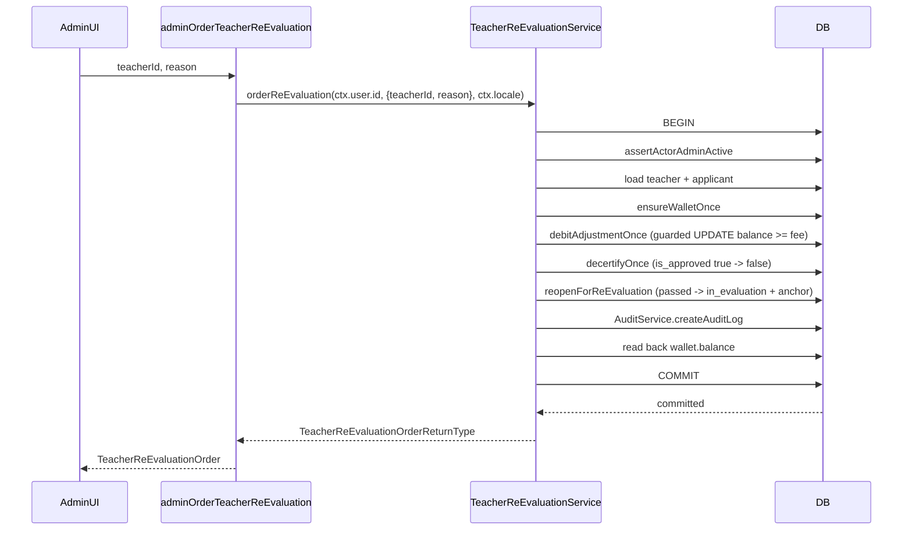
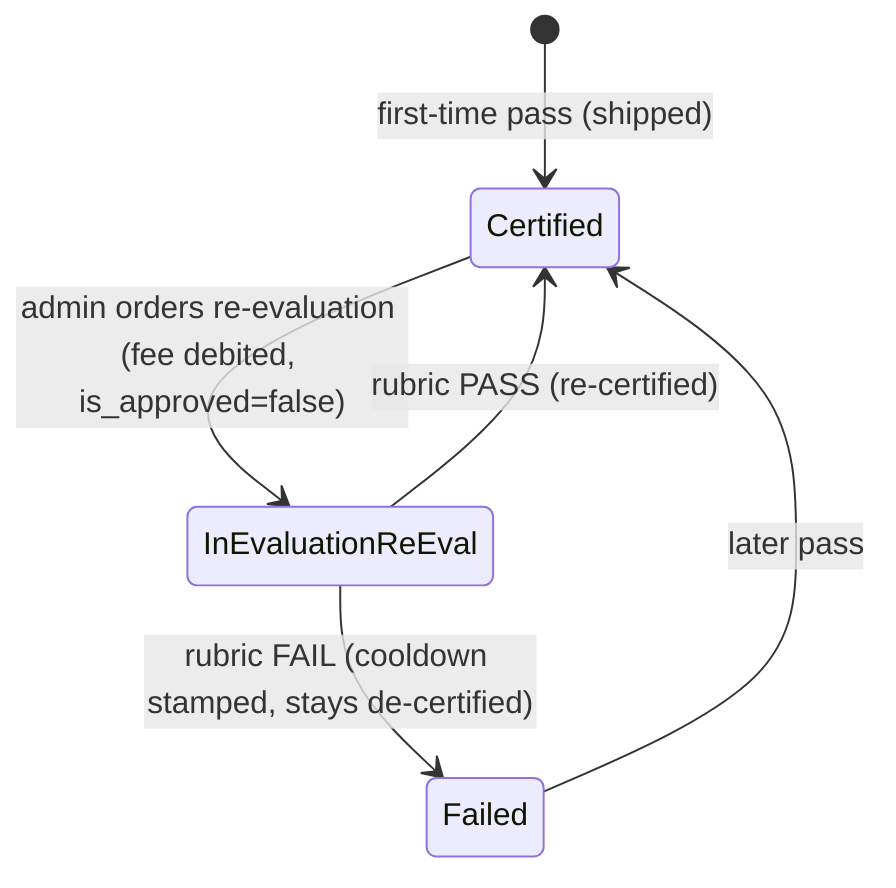

# Design — Admin-Ordered Re-Evaluation (Teacher Wallet Deduction)

> **Plan directory (verbatim):** `ai/plans/milestone_3_parent_portal_admin_governance/admin_ordered_re_evaluation_teacher_wallet_deduction/`
> **Ticket:** `Admin-Ordered Re-Evaluation (Teacher Wallet Deduction)` (`docs/planning/TICKETS.md:2143-2180`) — Dev 2 · Milestone 3 (`milestone_3_parent_portal_admin_governance`) · 5 SP
> **Specs of record:** `specs.md` (same directory) — authoritative for REQ-001..REQ-014, rulings R1/R2/R3, the Design Brief appendix (component inventory C1..C15, service signature, 10-step transaction pipeline, concurrency assessment)
> **Design (this file):** `plan.md` · **Tasks:** `tasks.md` (same directory) · **Deferred ledger:** `deferred-items.md` (same directory) · **Outcomes:** `outcome/`
> **Decision Refs:** B.5 (re-eval paid by teacher, `docs/workflows/01-teacher-verification-workflow.md:180`), A.5 (audit_logs), FR-3.8 (admin override authority, `docs/specs/functional-requirements.md:123`), INV-TV5 (`docs/specs/state-machine-invariants.md:91`)
> **Reconciliation authority (binding over the ticket's draft-era Gherkin):** `docs/billing/escrow-and-wallet-crediting.md` §5 + §8.2, `docs/teachers/applicant-lifecycle.md` §1, `docs/workflows/01-teacher-verification-workflow.md:180`

## Document Information

| Field | Value |
|---|---|
| Feature Name | Admin-Ordered Re-Evaluation (Teacher Wallet Deduction) |
| Milestone | M3 (`milestone_3_parent_portal_admin_governance`) |
| Owner Stream | Dev 2 |
| Story Points | 5 |
| Version / Date | 1.0 · 2026-09-30 |
| Plan kind | full-stack slice — one nullable schema column, three repository additions, one new admin service, one GraphQL mutation, one admin UI action (no new route), i18n keys, four test tiers, one journey test |
| Authority | `specs.md` (requirements + Design Brief) · this file (design) |
| Hard inputs (EXISTING, verified in `specs.md` §"Hard inputs") | `backend/db/schema/billing/wallet.ts:27-28,36-38` · `backend/db/schema/billing/teacher-transaction.ts:38,40-42,50` · `backend/db/schema/enums.ts:63` · `backend/db/repo/billing/wallet.repository.shared-writer.ts:60-69,77,91` · `backend/db/repo/billing/wallet.repository.admin.helpers.ts:427-432` · `backend/db/repo/teachers/applicant.repository.ts:407,468,507` · `backend/db/repo/teachers/teacher.repository.ts:286,319-331` · `backend/services/admin/audit.service.ts:82` · `backend/graphql/shared/admin-prelude.ts:24-29` |
| Downstream consumers (blocked by this ticket) | Admin re-evaluation UI polish · any future "re-evaluation notification" ticket |

## Overview

Decision B.5 resolved who pays for an admin-ordered re-evaluation: **the teacher pays** — the fee is deducted from `wallet.balance` and recorded as a `withdrawal`-type `teacher_transaction` row (`docs/workflows/01-teacher-verification-workflow.md:180`). This design ships that order end-to-end: an Admin compels a currently-certified teacher back through the 5-session evaluation loop; the fee is debited under the same guarded-debit discipline the escrow and withdrawal surfaces already use; the order is appended to the audit trail; and the teacher is de-certified (`teacher.is_approved = false`) for the duration of the re-evaluation.

The canonical money-path hand-off for this exact ticket is already written (`docs/billing/escrow-and-wallet-crediting.md:131`):

> "deducts the re-evaluation fee from `wallet.balance` as a withdrawal-type ledger row. It must ride the same guarded debit + validation matrix … write exactly one `audit_logs` row in the same transaction, and never touch `total_earning`."

This design implements that hand-off and nothing more on the money side: no new debit primitive, no new ledger vocabulary, no wallet schema change. Every state transition is at-most-once by a fused UPDATE predicate, so a concurrent duplicate or double-click charges the teacher exactly once.

### Design Goals

1. **Self-funding re-assessment** — the fee is debited from the teacher's wallet as a truthful `withdrawal`/`completed` ledger row; `wallet.total_earning` is never rewritten (REQ-005).
2. **Governance-gated** — only a governance-active admin can order (double gate: GraphQL `authScopes` + in-transaction `assertActorAdminActive`), and only for a currently-certified teacher whose applicant is `passed` (REQ-003).
3. **Zero-rows-on-denial** — every denial (validation, not-found, not-certified, insufficient funds) rolls back the whole transaction and commits zero rows (REQ-003.8, REQ-006.2).
4. **Exactly-once under concurrency** — the de-certify and applicant re-open transitions are the replay arbiter; no idempotency-key machinery is introduced (REQ-010).
5. **Loop reuse, not a parallel gate** — the teacher re-enters the SAME 5-session `teacher_evaluation` loop; only a cycle anchor plus one resolver precedence arm are added (REQ-008).
6. **Surface reuse** — the action lives on the existing admin user-detail governance surface; no new route, no new sidebar item (REQ-012).
7. **Auditable** — exactly one in-transaction `audit_logs` row per committed order, no PII in `details` (REQ-009).

### Key Design Decisions

Each decision follows Context / Options Considered / Decision / Rationale. Decisions D-1..D-3 are the binding reconciliation rulings R1/R2/R3 of `specs.md` §"Verification Reconciliation" — they supersede the ticket's draft-era Gherkin.

#### D-1 — Insufficient-balance denial posture (ruling R1)

- **Context.** The ticket's draft-era Gherkin says insufficient balance → **422** "Insufficient wallet balance for re-evaluation" (`docs/planning/TICKETS.md:2166`). The shipped money path instead surfaces funds denial as the localized `insufficientBalance` key raised as a `WALLET_INSUFFICIENT_FUNDS` `ConflictError`, and `CONFLICT` maps to **409** (`backend/lib/errors/error-code-taxonomy.ts:45-47,113-115`; `backend/lib/errors.ts:171-183`; `wallet.service.ts:305`; `admin-financial-auditing.service.ts:432`).
- **Options Considered.** (a) Honour the ticket verbatim — mint a new 422 code + a per-domain funds-denial key. (b) Reuse the existing 409 `ConflictError("WALLET_INSUFFICIENT_FUNDS", t.insufficientBalance)` posture with zero committed rows.
- **Decision.** Option (b). The order raises `ConflictError("WALLET_INSUFFICIENT_FUNDS", t.insufficientBalance)` → HTTP 409; no new code, no new key.
- **Rationale.** `docs/billing/escrow-and-wallet-crediting.md` §5.6 is the binding money-path authority; custom SCREAMING_SNAKE codes are not taxonomy rows, so a fresh 422 would fork the funds-denial vocabulary. Reuse keeps one funds-denial posture across escrow, withdrawal, and re-evaluation (REQ-006.1, REQ-002.3).

#### D-2 — Who is de-certified, and how (ruling R2)

- **Context.** The ticket says "the **teacher's** is_approved is set to false during re-evaluation" (`docs/planning/TICKETS.md:2174`), but no writer in the repo ever sets `is_approved=false` — the only writers are `insertColdStartCertified:286` and `elevateToCertified:319-331`, both writing `isApproved: true` (`backend/db/repo/teachers/teacher.repository.ts`).
- **Options Considered.** (a) Treat the subject as a never-certified applicant and reuse a lifecycle path (impossible — an applicant has no wallet). (b) Add exactly one new guarded writer `TeacherRepository.decertifyOnce(id, tx)` with predicate `WHERE id = $1 AND is_approved = true` and `RETURNING`, targeting a wallet-bearing certified teacher row.
- **Decision.** Option (b). The subject is a **certified teacher** with an existing/ensure-able wallet; `decertifyOnce` is the repo's FIRST-ever `is_approved=false` writer, guarded and at-most-once.
- **Rationale.** Only a certified teacher has a wallet to debit, so only a certified teacher is a coherent subject. The `is_approved = true` predicate makes the writer the concurrency arbiter (REQ-007.1, REQ-010.1) and re-certification on pass reuses the unchanged `elevateToCertified` (`is_approved = false`) path (REQ-007.4).

#### D-3 — Loop re-entry mechanism (ruling R3)

- **Context.** The ticket says "the same 5-session evaluation loop applies" (`docs/planning/TICKETS.md:2172`). But the loop gate requires `applicants.status === in_evaluation` (`evaluation-booking.helpers.ts:118`) plus an ACTIVE verification subscription cycle (`session.repository.evaluation.helpers.ts:157-178`); `transitionToInEvaluation` **rejects `passed`** (`applicant.repository.ts:407-423`); and a certified teacher's applicant row is `passed` with an expired 14-day verification subscription.
- **Options Considered.** (a) Invent a parallel re-evaluation booking path. (b) Add a guarded `passed → in_evaluation` transition with a fresh cycle anchor column, and extend the existing cycle resolver with one precedence arm so the unchanged 5-session machinery admits the re-evaluation cycle.
- **Decision.** Option (b). New `ApplicantRepository.reopenForReEvaluation(userId, tx)` (predicate `status = 'passed'`), new nullable `applicants.re_evaluation_started_at` column, and one extension arm in `resolveCurrentEvaluationCycle`. The 5 sessions remain ordinary `teacher_evaluation` sessions.
- **Rationale.** Reuses the fully-verified evaluation machinery (`EvaluationBookingService.bookEvaluation`, `countEvaluationBookingsInCycle`, rubric finalization) unchanged — the only additions are the transition guard and the anchor precedence. This satisfies REQ-008 while honouring the ticket's "same loop" intent; wiring the unused `SessionType.ReEvaluation` enum value is deferred (D-002).

#### D-4 — Server-owned pricing; no wire fee

- **Context.** Pricing must not be client-controllable, and the codebase's money discipline carries amounts as decimal strings (`docs/billing/escrow-and-wallet-crediting.md` §5.4).
- **Options Considered.** (a) Accept a `fee` argument on the mutation. (b) Define the fee once as a shared constant and carry it verbatim.
- **Decision.** Option (b). `RE_EVALUATION_FEE` (decimal string, EGP) + `RE_EVALUATION_FEE_CURRENCY = "EGP"` live in `shared/constants/re-evaluation.constants.ts`; the mutation input carries `teacherId` and `reason` ONLY.
- **Rationale.** Mass-assignment of price becomes structurally impossible (REQ-004.4); the fee is never parsed to a number or re-rounded (REQ-004.2). Mirrors `shared/constants/verification-plan.constants.ts:27-33`.

#### D-5 — Reuse the existing guarded debit; no new money primitive

- **Context.** The wallet layer already exposes a fused guarded debit (`debitWithLedgerRow`, predicate `wallet.balance >= $2` at `wallet.repository.shared-writer.ts:77`) and an adjustment façade (`debitAdjustmentOnce`, `wallet.repository.admin.helpers.ts:427-432`).
- **Options Considered.** (a) Author a re-evaluation-specific debit. (b) Compose the existing `debitAdjustmentOnce`.
- **Decision.** Option (b). The service calls `WalletRepository.debitAdjustmentOnce` and never forks the primitive (`docs/billing/escrow-and-wallet-crediting.md` §5.1).
- **Rationale.** One guarded-debit implementation means one correctness proof and one reconciliation story; the `balance >= amount` predicate fuses the read and the write, eliminating the TOCTOU window (REQ-005.2, REQ-005.5).

#### D-6 — No idempotency-key machinery; predicates are the arbiter

- **Context.** The flow must charge exactly once under a double-click or a concurrent duplicate (REQ-010).
- **Options Considered.** (a) Introduce `ctx.idempotencyKey` storage for this mutation. (b) Rely on the guarded state transitions as the replay arbiter.
- **Decision.** Option (b). `decertifyOnce` (`is_approved = true`) and `reopenForReEvaluation` (`status = 'passed'`) each match at most one racer; a completed order cannot be replayed because the applicant is no longer `passed`.
- **Rationale.** Mirrors the withdrawal-settlement predicate-arbiter model; no new idempotency table, no new key. The loser's zero-row miss throws and rolls back its already-executed debit → net exactly one charge (REQ-010.1, REQ-010.4).

#### D-7 — De-certification excludes the teacher from booking structurally

- **Context.** An under-review teacher must not teach or be booked while `is_approved = false`.
- **Options Considered.** (a) Add a re-evaluation-specific booking gate. (b) Rely on the existing booking lifecycle predicate.
- **Decision.** Option (b). `session.repository.lifecycle.helpers.ts:56` already asserts `EXISTS (… teacher.is_approved = true)`; no new gate is added.
- **Rationale.** The structural predicate already excludes a de-certified teacher (REQ-007.3); adding a parallel gate would duplicate an invariant.

## Data Models

### Schema change — `applicants.re_evaluation_started_at` (C2)

Exactly one column is added: a nullable timestamp anchoring the re-evaluation cycle. `NULL` means "never ordered a paid re-evaluation".

Target file: `backend/db/schema/teachers/applicants.ts` (extend the `applicants` table beside `cooldownUntil` / `status`, `backend/db/schema/teachers/applicants.ts:23-24`).

```ts
// backend/db/schema/teachers/applicants.ts  (additions inside pgTable("applicants", { … }))
export const applicants = pgTable("applicants", {
  // … existing columns (id, verificationAttempts, lastAttemptAt, cooldownUntil, status, createdAt, updatedAt) …
  reEvaluationStartedAt: timestamp("re_evaluation_started_at"),
});
```

Applied with `bun run db push` (no migration file authored by hand — see §10).

### No wallet / `teacher_transaction` schema change

| Table | Change | Why |
|---|---|---|
| `wallet` (`backend/db/schema/billing/wallet.ts:27-28,36-38`) | NONE | The debit spends `balance` via the existing guarded writer; `total_earning` is untouched. |
| `teacher_transaction` (`backend/db/schema/billing/teacher-transaction.ts:38,40-42,50`) | NONE | The ledger row uses existing `type = withdrawal`, `status = completed` vocabulary; `session_id = NULL` (`backend/db/schema/enums.ts:63` already defines the enum value). |
| `audit_logs` | NONE | Appended via the existing `AuditService.createAuditLog` contract. |

### Service/API return type — `TeacherReEvaluationOrderReturnType` (C7)

Target file: `backend/types/teachers/teacher-re-evaluation.types.ts` (re-exported from `backend/types/teachers/index.ts`).

```ts
export interface TeacherReEvaluationOrderReturnType {
  readonly teacherId: number;
  readonly amountCharged: string;       // RE_EVALUATION_FEE verbatim (decimal string)
  readonly currency: string;            // RE_EVALUATION_FEE_CURRENCY ("EGP")
  readonly walletBalance: string;       // wallet.balance read back INSIDE the tx
  readonly reEvaluationStartedAt: Date; // applicants.re_evaluation_started_at
}
```

### Audit write contract instance (`AuditLogWriteContract`)

Composed exactly once, inside the transaction, via `AuditService.createAuditLog(input, tx)` (`backend/services/admin/audit.service.ts:82`). Field NAMES + metadata only — no PII.

```ts
{
  actorId: actorUserId,                       // exclusive source: ctx.user.id
  actionType: AuditActionType.Override,       // value import, backend/enum/audit/audit-action-type.enum.ts:10
  entityType: "teacher",
  entityId: input.teacherId,                  // subject teacher's users.id
  details: JSON.stringify({
    action: "re_evaluation_ordered",
    amount: RE_EVALUATION_FEE,
    walletId: wallet.id,
    balanceAfter: balanceAfter.balance,
    reEvaluationStartedAt: reopened.reEvaluationStartedAt.toISOString(),
  }),
}
```

The writer truncates `details` defensively to `varchar(2000)` (`audit.service.ts:41-63`).

### GraphQL object — `TeacherReEvaluationOrderPothosObject` (C9)

Target file: `backend/graphql/pothos/admin/admin-re-evaluation.pothos.ts` (registered via `backend/graphql/pothos/admin/index.ts`). All fields non-null.

| Field | SDL type | Source (service return) |
|---|---|---|
| `teacherId` | `ID!` | `TeacherReEvaluationOrderReturnType.teacherId` |
| `amountCharged` | `String!` | `amountCharged` (decimal string) |
| `currency` | `String!` | `currency` |
| `walletBalance` | `String!` | `walletBalance` (decimal string) |
| `reEvaluationStartedAt` | `String!` | `reEvaluationStartedAt.toISOString()` |

### Data flow (one committed order)



## API Contracts

### Mutation SDL (exact line)

```graphql
adminOrderTeacherReEvaluation(teacherId: ID!, reason: String!): TeacherReEvaluationOrder!
```

Registered in a new `backend/graphql/mutation/admin/admin-re-evaluation.mutation.ts`, wired via a side-effect import in `backend/graphql/mutation/admin/index.ts` (no named exports; `mutation/AGENTS.md:29-32`). Args are mapped field-by-field (never spread) with `requirePositiveIntId` on the `ID` (`admin-finance.mutation.ts:120-138` precedent); the resolver delegates to `TeacherReEvaluationService.orderReEvaluation` with `ctx.user.id` as `actorUserId` and `ctx.locale`.

### Object type SDL

```graphql
type TeacherReEvaluationOrder {
  teacherId: ID!
  amountCharged: String!
  currency: String!
  walletBalance: String!
  reEvaluationStartedAt: String!
}
```

### Permission matrix

The Pothos `authScopes` are the inline `$all` conjunction `{ authenticated: true, role: [UserRole.Admin] }`, matching every shipped admin mutation (`admin-teachers.mutation.ts:45-50`; `admin-finance.mutation.ts:114-119`).

| Caller | authScopes gate | Result | extensions.code |
|---|---|---|---|
| Authenticated `UserRole.Admin` (governance-active) | pass | resolver runs | — |
| Authenticated `UserRole.Admin` (deleted / blocked / suspended) | pass (token valid) | in-tx `assertActorAdminActive` denies | `FORBIDDEN` → 403 |
| Anonymous (no token) | fail (not `authenticated`) | resolver never runs | `UNAUTHORIZED` → 401 |
| Authenticated non-admin (Teacher / Student / Parent) | fail (`role` mismatch) | resolver never runs | `FORBIDDEN` → 403 |

There is no distinct `SUPER_ADMIN` role: `UserRole` = `Admin | Teacher | Student | Parent` (`backend/enum/users/user-role.enum.ts:5-10`). Admin-only is the full permission story (REQ-011.6).

### Error-code table

| Condition | Error constructor | `extensions.code` | HTTP | Committed rows | Source |
|---|---|---|---|---|---|
| `actorUserId` / `teacherId` not a positive safe int | `ValidationError(t.validation)` | `VALIDATION` | 400 / 422 | zero | REQ-003.4 |
| `reason` empty or > `MAX_REASON_LENGTH` (229) | `ValidationError(t.reEvaluationReasonRequired)` | `VALIDATION` | 400 / 422 | zero | REQ-003.4, pipeline step 2 |
| Subject teacher row absent | `NotFoundError("TEACHER", t.teacherNotFound)` | `TEACHER_NOT_FOUND` | 404 | zero | REQ-003.5 |
| Teacher not certified (`is_approved !== true`) | `ConflictError("TEACHER_NOT_CERTIFIED", t.teacherNotCertified)` | `TEACHER_NOT_CERTIFIED` | 409 | zero | REQ-003.6, REQ-007.2 |
| Applicant absent or `status !== passed` | `ConflictError("APPLICANT_NOT_AWAITING_RE_EVALUATION", …)` | `APPLICANT_NOT_AWAITING_RE_EVALUATION` | 409 | zero | REQ-003.7, REQ-008.1 |
| Guarded debit matches zero rows (balance < fee) | `ConflictError("WALLET_INSUFFICIENT_FUNDS", t.insufficientBalance)` | `WALLET_INSUFFICIENT_FUNDS` | 409 | zero | REQ-006.1 (ruling R1) |
| Non-admin (authenticated) | authScopes | `FORBIDDEN` | 403 | zero | REQ-011.6, REQ-003.1 |
| Anonymous | authScopes | `UNAUTHORIZED` | 401 | zero | REQ-003.1 |

**Client rendering rule.** The admin UI branches on `extensions.code` via `frontend/providers/apollo/error-link.map.ts` (`mapGraphQLErrorByCode`), never on HTTP status (`frontend/AGENTS.md:63-67`).

### Reused existing error leaves (no new keys)

| Leaf | en | ar | Reused for |
|---|---|---|---|
| `insufficientBalance` | `shared/locale/en/errors/index.ts:113` | `shared/locale/ar/errors/index.ts:111` | funds denial (`WALLET_INSUFFICIENT_FUNDS`) |
| `teacherNotFound` | en `:111` | — | subject absent (`TEACHER_NOT_FOUND`) |
| `teacherNotCertified` | en `:108` | — | subject not certified (`TEACHER_NOT_CERTIFIED`) |

Added new leaves (en+ar parity): `applicantNotAwaitingReEvaluation`, `reEvaluationReasonRequired` (`shared/locale/types/errors/labels.ts` + en/ar `errors/index.ts`).

## Services & Repository Signatures

All signatures below are copied verbatim from the Design Brief appendix of `specs.md` (§"Service signature", §"Transaction pipeline"). Do not re-invent alternatives.

### Service (authoritative — C6)

```ts
// backend/services/teachers/teacher-re-evaluation.service.ts
export namespace TeacherReEvaluationService {
  export async function orderReEvaluation(
    actorUserId: number,
    input: { readonly teacherId: number; readonly reason: string },
    locale: string,
    outerTx?: DBTransaction
  ): Promise<TeacherReEvaluationOrderReturnType>;
}
```

Exported through the barrel `backend/services/teachers/index.ts`.

### Transaction pipeline (authoritative order — REQ-010.2)

1. `assertValidPositiveInt(actorUserId)` / `(input.teacherId)` pre-DB → `ValidationError(t.validation)`.
2. `normalizeReason(input.reason)` — trim; empty or > `MAX_REASON_LENGTH` → `ValidationError(t.reEvaluationReasonRequired)`. (Reuse the shape of `normalizeAdjustmentReason` at `admin-financial-auditing.service.helpers.ts:86-92`, `MAX_REASON_LENGTH = 229`.)
3. `withTransaction(outerTx, async tx => { … })`:
   1. `assertActorAdminActive(actorUserId, locale, tx)`.
   2. teacher = `TeacherRepository.findById(input.teacherId, tx)` → `NotFoundError("TEACHER", t.teacherNotFound)`; `teacher.isApproved !== true` → `ConflictError("TEACHER_NOT_CERTIFIED", t.teacherNotCertified)`.
   3. applicant = `ApplicantRepository.findByUserId(input.teacherId, tx)` → null/`status !== Passed` → `ConflictError("APPLICANT_NOT_AWAITING_RE_EVALUATION", …)`.
   4. wallet = `WalletRepository.ensureWalletOnce(input.teacherId, tx)`.
   5. ledger = `WalletRepository.debitAdjustmentOnce({ walletId: wallet.id, amount: RE_EVALUATION_FEE, description: composeReEvaluationDescription(reason) }, tx)`; `null` → log + `ConflictError("WALLET_INSUFFICIENT_FUNDS", t.insufficientBalance)`.
   6. `TeacherRepository.decertifyOnce(input.teacherId, tx)`; `null` → `ConflictError("TEACHER_NOT_CERTIFIED", …)`.
   7. `ApplicantRepository.reopenForReEvaluation(input.teacherId, tx)`; `null` → `ConflictError("APPLICANT_NOT_AWAITING_RE_EVALUATION", …)`.
   8. read back `WalletRepository.findById(wallet.id, tx)` for `balanceAfter`.
   9. `AuditService.createAuditLog({actorId: actorUserId, actionType: AuditActionType.Override, entityType: "teacher", entityId: input.teacherId, details: JSON.stringify({...})}, tx)`.
   10. return `{ teacherId, amountCharged: RE_EVALUATION_FEE, currency: RE_EVALUATION_FEE_CURRENCY, walletBalance: balanceAfter.balance, reEvaluationStartedAt: reopened.reEvaluationStartedAt }`.

### New repository methods (authoritative — C3, C4)

```ts
// backend/db/repo/teachers/applicant.repository.ts  (beside transitionToInEvaluation:407)
reopenForReEvaluation(userId: number, tx?: DBQueryExecutor): Promise<ApplicantReturnType | null>;
// guarded: WHERE AND(id = $1, status = ApplicantStatus.Passed)
//   SET status = ApplicantStatus.InEvaluation, re_evaluation_started_at = now()
//   RETURNING * → row | null (zero-row miss)

// backend/db/repo/teachers/teacher.repository.ts  (beside elevateToCertified:319-331)
decertifyOnce(id: number, tx?: DBQueryExecutor): Promise<TeacherReturnType | null>;
// guarded: WHERE AND(id = $1, is_approved = true)
//   SET is_approved = false
//   RETURNING * → row | null (zero-row miss)   FIRST-ever is_approved=false writer
```

Both writers must accept and honour the caller's `tx` so they participate in the single order transaction; the service passes `tx` explicitly.

### Cycle-resolver extension (authoritative — C5)

Target: `backend/db/repo/classes/session.repository.evaluation.helpers.ts:157-178` (`resolveCurrentEvaluationCycle`), reachable through the namespace wrapper `session.repository.ts:798`.

- **Added precedence arm:** when there is no ACTIVE verification subscription AND the applicant is `in_evaluation` with a non-null `re_evaluation_started_at`, return `{ cycleStart: re_evaluation_started_at, activeSubscriptionId: null }`.
- The existing active-verification-subscription arm remains the primary path for first-time applicants.
- The helper must observe the caller `tx`.
- `countEvaluationBookingsInCycle` remains filtered on `session.session_type = 'teacher_evaluation'` AND `created_at >= cycleStart` — UNCHANGED (the five re-evaluation sessions are ordinary `teacher_evaluation` sessions; deferred item D-002).

## Concurrency Assessment

Reproduced from the Design Brief appendix of `specs.md` (§"Concurrency assessment") — authoritative.

### Race 1 — Double-order for the same teacher

| Aspect | Detail |
|---|---|
| Actors | Two admins (or a double-click) ordering a re-evaluation for the same certified teacher |
| Risk | Teacher double-debited; two de-certifications / two re-opens |
| Arbiter | `TeacherRepository.decertifyOnce` (predicate `is_approved = true`) and `ApplicantRepository.reopenForReEvaluation` (predicate `status = 'passed'`) |
| Outcome | One racer matches rows and wins; the loser's guarded writes match ZERO rows → `ConflictError` → its already-executed debit rolls back with the transaction → **exactly one charge** |
| Mitigation | No idempotency key needed; predicates are the replay arbiter (D-6, REQ-010.1) |

### Race 2 — Re-evaluation debit vs concurrent withdrawal

| Aspect | Detail |
|---|---|
| Actors | The re-evaluation order + a concurrent teacher withdrawal on the same wallet |
| Risk | Sum of debits exceeds `wallet.balance` (over-spend) |
| Arbiter | Both ride the SAME `UPDATE … WHERE wallet.id = $1 AND wallet.balance >= $2` predicate on the same wallet row (`wallet.repository.shared-writer.ts:77`) |
| Outcome | The guarded statement serializes them; the loser matches zero rows and is denied honestly (`wallet.repository.test.ts:783-859` pattern) |
| Mitigation | Fused guard — the read is inside the write predicate; no probe read decides the write (REQ-005.2, REQ-010.3) |

### Race 3 — Re-certification racing a re-order

| Aspect | Detail |
|---|---|
| Actors | The 5th rubric PASS finalization (re-certifies) + an admin ordering another re-evaluation |
| Risk | An order starts against a not-yet-certified teacher, or re-certification overwrites a fresh de-certification |
| Arbiter | `elevateToCertified` (predicate `is_approved = false`, `teacher.repository.ts:319-331`) is the arbiter on pass; a re-order can only start from `passed` + `is_approved = true` |
| Outcome | The two transitions are mutually exclusive by predicate; an order against an already-`in_evaluation` applicant is denied by REQ-003.7 / REQ-008.1 |
| Mitigation | Both sides fused into their UPDATE predicates; no read-then-write window (REQ-010.3) |

### SELECT FOR UPDATE / TOCTOU summary

- No `SELECT FOR UPDATE` is introduced: every contested write is a single guarded `UPDATE … WHERE <predicate>` (debit, de-certify, re-open), so the predicate and the write are atomic.
- **TOCTOU windows:** none in the money path. The service never probes `wallet.balance` to decide the debit — the guard is the predicate; the "read-back" of `balanceAfter` (pipeline step 8) is a response value, not a gate.
- **Write order matters** (REQ-010.2): validate → gate → load teacher → load applicant → `ensureWalletOnce` → guarded debit → `decertifyOnce` → `reopenForReEvaluation` → audit → read-back. A miss at either arbiter throws and rolls back everything.

## Cross-Actor Journey Design

This section is the assertion set of `test/workflows/teachers/admin-ordered-re-evaluation.journey.test.ts` (REQ-013). Actors: Academy Admin (`UserRole.Admin`), Subject Teacher (`UserRole.Teacher`), Certified Evaluator (`UserRole.Teacher, is_evaluator=true`).

### Shared-entity state machine

Two coupled state variables on shared entities: `teacher.is_approved` (boolean) and `applicants.status` (varchar state machine).

| Current state | Trigger (actor + action) | Next state | Guard / Permission |
|---|---|---|---|
| `teacher.is_approved = true` + `applicants.status = passed` | Admin orders re-evaluation | `teacher.is_approved = false` + `applicants.status = in_evaluation`, `re_evaluation_started_at = now()` | `decertifyOnce` (`is_approved = true`) + `reopenForReEvaluation` (`status = 'passed'`); admin-only |
| `teacher.is_approved = false` + `applicants.status = in_evaluation` | 5th rubric PASS (`finalizeRubricPass`) | `teacher.is_approved = true` + `applicants.status = passed` | `elevateToCertified` (`is_approved = false`); unchanged path |
| `teacher.is_approved = false` + `applicants.status = in_evaluation` | rubric FAIL (`finalizeRubricFail`) | stays `is_approved = false`; `applicants.status = failed`, cooldown stamped | unchanged `transitionToFailed` path; teacher remains de-certified |



### Side-effect matrix (per transition)

| Transition | Rows created / updated | Notification | Arbiter |
|---|---|---|---|
| Order (admin) → de-certified + re-opened | +1 `teacher_transaction(withdrawal, completed)` (`session_id=NULL`); `wallet.balance -= fee`; `wallet.total_earning` UNCHANGED; `teacher.is_approved → false`; `applicants.status → in_evaluation` + `re_evaluation_started_at`; +1 `audit_logs(override, teacher)` | **none** (D-005 deferred) | `decertifyOnce` + `reopenForReEvaluation` predicates |
| Pass (evaluator) → re-certified | `teacher.is_approved → true`; `applicants.status → passed` (via `finalizeRubricPass` → `elevateToCertified`) | none (unchanged path) | `elevateToCertified` (`is_approved = false`) |
| Fail (evaluator) → stays de-certified | `applicants.status → failed` + cooldown (via `finalizeRubricFail` → `transitionToFailed`) | none (unchanged path) | existing failure path |

### Cross-actor visibility

| State | Admin sees | Subject teacher sees | Evaluator sees |
|---|---|---|---|
| Order committed (de-certified, `in_evaluation`) | order confirmed + post-debit `walletBalance`; audit-trail entry; governance surface reflects `is_approved=false` | own wallet ledger shows the `withdrawal` fee deduction; can book re-evaluation sessions | teacher appears in the evaluator booking pool (normal `teacher_evaluation` sessions) |
| Re-evaluation in progress | `in_evaluation` status; teacher cannot be booked for student sessions | booking surface; 5-session credit ceiling | assigned sessions + rubric submission |
| PASS → re-certified | `is_approved=true`, `applicants.status=passed` | re-certified badge/status restored | removed from re-evaluation pool |
| FAIL → stays de-certified | `failed` + cooldown | cooldown message; no student booking | — |

### Cross-actor EARS (observer perspective)

```
WHEN an admin orders a re-evaluation for a certified teacher
THEN the system SHALL debit the fee from the teacher's wallet AS a withdrawal-type ledger row
  AND append exactly one audit_logs row
  AND set teacher.is_approved = false
  AND set the applicant to in_evaluation with a fresh re-evaluation cycle anchor

WHEN the subject teacher has insufficient wallet balance
THEN the system SHALL reject the order with the localized funds denial AND commit zero rows

WHEN the re-evaluation is ordered
THEN the system SHALL surface the teacher's own fee deduction in their wallet ledger
  AND SHALL admit the teacher to the SAME 5-session evaluation loop

WHEN the 5-session loop finalizes with a PASS
THEN the system SHALL re-certify the teacher (is_approved = true)

IF the caller is not a governance-active admin
THEN the system SHALL deny the order before any money or state moves

IF the teacher is not currently certified
THEN the system SHALL reject the order
```

## UX/Navigation Specification

### New Routes & URLs

**NONE.** This feature adds NO new route and NO new URL segment. The order action is mounted on the EXISTING admin user-detail governance surface.

| Route | Status | Note |
|---|---|---|
| `/admin/users/[id]` (admin user detail) | EXISTING — extended | new "Order re-evaluation" affordance added here |
| — | no new route | — |

### Sidebar Navigation Integration

**NONE.** No new sidebar entry and no new nav item — the entire action lives inside the existing user-detail page (`navItems.ts:158-199` defines the existing admin nav tree; it is NOT modified).

| Aspect | Value |
|---|---|
| Group | unchanged |
| Parent Item | unchanged |
| Children | none added |
| Mobile Bottom Nav | unchanged |

### Mount surface (existing components)

| Component / file | Role in this feature |
|---|---|
| `frontend/views/admin/users/detail/UserHeroActions.tsx` | add an "Order re-evaluation" button (guard mirrors the inverse of the existing Certify button at `UserHeroActions.tsx:41-42`) |
| `frontend/views/admin/users/detail/GovernanceActionsSection.tsx` | alternative/complementary mount for the affordance row on the detail page |
| `frontend/views/admin/users/hooks/useGovernanceActions.ts` | orchestration seam (state + mutation + conflict-code routing) |
| `frontend/views/admin/users/dialogs/CertifyTeacherDialog.tsx` | dialog MODEL to copy for the new `OrderReEvaluationDialog.tsx` (mandatory `reason`) |
| `frontend/views/admin/finances/AdjustWalletDialog.tsx` | precedent for a fee-explaining, wallet-affecting dialog |

Visibility rule (mirror of `UserHeroActions.tsx:41-42`): render ONLY when `user.role === UserRole.Teacher` AND `user.teacher?.isApproved === true` AND the account is not deleted / blocked / suspended.

### Role-Based Access Matrix

| Role | Sees the action | Can invoke the mutation |
|---|---|---|
| Admin | yes (on any certified-teacher detail page) | yes |
| Teacher | no (teacher scope is not the admin surface) | no (403) |
| Student | no | no (403) |
| Parent | no | no (403) |
| Anonymous | no | no (401) |

### Per-Audience Rendering

| Audience | Prominent content / differences |
|---|---|
| Admin | "Order re-evaluation" action on a certified teacher's detail page; confirmation dialog (mandatory reason + fee explanation); on success the dialog closes and caches refetch; on failure the dialog stays open with localized copy mapped from `extensions.code` |
| Subject teacher | no admin surface; sees only the resulting `withdrawal` fee deduction in their own wallet ledger, and the re-evaluation loop on the booking surface |
| Evaluator | no change |
| Student / Parent | no change |

### Permission Mapping

| Component / route | Required permission | Source |
|---|---|---|
| `UserHeroActions` re-evaluation button | role Teacher + `teacher.isApproved === true` (client mirror) | local render guard |
| `adminOrderTeacherReEvaluation` mutation | admin-only | Pothos inline `authScopes` `$all { authenticated: true, role: [UserRole.Admin] }` + in-tx `assertActorAdminActive` |
| `OrderReEvaluationDialog` | client mirror of server `VALIDATION`/`ConflictError` codes | `mapGraphQLErrorByCode` (`frontend/providers/apollo/error-link.map.ts`) |

### Translation System Requirements

All new user-facing strings use the compile-time i18n system (REQ-012.6, REQ-002):

- **Client components:** `useAppTranslation(AdminUsers)` + property access (e.g. `t.orderReEvaluationDialog.*`) — never a string literal, never `t('functionCall')`.
- **Backend (resolver/service/scripts/tests):** `getServerTranslations(locale)` from `@/shared/locale/server-graphql` (single arg).
- **Enums in runtime expressions:** imported as VALUES (`TransactionType`, `TransactionStatus`, `AuditActionType`, `ApplicantStatus`, `UserRole`), never `import type`.
- MUI v9 `sx`-only styling, theme-palette-only colors, reduced-motion/aria rules (`frontend/AGENTS.md:1-9,30-38,52-56`); error copy branches on `extensions.code` only (`frontend/AGENTS.md:63-67`).

## Security & Tenancy Mitigations

### BOLA — Broken Object-Level Authorization

| Risk | Mitigation | Source |
|---|---|---|
| Client supplies a forged actor id to act as another admin | `actorUserId` comes EXCLUSIVELY from `ctx.user.id`; the resolver passes it and the service never reads an actor id from input/wire | REQ-003.2, REQ-009.2 |
| Client supplies `walletId` / `entityId` to target another user's resources | The only wire args are `teacherId` and `reason`; `walletId` and the audit `entityId` are DERIVED server-side from `teacherId` | REQ-004.4 |
| Ordering against an arbitrary subject | The subject must be a **certified teacher with a `passed` applicant** — both loaded and asserted inside the transaction | REQ-003.5-7 |

### BOPLA — Broken Object Property-Level Authorization

| Risk | Mitigation | Source |
|---|---|---|
| Mass-assignment of price (client sets the fee) | The fee is a server-owned constant `RE_EVALUATION_FEE`; there is NO fee on the wire — `teacherId` + `reason` ONLY | D-4, REQ-004.4 |
| Spread-mapping of GraphQL args lets extra properties through | Args are copied FIELD-BY-FIELD (`teacherId`, `reason`), never `{...args}` (`admin-finance.mutation.ts:120-138` precedent) | REQ-011.2 |
| Client injects ledger vocabulary (type/status/session) | The ledger row's `type`/`status`/`session_id` are server-set constants: `Withdrawal` / `Completed` / `NULL` | REQ-005.1 |

### BFLA — Broken Function-Level Authorization

| Layer | Control |
|---|---|
| GraphQL (outer) | inline `authScopes` `$all { authenticated: true, role: [UserRole.Admin] }` → anonymous 401, non-admin 403 before the resolver runs (REQ-003.1) |
| Service (inner re-assert) | `assertActorAdminActive(actorUserId, locale, tx)` INSIDE the transaction — deleted / blocked / suspended admins are denied even while holding a valid token (defense in depth; REQ-003.3) |

### Audit-PII rules

- The `audit_logs.details` JSON carries field NAMES + metadata ONLY: `{ action, amount, walletId, balanceAfter, reEvaluationStartedAt }` — NEVER contact PII, credentials, or token values (REQ-009.3).
- The funds-denial log emits exactly ONE bounded `logger.logDomainError(msg, { code, entity, entityId })` carrying the wallet id only — never the amount, never another user's identity (REQ-006.3).
- The audit row is appended INSIDE the transaction; any denial rolls it back (no orphan audit row) (REQ-009.4).
- The new mutation is registered as a `wired` row in the audit census (`test/workflows/admin/audit-completeness.catalog.ts`, bijection-locked by `audit-census-drift.test.ts`) (REQ-009.5).

### Tenancy

The feature operates on a single-tenant user/teacher/application graph; there is no academy/tenant discriminator on these tables. Cross-actor integrity is enforced by the subject-eligibility gate (certified teacher + `passed` applicant) and the admin-only entry, not by a tenancy column.

## Implementation Guidelines

### Per-file quality loop (mandatory — REQ-001.6)

Every modified file MUST pass, before proceeding:

```bash
bun run scripts/health/sub-loop.ts <file> --lifecycle duplicates
```

This runs the progressive loop (tsgo → oxlint → biome → lint → check:duplicates) and short-circuits at the first failure; do NOT proceed until exit code 0. The script also prints the instruction files and AGENTS.md files that apply to the target file — read ALL of them before fixing.

### Layer AGENTS.md references (read before working in each layer)

| Layer | Reference |
|---|---|
| Backend (general) | `backend/AGENTS.md` |
| Services | `backend/services/AGENTS.md` |
| DB repositories | `backend/db/repo/AGENTS.md` |
| GraphQL / Pothos | `backend/graphql/AGENTS.md` |
| Shared (constants, locale) | `shared/AGENTS.md` |
| Frontend | `frontend/AGENTS.md`, `frontend/views/AGENTS.md`, `frontend/graphql/AGENTS.md` |
| DB schema | `backend/db/schema/AGENTS.md` |

### Schema application — `db push` vs `migrate`

| Action | Command | Note |
|---|---|---|
| Apply `applicants.re_evaluation_started_at` | `bun run db push` | one nullable additive column (REQ-008.2); no hand-written migration for this slice |
| Do NOT | `bun run db migrate` | no migration file is authored by hand for this change |
| Never | `db reset` / `db cleanGenerate` | disabled by repo policy |

### GraphQL codegen & pins

```bash
bun run generate:gqlSchema && bun codegen   # regenerate SDL artifact byte-identical
```

Then refresh frozen inventories: `backend/graphql/test/sdl-static-assertions.test.ts:140-145` (`FROZEN_MUTATION_FIELDS`), `backend/graphql/test/schema-surface.test.ts:726,1160` (mutation-set pins) + a contains-pin for the new signature (mirroring the `adjustTeacherWallet` pin at `:2954`) (REQ-011.4-5).

### General implementation rules

- After each extracted/created file, run the per-file quality loop BEFORE importing it elsewhere.
- No plan-meta references (`REQ-x` / `Task x.y`) inside code snippets (Drizzle/SQL/TS).
- Enum values imported as values; no `oxlint-disable`; no `console.*` (use the logger).
- Database tests: use `runInRollback` + pass `tx` to every repo call; never use `expect(...).rejects.toThrow()` inside `runInRollback`. The journey test is the exception — committed fixtures + tracked `afterAll` cleanup, NO `runInRollback` (`test/workflows/AGENTS.md:8-11`).

## Outcome & Knowledge-Transfer Protocol

Canonical protocol per the design template and REQ-001 / REQ-014. The outcome directory is `ai/plans/milestone_3_parent_portal_admin_governance/admin_ordered_re_evaluation_teacher_wallet_deduction/outcome/`.

### BEFORE execution

- Read ALL existing files in `outcome/` to avoid re-analysis (REQ-001.3).
- Confirm `deferred-items.md` exists in the plan directory (REQ-001.2).
- Record the error baseline (`bun tsgo`, `bun biome:check`, `bun run scripts/lint-service.ts --json --id baseline`) and write `outcome/0-baseline-outcome.md` (REQ-001.1).

### AFTER execution

- Write `outcome/<task-id>-outcome.md` with: research findings, implementation details, **cross-file dependencies**, and carry-over points (REQ-001.4).
- Flip each completed task checkbox `[ ]` → `[x]` in `tasks.md` (REQ-001.5).
- Run the per-file quality loop on every modified file and do not advance until exit code 0 (REQ-001.6).
- Complete the semantic-review checklist — race conditions, tenancy, enums-as-values, dead code, deferred items logged — which the sub-loop script cannot detect (REQ-001.7).

### Documentation propagation (REQ-014)

| Doc | Action |
|---|---|
| `docs/teachers/admin-ordered-re-evaluation.md` | CREATE — order flow, guarded-transition arbiters, fee discipline, loop re-entry |
| `docs/teachers/applicant-lifecycle.md` §1 | EXTEND — add the `passed → in_evaluation` (paid re-evaluation) transition row + write-ownership note |
| `docs/billing/escrow-and-wallet-crediting.md` §8.2 | EXTEND — mark the hand-off delivered with a pointer to the new service + new doc |
| AGENTS.md / `.agents/instructions/*.instructions.md` | NOT edited (hand-curated only; REQ-014.4) |

### Testing strategy (four tiers — REQ-013)

| Tier | Location | Focus |
|---|---|---|
| Repository unit | `backend/db/test/repo/teachers/*` | `reopenForReEvaluation` / `decertifyOnce` guarded predicates + zero-row miss |
| Service | `backend/services/teachers/teacher-re-evaluation.service.test.ts` | success (one ledger + one audit + transitions), each denial → zero committed rows, insufficient funds 409 posture |
| GraphQL wire | under `frontend/graphql/test/` or `backend/graphql/test/` | mutation contract + `extensions.code` mapping |
| Journey | `test/workflows/teachers/admin-ordered-re-evaluation.journey.test.ts` | real services + real DB; admin → teacher → evaluator interop; permission with a REAL non-admin actor row |

### Final synthesis (REQ-014.5)

When the plan finishes: read and synthesize all `outcome/` files, finalize the `deferred-items.md` ledger, and confirm `bun quality-gate` passes clean.

---

**Design status:** complete · **Authority:** `specs.md` (requirements + Design Brief) supersedes any conflicting prose above; the ticket's draft-era Gherkin is superseded by rulings D-1/D-2/D-3 (R1/R2/R3).
