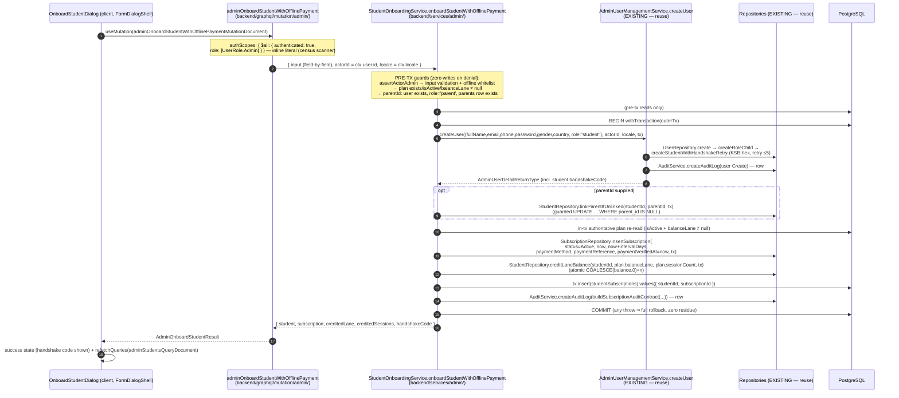
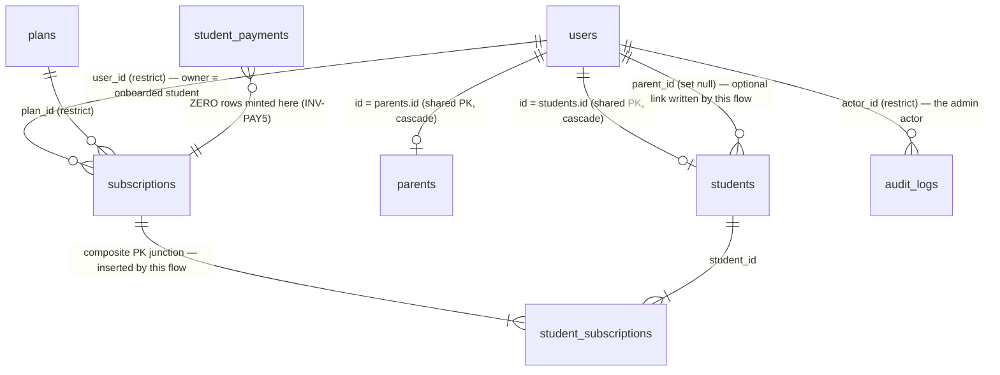

# Technical Architecture & Implementation Design: Direct Student Onboarding with Offline Payment

> **Plan of record:** `ai/plans/milestone_3/direct_student_onboarding_with_offline_payment/`
> **Target Directory:** `ai/plans/milestone_3/direct_student_onboarding_with_offline_payment`
> **Outcome Directory:** `ai/plans/milestone_3/direct_student_onboarding_with_offline_payment/outcome`
> **Specs:** `ai/plans/milestone_3/direct_student_onboarding_with_offline_payment/specs.md` (REQ-000, REQ-001, REQ-010..015, REQ-020, REQ-030; Journeys J-1..J-3)
> **Related:** `specs.md` · `tasks.md` · `deferred-items.md` (seeded at Task 0) · `outcome/exploration-ground-truth.md` (ground truth — every `path:line` claim below traces to it or to direct re-verification)
> **Version:** 1.0 · **Date:** 2026-09-21 · **Milestone:** M3 · **Source Ticket:** `docs/planning/TICKETS.md:2357-2402`
> **Decision Refs:** B.9 (offline payment audit trail — `docs/specs/open-decisions-and-gaps.md:123-127`), A.5 (audit_logs — `:35-40`), FR-10.2 (`docs/specs/functional-requirements.md:263-264`), INV-PAY5 (`docs/specs/state-machine-invariants.md:302`)
> **Blocked by:** Admin CRUD Users/Teachers/Students/Parents — IMPLEMENTED (`backend/services/admin/user-management.service.ts:261`); Admin Subscription Management — IMPLEMENTED (`backend/services/billing/subscription-admin.service.ts:159,299,400,488`)

---

## 1. System Overview & Architecture

### 1.1 Scope Statement

This ticket is a **single-mutation, service-composed admin surface**: ONE admin-gated GraphQL mutation (`adminOnboardStudentWithOfflinePayment`) driving ONE transaction that composes the EXISTING identity writer with a NEW offline-payment activation writer. The committed transaction mints, atomically:

1. `users` row (`role='student'`) + `students` row (unique `handshake_code`, zeroed balance lanes, NO trial grant) — composed from `AdminUserManagementService.createUser` (`backend/services/admin/user-management.service.ts:261`; admin trial dormancy at `:297-302`).
2. Optional `students.parent_id` link (guarded, `StudentRepository.linkParentIfUnlinked` — `backend/db/repo/students/student.repository.ts:373`).
3. `subscriptions` row with `status='active'`, `startDate=now`, `endDate=now+interval_days`, offline `payment_method`, admin-provided `payment_reference`, `payment_verified_at=now` — all columns EXISTING (`backend/db/schema/billing/subscriptions.ts:38-43`).
4. Immediate session-balance credit (`plans.session_count` into `plans.balance_lane` — `StudentRepository.creditLaneBalance`, `student.repository.ts:440`).
5. `student_subscriptions` junction row (`backend/db/schema/billing/student-subscriptions.ts:20`).
6. Exactly TWO `audit_logs` rows: user `Create` (minted inside `createUser`) + subscription `Create` (minted by the onboarding writer).

**INV-PAY5 is the structural invariant:** ZERO `student_payments` rows — the offline bypass. `student_payments` is an immutable gateway ledger (`backend/db/schema/billing/student-payments.ts:24-46`, `payment_gateway` NOT NULL `:64`); omission is the only consistent design.

Net-new surface (all `CREATE, first-lander` unless noted): service + helpers (`§4.2/§4.3`), canonical types (`§4.1`), Pothos input/result + mutation file (`§3.1/§3.2`), census row + additive census-journey composite-row support (`§4.7`), admin students toolbar entry point + onboarding dialog tree (`§5.4`), `studentOnboarding` i18n namespace (`§5.5`), shared Apollo document + GraphQL suite + journey test (`§7`).

**Zero schema drift** (NFR-8): every table, column, and enum member this flow touches is verified EXISTING — `git diff -- backend/db/schema/**` MUST stay empty; `bun run db push` is NEVER run (`§2.2`). **Zero new Pothos object types** for existing entities: the result composes `AdminUserDetail` + `StudentSubscription` (EXISTING canonical objects — `§3.1`). **No new route, no nav change** (`§5.1/§5.2`).

### 1.2 Data Flow (mermaid sequence diagram)



Read-back after commit (no new read surface): admin directory `adminStudents` (`backend/graphql/query/admin/admin-students.query.ts:59`) and `adminUserDetail` (`admin-users.query.ts:97`); linked parent sees the child through `ParentMonitoringService.listLinkedChildren` (`backend/services/parents/parent-monitoring.service.ts:178`) with zero extra ceremony (`requireLinkedChild` gate, `parent-monitoring.helpers.ts:177`); analytics counters already tally offline activations (`backend/db/repo/admin/platform-analytics-query-helpers.ts:112-117,458-479`).

### 1.3 Key Design Decisions Table

| # | Decision | Alternatives considered | Rationale (with evidence) |
|---|---|---|---|
| D1 | **Service home = `backend/services/admin/student-onboarding.service.ts`** (+ `student-onboarding.helpers.ts`), NOT `backend/services/students/` | (a) `backend/services/students/` (student-domain services: handshake, trial, homework); (b) `backend/services/billing/` (specs.md §4 traceability hint); (c) `backend/services/admin/` | **Deviation from the students/ default, recorded.** The direct precedent for a cross-domain admin-composed single mutation is `ColdStartCertificationService` at `backend/services/admin/cold-start-certification.service.ts` (verified in-tree): same shape — one admin-gated census-rowed mutation composing identity + audit rows in one tx. The flow's actor, BFLA re-assertion, census row, and journey file are ALL admin-domain; the student/billing stages are delegated to EXISTING single writers (`createUser`, repos). Option (b) rejected: specs.md:284's `billing/` hint names the composer, but the composer's concern is admin governance (Workflow-05 pillar), not billing math — the billing writers stay in `billing/` untouched. |
| D2 | **Single-writer composition**: pre-tx guards → ONE `withTransaction(outerTx)` composing `createUser` → optional `linkParentIfUnlinked` → `insertSubscription` → `creditLaneBalance` → junction insert → subscription audit | (a) split mutations (createUser then activate) chained client-side; (b) reuse `applyActivationCredit` | (a) breaks atomicity — partial states (identity without balance) become reachable; REQ-020.1 demands one field so partial states are structurally impossible. (b) `applyActivationCredit` (`backend/services/billing/subscription-activation-credit.helpers.ts:101`) is payment-row-coupled (classifies by `payment.studentId`; a missing row = quarantine) — CANNOT be reused with zero `student_payments` rows; only `subscriptionCreditLaneOf` (`:57`) is a safe shared primitive. Composition-seam rule: `outerTx` LAST (`backend/services/AGENTS.md`). |
| D3 | **Mutation `adminOnboardStudentWithOfflinePayment(input: AdminOnboardStudentOfflineInput!): AdminOnboardStudentResult!`**; `paymentMethod: PaymentGatewayPothosEnum`; `paymentReference: String!` REQUIRED (1–255 trimmed); result composes EXISTING `AdminUserDetail` + `StudentSubscription` + `creditedLane`/`creditedSessions`/`handshakeCode` | (a) `paymentReference` optional for scholarship; (b) new dedicated result object types for student/subscription; (c) free-form method string | (a) **considered and rejected**: a uniform required reference is a strictly stronger idempotency token (REQ-012.3 partial-unique guard) and keeps ONE closed contract; the scholarship leg supplies a unique reference (e.g. `SCH-<uuid8>`). specs.md §2.9 J-3 step 1 was reconciled at plan-review R1 to require a unique admin-provided reference for all three offline methods (D-ONB-002 tracks any future relaxation); the column stays nullable so a future relaxation is non-breaking. (b) violates single-canonical-object (`backend/AGENTS.md`); `SubscriptionPothosObject` already exposes `paymentMethod/paymentReference/paymentVerifiedAt` (`backend/graphql/pothos/billing/subscription.pothos.ts:84-96`). (c) non-enum values must die as GraphQL validation — `PaymentGatewayPothosEnum` (`backend/graphql/pothos/shared/enum.pothos.ts:226`); the service re-guards the offline subset (REQ-012.4). |
| D4 | **Canonical types in `backend/types/admin/admin-student-onboarding.types.ts`** exporting `AdminOnboardStudentSubmitInput` + `AdminOnboardStudentReturnType` | (a) local types in the Pothos file; (b) service-layer `.types.ts` | Both PROHIBITED (`backend/graphql/pothos/AGENTS.md`, `backend/services/AGENTS.md`); naming follows `{Entity}SubmitInput`/`{Entity}ReturnType` and the sibling `backend/types/admin/admin-user.types.ts` (`AdminCreateUserSubmitInput` at `:209-217`). No `StudentInsertType` is minted — the student insert is owned by the EXISTING provisioning seam. |
| D5 | **Exactly TWO audit rows per committed onboarding**: user `Create` (inside `createUser`, contract `backend/services/admin/user-management.helpers.ts:334`) + subscription `Create` (onboarding writer via `buildSubscriptionAuditContract`, `backend/services/billing/subscription-admin.helpers.ts:354`); census row pins verb `Create` + entityType `"user"` and the census machinery gains ADDITIVE composite-row support | (a) one combined audit row; (b) pin the census row to `"subscription"` only | (a) forking `createUser` to skip its audit breaks the user-creation single-writer pattern and under-trails WHO was created. (b) the census journey's 1:1 oracles count every row minted by the actor (`test/workflows/admin/audit-completeness.journey.test.ts:1582,1646` — `countAuditRowsForActor(adminA.userId) === executedActions.length`), and `record()` hard-stamps `entityType = entry.expectedEntityType` (`:372`) with an exact-match check at `:1010` — a two-entityType producer needs the ADDITIVE `secondaryExpectedAuditRows` extension spec'd in §4.7 (evidence: `test/workflows/admin/audit-completeness.catalog.ts:47-59` documents a single `expectedEntityType` per row). |
| D6 | **UI = multi-section dialog launched from the admin students directory toolbar** (`frontend/views/admin/students/AdminStudentsToolbar.tsx` — EXTENDED additive-only); NO new route, NO nav change | (a) new `/admin/onboarding` route + nav item; (b) host in the student detail drawer | (a) the ticket AC (TICKETS.md:2369-2394) requires an in-app flow, not a new destination; `/students` already exists (`app/(dashboard)/students/page.tsx`, `withPageAuth({ roles: [UserRole.Admin] })`) and the nav array already carries it (`frontend/views/dashboard/nav/navItems.ts:156-176`) — a new entry would add surface area with zero user value. (b) the drawer is read-only by charter (`AdminStudentDetailDrawer.tsx:11-14`) except the subscription lifecycle section — onboarding creates a NEW student, so the directory toolbar is the correct host. |
| D7 | **Journey test-first** at `test/workflows/admin/direct-student-onboarding.journey.test.ts` per `test/workflows/AGENTS.md` (committed fixtures + `TrackedFixtures` + zero-residue probes; NO `runInRollback`) | (a) only service+GraphQL tests; (b) journey in a new `test/workflows/students/` dir | The cross-actor matrix (admin/student/parent/other-parent/denied cast) is only honestly provable in the committed-fixture layer; `test/workflows/admin/` is the existing domain home (ground truth: no `students/` dir exists). Journey lands BEFORE the mutation implementation per test-first ordering (§7.3). |
| D8 | **GraphQL integration suite** `frontend/graphql/test/admin-student-onboarding/` via `setupTestServerLifecycle` + `testClient` + bearer auth, driving a NEW shared document `adminOnboardStudentWithOfflinePaymentMutationDocument` in `frontend/graphql/sharedDocuments/admin/` + codegen | (a) local `parse()`d documents in the test (legacy pattern, `frontend/graphql/test/subscription-admin/subscription-admin.test.ts:199-201`); (b) services-only tests | `frontend/graphql/test/AGENTS.md:104-140` mandates sharedDocuments + codegen + ALL-arguments coverage (optionals explicit `null`) + generated enums only; house naming is `admin<Verb><Entity>MutationDocument` (precedent `adminCreateUserMutationDocument`, `frontend/graphql/sharedDocuments/admin/admin-users.documents.ts:179`). |
| D9 | **Concurrency = constraint arbitration only**: `users_email_unique`, handshake in-tx retry, `subscriptions_payment_reference_unique` partial index, guarded relative balance UPDATE; NO `SELECT FOR UPDATE`, NO idempotency claims | (a) pre-check SELECTs for duplicates; (b) claim keys like renew's `subscription-admin:renew:<id>`; (c) lock the plan row | (a) race + leak (`backend/services/AGENTS.md` single-writer rule: arbitrate with the UNIQUE constraint, catch 23505 → typed conflict). (b) this flow INSERTS fresh entities — there is no guarded transition to make idempotent; `payment_reference` IS the human idempotency token (REQ-012.3). (c) the plan row is read-only here; full TOCTOU analysis in §4.6. |
| D10 | **Admin supplies the initial password in the form** (existing `AdminCreateUserSubmitInput.password` + `CreateUserDialog` precedent) — no credential-generation/email-outreach machinery | (a) generate a random password + email it; (b) invitation link | (a)/(b) invent a notification surface this ticket does not own; `AdminUserManagementService.createUser` already accepts a password (`backend/types/admin/admin-user.types.ts:209-217`), hashes it pre-tx, and creates immediately-authenticatable identities (REQ-010.6). Password NEVER appears in logs or audit `details`. |
| D11 | **In-tx authoritative plan re-read** (single SELECT inside the tx) after the pre-tx guard | (a) trust the pre-tx snapshot for `sessionCount`/`intervalDays`/`balanceLane` | (a) plans ARE mutable concurrently (`updatePlanMutationDocument`, `frontend/graphql/sharedDocuments/billing/plan-catalog.documents.ts:74`); crediting from a stale snapshot mis-prices the onboarding. The pre-tx check stays as the fast zero-write denial guard (REQ-013.3 fail-closed UX); the tx-snapshot read is authoritative. This is NOT a duplicate-arbiter pre-check — duplicates still arbitrate by constraint (D9). |
| D12 | **Trial grant stays dormant** (`subscription_status='none'`, `balance_trial` untouched) until the direct activation credits exactly one `session_count` | (a) also grant the free trial (public-registration parity) | Admin-surface precedent is explicit: `createUser`'s student branch deliberately omits the trial grant (`backend/services/admin/user-management.service.ts:297-302`); REQ-010.3 pins this. REQ-013.4: exactly one `session_count` — no trial top-up, no double credit. |
| D13 | **Service locale pattern**: `getServerTranslations(locale)` ONE argument (full tree) from `@/shared/locale/server-graphql`; resolvers use `ctx.t(...)`; client uses namespace handles | (a) two-arg lookups; (b) hardcoded strings | (a) FORBIDDEN (REQ-001.3; the legacy two-arg form is dead). (b) FORBIDDEN everywhere (`backend/services/AGENTS.md`). New flow-specific error keys land in the NEW `studentOnboarding` namespace (`§5.5`); existing keys (`authTranslations.emailAlreadyExists`, `errorsTranslations.*`) are reused, never re-minted. |

---

## 2. Data Models & Database Schema

### 2.1 Existing Schema Verification (READ-ONLY — zero drift gate, NFR-8)

Every element this flow touches is verified EXISTING in the ground-truth report and re-verified in-tree. **Verdict for every row: EXISTS — no change.**

| Table / object | Touched column(s) | Evidence (path:line) | Verdict |
|---|---|---|---|
| `users` | `id` :14, `full_name` :15, `email` :16 + `users_email_unique` :44, `phone` :17, `password_hash` :18, `role` :19, `gender` :21, `country` :22 | `backend/db/schema/users/users.ts:11-44` | EXISTS — no change |
| `students` | `id` (PK=FK→users.id) :21-23, `balance_hifz/_reviews/_tajweed/_trial` :24-27 (+ CHECKs :42-45), `handshake_code` NOT NULL + unique :31 (:40), `parent_id` FK set-null :32 | `backend/db/schema/students/students.ts:18-45` | EXISTS — no change |
| `parents` | `id` (PK=FK→users.id) :12-14 | `backend/db/schema/parents/parents.ts:11` | EXISTS — no change |
| `subscriptions` | `user_id` :32-34, `plan_id` :35-37, `status` :38, `start_date`/`end_date` :39-40, **`payment_method` :41**, **`payment_reference` :42 + partial unique `subscriptions_payment_reference_unique` :54-56**, **`payment_verified_at` :43** | `backend/db/schema/billing/subscriptions.ts:28-58` (doc `:12-14`: "support admin-verified offline payments") | EXISTS — no change |
| `student_subscriptions` | composite PK `(student_id, subscription_id)` :20, `enrolled_at` | `backend/db/schema/billing/student-subscriptions.ts:20-33` | EXISTS — no change |
| `plans` | `title` :23, `session_count` :25, `price` :24, `interval_days` :28, `balance_lane` :29 (nullable; NULL = quarantined, doc :13-17), `is_active` :30, CHECKs :39-41 | `backend/db/schema/billing/plans.ts:20-41` | EXISTS — no change |
| `student_payments` | **ZERO columns touched** (INV-PAY5 — row-count-delta proves absence) | `backend/db/schema/billing/student-payments.ts:50-78` (immutable ledger doc :24-46; `payment_gateway` NOT NULL :64) | EXISTS — no change; NEVER written |
| `audit_logs` | `actor_id` :34-36, `action_type` :37, `entity_type` :38, `entity_id` :39, `details` varchar(2000) :40, append-only trigger (doc :17-21) | `backend/db/schema/audit/audit-logs.ts:30-45` | EXISTS — no change |
| `parent_link_requests` | **ZERO columns touched** (self-service flow is OUT of scope, REQ-011.6) | `backend/db/schema/parents/parent-link-requests.ts:39-60` | EXISTS — no change |
| pgEnum `payment_gateway` | members `offline_cash`, `bank_transfer`, `scholarship` pre-date this ticket | `backend/db/schema/enums.ts:56-66`; TS mirror `backend/enum/billing/payment-gateway.enum.ts:10-19` | EXISTS — no change |
| pgEnum `subscription_status` | member `active` | `backend/db/schema/enums.ts:68-74`; mirror `backend/enum/billing/subscription-status.enum.ts:6-11` | EXISTS — no change |
| pgEnum `subscription_credit_lane` | `hifz, tajweed, reviews` (NO "trial" member — trial lane is a plain column) | `backend/db/schema/enums.ts:86`; mirror `backend/enum/billing/subscription-credit-lane.enum.ts:9-12` | EXISTS — no change |
| pgEnum `audit_action_type` | `create` (NO new verb member minted) | `backend/db/schema/enums.ts:102-110`; mirror `backend/enum/audit/audit-action-type.enum.ts:6-13` | EXISTS — no change |
| pgEnum `user_role` | `admin, teacher, student, parent` — exactly four; **no `super_admin` member exists and none is invented** | `backend/db/schema/enums.ts:9`; mirror `backend/enum/users/user-role.enum.ts:5-10` | EXISTS — no change |

**Completion gate (NFR-8):** `git diff -- backend/db/schema/**` MUST be empty at ticket close. NO `bun run db push`, NO migration file, NO pgEnum edit, NO new table. The three offline members, the three payment columns, the handshake column, and the parent link column all pre-date this ticket (B.9 resolution, `docs/specs/open-decisions-and-gaps.md:123-127`).

### 2.2 Entities & Relationships



**The `student_subscriptions` junction is a mandatory side-write** (specs REQ-012.6): `subscriptions.user_id` is a generic owner column; the subscription↔student enrollment link lives ONLY in the junction (`backend/db/schema/billing/student-subscriptions.ts:20`). Precedent insert shape (EXISTING pattern, `backend/services/billing/subscription-admin-settle.helpers.ts:98` and `backend/services/billing/subscription-purchase.service.ts:419`):

```typescript
await tx.insert(studentSubscriptions).values({ studentId, subscriptionId });
```

**Explicit ruling — ZERO schema migrations, ZERO enum changes, `bun run db push` NOT needed.** Evidence: every column and member above is verified present in the Drizzle source (§2.1 table); the only gap this ticket fills is orchestration + surface (services, mutation, UI, tests) — the exploration report's net gap list contains no schema item (`outcome/exploration-ground-truth.md`, agent-0 bottom line: "Every schema artifact the ticket assumes already EXISTS").

**Read-only downstream (never edited):** `parent_link_requests` (self-service handshake lane stays untouched — REQ-011.6), `student_payments` (immutable ledger — INV-PAY2/INV-PAY5), `wallet` (teacher earnings only, `backend/db/schema/billing/wallet.ts:20`).

---

## 3. API Contracts & Pothos Resolvers

### 3.1 SDL Additions (exact — REQ-020)

```graphql
"""Result of the atomic direct onboarding: created student identity +
directly-activated offline-paid subscription. Composes the EXISTING
canonical objects — no new entity object type is minted."""
type AdminOnboardStudentResult {
  student: AdminUserDetail!
  subscription: StudentSubscription!
  creditedLane: SubscriptionCreditLane!
  creditedSessions: Int!
  handshakeCode: String!
}

input AdminOnboardStudentOfflineInput {
  fullName: String!
  email: String!
  phone: String!
  password: String!
  gender: Gender
  country: String!
  parentId: Int
  planId: Int!
  paymentMethod: PaymentGateway!
  paymentReference: String!
}

type Mutation {
  adminOnboardStudentWithOfflinePayment(
    input: AdminOnboardStudentOfflineInput!
  ): AdminOnboardStudentResult!
}
```

Wire-name evidence (all EXISTING — reuse): `AdminUserDetail` = `AdminUserDetailPothosObject` (`backend/graphql/pothos/admin/admin-user.pothos.ts:225-227`); `StudentSubscription` = `SubscriptionPothosObject` (`backend/graphql/pothos/billing/subscription.pothos.ts:53-54` — exposes `paymentMethod`/`paymentReference`/`paymentVerifiedAt` at `:84-96`); enums `Gender` (`enum.pothos.ts:70`), `PaymentGateway` (`:226`), `SubscriptionCreditLane` (`:266`) — all registered once in `backend/graphql/pothos/shared/enum.pothos.ts`, never re-registered.

### 3.2 Pothos Registration, Barrels & Codegen

**Pothos types (CREATE, first-lander) — `backend/graphql/pothos/admin/admin-student-onboarding.pothos.ts`:**

```typescript
export const AdminOnboardStudentOfflineInput = gqlSchemaBuilder.inputType(
  "AdminOnboardStudentOfflineInput",
  {
    fields: t => ({
      fullName: t.string({ required: true }),
      email: t.string({ required: true }),
      phone: t.string({ required: true }),
      password: t.string({ required: true }),
      gender: t.field({ type: GenderPothosEnum, required: false }),
      country: t.string({ required: true }),
      parentId: t.int({ required: false }),
      planId: t.int({ required: true }),
      paymentMethod: t.field({ type: PaymentGatewayPothosEnum, required: true }),
      paymentReference: t.string({ required: true }),
    }),
  }
);

export const AdminOnboardStudentResultPothosObject = gqlSchemaBuilder
  .objectRef<AdminOnboardStudentReturnType>("AdminOnboardStudentResult")
  .implement({
    fields: t => ({
      student: t.field({ type: AdminUserDetailPothosObject }),        // EXISTING — reuse
      subscription: t.field({ type: SubscriptionPothosObject }),      // EXISTING — reuse
      creditedLane: t.field({ type: SubscriptionCreditLanePothosEnum }),
      creditedSessions: t.exposeInt("creditedSessions"),
      handshakeCode: t.exposeString("handshakeCode"),
    }),
  });
```

**Mutation (CREATE, first-lander) — `backend/graphql/mutation/admin/admin-student-onboarding.mutation.ts`**, modeled verbatim on the exemplary skeleton `backend/graphql/mutation/admin/admin-users.mutation.ts:58-86`:

```typescript
gqlSchemaBuilder.mutationField("adminOnboardStudentWithOfflinePayment", t =>
  t.field({
    type: AdminOnboardStudentResultPothosObject,
    args: { input: t.arg({ type: AdminOnboardStudentOfflineInput, required: true }) },
    // INLINE LITERAL — mandatory: the census drift scanner resolves literals only
    // (backend/db/test/logic/audit/audit-census-drift.test.ts:166-201).
    authScopes: { $all: { authenticated: true, role: [UserRole.Admin] } },
    resolve: async (_root, args, ctx) => {
      if (!ctx.user) { throw new UnauthorizedError(ctx.t("errorsTranslations").authenticationRequired); }
      const actorId = ctx.user.id;
      const { input } = args;
      return StudentOnboardingService.onboardStudentWithOfflinePayment(
        { // field-by-field whitelist — NEVER a `{ ...input }` spread (BOPLA)
          fullName: input.fullName, email: input.email, phone: input.phone,
          password: input.password, gender: input.gender ?? undefined,
          country: input.country, parentId: input.parentId ?? undefined,
          planId: input.planId, paymentMethod: input.paymentMethod,
          paymentReference: input.paymentReference,
        },
        actorId, ctx.locale
      );
    },
  })
);
```

Resolver discipline (from `backend/graphql/mutation/AGENTS.md` + census scanner): side-effect file (no named exports), thin resolver (no business logic, no local types), `ctx.user` narrowing only, service re-asserts the actor via `assertActorAdmin`. `parentId`/`planId` stay `Int` (no wire `ID` coercion needed — the service validates positive ints; `coerceSubscriptionId`-style strict parsing (`subscription-admin.helpers.ts:371-395`) applies to `ID!` args only).

**Barrels (EXTENDED additive-only):** add `import "./admin-student-onboarding.mutation";` to `backend/graphql/mutation/admin/index.ts:10-13` (side-effect barrel). The Pothos file is imported by name from `@/backend/graphql/pothos/admin` by the mutation file (object barrel already exists).

**Codegen (SAME change set — REQ-020.6):**

```bash
bun run generate:gqlSchema && bun codegen
```

Artifacts (`frontend/graphql/generated/gql/graphql` + schema SDL) are committed together with the mutation; the drift test and the GraphQL suite consume them (§7.2).

### 3.3 Error Mapping (`DomainError` → `extensions.code` → client handling)

All classes from `backend/lib/errors.ts` (VERIFIED: `NotFoundError` :37, `UnauthorizedError` :44, `ForbiddenError` :51, `ValidationError` :65, `ConflictError` :171; every subclass propagates `extensions.code` through `finalizeGraphqlErrors` masking). Denials log via `logger.logDomainError(msg, { code, entity, entityId })` — never `console.*` (REQ-001.7).

| Trigger (service layer) | Error class | `extensions.code` | Client handling (dialog) |
|---|---|---|---|
| Missing/invalid profile field; `paymentReference` not 1–255 after trim; `paymentMethod` ∉ {OfflineCash, BankTransfer, Scholarship} (REQ-012.4); plan inactive; plan `balance_lane` NULL (REQ-013.3); `parentId` role ≠ parent (REQ-011.3); parents row missing for parent user | `ValidationError` | `VALIDATION` | `runWithFeedback` projects `extensions.fields[]` → inline `helperText`; field-less → top-level alert band (`frontend/views/admin/users/hooks/useAdminUserFormFeedback.ts:4-16`) |
| Duplicate email — 23505 on `users_email_unique` (REQ-010.4) | `ConflictError` via `translateDbError` | `CONFLICT` | alert band with already-localized `authTranslations.emailAlreadyExists` copy |
| Duplicate `payment_reference` — 23505 on partial unique (REQ-012.3, JR-5) | `ConflictError` via `translateDbError` | `CONFLICT` | alert band; reference field highlighted |
| `planId` unknown (REQ-012.5) | `NotFoundError("PLAN", …)` | `PLAN_NOT_FOUND` | alert band |
| `parentId` unknown (REQ-011.4) | `NotFoundError("USER", …)` | `USER_NOT_FOUND` | alert band |
| Anonymous call | `UnauthorizedError` | `UNAUTHORIZED` | scope gate fires pre-resolver; UI never reaches it |
| Authenticated non-admin (teacher/student/parent) | `ForbiddenError` | `FORBIDDEN` | scope gate fires pre-resolver; UI surfaces server message via `extractErrorMessage` (`@/frontend/lib/graphql-error-utils`) with NO client re-translation (REQ-030.7) |

### 3.4 Permission / Authorization Matrix (role-based reality — NO permission layer exists)

Verified reality: `grep` proves NO `AppPermission`/permission strings exist; the scope resolvers are `authenticated`/`role` (with `permission` a placeholder that always passes, `backend/graphql/pothos/builder.ts:126-143`). The role enum is EXACTLY `admin | teacher | student | parent` (`backend/enum/users/user-role.enum.ts:5-10`) — **`SUPER_ADMIN` does not exist and is not invented anywhere in this plan.**

| Role | Scope gate result (`$all { authenticated: true, role: [UserRole.Admin] }`) | Service re-assert (`assertActorAdmin`) | Page gate (`withPageAuth`, host route) |
|---|---|---|---|
| `admin` | PASS | PASS | `/students` loads |
| `teacher` | `FORBIDDEN` (403) pre-resolver | unreachable | redirect to own role dashboard |
| `student` | `FORBIDDEN` (403) pre-resolver | unreachable | redirect |
| `parent` | `FORBIDDEN` (403) pre-resolver | unreachable | redirect |
| anonymous | `UNAUTHORIZED` (401) pre-resolver | unreachable | `/login?redirect=/students` |

Defense in depth is two-layer by design (REQ-020.2): the inline-literal Pothos scope gate AND the service-side `assertActorAdmin` (journeys exercise both honestly — `test/workflows/AGENTS.md:23-26`).

### 3.5 Schema-Baseline Updates (REQ-020.6 — same change set)

1. `bun run generate:gqlSchema` — regenerates the SDL from the Pothos builder (`backend/graphql/gqlSchema.ts:21-25`, definition ordering `backend/graphql/gqlSchema.definitions.ts:15-21`).
2. `bun codegen` — regenerates `frontend/graphql/generated/gql/graphql` consumed by the shared document + suites.
3. Commit schema + codegen artifacts together with the mutation file. Census row lands in the SAME change set (§4.7) or `backend/db/test/logic/audit/audit-census-drift.test.ts` fails the bijection (`:282-330`).

---

## 4. Backend Services, Repositories & Concurrency Model

### 4.1 Canonical Types — `backend/types/admin/admin-student-onboarding.types.ts` (CREATE, first-lander)

```typescript
import type { Gender } from "@/backend/enum/users/gender.enum";
import type { PaymentGateway } from "@/backend/enum/billing/payment-gateway.enum";
import type { SubscriptionCreditLane } from "@/backend/enum/billing/subscription-credit-lane.enum";
import type { AdminUserDetailReturnType } from "@/backend/types/admin/admin-user.types";
import type { SubscriptionReturnType } from "@/backend/types/billing/subscription.types";

/** Closed whitelist for the direct-onboarding surface (BOPLA — REQ-020.3).
 *  `role` is NOT client input: the service hard-codes "student".
 *  `paymentReference` is REQUIRED (D3) — trimmed, 1..255, the human idempotency token. */
export interface AdminOnboardStudentSubmitInput {
  readonly fullName: string;
  readonly email: string;
  readonly phone: string;
  readonly password: string;
  readonly gender?: Gender;
  readonly country: string;
  readonly parentId?: number | null;
  readonly planId: number;
  readonly paymentMethod: PaymentGateway;
  readonly paymentReference: string;
}

/** Composed result — reuses the EXISTING canonical return types (never re-declared). */
export interface AdminOnboardStudentReturnType {
  readonly student: AdminUserDetailReturnType;
  readonly subscription: SubscriptionReturnType;
  readonly creditedLane: SubscriptionCreditLane;
  readonly creditedSessions: number;
  readonly handshakeCode: string;
}
```

No `StudentInsertType`/`StudentReturnType` is minted (they remain absent by design — the student insert is owned by the EXISTING provisioning seam, `backend/services/shared/user-provisioning.helpers.ts:118`). `AdminUserDetailReturnType.student` is `AdminStudentSnapshotReturnType | null` and already carries `handshakeCode` (`backend/types/admin/admin-user.types.ts:160-171,192-197`) — the result's `handshakeCode` reads it from the same-tx detail; no extra query.

### 4.2 Service — `backend/services/admin/student-onboarding.service.ts` (CREATE, first-lander)

```typescript
export namespace StudentOnboardingService {
  export async function onboardStudentWithOfflinePayment(
    input: AdminOnboardStudentSubmitInput,
    actorId: number,
    locale: string,
    outerTx?: DBTransaction
  ): Promise<AdminOnboardStudentReturnType>;
}
```

Signature follows the house pattern `(input, actorId, locale, outerTx?)` — `outerTx` LAST (composition seam, `backend/services/AGENTS.md`; precedents `AdminUserManagementService.createUser` `backend/services/admin/user-management.service.ts:261-266`, `SubscriptionAdminService.extendSubscription` `backend/services/billing/subscription-admin.service.ts:159`). Copy resolution: `const t = getServerTranslations(locale)` (ONE argument) → `.errorsTranslations` / `.authTranslations` / `.studentOnboardingTranslations`.

### 4.3 Helpers — `backend/services/admin/student-onboarding.helpers.ts` (CREATE, first-lander)

Pure functions only (no `.types.ts` — service-layer type files prohibited). All enums are VALUE imports (REQ-001.4 — never `import type` for runtime enums, never string literals):

| Helper | Signature | Behavior |
|---|---|---|
| `OFFLINE_PAYMENT_GATEWAYS` | `const OFFLINE_PAYMENT_GATEWAYS: readonly PaymentGateway[]` (module const) | `[PaymentGateway.OfflineCash, PaymentGateway.BankTransfer, PaymentGateway.Scholarship]` — mirrors `OFFLINE_ACTIVATION_GATEWAYS` (`backend/db/repo/admin/platform-analytics-query-helpers.ts:112-117`); membership check via `includes`, not a string switch |
| `assertOfflinePaymentMethod` | `(method: PaymentGateway, t: StudentOnboardingLabels["errors"]): void` | throws localized `ValidationError` when `!OFFLINE_PAYMENT_GATEWAYS.includes(method)` — REQ-012.4, pre-write |
| `normalizePaymentReference` | `(raw: string, t): string` | trim → reject empty or length > 255 with localized `ValidationError` (REQ-012.3 shape: varchar(255)) |
| `buildOnboardSubscriptionInsert` | `(studentUserId: number, plan: PlanSelectType & { balanceLane: SubscriptionCreditLane }, input: AdminOnboardStudentSubmitInput, now: Date): SubscriptionInsertType` | field-by-field: `{ userId: studentUserId, planId: plan.id, status: SubscriptionStatus.Active, startDate: now, endDate: new Date(now.getTime() + plan.intervalDays * MS_PER_DAY), paymentMethod: input.paymentMethod, paymentReference: input.paymentReference, paymentVerifiedAt: now }` — the offline twin of `insertAdminPeriodSubscription` (`backend/services/billing/subscription-admin-settle.helpers.ts:43-60`, which leaves the three payment columns NULL for the comp case) |
| `buildOnboardAuditDetails` | `(input: { planId, paymentMethod, paymentReference, parentId, creditedLane, creditedSessions, studentUserId }): Record<string, unknown>` | ids/enums only, ≤2000 chars after `JSON.stringify` (REQ-015.3) — passed to `buildSubscriptionAuditContract` |
| `mapToCreateUserInput` | `(input: AdminOnboardStudentSubmitInput): AdminCreateUserSubmitInput` | field-by-field identity subset with `role: "student"` hard-coded — the ONLY writer of the role (BOPLA/BFLA) |

### 4.4 Reused Seams (EXISTING — reuse; never forked, never edited)

| Seam | Evidence (path:line) | Use in this flow |
|---|---|---|
| `AdminUserManagementService.createUser(input, actorId, locale, outerTx?)` | `backend/services/admin/user-management.service.ts:261` | identity stage inside the onboarding tx: users + students (handshake retry) + user audit row; duplicate email → `translateDbError` → localized `ConflictError` (`:261-331`) |
| `assertActorAdmin` | `backend/services/admin/admin-gate.helpers.ts` (extracted gate; usage precedent in `user-management.service.ts`) | service-layer actor re-assert, pre-tx |
| `createStudentWithHandshakeRetry(userId, tx, boundary, buildExhaustedError)` | `backend/services/shared/user-provisioning.helpers.ts:118` (retry budget `HANDSHAKE_RETRY_LIMIT = 5` `:30`; format `KSB-` + 8 hex `:43`) | mints the unique handshake code (reached THROUGH `createUser` — no direct call, no new generator) |
| `StudentRepository.linkParentIfUnlinked(studentId, parentId, tx)` | `backend/db/repo/students/student.repository.ts:373` | guarded `UPDATE … WHERE parent_id IS NULL`; null return → typed conflict (REQ-011.1/2) |
| `StudentRepository.creditLaneBalance(studentId, lane, amount, tx)` | `backend/db/repo/students/student.repository.ts:440` | atomic relative `COALESCE(balance_<lane>, 0) + amount` UPDATE (REQ-013.2) |
| `SubscriptionRepository.insertSubscription(insert, tx)` | `backend/db/repo/billing/subscription.repository.ts:70` | full `SubscriptionInsertType` — accepts the offline payment columns without schema change |
| `AuditService.createAuditLog(input, tx)` | `backend/services/admin/audit.service.ts:82` | subscription `Create` row, contract shape `backend/types/contracts/admin-audit.contract.types.ts:22` |
| `buildSubscriptionAuditContract(actorId, actionType, entityId, details)` | `backend/services/billing/subscription-admin.helpers.ts:354-366` | stamps `entityType = "subscription"` + ids-only JSON details |
| `subscriptionCreditLaneOf` | `backend/services/billing/subscription-activation-credit.helpers.ts:57` | the ONLY safe primitive from the payment-coupled credit helper (`:101` is NOT reused — D2) |
| `translateDbError(error, localizedMessage)` | `backend/lib/errors.ts` (cause-chain 23505 mapper; usage precedent `backend/services/auth/registration.service.ts:35,119`) | duplicate email + duplicate reference → localized `ConflictError` |
| `withTransaction(outerTx, fn)` | house tx seam (precedent: `user-management.service.ts` single-tx body) | ONE transaction for the whole write sequence |
| Parent monitoring read path | `ParentMonitoringService.listLinkedChildren` (`backend/services/parents/parent-monitoring.service.ts:178`), `requireLinkedChild` (`parent-monitoring.helpers.ts:177`) | read-back only — zero new code (REQ-011.5) |

### 4.5 Onboarding Write Sequence (full ordered listing — D2)

**Pre-tx guards (zero writes on any denial — REQ-015.4; `backend/services/AGENTS.md`: guard pre-checks run BEFORE the transaction opens):**

1. `assertActorAdmin(actorId, locale)` — BFLA re-assert (anonymous ⇒ `UNAUTHORIZED` at the gate; non-admin ⇒ `FORBIDDEN`).
2. `assertOfflinePaymentMethod(input.paymentMethod, t)` + `normalizePaymentReference(input.paymentReference, t)` + identity field checks (delegated: `createUser` runs `validateCreateInput` in-tx, but cheap pre-shape checks keep denials pre-DB).
3. `PlanRepository.findById(input.planId)` (`backend/db/repo/billing/plan.repository.ts:131`) — `null` ⇒ `PLAN_NOT_FOUND`; `!isActive` ⇒ localized `ValidationError`; `balanceLane === null` ⇒ localized `ValidationError` (REQ-013.3 fail-closed; `plans.ts:13-17` quarantine doc).
4. When `parentId` present: `UserRepository.findById(input.parentId)` — `null` ⇒ `USER_NOT_FOUND` (REQ-011.4); `role !== UserRole.Parent` ⇒ localized `ValidationError` (REQ-011.3); then parents-row existence probe.
   - **ADDITIVE method (CREATE):** `ParentRepository.findById(userId: number, tx?: DBQueryExecutor): Promise<ParentSelectType | null>` on the EXISTING `backend/db/repo/parents/parent.repository.ts` (today exports only `createForRegistration`, `:21`) — a bare read via `queryDb(tx)` per the bare-reads rule (`backend/AGENTS.md` §3). A parent-role user without the role-child row is corrupt state ⇒ localized `ValidationError`; the row is silently trusted in-tx (FK + invariant).

**ONE `withTransaction(outerTx, tx => …)` — every repository call receives `tx` (NFR-1: mixed `tx`/`db` is PROHIBITED):**

5. `AdminUserManagementService.createUser(mapToCreateUserInput(input), actorId, locale, tx)` → `users` insert (`hashPassword` pre-tx inside `createUser`) → `createRoleChild` student branch → `createStudentWithHandshakeRetry` (unique handshake, in-tx retry) — NO trial grant (`user-management.service.ts:297-302`) → user audit `Create` row (**audit row #1**) → same-tx `getUserDetail`. 23505 on email ⇒ `translateDbError` ⇒ localized `ConflictError` (REQ-010.4).
6. In-tx authoritative plan re-read: `PlanRepository.findById(input.planId, tx)` — re-assert `isActive` + `balanceLane !== null` against the tx snapshot; compute `now = new Date()` once (D11).
7. When `parentId` present: `StudentRepository.linkParentIfUnlinked(studentUserId, input.parentId, tx)` — `null` ⇒ typed conflict (student freshly created, so null can only mean an invariant breach — fail loud, roll back).
8. `SubscriptionRepository.insertSubscription(buildOnboardSubscriptionInsert(studentUserId, plan, input, now), tx)` — `status: SubscriptionStatus.Active` (direct `none→active`, B.9), `endDate = now + intervalDays * MS_PER_DAY`. 23505 on `subscriptions_payment_reference_unique` ⇒ `translateDbError` ⇒ localized `ConflictError` (REQ-012.3).
9. `StudentRepository.creditLaneBalance(studentUserId, plan.balanceLane, plan.sessionCount, tx)` — exactly one `session_count`, no proration, no trial top-up (REQ-013.4); `null` ⇒ `USER_NOT_FOUND` (defensive).
10. Junction insert: `await tx.insert(studentSubscriptions).values({ studentId: studentUserId, subscriptionId: subscription.id })` — the EXISTING service-layer junction pattern (`backend/services/billing/subscription-purchase.service.ts:419`, `subscription-admin-settle.helpers.ts:98`).
11. `AuditService.createAuditLog(buildSubscriptionAuditContract(actorId, AuditActionType.Create, subscription.id, buildOnboardAuditDetails(…)), tx)` — **audit row #2**; ids/enums only (REQ-015.3).
12. Return `{ student: detail, subscription: mapped SubscriptionReturnType, creditedLane: plan.balanceLane, creditedSessions: plan.sessionCount, handshakeCode: detail.student.handshakeCode }` — `handshakeCode` non-null because the detail's student snapshot is same-tx fresh.

Any throw at steps 5–11 rolls back EVERYTHING (NFR-4): zero users/students/links/subscriptions/junction/audit residue, zero credited balance, zero `student_payments` rows (they were never attempted).

### 4.6 Concurrency, TOCTOU & Idempotency Model (D9)

**Duplicate arbitration = database constraints ONLY** (no racing pre-check SELECTs — `backend/services/AGENTS.md` single-writer rule):

| Risk | Arbiter (constraint) | Outcome for the loser |
|---|---|---|
| Double-submit / concurrent same email | `users_email_unique` (`backend/db/schema/users/users.ts:44`) — 23505 | localized `ConflictError`; whole tx rolls back (NFR-4) |
| Handshake code collision | `students_handshake_code_unique` (`students.ts:40`) — in-tx bounded retry ≤ 5 (`user-provisioning.helpers.ts:30,118`); exhaustion ⇒ typed error | astronomically rare; arbiter is still the constraint |
| Same `payment_reference` used twice (JR-5) | `subscriptions_payment_reference_unique` partial index WHERE NOT NULL (`subscriptions.ts:54-56`) — 23505 | exactly one onboarding commits; the loser gets the localized duplicate-reference conflict and zero rows |
| Junction double-insert | composite PK `(student_id, subscription_id)` (`student-subscriptions.ts:20`) | unreachable for a fresh student; structurally safe anyway |
| Parent link race | `linkParentIfUnlinked` guarded `UPDATE … WHERE parent_id IS NULL` (`student.repository.ts:373`) | zero-row update ⇒ null ⇒ typed conflict; the column can never be silently overwritten |

**TOCTOU analysis (every window is either benign or constraint-closed):**

| Window | Actors | Exposure | Resolution |
|---|---|---|---|
| Parent precheck (role read) vs in-tx link write | onboarding admin vs any writer of `users.role` | a user whose role changed between precheck and link could receive a link mid-flight | **Benign by evidence**: NO role-mutation surface exists in the product — `AdminUpdateUserInput` is the exact five-key whitelist `fullName, phone, country, gender, dateOfBirth` (`backend/graphql/pothos/admin/admin-user.pothos.ts:317-331`); role is structurally unreachable. FK `students_parent_fk` remains the final arbiter (`students.ts:32`). |
| Plan precheck vs in-tx use of `sessionCount/intervalDays/balanceLane` | onboarding admin vs plan-editing admin | stale snapshot could mis-price the credit / quarantine check | closed by the **in-tx authoritative re-read** (step 6, D11) — the tx snapshot is what settles; the pre-tx check is UX-only fast denial |
| Parent/plan deleted between precheck and insert | ops tooling | FK violations (`restrict`) | users are never hard-deleted (INV-U4) and plans are soft-deactivated (`setActiveStatusOnce`, `plan.repository.ts:92`); a deactivated plan is re-validated at step 6 |
| Balance credit race with a concurrent subscription lifecycle op on the SAME student | extend/renew/change-plan | both do relative updates | the fresh student has no other subscription to operate on (brand-new identity); `creditLaneBalance` is a single relative UPDATE — atomic by statement |

**Why NO `SELECT FOR UPDATE` and NO idempotency claims:** every statement is either a fresh INSERT (uniqueness = the constraint), a guarded predicate UPDATE (`linkParentIfUnlinked`), or a relative UPDATE (`creditLaneBalance`) — no statement sequence reads-then-writes a shared mutable row, so there is nothing to lock and no guarded transition to claim. Contrast: `renewSubscription` uses the claim `subscription-admin:renew:<id>` (`subscription-admin.service.ts:299`) because it re-animates an EXISTING subscription; direct onboarding mints a fresh one, where `payment_reference` itself is the idempotency token (REQ-012.3). `subscription_purchase_idempotency` (`backend/db/schema/billing/subscription-purchase-idempotency.ts:24`) is gateway-flow machinery — untouched.

**Cross-entity purity:** this flow writes ONLY `users`, `students`, `subscriptions`, `student_subscriptions`, `audit_logs` (five tables). `student_payments`, `wallet`, `parent_link_requests`, `plans` are untouched — asserted by fixture byte-identity tests (§7) and the `student_payments` count-delta invariant (REQ-014.2).

### 4.7 Cross-Actor Journey Design (MANDATORY — specs §2.9)

**Census & audit wiring (D5, REQ-020.6/REQ-015):** the new mutation joins the anti-drift census — `test/workflows/admin/audit-completeness.catalog.ts` (EXTENDED additive-only) gains:

```typescript
{
  mutationField: "adminOnboardStudentWithOfflinePayment",
  serviceEntry: "StudentOnboardingService.onboardStudentWithOfflinePayment",
  expectedActionTypes: [AuditActionType.Create],
  expectedEntityType: "user",
  secondaryExpectedAuditRows: [
    { entityType: "subscription", expectedActionTypes: [AuditActionType.Create] },
  ],
  kind: "wired",
}
```

**Census machinery extension (EXTENDED additive-only — REQUIRED for composite producers).** Evidence the current shape cannot host a two-entityType mutation: `AdminActionCensusEntry` pins ONE `expectedEntityType` (`test/workflows/admin/audit-completeness.catalog.ts:47-59`); the journey's `record()` hard-stamps `entityType: entry.expectedEntityType` (`test/workflows/admin/audit-completeness.journey.test.ts:372`) and `executeCensusRows` rejects any recorded action whose entityType differs (`:1010-1011`); the 1:1 mapping oracle requires every actor-minted row to be recorded and read back exactly (`:1582,1646` — `countAuditRowsForActor(adminA.userId) === executedActions.length`). Therefore, in the SAME change set:

1. `AdminActionCensusEntry` gains optional `readonly secondaryExpectedAuditRows?: readonly { entityType: string; expectedActionTypes: readonly AuditActionType[] }[]` (additive — every existing row is untouched; the drift bijection test only reads `mutationField`/`kind`, `backend/db/test/logic/audit/audit-census-drift.test.ts:282-330`).
2. `record()` gains an optional `entityType` parameter (defaults to `entry.expectedEntityType`) so the runner records the subscription row honestly under `"subscription"`/`subscriptionId`.
3. `executeCensusRows` validation accepts `action.entityType === entry.expectedEntityType || entry.secondaryExpectedAuditRows` membership (verb checked against the matching shape).
4. A NEW census runner (`censusRunners["adminOnboardStudentWithOfflinePayment"]`) provisions a lane-bearing plan + parent fixture, executes the real service path, and records BOTH rows (user Create anchored on the student user id with `createUser`'s details contract; subscription Create anchored on the subscription id with `buildOnboardAuditDetails`).

**Shared-entity state machine (subscription lane of the fresh student — direct `none → active` sanctioned HERE only, B.9):**

| Transition | Guard | Driving actor | Audit row(s) |
|---|---|---|---|
| `[*] → user(student) + student row` (subscription_status `'none'`, balances zeroed) | `assertActorAdmin` + offline whitelist + plan/parent guards | Admin | `Create` on `"user"` (row #1, minted by `createUser`) |
| `none → active` (offline payment columns set + lane credited + junction row) | all pre-tx guards + constraint arbitration | Admin (same tx) | `Create` on `"subscription"` (row #2) |
| `active → active+days` / `active → cancelled` / plan change | NOT this ticket — EXISTING lifecycle surface | Admin | owned by `SubscriptionAdminService` (`subscription-admin.service.ts:159/299/400/488`) — operates on the resulting row exactly as if gateway-activated |
| `active → pending` | structurally impossible — the gateway's `pending → active` webhook path (`subscription-activation.service.ts:554`) is never entered by this flow | — | — |

**Side-effect matrix per journey step (J-1 cash · J-2 bank-transfer + parent · J-3 scholarship + denials):**

| Step | Actor → action | Rows written (one tx) | `student_payments` delta | Audit rows | Post-state |
|---|---|---|---|---|---|
| J1-1 | System — cast provisioning (one committing `db.transaction`, `test/workflows/helpers/actor-context.ts:88-143`, `TrackedFixtures`, `journeyPrefix("admin")`) | fixtures only | 0 | 0 | admin/parent/other-parent/student actors committed |
| J1-2 | Admin → `onboardStudentWithOfflinePayment({profile, planId, paymentMethod: OfflineCash, paymentReference, parentId: null})` | users +1, students +1, subscriptions +1 (active, offline_cash), junction +1, balance_lane += session_count | **0 (count-delta assertion, REQ-014.2)** | 2 (user Create + subscription Create, both actor=admin) | student usable; zero trial |
| J1-3 | Onboarded student → `login` (EXISTING surface) | 0 | 0 | 0 | authenticates (no verification gate, REQ-010.6); observes credited balance on existing student surfaces (JR-1) |
| J1-4 | Admin → `adminStudents` + `adminUserDetail` reads (EXISTING, `admin-students.query.ts:59`, `admin-users.query.ts:97`) | 0 | 0 | 0 | new row + active-subscription flag + handshake visible |
| J2-1 | Admin → same flow, `BankTransfer`, distinct reference, `parentId = parentActor.userId` | J1-2 rows + `students.parent_id` set | 0 | 2 | parent association committed |
| J2-2 | Linked parent → `ParentMonitoringService.listLinkedChildren` (real monitoring read path, `parent-monitoring.service.ts:178`) | 0 | 0 | 0 | child observed with active subscription, zero extra ceremony (JR-2) |
| J2-3 | Parent-other → same monitoring read for that student | 0 | 0 | 0 | constant-403 denial (requireLinkedChild oracle); zero leakage |
| J3-1 | Admin → scholarship onboarding (unique admin-provided reference — D3; specs §2.9 J-3 reconciled at plan-review R1) | J1-2 rows with `payment_method='scholarship'` | 0 | 2 | `payment_reference` unique index still honored |
| J3-2 | Admin → `paymentMethod: Paymob` | **0 — rejected pre-write** | 0 | **0 (REQ-015.4)** | localized `VALIDATION` (offline whitelist) |
| J3-3 | Admin → duplicate `payment_reference` | **0 — constraint rejection** | 0 | 0 | localized `CONFLICT` (REQ-012.3, JR-5) |
| J3-4 | Teacher/Student/Parent (real ids) → the service | **0 — denied** | 0 | 0 | `FORBIDDEN` via `assertActorAdmin` (service layer; GraphQL layer separately proven by the suite, §7 T2) |
| J3-5 | Anonymous (no session) → mutation | **0** | 0 | 0 | `UNAUTHORIZED` (scope gate) |
| J3-6 | System teardown — tracked hard-delete FK-reverse; audit sweep via `withAuditDeleteTriggersSuspended` (`test/helpers/db-cleanup.ts:83`); `deleteUsersByIds`; zero-residue probes (`test/workflows/AGENTS.md:12-19`) | −all | 0 → 0 | −all | zero residue proven |

**Cross-actor visibility table:**

| After step | Admin (actor) sees | Onboarded student sees | Linked parent sees | Other actors see |
|---|---|---|---|---|
| J1-2 commit | directory row + audit trail entries attributed to HIS id (JR-4) | credited lane balance + active subscription on own surfaces | — (unlinked) | nothing (zero fan-out, JR-1) |
| J2-1 commit | `students.parent_id` in detail snapshot | parent name surfaces (EXISTING snapshot fields) | child in monitoring portal immediately (JR-2) | other parents: constant-403 for that child |
| J3 denials | typed localized errors only | nothing | nothing | nothing — and ZERO rows anywhere (JR-3: denials are provably side-effect-free) |

---

## 5. Frontend & UX/Navigation Specification

### 5.1 Routes & URLs Table

| Path | Status | Gate | Purpose in this ticket |
|---|---|---|---|
| `/students` | **EXISTING — reuse** (`app/(dashboard)/students/page.tsx`, guard `withPageAuth({ roles: [UserRole.Admin] })`, mounts `AdminStudentsDirectoryContainer`) | admin-only page | hosts the "Onboard student" entry point in the directory toolbar (D6) |
| `/admin/users/[id]` | EXISTING — read-back only (`app/(dashboard)/admin/users/[id]/page.tsx:32-37`) | admin-only | post-onboarding detail read (no change) |
| login redirect | EXISTING (`/login?redirect=/students` via `withPageAuth`) | — | anonymous bounce (no change) |

**Explicit ruling — NO new route.** The onboarding flow is a dialog on the existing host route, not a destination. Rationale (§1.3 D6): the ticket AC asks for an in-app registration flow; `/students` already renders the admin student directory and its nav item already exists (`frontend/views/dashboard/nav/navItems.ts` admin array `:156-176`) — a dedicated route would add an untested orphan surface.

**Explicit ruling — NO sidebar/nav change.** `navItems.ts` is role-keyed (`NAV_ITEMS_BY_ROLE`, `navItems.ts:127`) and carries `/students` already; the flow is reached from inside the directory. `navItems.ts`, `DashboardSidebar.tsx`, `shared/locale/{types,en,ar}/dashboard/`, and `navItems.test.ts` are all untouched. No mobile bottom-nav exists and none is added.

### 5.2 Role-Based Access Matrix & Per-Audience Rendering (roles verified: exactly `admin | teacher | student | parent` — `backend/enum/users/user-role.enum.ts:5-10`; there is NO `super_admin`/`SUPER_ADMIN` role and this plan invents none)

| Audience | `/students` page | Onboard entry point | Mutation | Monitoring read |
|---|---|---|---|---|
| `admin` | full directory | toolbar button visible | scope gate PASS + service `assertActorAdmin` PASS | n/a (uses admin surfaces) |
| `teacher` | SSR redirect to own role dashboard | never rendered | `FORBIDDEN` (scope gate) even if called blind | n/a |
| `student` | SSR redirect | never rendered | `FORBIDDEN` | n/a |
| `parent` | SSR redirect | never rendered | `FORBIDDEN` | linked child visible ONLY via the EXISTING parent portal (untouched) |
| anonymous | `/login?redirect=/students` | never rendered | `UNAUTHORIZED` | n/a |

Permission mapping = the role-gating reality: `withPageAuth({ roles: [UserRole.Admin] })` at the page (`app/(dashboard)/students/page.tsx`) + the mutation's inline-literal `authScopes: { $all: { authenticated: true, role: [UserRole.Admin] } }` (§3.4). There is NO permission-string layer in this codebase (verified absence: `requirePermissionForPage` / `RequirePermission` / `AppPermission` do not exist) — the plan does not reference them. A scope-gate `FORBIDDEN` that slips through renders via `PermissionDeniedFallback` (`frontend/components/ui/PermissionDeniedFallback.tsx`) — never bare `null`.

### 5.3 Dialog Component Tree (D6 — all files under `frontend/views/admin/students/onboarding/`, CREATE, first-lander)

```
app/(dashboard)/students/page.tsx                       (EXISTING — untouched; mounts container label-free)
  └── frontend/views/admin/students/AdminStudentsDirectoryContainer.tsx   (EXTENDED additive-only)
        │   hosts `const [onboardingOpen, setOnboardingOpen] = useState(false)`
        │   passes `onOnboardStudent={() => setOnboardingOpen(true)}` down to the toolbar
        ├── frontend/views/admin/students/AdminStudentsToolbar.tsx         (EXTENDED additive-only)
        │     + one "Onboard student" button (inline-end, `PersonAddOutlined` icon,
        │       disabled while the dialog is open) — label from `useAppTranslation(StudentOnboarding)`
        └── frontend/views/admin/students/onboarding/                       (CREATE, first-lander)
              ├── index.ts                        (barrel: `export * from "./…"`)
              ├── OnboardStudentDialog.tsx        (FormDialogShell host — 4 sections in ONE dialog)
              ├── OnboardStudentProfileSection.tsx   (fullName, email, phone, password, gender?, country)
              ├── OnboardStudentParentSection.tsx    (optional parent picker — Autocomplete)
              ├── OnboardStudentPlanSection.tsx      (active-plan cards: sessions/interval/lane)
              ├── OnboardStudentPaymentSection.tsx   (3 ToggleButton segments + reference TextField)
              ├── OnboardStudentSuccessContent.tsx  (post-submit: handshake code handoff display)
              ├── onboardingDialog.types.ts         (local VIEW types only — dialog form state)
              └── hooks/
                    ├── index.ts
                    ├── useOnboardStudentMutation.ts       (Apollo mutation + feedback)
                    ├── useOnboardStudentFormFeedback.ts    (runWithFeedback-style seam)
                    └── useOnboardingPlanOptions.ts         (plan picker data)
```

Section order in the single dialog (REQ-030.2): **Profile → Parent (optional) → Plan (active plans only) → Offline Payment** (method segments `offline_cash` | `bank_transfer` | `scholarship` + reference field, required for all three — D3). The reference input trims client-side and enforces 1–255; the service re-validates. `FormDialogShell` (`frontend/views/admin/forms/FormDialogShell.tsx:12-31`) supplies the chrome (title, cancel/save/saving labels, global error band, `React.SyntheticEvent<HTMLFormElement>` submit). MUI v9 discipline throughout: layout props via `sx` only, theme-palette colors only, `*Outlined` icons (frontend/AGENTS.md).

**Parent picker data** — EXISTING query, zero new backend: `adminUsersQueryDocument` with `filters: { role: "parent" }` (`AdminUserFiltersInput.role`, `backend/graphql/pothos/admin/admin-user.pothos.ts:298-305`; document at `frontend/graphql/sharedDocuments/admin/admin-users.documents.ts:112`). **Plan picker data** — EXISTING query: `planCatalogQueryDocument` (`frontend/graphql/sharedDocuments/billing/plan-catalog.documents.ts:20`) — active-only by construction (`PlanCatalogService.listActiveCatalog`, `backend/services/billing/plan-catalog.service.ts:249`) — selects `id, title, sessionCount, intervalDays, balanceLane, price, currency`.

### 5.4 Apollo Wiring (documents convention — REQ-020.7)

**New document (CREATE, first-lander) — `frontend/graphql/sharedDocuments/admin/admin-student-onboarding.documents.ts`** + co-located `admin-student-onboarding.documents.test.ts` contract test + barrel line in `frontend/graphql/sharedDocuments/admin/index.ts`:

```typescript
export const adminOnboardStudentWithOfflinePaymentMutationDocument: TypedDocumentNode<
  AdminOnboardStudentWithOfflinePaymentMutation,
  AdminOnboardStudentWithOfflinePaymentMutationVariables
> = gql`
  mutation AdminOnboardStudentWithOfflinePayment($input: AdminOnboardStudentOfflineInput!) {
    adminOnboardStudentWithOfflinePayment(input: $input) {
      student { id ...AdminUserDetailFields }      # id FIRST — Apollo cache normalization
      subscription { id status paymentMethod paymentReference paymentVerifiedAt }
      creditedLane
      creditedSessions
      handshakeCode
    }
  }
`;
```

House naming verified: `admin<Verb><Entity>MutationDocument` (precedent `adminCreateUserMutationDocument`, `admin-users.documents.ts:179`). Hooks import from `"@apollo/client/react"` — NEVER bare `"@apollo/client"`; `useQuery`/`useMutation` only, NO `useLazyQuery` (frontend/graphql/AGENTS.md).

`useOnboardStudentMutation.ts` mirrors the EXISTING wiring idiom (`frontend/views/admin/users/hooks/useAdminUsersDirectory.ts:77-97`):

```typescript
const [onboardStudent, { loading }] = useMutation(adminOnboardStudentWithOfflinePaymentMutationDocument, {
  refetchQueries: [{ query: adminStudentsQueryDocument, variables }],  // directory refresh
  awaitRefetchQueries: true,
});
```

Error handling (REQ-030.3/7): rejections PROPAGATE to the feedback seam — `runWithFeedback` maps `VALIDATION` `extensions.fields[]` to inline `helperText`, field-less errors to the alert band; server messages render verbatim via `extractErrorMessage` (`@/frontend/lib/graphql-error-utils`) with NO client re-translation. Success (REQ-030.6): dialog switches to the success content showing the handshake code (for handoff to the parent) and the directory refetch lands the new row.

### 5.5 i18n — NEW namespace `studentOnboarding` (REQ-001, REQ-030.4; anatomy cloned EXACTLY from `subscriptionAdmin`)

| Piece | Path (CREATE, first-lander — except the registry key which is EXTENDED additive-only) |
|---|---|
| Labels type | `shared/locale/types/studentOnboarding/index.ts` — `export interface StudentOnboardingLabels { … }` (nested `readonly` groups; plurals as `(count: number) => string`; interpolation as function types) |
| en leaf | `shared/locale/en/studentOnboarding/index.ts` — single `export const studentOnboardingEn: StudentOnboardingLabels = { … }`, no logic |
| ar leaf | `shared/locale/ar/studentOnboarding/index.ts` — exact key parity with en (RTL-safe copy) |
| Namespace handle | `shared/locale/namespaces/studentOnboarding/studentOnboarding.namespace.ts` — `export const StudentOnboarding = defineNamespace<StudentOnboardingLabels>("studentOnboarding.studentOnboarding", translations => translations.studentOnboardingTranslations);` + `shared/locale/namespaces/studentOnboarding/index.ts` re-export (anatomy precedent: `shared/locale/namespaces/subscriptionAdmin/subscriptionAdmin.namespace.ts:4-6`) |
| Registry | `shared/locale/types/message.ts` (EXTENDED additive-only) — add `studentOnboardingTranslations: StudentOnboardingLabels;` (beside `subscriptionAdminTranslations` :56) — the compile-time map forces BOTH leaves to implement every key |
| Parity test | `shared/locale/studentOnboarding-namespace.parity.test.ts` (precedent `shared/locale/subscriptionAdmin-namespace.parity.test.ts`) |

Consumption: client components call `useAppTranslation(StudentOnboarding)` with the handle imported from `@/shared/locale/namespaces/studentOnboarding` (pattern `frontend/views/admin/users/directory/AdminUsersDirectoryContainer.tsx:47-50`); the service resolves `getServerTranslations(locale).studentOnboardingTranslations` (ONE argument, `@/shared/locale/server-graphql`); resolvers use `ctx.t("errorsTranslations")`. String-literal namespaces and `Translation.`-enum access are FORBIDDEN (REQ-001.1).

Key inventory (all keys in BOTH en and ar; exhaustive, not illustrative): `title`; `sections: { profile, parent, plan, payment }`; `fields: { fullName, email, phone, password, gender, country }`; `parentSection: { none, linkedTo, searchPlaceholder }`; `planSection: { sessions: (count) => string, intervalDays: (days) => string, lane: { hifz, tajweed, reviews } }`; `paymentSection: { methods: { offlineCash, bankTransfer, scholarship }, reference, referenceHelper }`; `actions: { submit, cancel, saving }` (FormDialogShell labels slice); `success: { title, handshakeCode: (code) => string, balanceCredited: (count) => string }`; `errors: { methodNotOffline, referenceInvalid, planInactive, planLaneUnconfigured, parentRoleInvalid, parentsRowMissing, duplicateReference }`. Existing keys are REUSED, never re-minted: duplicate email (`authTranslations.emailAlreadyExists`), user/plan not-found (`errorsTranslations`).

---

## 6. Security & Tenancy

**BOLA:** the actor is ALWAYS `ctx.user.id` from the verified context — no actor-shaped input exists (`backend/graphql/gqlContextFactory.ts:76-89`); `actorId` on every audit row is ctx-derived, never client-supplied (REQ-015.2). Target ids (`parentId`, `planId`) are legitimate admin-managed parameters on an admin-only surface; unknown ids yield typed `*_NOT_FOUND` — non-sensitive to a full-governance admin.

**BOPLA (REQ-020.3, NFR-2):** the input is a closed whitelist (`AdminOnboardStudentSubmitInput`) mapped field-by-field at the resolver AND the service boundary; `{ ...input }` spreads are banned by construction (grep gate in tasks). Server-controlled fields (`role`, `status`, `startDate`/`endDate`, `paymentVerifiedAt`, balances, handshake, governance columns, `id`, timestamps) are structurally unreachable; `role: "student"` is hard-coded in `mapToCreateUserInput`. Transport-tampered extra properties are ignored by explicit mapping.

**BFLA:** scope gate inline literal `$all { authenticated: true, role: [UserRole.Admin] }` (census scanner requires the literal — `audit-census-drift.test.ts:166-201`) + service re-assert `assertActorAdmin`. No `grantRole*`/`elevate*` operation exists; admin-role creation remains impossible (`RegisterPublicRole` excludes admin, `backend/types/users/registration.types.ts`); the flow can never mint admins or write another tenant's rows (single-tenant platform — directory predicates are platform-wide BY DESIGN and admin-gated).

**Input sanitization:** all queries Drizzle-parameterized; `paymentReference` is trimmed + bounded 1..255 before insert (column varchar(255), `subscriptions.ts:42`); email/identity validation is delegated to the EXISTING `validateCreateInput` inside `createUser` (never re-implemented); positive-int guards on `parentId`/`planId` before any DB read; no raw concatenated SQL, no inline `--` comments in `sql` templates.

**Audit PII rules (REQ-015.3, NFR-6):** `details` = ids, enum members, and timestamps only — `{ planId, paymentMethod, paymentReference, parentId?, creditedLane, creditedSessions, studentUserId, subscriptionId }` (REQ-015.3's sanctioned shape; `paymentReference` is a receipt number — business evidence, not contact PII) — JSON-stringified ≤ 2000 chars (`audit-logs.ts:40`), truncation never fails the write. NO names, emails, phone numbers, or credentials ever enter `details` or any log. The admin-supplied password exists only as `hashPassword` output inside `createUser` (hash pre-tx, `user-management.service.ts:261-331`).

**Denial-path zero-write rule (REQ-015.4, JR-3):** every rejection — anonymous, non-admin, invalid method, bad reference, unknown parent/plan, inactive/laneless plan, duplicate email/reference — fires BEFORE or aborts the single transaction; ZERO rows of any table, ZERO audit rows, ZERO `student_payments` rows. Expected rejections log via `logger.logDomainError(msg, { code, entity, entityId })` — never `console.*` (NFR-7).

---

## 7. Testing Strategy (4-tier matrix — every run via the wrapper, NEVER raw `bun test`)

| Tier | Suite (path) | Harness | Proves |
|---|---|---|---|
| T1 Service | `backend/services/admin/student-onboarding.service.test.ts` (CREATE, co-located) | `runInRollback` + `tx` to EVERY call (`backend/db/test/test-utils.ts:34`), `expectRepoError` (`:73` — never `rejects.toThrow()` inside rollback), `entity-setup.ts` fixtures only (`createTestUser :74`, `createTestPlan :180`, `createTestParent :131`, `createTestAdmin :169`), translated substring assertions via `getServerTranslations("en")`, `silenceDomainLog`/`assertErrorCode` pattern (`backend/services/admin/user-management.service.test.ts:108-123`), tracked spies restored in `afterEach` (`backend/services/billing/subscription-admin.service.test.ts:166-178`) | happy path row contracts; offline whitelist rejections; duplicate email/reference → 23505 → localized conflicts; NULL-lane fail-closed; credit == `session_count` exactly; `student_payments` zero-delta; forced-failure rollback (throw injected mid-tx ⇒ zero residue, NFR-4) |
| T2 GraphQL | `frontend/graphql/test/admin-student-onboarding/admin-student-onboarding.test.ts` (CREATE) | `setupTestServerLifecycle` + `testClient` + `expectMutationError` from `@/test/helpers` (`test/helpers/test-lifecycle.ts:41`, `graphql-test-helpers.ts:8`, `expect-mutation-error.ts:33`); admin fixture via `insertAdminUserWithChildRow` + `login` → bearer `Authorization` header per request (`test/helpers/fixture-rows.ts:69`); typed documents from sharedDocuments + codegen; ALL input args on every call, optionals explicit `null`, enums from `@/frontend/graphql/generated/gql/graphql` (`frontend/graphql/test/AGENTS.md:104-140`); cleanup `deleteUsersByIds` + `countUsersByIds === 0` probes | anonymous ⇒ `UNAUTHORIZED`; teacher/student/parent ⇒ `FORBIDDEN`; happy path result shape (incl. handshakeCode + subscription payment fields); happy + each denial; no backend imports in the suite |
| T3 Journey (TEST-FIRST — D7) | `test/workflows/admin/direct-student-onboarding.journey.test.ts` (CREATE) | committed fixtures in ONE `beforeAll` `db.transaction` via `provisionAdminActor`/`provisionStudentActor`/`provisionParentActor` (`test/workflows/helpers/actor-context.ts:88-143`), `TrackedFixtures` registry + reverse-order hard-delete (`tracked-fixtures.ts:173`), `journeyPrefix("admin")`, `catchJourneyError` (`journey-fixtures.ts:226`), NO `runInRollback` (`test/workflows/AGENTS.md:8-11`); sequential actor-attributed `test("step N — <actor>: …")` steps; zero-residue probes in `afterAll` (`:12-19`); audit sweep via `withAuditDeleteTriggersSuspended` (`test/helpers/db-cleanup.ts:83`) | J-1/J-2/J-3 end-to-end (§4.7 matrices): cross-actor visibility, parent monitoring read-back, denials through REAL auth, `student_payments` count-delta = 0, exactly 2 audit rows per commit attributed to the admin, teardown residue-free |
| T4 Census + contracts | `test/workflows/admin/audit-completeness.catalog.ts` (EXTENDED) + `test/workflows/admin/audit-completeness.journey.test.ts` (EXTENDED additive) + `backend/db/test/logic/audit/audit-census-drift.test.ts` (EXISTING — must stay green) + `shared/locale/studentOnboarding-namespace.parity.test.ts` (CREATE) + `frontend/graphql/sharedDocuments/admin/admin-student-onboarding.documents.test.ts` (CREATE) | drift bijection (`audit-census-drift.test.ts:282-330`) + census runner for the new row (§4.7) | mutation↔census bijection; composite audit-row oracles; en/ar key parity; document shape contract |

**Repo seam:** `ParentRepository.findById` (the one ADDITIVE method, §4.5) gets a co-located repo test at `backend/db/test/repo/parents/` (CREATE or extended if a sibling suite exists — verify at implementation) under the same `runInRollback` + `expectRepoError` rules.

**Exact run commands (REQ-000.4 gates each file with `bun run scripts/health/sub-loop.ts <file> --lifecycle duplicates` first):**

```bash
bun run test/scripts/run-test.ts backend/services/admin/student-onboarding.service.test.ts
bun run test/scripts/run-test.ts frontend/graphql/test/admin-student-onboarding/admin-student-onboarding.test.ts
bun run test/scripts/run-test.ts test/workflows/admin/direct-student-onboarding.journey.test.ts
bun run test/scripts/run-test.ts test/workflows/admin/audit-completeness.journey.test.ts
bun run test/scripts/run-test.ts backend/db/test/logic/audit/audit-census-drift.test.ts
bun run test/scripts/run-test.ts shared/locale/studentOnboarding-namespace.parity.test.ts
# whole layers when touched broadly:
bun run test:services && bun run test:graphql
# final: bun quality-gate (tsgo → oxlint → biome → lint → duplicates), plus
bun run generate:gqlSchema && bun codegen   # artifacts committed in the same change set
```

Test-lifecycle ordering (test-first per tasks.md): T3 journey scaffold + T1 service red tests land BEFORE the service implementation; T2 requires the schema regen to exist; T4 census row lands with the mutation (REQ-020.6).

---

## 8. Deferred Items & Outcome Protocol

**Deferred-items ledger** — `ai/plans/milestone_3/direct_student_onboarding_with_offline_payment/deferred-items.md`, seeded at Task 0 from the repo template. Ledger table columns: `| ID | Deferred Item | Source Task | Target Task/Owner | Status | Verified By | Notes |`; status values ✅/⚠️/❌/🔄; final gate: `grep -c "❌\|⚠️"` prints 0. Pre-registered rows:

| ID | Deferred item | Rationale (evidence) |
|---|---|---|
| D-ONB-001 | Teacher assignment during onboarding (named in FR-10.2 prose, `docs/specs/functional-requirements.md:263-264`) | ABSENT from ticket AC (`docs/planning/TICKETS.md:2369-2394`) — OUT of scope per specs §1; owned by a future placement ticket; the flow composes cleanly without it (no placement fields anywhere) |
| D-ONB-002 | `paymentReference` optional for scholarship (specs §2.9 J-3 step 1 wording) | rejected for v1 (§1.3 D3) — kept as a ledger row so the relaxation decision is revisitable non-breaking (column already nullable) |
| D-ONB-003 | Admin "parents directory" surface (picker today queries `adminUsers` role-filtered) | no admin parents page exists (`frontend/views/admin/` has no `parents/` dir — ground truth agent-3 §1); a dedicated surface is a separate UX ticket |

**Outcome protocol (REQ-000, binding):**

1. Task 0 records the pre-implementation baseline (`bun tsgo`, `bun biome:check`, `bun run scripts/lint-service.ts --json --id baseline`) + `git diff --name-only` into `outcome/0-baseline-outcome.md`.
2. Every task starts by reading prior `outcome/*.md` files + the ledger — never re-verifying what a prior outcome proved; every completed task writes `outcome/<task-id>-outcome.md` (summary, files changed, files deliberately NOT changed, verification outputs, cross-file dependencies) and keeps `tasks.md` checkboxes current.
3. Every created/edited file passes `bun run scripts/health/sub-loop.ts <file> --lifecycle duplicates` (exit 0) BEFORE its task is marked done; each phase closes with a semantic review checklist against `.agents/instructions/*.instructions.md` + applicable AGENTS.md files.
4. A missing/drifted dependency artifact ⇒ ❌ ledger row + blocked dependent tasks — never an inline patch of a foreign layer.
5. Success definition (specs DoD): all EARS criteria have passing tests at the right layer; J-1/J-2/J-3 green with zero-residue; `student_payments` delta 0 everywhere; exactly 2 audit rows + census green; both locales work in `bun run dev`; `git diff -- backend/db/schema/**` EMPTY; `bun quality-gate` green; outcome files complete.

---

## 9. Traceability (REQ id → plan section → future task phase)

| REQ | Requirement essence | Plan section(s) | Task phase (tasks.md) |
|---|---|---|---|
| REQ-000 | Baseline & execution protocol | §8 (outcome rules), §7 (sub-loop + wrapper commands) | Phase 0 (baseline + ledger seed); every phase gate |
| REQ-001 | i18n & enum import compliance | §1.3 D13, §4.3 (value imports), §5.5 (namespace anatomy), §7 T1/T4 (translated assertions + parity) | Phase 1 (types + i18n), enforced in all phases |
| REQ-010 | Direct student registration (users/students rows) | §1.2, §2.1, §4.2/§4.5 steps 1–5, §3.1/§3.2 (surface) | Phase 2 (service + tests) → Phase 3 (GraphQL) |
| REQ-011 | Optional parent association | §4.5 steps 4/7, §4.4 (`linkParentIfUnlinked`), §4.7 (J-2 visibility), §5.3 (picker) | Phase 2 → Phase 3 → Phase 4 (dialog) |
| REQ-012 | Direct offline subscription activation | §4.3 (`buildOnboardSubscriptionInsert`), §4.5 step 8, §3.1 (SDL), §2.1 (columns verified) | Phase 2 → Phase 3 |
| REQ-013 | Immediate session balance credit | §4.5 step 9 (`creditLaneBalance`), §1.3 D2/D11 (lane primitive + in-tx re-read), §4.6 | Phase 2 |
| REQ-014 | `student_payments` bypass (INV-PAY5) | §1.1, §4.6 (purity), §4.7 + §7 (count-delta assertions) | Phases 2–5 (asserted in every tier) |
| REQ-015 | Audit logging (two rows, ids-only details) | §4.5 steps 5/11, §4.7 (census + composite-row extension), §6 (PII rules) | Phase 2 → Phase 3 (census row same change set) |
| REQ-020 | Admin GraphQL mutation surface | §3 (SDL, registration, errors, matrix, codegen), §4.1 (types), §7 T2/T4 | Phase 1 (types) → Phase 3 (mutation + schema regen + census) |
| REQ-030 | Admin onboarding UI & i18n | §5 (routes, rulings, dialog tree, Apollo wiring, namespace) | Phase 4 (frontend + i18n) |
| Journeys J-1/J-2/J-3 | Cross-actor workflow scenarios | §4.7 (state machine, side-effect matrix, visibility table), §7 T3 | Phase 2 (journey test-first) → Phase 5 (integration + review waves) |

**Consumers of this plan (binding traceability note):** future tickets touching admin onboarding or offline payment evidence SHALL import this plan's composition seam (`StudentOnboardingService` + `AdminOnboardStudentSubmitInput`) by reference; SHALL NOT fork the write sequence, the census composite-row extension, the offline whitelist, or the INV-PAY5 bypass. Teacher assignment (D-ONB-001) extends `AdminOnboardStudentSubmitInput` additively — never through a parallel surface.
