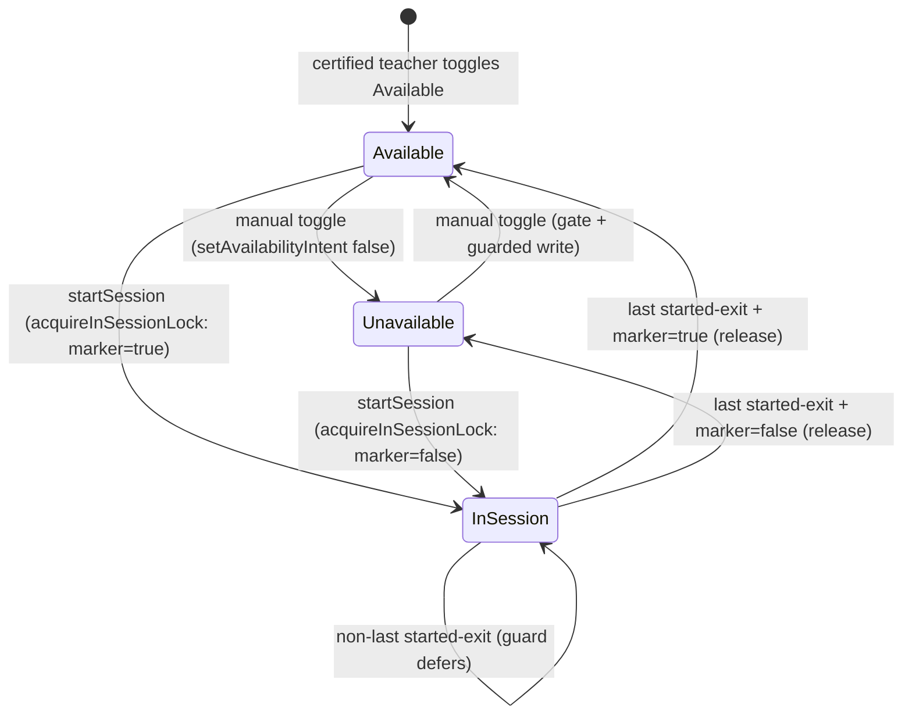

# Design — In-Session Locking (Hide from Directory)

**Plan directory (verbatim, used by every header/ledger/self-reference):** `ai/plans/milestone_2/in_session_locking_hide_from_directory/`
**Specs of record:** `ai/plans/milestone_2/in_session_locking_hide_from_directory/specs.md` (REQ-001..REQ-023)
**Ledger:** `ai/plans/milestone_2/in_session_locking_hide_from_directory/deferred-items.md`
**Outcome dir:** `ai/plans/milestone_2/in_session_locking_hide_from_directory/outcome/`
**Ticket:** `docs/planning/TICKETS.md:1338-1372` (Milestone 2 · Dev 2 · 3 SP · Decision Refs INV-A2, INV-A3, INV-A4, FR-4.3) · **Milestone:** 2 (M2 — Matching, Notifications & Escrow)

---

## 1. Overview & System Context

The in-session lock is the write-side backbone of on-demand matching: while a teacher is in a `started` session, `teacher.is_online` must be `false` (INV-A2/INV-S6), and when the session concludes, availability must return according to the teacher's **persisted pre-lock intent** (INV-A4), never an unconditional resurrect. The shipped tree already locks atomically at `startSession` (`backend/services/classes/session-lifecycle.service.ts:283`) but releases unconditionally (`backend/services/classes/session-lifecycle.transitions.ts:249-257`), leaks on admin-governance cancels of started sessions (`backend/services/classes/session-admin-governance.helpers.ts:298-366`), and classifies release-worthiness with a `startedAt !== null` heuristic that admin reschedule pollutes (`backend/db/repo/classes/session.repository.helpers.ts:443-457`).

This design replaces the release with a **marker-gated, last-started-exit-guarded, single-statement** restore; replaces the transient prior-online read with an **atomic capture-and-lock** primitive; retires `setOnline` in favor of a **direction-guarded, marker-aware toggle-intent** primitive; and composes the release on **every** terminal exit. Zero GraphQL change, zero UI, zero new locale keys.

```
┌────────────────────────────────────────────────────────────────────────────────┐
│ Writer map for teacher.is_online + teacher.was_online_before_lock (AFTER)     │
│                                                                                │
│ startSession ────────► TeacherRepository.acquireInSessionLock(id, tx)          │
│   (scheduled→started)   1 stmt: marker = COALESCE(marker, is_online);          │
│                         is_online = false                       [REQ-005]      │
│                                                                                │
│ completeSessionWithReceipt ─┐                                                 │
│ cancelSession ───────────────┤                                                 │
│ resolveSessionDispute ───────┼─► releaseTeacherInSessionLock(tid, tx)          │
│ admin cancelSessionInTx ────┘     └► TeacherRepository.releaseInSessionLock(  │
│   (LEAK FIX — new call site)          tid, tx)                                │
│                                       1 stmt: is_online = marker; marker=NULL; │
│                                       WHERE marker IS NOT NULL                │
│                                       AND NOT EXISTS(started sessions)        │
│                                                                      [REQ-006/7/8] │
│                                                                                │
│ setTeacherAvailability ─► TeacherAvailabilityService.setAvailability            │
│   (teacher-only mutation)   └► TeacherRepository.setAvailabilityIntent(       │
│                                 id, isOnline, tx)                              │
│                                 1 stmt: is_online = $v;                        │
│                                 marker = CASE WHEN marker IS NULL               │
│                                              THEN NULL ELSE $v END;            │
│                                 WHERE (NOT $v OR NOT EXISTS started)  [REQ-009/10] │
└────────────────────────────────────────────────────────────────────────────────┘
```

### Design Goals

1. **Truthfulness** — `is_online` is correct at every instant, for every current and future consumer (INV-A3 data-level).
2. **Never-resurrect** — conclusion restores intent, never a hardcoded `true` (INV-A4).
3. **Race-free by construction** — every writer is one guarded statement; concurrent sessions and toggle-vs-start races are closed at the row/statement level (MILESTONE_PLAN risk row `docs/planning/MILESTONE_PLAN.md:245`).

### Key Design Decisions

#### D1: Marker on the `teacher` row, not the session row
**Context:** the canonical doc sanctions either (`docs/teachers/teacher-availability.md:311`: "a `was_online_before_lock` column on `teacher`, or an equivalent in a session-scoped table").
**Options:** (1) teacher-level nullable marker; (2) session-level snapshot column.
**Decision:** teacher-level `was_online_before_lock boolean` (nullable, no default).
**Rationale:** the lock is teacher-shaped (one availability flag, N sessions). A teacher-level marker + `COALESCE` first-lock-wins capture + `NOT EXISTS` last-exit guard covers concurrent sessions with ONE column instead of per-session bookkeeping; a `NULL` marker doubles as the authoritative "lock held?" oracle, which also retires the polluted `startedAt` classifier at zero extra cost. Session-level snapshots would need cross-row reconciliation logic to answer "restore now?" — strictly more machinery for the same semantics.

#### D2: Release semantics = restore-marker-if-last, else no-op
**Context:** today `releaseTeacherInSessionLock` unconditionally writes `true` (`session-lifecycle.transitions.ts:250`).
**Decision:** one guarded statement: `UPDATE teacher SET is_online = was_online_before_lock, was_online_before_lock = NULL, updated_at = now() WHERE id = $1 AND was_online_before_lock IS NOT NULL AND NOT EXISTS (SELECT 1 FROM session WHERE teacher_id = $1 AND status = 'started') RETURNING *`; zero rows ⇒ follow-up existence read disambiguates `no_lock_held` / `active_sessions_remain`; missing row ⇒ fail-closed throw (existing contract).
**Rationale:** single-statement atomicity closes the two-concurrent-releases race and the release-vs-toggle race; the `NOT EXISTS` guard makes INV-A2 hold across overlapping sessions; the marker gate makes never-started / reschedule-polluted / double releases free no-ops.

#### D3: `setOnline` is retired, not extended
**Context:** post-ticket, its only production caller is the toggle; its docblock already confesses the owed never-resurrect gating (`teacher.repository.ts:483-488`).
**Options:** (1) keep `setOnline` + wrapper primitives; (2) replace with three purposeful primitives.
**Decision:** replace. `acquireInSessionLock` (lock path), `releaseInSessionLock` (release path), `setAvailabilityIntent` (toggle path); `setOnline` is deleted and its repo test suite (`backend/db/test/repo/teachers/teacher.repository.test.ts:393+`) migrates to the three new suites.
**Rationale:** keeping a dead unconditional writer invites a fourth caller and reintroduces the hazard; knip would flag the dead export anyway (repo no-dead-code rule).

#### D4: Restore-truth = persisted intent; app-open detection stays with `:1298`
**Context:** ticket AC-3 says "returns to Available only if they are still active (app open)"; `users.last_active_at` is login-stamped only (`backend/services/auth/auth.service.ts:514-516`) and the sweep ticket is unbuilt.
**Options:** (1) gate the restore on `last_active_at` freshness; (2) restore persisted intent, delegate liveness to the sweep.
**Decision:** (2). Option (1) is wrong on current data: an hours-active teacher has a stale login-time stamp and would be misclassified offline.
**Rationale:** `TICKETS.md:1322-1324` already assigns composition to the sweep ("in-session lock takes priority"); after this ticket, a restored-Available teacher who truly left converges to Unavailable once the sweep ships. Honest, documented seam (ledger D3).

#### D5: Accept-moment stays at `startSession`
Locking at booking would falsely consume a teacher's availability for future scheduled work and contradicts INV-A2's `started` binding (`state-machine-invariants.md:121`). A real accept/decline intake is Dev-3 matching vocabulary; the unused `teacher.request_preference` pgEnum (`backend/db/schema/enums.ts:162`) and the unwired emitters (`session-request-notification.service.ts:229-276`) are its future seams (ledger D1). Ratified at plan review.

#### D6: Release calls become unconditional; the marker is the single gate
The `startedAt !== null` guards at `session-lifecycle.service.ts:489,663` are removed and the admin-governance cancel gains the release call — because REQ-006.3 (marker `NULL` ⇒ no-op) makes the guards redundant and the marker immune to the reschedule pollution that falsifies `startedAt`.

---

## 2. Data Models

### 2.1 Schema change (the ONLY one)

`backend/db/schema/teachers/teacher.ts` — add after `isOnline` (`:28`):

```typescript
// Drizzle (matches file style; isOnline sits at :28)
wasOnlineBeforeLock: boolean("was_online_before_lock"), // nullable, no default
```

| Column | Type | Null | Default | Meaning |
|--------|------|------|---------|---------|
| `was_online_before_lock` | `boolean` | YES | none | `NULL` = no in-session lock held; `true/false` = pre-lock availability intent to restore on last exit |

- Applied via **`bun run db push`** (Drizzle schema flow; no custom SQL ⇒ no `migrate` — repo policy).
- Existing rows read `NULL` — no backfill; `is_online` semantics unchanged for every existing consumer.
- `TeacherSelectType` (`backend/types/teachers/teacher.types.ts:3`) derives from `typeof teacher.$inferSelect` — the new column flows automatically; NO manual type edits for the select shape.

### 2.2 Canonical types (backend/types/teachers/teacher.types.ts — UPDATE, additive)

```typescript
/** Outcome of a marker-gated in-session lock release. */
export type TeacherInSessionLockReleaseOutcomeType =
  | "released"            // marker restored into is_online, marker cleared
  | "no_lock_held"        // marker was NULL — benign no-op (never-started / polluted / double release)
  | "active_sessions_remain"; // another started session defers the restore

export interface TeacherInSessionLockReleaseResultType {
  readonly outcome: TeacherInSessionLockReleaseOutcomeType;
  readonly teacher: TeacherSelectType; // the current row (post-update on "released")
}
```

- `TeacherAvailabilityReturnType` (`:24-28`) is UNCHANGED — no `inSession` flag may ever appear (forbidden-field registry, `docs/backend/cross-stream-contracts.md:56`).
- `TeacherAvailabilitySnapshotContract` (`backend/types/contracts/teacher-availability.contract.types.ts:27-41`) is UNTOUCHED — Dev-3 matching input, distinct concern.

### 2.3 State model (teacher availability × lock)



| State | `is_online` | `was_online_before_lock` |
|-------|-------------|--------------------------|
| Available / Unavailable | true / false | NULL |
| In-Session (captured Available) | false | true |
| In-Session (captured Unavailable, or mid-session offline toggle) | false | false |

---

## 3. API Contracts (GraphQL — UNCHANGED) & Permission Matrix

**SDL freeze:** no new/changed queries, mutations, objects, or args. The complete teacher-availability wire surface is `myTeacherAvailability: TeacherAvailabilityState!` (zero args) and `setTeacherAvailability(isOnline: Boolean!): TeacherAvailabilityState!` (`backend/graphql/query/teachers/teacher-availability.query.ts:50-75`; `backend/graphql/mutation/teachers/teacher-availability.mutation.ts:53-89`).

**Pinned assertions that must stay green unedited:**
- mutation args exactly `["isOnline"]`; query args empty; `TeacherAvailabilityState` fields exactly `{id, isOnline, isApproved}` (`backend/graphql/test/teacher-availability.integration.test.ts:807-849`; `backend/graphql/test/schema-surface.test.ts:1200-1205`).
- Denial taxonomy unchanged: `VALIDATION`/422, `TEACHER_NOT_FOUND`/404, `FORBIDDEN`/403, `TEACHER_IN_ACTIVE_SESSION`/409 (wire evidence: `backend/graphql/mutation/teachers/teacher-availability.mutation.ts:33-35` docblock + the integration suite; the 409 comes from `ConflictError` at `backend/lib/errors.ts:171-183` — the generic taxonomy at `backend/lib/errors/error-code-taxonomy.ts` carries only canonical category codes).

**Permission matrix (unchanged, verified):**

| Operation | Scope | Evidence |
|-----------|-------|----------|
| `myTeacherAvailability` | `authScopes: { $all: { authenticated: true, role: [UserRole.Teacher] } }` | `teacher-availability.query.ts:54-59` |
| `setTeacherAvailability` | same `$all` teacher-only conjunction | `teacher-availability.mutation.ts:64-69` |
| `startSession` / `completeSession` | teacher-role scopes in session lifecycle mutations | `backend/graphql/mutation/classes/session-lifecycle.mutation.ts:156-207` |
| `cancelSession` | participant scopes | `session-lifecycle.mutation.ts:213-238` (scope at `:227-229`) |
| Admin governance cancel | admin gates inside `SessionAdminGovernanceService` | `backend/services/classes/session-admin-governance.ts:325-332` |

**Error surface delta:** exactly ONE new service-side denial path — the race-closed Available-direction write returning zero rows ⇒ `ConflictError("TEACHER_IN_ACTIVE_SESSION", t.teacherInActiveSession)` (same code + message as the existing gate; REQ-010.2). No new codes.

---

## 4. Repository Layer — Exact Signatures & SQL

All three primitives live in `backend/db/repo/teachers/teacher.repository.ts` (the single `teacher.is_online` writer file; single-writer rule `docs/teachers/teacher-availability.md:174`).

### 4.1 `acquireInSessionLock` (NEW — replaces findById+setOnline pair at `session-lifecycle.service.ts:274,283`)

```typescript
export async function acquireInSessionLock(
  id: number,
  tx: DBTransaction
): Promise<TeacherSelectType | null>
```

One guarded statement (required `tx` — same discipline as today's `setOnline`, `teacher.repository.ts:512-522`):

```sql
UPDATE teacher
SET was_online_before_lock = COALESCE(was_online_before_lock, is_online),
    is_online = false,
    updated_at = now()
WHERE id = $1
RETURNING *
```

- `COALESCE` = first-lock-wins: a pre-existing marker (concurrent session already locked) is preserved.
- `NULL` return ⇒ teacher row missing ⇒ caller (startSession) fails closed, rolls back the `scheduled → started` transition — preserving today's contract (`session-lifecycle.service.ts:284-289`).
- Drizzle note: `sql`COALESCE(${teacher.wasOnlineBeforeLock}, ${teacher.isOnline})`` — NO inline `--` comments inside `sql` templates (parameter-shift hazard, design-template rule).

### 4.2 `releaseInSessionLock` (NEW — the release body)

```typescript
export async function releaseInSessionLock(
  teacherId: number,
  tx: DBTransaction
): Promise<TeacherInSessionLockReleaseResultType | null> // null ⇒ teacher row missing
```

Primary statement:

```sql
UPDATE teacher
SET is_online = was_online_before_lock,
    was_online_before_lock = NULL,
    updated_at = now()
WHERE id = $1
  AND was_online_before_lock IS NOT NULL
  AND NOT EXISTS (SELECT 1 FROM session WHERE session.teacher_id = $1 AND session.status = 'started')
RETURNING *
```

- Row updated ⇒ `{ outcome: "released", teacher: <row> }`.
- Zero rows ⇒ ONE disambiguation read (`findById(teacherId, tx)`): row missing ⇒ return `null` (caller fails closed — preserves `session-lifecycle.transitions.ts:251-256`); marker `NULL` ⇒ `{ outcome: "no_lock_held", teacher }`; marker set ⇒ `{ outcome: "active_sessions_remain", teacher }` (a `started` row blocked the guard).
- **Ratified layer deviation:** `backend/db/repo/AGENTS.md:30` says "a zero-row result is the miss signal; the service tier disambiguates the reason." This primitive consciously deviates: the three-way outcome requires reading the marker + session state immediately after the guarded UPDATE (same executor, adjacent statement), and encapsulating that read here keeps `releaseTeacherInSessionLock` a thin mapper and prevents a fourth caller from re-implementing the classification. Ratified at the Phase 1.5 plan review; do not "fix" it back to a bare `TeacherSelectType | null` return.
- The `NOT EXISTS` probe reads the caller's transaction snapshot: terminal transitions updated their own session row first, so the exiting session never counts; concurrent un-committed exits from OTHER transactions are invisible (READ COMMITTED) and serialize on the teacher-row lock — the later committer sees the earlier exit's cleared state. Correct in both orders; pinned by chaos tests.

### 4.3 `setAvailabilityIntent` (NEW — the toggle writer; `setOnline` DELETED)

```typescript
export async function setAvailabilityIntent(
  id: number,
  isOnline: boolean,
  tx: DBTransaction
): Promise<TeacherSelectType | null> // null ⇒ guarded write matched zero rows
```

```sql
UPDATE teacher
SET is_online = $2,
    was_online_before_lock = CASE
      WHEN was_online_before_lock IS NULL THEN NULL
      ELSE $2 END,
    updated_at = now()
WHERE id = $1
  AND ($2 = false OR NOT EXISTS (SELECT 1 FROM session WHERE session.teacher_id = $1 AND session.status = 'started'))
RETURNING *
```

- Unavailable direction (`$2 = false`): predicate is just `id` — going offline is always allowed, marker overwritten to `false` if a lock is held (deliberate intent wins, REQ-009).
- Available direction: the `NOT EXISTS` guard closes the toggle-vs-start TOCTOU window (REQ-010); zero rows in the Available direction ⇒ race-blocked (teacher existence already proven in-tx by `lockForCertificationCheck`, `teacher-availability.service.ts:190`) ⇒ caller throws the existing `TEACHER_IN_ACTIVE_SESSION` denial.
- Zero rows in the Unavailable direction ⇒ teacher vanished mid-transaction ⇒ caller throws the existing `NotFoundError("TEACHER", …)` (contract preserved from `teacher-availability.service.ts:231-242`).

### 4.4 Retired surface

`setOnline(id, online, tx)` (`teacher.repository.ts:512-522`) is deleted together with its docblock (`:473-511`); its test suite (`backend/db/test/repo/teachers/teacher.repository.test.ts:393+`) migrates: lock/release/idempotency/zero-row/NULL-coercion/chaos/required-tx cases are re-expressed against the three new primitives (see §9 Testing).

---

## 5. Service Layer — Signatures & Composition

### 5.1 `startSession` (UPDATE — `backend/services/classes/session-lifecycle.service.ts:249-292`)

Signature unchanged: `startSession(teacherUserId: number, sessionId: number, locale: string, outerTx?: DBTransaction): Promise<SessionReturnType>`.

Inside `withTransaction` (`:265`): `SessionRepository.startSessionOnce(sessionId, teacherUserId, tx)` (`:266`, unchanged) → **REPLACE** the pair `TeacherRepository.findById(started.teacherId, tx)` (`:274`) + `TeacherRepository.setOnline(started.teacherId, false, tx)` (`:283`) with ONE call: `const locked = await TeacherRepository.acquireInSessionLock(started.teacherId, tx);` → `null` ⇒ existing fail-closed `logger.error` + throw (`:284-289` keeps its message). The stale docblock at `:230-234` is rewritten to the marker semantics (REQ-015.4).

### 5.2 `releaseTeacherInSessionLock` (REWORK BODY — `backend/services/classes/session-lifecycle.transitions.ts:249-257`)

Signature unchanged: `releaseTeacherInSessionLock(teacherId: number, tx: DBTransaction): Promise<void>` (all three existing call sites keep compiling).

New body: `const result = await TeacherRepository.releaseInSessionLock(teacherId, tx);`
- `result === null` ⇒ `logger.error("Session lifecycle blocked: in-session lock release matched zero teacher rows", { teacherId })` + throw (existing contract `:251-256` preserved verbatim).
- `outcome === "released"` ⇒ silent (happy path).
- `outcome === "no_lock_held"` ⇒ one `logger.debug` (benign — scheduled cancel / reschedule-polluted `startedAt` / double release).
- `outcome === "active_sessions_remain"` ⇒ one `logger.debug` (deferred restore; the last exit will restore).
No session ids in the log context (oracle-safety discipline, `session-lifecycle.enforcement.ts:186-189`).

### 5.3 Release call-site matrix (UPDATE — REQ-008)

| Call site | File:line (today) | Change |
|-----------|-------------------|--------|
| `completeSessionWithReceipt` | `session-lifecycle.service.ts:404` | KEEP unconditional (predicate guarantees `started` pre-state) |
| `cancelSession` | `session-lifecycle.service.ts:489-491` | REMOVE the `cancelled.startedAt !== null` guard ⇒ unconditional release (marker gates) |
| `resolveSessionDispute` | `session-lifecycle.service.ts:663-665` | REMOVE the `resolved.startedAt !== null` guard ⇒ unconditional release |
| `cancelSessionInTx` (admin governance) | `session-admin-governance.helpers.ts:298-366` | **ADD** `await releaseTeacherInSessionLock(cancelled.teacherId, tx);` after the claim-backfill (`:356`) and before the governance wave (`:359`) — the teacher row is acquired after the session-row transition and before the governance wave's receipt writes, mirroring the completion path's lock order (session row → teacher row → notification-receipt rows; consistent-ordering discipline §6) |

Sweeper paths stay untouched: `sweepExpiredScheduledOnce` never matches `started` rows (`session.repository.ts:570`) and `sweepExpiredCompletedOnce` rows already released at completion (`:601-607`).

### 5.4 `TeacherAvailabilityService.setAvailability` (UPDATE — `backend/services/teachers/teacher-availability.service.ts:178-246`)

Signature unchanged: `setAvailability(teacherId: number, isOnline: boolean, locale: string, tx?: DBTransaction): Promise<TeacherAvailabilityReturnType>`.

- Gates unchanged: shape guard (`:185-187`), `lockForCertificationCheck` (`:190-199`), Available-direction-only certification gate (`:209-217`) + `assertTeacherNotInActiveSession` (`:223`).
- **REPLACE** `TeacherRepository.setOnline(teacherId, isOnline, innerTx)` (`:230`) with `TeacherRepository.setAvailabilityIntent(teacherId, isOnline, innerTx)`.
- New zero-row mapping: `isOnline === true` ⇒ `throw new ConflictError("TEACHER_IN_ACTIVE_SESSION", t.teacherInActiveSession)` (race-closed backstop; teacher existence proven in-tx); `isOnline === false` ⇒ existing `NotFoundError("TEACHER", t.teacherNotFound)` path (`:231-242` semantics preserved).
- `getAvailability` (`:103-125`) is untouched.

---

## 6. Concurrency & Race-Condition Assessment

| Scenario | Actors | Risk | Mitigation (by construction) |
|----------|--------|------|-------------------------------|
| Two `startSession`s race (overlapping sessions) | 2 students' sessions, 1 teacher | marker clobbered / double lock | single-statement `COALESCE` capture; teacher-row UPDATE serializes; first-lock-wins (REQ-005.1) |
| Toggle-Available vs concurrent session start | teacher + student session | `is_online=true` lands while `started` exists (INV-A2 breach) | pre-check gate (existing) + **guarded write predicate** (REQ-010); zero rows ⇒ 409 |
| Toggle-Unavailable vs release | teacher + completing session | intent lost (resurrect) or release no-op | both are single statements on the teacher row; row lock serializes; CASE marker rule converges (REQ-009.4, chaos-pinned) |
| Two terminal exits race (2 sessions conclude) | 2 txs | double restore / lost marker | `NOT EXISTS(started)` inside the restore statement + row serialization; later committer re-evaluates guard (REQ-007.3-4) |
| Release vs admin-governance cancel of another started session | admin tx + teacher tx | ordering hazards | both txs acquire locks in the SAME order (session row → teacher row → notification-receipt rows; §5.3 placement) ⇒ no lock-cycle deadlock |
| Sweeper vs lock/release | cron | spurious release | sweeper never matches `started`; marker-`NULL` releases no-op (REQ-022.5) |
| Reschedule-polluted `startedAt` on scheduled rows | admin reschedule | spurious restore on pre-start cancel | retired classifier; marker `NULL` ⇒ no-op (D6) |

**SELECT FOR UPDATE inventory:** no new explicit `for("update")` is needed — the acquire/release/intent writers take their row lock via the guarded `UPDATE` itself; the existing `lockForCertificationCheck` (`teacher.repository.ts:217-227`) remains the toggle's teacher-row FOR UPDATE.
**TOCTOU windows remaining (documented, pre-existing):** none on the write side after REQ-010. The directory read-side race is Dev 3's to close via the composite oracle (forward contract `docs/teachers/teacher-availability.md:297`; ledger D2).

---

## 7. Cross-Actor Journey Design

**Shared entity:** teacher availability (`is_online` + marker) over the session lifecycle. Journey test: `test/workflows/sessions/in-session-lock-release.journey.test.ts` (test-first; single file, four journeys J1–J4 sharing one cast; helpers from `test/workflows/helpers/actor-context.ts` — `provisionStudentActor(tx, options)` `:88`, `provisionCertifiedTeacherActor(tx, options)` `:105`, `JourneyActor = { userId, locale, role }` `:43-47`).

**State machine (teacher availability × session):** §2.3 mermaid — guard/permission per transition: start = teacher role via `startSession`; release transitions = system-composed on terminal exits (teacher complete, participant cancel, admin cancel, arbitration resolve); manual toggles = teacher-only mutation with INV-A1/INV-A2 gates.

**Side-effect matrix:**

| Transition | Rows written | Notifications | Idempotency |
|------------|---------------|---------------|-------------|
| start ⇒ In-Session | `session.status/startedAt` + teacher (marker capture + is_online=false) — one tx | none (REQ-013) | `startSessionOnce` guarded UPDATE (`session.repository.ts:173-186`) |
| complete ⇒ restore | `session.status/endedAt` + teacher (marker restore + clear) — one tx | existing completion-prompt wave (`session-lifecycle.service.ts:409`, unchanged) | `completeSessionOnce` guarded UPDATE |
| participant cancel ⇒ restore | `session.status/cancelReason` + teacher restore — one tx | existing cancel-side effects only | `cancelSessionOnce` guarded UPDATE |
| admin cancel ⇒ restore (LEAK FIX) | `session.status` + refund lane + audit + teacher restore — one tx | existing `notifySessionGovernanceCancelled` wave (`session-admin-governance.helpers.ts:359`, unchanged) | governance claim/idempotency keys unchanged |
| arbitration resolve ⇒ restore | `session.status/resolution*` + teacher restore — one tx | existing arbitration waves | `resolveDispute*Once` guarded UPDATEs |
| manual Unavailable mid-session | teacher (is_online=false + marker=false) — one stmt | none | idempotent same-value writes |

**Cross-actor visibility:**

| State | Teacher sees (via `myTeacherAvailability`) | Student sees | Admin sees |
|-------|---------------------------------------------|--------------|------------|
| In-Session | `isOnline=false`; Available-toggle denied 409 with lock hint | (no directory yet) own session rows only — future directory MUST exclude via `is_online`+oracle (ledger D2) | governance tables + analytics `onlineNowCount` reflecting truth |
| Released (marker=true) | `isOnline=true` restored | future directory eligible | analytics reflect restore |
| Released (marker=false) | `isOnline=false` (never resurrected) | future directory excludes | — |

---

## 8. UX/Navigation Specification (Explicit No-UI Ruling)

- **New routes/URLs:** NONE. The feature is backend data-integrity work; every user-visible consequence already ships (availability card `frontend/views/teachers/dashboard/TeacherAvailabilityCard.tsx:62`; hook `useTeacherAvailabilityToggle.ts:79`; `TEACHER_IN_ACTIVE_SESSION` inline hint + global toast row `frontend/providers/apollo/error-link.map.ts:480-482`; in-session lock hint copy `inSessionLockedHint` in `shared/locale/types/availability/labels.ts`).
- **Sidebar/navigation:** no changes (`frontend/views/dashboard/nav/navItems.ts` untouched; no bottom-nav involved).
- **Role-based access matrix:** unchanged — teacher-only toggle surface; student/admin surfaces untouched (§3).
- **Per-audience rendering:** teacher — identical card behavior; student — nothing yet (Dev 3 directory); admin — governance UI unchanged (cancel now self-heals availability); parent — no interaction.
- **Mobile/desktop:** N/A (no UI).
- **i18n:** zero new keys/namespaces; existing `availability` + `errors` keys consumed unchanged (REQ-002.1).

---

## 9. Security & Tenancy Mitigations

- **BOLA/IDOR:** every writer takes server-derived ids only (transitioned `session.teacherId` or `ctx.user.id`); the GraphQL surface keeps `isOnline: Boolean!` as the only client-owned value; BOPLA wire probes already assert smuggled-id rejection (`teacher-availability.integration.test.ts:762-802`) — must stay green.
- **BOPLA/mass-assignment:** no input object reaches any update; the three primitives take scalars only; no `{ ...input }` spreads anywhere in the touched paths.
- **BFLA:** no new admin/supervisor function surface; the governance-cancel release is composed INSIDE the existing admin-gated flow, not a new entrypoint.
- **Oracle safety:** `TEACHER_IN_ACTIVE_SESSION` denials continue to disclose no session id (`session-lifecycle.enforcement.ts:186-189` docstring — fixed per REQ-015.5 to say CONFLICT-class) — journey asserts message+JSON do not contain the session id (pattern at `test/workflows/teachers/teacher-availability.journey.test.ts:336-352`).
- **Tenancy:** no cross-tenant reads introduced; the `NOT EXISTS` probe is scoped to `teacher_id` equality.

---

## 10. Testing Strategy

**Layer constraints:** DB/repo tests in `runInRollback` + `tx` to EVERY repo call; service tests mock nothing external (pure DB); journeys: committed fixtures + tracked `afterAll` + NO `runInRollback`; all runs via `bun run test/scripts/run-test.ts <path>`.

| Tier | File | What it locks |
|------|------|---------------|
| Repo (Tier 1–4) | `backend/db/test/repo/teachers/teacher.repository.test.ts` (migrate `:393+` suite) | acquire: first-lock-wins, idempotent re-acquire, zero-row null, NULL-is_online coercion; release: restore true/false, marker clear, `no_lock_held`, `active_sessions_remain`, missing-row null, same-value idempotency, 20-way chaos (`Promise.allSettled`; the retired suite's chaos case at `:562-580` is 25-way — preserve or exceed), required-tx pins; intent: both directions, marker CASE while locked, marker untouched when NULL, Available-direction guard block, 20-way rapid-toggle storm |
| Service | `backend/services/classes/session-lifecycle.service.test.ts` (extend INV-S6 suite `:3246-3440`) | keep existing verdicts; add: marker captured at start; complete restores per marker (true & false variants); cancel-from-started restores; cancel-from-scheduled ⇒ `no_lock_held` no-op; never-resurrect both variants (pre-start offline, mid-session offline toggle); arbitration restore; reschedule-polluted `startedAt` cancel ⇒ no-op; two-started-sessions deferral matrix |
| Service | `backend/services/teachers/teacher-availability.service.test.ts` (extend) | mid-session Unavailable overwrites marker; Available-direction race-block (guarded write returns null) ⇒ 409 with same code/message; zero `setOnline` references remain (source pin) |
| Service | `backend/services/classes/session-admin-governance.service.test.ts` (extend) | admin cancel of started session releases per marker; scheduled cancel no-op; wave still fires once; refund/audit unchanged |
| Journey (test-first) | `test/workflows/sessions/in-session-lock-release.journey.test.ts` (NEW) | J1–J4 (REQ-016..019): committed cast, direct-DB oracle (`is_online` + marker), denial oracle-safety, tracked cleanup + zero-residue re-probes |
| GraphQL integration | `backend/graphql/test/teacher-availability.integration.test.ts`, `backend/graphql/test/schema-surface.test.ts` | stay green UNEDITED (schema freeze, REQ-012) |
| Workflow state machine | `test/workflows/sessions/session-state-machine.journey.test.ts` | stays green (no transition-matrix change) |

**Traceability:** every REQ-003..REQ-023 test anchor maps to a tasks.md subtask (`tasks.md` Phase mapping).

## 11. Migration & Compatibility

- Schema: one nullable column via `bun run db push`; zero data migration; zero backfill; rollback = drop column (no dependent objects).
- API: byte-identical SDL; the only behavior deltas are (a) never-resurrect restore, (b) admin-cancel self-heal, (c) race-closed Available toggle denial — all internal-correctness improvements with no signature changes.
- **Deploy-cutover edge (documented, accepted):** a session already `started` at deploy time was locked by the legacy path and holds no marker; when it concludes post-deploy, the release resolves `no_lock_held` and writes nothing, leaving that teacher `is_online=false` until they toggle manually (self-heal; no data corruption). A one-time cutover backfill (`UPDATE teacher SET was_online_before_lock = true WHERE id IN (SELECT teacher_id FROM session WHERE status = 'started')`) is OPTIONAL and NOT scheduled — recorded here so ops can decide; the transient gap closes as pre-deploy sessions drain.
- Docs: `docs/specs/state-machine-invariants.md`, `docs/teachers/teacher-availability.md`, `docs/sessions/session-lifecycle.md` updated in the same changeset (REQ-015) so no doc claims a semantic the code no longer has.

## 12. Outcome & Knowledge Transfer Protocol

- **BEFORE execution:** executing agents MUST read ALL files in `ai/plans/milestone_2/in_session_locking_hide_from_directory/outcome/`.
- **AFTER each task:** write `outcome/<task-id>-outcome.md` (research, exact anchors, cross-file dependencies, carry-overs).
- **PROGRESS:** flip `[ ]` → `[x]` in `tasks.md` only when all subtasks (`.QL`/`.TE`/`.SEC`/`.SR`/`.IV`) are complete.
