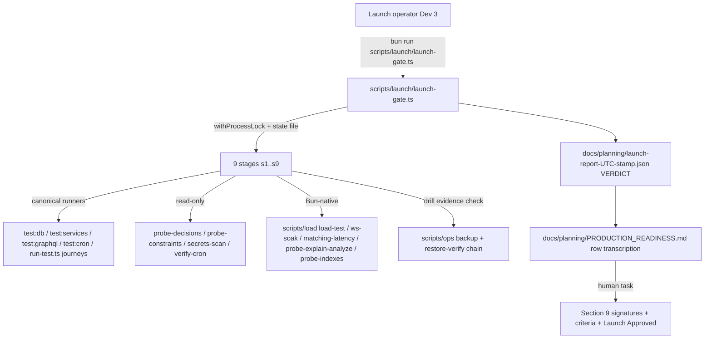
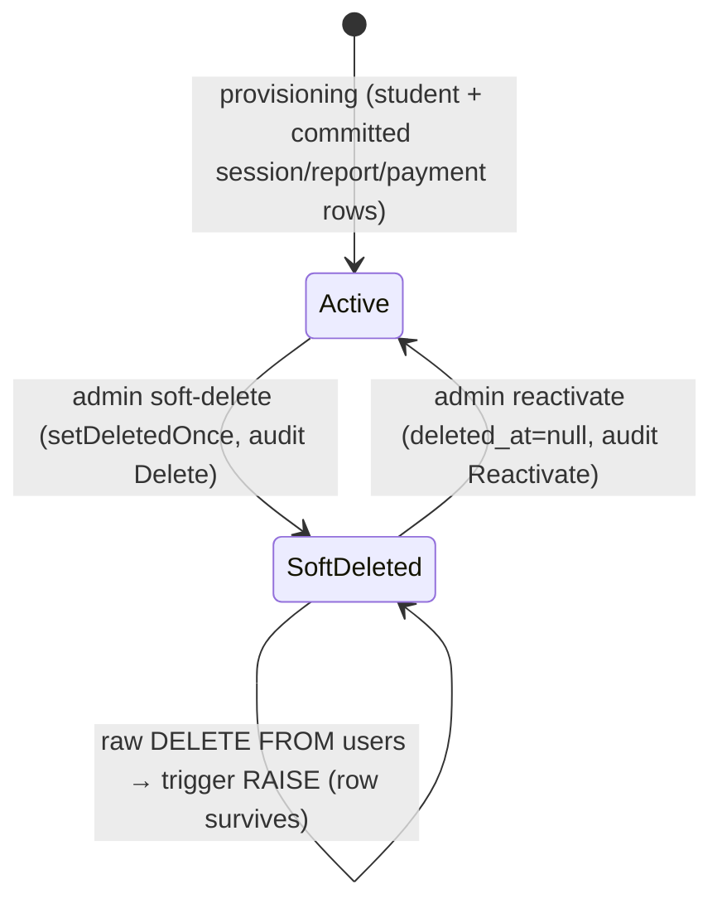
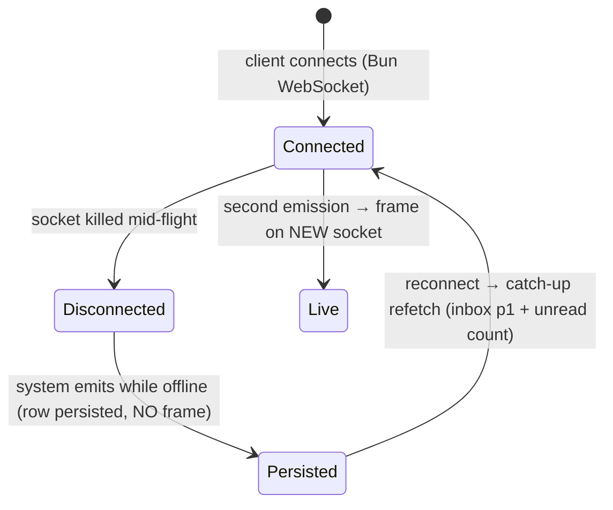
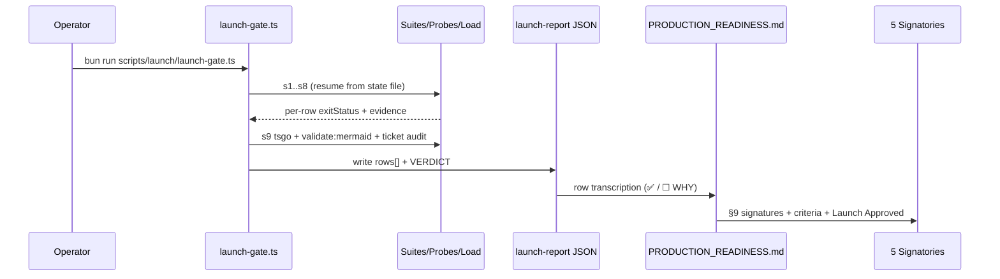

# Design — Production Launch Checklist Execution

**Plan directory (verbatim, used by every header/ledger/self-reference):** `ai/plans/milestone_4/production_launch_checklist_execution`
**Specs of record:** `ai/plans/milestone_4/production_launch_checklist_execution/specs.md` (REQ-000..REQ-013 · slices S1–S11 · deferred pointers D1–D17 · journeys J1–J3)
**Ledger:** `ai/plans/milestone_4/production_launch_checklist_execution/deferred-items.md` (pre-seeded with resolved-pointer rows D1–D17: specs §2.2 D1–D11 canonical + plan-introduced D12–D17)
**Outcome dir:** `ai/plans/milestone_4/production_launch_checklist_execution/outcome/` (research-00…research-10 incl. 08a/08b/08c — the pre-absorbed, verified evidence base)
**Ticket:** `docs/planning/TICKETS.md:3029-3059` (Dev 3 · Milestone 4 · 5 SP · final gate before opening the platform) · **Executed checklist:** `docs/planning/PRODUCTION_READINESS.md` (369 lines · 156 §1–§8 rows + 17 §9 items · 33 decisions · Launch Gate rule at `:12`)
**Date:** 2026-10-08 · **Author:** Dev 3 launch-plan design wave

---

## 1. Overview & System Context

The platform is behaviorally complete; the deliverable is **evidence assembly, a small evidence-backed set of gap-closers, honest reconciliation of false-as-written rows, drills with filed evidence, and sign-off collection** — never re-implementation. The research modality census (research-10) classifies all 173 rows: 119 AUTOMATED-TEST (existing green suites + this plan's small new tests), 22 SCRIPT-PROBE, 12 MANUAL-DRILL, 8 DOC-SIGNOFF, 17 §9 items (11 harness-checkable criteria + 6 human rows). The design is three phases mirroring specs.md §0:

1. **Phase A — HARNESS.** A 9-stage, resumable launch gate under `scripts/launch/` (NOT `test/launch/` — `scripts/` owns orchestration CLIs; `test/` dirs are bun-test layers governed by per-dir AGENTS.md). Nine stages mirror checklist §1–§9; each stage invokes its mapped suites through their canonical runners and appends per-row evidence to a machine JSON launch report at `docs/planning/launch-report-<UTC-stamp>.json` with a final `VERDICT`.
2. **Phase B — GAP-CLOSERS + AS-BUILT RECONCILIATION.** Small closers for rows currently unverifiable (GUC-gated users hard-delete trigger, history-preservation journey, retention anti-drift scan, WS reconnect catch-up journey, notification census, expired-token pin, account-keyed login limiter, CSRF/SSL/secrets pins, constraint-inventory + decision probes, enum census, handshake-23505 run-and-record, financial wire pins, Bun-native load tooling, INV-B3 expiry-chain delta legs), plus the REQ-002 re-wording of every false-as-written row.
3. **Phase C — DRILLS + REPORT + SIGN-OFF.** DR cold-operator drill with filed evidence; production-scale load runs recorded as launch-drill items or signed waivers; launch report emission; the five human §9 signatures.

**Precondition honesty:** the gate audits sibling M4 ticket state at the §9 "All Milestone 4 tickets completed" criterion — each unfinished sibling is either landed by its owner or explicitly waived-with-sign-off inside this gate, never silently passed (specs §0; research-00).



### Design Goals

1. **Reproducible evidence** — every ✅ cites an executed command + artifact; a second gate run against unchanged code reproduces the same per-row verdicts (specs §9 Acceptance Metrics).
2. **Interruption-proof** — a multi-hour gate resumes from the failed stage; passed stages never re-run (REQ-001 AC-3/AC-7).
3. **Honest sign-off** — zero silent passes: every row is ✅ with evidence, ☐ WHY + named owner + signatory, or FAIL (launch blocked, `PRODUCTION_READINESS.md:12`).

### Key Design Decisions

> **Numbering note:** `D1`–`D7` below are THIS plan's design rulings. The specs' deferred-items ledger pointers are cited throughout as **"D\<N\> ledger pointer"** (specs §2.2: D1 booking-gate waiver, D3 sustained load program, D5 depth/complexity, D6 DataLoader retrofit, D7 scheduler arming, D9 DR deferrals, D10 session-status trigger, etc.) — always distinguishable by the "ledger pointer" tag.

#### D1: Add a GUC-gated `prevent_users_delete` DB trigger — via the authored-source custom-migration lane, not `db push`
**Context:** Row 1.1.1 is only app-layer protected (zero production `.delete(users)` callsites — corpus-proven by `backend/graphql/test/inv-u4-grep-lock.test.ts` whose whitelist at `:94` is exactly `backend/db/migration`, `test/helpers/db-cleanup.ts`, `test/workflows`); child profiles CASCADE (`backend/db/schema/students/students.ts:23`, `teacher.ts:24`, `parents.ts:14`, `admin.ts:13`), so a raw `DELETE FROM users` succeeds for a user without restrict-FK dependents.
**Options:** (1) amend the row to FK-restrict-only semantics; (2) ship a BEFORE DELETE → RAISE trigger whose guard function checks a custom GUC — ON when the GUC is unset (production default), OFF only where a test-path opt-out pins it; (3) an unconditional trigger + wrap every test teardown path in the trigger-suspension helper.
**Decision:** (2) — NOT (3). The guard function checks the GUC: `IF coalesce(current_setting('kottaby.users_delete_guard', true), '') <> 'off' THEN RAISE EXCEPTION …` — the missing-ok `current_setting` idiom is already in the migration corpus (`backend/db/migration/2-functions.sql:4`). **Conflict resolved:** the two research citations disagree on where triggers live — `backend/drizzle/20260904084152_custom_3-immutability-triggers/migration.sql` (research-01) vs `backend/db/migration/3-immutability-triggers.sql` (research-06/08a). Both are real: the **authored source** lives in `backend/db/migration/<N>-<slug>.sql`; `bun db migrate` → `backend/db/scripts/migrate.ts:41` calls `applyCustomMigrations()` (`backend/db/scripts/applyCustomMigrations.ts:252`), which auto-bundles new/changed files into a generated `backend/drizzle/<stamp>_custom_<slug>/migration.sql` (with `-- Source:` headers) that the Drizzle migrator then applies. The new trigger is therefore **authored at `backend/db/migration/14-prevent-users-delete.sql`** (next ordinal after `13-teacher-was-online-before-lock.sql`), idempotent (`CREATE OR REPLACE FUNCTION` + `DROP TRIGGER IF EXISTS` + `CREATE TRIGGER`), and shipped by `bun db migrate` — NOT `bun run db push` (push applies Drizzle-schema `.ts` changes only; `backend/db/schema/AGENTS.md:39`).
**Rationale:** closes the raw-SQL hole the checklist row literally demands ("Attempt hard-delete via SQL — must fail") at the same tier as the proven ledger triggers; follows the repo's real custom-SQL pipeline exactly.
**Test-DB opt-out — why the teardown-wrap approach (option 3) was rejected and the seam that replaces it (verified):** test teardown hard-deletes users far beyond the two helper files a first draft wrapped — `test/helpers/db-cleanup.ts` `deleteUsersByIds` (`:123,134`) and `test/workflows/helpers/journey-cleanup.ts` `db.delete(users)` (`:101`), plus `TrackedFixtures.cleanup()` (42 files), `SessionFixtureRegistry.cleanup()` (10 files), `createJourneyFixtures` teardown (8 files), and ~61 backend test files with direct `db.delete(users)` — and CI provisions every test DB via `bun run db migrate` (`.github/workflows/ci.yml:213,280,349`), so the trigger is INSTALLED on all of them: an unconditional trigger would break ~50 of 54 journey files. The opt-out must therefore be inherited by every test connection with ZERO test-helper/journey/backend-suite edits. **Provisioning-seam audit (no clean single seam exists):** `bun run db migrate` resolves to `scripts/dbActions/cli-entry.ts` (package.json:55) → `backend/db/scripts/migrate.ts:24` `runMigrations` — the SHARED production/CI path; the CI test DB (`kottaby_test`) is created by the `postgres:16` GitHub Actions service container, not by any repo script; the local sandbox DB is created by `scripts/pg-start.sh:41` (`createdb`). The sanctioned fallback is the **test-path DB client**, gated on the repo's test flags (`TEST_CI === "1" || TEST_SERVER === "1"` — the same predicate + production fail-fast guard as `app/api/graphql/rate-limit.ts:34-48`; `TEST_SERVER` is set universally by the `backend/db/test/ensure-env.ts` bunfig preload, by CI's `.env.test`, and by `test/scripts/run-server-tests.ts:187` for spawned test servers):
- **postgres provider:** the pg Pool's EXISTING startup-options packet at `backend/db/client.ts:168` (`options: "-c timezone=UTC"`) appends `-c kottaby.users_delete_guard=off` when the test predicate is true — every pooled test connection inherits the opt-out. (node-postgres `Pool` has no `afterCreate` hook — verified against `@types/pg` `PoolConfig` at `node_modules/@types/pg/index.d.ts:49-60`, whose only per-connection hooks are `onConnect`/`verify`; the startup-options packet is the connection-time seam this client already uses for `timezone`.)
- **PGlite provider:** the init pin beside `SET TIME ZONE 'UTC'` (`backend/db/pglite-pool.ts:199`) adds the same gated session opt-out (`SET kottaby.users_delete_guard = 'off'`) — PGlite is single-connection in-process, so session scope is the correct scope there.
**Probe (proves the guard fires):** the PG-tier probe re-enables the guard transaction-locally with `SELECT set_config('kottaby.users_delete_guard', 'on', true)` inside the rollback transaction and asserts the fixture `DELETE FROM users` RAISEs; with the inherited opt-out the same DELETE proceeds — proving teardown stays green (C12 / task 2.1). On push-provisioned DBs (trigger absent) the probe branches on trigger presence (pattern `backend/db/test/logic/audit/audit-immutability.test.ts:339,427`) and asserts the FK-RESTRICT failure class instead.
**Prod safety:** an attacker with SQL access could `DROP TRIGGER` / `ALTER TABLE … DISABLE TRIGGER` on any of the existing immutable-table triggers — the GUC adds no material weakening. Recorded as a signed launch note → ledger **D17**; the arming runbook (C15 / task 4.3) carries the production-DB posture line: the guard is armed with the GUC unset, and the `off` value is never set in any production connection string or environment.

#### D2: DO NOT add a session-status DB trigger — app-layer-only, signed exception
**Context:** INV-S1/S2 (rows 5.1.1/5.1.2) are enforced by guarded UPDATEs folding pre-state into WHERE clauses; zero `CREATE TRIGGER` touches `session` across `backend/drizzle/*/migration.sql` (research-05 gap 1).
**Options:** (1) a `custom_6-session-status-guard` trigger permitting only the 8 legal matrix edges; (2) accept app-layer enforcement with a signed note.
**Decision:** (2). Evidence: the 5×5 enforcement sweep `session-lifecycle.enforcement.test.ts:164-193` (SESSION_TRANSITION_MATRIX at `session-lifecycle.enforcement.ts:84-85` — `Completed`/`Cancelled` have empty target sets), the journey sweep `session-state-machine.journey.test.ts:395-465` (INV-S1 `:426`, INV-S2 `:434`), and the single-writer discipline. A DB guard stays deferred as **D10** in the ledger (waived-with-sign-off, never silently skipped).
**Rationale:** a pre-launch trigger on the hottest table risks blocking legitimate guarded transitions; the enforcement suites already deny every off-matrix move at the only writable surface.

#### D3: Login rate limiter SHIPS; CSRF stays cookie-posture with as-built re-wording
**Context:** Row 4.2.5 has no login-specific limiter (only the gateway-wide 100/min/IP at `app/api/graphql/rate-limit.ts:56`); row 4.2.4's "CSRF token validation" describes a mechanism that does not exist — the shipped posture is HttpOnly `SameSite=Strict` cookies (`backend/lib/auth/cookies.ts:160`), POST-only GraphQL route with 405 on GET (`backend/lib/gateway/transport-guard.ts:37`), CORS allowlist (`app/api/graphql/rate-limit.ts:88-89`), CSP `frame-ancestors 'none'`.
**Decision:** add an ACCOUNT-keyed login limiter to `backend/lib/ratelimit.ts` (existing `RateLimiterConfig {name, limit, windowMs}` at `:20-24`; in-memory, fail-open, `RateLimitExceededError` at `backend/lib/errors.ts:186` — code `RATE_LIMIT_EXCEEDED`) wired at the login mutation (`backend/graphql/mutation/auth.mutation.ts:80-90`) throttling BEFORE `AuthService.login` (throttle-before-compare precedent `backend/lib/gateway/cron-endpoint.ts:119,131`) — a `loginAccountLimiter()` factory keyed by the normalized login email from the mutation input, with the thrown message resolved via `ctx.t("errors")` → `rateLimitExceeded`. NO IP-keyed limiter ships: the GraphQL Context (`backend/graphql/gqlContextFactory.ts:49-99`) exposes no client IP, so wiring one would require an undeclared context edit; transport-level IP throttling remains the existing gateway-wide per-IP limiter (`app/api/graphql/rate-limit.ts:56`), and a login-specific per-IP limiter folds into ledger **D14**. No forgot-password endpoint exists (only admin-initiated reset — `test/workflows/admin/admin-password-reset.journey.test.ts`), so the row's "password reset" limb is re-worded and the absence is noted in the runbook. CSRF: do NOT invent a token mechanism; pin the shipped posture with a cookie-contract test and re-word the row per REQ-002 AC-10.
**Rationale:** brute-force protection is the real launch risk; a token retrofit before launch adds risk, not safety. **Env-config rule (corrected):** there is NO `env-config-keys.ts` in this repo (verified — Glob returns nothing). The real mechanism: new keys are added to the cached snapshot in `backend/lib/env.ts` via `parsePositiveIntegerEnv(process.env.LOGIN_RATE_LIMIT_*, DEFAULT_*)` (pattern: `wsMaxConnections` / `teacherInactivityTimeoutMinutes` at `:405-413`), and tests that mutate env MUST call `resetEnvironmentCache()` (`backend/lib/env.ts:460`) to invalidate the cache.

#### D4: Load harness is Bun-native, zero new dependencies; production-scale runs are launch-drill items
**Context:** §6 has zero artifacts (research-09); the 8-SP load ticket (`TICKETS.md:2911`) never started; adding k6/autocannon/artillery violates the no-new-heavyweight-deps constraint (specs §8).
**Options:** (1) absorb the sibling ticket's program; (2) ship minimal Bun-native tooling + record production-scale runs as drills or signed waivers.
**Decision:** (2). Deliverables under `scripts/load/`: an HTTP virtual-user driver reporting p50/p95/p99, a WS soak driver, a matching-latency probe against 100+ seeded teachers (fixtures pattern: `scripts/qa-directory-fixtures.ts`), `probe-explain-analyze.ts`, `probe-indexes.ts`, plus the N+1 query-count harness as a test (§5 C10). The full 100+ concurrent-user p95 < 500ms / 100+ teacher matching / 1-hour soak targets (rows 6.1–6.3) are executed against the production-candidate environment during launch week and recorded as LAUNCH-DRILL evidence rows — or waived with sign-off (**D3 ledger pointer**); a scaled dev-environment run IS recorded in this ticket as the automated evidence.
**Rationale:** protects the 5-SP envelope; the WS sidecar already ships caps (`backend/lib/env.ts:405-408`: `WS_MAX_CONNECTIONS` default 1000, per-user 5) and miss limits (`WS_MISSED_PONG_LIMIT = 2` at `backend/ws/notification-ws-server-constants.ts:11`), so the soak driver only exercises them.

#### D5: Parent-link expiry = lazy materialization + on-demand ops scripts, signed; scheduled wiring stays deferred
**Context:** Row 5.5.6 (B.14): the sweep + reminder primitives are shipped and tested (`parent-link-request.service.ts:424` sweep, `:479` reminders; ops triggers `bun run ops:sweep-link-requests` / `ops:remind-link-requests` at `package.json:66-67`) but have NO scheduled caller — the canonical doc's own D1 cron-stream ticket (`docs/parents/parent-link-request.md:87,123`).
**Options:** (a) signed waiver that on-demand ops invocation is the launch posture; (b) wire a scheduled cron route now.
**Decision:** (a), per specs REQ-007 AC-5's sanctioned choice — the runbook (REQ-012 AC-5) states the on-demand cadence so the re-request lockout window (chaos-pinned at `parent-link-request.chaos.test.ts:801`, lifted by running the sweep) is operationally bounded; the scheduled wiring stays with the canonical doc's own D1 cron-stream backlog ticket (`docs/parents/parent-link-request.md:87,123` — the parent-link doc's D1, distinct from this plan's ledger D1 booking-gate waiver).
**Rationale:** matches the platform's cron architecture (all four cron routes are externally triggered); inventing a fifth scheduler integration at launch adds operational risk with no behavioral gain — expiry semantics hold regardless (liveness is read/claim-enforced, strict `expiresAt > now`).

#### D6: Zero GraphQL schema changes, zero UI, zero new user-facing strings
The SDL surface is frozen for launch (pinned by `backend/graphql/test/schema-surface.test.ts` and the allowlist walk `frontend/graphql/test/gateway/allowlist-coverage.test.ts:158,181` — both stay green unedited). No routes, no components, no locale namespaces. The only wire-visible behavior change is the login limiter's `RATE_LIMIT_EXCEEDED` denial (an existing taxonomy code at `backend/lib/errors.ts:186`, surfaced through the standard `extensions.code` channel) — its user-facing copy already exists in the errors vocabulary.

#### D7: Launch report at `docs/planning/launch-report-<UTC-stamp>.json`, redacted, repo-committed
**Context:** §9 needs a machine record bound to the human signatures; no launch-report artifact exists (research-10 gap 7).
**Options:** docs/planning/ (governed planning docs, beside the checklist) vs ai/finished_plans evidence packs vs a new summary MD (forbidden — root AGENTS.md rule; the JSON report is a ticket-required artifact, not an agent summary, per research-10 rec (d)).
**Decision:** `docs/planning/launch-report-<UTC-stamp>.json` (stamped-name precedent: `RESTORE_REPORT_FILE = "restore-report.json"` + per-run stamp at `scripts/ops/restore-shared.ts:31`; `VERDICT:` print precedent `scripts/ops/restore-verify.ts:213`). **Redaction rule:** the report contains row ids, commands, exit codes, and evidence paths ONLY — never env values, secrets, tokens, or connection strings (the writer allowlists fields; `secrets-scan` runs against the report before commit).
**Rationale:** the human record stays in `PRODUCTION_READINESS.md` §9 itself (the table + criteria + Launch Approved line ARE the record — specs REQ-011 AC-3); the JSON is the reproducible per-row manifest REQ-011 AC-1 demands.

**Two harness-level discoveries recorded as sub-decisions:**
- **D7a — process-lock timeout exemption:** `withProcessLock` (`scripts/lib/process-lock.ts:161`) enforces a 5-minute timeout for non-exempt descriptions (`isTimeoutExempt` at `scripts/lib/process-lock-helpers.ts:58` exempts only quality-gate/duplicates/jscpd/lint-service/test*). A multi-hour gate named `launch-gate` would be killed at 5 minutes. The gate MUST add `d.includes("launch-gate")` to `isTimeoutExempt` (and update the exempt list comment at `process-lock.ts:159`) as part of the harness task — a tiny, justified edit to `scripts/lib/process-lock-helpers.ts`.
- **D7b — INV-B6 wire coverage already exists:** the original research-06 gap 2 requested a new `backend/graphql/test/subscription-admin.wire.test.ts` — but the researcher only globbed `backend/graphql/test/`. **Verified:** `frontend/graphql/test/subscription-admin/subscription-admin.test.ts` (871 lines) already pins exactly the AC's tiers — anonymous UNAUTHORIZED (`:552`), non-admin denied (`:594`), admin extend happy path over real fixtures (`:652`), admin renew happy path (`:670`). Resolution: **run-and-record**; NO new file (specs REQ-007 AC-4 / S4 now say the same). Duplicating it in `backend/graphql/test/` would violate the run-and-record philosophy and the duplicates gate. (Flagged in the design report.)

---

## 2. UX/Navigation Specification (Explicit No-UI Ruling)

| Route | Purpose | Permission | Roles with Access | Status |
|-------|---------|------------|-------------------|--------|
| — (none) | This ticket ships ZERO UI surface | — | — | Explicit no-UI ruling (specs §4) |

- **Sidebar/navigation:** no changes — `frontend/views/dashboard/nav/navItems.ts` untouched; no bottom-nav involvement.
- **Role-based access matrix:** unchanged; no component, story, or design-system touch.
- **Per-audience rendering:** nothing changes for student/parent/teacher/admin — every user-facing behavior this ticket verifies is ALREADY-shipped UI (teacher availability card, parent portal, dashboards) consumed unchanged.
- **Justification:** this is an ops/verification gate. Its surfaces are CLI scripts (`scripts/launch/`, `scripts/load/`), tests and probes, planning-doc edits, a machine JSON report, and human signatures. Adding UI here would add launch risk, not launch evidence.

## 3. Translation / i18n Requirements (Explicitly N/A — no user-facing strings introduced)

All new surfaces are scripts, tests, probes, report JSON, and planning-doc tables — zero locale keys, zero namespaces. For completeness, the REAL translation signatures (verified 2026-10-08) any future adjacent work must use:

- **Server side:** `getTranslations(locale)` — single argument, property-chain namespace object — at `shared/locale/server.ts:15` (`export function getTranslations(locale: string): Translations`). Two-arg `getTranslations(locale, "ns")` is forbidden.
- **Client side:** `useAppTranslation()` / `useAppTranslation(handle)` with an optional `NamespaceHandle<TLabels>` from `defineNamespace` — at `shared/locale/client/use-app-translation.ts:8-10`. String-literal namespaces are forbidden.
- **There is NO `Translation.` enum** — do not invent one (the design template's enum example is stale; `shared/locale/` has no such export).
- Journey denial assertions continue using translated substrings via `getServerTranslations("en").errorsTranslations` (`test/workflows/AGENTS.md:33-34`). Forbidden legacy systems remain forbidden: `next-intl`, `shared/messages/`.

---

## 4. Architecture

### Stage table (REQ-001 AC-2 — the gate's single source of truth is `scripts/launch/launch-checklist.ts`)

| Stage | § / rows | Modality mix | Invokes (canonical runners) |
|-------|----------|--------------|------------------------------|
| `s1-data-integrity` | §1 · 17 | 15 TEST + 2 PROBE | `bun run test:db` (audit + financial-immutability logic), `run-test.ts backend/db/test/logic/shared/data-integrity.probe.test.ts`, `backend/db/test/logic/shared/retention-anti-drift.test.ts`, `run-test.ts test/workflows/admin` (governance + audit journeys) |
| `s2-financial` | §2 · 25 | 25 TEST | `bun run test:services` (session-lifecycle, arbitration, wallet, admin-financial-auditing), `run-test.ts backend/db/test/logic/billing/launch-financial-probe.test.ts`, `bun run test:graphql frontend/graphql/test/billing/escrow-denial-codes.test.ts`, `run-test.ts test/workflows/billing` + `test/workflows/sessions` financial journeys |
| `s3-realtime` | §3 · 17 | 12 TEST + 1 PROBE + 4 DRILL/rewired | `run-test.ts test/workflows/notifications` (incl. new reconnect-catchup), `backend/enum/notifications/notification-type-census.test.ts`, `backend/ws` server suites, `run-test.ts test/workflows/teachers`, `bun run test:cron` |
| `s4-security` | §4 · 16 | 11 TEST + 2 PROBE + 3 re-worded | jwt/cookies/ratelimit/db-ssl unit + config tiers, `test/config/security-headers.test.ts`, `backend/lib/errors/test/security-abuse.contract.test.ts`, `bun run test:graphql` (gateway + auth + allowlist), governance journeys, `scripts/launch/secrets-scan.ts` |
| `s5-invariants` | §5 · 34 | 33 TEST + 1 waived (5.3.3 flips) | `bun run test:db` + `test:services` (enforcement, cooldown, rubric, expiry), `run-test.ts test/workflows/{sessions,teachers,parents,billing}`, `scripts/launch/probe-constraints.ts`, existing `frontend/graphql/test/subscription-admin/` (INV-B6, D7b) |
| `s6-performance` | §6 · 7 | 1 TEST + 5 PROBE + 1 drill-recorded | `scripts/load/load-test.ts`, `ws-soak.ts`, `matching-latency.ts`, `probe-explain-analyze.ts`, `probe-indexes.ts`, `bun run test:graphql backend/graphql/test/query-count-regression.test.ts`, pagination pins recorded |
| `s7-dr` | §7 · 7 | 2 TEST + 2 PROBE + 2 DRILL + 1 SIGNOFF | `run-test.ts scripts/ops/backup-restore.integration.test.ts` + `scripts/ops/restore-verify.test.ts`, drill-evidence artifact verification, RPO/RPO/timer sign-off lines |
| `s8-decisions` | §8 · 33 | 21 TEST + 11 PROBE + 1 SIGNOFF | `scripts/launch/probe-decisions.ts`, `run-test.ts backend/db/test/logic/shared/schema-registry-census.test.ts`, `run-test.ts backend/db/test/logic/students/handshake-code-generation-locks.test.ts` (row 8.3 run-and-record), `run-test.ts backend/db/schema/users/users-governance.static-assertions.test.ts`, `run-test.ts shared/constants/evaluation-rubric.constants.test.ts`, `bun run test/scripts/run-test.ts backend/enum/notifications/notification-type-census.test.ts`, behavioral journeys recorded |
| `s9-gate` | §9 · 17 | 11 harness + 6 human | `bun tsgo`, `bun run validate:mermaid`, ticket-state audit (TICKETS.md/MILESTONE_PLAN.md), report assembly + `VERDICT`, §9 signature-row verification (evidence-existence check only — never auto-pass) |

**Lock/resume semantics (REQ-001 AC-3/AC-7):** the gate wraps execution in `withProcessLock("launch-gate", …)` (import from `@/scripts/lib`, the exact pattern at `scripts/quality-gate.ts:12,237`); state persists to repo-root `.launch-gate-state.json`; resume starts at `STAGES.indexOf(state.stage)` (pattern `scripts/quality-gate.ts:217`); `--fresh` deletes the state file ONLY — never any cache (repo cache-preservation rule); a failing row halts the stage with rowId + exit code; MANUAL-DRILL/DOC-SIGNOFF rows are marked from the EXISTENCE of their filed evidence artifact (REQ-001 AC-5), never auto-passed.

---

## 5. Components & Interfaces

### C1: `scripts/launch/launch-gate.ts` (NEW — thin CLI)
**Purpose:** one resumable command executing the whole checklist. **Signature:** `main(): Promise<number>` reading argv `--fresh`; body `await withProcessLock("launch-gate", runLaunchGate)`. Reads/writes `.launch-gate-state.json`; iterates `STAGES` from the resumed index; per stage: runs the stage's mapped commands via `spawn`, streams output, appends per-row results, persists state after each stage. Exit 0 iff final `VERDICT: PASS`.
**Dependencies:** `@/scripts/lib` (`withProcessLock`), `./launch-checklist`, `./launch-report`, `./shared/launch-types`, `@/backend/lib/logger` for structured diagnostics; printed record/evidence lines follow the ops stdout-line-as-record pattern — bare `console.log` is lawful for `scripts/**/*.ts` under the ESLint `no-console` carve-out (`eslint.config.mjs:237,244`; ops precedents `scripts/quality-gate.ts:68,142`, `scripts/ops/restore-verify.ts:99-100,213`), while `backend/**` keeps the hard no-`console.*` rule. **Notes:** modeled on `scripts/quality-gate.ts` (state at `:14,19-24`; resume `:217`; lock `:237`) and the thin-composer pattern `scripts/health/sub-loop.ts:71-73` (progressive: run the cheapest deterministic checks first, short-circuit on first failure per stage).

### C2: `scripts/launch/launch-checklist.ts` (NEW — single source of truth)
**Purpose:** all 173 rows: `rowId → section → modality → command/oracle → evidenceRef` (REQ-001 AC-1/AC-6). **Signature:** `export interface LaunchRow { readonly rowId: string; readonly section: 1|2|3|4|5|6|7|8|9; readonly modality: "AUTOMATED-TEST"|"SCRIPT-PROBE"|"MANUAL-DRILL"|"DOC-SIGNOFF"; readonly command: string; readonly evidenceRef: string; readonly waiver?: { why: string; owner: string }; }` + `export const LAUNCH_CHECKLIST: readonly LaunchRow[]` + `export const STAGES: readonly LaunchStage[]` + `export function rowsForStage(stage: LaunchStage): readonly LaunchRow[]`. Suite logs captured by `test/scripts/run-test.ts` log capture are the `evidenceRef` (REQ-001 AC-6). **Notes:** stage→row mapping and row counts exactly per §4 stage table; the s5 INV-matrix report step consumes `docs/specs/state-machine-invariants.md` as its row source (REQ-007 AC-1 — this gate RUNS and RECORDS the sibling wave's suites; it never duplicates them).

### C3: `scripts/launch/launch-report.ts` (NEW — stamped writer)
**Purpose:** emits `docs/planning/launch-report-<UTC-stamp>.json` + final `VERDICT:` line. **Signature:** `export function writeLaunchReport(rows: readonly LaunchReportRow[], stages: readonly StageResult[]): string` (returns the written path); `export function computeVerdict(rows): "PASS"|"FAIL"` — FAIL iff any row result is FAIL or any waiver lacks a signatory. Redaction: the serializer allowlists report fields (D7) — no env values, no secrets. **Notes:** model `scripts/ops/restore-shared.ts:31` (stamped report name) + `scripts/ops/restore-verify.ts:213` (`VERDICT:` print).

### C4: `scripts/launch/shared/launch-types.ts` (NEW — model: `scripts/health/shared/`)
`LaunchStage` (9 literals), `LaunchModality`, `LaunchGateState {stage, owner:"launch-gate", lifecycle:"FRESH"|"IN_PROGRESS"|"DONE", lastRun}`, `LaunchReportRow` (§6 shape), `StageResult`, `RowDisposition = "PASS"|"WAIVED"|"FAIL"`.

### C5: `scripts/launch/probe-decisions.ts` (NEW — read-only introspection, §8 schema-shape rows)
**Purpose:** verifies the ~11 schema-shape decision rows against the live launch DB — one PASS/FAIL line per row, zero writes, safe against prod (REQ-010 AC-1; research-08a harness rec 5). **Signature:** `export async function probeDecisions(db: NodePgDatabase): Promise<readonly ProbeLine[]>` querying `information_schema`/`pg_enum`/`pg_trigger`: parents/students/notifications/audit_logs/applicants tables; `students.parent_id` FK→`users.id` + `students_handshake_code_unique`; governance columns on users ONLY; the six named pgEnum member sets; `subscriptions.user_id` + offline payment fields + partial unique index; `evaluations` FKs; `recitation_session_id_unique`; reports column set WITHOUT `teacher_id`; `surah_juz_ref` at 144 members; ABSENCE of any assignment/allocation table (B.10). **Notes:** generalizes `scripts/verify-unique-constraints.ts:1-12` (live-DB, no schema-code involvement).

### C6: `scripts/launch/probe-constraints.ts` · `secrets-scan.ts` · `verify-cron.ts` (NEW)
- **`probe-constraints.ts`** (REQ-007 AC-8): diffs the deployed `pg_constraint`/`pg_trigger` names against the expected inventory — 6 named CHECK/unique constraints (`wallet_balance_check`, `wallet_total_earning_check`, `wallet_teacher_id_unique`, `teacher_transaction_amount_check`, 4× `students_balance_*_check`), both immutability trigger families present+enabled, settlement-amended function — read-only, pattern `scripts/verify-unique-constraints.ts`.
- **`secrets-scan.ts`** (REQ-006 AC-5): automates the hardcoded-secret grep against the `backend/lib/env.ts` `requireEnv`/`getEnv` discipline and the placeholder-only `.env.example`; exits non-zero on literal secret assignments.
- **`verify-cron.ts`** (REQ-012 AC-2): GETs each armed cron route with the production bearer and records response envelopes (`{cancelled, refunded}`, `{offlined}`, expiry counts) as evidence rows; verifies `NOTIFICATION_FANOUT_TRANSPORT` resolves to the Redis bus when `REDIS_URL` is set (`.env.example:88-90`) and the sidecar healthcheck (`scripts/start-notification-ws.ts`).

### C7: `scripts/load/` (NEW — Bun-native performance tooling, zero new dependencies)
- **`load-test.ts`** — HTTP virtual-user driver against a running server: N concurrent users (default 100) driving the hot reads (directory browse, session list, notification inbox) for a bounded duration; reports p50/p95/p99 + rps into a stamped JSON artifact (D7 redaction applies). **Signature:** `main(): Promise<number>`; args `--url --users --duration-s --out`.
- **`ws-soak.ts`** — opens 100+ authenticated sockets against the sidecar for a bounded window; asserts zero unexplained drops beyond `WS_MISSED_PONG_LIMIT = 2` (`backend/ws/notification-ws-server-constants.ts:11`); respects caps `WS_MAX_CONNECTIONS`/`WS_MAX_CONNECTIONS_PER_USER` (`backend/lib/env.ts:405-408`).
- **`matching-latency.ts`** — seeds 100+ teachers (fixture pattern `scripts/qa-directory-fixtures.ts`), runs the real matching browse, records pipeline duration into the report (generous CI multiple, no brittle hard threshold — REQ-008 AC-6).
- **`probe-explain-analyze.ts`** — `EXPLAIN (ANALYZE, BUFFERS)` over the critical query set (directory browse, session lists, notification inbox, escrow balance read); FAILs on `Seq Scan` nodes in driving tables (REQ-008 AC-2).
- **`probe-indexes.ts`** — true-coverage FK audit: static diff of schema `references()` vs `index()` + live `pg_indexes` probe that counts shared-PK children (`teacher.id`/`students.id`/`parents.id`/`admin.id`/`applicants.id` each `.primaryKey().references(() => users.id)` — there is NO `teacher.user_id` column, `backend/db/schema/teachers/teacher.ts:22-24`), composite-PK leading columns (`student_subscriptions.student_id`, `backend/db/schema/billing/student-subscriptions.ts:32`), and unique-constraint backing indexes (`wallet.teacher_id` via `wallet_teacher_id_unique`) as covered; the verified-remaining unindexed FK columns are exactly four — `broadcasts.sent_by_id`/`stopped_by_id` (`backend/db/schema/notifications/broadcasts.ts:45,49`), `subscription_purchase_idempotency.subscription_id` (`backend/db/schema/billing/subscription-purchase-idempotency.ts:32`), `session_request_idempotency.session_id` (`backend/db/schema/classes/session-request-idempotency.ts:32`) — and each gains a Drizzle `index()` shipped via `bun run db push`; the audit FAILs on any future FK column without coverage (REQ-008 AC-4).

### C8: `backend/db/migration/14-prevent-users-delete.sql` (NEW — the D1 trigger) + the two-line test-path opt-out pin (EDIT — `backend/db/client.ts`, `backend/db/pglite-pool.ts`)
Idempotent custom SQL (CREATE OR REPLACE FUNCTION + DROP TRIGGER IF EXISTS + CREATE TRIGGER, mirroring `3-immutability-triggers.sql`):

```sql
CREATE OR REPLACE FUNCTION prevent_users_delete()
RETURNS trigger AS $$
BEGIN
    -- Guard is ON when the GUC is unset or holds any value other than 'off'
    -- (production default: no opt-out is configured anywhere).
    IF coalesce(current_setting('kottaby.users_delete_guard', true), '') <> 'off' THEN
        RAISE EXCEPTION 'users is not hard-deletable — use governance soft delete';
    END IF;
    RETURN OLD;
END;
$$ LANGUAGE plpgsql;

DROP TRIGGER IF EXISTS prevent_users_delete_trigger ON users;
CREATE TRIGGER prevent_users_delete_trigger
    BEFORE DELETE ON users
    FOR EACH ROW
    EXECUTE FUNCTION prevent_users_delete();
```

Shipped by `bun db migrate` (auto-bundled). **Companion edits — both in the DB client, ZERO test-helper/journey/backend-suite edits (D1):** `backend/db/client.ts:168` appends `-c kottaby.users_delete_guard=off` to the pg Pool startup `options` packet when `TEST_CI === "1" || TEST_SERVER === "1"` (predicate + production fail-fast guard mirrored from `app/api/graphql/rate-limit.ts:34-48`); `backend/db/pglite-pool.ts` pins the same session opt-out beside `SET TIME ZONE 'UTC'` (`:199`). Signed launch note → ledger **D17**.

### C9: `scripts/lib/process-lock-helpers.ts` (EDIT — D7a)
`isTimeoutExempt` (`:58`) gains `d.includes("launch-gate")`; the exempt-task list comment at `scripts/lib/process-lock.ts:159` updated in the same change.

### C10: Login rate limiter (EDIT — `backend/lib/ratelimit.ts`, `backend/lib/env.ts`, `backend/graphql/mutation/auth.mutation.ts`)
- `backend/lib/ratelimit.ts`: add `loginAccountLimiter()` — a **factory** returning a `RateLimiterConfig` (default 5 / 15 min, key `login:{normalized-email}`) whose limit/window are resolved lazily INSIDE the check call (reads the env-cached config per check, so `resetEnvironmentCache()` is observable in override tests — no module-scope const), plus `export function isRateLimitTestBypass(): boolean` (TEST_CI/TEST_SERVER skip with the production fail-fast guard, factored FROM `app/api/graphql/rate-limit.ts:34-48` so the block is single-sourced — that file refactors to consume it). **ACCOUNT-keyed only:** the key derives from the mutation input's login email (trim + lowercase) — NO IP-keyed limiter ships, because the GraphQL Context exposes no client IP (`backend/graphql/gqlContextFactory.ts:49-99`) and wiring one would require an undeclared context edit; transport-level IP throttling remains the EXISTING gateway-wide per-IP limiter (`app/api/graphql/rate-limit.ts:56` — recorded as the row's transport-tier evidence), and a login-specific per-IP limiter folds into ledger **D14**.
- `backend/lib/env.ts`: add `loginRateLimitMax`/`loginRateLimitWindowMs` fields to the cached config via `parsePositiveIntegerEnv` (pattern `:405-413`); tests mutating env call `resetEnvironmentCache()` (`:460`).
- `backend/graphql/mutation/auth.mutation.ts` login resolver (`:80-90`): before `AuthService.login(args.email, …)`, check the account limiter; exceeded ⇒ `throw new RateLimitExceededError(…)` (code `RATE_LIMIT_EXCEEDED`, `backend/lib/errors.ts:186`) with the message resolved via `ctx.t("errors")` → `rateLimitExceeded` (the parity-pinned key at `shared/locale/en/errors/index.ts:9`; translated-string precedent `backend/lib/gateway/cron-endpoint.ts:131`; throttle-before-compare, `cron-endpoint.ts:119,131`). No forgot-password endpoint exists — row 4.2.5's reset limb is re-worded; the runbook notes the absence (REQ-006 AC-2).

### C11: Security pins (EDIT/NEW — rows 4.1.3/4.2.4/4.3.4)
- `backend/lib/auth/jwt.test.ts` (EDIT): expired-token pin — sign with a past `exp`, assert `verifyAccessToken`/`verifyRefreshToken` return `null` (docblock `:7` claims it; no test signs one today — research-04 gap 1).
- `backend/lib/auth/cookies.test.ts` (EDIT): pin the serialized `HttpOnly; SameSite=Strict` flag string (`backend/lib/auth/cookies.ts:160`) — the CSRF posture pin (REQ-006 AC-3).
- `test/config/db-ssl.test.ts` (NEW): assert `shouldUseSsl` enables SSL for `sslmode=require`/Neon `DATABASE_URL` (`backend/db/client.ts:42-46`); record the `rejectUnauthorized: false` posture (`:157`) and the plain-URL-gets-no-SSL hazard as signed launch notes; REQ-012 AC-4 requires the production connection string to carry `sslmode=require`.

### C12: §1/§3/§8 closer tests (NEW — cross-cutting homes in `backend/db/test/logic/shared/`, the AGENTS-documented home for cross-cutting infra + integrity tests at `backend/db/test/logic/AGENTS.md:15,48`; the directory is created by the first landing test — NO AGENTS.md Layout edit needed, `shared/` is already documented)
- `backend/db/test/logic/shared/data-integrity.probe.test.ts` — PG tier (`isPgliteProvider() ? describe.skip : describe`, pattern `financial-immutability.test.ts:314`), `runInRollback`, try/catch + `expectRepoError` with per-leg SAVEPOINT brackets (never `rejects.toThrow()` inside): the users hard-delete guard ONLY — re-enable the guard with `SELECT set_config('kottaby.users_delete_guard', 'on', true)` (transaction-local, auto-reverts at rollback) → fixture `DELETE FROM users` RAISEs; then assert the inherited test-path opt-out lets the same DELETE proceed (teardown stays green); environment-branched on trigger presence (pattern `audit-immutability.test.ts:339,427` — push-provisioned DBs assert the FK-RESTRICT failure class instead). The `student_payments`/`teacher_transaction`/`audit_logs` trigger legs are run-and-record citations of `backend/db/test/logic/billing/financial-immutability.test.ts` + `backend/db/test/logic/audit/audit-immutability.test.ts` — never rebuilt (REQ-003 AC-2).
- `backend/db/test/logic/shared/retention-anti-drift.test.ts` — DB-free fs-scan (mirror `audit-immutability.test.ts:208-268`): zero `.delete(`/raw DELETE paths against `session`, `reports`, `recitation`, `home_work`, `evaluations` across `backend/db/repo/**` + `app/api/cron/` + `scripts/ops/`; allowlist `lesson.repository.ts:101`, `notification.repository.ts:346` (REQ-003 AC-4).
- `backend/enum/notifications/notification-type.enum.test.ts` (EDIT) + `backend/enum/notifications/notification-type-census.test.ts` (NEW): first EXTEND the existing test's `CANONICAL_VALUES` (`:17`, currently 9 members) to the 10-member set (`backend/db/schema/enums.ts:101-112` — adding `applicant_outcome`), extending-not-duplicating; the census test then derives its member list from `Object.values(NotificationType)` and asserts every member has ≥1 production emitter + ≥1 exercising test (REQ-005 AC-4).
- `backend/db/test/logic/shared/schema-registry-census.test.ts` — fs-walk asserting zero `pgEnum(` in domain schema files, count === 21, and byte-identical (order-sensitive) pgEnum↔TS-mirror parity closing the 13-mirror gap; assertion shape from `backend/enum/notifications/notification-type.enum.test.ts:54-67` (REQ-010 AC-3).
- `backend/db/schema/users/users-governance.static-assertions.test.ts` — A.7 negative pin: DB-free `getTableColumns`/`getTableConfig` assertions (pattern `backend/db/schema/classes/report-homework-schema.static-assertions.test.ts`) that users carries the governance columns (`isDeleted`/`suspended`/`isBlocked` + their timestamps) and students/teacher/parents/admin export NONE of them (REQ-010 AC-4).
- `shared/constants/evaluation-rubric.constants.test.ts` (NEW, beside its source) — freezes `RUBRIC_PASS_THRESHOLD === 80` (`shared/constants/evaluation-rubric.constants.ts:18`, the only pricing/threshold constant without an existing pin), following the `<file>.constants.test.ts` naming convention; the other three constants are run-and-record citations of the already-green pins — `SESSION_CONFIRMATION_WINDOW_MS`/`SESSION_FEE_HIFZ`/`SESSION_FEE_TAJWEED` at `shared/constants/session-fees.constants.test.ts:96-107,137-140` and `RE_EVALUATION_FEE` at `shared/constants/re-evaluation.constants.test.ts:53,105`. `shared/constants/launch-constant-pins.test.ts` is CANCELLED — it would duplicate green coverage (REQ-010 AC-7).
- `backend/graphql/test/query-count-regression.test.ts` — in-process N+1 oracle: test-mode Drizzle query logger counting SQL per GraphQL operation as page size grows; flat-projection design kept (dataloader intentionally NOT loaded, `backend/graphql/pothos/builder.ts:15-17` — D6 ledger pointer).
- **NOT created (row 8.3 is run-and-record):** `backend/db/test/repo/students/student-handshake-code-unique.test.ts` — the duplicate-INSERT SQLSTATE 23505 + `students_handshake_code_unique` path is ALREADY asserted green at the logic tier (service guards bypassed, via the registration repository) in `backend/db/test/logic/students/handshake-code-generation-locks.test.ts:255,280,376`; the s8 stage runs and records that suite (REQ-010 AC-2).

### C13: Journey tests (NEW — `test/workflows/AGENTS.md` in full: no `runInRollback`, committed fixtures + registry-tracked cleanup with zero-residue re-probes, honest roles via the actor-context factory, spied fanout transports, try/catch denial helpers, matching `DIAGRAMS.md` Mermaid entry validated via `bun run validate:mermaid`)
- `test/workflows/admin/admin-delete-with-history.journey.test.ts` — **J1** (§9 Journey Design).
- `test/workflows/notifications/reconnect-catchup.journey.test.ts` — **J2**: boots the real sidecar via `startNotificationWsServer` on `port: 0` with a **recording-and-forwarding transport wrapper** around the real `InProcessTransport` (`backend/services/notifications/realtime` export, exercised at `backend/ws/notification-ws-server.test.ts:42`; tier pattern `notification-ws-server.test.ts:499`) — the wrapper records every dispatch for telemetry AND delivers in-process, so the frame provably arrives on the new socket while dispatch evidence is captured (this resolves the spy-vs-delivery contradiction: a pure spy would swallow the delivery, breaking the "frame arrives on the NEW socket" leg); connects a real Bun `WebSocket` client, kills the socket, emits while disconnected, reconnects; asserts (a) catch-up refetch surfaces the missed row through the real inbox path (client seam `frontend/hooks/notifications/use-notification-realtime.socket.ts:74-100`), (b) a post-reconnect push arrives on the NEW socket (server flicker proof exists at `notification-ws-server.test.ts:704`), (c) a session row under observation is byte-unchanged across the disconnect window (the concrete artifact for re-worded 3.2.1/3.2.2), (d) the sibling recipient's inbox rows and frames stay untouched — leakage asserted via sibling-silence + inbox row-count deltas (pattern `notification-ws-server.test.ts:517-541`), and records the emit→frame loopback latency (3.4.1 — a recorded number, not a CI threshold). The sidecar is shut down in `afterAll` (`backend/ws/AGENTS.md:35` — never leave a listener behind).
- `test/workflows/billing/subscription-expiry-booking-denial.journey.test.ts` — **J3 (delta legs only — the middle leg is run-and-record, H2 ruling)**: the EXISTING `test/workflows/billing/subscription-expiry.journey.test.ts` steps 1–5 (`:493`–`:671`) already chain funded → real expiry sweep → lane zeroed → booking denied `SUBSCRIPTION_EXPIRED` (service + wire, ZERO writes) — the s5/s2 stages run and record it, never rebuild it. The NEW journey walks the deltas on one student: funded control booking with TWO active subscriptions covering the lane → sweep expires one, covering subscription keeps the lane intact (skip path asserted, INV-B3 as-built) → the covering subscription expires too (backdate + sweep) → lane zeroed → booking denied `SUBSCRIPTION_EXPIRED` with ZERO session rows + reusable idempotency key (as-built precedence: `backend/services/classes/session-lifecycle.booking.ts:139-149`, pinned at `session-lifecycle.booking.test.ts:520-535`; `INSUFFICIENT_BALANCE` fires only for a never-funded student, `session-booking-balance.test.ts:194`) → admin RENEW (`renewSubscription` — source must be `expired`, credits the lane, `backend/services/billing/subscription-admin.service.ts:22-36,299`; NOT `extendSubscription`, which requires an active row and shifts the window without crediting, `:159`) → lane credited → booking succeeds again on the renewed lane. Flips the stale 5.3.3 deferral per REQ-002 AC-5; INV-B6 admin-extend wire coverage stays run-and-record (existing `frontend/graphql/test/subscription-admin/subscription-admin.test.ts:552,594,652,670` — D7b).
- `frontend/hooks/notifications/use-notification-realtime.helpers.test.ts` — pure-function backoff-curve pin (journey-adjacent, specs §6).
- **NOT created (D7b):** `backend/graphql/test/subscription-admin.wire.test.ts` — INV-B6 wire evidence is the EXISTING `frontend/graphql/test/subscription-admin/subscription-admin.test.ts` (run-and-record).

### C14: Wire pins (NEW/EDIT)
- `frontend/graphql/test/billing/escrow-denial-codes.test.ts` (NEW): dev-server `testClient` suite pinning `extensions.code` for `INSUFFICIENT_BALANCE` (`session-lifecycle.booking.ts:151-156`) and `WALLET_INSUFFICIENT_FUNDS` (`wallet.service.ts:301-305`) — modeled on `backend/graphql/test/session-booking-balance.test.ts:193-283`. **Companion doc edit:** the new `billing/` sub-directory is documented under Layout in `frontend/graphql/test/AGENTS.md` (its rule for new sub-dirs).
- `frontend/graphql/test/gateway/login-rate-limit.test.ts` (NEW): in-process built-schema suite (the `gateway/` layer deliberately imports the schema without a live server): burst past threshold with bypass flags unset (env mutated + `resetEnvironmentCache()`) ⇒ `extensions.code === "RATE_LIMIT_EXCEEDED"`; flags restored in `finally`. The existing dev-server auth battery staying green IS the bypass-honored pin (TEST_SERVER=1).

### C15: Docs (EDIT/NEW — REQ-002/REQ-012/REQ-013)
- `docs/planning/PRODUCTION_READINESS.md` — the row-edit protocol (§14 below defines WHO edits WHEN).
- `docs/ops/launch-arming-runbook.md` (NEW, indexed from the planning docs): external scheduler arming for the four cron routes (`app/api/cron/sweep-sessions`, `sweep-inactive-teachers`, `expire-subscriptions`, `reconcile-paymob-payments`) with `CRON_EXECUTION_MODE=external` + `CRON_EXTERNAL_ENABLED=true` + `CRON_SECRET` bearer, ≤5-minute cadence; sidecar boot (`bun run scripts/start-notification-ws.ts`); `NOTIFICATION_FANOUT_TRANSPORT` resolving to the Redis bus when `REDIS_URL` is set (`.env.example:88-90` — miss degrades fanout silently); production `DATABASE_URL` carrying `sslmode=require`; the users-delete-guard production-DB posture line (ledger D17 — the `prevent_users_delete` trigger is armed with `kottaby.users_delete_guard` unset, and the `off` opt-out value is never set in any production connection string or environment); backup-timer evidence line (RPO cadence `interval + runtime + jitter ≤ RPO 1h`, `docs/ops/disaster-recovery.md:41-42`); the D5 parent-link on-demand sweep/remind cadence; no forgot-password endpoint note.
- `docs/parents/monitoring-portal.md` — five→seven read queries (`:248,250,268`); `docs/sessions/session-lifecycle.md:82-83` — unconsumed-gate consumer claim corrected (real enforcement `backend/services/classes/session-report.service.ts:262-274`).
- Root `AGENTS.md` — one `scripts/launch/` line in the Essential Commands block (mirroring `quality-gate`/`ops:*` documentation; REQ-013 AC-2).

---

## 6. Data Models

### 6.1 State file — `.launch-gate-state.json` (repo root; model `scripts/quality-gate.ts:14,19-24`)

```json
{ "stage": "s2-financial", "owner": "launch-gate", "lifecycle": "IN_PROGRESS", "lastRun": "2026-10-08T09:41:00.000Z" }
```

`--fresh` deletes this file only (never any cache). A stale `lifecycle: "DONE"` with a non-`s9-gate` stage is resumable — the gate trusts the stage index, not the lifecycle label.

### 6.2 Launch report — `docs/planning/launch-report-<UTC-stamp>.json` (REQ-001 AC-4 / REQ-011 AC-1)

```json
{
  "generatedAt": "2026-10-08T12:00:00.000Z",
  "verdict": "PASS",
  "stages": [ { "stage": "s1-data-integrity", "status": "PASS", "startedAt": "…", "finishedAt": "…" } ],
  "rows": [ { "rowId": "1.1.1", "section": 1, "modality": "AUTOMATED-TEST",
              "command": "bun run test/scripts/run-test.ts backend/db/test/logic/shared/data-integrity.probe.test.ts",
              "exitStatus": 0, "result": "PASS",
              "evidenceRef": "logs/<stamp>/data-integrity.probe.log", "timestamp": "…" } ],
  "waivers": [ { "rowId": "3.3.3", "why": "…", "owner": "Dev 3", "signatory": "Product Owner" } ]
}
```

**Evidence row shape:** `{rowId, section, modality, command, exitStatus, result, evidenceRef, timestamp}` — exactly the REQ-001 AC-4 tuple plus `section`/`result`. `evidenceRef` resolves to a captured suite log (run-test.ts log capture), a probe output, a script artifact under `scripts/load/` output, or a filed drill artifact in `outcome/`. **Redaction rule (D7):** the serializer emits ONLY these fields — no env values, secrets, tokens, or connection strings; `secrets-scan.ts` runs against the report file before commit.

### 6.3 Drill evidence (filed, not modeled in JSON beyond a reference)
`outcome/` receives: the DR timing table (per-step wall-clock vs the ≤2h budget), the drill run's `restore-report-<stamp>.json` copy + manifest SHA-256 + final `VERDICT` line, the friction log, and the load-run artifacts. The launch report references these paths (REQ-009 AC-2/AC-6).

---

## 7. API Contracts (GraphQL UNCHANGED) & Launch-Surface Permission Matrix

**SDL freeze (D6):** no new/changed queries, mutations, objects, args, or enums. `bun run generate:gqlSchema` output is byte-identical before/after this ticket; `backend/graphql/test/schema-surface.test.ts` and `frontend/graphql/test/gateway/allowlist-coverage.test.ts` stay green UNEDITED. The only wire-visible delta is the login limiter's denial using the EXISTING `RATE_LIMIT_EXCEEDED` taxonomy code (`backend/lib/errors.ts:186`) through the standard `extensions.code` channel.

**New HTTP surface: NONE.** No new `app/api/**/route.ts` is created (the D5 decision means NO parent-link cron route). The existing cron routes are only re-verified with their existing bearer:

| Launch surface | Access control | Evidence |
|----------------|----------------|----------|
| `scripts/launch/**`, `scripts/load/**` | Operator-only CLIs — not network-exposed; repo-committed, run by Dev 3 | `scripts/` layout conventions (research-10 rec (b)) |
| `app/api/cron/{sweep-sessions,sweep-inactive-teachers,expire-subscriptions,reconcile-paymob-payments}` | `CRON_SECRET` bearer + GET-only envelope (existing `backend/lib/gateway/cron-endpoint.ts` gates; 404/401 fail-closed per `app/api/cron/sweep-sessions/test/sweep-sessions-route.test.ts:114-178`) | `verify-cron.ts` records the live envelopes |
| `docs/planning/launch-report-<stamp>.json` | Repo-committed planning artifact — redacted (D7), no secrets | REQ-011 AC-1 |
| `scripts/ops/**` DR chain | Existing triple gate (`--target` + safety guard + `--yes-i-understand`) | `scripts/ops/restore-verify.ts` |

---

## 8. Services/Repo Signatures & Concurrency Assessment

No new repository methods and no service-layer changes except the limiter wiring (C10). New/changed function signatures:

```typescript
// scripts/launch/launch-report.ts
export function computeVerdict(rows: readonly LaunchReportRow[]): "PASS" | "FAIL";
export function writeLaunchReport(rows: readonly LaunchReportRow[], stages: readonly StageResult[]): string;

// scripts/launch/probe-decisions.ts  (C5 — read-only)
export async function probeDecisions(db: NodePgDatabase): Promise<readonly ProbeLine[]>;

// backend/lib/ratelimit.ts  (C10 — additive exports)
export function loginAccountLimiter(): RateLimiterConfig;
// ^ Factory called at check time — limit/window resolved lazily from the
//   env-cached config INSIDE each check, so resetEnvironmentCache()
//   (backend/lib/env.ts:460) is observable in env-override tests.
//   ACCOUNT-keyed only (key `login:{normalized-email}`); NO IP-keyed
//   limiter — the GraphQL context exposes no client IP (D3/C10 ruling).
export function isRateLimitTestBypass(): boolean;       // factored from app/api/graphql/rate-limit.ts:34-48

// scripts/lib/process-lock-helpers.ts  (C9 — one predicate line added)
export function isTimeoutExempt(description: string): boolean;  // now also matches "launch-gate"
```

**Concurrency & race assessment:**
- **Gate serialization:** `withProcessLock("launch-gate", …)` prevents two concurrent gates (the lock dir `.quality-gate-lock/` family already serializes quality-gate/duplicates/lint lanes); the 5-minute timeout exemption (D7a) is required because stages run multi-hour test suites.
- **Parallel-runner safety per AGENTS.md:** gate stages invoke suites through their canonical locked runners (`bun run test:db` via `test/scripts/run-db-tests-parallel.ts:14-19` config — `isEmbeddedDb ? 1 : 8` workers; `test:graphql` via `run-locked-cmd.ts`'s `withProcessLock` at `scripts/lib/run-locked-cmd.ts:50`), so a gate run never races the repo's other lanes; `bun tsgo`, `biome:check`, and `bun run lint` remain safe to run concurrently.
- **Race probes in gap-closers:** J1's raw-SQL hard-delete probe is single-actor (trigger RAISE, no race surface); J2's disconnect-window oracle asserts a session row is byte-unchanged while sockets flip (no concurrent writer — the sidecar is push-only, `backend/ws/notification-ws-server.ts:34`); J3 rides the ALREADY-race-proven expiry/booking surfaces (`subscription-expiry.service.test.ts:222-409` incl. true-concurrency tiers). The login limiter is in-memory per-instance and fail-open by design (same posture as the gateway limiter, `backend/lib/ratelimit.ts:125-127`) — distribution via the installed-but-unused `@upstash/redis` stays a ☐ WHY row (REQ-006 AC-7).
- **TOCTOU note:** no new shared mutable state is introduced by the harness itself; the state file is written by the single lock-holding process.

---

## 9. Cross-Actor Journey Design (specs §6 — these tables become the journey tests' assertion sets)

**Shared entity:** the governed user record and its dependent history (J1); the notification inbox + sidecar socket (J2); the subscription balance lane (J3).

### J1 — Admin Soft-Delete → History Preservation (`test/workflows/admin/admin-delete-with-history.journey.test.ts`; rows 1.1.1–1.1.5)

**State machine (governed user × history):**



**Side-effect matrix:**

| Transition | Rows written | Notifications | Idempotency |
|------------|---------------|---------------|-------------|
| soft-delete | `users.is_deleted=true, deleted_at=now` + audit `Delete` row — one tx (`admin-user.repository.ts:426-448`) | none new | guarded inverse-state UPDATE (re-delete no-ops) |
| soft-deleted login attempt | zero writes — `ForbiddenError` at the governance gate (`auth.service.ts:117-135`) | none | denial is pure |
| raw-SQL hard-delete probe (PG tier) | zero writes — `prevent_users_delete` RAISEs with the guard re-enabled via `set_config('kottaby.users_delete_guard', 'on', true)` (C8); on push-provisioned DBs the trigger is absent → FK-RESTRICT failure class instead (environment branch, pattern `audit-immutability.test.ts:339,427`) | none | trigger is GUC-gated (guard ON when unset — production default) |
| reactivate | `is_deleted=false, deleted_at=null` + audit `Reactivate` | none | guarded UPDATE |

**Cross-actor visibility:** admin observes the audit `Delete`/`Reactivate` entries and every re-queried session/report/payment row byte-identical; the soft-deleted student observes only the login denial; no session/report/payment row changes for any observer. History rows (sessions/reports/payments/wallet-adjacent ledger) are re-queried present and byte-identical after soft-delete — the previously unasserted row-1.1.4 guarantee. **Fixture-teardown note (M4):** the committed fixture family's DELETE-blocked ledger rows (`student_payments`/`teacher_transaction`) are torn down in `afterAll` inside `withImmutabilityTriggersSuspended([...])` — the repo-wide teardown convention (34 files, e.g. `test/workflows/billing/subscription-expiry.journey.test.ts:469`); the users-delete guard itself needs no teardown edit (the test-path GUC opt-out, D1/D17).

### J2 — WS Reconnect Catch-Up (`test/workflows/notifications/reconnect-catchup.journey.test.ts`; rows 3.2.1–3.2.4, 3.4.1)

**State machine (recipient socket × inbox):**



**Side-effect matrix:**

| Transition | Rows written | Notifications (channel → recipient) | Idempotency |
|------------|---------------|--------------------------------------|-------------|
| emit while disconnected | ONE `notifications` row (`notification-engine.service.ts:60-77` persist-first) | no frame delivered (3.4.3 seam) | engine emit-idempotency claim |
| reconnect catch-up | zero writes — refetch is a read (`use-notification-realtime.socket.ts:74-100`) | missed row surfaces via real inbox path + correct unread count (3.2.4) | network-only refetch |
| post-reconnect push | zero additional rows | frame arrives on the NEW socket (3.2.3 — server flicker proof at `notification-ws-server.test.ts:704`) | single-recipient routing |
| observed session row | ZERO writes across the whole window | — | byte-unchanged oracle (the 3.2.1/3.2.2 artifact) |

**Cross-actor visibility:** the teacher recipient observes the missed row + correct unread count post-reconnect, then the live frame on the new socket; a sibling recipient's inbox rows and frames stay untouched (no fan-out leakage — asserted via sibling-silence + inbox row-count deltas, pattern `notification-ws-server.test.ts:517-541`, under the recording-and-forwarding transport wrapper of C13); the emit→frame loopback latency is recorded into the report (3.4.1). The sidecar boots on `port: 0` and is shut down in `afterAll` (`backend/ws/AGENTS.md:35`).

### J3 — Expired Subscription → Lane Zero → Booking Denied (`test/workflows/billing/subscription-expiry-booking-denial.journey.test.ts`; rows 5.3.3/5.3.4/5.3.6 chained — delta legs; the middle leg is run-and-record)

**Run-and-record spine (H2 ruling):** `test/workflows/billing/subscription-expiry.journey.test.ts` steps 1–5 (`:493`–`:671`) already chain funded purchase → real expiry sweep (`backend/services/billing/subscription-expiry.service.ts`) → lane zeroed → booking denied `SUBSCRIPTION_EXPIRED` (service + wire, ZERO writes) → sweep-replay idempotency. The gate runs and records that journey; this NEW journey contributes ONLY the delta legs below. As-built semantics it pins: the uncovered-expired-lane gate throws `ValidationError("SUBSCRIPTION_EXPIRED")`, taking precedence over the balance denial (`backend/services/classes/session-lifecycle.booking.ts:139-149`, pinned at `session-lifecycle.booking.test.ts:520-535`); `INSUFFICIENT_BALANCE` fires only for a never-funded student (`backend/graphql/test/session-booking-balance.test.ts:194`); reviving an expired subscription is the RENEW flow — `renewSubscription` requires the source row `expired` and credits the owner's lane (`backend/services/billing/subscription-admin.service.ts:22-36,299`) — while `extendSubscription` requires an active row and shifts the window without crediting lanes (`:159`), so the recovery leg uses RENEW, not extend.

**State machine (subscription validity × balance lane):**

```mermaid
stateDiagram-v2
    [*] --> ActiveFunded: purchase → activation (lane credited; two covering subscriptions)
    ActiveFunded --> ActiveFunded: covering subscription skips zeroing (INV-B3 as-built)
    ActiveFunded --> Expired: both coverings lapse → sweep zeroes the uncovered lane
    Expired --> Denied: booking → SUBSCRIPTION_EXPIRED (zero session rows)
    Expired --> ActiveRenewed: admin RENEW (renewSubscription, lane credited)
    ActiveRenewed --> Booked: booking succeeds again on the renewed lane
```



**Side-effect matrix:**

| Transition | Rows written | Notifications | Idempotency |
|------------|---------------|---------------|-------------|
| expiry sweep (covered) | `subscriptions.status=expired` for the lapsed row only — the covering subscription keeps the lane intact (`zeroLaneIfNoCoveringSubscription`, `student.repository.zero-lane.helpers.ts:95`) | none (silent-expiry rule) | idempotent re-sweep (zero rows) |
| expiry sweep (uncovered) | `subscriptions.status=expired` + conditional lane zeroing — never zeroes `balance_trial` | none (silent-expiry rule) | idempotent re-sweep (zero rows) |
| denied booking | ZERO session rows; idempotency key NOT burned | none | `ValidationError("SUBSCRIPTION_EXPIRED")` oracle vocabulary from `session-booking-balance.test.ts:193-283` |
| admin RENEW | fresh active row `renewedFromSubscriptionId` + lane credited via `settleRenewalSideEffects` (`subscription-admin.service.ts:299,351`) + audit row + `renew:<sourceId>` claim | none new | guarded claim — duplicate replays the first result (already-renewed conflict on the second) |
| successful re-booking | normal booking rows (lane debit + hold markers) | existing session-request wave | existing booking idempotency |

**Cross-actor visibility:** the student observes the covered→uncovered→denied→renewed→rebooked arc; when another active subscription covers the lane, the sweep skips zeroing and the student's balance survives (INV-B3 as-built, asserted); the admin observes the renew audit row. The funded control booking at step 1 proves the lane was live before expiry. INV-B6 admin-extend wire coverage stays run-and-record (existing `frontend/graphql/test/subscription-admin/subscription-admin.test.ts:552,594,652,670` — D7b).

---

## 10. Security Considerations

- **Tenancy unaffected:** no new data surfaces, no new endpoints, no schema-visible fields. The sidecar, cron routes, and GraphQL surface are consumed unchanged.
- **Report redaction (D7):** the launch report allowlists fields — no secrets, env values, tokens, or connection strings; `secrets-scan.ts` runs against the report before commit. Evidence refs are repo-relative paths only.
- **CRON_SECRET discipline:** `verify-cron.ts` reads the bearer from the environment (never from argv or the report); the cron routes' fail-closed envelope (404/401) is re-verified live (REQ-012 AC-2).
- **Test-data hygiene in drills:** the DR drill runs against scratch databases only (the existing triple gate refuses production DSNs); the load drivers target explicitly-passed `--url` servers and their artifacts contain latency numbers only; drill fixtures are registry-tracked and re-probed for zero residue.
- **Login limiter posture:** in-memory, fail-open, per-instance (matching the gateway limiter) — the distributed limiter, per-account lockout, and a login-specific per-IP limiter (beyond the existing gateway-wide one at `app/api/graphql/rate-limit.ts:56`) are dispositioned ☐ WHY + ledger pointer per REQ-006 AC-7, alongside GraphQL depth/complexity limiting (**D5 ledger pointer**; only the 2MB body cap exists today at `backend/lib/gateway/transport-guard.ts:49`) and the `permission` authScope placeholder (`backend/graphql/pothos/builder.ts:148`, always-true — recorded as a signed launch note).
- **DB TLS:** production `DATABASE_URL` MUST carry `sslmode=require` (runbook line + `db-ssl.test.ts`); the `rejectUnauthorized: false` posture is recorded as a signed launch note (REQ-006 AC-4).

## 11. Error Handling

| Failure | Behavior | Recovery |
|---------|----------|----------|
| Stage suite/probe failure | Stage halts with failing `rowId` + exit code; report marks the row FAIL; gate exits non-zero | Re-run resumes at the failed stage via `STAGES.indexOf(state.stage)` — passed stages never re-run (REQ-001 AC-7) |
| Gate interrupted (Ctrl-C/crash) | State file already persisted at last completed stage | Next invocation resumes from the persisted stage |
| Probe cannot connect (DB/server) | Stage FAILs with a named connection error row — never silently skipped | Operator fixes env (`DATABASE_URL`, server URL) and re-runs |
| Drill aborts mid-run | The drill's partial evidence is NOT accepted — MANUAL-DRILL rows verify a COMPLETE filed artifact set (timing table + report copy + friction log); missing artifact ⇒ row stays ☐ | Re-execute the drill per the runbook |
| Waiver without signatory | `computeVerdict` returns FAIL — the Launch Gate rule (`PRODUCTION_READINESS.md:12`) blocks launch | Collect the signature (human task) or close the gap |
| Report VERDICT semantics | `PASS` iff all 173 rows are PASS or WAIVED-with-signatory; any FAIL row or unsigned waiver ⇒ `FAIL` + launch blocked (REQ-011 AC-4) | Fix and re-run; reproducibility criterion: second run reproduces per-row verdicts |
| `scripts/**` logging | `@/backend/lib/logger` for structured diagnostics; bare `console.log` record/evidence lines are lawful under the `scripts/**/*.ts` `no-console` carve-out (`eslint.config.mjs:237,244` — the ops pattern at `scripts/quality-gate.ts:68,142`, `scripts/ops/restore-verify.ts:99-100,213`); `backend/**` keeps the hard no-`console.*` rule | — |

## 12. Testing Strategy (tier assignment per component)

| Tier | File | Locks |
|------|------|-------|
| Unit (limiter mechanics) | `backend/lib/ratelimit.test.ts` (EDIT) | new limiter configs: first-pass/block/window-reset/key isolation + `isRateLimitTestBypass` prod-guard |
| Unit (auth pins) | `backend/lib/auth/jwt.test.ts` (EDIT) · `backend/lib/auth/cookies.test.ts` (EDIT) | expired-token null verification; serialized `HttpOnly; SameSite=Strict` flag |
| Config | `test/config/db-ssl.test.ts` (NEW) | `shouldUseSsl` truth table; `sslmode=require` requirement recorded |
| Static census (DB-free) | `backend/db/test/logic/shared/retention-anti-drift.test.ts` · `backend/db/test/logic/shared/schema-registry-census.test.ts` · `backend/db/schema/users/users-governance.static-assertions.test.ts` · `backend/enum/notifications/notification-type-census.test.ts` (+ the `notification-type.enum.test.ts` CANONICAL_VALUES extension to 10) · `shared/constants/evaluation-rubric.constants.test.ts` | retention corpus scan; 21-enum registry + parity; A.7 governance-column negative pin; 10-type emitter/test census; `RUBRIC_PASS_THRESHOLD === 80` frozen (the other three constants run-and-record from their existing green pins) |
| PG probe (logic tier) | `backend/db/test/logic/shared/data-integrity.probe.test.ts` · `backend/db/test/logic/billing/launch-financial-probe.test.ts` | users hard-delete guard: GUC-bracketed RAISE + opt-out proceeds leg, environment-branched (the payments/ledger/audit trigger legs run-and-record from the existing immutability suites); named CHECK constraints raise — all `runInRollback`, try/catch + `expectRepoError` with per-leg SAVEPOINT brackets, never `rejects.toThrow()`; row 8.3's 23505 arbiter is run-and-record from `backend/db/test/logic/students/handshake-code-generation-locks.test.ts:255,280,376` |
| GraphQL in-process | `frontend/graphql/test/gateway/login-rate-limit.test.ts` · `backend/graphql/test/query-count-regression.test.ts` | limiter denial `extensions.code` with bypass off; constant SQL per operation as page size grows |
| Dev-server wire | `frontend/graphql/test/billing/escrow-denial-codes.test.ts` (NEW) · existing `frontend/graphql/test/subscription-admin/subscription-admin.test.ts` (run-and-record, D7b) | escrow denial codes over the wire; INV-B6 extend tiers |
| Journey | `admin-delete-with-history` · `reconnect-catchup` · `subscription-expiry-booking-denial` (NEW) | J1/J2/J3 assertion sets (§9) |
| Pure-function | `frontend/hooks/notifications/use-notification-realtime.helpers.test.ts` (NEW) | backoff curve + abort semantics |
| Harness self-verification | gate run itself + `scripts/ops/restore-verify.test.ts` re-run | 173-row report reproducibility; DR 4-tier suite as launch-day evidence |

**Run discipline:** every single test file runs via `bun run test/scripts/run-test.ts <path>` (mandatory log capture); the whole journey layer via `bun run test/scripts/run-test.ts test/workflows` (`test/workflows/AGENTS.md:100-107`); server-lane files via `bun run test:graphql <path>` (explicit paths — `run-server-tests.ts` defaults to `frontend/graphql/test/`, `:15`); every new/modified file passes `bun run scripts/health/sub-loop.ts <file> --lifecycle duplicates` (exit 0) before use elsewhere.

---

## 13. Drizzle / Migration Conventions (which mechanism applies to this plan's changes)

| Change | Mechanism | Why |
|--------|-----------|-----|
| `prevent_users_delete` trigger (C8) | Author `backend/db/migration/14-prevent-users-delete.sql` → ship via **`bun db migrate`** (auto-bundles into `backend/drizzle/<stamp>_custom_14-prevent-users-delete/` via `applyCustomMigrations`, `backend/db/scripts/applyCustomMigrations.ts:252`) | Custom SQL is the `backend/db/migration/` authored-source lane; `db push` applies Drizzle-schema `.ts` changes only (`backend/db/schema/AGENTS.md:39`) |
| Test-path GUC opt-out pins (D1/D17) | Two-line edits: `backend/db/client.ts:168` (pg Pool startup-options packet) + `backend/db/pglite-pool.ts` init pin (`:199`), gated on `TEST_CI`/`TEST_SERVER` with the `app/api/graphql/rate-limit.ts:34-48` prod fail-fast guard | Connection-time opt-out inherited by every test connection — zero test-helper/journey/backend-suite edits |
| FK indexes for the four verified unindexed columns (REQ-008 AC-4) | Drizzle schema edits (`backend/db/schema/notifications/broadcasts.ts:45,49`, `backend/db/schema/billing/subscription-purchase-idempotency.ts:32`, `backend/db/schema/classes/session-request-idempotency.ts:32`) → **`bun run db push`** | Plain schema change; no custom SQL |
| Everything else in this ticket | No schema change at all | Tests, probes, scripts, docs, and wiring only |

Custom-SQL idempotency rule: `CREATE OR REPLACE FUNCTION` + `DROP TRIGGER IF EXISTS` + `CREATE TRIGGER` (the auto-bundler may re-apply a modified file). NEVER inline `--` comments inside `sql` templates (parameter-shift hazard). No `inv-u4-grep-lock.test.ts` edit is needed: its corpus walk covers production `.ts` files only (`:100,113-115` — the authored `.sql` migration source is never scanned), and its whitelist (`:94`) already covers the untouched teardown helpers (`test/helpers/db-cleanup.ts`, `test/workflows`).

## 14. As-Built Reconciliation Protocol (REQ-002 — WHO edits WHEN)

**Row-edit format (existing exemplars `:243`/`:328`):** `✅ <task-ref> (<evidence refs — test files, schema refs, command>)` in the Status column; waivers keep `☐` + `WHY: <owner/scope>` (exemplar `:245`); the four-column row structure is preserved — edit the Status column and wording, never restructure (REQ-013 AC-4). Hard rule from precedent: "only tick boxes whose evidence actually executed" (`ai/finished_plans/milestone_1_core_domain_mvp/segregated_session_balance-crediting/tasks.md:95`).

**WHO edits WHEN:** a row is flipped ONLY after its owning stage is green in a gate run — the gate's per-row report is the edit ticket. Executors re-spot-check every citation before transcribing a ✅ (specs §8 assumption (c)). The full re-wording map (each with code pointers into the row): 2.2.2/2.2.3 → request-time lane debit + `fee_held` + `held_balance_lane` provenance (`session-lifecycle.booking.ts:133-185`), same-lane refund once, consume-once at dual confirmation; 2.5.2/2.5.3 → debit at request, approve settles, reject restores additively (`wallet.repository.admin.helpers.ts:329,352-365`); 2.3.5/5.4.8 (INV-W8) → `amount > 0` strictly positive (`teacher-transaction.ts:50`); 5.3.1 (INV-B1) → only `balance_trial` NOT NULL, others nullable with CHECKs bounding non-NULL values (`students.ts:24-27,42-45`); 5.3.3 → stale deferral flipped to ✅ citing `subscription-expiry.service.ts` + `subscription-expiry.service.test.ts:222-409` + `backend/db/test/logic/billing/subscription-expiry.repository.test.ts` + `test/workflows/billing/subscription-expiry.journey.test.ts` + the 2.11 delta journey (or the team re-confirms in writing with a named owner); 3.4.5 → ten notification types (`enums.ts:101-112`); 3.1.1/3.2.1/3.2.2 → heartbeat is `recordMyActivity` (`backend/graphql/mutation/user.mutation.ts:170` → `auth.service.ts:516`) + context stamp (`gqlContextFactory.ts:297`); NO session-scoped realtime lane (sidecar push-only, `notification-ws-server.ts:34`); 3.3.3 → directory-level exclusion is the gate (`teacher.repository.matching.helpers.ts:129-142`), booking re-assertion waived (**D1**); 8.11 (B.1) → per-submission minimum score of 80 across five submissions, 0–100 integer band (`evaluation-rubric.constants.ts:18`; verdict `evaluation-rubric.helpers.ts:295`); 8.13 (B.3) → fee by session intent (`session-lifecycle.guards.ts:83-85`; `"25.00"` EGP `session-fees.constants.ts:27-30`) + provisional `RE_EVALUATION_FEE = "100.00"` routed to the Product Owner as a sign-off input; 1.2.1/1.2.2 → immutable except the documented guarded transitions (`student-payments.ts:26-46`; `teacher-transaction.ts:17-23`); 1.1.1 → app-layer + new DB trigger distinguished; 2.3.1/2.5.4 "422" → GraphQL error-code vocabulary (`INSUFFICIENT_BALANCE`, `WALLET_INSUFFICIENT_FUNDS`) + the C14 wire pin; 4.2.4 → shipped cookie posture (D3); §9 `:365` → `bun run validate:mermaid` → `scripts/validation/validate-mermaid.ts` (`package.json:73`); vocabulary fixes → role table `teacher` singular, `students.parent_id` → `users.id`, seven parent-portal read fields (`docs/parents/monitoring-portal.md:248,250,268` fixed in the same change); 5.1.7/5.1.8 cite `session-report.service.ts:262-274` with the `docs/sessions/session-lifecycle.md:82-83` drift corrected; 5.5 six rows incl. the lazy-expiry note (D5).

## 15. Deployment & Operations

**Cron arming (REQ-012 AC-1):** the runbook documents external scheduler arming for the four routes — `CRON_EXECUTION_MODE=external` (default is `vercel-daily`, `.env.example:161`), `CRON_EXTERNAL_ENABLED=true` (`:170`), `CRON_SECRET` bearer (`:151`, `CRON_EXTERNAL_SECRET` defaults to it `:173`), ≤5-minute cadence; nothing in-repo proves anything calls them today — arming is environment-side evidence (**D7 ledger pointer**), verified live by `verify-cron.ts`.

**Production posture checklist (runbook):** WS sidecar booted (`bun run scripts/start-notification-ws.ts`); `NOTIFICATION_FANOUT_TRANSPORT` resolving to the Redis bus when `REDIS_URL` is set (a miss silently degrades multi-process fanout to in-process); production `DATABASE_URL` with `sslmode=require`; the users-delete guard armed with `kottaby.users_delete_guard` unset (D17 — the `off` opt-out is never set in production); backup timer evidence satisfying `interval + runtime + jitter ≤ RPO 1h` (30-minute stanza baseline, `docs/ops/disaster-recovery.md:87-91`); the D5 on-demand sweep/remind cadence bounding the re-request lockout window.

**DR drill runbook (REQ-009 AC-2):** ONE cold-operator drill per the quarterly procedure (`docs/ops/disaster-recovery.md:246-253`): `ops:db-backup` → `ops:db-restore-verify` against a scratch target → file the timing table (total ≤ 2h vs RTO 4h, ≥50% headroom), the run's `restore-report-<stamp>.json` copy + manifest SHA-256 + `VERDICT` line, and a friction log into `outcome/`; operator-side timer evidence (systemctl list-timers/crontab) recorded as an ops sign-off line (7.1); the DR plan's own deferrals (Neon PITR D-001, scheduled automation D-002, off-site upload D-003) re-confirmed as sign-off lines (**D9**).

**Launch report assembly + sign-off (REQ-011):** after s1–s9 the gate emits the report; the 156 §1–§8 rows are transcribed into the checklist (✅/☐ WHY per §14); §9's five signature rows (`:346-352`), 12 criteria checkboxes (`:356-367`), and the 🚀 Launch Approved line (`:369`) are filled by the named humans — a human task with the exact file/rows to fill; the gate cannot self-sign (business constraint).

**End-to-end launch flow:**



---

## 16. Outcome & Knowledge Transfer Protocol (verbatim from the skill)

- **BEFORE Execution:** Executing agents MUST read ALL existing files in `ai/plans/milestone_4/production_launch_checklist_execution/outcome/` (lexical order — research-00…research-10 incl. 08a/08b/08c are the pre-absorbed knowledge base) before touching code, and MUST NOT repeat the completed research wave.
- **AFTER Execution:** Executing agents MUST write `ai/plans/milestone_4/production_launch_checklist_execution/outcome/<task-id>-outcome.md` (research findings, exact anchors touched, cross-file dependencies, carry-over points) BEFORE the next task begins. REQ-009 drill evidence (timing table, restore-report copy, friction log) is filed here.
- **PROGRESS TRACKING:** Executing agents MUST update task checkboxes `[ ]` → `[x]` in the tasks file — only when ALL subtasks of the task are complete (REQ-000 AC-5).
- **Per-file verification (REQ-000 AC-6):** every created/modified file passes `bun run scripts/health/sub-loop.ts <file> --lifecycle duplicates` (exit 0) before being imported or used elsewhere; `bun quality-gate` green at ticket end; `deferred-items.md` resolved-pointer only (zero ❌/⚠️ rows) with every ledger row D1–D17 each closed or carrying its named owner (REQ-013 AC-3).

## 17. Design Review Checklist (self-verification)

- [x] Every REQ-000..REQ-013 requirement addressed; slice IDs S1–S11, journey IDs J1–J3, and deferred pointers D1–D17 kept consistent with specs.md
- [x] The two research-file conflicts resolved inside the design (trigger shipping mechanism, D1; INV-B6 existing coverage, D7b) and flagged in the design report
- [x] UX/nav section present (explicit no-UI ruling) · i18n section present (explicit N/A with verified signatures — no `Translation.` enum, single-arg `getTranslations`)
- [x] Every cross-actor journey has a state machine + side-effect matrix + cross-actor visibility table
- [x] No invented paths: every new file's directory conventions verified (scripts/launch, scripts/load, backend/db/migration, backend/db/test/logic, backend/enum/notifications, shared/constants, test/config, test/workflows/<domain>, frontend/graphql/test/<domain>, frontend/hooks/notifications)
- [x] Anti-patterns absent: no `Translation.` enum, no two-arg `getTranslations`, no `next-intl`/`shared/messages/`, no `@/frontend/utils/logger`, no raw `bun test <single-journey-file>` prescriptions (run-test.ts everywhere), no UI/bottom-nav, no `jscpd:ignore`
- [x] Concurrency assessed (withProcessLock on the gate + D7a exemption; parallel-runner safety; race probes ride proven surfaces)
- [x] Drizzle conventions: custom SQL via `bun db migrate` authored-source lane; plain schema via `bun run db push`; caches never cleared by gate tooling
