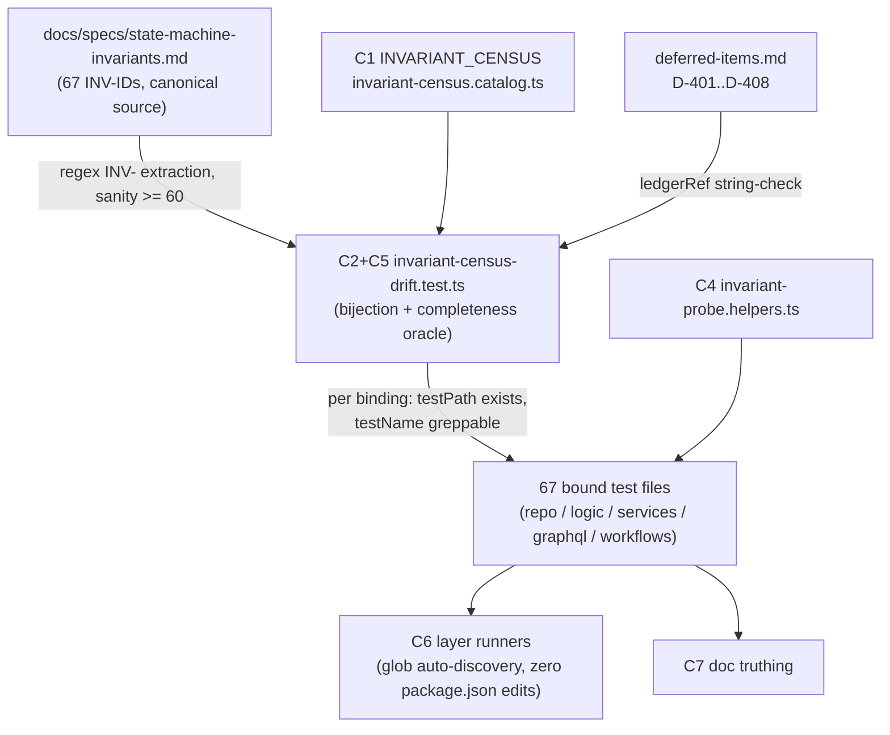

# Design — State Machine Invariant Verification

**Plan directory (verbatim, used by every header/ledger/self-reference):** `ai/plans/milestone_4/state_machine_invariant_verification`
**Specs of record:** `ai/plans/milestone_4/state_machine_invariant_verification/specs.md` — REQ-000 · REQ-010 · REQ-020..REQ-110 (the eleven machine REQs) · REQ-120 · REQ-130; the embedded 67-row census with dispositions is the binding requirements table
**Ledger:** `ai/plans/milestone_4/state_machine_invariant_verification/deferred-items.md` — pre-seeded D-401..D-408 (REQ-000.2)
**Outcome dir:** `ai/plans/milestone_4/state_machine_invariant_verification/outcome/` — the 12 research dossiers (`outcome/research/01-session-lifecycle.md` … `12-sibling-plans-canonical-docs.md`) are ground truth; read ALL before any task (REQ-000.3)
**Ticket:** `docs/planning/TICKETS.md:2873-2910` — State Machine Invariant Verification Tests · Dev 2 · 5 SP · Blocked By: All Milestone 1–3 tickets (all verified shipped — dossier 12 §7)
**Milestone:** 4

---

## 1. Overview & System Context

The ten shipped state machines plus the doc's eleventh (plan catalog) carry **67 documented invariants** (`docs/specs/state-machine-invariants.md:1-358`), enforced by a deliberately heterogeneous stack: DB CHECK/UNIQUE/FK constraints, immutability triggers, guarded single-statement UPDATEs, service gates and transition matrices — and, for six invariants, app-layer discipline only (writer absence, static grep-locks, transactional composition). Per-invariant coverage is abundant (spread across ~90 files) but **unverifiable as a claim**: dossier 11 §3.9 proved no invariant-named suite, registry, or completeness oracle exists anywhere in the test tree (`grep -ri invariant` returns only prose; `find -iname "*invariant*"` returns nothing). The ticket's criterion — "every invariant is tested and passes" — is today a belief, not a checkable property.

This design ships the **verification harness** that makes it computable: (1) a machine-readable **census** (`backend/db/test/logic/invariants/invariant-census.catalog.ts`) binding every INV-ID to named, passing tests with enforcement-tier, verdict, and disposition records; (2) a static **anti-drift oracle** (`backend/db/test/logic/invariants/invariant-census-drift.test.ts`) enforcing the doc ↔ census ↔ test-file bijection — a new doc invariant without a census row + binding fails CI, and a census row citing a phantom or renamed test fails CI; (3) **surgical residual closure** — 24 EXTEND cells in existing suites, 5 NEW-PROBE files, 6 PIN-APP-LAYER rows that pin shipped semantics and record doc drift; (4) **doc truthing** — 16 `†` annotations on the invariants spec, a PRODUCTION_READINESS §5 refresh, and a canonical testing doc. Runners auto-discover every new file by glob — zero `package.json` edits; no product code, no schema, no UI, no GraphQL SDL change.

### Design Goals

1. **Computable completeness** — 67/67 census rows, each with ≥1 named passing binding; the ticket's criterion becomes CI-enforced (REQ-010).
2. **Permanent anti-drift** — the bijection is red-on-drift in both directions (REQ-010.2–.4).
3. **Surgical, single-sourced residuals** — extend existing suites; verify-by-reference sibling suites; never fork (`backend/db/test/logic/AGENTS.md:47`).
4. **Honest enforcement tiers** — the 6 no-DB-guard invariants are pinned at their real tier with doc annotations; schema hardening is ledgered (D-401..D-408), never built by a test ticket.
5. **Runner-light, duplication-clean** — per-file 60s budget respected; ONE shared savepoint-probe helper keeps `bun run check:duplicates` green (REQ-120.8, REQ-120.10).

### Key Design Decisions

#### D1: Census module lives in the DB-test layer, not `test/workflows/`
- **Context:** where does the canonical 67-row catalog live? The audit sibling put its census at `test/workflows/admin/audit-completeness.catalog.ts` because its consumer was a journey.
- **Options:** (a) test-layer module under `test/workflows/`; (b) `backend/db/test/logic/invariants/invariant-census.catalog.ts`; (c) a `shared/` constants module.
- **Decision:** (b).
- **Rationale:** the census's only consumer is the static drift oracle — a logic-tier file-scan; `logic/` is the documented home for state-machine/constraint/integrity tests (`backend/db/test/logic/AGENTS.md:5`); one dir holds catalog + drift test + probe helper + per-domain suites (the ticket's single audit surface, REQ-010.5) and needs exactly one AGENTS.md Layout entry (REQ-120.9). A `shared/` module would be production-adjacent dead code with no runtime consumer (knip).

#### D2: Per-domain invariants files where content exists; census-named co-located files otherwise — never a mega-file
- **Context:** dossier 11 §4.1 sketched 11 per-domain files; the specs census (its own routing rule, specs.md:62) let a probe whose dossier-named helper battery lives in an existing file extend that file instead, with the census recording the final home.
- **Options:** (a) create all 11 shells anyway; (b) create per-domain files only where a live default-home probe exists, extend census-named files otherwise.
- **Decision:** (b).
- **Rationale:** empty shells trip `bun run check:unused` (knip flags unused files) and waste runner slots; the census routing (authored later, finer-grained) supersedes the dossier's group-level sketch; the anti-mega-file NFR (REQ-120.10) holds — content spreads across ~20 files, each far under the 60s/file budget. Created under `logic/invariants/`: catalog, drift test, probe helper, `session-invariants.test.ts` (S8 data-level probe — dossier 01 suggested `backend/db/test/logic/classes/`; the census default wins), `plan-catalog-invariants.test.ts` (PC3 pins — dossier 04 suggested extending `plan-catalog.repository.test.ts`; the census default wins).

#### D3: Verify-by-reference over re-authoring
- **Context:** 32 invariants already have named passing tests, many sibling-owned (`docs/billing/financial-safety-verification.md:30-41`).
- **Options:** (a) re-author INV-named suites for uniformity; (b) bind the existing tests by name in the census.
- **Decision:** (b).
- **Rationale:** re-authoring forks ~90 files of maintenance and violates the no-duplicate-coverage rule (`backend/db/test/logic/AGENTS.md:47`); the drift oracle makes the citation itself CI-enforced — a renamed or deleted test fails REQ-010.3, so a binding can never silently rot.

#### D4: Annotate the doc; never rewrite semantics
- **Context:** 16 rows carry doc-vs-code drift (shipped `amount > 0` CHECKs vs doc `>= 0`; a 9-value pgEnum vs the doc's 5; cooldowns on `applicants.cooldown_until` not `students`; governance columns on `users`; booking stricter than the login window; the milestone_2-era "no student directory" claim).
- **Options:** (a) "fix" code or tests to match doc wording; (b) pin shipped semantics with tests and annotate the doc following its existing amendment-glyph precedent (already used on the INV-PAY2/INV-PAY5 rows).
- **Decision:** (b).
- **Rationale:** tests must pass against shipped behavior — a `>= 0` PAY1 probe would fail because the CHECK is `> 0` (`backend/db/schema/billing/student-payments.ts:74`); a test ticket ships no product change (REQ-130); genuine schema hardening is ledgered D-401..D-408 as future-ticket pointers.

#### D5: ONE shared probe helper
- **Context:** 10+ new/extended probe files would otherwise copy the savepoint-bracket scaffold (REQ-120.8).
- **Options:** (a) per-file scaffolds; (b) extract one helper (extraction precedent: `backend/db/test/pg-error.ts:3-5` was pulled out of 16 per-file copies).
- **Decision:** (b) — `backend/db/test/logic/invariants/invariant-probe.helpers.ts`.
- **Rationale:** `bun run check:duplicates` (jscpd) fails on cloned scaffolds; consumers keep importing `runInRollback`/`expectRepoError` from `@/backend/db/test/test-utils` directly (no re-export shims).

---

## 2. Test Architecture



### C1 — Invariant Census Registry — `backend/db/test/logic/invariants/invariant-census.catalog.ts` (CREATE)
- **Purpose:** the single machine-readable audit surface: all 67 INV-IDs, each bound to ≥1 named passing test.
- **Responsibilities:** exactly 67 entries grouped under 12 machine keys (S, TV, A, B, W, U, P, PAY, HW, PR, E, PC) mirroring the specs Phase-0 table; per row: `docLine`, `statement`, `enforcementTier`, `verdict`, `disposition`, optional `docDrift`/`ledgerRef`, `bindings[]` with ≥1 entry (REQ-010.1).
- **Interfaces:** consumed by the drift test via `@/backend/db/test/logic/invariants/invariant-census.catalog`; per-domain suites cite it in header comments instead of re-listing tests (REQ-010.5).
- **Implementation notes:** a typed module, NOT a `*.test.ts` file (the db runner's test glob will not execute it); exports limited to what the drift test consumes (knip discipline); entry shape in §3.1.

### C2 — Anti-Drift Static Bijection Test — `backend/db/test/logic/invariants/invariant-census-drift.test.ts` (CREATE)
- **Purpose:** make doc ↔ census ↔ test-file bijection a CI-enforced property (REQ-010.2–.4).
- **Responsibilities:** parse the invariants doc, extract every `INV-` token (corpus sanity ≥60 — a broken scanner can never fake green), assert set-equality in BOTH directions (a doc ID missing from the census fails; a census ID missing from the doc fails); for every binding: `testPath` exists on disk and `testName` is greppable in that file; every PIN row's `ledgerRef` matches a live `D-4xx` string in `deferred-items.md`.
- **Interfaces:** pure file-scan — zero DB dependency, order-of-seconds (specs NFR).
- **Implementation notes:** mirrors the audit census-drift pattern (`backend/db/test/logic/audit/audit-census-drift.test.ts`; catalog precedent `test/workflows/admin/audit-completeness.catalog.ts:143`); red-on-drift is proven at implementation time by seeding a fake doc ID + a phantom cite, watching both fail, then reverting (Definition-of-Done check).

### C3 — Per-Domain Invariant Suites + Extend Targets
- **Purpose:** homes for the residual probes; the census records each row's FINAL home — no assertion may exist in two files (`backend/db/test/logic/AGENTS.md:47`).
- **Responsibilities:** the new `logic/invariants/` per-domain files carry the live default-home probes — `session-invariants.test.ts` (S8 data-level homework⇒report LEFT-JOIN-zero probe, `runInRollback`) and `plan-catalog-invariants.test.ts` (PC3: `PlanRepository` writer-absence source pin, referenced-plan 23503 probe, unreferenced-DELETE-succeeds pin). Every other residual extends the census-named co-located file (the §5.2 matrix is authoritative): repo tier (NEW `teacher-verification.repository.test.ts` for TV7; extends `teacher.repository.test.ts`, `wallet.repository.test.ts`, `home-work.repository.test.ts`, `progress.repository.test.ts`, `evaluation.repository.test.ts`), logic tier (NEW `student_status_history.test.ts` + `student_status_transition.test.ts` — names pre-documented in `backend/db/test/logic/AGENTS.md:23`; extends `financial-immutability.test.ts`, `student-payment.repository.test.ts`, `lesson.service.test.ts`, `auth.service.test.ts`), service tier (extends `session-lifecycle.service.test.ts`, `session-lifecycle.booking.test.ts`, `teacher-availability.service.test.ts`, `subscription-expiry.service.test.ts`, `session-report.service.test.ts`, `admin-academic-tracking.service.test.ts`), static tier (NEW `backend/db/schema/teachers/evaluations-schema.static-assertions.test.ts`; NEW `shared/constants/evaluation-rubric.constants.test.ts`; extends `backend/db/schema/classes/report-homework-schema.static-assertions.test.ts`), wire tier (NEW `backend/graphql/test/teacher-matching.integration.test.ts`), journey tier (4 extensions + 1 new — §5.4).
- **Interfaces:** every suite header cites the census rows it owns + the existing probes it deliberately does not duplicate.
- **Implementation notes:** D2 ruling — no empty shells; `backend/db/test/logic/AGENTS.md` Layout gains the `invariants/` entry (REQ-120.9; the current Layout is stale — dossier 11 §3.3).

### C4 — Shared Probe Helper — `backend/db/test/logic/invariants/invariant-probe.helpers.ts` (CREATE)
- **Purpose:** ONE canonical savepoint/CHECK/trigger probe utility (REQ-120.8; jscpd; extraction precedent `backend/db/test/pg-error.ts:3-5`).
- **Intended signatures:**
```ts
export async function probeInsideSavepoint(tx: DBTransaction, label: string, probe: () => Promise<unknown>): Promise<Error>;
export function expectCheckViolation(err: Error, constraintName: string): void;   // 23514 + name in cause chain
export function expectUniqueViolation(err: Error, constraintName: string): void;  // 23505
export function expectFkViolation(err: Error, constraintName: string): void;    // 23503
export function expectNotNullViolation(err: Error, columnFragment: string): void; // 23502
export function expectEnumViolation(err: Error, enumFragment: string): void;     // 22P02 cause-chain text
export function expectTriggerRaise(err: Error, raiseText: string): void;        // exact DDL RAISE text
```
- **Implementation notes:** `probeInsideSavepoint` opens `savepoint inv_<label>` via `tx.execute(sql`…`)`, runs the probe under try/catch (`expectRepoError` discipline — NEVER `expect(...).rejects.toThrow()` inside `runInRollback`), and executes `rollback to savepoint` in a finally so the outer `runInRollback` transaction stays queryable. It composes the two canonical patterns — CHECK probes (`backend/db/test/repo/billing/wallet.repository.test.ts:475-527`) and trigger raises (`backend/db/test/logic/billing/financial-immutability.test.ts:174-178`) — into the one shared scaffold. The expector functions compose `hasPostgresErrorCode` (`backend/db/test/pg-error.ts:16-27`), `constraintNameOf` (`backend/db/test/test-utils.ts:111-126`), and a cause-chain text walker; consumers import `runInRollback`/`expectRepoError` from `@/backend/db/test/test-utils` directly (no re-export shims).

### C5 — Census-Driven Completeness Oracle (second tier of the C2 drift test file)
- **Purpose:** every registry row's binding resolves, and the registry itself is well-formed (REQ-010.1/.3/.4).
- **Responsibilities:** walk `CENSUS_ROWS` asserting: exactly 67; all 12 machine keys present; every disposition within the four legal values; ≥1 binding per row; each binding's `testPath` exists + `testName` greppable; PIN rows carry `ledgerRef`; the 16 `†` rows carry `docDrift`.
- **"Passing" semantics:** enforced compositionally — bindings name real bun:test cases; when the bound suites run green in CI the completeness claim holds; the oracle guarantees the names resolve, so drift can never hide behind a rename (REQ-010.4).
- **Implementation notes:** a describe tier inside the C2 file (single-concern census-integrity file, audit precedent has one drift test; avoids a second near-identical scaffold and a spare 60s runner slot).

### C6 — Runner Wiring (zero `package.json` edits)
- `bun run test:db` globs `backend/db/test` for `**/*.test.ts` (8 workers, 60s/file — `test/scripts/run-db-tests-parallel.ts:14-19`): auto-discovers the drift test, `session-invariants`, `plan-catalog-invariants`, the TV7 repo file, `student_status_history`/`student_status_transition`, the U3 auth arms, and every extended repo/logic file.
- `bun run test:services` (8 workers, 60s) auto-discovers every extended service test (A1, U2, W4, B3, B8, HW4, E5).
- The A3 wire file runs via the per-test runner on the backend wire layer (`bun run test/scripts/run-test.ts backend/graphql/test/teacher-matching.integration.test.ts` — dev-server `testClient` harness, same as its model `backend/graphql/test/teacher-availability.integration.test.ts`); bare `bun run test:graphql` defaults to `frontend/graphql/test/` only (`test/scripts/run-server-tests.ts:15` DEFAULT_TEST_PATH) and never discovers `backend/graphql/test/**`.
- Journeys run via `bun run test/scripts/run-test.ts test/workflows/<domain>` (`test/workflows/AGENTS.md:96-105`); raw `bun test` on `backend/db/test/**` or `test/workflows/**` is FORBIDDEN (REQ-120.6).

### C7 — Doc-Truthing Deliverable (detail in §9)
Annotations on `docs/specs/state-machine-invariants.md` (16 `†` rows, following the doc's amendment-glyph precedent); NEW `docs/testing/invariant-verification.md`; `docs/planning/PRODUCTION_READINESS.md` §5 refresh; `docs/parents/monitoring-portal.md` five→seven correction; `backend/db/test/logic/AGENTS.md` Layout entry for `invariants/` (REQ-130, REQ-120.9).

---

## 3. Data Models

### 3.1 Census entry + registry shape (`invariant-census.catalog.ts`)

```ts
export type InvariantMachine = "S" | "TV" | "A" | "B" | "W" | "U" | "P" | "PAY" | "HW" | "PR" | "E" | "PC";
export type InvariantVerdict = "COVERED" | "PARTIAL" | "GAP";
export type InvariantDisposition = "VERIFY-BY-REFERENCE" | "EXTEND" | "NEW-PROBE" | "PIN-APP-LAYER+DOC-DRIFT";

export interface InvariantCensusBinding {
  readonly testPath: string;  // repo-root-relative POSIX path of the bound test file
  readonly testName: string;  // greppable test/describe name fragment in that file (REQ-010.3)
  readonly tier?: string;     // optional: this binding's tier (SVC/REPO/DB CHECK/TRIGGER/SCHEMA/JRN/SDL/STATIC)
}

export interface InvariantCensusEntry {
  readonly id: string;              // "INV-S1"
  readonly machine: InvariantMachine;
  readonly docLine: number;         // line in docs/specs/state-machine-invariants.md
  readonly statement: string;       // abridged invariant text
  readonly enforcementTier: string;
  readonly verdict: InvariantVerdict;
  readonly disposition: InvariantDisposition;
  readonly docDrift?: string;       // required on the 16 † rows (REQ-130)
  readonly ledgerRef?: string;      // required on PIN rows: "D-401".."D-408"
  readonly notes?: string;
  readonly bindings: readonly InvariantCensusBinding[];  // >= 1 per row
}

export const CENSUS_DOC_PATH = "docs/specs/state-machine-invariants.md";
export const INVARIANT_CENSUS: Readonly<Record<InvariantMachine, readonly InvariantCensusEntry[]>>; // 12 keys
export const CENSUS_ROWS: readonly InvariantCensusEntry[]; // derived flat view, exactly 67
```

Field reconciliation: the brief's `testBindings[{file, tier, name-pattern}]` maps onto the specs-of-record shape `{ testPath, testName }` (REQ-010.1) — `testPath` ≡ file, `testName` ≡ name-pattern, `tier` kept optional, `notes` entry-level. Specs win on naming.

### 3.2 Registry counts (the census is a test-layer module — no DB object, no table)
67 rows grouped S 8 · TV 7 · A 4 · B 8 · W 8 · U 5 · P 4 · PAY 7 · HW 4 · PR 3 · E 6 · PC 3. Dispositions: 32 VBR · 24 EXTEND · 5 NEW-PROBE (TV7, A3, PC2, U1, U5) · 6 PIN (B5, W7, U4, E2, E6, PC3). Verdicts: 45 COVERED · 18 PARTIAL · 4 GAP (TV7, U1, PAY1, E6). 16 rows carry `†` doc drift.

### 3.3 Fixture model (verified battery `backend/db/test/entity-setup.ts:74-571`; every helper takes `tx` first + `Partial<SelectType>` overrides last)

| Suite / probe | Fixtures |
|---|---|
| TV7 schema-contract (new repo file) | `createTestUser` + `createTestTeacherRow`; raw `tx.insert(teacherVerification)` + `information_schema.columns` reads. **No `createTestTeacherVerification` helper exists** (not among the verified 16) and none is added — single-consumer raw insert keeps the frozen battery frozen (knip) |
| session-invariants (S8 data-level) | `createTestSession` → `createTestSessionReport` → `createTestHomeWork`; LEFT-JOIN count via `tx.execute(sql`…`)` inside `runInRollback` |
| plan-catalog-invariants (PC3) | `createTestPlan` + `createTestSubscription` (the FK-referenced case) + an unreferenced `createTestPlan` variant |
| student_status_history (U1 + U4 FK leg) | `createTestUser` (governance overrides — flags live on `users`, `backend/db/schema/users/users.ts:37-43`) + `createTestStudent` + `createTestTeacherRow` + `createTestSession` + `createTestSessionReport` + `createTestSubscription` + `createTestStudentPayment` |
| student_status_transition (U5) | `createTestUser` + `createTestStudent` with non-zero lane overrides `{balanceHifz:3, balanceTajweed:2, balanceReviews:1, balanceTrial:1}` |
| U3 refresh arms | committed credentials via `RegistrationService.registerUser` + governance flips; `deleteUsersByIds` teardown — NOT `runInRollback` (`refreshToken` opens its own tx; D11 pattern `backend/services/admin/user-governance.service.test.ts:1205-1319`) |
| PAY1/PAY4 | `createTestUser` + `createTestStudent` + `createTestStudentPayment` (amount/gateway overrides); raw-SQL enum probes |
| W3/W5 | `createTestWallet`; `insertTeacherLedgerFixture` (file-local, `backend/db/test/logic/billing/financial-immutability.test.ts:262-275`) |
| HW/PR legs | `createTestSession` ×n + `createTestHomeWork` ×n; `createTestPlan` + `createTestLesson` (positional `planId` REQUIRED, `backend/db/test/entity-setup.ts:404-410`). **No `createTestProgress`** — PR1 legs use `ProgressRepository.insertRow({studentId, lessonId}, tx)` (`backend/db/test/logic/classes/student-progress.service.test.ts:151`) or raw `tx.insert(progress)` (`backend/db/test/repo/classes/lesson.repository.test.ts:427`) |
| E1/E3/E6 | `createTestUser` ×2 + `createTestEvaluation`; committed-fixture tier via `createCommittedCast` (`backend/db/test/repo/teachers/evaluation.repository.test.ts:281-288`) |
| Journeys | actor factory `provisionStudentActor`/`provisionCertifiedTeacherActor`/`provisionParentActor`/`provisionAdminActor` + `createTestPlan` etc. inside ONE committing `beforeAll` tx; registry tracks the FIXED 9-table vocabulary (`test/workflows/helpers/journey-fixture-registry.ts:73-83`) — immutable ledgers (`audit_logs`, `teacher_transaction`, `student_payments`) asserted zero-row, NEVER tracked |

**No product schema changes. NO migrations — `bun run db` generate/push/migrate are NOT applicable to this plan.**

---

## 4. API Contracts + SDL + Permission Matrix

**Ruling: NO API/SDL surface changes.** Tests consume existing services/repos directly; journeys exercise real services; `bun codegen` is NOT required; the SDL freeze suites (`backend/graphql/test/schema-surface.test.ts`) stay green unedited. The ONLY wire-tier addition is a test file exercising the existing student browse — `browseAvailableTeachers` (`backend/graphql/query/teachers/teacher-matching.query.ts:81`, student-only scopes `:123-128`) — closing INV-A3's wire hole (REQ-040.4). Live Paymob E2E is excluded: every INV-PAY leg is verifiable via the mock channel, which delivers real signed callbacks without live credentials (`test/workflows/billing/paymob-purchase-journey.test.ts:803/:934`; dossier 08 §6.3).

**Journey actor provisioning matrix (real roles; honest authorization — no monkey-patching):**

| Journey (new/extended) | Real actors provisioned | Denial paths driven |
|---|---|---|
| `test/workflows/billing/plan-catalog-invariance.journey.test.ts` (NEW — PC2) | S + certified T + A via actor factory, ONE committing tx, `jrn_` prefix, registry-tracked | none — positive invariance journey; PC1 re-proof via catalog-exclusion assertion |
| `test/workflows/sessions/session-state-machine.journey.test.ts` (S2 cells) | existing cast (`buildSessionJourneyCast`) | cancelled→complete, cancelled→dispute: `SESSION_INVALID_TRANSITION`, row byte-identical |
| `test/workflows/teachers/teacher-inactivity-auto-offline.journey.test.ts` (A4 pin) | existing cast | none — marker-restore + sweep re-offline pin |
| `test/workflows/parents/parent-session-completion-deep-link.journey.test.ts` (P3 pin) | P + certified T (+ student) | zero-notification absence oracle (`SpiedFanoutTransport` delta 0) |
| `test/workflows/admin/account-governance.journey.test.ts` (ladder leg) | S + A | U2 booking FORBIDDEN while suspended; U3 refresh cross-actor arm (`accountBlocked`); U1 history byte-identical to every observer |
| `backend/graphql/test/teacher-matching.integration.test.ts` (A3, wire) | student caller + anonymous/teacher denial cast | scope-step denials per `teacher-matching.query.ts:123-128` |

---

## 5. Verification Matrix, Concurrency & Journey Design

### 5.1 New test-side signatures (no production signature changes anywhere)
The only NEW signatures are test-side: the C4 probe helper (§2) and the census module exports (§3.1 — `INVARIANT_CENSUS`, `CENSUS_ROWS`, `CENSUS_DOC_PATH`, the types). Every extended file keeps its existing helpers and conventions.

### 5.2 Per-machine verification matrix — 67 rows (the census bindings' authoritative homes)
Legend: **VBR** verify-by-reference (existing named test; census binds it) · **EXT** extend existing file · **NEW** new test file/journey · **PIN** pin-app-layer + doc-drift. `†` = doc-truthing annotation required (REQ-130). Sibling-owned rows are bound, never re-authored (boundary `docs/billing/financial-safety-verification.md:30-41`).

| ID | Disp | Target test file (final home) | Tier(s) | Assertion approach |
|---|---|---|---|---|
| INV-S1 | VBR | `backend/services/classes/session-lifecycle.enforcement.test.ts` | SVC matrix | 5×5 off-matrix sweep `:193` — completed/cancelled allow nothing (cite; journey `test/workflows/sessions/session-state-machine.journey.test.ts:426` corroborates) |
| INV-S2 | EXT | `test/workflows/sessions/session-state-machine.journey.test.ts` | JRN | add `cancelled→complete` + `cancelled→dispute` cells to the sweep block `:395-460`; `expectServiceDenial` + `readFullSessionRow` byte-equality (`:106-120`) |
| INV-S3 | VBR | `backend/services/classes/session-lifecycle.service.test.ts` | SVC·REPO | exactly-one-earning flow `:2505` + import-allowlist source pin `:1517` |
| INV-S4 | VBR | `backend/db/test/repo/classes/session.repository.test.ts` | SCHEMA | raw NULL INSERT ⇒ 23502 both FK columns `:2311` |
| INV-S5 | VBR | `backend/services/classes/session-lifecycle.service.test.ts` | SVC | null-certification strict-true boundary `:854` |
| INV-S6 | VBR | `backend/services/classes/session-lifecycle.service.test.ts` | SVC·REPO·JRN | 12-test INV-S6 lock block `:3463-3927` (never fork) |
| INV-S7 | VBR | `backend/services/classes/session-report.service.test.ts` | SVC | production FOR UPDATE gate denies all 4 wrong states `:532` |
| INV-S8 | EXT | `backend/db/schema/classes/report-homework-schema.static-assertions.test.ts` + `backend/services/classes/session-report.service.test.ts` + `backend/db/test/logic/invariants/session-invariants.test.ts` (new) | STATIC·SVC·DB | `homeWork.sessionId.notNull===true` + `reports.sessionId.notNull===true` pins; single-call-site source pin (`backend/services/classes/session-report.service.ts:227`); LEFT-JOIN-zero probe in `runInRollback` |
| INV-TV1 | VBR | `backend/services/teachers/evaluation-rubric.service.test.ts` | SVC·REPO·JRN | 3-arm writer closure: quorum gate `:443`, pass-mint `:490`, fail-no-mint `:535` (+ journeys `:1027/:1296`) |
| INV-TV2 | VBR | `backend/services/teachers/evaluation-booking.service.test.ts` + `backend/db/test/repo/teachers/evaluation.repository.test.ts` | SVC·SCHEMA | distinctness `:650/:671/:588`; 23505 arbiter `evaluations_session_evaluator_unique` `:460` |
| INV-TV3 | VBR | `backend/services/teachers/applicant-lifecycle.service.test.ts` | SVC | strict-`>` expiry boundary `:433/:447` (+ purchase denial `backend/services/teachers/verification-purchase.service.test.ts:301`) |
| INV-TV4 † | EXT | `shared/constants/evaluation-rubric.constants.test.ts` (new) | STATIC | literal-type tripwire `TAJWEED_COOLDOWN_DAYS===30` / `HIFZ_COOLDOWN_DAYS===90` (model `shared/constants/verification-plan.constants.test.ts:55-69`) |
| INV-TV5 | VBR | `backend/services/teachers/applicant-lifecycle.service.test.ts` | SVC·JRN | override trio `:1524/:1817/:1959` + admin-only gate `:2065` |
| INV-TV6 | VBR | `test/workflows/teachers/applicant-student-conversion.journey.test.ts` | JRN | converted actor subscribes + books during cooldown `:1063` |
| INV-TV7 † | NEW | `backend/db/test/repo/teachers/teacher-verification.repository.test.ts` (new) | SCHEMA | `information_schema.columns` (nullable varchar(50) both levels; DDL `backend/drizzle/20260904084151_omniscient_karen_page/migration.sql:313-320`, FK `:502`, index `:376`) + `runInRollback` round-trip; rubric-write assertion FORBIDDEN — no producer (D-401) |
| INV-A1 | EXT | `backend/services/teachers/teacher-availability.service.test.ts` | SVC | toggle-vs-`demoteToUncertified` interleave under `lockForCertificationCheck` (`backend/db/repo/teachers/teacher.repository.ts:179-189`): both orderings end internally consistent, no uncertified-online bypass |
| INV-A2 | EXT | `backend/db/test/repo/teachers/teacher.repository.test.ts` | REPO | one `Started` session seeded; ALL three `is_online` writers fire (`setAvailabilityIntent`→null+untouched, `releaseInSessionLock`→`active_sessions_remain`, sweep→`false` only); each re-read leaves `isOnline===false` |
| INV-A3 † | NEW | `backend/graphql/test/teacher-matching.integration.test.ts` (new; model `backend/graphql/test/teacher-availability.integration.test.ts`) | SDL wire | student 200 sees NO in-session teacher in the `browseAvailableTeachers` page; anon/teacher denied at the scope step (`teacher-matching.query.ts:123-128`) |
| INV-A4 † | EXT | `test/workflows/teachers/teacher-inactivity-auto-offline.journey.test.ts` | JRN | INV-A4-named pin: marker=true restore returns Available; gone-stale teacher re-offlined by the next sweep (`:506` pattern) — never an activity-conditioned restore |
| INV-B1 | VBR | `backend/db/repo/students/__tests__/student-grant-free-trial-once.test.ts` + `backend/db/repo/students/__tests__/student-lane-debit.test.ts` | DB CHECK | named lane CHECK trips `:191/:379` (+ `backend/db/test/repo/students/student.repository.test.ts:428-458`) |
| INV-B2 | VBR | `backend/services/billing/subscription-activation.service.test.ts` | SVC·REPO | exact sessionCount delta credited to one lane `:927/:950/:990` |
| INV-B3 | EXT | `backend/services/billing/subscription-expiry.service.test.ts` | SVC·cron | one cancel→later-sweep interplay case (cancelled is NON-covering — doc `:186-187`); exact counts via `scopeSweepToUsers` seam `:198-210` |
| INV-B4 | VBR | `backend/services/classes/session-lifecycle.booking.test.ts` | SVC·JRN | zero-balance ⇒ INSUFFICIENT_BALANCE, zero writes `:603` |
| INV-B5 † | PIN | `backend/db/repo/students/__tests__/student-lane-debit.test.ts` (+ optional `student-lane-debit.test-d.ts`) | REPO frozen map | implemented segregation pinned `:346` + optional `@ts-expect-error` reviews-lane pin; doc's reviews-decrement clause recorded UNIMPLEMENTED (no `HeldBalanceLane.Reviews`, `backend/enum/scheduling/held-balance-lane.enum.ts:17-21`) — never a runtime reviews-booking test (D-406) |
| INV-B6 | VBR | `backend/services/billing/subscription-admin.service.test.ts` | SVC·JRN | guarded `extendActiveOnce` `:501` + journey `test/workflows/billing/subscription-admin-lifecycle.journey.test.ts:493` |
| INV-B7 | VBR | `backend/db/repo/students/__tests__/student-grant-free-trial-once.test.ts` | REPO·SVC | `trial_granted_at IS NULL` arbiter, replay null `:98` |
| INV-B8 | EXT | `backend/services/classes/session-lifecycle.booking.test.ts` | SVC | `runInRollback` ordering cell: seed `{balanceTrial:1, balanceHifz:3}` (no sweep) ⇒ `heldBalanceLane===Trial`, trial 1→0, hifz byte-identical |
| INV-W1 | VBR | `backend/db/test/repo/billing/wallet.repository.test.ts` | DB CHECK (sibling-owned) | `wallet_balance_check` 23514 `:476` — bound, never re-authored |
| INV-W2 | VBR | `backend/db/test/repo/billing/wallet.repository.test.ts` | DB CHECK (sibling) | `wallet_total_earning_check` `:494` |
| INV-W3 | EXT | `backend/db/test/repo/billing/wallet.repository.test.ts` (CHECK-probe describe `:475`) | DB UNIQUE | raw second INSERT bypassing ON CONFLICT ⇒ 23505 `wallet_teacher_id_unique` (`constraintNameOf` + cause-chain name); per-teacher count still 1 after rollback |
| INV-W4 | EXT | `backend/services/classes/session-lifecycle.service.test.ts` | SVC | arbitration-Complete arm at `:1900` gains the missing oracle: `WalletRepository.findByTeacherId(teacherUserId, tx)` null + `confirmedByStudentAt` null |
| INV-W5 | EXT | `backend/db/test/logic/billing/financial-immutability.test.ts` (tamper tier, all under `describeTriggerTier` `:314`) | TRIGGER | 4 residual cells with exact RAISE text + row byte-identical: `pending→pending` no-op; decided re-open (`completed→failed`); description freeze; `session_id` NULL-swap (live guard `backend/drizzle/20260914064155_custom_5-teacher-transaction-settlement/migration.sql:54-76`) |
| INV-W6 | VBR | `backend/db/test/logic/billing/financial-immutability.test.ts` | TRIGGER (sibling) | UPDATE/DELETE blocked `:364-478` + compensating-row doctrine |
| INV-W7 † | PIN | `backend/db/test/repo/billing/wallet.repository.test.ts` | REPO signature | no DB CHECK exists (`backend/db/schema/billing/teacher-transaction.ts:38` plain nullable FK); pin `creditEarningOnce` ledger rows carry the fixture `sessionId` (signature-level enforcement `backend/db/repo/billing/wallet.repository.ts:81`); schema CHECK → ledger D-402 |
| INV-W8 † | VBR | `backend/db/test/repo/billing/wallet.repository.test.ts` | DB CHECK (sibling) | shipped `> 0`: negative probe `:504` + zero-amount rejection `:722-758` — doc's `>= 0` is weaker than shipped; annotate, never "fix" |
| INV-U1 | NEW | `backend/db/test/logic/students/student_status_history.test.ts` (new) | REPO·SVC | byte-identical `session`/`reports`/`student_payments` across the full suspend→block→soft-delete→reactivate ladder via `AdminUserManagementService.setUserDeleted` and friends; login denied while deleted; reactivate keeps history |
| INV-U2 † | EXT | `backend/services/classes/session-lifecycle.service.test.ts` (governance block `:752`) | SVC | lapsed-suspension cell: booking STILL denies FORBIDDEN on the raw boolean (`backend/services/classes/session-lifecycle.governance.ts:53`) — deliberately stricter than the login window (lapse-ALLOWED pinned at `backend/services/admin/user-governance.service.test.ts:1357`); pin with a comment, never "fix" |
| INV-U3 | EXT | `backend/db/test/logic/auth/auth.service.test.ts` | SVC | `refreshToken` governance arms on committed fixtures + `deleteUsersByIds` teardown (D11 pattern `backend/services/admin/user-governance.service.test.ts:1205-1319`): pre-block token ⇒ `ForbiddenError(accountBlocked)` (gate `backend/services/auth/auth.service.ts:270`); deleted + active-suspension arms likewise |
| INV-U4 † | PIN | `backend/graphql/test/inv-u4-grep-lock.test.ts` + FK probe in `backend/db/test/logic/students/student_status_history.test.ts` | STATIC·FK | grep-lock `:211` is THE enforcement; FK-RESTRICT backstop: referenced-user raw DELETE ⇒ 23503 `session_student_id_…_fkey` in a savepoint; unreferenced-user DELETE SUCCEEDS then rolls back — never expect a `prevent_users_delete` trigger (D-404) |
| INV-U5 | NEW | `backend/db/test/logic/students/student_status_transition.test.ts` (new) | REPO | the TARGET's own row — all four balance lanes + `trialGrantedAt` — byte-identical across every governance transition (sibling-user isolation already pinned at `backend/services/admin/user-management.service.test.ts:2151`) |
| INV-P1 | VBR | `backend/services/parents/parent-link.static-locks.test.ts` | REPO·SVC·JRN·chaos | single-writer corpus `:533` + guarded link + one-winner race (five-layer evidence, REQ-080.1) |
| INV-P2 | VBR | `backend/graphql/test/schema-surface.test.ts` | SDL·SVC·JRN | mutation-root freeze `:1417` + sanctioned trio `:772-776` |
| INV-P3 | EXT | `test/workflows/parents/parent-session-completion-deep-link.journey.test.ts` | JRN | absence pin: linked child, session completed, NO report ⇒ ZERO parent notification rows + ZERO spied publishes (producer is report submission, `backend/services/classes/session-report.service.ts:306`) |
| INV-P4 † | VBR | `backend/db/test/logic/students/handshake-code-generation-locks.test.ts` | SCHEMA·REPO | FK + handshake unique + NOT NULL matrix `:219` (annotate: portal is SEVEN SDL fields, `docs/parents/monitoring-portal.md:248/:250/:268` say five) |
| INV-PAY1 † | EXT | `backend/db/test/logic/billing/student-payment.repository.test.ts` | DB CHECK | savepoint probes: `-1.00` AND `"0.00"` inserts BOTH rejected ⇒ 23514 + `constraintNameOf` `student_payments_amount_check` (shipped `> 0`, `backend/db/schema/billing/student-payments.ts:74` — zero MUST reject); no UPDATE-leg probe (immutability trigger raises first, covered `:259`) |
| INV-PAY2 | VBR | `backend/db/test/logic/billing/student-payment.repository.test.ts` | TRIGGER | guarded transition matrix `:169/:227/:259/:295` + provider-reference freeze `:420-574` |
| INV-PAY3 | VBR | `backend/services/billing/subscription-activation.service.test.ts` | SVC | failed delivery ⇒ stays pending, zero credit `:533` |
| INV-PAY4 † | EXT | `backend/db/test/logic/billing/student-payment.repository.test.ts` | SCHEMA pgEnum | bogus gateway ⇒ 22P02 (cause-chain "invalid input value for enum"); NULL ⇒ 23502; `enum_range(NULL::payment_gateway)` === the 9 shipped values (`backend/db/schema/enums.ts:67-77` — doc lists 5) |
| INV-PAY5 | VBR | `backend/services/admin/student-onboarding.service.test.ts` | SVC | zero-ledger oracle + audit cols `:703/:725/:751` (+ gateway denial `:518`) |
| INV-PAY6 | VBR | `backend/db/test/logic/billing/student-payment.repository.test.ts` | REPO·SVC·JRN·route | replay null `:190` + late-confirmed rejected-and-logged (`backend/services/billing/subscription-activation.service.test.ts:612`) + byte-identical replay `:1303` + route storm `app/api/payments/webhook/test/payments-webhook-route.test.ts:1377` |
| INV-PAY7 | VBR | `backend/services/billing/subscription-activation.service.test.ts` | SVC·route·JRN | mismatch quarantine zero-mutation + 200 `{processed:false}` ack `:894/:1269/:1234/:1728` + route `payments-webhook-route.test.ts:1027` |
| INV-HW1 | EXT | `backend/db/test/repo/classes/home-work.repository.test.ts` + `backend/db/schema/classes/report-homework-schema.static-assertions.test.ts` | SCHEMA | 23502 NULL-session; 23503 orphan `home_work_session_id_session_id_fkey`; session-row delete cascades the homework row; static `sessionId.notNull===true` pin |
| INV-HW2 | EXT | `backend/db/test/repo/classes/home-work.repository.test.ts` | DB CHECK | `gradeHomeWorkOnce` (bypasses service validation) with 101 / −1 ⇒ 23514 `home_work_current_grade_check` / `home_work_revision_grade_check` (savepoint bracket, row survives) |
| INV-HW3 | VBR | `backend/services/classes/session-report.service.test.ts` | SVC | assignment born ungraded; no-prior silent no-op `:710/:751/:778` |
| INV-HW4 | EXT | `backend/services/classes/session-report.service.test.ts` | SVC·REPO | routing pin: two ungraded rows ⇒ grades land on the NEWEST prior row only — the shipped semantic behind the doc's "previous session" (no grade predicate, `backend/db/repo/classes/home-work.repository.ts:142-171`) |
| INV-PR1 | EXT | `backend/db/test/repo/classes/progress.repository.test.ts` | SCHEMA | `student_id` NULL ⇒ 23502; orphan student/lesson ⇒ 23503 (`progress_student_id_students_id_fkey` / `progress_lesson_id_lessons_id_fkey`); legal `lesson_id=NULL` row pinned (set-null artifact) |
| INV-PR2 | VBR | `backend/db/test/logic/classes/student-progress.service.test.ts` | SVC·JRN | Tajweed-only pointer ladder `:222/:338/:240-318` + journey `test/workflows/classes/tajweed-progress-increment.test.ts:559` |
| INV-PR3 † | EXT | `backend/db/test/logic/classes/lesson.service.test.ts` | SVC | wire-shaped `planId: null` ⇒ `LESSON_PLAN_NOT_FOUND` (the only plan-membership write surface, `backend/services/classes/lesson.service.ts:172-173`); `lessons.plan_id` nullable BY DESIGN — no NOT NULL probe |
| INV-E1 | EXT | `backend/db/test/repo/teachers/evaluation.repository.test.ts` + `backend/db/schema/teachers/evaluations-schema.static-assertions.test.ts` (new) | DB CHECK·STATIC | `insertOnce` with concrete 101 / −1 ⇒ raw 23514 `evaluations_score_check` (column nullable — concrete integers, never NULL; savepoint next to the unique probe `:460`); static pin: CHECK list exactly `["evaluations_score_check"]` + `isDeleted`/`deletedAt` columns |
| INV-E2 † | PIN | `backend/db/test/repo/teachers/evaluation.repository.test.ts` (source-pins describe) | STATIC | `backend/db/repo/teachers/evaluation.repository.ts` exposes no `.delete(` call and no delete/softDelete/update symbol — the "not hard-deleted" half is surface-absence only; a raw DELETE-rejection test is FORBIDDEN (teardowns delete successfully, `:290-292`; D-403) |
| INV-E3 | EXT | `backend/db/test/repo/teachers/evaluation.repository.test.ts` | SCHEMA | evaluator-FK 23503 probe `evaluations_evaluator_id_users_id_fkey` (savepoint); committed-fixture set-null survival: session hard-deleted ⇒ evaluation survives with `sessionId===null` (`backend/db/schema/teachers/evaluations.ts:47`) |
| INV-E4 | VBR | `backend/db/test/repo/teachers/teacher.repository.test.ts` | SVC·REPO·JRN·wire | 0-5 clamp CHECK trip `:2447` + scale conversion + journey + wire denial (five-tier evidence, REQ-110.1) |
| INV-E5 | EXT | `backend/services/admin/admin-academic-tracking.service.test.ts` | SVC | one INV-E5-labeled composite: homework grades (both tracks) + report history + `progressRowCount` + attention flag for one known student (maps to the academic-tracking surface, NOT the `evaluations` table) |
| INV-E6 † | PIN | `backend/db/test/repo/teachers/evaluation.repository.test.ts` (the E3 committed tier) | set-null design | testable core = the E3 set-null survival pin; no retention guard exists — PIN + annotate; full DELETE guard = new migration → ledger D-403 |
| INV-PC1 | VBR | `backend/db/test/logic/billing/plan-catalog.repository.test.ts` | REPO·SVC·SDL | `findActiveById` null + `listActive` excludes `:175/:209` + purchase denial `backend/services/billing/subscription-purchase.service.test.ts:230` |
| INV-PC2 | NEW | `test/workflows/billing/plan-catalog-invariance.journey.test.ts` (new) | JRN | purchase → confirmed activation → admin deactivate + edit ⇒ subscription row + credited lane byte-identical AND a subsequent booking on the credited lane SUCCEEDS (§5.4) |
| INV-PC3 † | PIN | `backend/db/test/logic/invariants/plan-catalog-invariants.test.ts` (new) | SDL·writer-absence | `PlanRepository` exposes no delete method (source pin over `backend/db/repo/billing/plan.repository.ts:42-241`); referenced-plan raw DELETE ⇒ 23503 `subscriptions_plan_id_fkey` (`backend/db/schema/billing/subscriptions.ts:35-37`) in a savepoint; unreferenced-plan DELETE SUCCEEDS — documented accepted boundary, no `prevent_plans_delete` trigger exists (D-405) |

### 5.3 Concurrency & isolation assessment

| Scenario | Risk | Mitigation |
|---|---|---|
| `SubscriptionExpiryService.expireDue` sweeps the WHOLE shared test DB | unrelated due rows break exact-count assertions (B3 interplay, PC2 journey) | `scopeSweepToUsers` spyOn seam (`backend/services/billing/subscription-expiry.service.test.ts:198-210`); journeys scope claims to their committed fixture users |
| Parallel DB tests (8 workers) | cross-test state bleed | every DB test wraps in `runInRollback` (`backend/db/test/test-utils.ts:34`) with `tx` threaded to ALL repo calls; each probe adds its own savepoint so a failed probe never poisons the outer tx |
| Committed-fixture tiers (U3 refresh arms, E3/E6 set-null, all journeys) | residue across runs | `jrn_<domain>_<8hex>` prefixes; registry-tracked FK-safe teardown; `deleteUsersByIds` for credential fixtures; twice-green reruns |
| Trigger tiers on embedded / schema-push providers | custom-migration triggers absent ⇒ false red | `describeTriggerTier = isPgliteProvider() ? describe.skip : describe` (`backend/db/test/logic/billing/financial-immutability.test.ts:314`); migrate-provisioned `kottaby_test` required for trigger tiers (`backend/db/test/repo/billing/wallet.repository.test.ts:886-895`); CHECK/enum probes stay ungated |
| A1 toggle-vs-demote interleave | an uncertified-online row bypassing the gate | `lockForCertificationCheck` FOR UPDATE serializes; assert both orderings end internally consistent; journeys' stale-flag windows covered by existing in-session-lock journeys (cited) |
| Cross-suite shared rows (expired subs, other files' wallets) | count drift in scoped assertions | probes count only fixture-scoped rows (per teacher/user id); never query seed data (REQ-000 discipline) |

### 5.4 Journey design

Every created/extended journey updates its domain `DIAGRAMS.md` section and validates via `bun run validate:mermaid` (`test/workflows/AGENTS.md` rule 13); the teachers domain gains its missing `DIAGRAMS.md` in task 4.4.

**Extended (existing files — cells added):**

| File | Cells added |
|---|---|
| `test/workflows/sessions/session-state-machine.journey.test.ts` | S2 residual cells in the off-matrix sweep `:395-460` — `cancelled→complete` + `cancelled→dispute` through the real service; denial text from `getServerTranslations("en").errorsTranslations` (`:92-94`) |
| `test/workflows/teachers/teacher-inactivity-auto-offline.journey.test.ts` | INV-A4-named pin — marker restore then the next sweep re-offlines (`:506` pattern); the shipped contract, never an activity-conditioned restore |
| `test/workflows/parents/parent-session-completion-deep-link.journey.test.ts` | P3 absence pin — linked child + completed-but-unreported session ⇒ ZERO parent notification rows + ZERO spied publishes (producer is report submission, `backend/services/classes/session-report.service.ts:306`) |
| `test/workflows/admin/account-governance.journey.test.ts` | governance-ladder leg (the specs' "Journey extension — student-governance ladder"): (1) S books pre-suspension — history baseline snapshotted; (2) A suspends → S booking FORBIDDEN, zero writes, balances byte-identical (U2/U5); (3) A blocks → S's still-valid refresh token denied `accountBlocked` (U3 cross-actor arm; unit arms at the logic tier per REQ-070.4); (4) A soft-deletes → history rows byte-identical to every observer, login denied (U1); (5) A reactivates → history intact, S books again |

**New journey — plan-catalog invariance (PC2), full cross-actor format.** Ordered steps: (1) **System** provisions S + certified T + A + a hifz-lane plan in ONE committing transaction (`jrn_` prefix, registry-tracked); (2) **S** purchases; the mock channel confirms ⇒ subscription `active`, `balance_hifz = plan.sessionCount` (byte-snapshot both); (3) **A** deactivates the plan (`is_active=false`, `deactivated_at`) and edits it (title/price); (4) **Observer assertions** — subscription row byte-identical, credited lane byte-identical, `planCatalog` excludes the plan (PC1 re-proof); (5) **S** books a session on the credited lane ⇒ SUCCEEDS (credited value survived deactivation + edit); (6) **System** teardown via registry; zero residue; immutable tables asserted zero-row, never tracked.

**Shared-entity state machine (plan × subscription × credited lane):**

| Current state | Trigger (actor + action) | Next state | Guard / permission |
|---|---|---|---|
| plan active | S purchases; mock channel confirms (System) | subscription `active`; lane `+= plan.sessionCount` | guarded pending→paid (`markPaidOnce` / `activatePendingOnce`) |
| plan active | A `setPlanActiveStatus(false)` | plan deactivated; subscription + lane UNTOUCHED | admin role; catalog-service zero-coupling (`backend/services/billing/plan-catalog.service.ts:8-10`) |
| plan deactivated | A `updatePlan` (title/price) | plan edited; subscription + lane still UNTOUCHED | admin role |
| subscription active (plan deactivated) | S books on the credited lane | session booked; lane debited | booking gates satisfied by the credited lane (B4) |

**Side-effect matrix:**

| Transition | Rows written | Notifications | Idempotency |
|---|---|---|---|
| purchase + confirmed activation | `student_payments` pending→paid; `subscriptions` pending→active; `students` lane credit | engine receipts spied (`SpiedFanoutTransport`) | guarded single-statement UPDATEs |
| deactivate + edit | `plans` row only — ZERO subscription/lane writes | none | guarded `setActiveStatusOnce` |
| booking on credited lane | `session` row + lane debit | existing request waves | guarded `decrementLaneIfAvailable` |

**Cross-actor visibility:**

| State | Student S sees | Admin A sees | Teacher T sees |
|---|---|---|---|
| plan deactivated + edited | plan absent from `planCatalog`; own subscription + credited balance byte-identical | plan row carrying `deactivated_at` + edits in the admin surface | n/a until booked |
| post-booking | lane debited exactly 1; session scheduled | governance rows unchanged | own session row |

Teardown: `createSessionFixtureRegistry()`-tracked, FK-safe order; twice-green reruns; NO `runInRollback` (`test/workflows/AGENTS.md:8-11`).

---

## 6. UX/Navigation Specification (explicit no-UI ruling)

| Surface | Ruling |
|---|---|
| New routes/URLs | none — test-only deliverable |
| Sidebar navigation placement | N/A — no `frontend/` or `app/` file created or modified |
| Tabs / per-audience rendering | N/A |
| UI files touched | none (specs out-of-scope ruling #3) |

---

## 7. Security & Tenancy Mitigations

- **Honest authorization:** journeys resolve REAL roles via the actor factory (`provisionStudentActor` / `provisionCertifiedTeacherActor` / `provisionParentActor` / `provisionAdminActor`, `test/workflows/helpers/actor-context.ts:88,105,122,136`); denial steps fail through the real authorization/ownership checks — never monkey-patched (`test/workflows/AGENTS.md:23-26`).
- **Tenancy scoping in probes:** fixtures are owned by per-run `jrn_`-prefixed identities; NO seed/demo rows (`test/workflows/AGENTS.md:37-40`); every probe scopes assertions to fixture ids; the shared-DB sweep hazard is fenced by `scopeSweepToUsers` (§5.3).
- **No secrets in fixtures:** no live gateway credentials anywhere — the mock/simulation channel delivers real signed callbacks (`test/workflows/billing/paymob-purchase-journey.test.ts:803/:934`); the live-E2E gate (`PAYMOB_LIVE_TESTS` + `build:test` + ngrok) is never entered (excluded, dossier 08 §6.3).
- **Denial-text discipline:** journeys assert typed `DomainError.code` + translated substrings from `getServerTranslations("en").errorsTranslations` (`test/workflows/sessions/session-state-machine.journey.test.ts:92-94`) — never hardcoded English; DB-tier tests assert the repo's own message substrings and NEVER call `getServerTranslations` (i18n loader hang — `backend/db/test/AGENTS.md:121-124`).
- **Immutable ledgers:** zero-row delta assertions instead of tracking DELETE-blocked tables (the registry vocabulary is the fixed 9 tables, `test/workflows/helpers/journey-fixture-registry.ts:73-83`); teardown of immutable rows uses `withImmutabilityTriggersSuspended` / `withAuditDeleteTriggersSuspended` in `afterAll` only, never inside probes (`backend/db/test/repo/billing/wallet.repository.test.ts:68,908-912`).

---

## 8. Error Handling & Testing Strategy

### 8.1 Safe error capture per layer

| Layer | Failure mode | Sanctioned capture pattern (verified) |
|---|---|---|
| DB CHECK / UNIQUE / FK / NOT NULL | 23514 / 23505 / 23503 / 23502 | savepoint bracket + `expectRepoError` (`backend/db/test/test-utils.ts:77`) + `constraintNameOf` (`:111-126`) + `hasPostgresErrorCode` (`backend/db/test/pg-error.ts:16-27`) — canonical `backend/db/test/repo/billing/wallet.repository.test.ts:475-527`; via C4's `probeInsideSavepoint` + expectors |
| pgEnum closed set | 22P02 | cause-chain contains "invalid input value for enum" (PAY4) |
| Immutability triggers | RAISE text | `withinSavepoint` + exact-RAISE-text cause-chain assertions (`backend/db/test/logic/billing/financial-immutability.test.ts:174-178,363-516`); ALL trigger tiers under `describeTriggerTier` (`:314`) |
| Service denials | typed `DomainError.code` | co-located service test: typed code + translated substring (REQ-120.3) |
| Journey denials | 4xx domain errors | `expectServiceDenial` try/catch + full-row byte-equality re-read (`test/workflows/sessions/session-state-machine.journey.test.ts:106-120`) |
| Forbidden everywhere | `expect(...).rejects.toThrow()` inside `runInRollback` | deadlocks the rollback tx — NEVER used (REQ-120.1) |

### 8.2 Four-tier framework application (tier semantics pinned by the `backend/db/test/repo/billing/wallet.repository.test.ts:19-40` docstring)

| Tier | Application in this plan |
|---|---|
| Tier 1 (branch/statement coverage) | the census completeness oracle IS the coverage guarantee for new logic: every new file's happy-path + honest-null legs; guarded-UPDATE misses return null with zero writes (S2 cells, W3 count-still-1, HW2 row-survives) |
| Tier 2 (boundaries) | the named boundary cells: grades 0/100 accept and 101/−1 trip (HW2, E1); amounts `"-1.00"`/`"0.00"` reject (PAY1; W8 zero-reject cited); rating 0–5 clamp (E4 cited); cooldown extend bounds 1/3650 + strict-`>` expiry boundary (TV3/TV4 cited); enum closed-set `enum_range` pin (PAY4) |
| Tier 3 (chaos / duplication) | concurrent guarded-UPDATE races via `Promise.allSettled` where dossiers recommend: the A1 toggle-vs-demote interleave (both orderings internally consistent). Existing races cited only, never re-authored: P1 two-parent confirm (`backend/services/parents/parent-link-request.chaos.test.ts:534`), W1 funds-guard race (`backend/db/test/repo/billing/wallet.repository.test.ts:822-858`) |
| Tier 4 (security / static / abuse) | raw-SQL tamper probes = the trigger matrix (W5 residual cells; PAY2 cited); CHECK probes (PAY1, HW2, E1); source pins (S8 single call-site, E2 no-delete surface, PC3 no-delete method, U4 grep-lock `backend/graphql/test/inv-u4-grep-lock.test.ts:211`); namespace-closure precedent (`wallet.repository.test.ts:419-446`, cited); hostile-text-as-parameterized-data precedent (`wallet.repository.test.ts:863-875`) |

**Run discipline (REQ-120.6):** every touched file iterates via `bun run test/scripts/run-test.ts <path>` (journeys: `... test/workflows/<domain>`); whole-layer green via `bun run test:db`, `bun run test:services`, and the workflows layer; per-file quality via `bun run scripts/health/sub-loop.ts <file> --lifecycle duplicates` before the next file is touched (REQ-000.5).

---

## 9. Documentation & Knowledge Propagation Design

**`docs/testing/invariant-verification.md` (NEW canonical — modeled on `docs/billing/financial-safety-verification.md:30-41`):** (1) what the census is + the 67-row registry, machine-grouped and condensed from §5.2; (2) the anti-drift oracle mechanics + the red-on-drift proof; (3) the PIN-APP-LAYER doctrine — the 6 rows, their real enforcement tier, and their D-401..D-408 pointers; (4) probe recipes (savepoint/CHECK/trigger patterns + the C4 helper signature); (5) how to add an invariant: doc row → census row + binding → CI stays red until the binding passes.

**`docs/specs/state-machine-invariants.md` annotations (the 16 `†` rows, REQ-130.1):** follow the doc's existing amendment-glyph precedent (already used on the INV-PAY2/INV-PAY5 rows) — never silently rewriting semantics. TV7 `KNOWN-UNIMPLEMENTED` (no producer; levels live in `evaluations.weakness_area`, `backend/db/schema/teachers/evaluations.ts:50`); W8 + PAY1 amended to the shipped CHECK `amount > 0`; PAY4 amended to the 9-value pgEnum (`backend/db/schema/enums.ts:67-77`); §2.1 cooldown rows → `applicants.cooldown_until` (`backend/db/schema/teachers/applicants.ts:23`), never `students.suspended_period_days`; §6 note that governance columns live on `users` (`backend/db/schema/users/users.ts:37-43`); A3 note that the directory EXISTS (`browseAvailableTeachers` — retire the "remains owned by the directory/alternatives surfaces" claim at `:127`); A4 marker-restore + sweep-freshness note; U2 booking-stricter-than-login note; B5 reviews-decrement clause marked UNIMPLEMENTED; W7 signature-level-enforcement note; E3 column names (`evaluated_id`/`evaluator_id`); E2/E6 + PC3 design-boundary notes; `:127` writer-line-pointer refresh (`backend/db/repo/teachers/teacher.repository.ts:460/:558/:685`).

**`docs/planning/PRODUCTION_READINESS.md` §5 refresh (REQ-130.2):** correct the stale §5.3.3 "no expiry surface" claim (the sweep shipped — `backend/services/billing/subscription-expiry.service.ts` + `backend/db/repo/billing/subscription.repository.ts:399-412`); flip the unchecked rows of §5.1/§5.2/§5.4/§5.5 with census test cites; add the missing PAY/HW/PR/E/PC rows (or ledger-defer with a pointer where checklist ownership resists).

**`docs/parents/monitoring-portal.md`:** correct the stale "five SDL queries" rows `:248/:250/:268` to the seven-field SDL pin (`backend/graphql/test/schema-surface.test.ts:709-717`).

**`backend/db/test/logic/AGENTS.md`:** Layout gains the `invariants/` entry (REQ-120.9); the current Layout is stale (dossier 11 §3.3) — the refresh documents the nine real subdirs plus `invariants/`.

---

## 10. Outcome & Knowledge Transfer Protocol (`ai/plans/milestone_4/state_machine_invariant_verification/outcome/`)

- **BEFORE execution:** executing agents MUST read ALL files under the outcome dir — the 12 research dossiers are ground truth; nothing is re-derived (REQ-000.3).
- **AFTER each task:** write `outcome/<task-id>-outcome.md` (findings, exact anchors, cross-file dependencies, carry-overs) and flip the `tasks.md` checkbox `[ ]` → `[x]` (REQ-000.4).
- **Per-file quality:** `bun run scripts/health/sub-loop.ts <file> --lifecycle duplicates` SHALL exit 0 before the next file is touched (REQ-000.5); the semantic-review checklist runs per completed subtask — no REQ/task references in code comments, no dead code, no cross-layer imports, layer transaction contracts respected (REQ-000.6).
- **Baseline:** `outcome/phase0-baseline.md` records `bun tsgo`, `bun biome:check`, `bun run scripts/lint-service.ts --json --id baseline`, and the current pass/fail state of every suite this plan touches (REQ-000.1).
- **Ledger:** `deferred-items.md` carries D-401 (TV7 producer) · D-402 (W7 CHECK) · D-403 (E2/E6 delete guard) · D-404 (U4 users DELETE trigger) · D-405 (PC3 plans DELETE trigger) · D-406 (B5 reviews-lane decrementer) · D-407 (duplicate-earning unique index — sibling deferred) · D-408 (session-status DB-trigger hardening option) as future-ticket pointers; this plan ships no schema, triggers, or writers (REQ-000.2).

---

## Design Review Checklist (author self-certification)

- [x] All requirements addressed: REQ-000 (§10, baseline + ledger), REQ-010 (§2 C1/C2/C5), REQ-020..REQ-110 (§5.2 matrix — every machine REQ's cites and residuals routed), REQ-120 (§2 C4/C6, §3.3, §5.3, §8), REQ-130 (§2 C7, §9)
- [x] Component responsibilities defined with exact paths (§2)
- [x] Interfaces/signatures concrete (§3.1 census shape; C4 probe-helper signatures)
- [x] Error handling per layer + four-tier application (§8)
- [x] Security & tenancy addressed (§7)
- [x] UX/Navigation resolved explicitly (no-UI ruling, §6)
- [x] Cross-actor journey design present (PC2 shared-entity state machine + side-effect matrix + cross-actor visibility; four extensions itemized, §5.4)
- [x] No schema/migration/API/SDL surface changes (§3.3, §4)
- [x] Sibling boundaries respected — verify-by-reference only, never re-authored (§1 D3, §5.2)
- [x] Runner/isolation/duplication budgets respected (§2 C6, §5.3; ONE probe helper)
- [x] Every path:line sourced from specs.md, the 12 dossiers, the sibling plans, or session-verified reads — none invented
