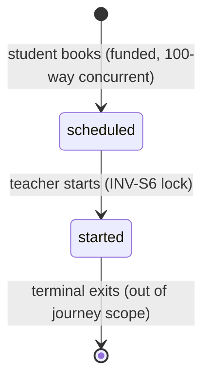
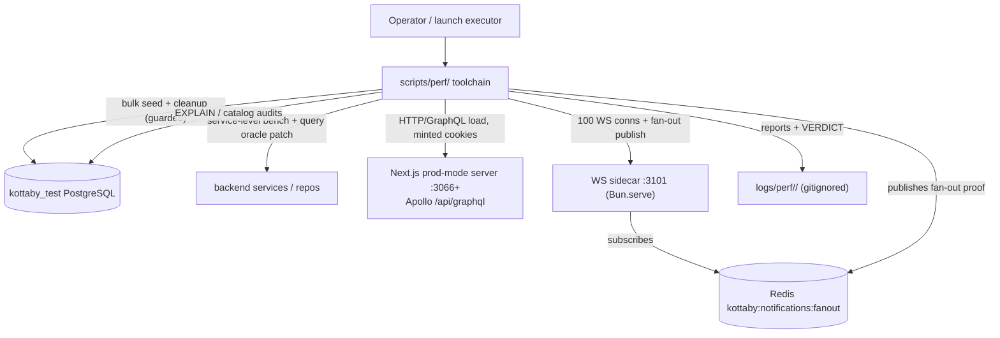
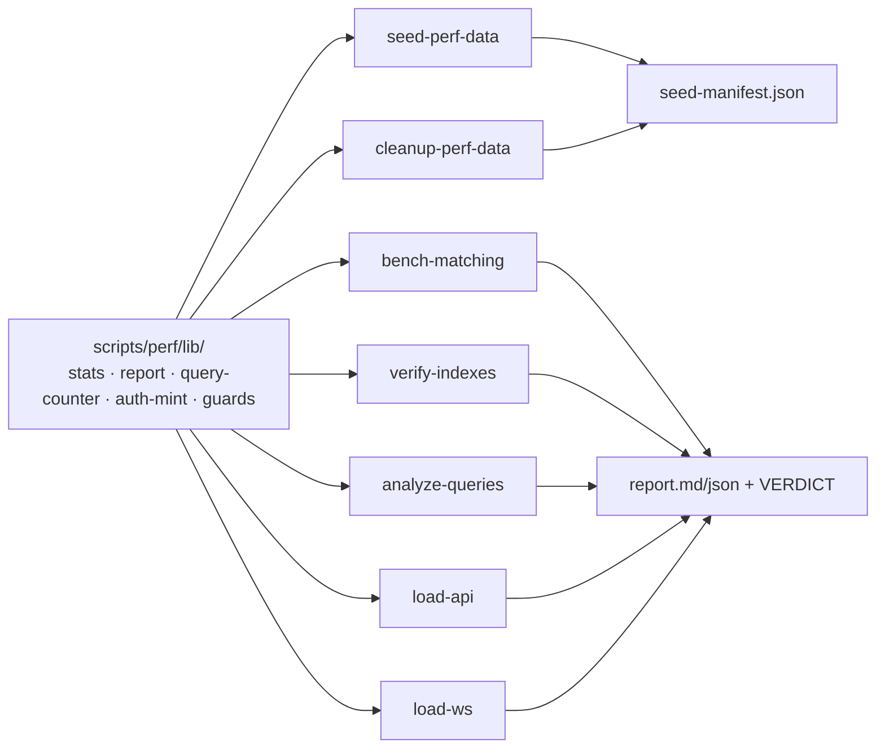

# Design Document: Load Testing & Performance Optimization

> **Plan directory (verbatim):** `ai/plans/milestone_4_integration_security_launch/load_testing_performance-load-testing-performance`
> **Requirements of record:** `ai/plans/milestone_4_integration_security_launch/load_testing_performance-load-testing-performance/specs.md` (REQ-0..REQ-12, Journey J1)

## Document Information

- **Feature Name**: Load Testing & Performance Optimization
- **Ticket**: `docs/planning/TICKETS.md:2911-2948` — Dev 3, Milestone 4, 8 SP
- **Target Directory**: `ai/plans/milestone_4_integration_security_launch/load_testing_performance-load-testing-performance`
- **Outcome Directory**: `ai/plans/milestone_4_integration_security_launch/load_testing_performance-load-testing-performance/outcome`
- **Version**: 1.0 · **Date**: 2026-10-08 · **Author**: Dev 3 stream (spec authored by planning agent)
- **Stakeholders**: Launch-checklist executor (downstream — `TICKETS.md:3029`), SRE/DBA, Admin (business acceptor), platform users (load personas)
- **Related Documents**: `docs/planning/PRODUCTION_READINESS.md:276-286` (§6 targets) · `docs/ops/disaster-recovery.md` (operator-tooling precedent) · `docs/graphql/dataloader-batching.md` · `docs/notifications/realtime-engine.md` · `docs/testing/workflow-journey-tests.md`

## Overview

This design delivers performance verification as **operator tooling plus two evidence-mandated code fixes** — the same posture as the finished DR sibling (`ai/finished_plans/milestone_4_integration_security_launch/disaster-recovery-backup-verification/plan.md`: "operator tooling, not application code"), extended with exactly the product-code changes the ticket's own acceptance criteria demand (N+1 elimination, index remediation).

1. **A Bun-native harness suite under `scripts/perf/`** (new directory, mirroring `scripts/ops/` conventions — co-located `*.test.ts`, `package.json` script registration pinned by a registration test, `VERDICT: PASS|FAIL` terminal output, timestamped run directories under `logs/perf/`): bulk seeder + cleanup, matching benchmark, FK/EXPLAIN auditors, 100-VU API load generator, 100-connection WS stability harness.
2. **The N+1 fix** for the three subscription page resolvers (`backend/graphql/pothos/billing/subscription.pothos.ts:68,109,116`) via page-level batch enrichment in the two list services, using new batch repository/service methods — SDL byte-identical.
3. **Index remediation**: the four unindexed FK columns (unconditional — ticket-mandated) plus matching-pipeline driving indexes (conditional on EXPLAIN evidence at seeded volume, per REQ-3.5).
4. **A runbook** (`docs/performance/load-testing.md`) binding every PRODUCTION_READINESS §6 item to a command, gate, and artifact, plus the caching-strategy doc (`docs/performance/caching-strategy.md`).

Zero new runtime/dev dependencies (k6/artillery/autocannon proven absent; Bun ships `fetch`, `WebSocket`, `performance.now()`). Zero UI. Zero new env keys (all knobs are CLI flags; the DB-target guard checks the resolved DSN itself).

### Design Goals

- **Evidence over assertion** — every §6 item gets a command, a measured artifact, and a gate verdict; nothing is "verified" by prose.
- **Measure reality, not the harness** — production-mode server for API gates, real login cookies, real sidecar with its real caps/throttle, real pool ceiling (`max: 10` — `backend/db/client.ts:156`).
- **Minimal write surface** — product code changes only where verified defects exist (3 resolvers + indexes); everything else is new tooling.
- **Reproducible + reversible** — prefix-isolated seed data with manifest-backed cleanup; run directories gitignored; exit-code gates CI-able.

### Key Design Decisions

### Decision D1: Bun-native harness, zero new dependencies
**Context:** Load testing needs a load generator; none exists (proven absent). **Options:** (1) k6/Artillery external binaries — new toolchain, AGPL k6, version pinning, separate scripting language; (2) autocannon npm dep — Node-centric HTTP-only, no WS client; (3) Bun-native TS harness reusing repo conventions. **Decision:** (3). **Rationale:** the repo already runs Bun-native `Bun.serve` WS server (`backend/ws/notification-ws-server.ts:110-127`) proving the runtime's WS stack; `scripts/ops/` proves the Bun-TS operator-tooling pattern with co-located tests; zero supply-chain additions; harness code is quality-gated by the same `sub-loop.ts` pipeline as product code.

### Decision D2: `scripts/perf/` as the tooling home; `perf:*` script registry
**Context:** Harnesses need a conventional home, testable modules, and npm-script entrypoints. **Options:** `test/perf/` (wrong — `test/` is test code, not operator CLIs); `scripts/perf/` (matches `scripts/ops/` precedent). **Decision:** `scripts/perf/` with shared lib under `scripts/perf/lib/`, entrypoints at `scripts/perf/*.ts`, `package.json` entries `perf:seed|perf:cleanup|perf:bench-matching|perf:verify-indexes|perf:analyze-queries|perf:load-api|perf:load-ws` in the `bun --env-file=.env.test scripts/perf/<tool>.ts` shape (matching the runner-wrapped test entry `"bun run scripts/lib/run-locked-cmd.ts test bun --env-file=.env.test test --timeout=60000"` — `package.json:21`), adjacency pinned by `scripts/perf/scripts-registration.test.ts` mirroring `scripts/ops/scripts-registration.test.ts:59-103`. **Rationale:** discovery, lint/test gates, and the destructive-target guard all follow the established ops-toolchain path.

### Decision D3: p95 gates run against the production-mode build; rate limiting bypassed — both as documented rulings
**Context:** Dev-mode Turbopack numbers are not production evidence; the in-memory per-IP limiter (100 req/60s — `backend/lib/ratelimit.ts:37-41`) would throttle a single-origin generator at ~1.7 req/s — measuring the limiter, not the API. **Options:** dev-server gates (unrepresentative); prod-mode gates with limiter on (measures limiter); prod-mode with the test-server boot env (`TEST_SERVER=1` + `IS_DEMO=true` — the operative bypass at `app/api/graphql/rate-limit.ts:34-48`; the runner also sets the set-but-unconsumed `DISABLE_RATE_LIMITING` flag — `test/scripts/run-server-tests.ts:182-192`). **Decision:** prod-mode (`TEST_SERVER_MODE=production`, dist `.next-test-prod` — `test/scripts/run-server-tests.ts:171-196`, built by `bun run build:test` → `test/scripts/build-test.ts:4`), limiter bypassed exactly as every other server-test suite already does; the ruling + its production implications are runbook-documented. **Rationale:** matches the Paymob E2E precedent (`package.json:35` uses the same runner in production mode); keeps the gate about API latency; limiter-throughput tuning is §4 Security's concern.

### Decision D4: N+1 fixed by page-level batch enrichment, NOT DataLoader plugin
**Context:** `@pothos/plugin-dataloader` is installed but intentionally not loaded (`backend/graphql/pothos/builder.ts:15-17`); `docs/graphql/dataloader-batching.md` is the forward contract; the established production counter-pattern is service-level batch-enrich (`backend/services/classes/session-lifecycle.queries.ts:113-121`); `backend/services/AGENTS.md:10` mandates batch service methods. **Options:** (1) load the dataloader plugin on these three fields — contradicts the builder's documented stance, adds per-request cache semantics; (2) request-scoped memo; (3) page-level enrichment in the two list producers + batch methods. **Decision:** (3), with field resolvers preferring parent-carried data and falling back to single-row calls only when absent (defensive; the query-count regression gate — REQ-5.7 — fails any producer that forgets). Ruling for the rule files: the `t.loadable()` MUST in `backend/graphql/pothos/AGENTS.md:20-22` is unsatisfiable while the dataloader plugin stays intentionally unloaded (`backend/graphql/pothos/builder.ts:15-17,:101`), so page-level enrichment + the parent-carried fast path is the sanctioned interim pattern per `docs/graphql/dataloader-batching.md`; and the dynamic `inArray` form (repo rule `backend/db/repo/AGENTS.md:29`, source-test-locked) wins over the placeholder form shown in `backend/graphql/pothos/AGENTS.md:26`. **Rationale:** constant queries per page with zero new caching semantics, SDL unchanged, matches both the AGENTS mandate and the proven pattern.

### Decision D5: Query-count oracle = harness-process `pg` patch
**Context:** REQ-5 needs a hard N+1 oracle; Drizzle/pg offer no built-in counter; the harness needs no pool handle: the client module exports `db` (`backend/db/client.ts:214`), `queryDb` (`:227`), `closePool` (`:272`), and `getDrizzleDbPool` (`:177`) — none expose query-counting. **Options:** pg_stat_statements extension (server config change, noisy); Apollo plugin (app-code change for testing); patch `pg`'s `Client.prototype.query` in the harness process (pg's `Pool` extends EventEmitter and delegates every query to a borrowed `Client` instance — `node_modules/pg-pool/index.js:66` — so one `Client.prototype.query` patch counts pooled and transaction-client round trips alike). **Decision:** `scripts/perf/lib/query-counter.ts` patches `Client.prototype.query` at harness startup, snapshots/deltas per measured operation, restores on uninstall; never imported outside `scripts/perf/`. **Rationale:** counts every real round trip including inside transactions with zero app-code changes and zero DB-server config changes.

### Decision D6: Scale-aware EXPLAIN gate, not a naive "no Seq Scan" grep
**Context:** PR §6 item 6.4 says "No full table scans"; at 100-row tables the planner correctly chooses seq scans, and ILIKE `'%…%'` predicates cannot use btree indexes at all. A naive gate would either always pass (tiny data) or always fail (name search). **Decision:** the gate flags Seq Scan nodes only when the scanned relation's estimated rows ≥ threshold (default 1,000) at the seeded volume; ILIKE-name-search cells report plan cost as evidence, not gate failures; pg_trgm stays a deferred item with explicit entry criteria (EXPLAIN shows materialized scan cost on ≥2,000-teacher volume AND the 200ms gate is threatened). **Rationale:** measures the launch-relevant failure mode (scan over grown tables) without inventing work.

### Decision D7: Seed into `kottaby_test` with prefix isolation + manifest cleanup — not a dedicated DB
**Context:** Perf data must be isolated and removable; journey tests already commit-and-cleanup in the shared test DB (`test/workflows/AGENTS.md` rules 2-3). **Options:** dedicated `kottaby_perf` DB (new infra, drizzle journal mismatch risk, migration drift); prefix-isolated rows in `kottaby_test` + manifest cleanup. **Decision:** the latter, with `perf_<8hex>` prefixes in emails/names, a `seed-manifest.json` run contract, a standalone cleanup tool that re-probes zero residue, and a destructive-target guard refusing any DSN not naming `kottaby_test` (precedent: `scripts/lib/destructiveDbGuard.ts`). **Rationale:** same database the launch-evidence stack already exercises (`.env.test` → `kottaby_test`); no schema drift; cleanup is contract-driven, not heuristic.

### Decision D8: WS harness math is derived from the documented caps
**Context:** 100 connections must coexist with per-user cap 5 (`backend/lib/env.ts:101-104`) and handshake throttle 5 tokens / 1 per 2s (`backend/ws/notification-ws-server-constants.ts:14-20`). **Decision:** ≥21 seeded identities (100/5 → 20 users minimum; +1 headroom), default ramp of an initial 5-connection burst then 1 connection per 2s (a throttle-honoring 100-connection ramp is ~190s — burst 5 + 95×2s; the bucket constants are hardcoded `backend/ws/notification-ws-server-constants.ts:14-17`, so no env override exists and none is added); harness clients do NOT auto-reconnect during the window so drops are observable; fan-out delivery is proven by publishing to the fixed channel `kottaby:notifications:fanout` (`backend/services/notifications/realtime/redis-pubsub-transport.ts:27`) with ioredis (already a dependency — `package.json:132`). **Rationale:** honors every documented §3.8 policy (`docs/notifications/realtime-engine.md:159-166`); measures the real handshake, liveness, and delivery paths. The WS client MUST present an allowlisted `Origin` header alongside the cookie (Origin is checked FIRST — `backend/ws/notification-ws-server-handshake.ts:62-73`; defaults `backend/lib/env.ts:93-98`).

### Decision D9: Index remediation split — unconditional FK set + evidence-conditional matching set
**Context:** Ticket mandates FK coverage; hot-column indexes must not be speculative. **Decision:** (a) unconditional: 4 FK columns (`session_request_idempotency.session_id`, `subscription_purchase_idempotency.subscription_id`, `broadcasts.sent_by_id`, `broadcasts.stopped_by_id`) via Drizzle `.index()` + `bun run db push`; (b) conditional on EXPLAIN at ≥2,000-teacher seeded volume: `teacher(is_online, is_approved)` composite and `teacher(average_rating)`; (c) explicitly NOT indexed by default: `users.full_name` (leading-wildcard ILIKE — btree useless; pg_trgm deferred per D6), `users.country_code` (2-value tier CASE — no selectivity). **Rationale:** every added index has a ticket clause or an EXPLAIN case; no folklore indexes.

### Decision D10: Reports are the deliverable — structured, diffable, secret-free
**Context:** §6 evidence must outlive the run and be auditable. **Decision:** every tool writes `logs/perf/<YYYY-MM-DDTHH-MM-SS>_<tool>/` containing `report.json` (machine), `report.md` (human), per-gate rows, and raw artifacts (explain plans, samples); terminal line `VERDICT: PASS|FAIL` + matching exit code; gitignore pattern `logs/perf/` added (the `logs/` tree is already untracked scratch — `logs/` appears in the working tree with run directories); no credentials/tokens/cookie values ever serialized. **Rationale:** the DR toolchain's manifest/report discipline (`scripts/ops/backup-database.ts` + `manifest.json`) is the proven in-repo pattern for tamper-evident operator evidence.

### UX/Navigation Specification (REQUIRED — explicit no-UI ruling)

Per specs.md §4: **this feature creates no routes, no pages, no sidebar entries, no bottom-nav changes, and no new GraphQL SDL.** The deliverables are operator CLIs and docs.

#### New Routes & URLs
| Route | Purpose | Permission Required | Roles with Access |
|-------|---------|---------------------|-------------------|
| *(none)* | n/a | n/a | n/a |

#### Sidebar Navigation Integration
- No group/parent/children changes in any navigation surface (student/teacher/parent/admin dashboards unchanged).

#### Role-Based Access Matrix
| Role | Routes Accessible | Permissions Granted |
|------|-------------------|---------------------|
| SUPER_ADMIN, ACADEMY_ADMIN, SUPERVISOR, TEACHER, PARENT, STUDENT, STAFF, USER, GUEST | unchanged | none granted/revoked |

#### Per-Audience Rendering
| Audience | Prominent Content / Differences |
|----------|----------------------------------|
| All | none — no UI is created; users observe only existing surfaces' latency envelope |

#### Permission Mapping
| Component/Route | Required Permission | Source |
|----------------|---------------------|--------|
| `scripts/perf/*` CLIs | none (operator shell access; DB-target guard enforces scope) | `scripts/lib/destructiveDbGuard.ts` precedent |

#### GraphQL SDL & Permission Matrix (no-change ruling)
- Schema diff discipline: `bun run generate:gqlSchema` output is **byte-identical** before/after REQ-5 (resolver-internal change). The plan-review and Phase-1.5 gate re-check this.
- No new fields/mutations/queries → no permission matrix changes (`authScopes` untouched — student-only `browseAvailableTeachers` at `backend/graphql/query/teachers/teacher-matching.query.ts:123-129`, admin-only `adminStudentSubscriptions` at `backend/graphql/query/billing/subscription-admin.query.ts` `adminOnlyAuthScopes`).

### Translation System Requirements
- **Zero new locale namespaces** (operator output is not user-facing — scripts/ops precedent has none).
- REQ-5 touches services/resolvers but MUST NOT alter any user-facing message; existing suites stay the oracle.
- Enum value imports for all runtime enum use in harness/seed code (`SessionStatus`, `UserRole`, `SessionIntent`, `RecitationReading`, `TeacherMatchingSort` — all as value imports).

### Concurrency & Race Condition Assessment (CONDITIONAL — included: REQ-6/7/8 are concurrency features)

**Concurrency Model.** The platform is a single Next.js process (10-connection pg pool — `backend/db/client.ts:154-169`) plus a standalone `Bun.serve` WS sidecar (default `127.0.0.1:3101` — `backend/lib/env.ts:80,83`) fed by Redis pub/sub. Load arrives as 100+ authenticated GraphQL requests and 100 WS handshakes against these two processes; the DB is the shared bottleneck by design.

**Race Condition Scenarios:**

| Scenario | Actors | Risk | Mitigation / Design |
|----------|--------|------|---------------------|
| 100 VUs vs pool `max: 10` | API generator ↔ pg pool | queue latency hides in p95; connectionTimeout 10s (`client.ts:159`) under-siege | harness measures end-to-end latency (queue-inclusive, honest); FAIL diagnosis includes `pg_stat_activity` peak snapshot; pool resize is a ledgered follow-up, not this ticket |
| Concurrent booking, distinct students | 100 students → booking tx | deadlock 40P01, double-hold | distinct student rows ⇒ no same-row lock contention; booking writes follow repo single-statement guarded discipline (`backend/db/repo/AGENTS.md:30`); journey J1 asserts zero 40P01 and 1:1 hold↔session |
| Hot-teacher contention | many students → same teacher | serializer bottleneck on teacher row reads | bookings serialize on the hot teacher's FOR UPDATE row (`TeacherRepository.lockForCertificationCheck` — `backend/services/classes/session-lifecycle.booking.ts:245`); uniform teacher→student lock order keeps AB-BA deadlock unlikely (zero-40P01 oracle still sound); `--hot-teachers` is the contention knob; the matcher's NOT EXISTS read stays non-locking (`teacher.repository.matching.helpers.ts:140`) |
| Escrow balance race (same student, concurrent requests) | student ↔ escrow hold | INV-B4 breach | out of functional scope (Financial Safety ticket owns depth — `TICKETS.md:2985`); J1 uses funded single-shot students + one deliberately-unfunded negative probe; no same-student concurrent hammering (documented boundary) |
| 100 WS handshakes vs token bucket | harness ↔ sidecar | spurious `4429` rejections | ramp: 5-conn burst then 1/2s (~190s for 100 — D8); bucket raise via env documented for soak runs only |
| Per-user cap eviction during ramp | 21 identities × 5 conns | silent `4009` eviction | identity plan guarantees ≤5 conns/user (100 = 20×5); harness asserts zero `4009` |
| Rate-limit map growth | limiter under load | unbounded memory | pre-existing bound: `MAX_TRACKED_IDENTIFIERS = 10_000` with eviction to 80% (`backend/lib/ratelimit.ts:51`); bypassed under `TEST_SERVER=1` anyway |
| Harness sample buffers | 100 VUs × duration | O(N) memory blow-up | REQ-12.3: incremental aggregation (count/sum/sumsq + per-scenario histograms), no per-request retention |
| Query-counter patch lifetime | harness process | leaked patch skewing later counts | install/uninstall bracketing + snapshot/delta API (D5); unit test proves restoration |

**SELECT FOR UPDATE Usage.** None introduced by this plan (no new repo methods lock rows; batch read methods are plain selects/`inArray`). Existing locking discipline is exercised, not changed.

**TOCTOU Windows.** None created. The enrichment pass (REQ-5) reads plan/audit rows after the page rows are fetched — a benign read-read window; staleness bounded by the page query itself (same transactional context as today's per-row reads, strictly fewer round trips).

### Cross-Actor Journey Design (J1 — Concurrent Booking Under Load)

**Shared-Entity State Machine** (existing session lifecycle — verified at `docs/sessions/session-lifecycle.md`; this plan only observes it under load):

| Current State | Trigger (actor + action) | Next State | Guard / Permission |
|---------------|--------------------------|------------|--------------------|
| *(absent)* | student books eligible teacher | `scheduled` (escrow hold debited) | student role + INV-B4 funded (`state-machine-invariants.md:155`) |
| `scheduled` | teacher starts session | `started` (teacher `is_online=false` — INV-S6 `:47`) | teacher role, ownership |
| `started` | other student browses | teacher excluded from results (INV-A3 `:122`) | read path, no transition |



**Side-Effect Matrix (per transition):**

| Transition | Rows Created/Updated | Notifications (channel → recipient) | Idempotency Key |
|------------|----------------------|--------------------------------------|-----------------|
| book → `scheduled` | `session` row; student balance hold-debit; `session_request_idempotency` claim | session-request → teacher (spied `SpiedFanoutTransport`) | existing request-idempotency unique key |
| start → `started` | session status update; `teacher.is_online=false` | (existing waves, out of J1 assertions) | single-writer discipline |
| unfunded probe → *(rejected)* | none (asserted zero-residue) | none | n/a |

**Cross-Actor Visibility:**

| State | Booking student sees | Other students see | Teacher sees |
|-------|----------------------|--------------------|-------------|
| `scheduled` | own session row + debited balance | nothing of others' rows; teacher still listed | persisted notification in inbox (spied dispatch proof) |
| `started` | own session `started` | teacher **excluded** from browse results (INV-A3) | `is_online=false` (INV-S6) |

This matrix is J1's assertion set (`test/workflows/sessions/concurrent-booking-load.journey.test.ts`), per `test/workflows/AGENTS.md` rules 1–13 (incl. rule 13 DIAGRAMS.md mermaid + `bun run validate:mermaid`).

### Outcome & Knowledge Transfer Protocol (`.../outcome/`)
- **BEFORE Execution:** read ALL files in `ai/plans/milestone_4_integration_security_launch/load_testing_performance-load-testing-performance/outcome/`.
- **AFTER Execution:** write `outcome/<task-id>-outcome.md` per task.
- **PROGRESS TRACKING:** `[ ]` → `[x]` in `tasks.md` only when all five subtask stages (QL/TE/SEC/SR/IV) pass.

## Architecture

### System Context



### High-Level Architecture



### Technology Stack
| Layer | Technology | Rationale |
|-------|------------|-----------|
| Harness runtime | Bun 1.4.0 (`package.json:5`) | native `fetch`/`WebSocket`/`performance.now()`; repo runtime |
| HTTP load | Bun `fetch` + `Promise`-based VU loops | no autocannon dep (proven absent); full control of ramp/mix |
| WS load | Bun `WebSocket` client | same runtime as the `Bun.serve` server (`backend/ws/notification-ws-server.ts:110`) |
| DB access | existing `@/backend/db` (`db`, `queryDb` — `client.ts:214,227`) + Drizzle | single source of pool/dialect behavior; PGlite mode simply unsupported by perf tools (guard documents it) |
| Fan-out proof | ioredis publish (`package.json:132`) | sidecar already requires Redis (`scripts/start-notification-ws.ts:27-40`) |
| Server under test | prod-mode Next via existing runner (`test/scripts/run-server-tests.ts:171-196`) | launch-representative numbers; precedent: Paymob E2E (`package.json:35`) |

## Components and Interfaces

### Component 1: `scripts/perf/lib/` shared harness library — **CREATE**

**Purpose:** the measurement/reporting/guard substrate every tool composes.

**Responsibilities:** percentile summaries + gate evaluation; run-directory/report lifecycle + VERDICT emission; query-count oracle install/uninstall; auth-cookie minting; destructive-target guard; incremental latency aggregation.

**Interfaces (exact signatures):**
```ts
// scripts/perf/lib/stats.ts
export interface LatencySample { scenarioId: string; durationMs: number; ok: boolean; errorCode?: string }
export interface PercentileSummary { count: number; errorCount: number; p50: number; p95: number; p99: number; max: number }
export interface GateThreshold { id: string; p95MaxMs?: number; maxErrorCount?: number }
export interface GateResult { id: string; passed: boolean; observed: Partial<PercentileSummary>; breaches: string[] }
export function summarizeSamples(samples: readonly LatencySample[]): PercentileSummary
export function evaluateGate(summary: PercentileSummary, threshold: GateThreshold): GateResult

// scripts/perf/lib/report.ts
export interface PerfRunContext { runId: string; tool: string; startedAt: string; args: Record<string, string | number | boolean> }
export function openRunDirectory(tool: string): { runDir: string; runId: string }
export function writeReport(ctx: PerfRunContext, gates: GateResult[], sections: Record<string, unknown>): void
export function emitVerdict(gates: readonly GateResult[]): boolean   // prints VERDICT line; returns pass

// scripts/perf/lib/query-counter.ts
export interface QueryCountSnapshot { total: number; byFingerprint: ReadonlyMap<string, number> }
export interface QueryCountHandle { snapshot(): QueryCountSnapshot; deltaSince(s: QueryCountSnapshot): number; uninstall(): void }
export function installQueryCounter(): QueryCountHandle

// scripts/perf/lib/auth-mint.ts
export interface MintedSession { userId: number; email: string; cookieHeader: string }
export async function mintSessionCookie(baseUrl: string, email: string, password: string): Promise<MintedSession>

// scripts/perf/lib/db-target-guard.ts
export function assertTestDatabaseTarget(databaseUrl: string, opts?: { forceFlag?: boolean }): { ok: true; dbName: string }
```

**Implementation Notes:** nearest-rank percentiles (deterministic, no interpolation ambiguity); `installQueryCounter` patches `pg`'s `Client.prototype.query` (pg's Pool delegates every query to a borrowed Client — `node_modules/pg-pool/index.js:66` — so one patch covers pooled + transaction-client queries) and MUST restore on uninstall (unit-proved); `mintSessionCookie` drives the real `login` mutation (`backend/graphql/mutation/auth.mutation.ts:80`) and reads `Set-Cookie` (`access_token` — `backend/lib/auth/cookies.ts:37`); guard refuses DSNs whose database name ≠ `kottaby_test` (uppercase/lowercase tolerant) unless `--force-prod-shaped-target` (mirror of `scripts/lib/destructiveDbGuard.ts` posture).

### Component 2: Seeder + Cleanup — **CREATE**

**Purpose:** one command to build a production-shaped, prefix-isolated dataset; one command to remove it exactly.

**Interfaces (CLI contracts):**
```ts
// scripts/perf/seed-perf-data.ts
// bun --env-file=.env.test scripts/perf/seed-perf-data.ts \
//   --teachers 2000 --students 120 --sessions 5000 --notifications 20000 \
//   --subscriptions 500 --hot-teachers 8 [--run-id <hex8>]
// writes logs/perf/<ts>_seed/seed-manifest.json { runId, prefix, startedAt, counts: { teacher, users, student, session, notification, subscription, wallet }, identity: { emailsByRole } }

// scripts/perf/cleanup-perf-data.ts
// bun --env-file=.env.test scripts/perf/cleanup-perf-data.ts --run <runId> | --last
// hard-deletes by prefix in FK-safe order; re-probes counts==0; exit 1 on residue
```

**Implementation Notes:** teachers satisfy the full matcher predicate (`is_online=true`, `is_approved=true`, eligible user flags — `teacher.repository.matching.helpers.ts:129-141`) with deterministic distributions over `recitations`/`subjects`/`languages`/`country`/`countryCode`/`average_rating`; hot teachers get `started` sessions (NOT EXISTS branch — `:140`); students funded per INV-B4 (`state-machine-invariants.md:155`); volume tables via chunked multi-row inserts (batch size ≤500); row shapes follow `backend/db/test/entity-setup.ts` conventions (e.g., teacher defaults `isApproved: true` — `:558-563`) but use bulk SQL/Drizzle inserts, not per-row helpers; emails/names carry the `perf_<runId>_` prefix; passwords random per run, recorded only in-memory + manifest as bcrypt-hashed (never plaintext beyond process lifetime).

### Component 3: Matching Benchmark — **CREATE**

**Purpose:** REQ-2 — p95 < 200ms service-level gate at 100+ teachers, with scale-matrix evidence.

**Interface:** `bun --env-file=.env.test scripts/perf/bench-matching.ts [--volumes 100,500,2000] [--samples 30] [--warmup 5] [--gate-ms 200]`

**Implementation Notes:** calls `TeacherMatchingService.browseAvailableTeachers(studentUserId, input, locale)` (`teacher-matching.service.ts:354-359`) directly with real seeded student/teacher data through the global `db` (no `tx` — matches production request context); a caller student is seeded if absent; matrix per specs REQ-2.2; every sampled call asserts the envelope (`total/page/pageSize/pageCount` — `teacher-matching.service.ts:423-429`) and INV-A3 exclusion; per-cell latency + gate table land in the report.

### Component 4: Index Auditor — **CREATE**

**Purpose:** REQ-3 — FK coverage check + hot-column planner-choice verification.

**Interface:** `bun --env-file=.env.test scripts/perf/verify-indexes.ts [--json]`

**Implementation Notes:** queries `pg_constraint contype='f'` joined with `pg_indexes`/`pg_attribute` via `queryDb` (`backend/db/client.ts:227`); coverage rule: an FK column is covered iff some index (btree/unique/PK-backed) lists the column as leading column or the FK's referencing columns are a prefix of an index's columns; hot-column planner check runs EXPLAIN on the matching query (seed volume required) and reports the chosen index per D9; gate = zero uncovered FK columns; the four known gaps (specs REQ-3.2) must transition to covered within this plan.

### Component 5: EXPLAIN Query Auditor + Scan Gate — **CREATE**

**Purpose:** REQ-4 — canonical-query plan evidence with a scale-aware scan gate.

**Interfaces:**
```ts
// scripts/perf/lib/query-registry.ts
export interface RegistryEntry { id: string; minVolumeNote?: string; build: () => { sql: string; params: unknown[] } | { drizzle: SQL } }
export const CANONICAL_QUERY_REGISTRY: readonly RegistryEntry[]
// scripts/perf/analyze-queries.ts
// bun --env-file=.env.test scripts/perf/analyze-queries.ts [--scan-threshold-rows 1000]
```

**Implementation Notes:** registry seeds include: matching candidates (all filter/sort variants — SQL rebuilt from the repo helpers' shape), `mySubscriptions` page SQL, `adminStudentSubscriptions` page SQL, notifications list, session lists, `UserRepository.findById` (the per-request context read — `backend/graphql/gqlContextFactory.ts:266`); each runs under `EXPLAIN (ANALYZE, BUFFERS, FORMAT JSON)`; gate logic walks plan nodes for `Seq Scan` with `Plan Rows >= threshold` (D6); per-query JSON plans persisted as `explain/<id>.json`; matching's NOT EXISTS subplan must use `session_teacher_id_status_idx` (`backend/db/schema/classes/session.ts:91`) — flagged otherwise.

### Component 6: API Load Generator — **CREATE**

**Purpose:** REQ-6 — 100 VUs, scenario registry, p95 < 500ms per scenario, prod-mode server.

**Interfaces:**
```ts
// scripts/perf/lib/api-scenarios.ts
export interface ApiScenario {
  id: string; weight: number; role: "student" | "admin";
  buildRequest(cookie: string, state: { runId: string; iteration: number }): { body: unknown; headers: Record<string, string> }; // booking scenario mints a unique `x-idempotency-key` header per request — `backend/graphql/gqlContextFactory.ts:242`
  expect: { kind: "graphql"; mustSucceed: boolean };
}
export const API_SCENARIOS: readonly ApiScenario[]   // login, browse (±filters), mySubscriptions (enriched fields), notifications list, bookSession, adminStudentSubscriptions
// scripts/perf/load-api.ts
// bun --env-file=.env.test scripts/perf/load-api.ts [--vus 100] [--duration-s 120] [--ramp 10/5s] [--base-url http://localhost:3066] [--weights ...] [--self-check]
```

**Implementation Notes:** boots/uses a production-mode server via the same env knobs `run-server-tests.ts` consumes (`TEST_SERVER_MODE=production`, `NEXT_DIST_DIR=.next-test-prod`, `TEST_SERVER=1` + `IS_DEMO=true` as the operative limiter bypass — `app/api/graphql/rate-limit.ts:34-48`, health-wait `HEAD /api/graphql` → 204 — `test/scripts/run-server-tests.ts:137-147`); identities drawn from the seed manifest; cookies minted once at VU start (Component 1) and reused; samples aggregated incrementally (REQ-12.3); scenario gates evaluated per specs REQ-6.3; booking scenario realizes "100 concurrent session requests — all succeed" (`TICKETS.md:2940`) with per-request outcome classification (created | translated-domain-rejection | transport-error); `--self-check` runs 2 VUs × 10s for plumbing verification without gate semantics.

### Component 7: WS Stability Harness — **CREATE**

**Purpose:** REQ-8 — 100 authenticated connections, heartbeat-stability window, 100% fan-out delivery, soak command.

**Interface:** `bun --env-file=.env.test scripts/perf/load-ws.ts [--connections 100] [--identities 21] [--duration-s 300] [--ramp 5/2s] [--fanout-bursts 3] [--no-reconnect]`

**Implementation Notes:** connects to `ws://127.0.0.1:3101` (env-derived `WS_HOST`/`WS_PORT` — `backend/lib/env.ts:80,83`) with minted `access_token` cookies AND an allowlisted `Origin` header (Origin is checked first — `backend/ws/notification-ws-server-handshake.ts:62-73`, :89-91 for the cookie; defaults `backend/lib/env.ts:93-98`); expects the real 30s/2-miss liveness (`backend/ws/notification-ws-server-constants.ts:8-11`) — pongs observed per ping cycle; honors the token bucket ramp (5-conn burst then 1/2s, ~190s for 100 — D8); fan-out proof publishes a guard-valid envelope `{ userIds, payload }` to `kottaby:notifications:fanout` (`redis-pubsub-transport.ts:27`; envelope validated by `parseFanoutEnvelope`, delivered only to member userIds — `:31,57-67`) with ioredis (already a dependency — `package.json:132`), `userIds` covering all connected identities and a unique `data.id` per burst and measures delivery latency per connection (gate p95 ≤ 2s, 100% delivery across all connected identities); fail-fast when sidecar down or transport misconfigured (REQ-8.5); no auto-reconnect during window (drops observable); cleanup closes all sockets and verifies zero residue client-observably (all closed cleanly; zero deliveries after close — the sidecar exposes no registry-count surface, its single `fetch` is the handshake — `backend/ws/notification-ws-server.ts:126`).

### Component 8: N+1 Batch Enrichment — **UPDATE (product code)**

**Purpose:** REQ-5 — constant round trips for subscription pages.

**Interfaces (new/changed signatures):**
```ts
// backend/db/repo/billing/plan.repository.ts  (UPDATE — add)
export async function findByIds(ids: number[], tx?: DBQueryExecutor): Promise<PlanSelectType[]>
// dynamic inArray select — never prepared (backend/db/repo/AGENTS.md:29) — tx/no-tx split mirroring the file's bare-read convention (`findBalanceLanesByIds`, `backend/db/repo/billing/plan.repository.ts:189`; no-tx leg via `queryDb` `= ANY($1::int[])` per `:8-14`)

// backend/db/repo/audit/audit-trail.repository.ts  (UPDATE — add)
export async function countEntriesByEntityIds(entityType: string, entityIds: number[], tx?: DBQueryExecutor): Promise<Map<number, number>>  // entityType = canonical audit label, e.g. SUBSCRIPTION_AUDIT_ENTITY_TYPE (backend/services/billing/subscription-admin.helpers.ts:53)
// sql<number> conditional aggregation + .mapWith(Number) (backend/db/repo/AGENTS.md:34)
export async function listLatestEntriesByEntityIds(entityType: string, entityIds: number[], tx?: DBQueryExecutor): Promise<Map<number, SubscriptionAuditTrailPeek | null>>  // entityType = canonical audit label, e.g. SUBSCRIPTION_AUDIT_ENTITY_TYPE (backend/services/billing/subscription-admin.helpers.ts:53)
// DISTINCT ON (entity_id) ORDER BY created_at DESC — one round trip

// backend/services/billing/plan-catalog.service.ts  (UPDATE — add)
export async function findByIds(ids: number[], locale?: string, tx?: DBTransaction): Promise<Map<number, PlanReturnType | null>>

// backend/services/billing/subscription-admin.service.ts  (UPDATE — add)
export async function auditEntriesCountBatch(subscriptionIds: number[]): Promise<Map<number, number>>
export async function auditTrailPeekBatch(subscriptionIds: number[]): Promise<Map<number, SubscriptionAuditTrailPeek | null>>

// backend/types/billing/subscription.types.ts  (EXTEND)
export type EnrichedSubscriptionReturnType = SubscriptionReturnType & {
  // flat structural supertype — producers merge enrichment into row copies
  // (Object.assign idiom — session-lifecycle.queries.ts:113-121) so the rows
  // stay assignable to objectRef<SubscriptionReturnType>
  plan?: PlanReturnType | null;
  auditEntriesCount?: number;
  auditTrailPeek?: SubscriptionAuditTrailPeek | null;   // backend/types/billing/subscription-admin.types.ts:14
}
```

**Implementation Notes:** the two list producers (`SubscriptionPurchaseService.listOwn` — reached from `backend/graphql/query/subscription.query.ts:62`; `SubscriptionAdminService.listForAdmin` — `backend/graphql/query/billing/subscription-admin.query.ts:60`) build enriched pages in ONE pass per page (≤3 extra queries total: plan batch, audit count batch, audit peek batch); the three field resolvers (`subscription.pothos.ts:68,109,116`) prefer `parent`-carried data and fall back to the existing single-row calls only when absent (D4); `bun run generate:gqlSchema` byte-identical before/after; per `backend/db/repo/AGENTS.md:38-39` new repo methods import from the owning namespace and types live in `backend/types/`. Service-layer batch mandate followed with a recorded number-keyed deviation (int4 PKs; precedents `user.repository.ts:244-247`, `parent-link-request-reminder.repository.ts:93-95`; the rule's literal string-keyed shape targets the unloaded dataloader plugin). The audit peek batch keeps the service-side fail-closed action-type certification (`subscription-admin.service.ts:575-601`) — the repo returns raw rows; certification stays above the repo seam.

### Component 9: Runbook + Caching Strategy docs — **CREATE**

**Purpose:** REQ-11/REQ-9 — operator docs binding §6 items to commands and defining the caching posture.

**Files:** `docs/performance/load-testing.md` (runbook: per-item command/precondition/gate/artifact/interpretation + §6 sign-off table + triage order + environment caveats per specs REQ-11.3); `docs/performance/caching-strategy.md` (inventory, when-to-cache evidence rules, batch-enrichment as first-line, `CACHE_PROVIDER` deferred seam, permission-before-cache restatement, closing evidence from REQ-6). Doc shape follows the docs file structure convention (Why → Pattern/Rules → What NOT to do → Related).

## Data Models

### New DB objects: indexes only (no new tables/columns)

| Table | Index (Drizzle definition) | Evidence class | Schema file |
|---|---|---|---|
| `session_request_idempotency` | `index("session_request_idempotency_session_id_idx").on(t.sessionId)` | Unconditional — FK coverage (ticket `:2945`) | `backend/db/schema/classes/session-request-idempotency.ts:32` col |
| `subscription_purchase_idempotency` | `index("subscription_purchase_idempotency_subscription_id_idx").on(t.subscriptionId)` | Unconditional — FK coverage | `backend/db/schema/billing/subscription-purchase-idempotency.ts:32` col |
| `broadcasts` | `index("broadcasts_sent_by_id_idx").on(t.sentById)` · `index("broadcasts_stopped_by_id_idx").on(t.stoppedById)` | Unconditional — FK coverage | `backend/db/schema/notifications/broadcasts.ts:45-51` cols |
| `teacher` | `index("teacher_matching_online_approved_idx").on(t.isOnline, t.isApproved)` · `index("teacher_average_rating_idx").on(t.averageRating)` | **Conditional** — EXPLAIN at ≥2,000-teacher volume (D9; REQ-3.5) | `backend/db/schema/teachers/teacher.ts:19` table |

Applied via `bun run db push` (root `AGENTS.md` Drizzle convention; no custom SQL — pg_trgm stays deferred per D6 entry criteria). Co-located repo tests assert the indexes exist post-push; `verify-indexes.ts` re-proves coverage live.

**Validation Rules:** no NOT NULL/enum/type changes; migrations stay additive-only.

### Run artifact schemas

```ts
// seed-manifest.json
{ "runId": "a1b2c3d4", "prefix": "perf_a1b2c3d4_", "startedAt": "ISO", "database": "kottaby_test",
  "counts": { "users": 2121, "teacher": 2000, "student": 120, "session": 5000, "notification": 20000, "subscription": 500, "wallet": 120 },
  "identities": { "studentEmails": ["..."], "adminEmails": ["..."], "wsIdentityEmails": ["..."], "passwordNote": "random per run; not persisted in plaintext" } }

// report.json (all tools)
{ "tool": "load-api", "runId": "...", "startedAt": "ISO", "args": {...}, "environment": { "serverMode": "production", "node": "bun 1.4.0", "db": "kottaby_test" },
  "gates": [GateResult], "scenarios": [{ "id": "...", "summary": PercentileSummary }], "verdict": "PASS" }

// §6 evidence row emitted per tool
{ "prItem": "6.1", "gate": "p95 < 500ms @100 VUs", "result": "PASS", "runDir": "logs/perf/..._load-api", "timestamp": "ISO" }
```

**Relationships:** manifest 1—N run reports (a seed run feeds several gated tools); cleanup consumes the manifest exclusively.

## API Design

### GraphQL SDL — explicit no-change ruling
- Zero new queries/mutations/fields/types. `bun run generate:gqlSchema` diff is empty before vs after the whole plan (checked at Phase-1.5 gate and again in the review wave).
- Existing permission wiring untouched: `browseAvailableTeachers` student-only (`backend/graphql/query/teachers/teacher-matching.query.ts:123-129`), `mySubscriptions` student-only (`backend/graphql/query/subscription.query.ts:48-56`), `adminStudentSubscriptions` admin-only (`adminOnlyAuthScopes`).

### CLI contracts (the "API" of this plan)

| Command (package.json) | Entrypoint | Key flags | Gate / exit semantics |
|---|---|---|---|
| `perf:seed` | `scripts/perf/seed-perf-data.ts` | `--teachers --students --sessions --notifications --subscriptions --hot-teachers --run-id` | exit 0 + manifest; non-test DB refused |
| `perf:cleanup` | `scripts/perf/cleanup-perf-data.ts` | `--run <id> \| --last` | exit 0 iff zero residue |
| `perf:bench-matching` | `scripts/perf/bench-matching.ts` | `--volumes --samples --warmup --gate-ms` | VERDICT: p95 < 200ms at 100-teacher cells |
| `perf:verify-indexes` | `scripts/perf/verify-indexes.ts` | `--json` | exit 0 iff zero uncovered FK columns |
| `perf:analyze-queries` | `scripts/perf/analyze-queries.ts` | `--scan-threshold-rows` | VERDICT: zero materialized Seq Scans |
| `perf:load-api` | `scripts/perf/load-api.ts` | `--vus --duration-s --ramp --base-url --weights --self-check` | VERDICT: per-scenario p95 < 500ms, 0 transport errors |
| `perf:load-ws` | `scripts/perf/load-ws.ts` | `--connections --identities --duration-s --ramp --fanout-bursts` | VERDICT: 0 drops, 100% fan-out delivery |

All follow `bun --env-file=.env.test scripts/perf/<tool>.ts` (matches the runner-wrapped test entry `"bun run scripts/lib/run-locked-cmd.ts test bun --env-file=.env.test test --timeout=60000"` — `package.json:21`); registration pinned by `scripts/perf/scripts-registration.test.ts` (mirror of `scripts/ops/scripts-registration.test.ts:59-103`). `logs/perf/` gitignored.

**Error Responses (CLI):** non-test DB target → refuse (exit 2, actionable message); sidecar down / `in-process` transport → fail-fast message mirroring `scripts/start-notification-ws.ts:27-40`; missing seed manifest → list available runs; server not ready within health deadline → abort with runner semantics (`SERVER_READY_TIMEOUT_MS` — `test/scripts/run-server-tests.ts:14-17`).

## Security Considerations

### Authentication
- Harness identities authenticate through the real `login` mutation (`backend/graphql/mutation/auth.mutation.ts:80`); cookies (`access_token` — `backend/lib/auth/cookies.ts:37`) live in harness memory only, never logged/persisted (REQ-12.6).
- WS harness connects through the real cookie handshake (`backend/ws/notification-ws-server-handshake.ts:89-91`) — no auth bypass; origin allowlist (`WS_ALLOWED_ORIGINS`) exercised as-is.

### Authorization
- No new permissions; scenarios use role-correct cookies (student scenarios never call admin fields; the admin scenario uses an admin cookie). BFLA depth remains Security Hardening's domain (`TICKETS.md:2798-2836`).
- REQ-5 enrichment runs **after** the caller-authorized list query (owner-scoped `listOwn`; admin-scoped `listForAdmin`) — enrichment adds no new authorization surface; permission-before-cache ordering preserved (`backend/services/AGENTS.md:14`).

### Data Protection
- Perf data is synthetic (random names/emails under `perf_` prefix), lives only in `kottaby_test`, and is removable by manifest contract; no PII from real users.
- Reports redact by construction: only counters/latencies/plan JSON — never SQL params containing secrets, tokens, or cookie values.

### Input Validation
- Seed/bench inputs validated by CLI arg parsing (typed flags, bounded ranges); search-like filter values reuse the service's existing `escapeLikeWildcards` path (imported at `backend/services/teachers/teacher-matching.service.ts:76` from `@/backend/lib/db/escape-like-wildcards`, applied in `quotedTokenPattern` at `:215-217` and `resolveNameSearchPattern` at `:236`) because benchmarks call the service — no raw SQL string interpolation anywhere in the harness beyond parameterized `queryDb` calls (`backend/db/client.ts:227-230`).
- The destructive-target guard (Component 1) is the primary boundary: `kottaby_test` name check + explicit force flag.

### Tenancy
- No tenant model is introduced or altered; perf rows are ordinary rows created by the same repositories/services that own them.

## Error Handling

| Category | Signal | Harness behavior |
|---|---|---|
| Transport error | fetch reject / non-2xx / WS close ≠ documented policy | counted per scenario; gate breach (`load-api`), connection-drop verdict (load-ws) |
| Domain rejection | GraphQL error with translated code | classified `domain-rejection` — not a transport failure; booking scenario counts outcomes (specs REQ-6.4) |
| Deadlock (40P01) | pg error code | surfaced verbatim in journey J1 assertions — zero tolerated (specs REQ-7.2) |
| Server not ready | health-check timeout | abort with runner's deadline semantics (`run-server-tests.ts:14-17,137-147`) |
| Wrong DB target | guard refusal | exit 2 + actionable message (Component 1) |
| Sidecar misconfig | `in-process` transport / no Redis | fail fast, mirroring `scripts/start-notification-ws.ts:27-40` |
| Mid-run crash | unhandled error | exit handlers clean sockets/processes; manifest persists → cleanup always possible (REQ-12.2) |

### Logging Strategy
- Harness operator output follows the `scripts/ops/` idiom — direct `console.*` is ESLint-sanctioned for `scripts/**/*.ts` (`eslint.config.mjs:237,244` overrides the global `no-console: "error"` at `:165`; precedent `scripts/ops/backup-database.ts:127-128`). The backend `@/backend/lib/logger` remains the rule anywhere under `app/`/`backend/`/`frontend/`/`shared/`.
- Structured artifacts (report.json, explain/*.json, seed-manifest.json) are the durable evidence trail.

## Performance Considerations

### Expected Load
- **Concurrent users:** 100 VUs (ticket regime — `TICKETS.md:2926`); 100 WS connections; DB pool ceiling 10 (`backend/db/client.ts:156`).
- **Data volume per seed run (defaults):** 2,000 teachers (scale matrix headroom over the 100+ regime), 120 students, 5,000 sessions, 20,000 notifications, 500 subscriptions.

### Performance Requirements (gates — full mapping in specs §6 table)
- p95 < 500ms per API scenario @100 VUs; matching p95 < 200ms @100+ teachers; WS 100-conn stability + 100% fan-out; zero materialized seq scans; list ops ≤ K round trips; zero uncovered FK columns.

### Optimization Strategies (in priority order)
1. Index remediation (D9) — planner-verified.
2. N+1 batch enrichment (D4) — 3N+1 → ≤6 round trips per page.
3. Everything else is measured before touched: the harness FAIL diagnosis (pg_stat_activity peak, per-scenario decomposition, plan artifacts) is the entry point for any further optimization; no speculative caching (D-caching: strategy doc + evidence).

### Monitoring and Metrics
- In-run: per-scenario latency percentiles, throughput, error taxonomy, in-flight gauge (query counter), WS pong latencies, fan-out delivery distribution.
- Post-run: report.json gates[] consumable by CI; §6 evidence rows roll up into the runbook table (REQ-11.2).

## Testing Strategy

### Unit (co-located, `scripts/perf/*.test.ts` — pure, no DB)
- `stats.ts`: percentile correctness (known distributions), gate boundary (p95 == threshold), empty-sample handling; `report.ts`: directory naming, verdict emission, redaction (no token substrings); `query-counter.ts`: install→count→uninstall restoration; `db-target-guard.ts`: DSN parsing matrix incl. uppercase/parts-style DSNs; registration test pinning package.json entries (mirror of `scripts/ops/scripts-registration.test.ts`).

### Database (`backend/db/test/` — `runInRollback` + `tx` propagation, `expectRepoError` discipline)
- `PlanRepository.findByIds` (empty ids, missing ids, duplicates, order preservation) and `AuditTrailRepository.countEntriesByEntityIds` / `listLatestEntriesByEntityIds` (empty, no-entries, latest-entry-per-id correctness) — 100% branch coverage per root `AGENTS.md`.

### Service (`backend/services/billing/*.test.ts` — mocks at repo seam)
- Batch methods + enrichment assembly (map building, missing-plan tolerance, ≤3 queries per page asserted via mock call counts).

### GraphQL integration (`frontend/graphql/test/` via `run-server-tests.ts` + `testClient`)
- Enriched fields return byte-identical shapes; `mySubscriptions`/`adminStudentSubscriptions` behave unchanged for auth/ownership; the query-count oracle regression (constant K at page sizes 1/25/100) wired as a service-level assertion.

### Workflow journey (J1)
- `test/workflows/sessions/concurrent-booking-load.journey.test.ts` per `test/workflows/AGENTS.md` (rules 1–13, spied fan-out, DIAGRAMS.md mermaid, double-run green) — run via `bun run test/scripts/run-test.ts`.

### Harness end-to-end
- Each gated tool ships a `--self-check` (tiny volumes) proving plumbing; full-gate runs are executed as plan tasks with their run directories as the acceptance evidence.

## Deployment and Operations

- **No deployment surface**: tooling + docs only; the runbook (`docs/performance/load-testing.md`) is the operator entry point; the §6 bundle rows are the launch-checklist input (`PRODUCTION_READINESS.md:361`).
- **Configuration:** CLI flags only; no new env keys; `.env.test` DSN is the DB contract (guard-enforced).
- **Monitoring/Alerting:** out of scope (no new runtime surfaces); the report gates are re-runnable on demand and CI-able via exit codes.

## Migration and Compatibility

- **Data migration:** none (indexes are additive; `bun run db push`; no data transforms).
- **Backward compatibility:** SDL byte-identical; enriched resolvers are behavior-compatible (parent-carried fast path + fallback); all existing suites remain green — they are the regression oracle.
- **Integration impact:** `SubscriptionPothosObject` consumers (frontend subscription views) see no wire change; harness tools are additive.

---

## Design Review Checklist (self-verification at Phase 1.5)

- [x] Architecture/components/interfaces specified with exact signatures and CREATE/UPDATE/EXTEND labels
- [x] Every requirement (specs REQ-1..REQ-12) maps to ≥1 component here and ≥1 task in `tasks.md`
- [x] Concurrency assessment covers pool ceiling, booking races, WS caps, bounded state
- [x] J1 has state machine + side-effect matrix + cross-actor visibility (assertion set)
- [x] UX/Nav section present with explicit no-UI ruling; SDL no-change ruling with diff discipline
- [x] Security: guards, cookie hygiene, no-auth-bypass, no secrets in reports
- [x] Testing strategy per layer with repo conventions (`runInRollback`, journey rules, registration tests)
