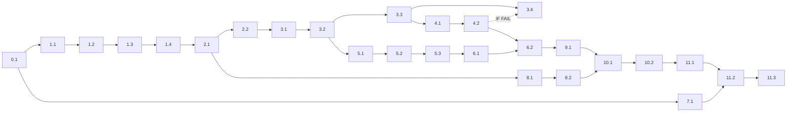

# Implementation Tasks: Load Testing & Performance Optimization

> **Plan directory (verbatim):** `ai/plans/milestone_4_integration_security_launch/load_testing_performance-load-testing-performance`
> **Specs of record:** `ai/plans/milestone_4_integration_security_launch/load_testing_performance-load-testing-performance/specs.md` (REQ-0..REQ-12, Journey J1) · **Design of record:** `ai/plans/milestone_4_integration_security_launch/load_testing_performance-load-testing-performance/plan.md` (D1–D10, Components 1–9)
> **Ticket (governing ruling):** Milestone 4 · Dev 3 · 8 SP (`docs/planning/TICKETS.md:2911-2948`). Ship the `scripts/perf/` toolchain (seed/cleanup, matching benchmark, index + EXPLAIN auditors, 100-VU API load, 100-conn WS stability), the N+1 page-enrichment fix (3 resolvers → batch services), FK + evidence-conditional matching indexes, journey J1, and the `docs/performance/` runbook + caching strategy. **Zero UI, zero new GraphQL SDL (byte-identical schema diff), zero new runtime/dev dependencies, zero new locale namespaces, zero new env keys.** §6 evidence (`docs/planning/PRODUCTION_READINESS.md:276-286`) is the acceptance surface.

---

## Non-Negotiable Execution Protocol

1. **Pre-Execution Knowledge Read:** Before executing ANY task, read ALL existing files in `ai/plans/milestone_4_integration_security_launch/load_testing_performance-load-testing-performance/outcome/` in lexical order. Prior outcomes are binding context — never contradict a ratified ruling without a ledger entry.
2. **Post-Edit Verification:** EVERY created/modified code file MUST pass `bun run scripts/health/sub-loop.ts <file> --lifecycle duplicates` (exit code 0) before its task checkbox flips. The script runs `tsgo → oxlint → biome:check → lint:type-aware → check:duplicates` progressively and auto-discovers the applicable `AGENTS.md` + `.agents/instructions/*.instructions.md` files for the target path.
3. **Test Execution:** ALL tests run via `bun run test/scripts/run-test.ts <test-path>` — NEVER raw `bun test` (raw skips the `--env-file=.env.test` preload). Journey tests: `bun run test/scripts/run-test.ts test/workflows/sessions/concurrent-booking-load.journey.test.ts`; GraphQL wire tests via `bun run test:graphql` (boots the real server). DB tests via `bun run test:db` when touching `backend/db/test/`.
4. **Semantic Review:** Every implementation task includes an `.SR` self-review against the semantic checklist (atomicity, env-config n/a here — zero new env keys, zero dead code, no cross-layer imports, enums as VALUE imports, canonical types only, deferred-item ledgering).
5. **Outcome Documentation:** Every task writes `ai/plans/milestone_4_integration_security_launch/load_testing_performance-load-testing-performance/outcome/<task-id>-outcome.md` BEFORE the next task begins.
6. **Checkbox Tracking:** `[ ]` → `[x]` only when ALL subtasks (`.QL`/`.TE`/`.SEC`/`.SR`/`.IV`) of that task are complete. No partial flips.
7. **Ledger Discipline:** Forward/incomplete-looking items are recorded ONLY as ✅ resolved-pointer entries in `ai/plans/milestone_4_integration_security_launch/load_testing_performance-load-testing-performance/deferred-items.md`; the final gate is `grep -cE '^\s*\| D[0-9]+ \|.*(❌|⚠️)' deferred-items.md` = 0 (D-row-scoped: excludes the Status-Values legend AND the fenced example row in Usage Guidelines).
8. **Drizzle rule:** ALL schema changes of this plan are index additions applied via `bun run db push`. `bun db migrate` is NOT invoked (no custom SQL; pg_trgm stays deferred per design D6 entry criteria). SDL diff discipline: `bun run generate:gqlSchema` before/after Phase 5 — byte-identical.

**Mandatory 5-stage subtask pipeline (strict order) for EVERY implementation task X.Y:** `X.Y.QL` (per-file sub-loop) → `X.Y.TE` (4-Tier test engineering) → `X.Y.SEC` (BOLA/BOPLA/BFLA/sanitization) → `X.Y.SR` (semantic review) → `X.Y.IV` (instruction verification). No skipping ahead: if tsgo fails, fix only tsgo before oxlint/biome/lint/duplicates.

**Applicable rule files (auto-discovered by `sub-loop.ts`; read before fixing):**

| Task files | AGENTS.md | `.agents/instructions/` |
|---|---|---|
| `scripts/perf/**` (non-test) | root `AGENTS.md` | — |
| `scripts/perf/*.test.ts` | root `AGENTS.md` | `tests.instructions.md` |
| `backend/db/schema/**` | root + `backend/AGENTS.md` + `backend/db/schema/AGENTS.md` | `backend.instructions.md` |
| `backend/db/repo/**` (+ tests) | root + `backend/AGENTS.md` + `backend/db/repo/AGENTS.md` (+ `backend/db/test/AGENTS.md` for tests) | `backend.instructions.md` (+ `tests.instructions.md`) |
| `backend/types/**` | root + `backend/AGENTS.md` + `backend/types/AGENTS.md` | `backend.instructions.md` |
| `backend/services/**` (+ tests) | root + `backend/AGENTS.md` + `backend/services/AGENTS.md` | `backend.instructions.md` (+ `tests.instructions.md`) |
| `backend/graphql/**` | root + `backend/AGENTS.md` + `backend/graphql/AGENTS.md` + `backend/graphql/pothos/AGENTS.md` | `backend.instructions.md` |
| `frontend/graphql/test/**` | root + `frontend/AGENTS.md` + `frontend/graphql/AGENTS.md` | `frontend.instructions.md` + `tests.instructions.md` |
| `test/workflows/**` | root + `test/workflows/AGENTS.md` | `tests.instructions.md` |
| `docs/**` | root `AGENTS.md` | — |

---

## Phase 0: Pre-Implementation Baseline

- [x] 0.1 [Record baseline + initialize ledger + read outcomes]
  - Record baseline: `bun tsgo 2>&1 | grep "error TS" | wc -l > /tmp/baseline-tsgo.txt`; `bun biome:check 2>&1 | grep -c "warn" > /tmp/baseline-biome.txt`; `bun run scripts/lint-service.ts --json --id baseline > /tmp/baseline-lint.json`
  - Initialize `ai/plans/milestone_4_integration_security_launch/load_testing_performance-load-testing-performance/deferred-items.md` from `.agents/spec-process-guide/templates/deferred-items-template.md` with the pre-seeded ✅ resolved-pointer rows (see that file's initial table).
  - Verify Phase-1.5 gate record exists: `outcome/plan-review-R1.md` (written during planning; if missing, STOP and re-run the plan-review gate).
  - Confirm environment preconditions: `kottaby_test` reachable via `.env.test`; Redis available (sidecar requirement — `scripts/start-notification-ws.ts:27-40`); `bun run build:test` (prod-mode dist `.next-test-prod` — `test/scripts/build-test.ts:4`) is expected to be run in Task 6.2, not now.
  - Write outcome: `outcome/0.1-baseline-outcome.md`
  - _Requirements: REQ-0 (all criteria), REQ-0.5 (ratified for all tasks via `.SR`/`.IV`)_

---

## Phase 1: Harness Library Foundation (`scripts/perf/lib/`)

- [x] 1.1 [Create `scripts/perf/lib/stats.ts` + `scripts/perf/lib/report.ts` + co-located tests]
  - Files: `scripts/perf/lib/stats.ts`, `scripts/perf/lib/report.ts`, `scripts/perf/lib/stats.test.ts`, `scripts/perf/lib/report.test.ts` — **CREATE**; exact signatures in plan.md Component 1.
  - `stats.ts`: nearest-rank percentiles (p50/p95/p99/max), `summarizeSamples`, `evaluateGate` (threshold boundary: p95 exactly at limit FAILS is configurable-by-contract — pick `< threshold` passes and unit-test both sides).
  - `report.ts`: `openRunDirectory` (creates `logs/perf/<YYYY-MM-DDTHH-MM-SS>_<tool>/`), `writeReport` (report.md + report.json; args echo; NO secret/token/cookie substrings — redaction unit-tested), `emitVerdict` (terminal `VERDICT: PASS|FAIL` + failure list; returns pass bool).
  - Add `logs/perf/` to `.gitignore` (adjacent to existing logs entries).
  - [x] 1.1.QL: sub-loop on all four files (exit 0)
  - [x] 1.1.TE: Tier 1: 100% branch of stats/report (empty samples, single sample, boundary p95, unknown tool id); Tier 2: unicode/RTL in report section titles, huge counts (1e9), zero-duration; Tier 3: fuzz `summarizeSamples` with NaN/Infinity guards (reject, not crash); Tier 4: redaction abuse — cookie-shaped and DSN-shaped strings in section payloads must not serialize.
  - [x] 1.1.SEC: no input reaches `eval`/shell; report writer path-confined under `logs/perf/` (no `../` traversal via tool id — validate tool id charset).
  - [x] 1.1.SR: no module-level mutable state beyond the run-dir singleton; no dead branches; (`@/` imports only where backend symbols are used; operator output follows the `scripts/ops/` console idiom — `console.*` is ESLint-sanctioned for `scripts/**/*.ts`, `eslint.config.mjs:237,244`, precedent `scripts/ops/backup-database.ts:127-128`).
  - [x] 1.1.IV: root `AGENTS.md` + `tests.instructions.md` (test files); validate no `any`; console usage follows the `scripts/**` lint exemption (ops idiom).
  - Write outcome: `outcome/1.1-harness-stats-report-outcome.md` · _Requirements: REQ-12.3, REQ-12.6, REQ-11.2_

- [x] 1.2 [Create `scripts/perf/lib/query-counter.ts` + test]
  - Files: `scripts/perf/lib/query-counter.ts`, `scripts/perf/lib/query-counter.test.ts` — **CREATE**; signature per plan.md Component 1 (install → snapshot → deltaSince → uninstall).
  - Patch target: `pg`'s `Client.prototype.query` (pg's Pool extends EventEmitter and delegates every query to a borrowed Client — `node_modules/pg-pool/index.js:66` — so one patch covers pooled AND transaction-client round trips; unit-test against real pg delegation semantics, not an invented inheritance); fingerprint = normalized SQL prefix (first 120 chars, whitespace-collapsed) for `byFingerprint`; restore-original on uninstall (byte-identical function identity asserted in test).
  - Harness-process-only contract: NOTHING under `app/`, `backend/`, `frontend/`, `shared/` may import this module (knip + review-wave enforced).
  - [x] 1.2.QL → [x] 1.2.TE: install/uninstall restoration, counting across pool + tx clients (mock `pg` in unit test — no live DB), delta arithmetic, concurrent query interleaving (Promise.allSettled) counted exactly. → [x] 1.2.SEC: patch scope documented + enforced (module doc contract); no double-install (guard throws). → [x] 1.2.SR: no leaked patch on error paths (try/finally in install). → [x] 1.2.IV: root `AGENTS.md` + `tests.instructions.md`.
  - Write outcome: `outcome/1.2-query-counter-outcome.md` · _Requirements: REQ-5.1 oracle, REQ-12.4_

- [x] 1.3 [Create `scripts/perf/lib/auth-mint.ts` + `scripts/perf/lib/db-target-guard.ts` + tests]
  - `auth-mint.ts` — **CREATE**: `mintSessionCookie(baseUrl, email, password)` → drives the real `login` mutation (`backend/graphql/mutation/auth.mutation.ts:80`) via `fetch`, parses `Set-Cookie` for `access_token` (`backend/lib/auth/cookies.ts:37`); cookie lives in memory only; throws typed error on non-success.
  - `db-target-guard.ts` — **CREATE**: `assertTestDatabaseTarget(databaseUrl, { forceFlag })` → parses DSN (also URL-encoded/scheme-variant forms), database name MUST equal `kottaby_test`; otherwise exit-2 refusal mirroring `scripts/lib/destructiveDbGuard.ts` posture; `--force-prod-shaped-target` requires explicit re-confirm.
  - [x] 1.3.QL → [x] 1.3.TE: DSN matrix (localhost/127.0.0.1/neon-style with params, uppercase, URL-encoded password with `@`), cookie parse (multiple set-cookie headers, expires forms), login failure paths (401, network). Tier 4: password with SQL-ish payload chars round-trips through login unchanged. → [x] 1.3.SEC: guard is the primary boundary — test that a `postgres://...@prod-host/kottaby` DSN is refused; cookie never logged (assert logger spy receives no token). → [x] 1.3.SR: no plaintext password persisted (in-memory only); no dead branches. → [x] 1.3.IV: root `AGENTS.md` + `tests.instructions.md`.
  - Write outcome: `outcome/1.3-auth-mint-guard-outcome.md` · _Requirements: REQ-1.7, REQ-12.1, REQ-12.6, specs §4 identity note_

- [x] 1.4 [Register `perf:*` scripts + `scripts/perf/scripts-registration.test.ts`]
  - `package.json` — **UPDATE**: add the seven entries per plan.md CLI table (`perf:seed`, `perf:cleanup`, `perf:bench-matching`, `perf:verify-indexes`, `perf:analyze-queries`, `perf:load-api`, `perf:load-ws`), each `bun --env-file=.env.test scripts/perf/<tool>.ts`, adjacent to the `ops:*` block (`package.json:66-69`). Entrypoint files do not exist yet — this task creates **stub entrypoints that fail fast with "not implemented in this task order" ONLY if** that keeps the registration test green; otherwise defer the registration test additions per-entrypoint and add rows as each tool lands (prefer: land all seven minimal arg-parsing entrypoints now, each exiting 3 with a clear message until its phase fills it).
  - `scripts/perf/scripts-registration.test.ts` — **CREATE**: mirror `scripts/ops/scripts-registration.test.ts:59-103` (manifest checks, entrypoint-on-disk, adjacency to `ops:*` block, `.gitignore` `logs/perf/` rule present).
  - [x] 1.4.QL (package.json excluded from sub-loop; run on the test file) → [x] 1.4.TE: registration suite green; adjacency assertions. → [x] 1.4.SEC: no secret values in scripts block. → [x] 1.4.SR: zero dead script entries (each maps to a real file). → [x] 1.4.IV: root `AGENTS.md` + `tests.instructions.md`.
  - Write outcome: `outcome/1.4-script-registry-outcome.md` · _Requirements: REQ-12.5_

---

## Phase 2: Performance Data Seeding

- [x] 2.1 [Implement `scripts/perf/seed-perf-data.ts` (bulk, prefix-isolated, manifest-writing)]
  - Files: `scripts/perf/seed-perf-data.ts`, `scripts/perf/lib/seed-shapes.ts` (row builders), `scripts/perf/seed-perf-data.test.ts` — **CREATE**; CLI contract per plan.md Component 2 (defaults: `--teachers 2000 --students 120 --sessions 5000 --notifications 20000 --subscriptions 500 --hot-teachers 8`).
  - Behavior: run-id = 8-hex (or `--run-id`); prefix `perf_<runId>_` on emails/names; guard via `db-target-guard.ts`; teachers satisfy the matcher predicate (`is_online=true`, `is_approved=true`, eligible user flags — `backend/db/repo/teachers/teacher.repository.matching.helpers.ts:129-141`) with deterministic distributions across `recitations`/`subjects`/`languages`/`country`/`countryCode`/`average_rating` (reproducible via `--seed`); hot teachers receive `started` sessions (NOT EXISTS branch — `helpers.ts:140`); students funded ≥1 session (INV-B4 — `docs/specs/state-machine-invariants.md:155`); volume tables via chunked multi-row inserts (≤500/batch); session/notification/subscription volumes per flags; writes `seed-manifest.json` (schema in plan.md Data Models) into the run dir.
  - Row shapes follow `backend/db/test/entity-setup.ts` conventions (teacher defaults `isApproved: true` — `:558-563`) but as bulk builders — NEVER per-row helper loops for volume tables.
  - [x] 2.1.QL: sub-loop on the three files. 
  - [x] 2.1.TE: Tier 1: builder unit tests (determinism under `--seed`, predicate satisfaction for every generated teacher, prefix correctness); Tier 2: `--teachers 0`, single-teacher, idempotent re-run with same `--run-id` (must refuse or no-op — pick and test); Tier 3: chunk-boundary volumes (499/500/501), concurrent-guard (second run while first holds prefix); Tier 4: guard refusal on non-test DSN (integration with 1.3), injection-shaped prefix chars rejected.
  - [x] 2.1.SEC: guard invoked before ANY write; no plaintext passwords persisted (hash via existing auth hashing utilities — verify the canonical hash helper at implementation); no PII beyond synthetic values.
  - [x] 2.1.SR: bounded memory (streaming chunk inserts, no all-rows-in-RAM for the big tables); enums as value imports (`SessionStatus`, `UserRole`); no cross-layer imports.
  - [x] 2.1.IV: root `AGENTS.md` + `tests.instructions.md`; entity-shape read of `backend/db/test/AGENTS.md` for column conventions (read-only; no test files created there).
  - Write outcome: `outcome/2.1-seed-perf-data-outcome.md` · _Requirements: REQ-1.1–REQ-1.8_

- [x] 2.2 [Implement `scripts/perf/cleanup-perf-data.ts` (manifest-driven, zero-residue)]
  - Files: `scripts/perf/cleanup-perf-data.ts`, `scripts/perf/cleanup-perf-data.test.ts` — **CREATE**; `--run <id> | --last`; deletes by prefix in FK-safe order (children first, `users` last — mirrors `test/workflows/AGENTS.md` rule 2 order); re-probes every table for zero rows with the prefix; exit 1 on residue with the offending table listed; `--last` resolves newest manifest under `logs/perf/`.
  - [x] 2.2.QL → [x] 2.2.TE: order correctness (unit: deletion plan sequence vs FK graph), `--last` resolution (multiple manifests, corrupted newest → actionable error), missing manifest path, partial-failure retry (second run after interrupted cleanup completes). → [x] 2.2.SEC: guard before deletes; refuses to run without a manifest match (never deletes unscoped). → [x] 2.2.SR: no residue-accepting branches; ledgered none. → [x] 2.2.IV: root `AGENTS.md` + `tests.instructions.md`.
  - Write outcome: `outcome/2.2-cleanup-outcome.md` · _Requirements: REQ-1.6, REQ-1.7, REQ-12.2_

---

## Phase 3: DB Verification & Index Remediation

- [x] 3.1 [Implement `scripts/perf/verify-indexes.ts` (FK coverage audit + hot-column planner check)]
  - Files: `scripts/perf/verify-indexes.ts`, `scripts/perf/verify-indexes.test.ts` — **CREATE**; catalog query via `queryDb` (`backend/db/client.ts:227-230`): `pg_constraint contype='f'` ⋈ `pg_attribute` ⋈ `pg_indexes`; coverage rule (leading-column or FK-columns-prefix of index columns; PK/unique-backed counts — plan.md Component 4); hot-column planner check: EXPLAIN on the matching query reports chosen index for `teacher` filtering/sort columns; gate = zero uncovered FK columns; `--json` machine output; Markdown table in report.
  - [x] 3.1.QL → [x] 3.1.TE: coverage-rule unit tests against synthetic catalog rows (btree leading col, partial index `WHERE`, unique constraint, composite prefix, UNCOVERED); planner-check parsing (EXPLAIN JSON shapes); Tier 2: empty catalog, quoted identifiers/camel-case names; Tier 3: catalog with cycles/multi-column FKs; Tier 4: identifier injection in catalog SQL impossible (parameterized only). → [x] 3.1.SEC: read-only DB access (no writes anywhere); guard still invoked (writes nothing but refuses wrong DB for consistency). → [x] 3.1.SR: registry of expected-covered columns derives from live catalog, NOT a hardcoded list (drift-proof), with the four known gaps called out as pre-remediation documentation. → [x] 3.1.IV: root `AGENTS.md` + `tests.instructions.md`.
  - **Baseline evidence run (before remediation):** run `perf:verify-indexes` against the Phase-2-seeded DB; the report MUST show exactly the four known gaps (specs REQ-3.2) — this is the "before" artifact for §6 item 6.6. Save under the run dir; reference in outcome.
  - Write outcome: `outcome/3.1-verify-indexes-outcome.md` · _Requirements: REQ-3.1, REQ-3.2, REQ-3.4, REQ-3.6_

- [x] 3.2 [Add FK indexes to schema + push + repo test locks]
  - Files: `backend/db/schema/classes/session-request-idempotency.ts`, `backend/db/schema/billing/subscription-purchase-idempotency.ts`, `backend/db/schema/notifications/broadcasts.ts` — **EXTEND** (`.index()` definitions per plan.md Data Models table); co-located schema assertion updates in the matching `backend/db/test/repo/` suites if they pin index sets (discover at implementation; if no existing suite pins them, add assertions in the owning repo test files).
  - Apply via `bun run db push` (Protocol rule 8); re-run `perf:verify-indexes` → zero uncovered FK columns (the "after" artifact).
  - [x] 3.2.QL: sub-loop on each touched schema file. 
  - [x] 3.2.TE: repo tests assert the indexes exist post-push (`pg_indexes` probe in a `runInRollback`-compatible read or a guarded direct read — follow existing repo-test conventions); no behavior change tests needed (indexes are transparent).
  - [x] 3.2.SEC: n/a mechanics (read-optimizer only) — verify no query semantics changed (WHERE/RETURNING untouched).
  - [x] 3.2.SR: names follow the `<table>_<cols>_idx` convention visible across schema (e.g., `session_teacher_id_status_idx` — `backend/db/schema/classes/session.ts:91`).
  - [x] 3.2.IV: root + `backend/AGENTS.md` + `backend/db/schema/AGENTS.md` + `backend.instructions.md` (+ `backend/db/test/AGENTS.md`, `tests.instructions.md` for test edits).
  - Write outcome: `outcome/3.2-fk-indexes-outcome.md` · _Requirements: REQ-3.2, REQ-3.3, REQ-3.6_

- [x] 3.3 [Implement `scripts/perf/analyze-queries.ts` + `scripts/perf/lib/query-registry.ts` (EXPLAIN scan gate)]
  - Files: `scripts/perf/analyze-queries.ts`, `scripts/perf/lib/query-registry.ts`, `scripts/perf/analyze-queries.test.ts` — **CREATE**; registry entries per plan.md Component 5 (matching variants, subscription page SQLs, notifications list, session lists, `UserRepository.findById`); `EXPLAIN (ANALYZE, BUFFERS, FORMAT JSON)`; scan gate: `Seq Scan` nodes with `Plan Rows >= --scan-threshold-rows` (default 1000) FAIL (design D6); matching NOT EXISTS subplan must reference `session_teacher_id_status_idx` (`backend/db/schema/classes/session.ts:91`); plans persisted `explain/<id>.json`; verdict + report per Component 1.
  - Registry SQL builders reuse repo helper shapes where importable (`backend/db/repo/teachers/teacher.repository.matching.helpers.ts:140` chain) — import the real builders, never re-type the SQL (drift-proof).
  - [x] 3.3.QL → [x] 3.3.TE: plan-node walker unit tests (nested nodes, CTE scans, `JIT` blocks, parallel-aware plans; threshold boundary); registry completeness test (each id unique, each builds against seeded DB in a `--self-check` mini-run); Tier 2: empty registry cell, zero-row tables; Tier 3: malformed plan JSON tolerated (report, not crash). → [x] 3.3.SEC: parameterized registry params only; guard invoked. → [x] 3.3.SR: registry is the single source (no scattered EXPLAIN calls); dead-entry check (every registry id executed). → [x] 3.3.IV: root `AGENTS.md` + `tests.instructions.md`.
  - Write outcome: `outcome/3.3-analyze-queries-outcome.md` · _Requirements: REQ-4.1–REQ-4.6_

- [x] 3.4 [Matching-index EXPLAIN decision + conditional teacher indexes]
  - **Evidence-gated task (design D9):** run `perf:analyze-queries` at ≥2,000-teacher seeded volume; IF the matching query plan shows a materialized Seq Scan on `teacher` (or, per Phase-4 evidence re-entered from 4.2 triage, the <200ms gate is threatened by plan cost) THEN add `teacher_matching_online_approved_idx` + `teacher_average_rating_idx` to `backend/db/schema/teachers/teacher.ts` (**EXTEND**, `bun run db push`) with the same test discipline as 3.2, re-run analyze+verify for the "after" plans; ELSE record the decision + plan evidence in the outcome and mark this task complete with the no-change verdict (both paths are complete — the gate outcome is the deliverable). **NO-CHANGE verdict taken** (both triggers unmet — teacher scan 48-row estimate < 1,000 threshold, no Phase-4 evidence; evidence + adjudication in the outcome).
  - [x] 3.4.QL (no-op — no schema/code file touched) · [x] 3.4.TE (no-change path: decision-test documented — 24-statement artifact walk + live guard-first catalog probe prove criteria unmet) · [x] 3.4.SEC (n/a — zero surface changes; read-only catalog probe only) · [x] 3.4.SR (decision + evidence recorded; pg_trgm/users-column non-index rulings restated in outcome) · [x] 3.4.IV (no schema touched — rules not triggered).
  - Write outcome: `outcome/3.4-matching-index-decision-outcome.md` · _Requirements: REQ-3.4, REQ-3.5_

---

## Phase 4: Matching Pipeline Benchmark

- [x] 4.1 [Implement `scripts/perf/bench-matching.ts` (<200ms gate + scale matrix)]
  - Files: `scripts/perf/bench-matching.ts`, `scripts/perf/bench-matching.test.ts` — **CREATE**; contract per plan.md Component 3: direct calls to `TeacherMatchingService.browseAvailableTeachers(studentUserId, input, locale)` (`backend/services/teachers/teacher-matching.service.ts:354-359`) through the global `db` (no `tx` — matches production request context); matrix per specs REQ-2.2 (volumes {100, 500, 2000} × sorts {RATING_DESC, NAME_ASC, NEWEST} — `backend/enum/teachers/teacher-matching-sort.enum.ts:21-25` — × filter variants); ≥30 samples after ≥5 warmups per cell; envelope assertion (`teacher-matching.service.ts:423-429`) and INV-A3 exclusion assertion on every sample; per-cell p50/p95/p99/max; gate = p95 < `--gate-ms 200` at the 100-teacher cells (specs REQ-2.4/2.7).
  - The 100-teacher volume is produced by filtering the seeded teacher set to the first 100 eligible (deterministic, recorded in report) — the seed always contains ≥ the matrix headroom.
  - [x] 4.1.QL → [x] 4.1.TE: matrix-runner unit tests (deterministic cell enumeration, sample accounting, gate boundary), a `--self-check` mini-run (1 volume × 1 sort × 3 samples, no gate) proving plumbing; Tier 2: zero-eligible-teacher volume (bench must still summarize + pass envelope-empty assertions); Tier 3: interleaved cells don't cross-contaminate sample sets. → [x] 4.1.SEC: caller student is a seeded perf identity; no data escapes the run dir. → [x] 4.1.SR: service called with real input shapes (no fabricated bypass of validation — `isBrowseIntent` path honored); enums as value imports. → [x] 4.1.IV: root `AGENTS.md` + `tests.instructions.md`.
  - Write outcome: `outcome/4.1-bench-matching-outcome.md` · _Requirements: REQ-2.1–REQ-2.7_

- [x] 4.2 [**Evidence Run**: matching benchmark against seeded volume — gate verdict for §6 item 6.2]
  - Execute: `perf:seed` (if no active run) → `perf:bench-matching` at defaults; capture `VERDICT` + report; IF FAIL: triage per runbook order (plan artifact → index decision 3.4 → re-run) and iterate in-scope until the 100-teacher cells pass (specs REQ-2.7); 2,000-teacher cells are scale-evolution evidence, not the gate.
  - Record the §6 evidence row (item 6.2) in the outcome; cleanup decision: keep the seed run for Phases 5–6 (record run id in outcome) or re-seed there.
  - Write outcome: `outcome/4.2-bench-evidence-outcome.md` (update `deferred-items.md` only if new forward items surfaced) · _Requirements: REQ-2.4, REQ-11.2_

---

## Phase 5: N+1 Elimination (Subscription Page Enrichment)

- [x] 5.1 [Batch repository methods: `PlanRepository.findByIds` + `AuditTrailRepository.countEntriesByEntityIds` / `listLatestEntriesByEntityIds`]
  - Files: `backend/db/repo/billing/plan.repository.ts` — **UPDATE** (`findByIds(ids: number[], tx?: DBQueryExecutor): Promise<PlanSelectType[]>` — NEVER prepared, `backend/db/repo/AGENTS.md:29`; tx/no-tx split mirroring the file's bare-read convention: tx leg = Drizzle `inArray`, no-tx leg = `queryDb` with `= ANY($1::int[])` — precedent `findBalanceLanesByIds`, `backend/db/repo/billing/plan.repository.ts:189`, convention `:8-14`); `backend/db/repo/audit/audit-trail.repository.ts` — **UPDATE** (`countEntriesByEntityIds` via `sql<number>` + `.mapWith(Number)` conditional aggregation per `backend/db/repo/AGENTS.md:34`; `listLatestEntriesByEntityIds` (entityType: string — the canonical audit label constant `SUBSCRIPTION_AUDIT_ENTITY_TYPE`, `backend/services/billing/subscription-admin.helpers.ts:53` — no `AuditEntityType` type exists) via `DISTINCT ON (entity_id) … ORDER BY entity_id, created_at DESC` — one round trip); tests in the owning `backend/db/test/repo/` suites — **CREATE** test cases (empty ids, no-match ids, duplicates in ids, order-independence of returned map, latest-entry correctness, 100% branch).
  - All DB tests: `runInRollback` + `tx` propagation to every method; `expectRepoError` try/catch (never `rejects.toThrow` inside rollback — root `AGENTS.md`); run via `bun run test/scripts/run-test.ts <path>`.
  - [x] 5.1.QL → [x] 5.1.TE (as specified above; Tier 2: 1000-id batch, unicode entity ids n/a (int4), Tier 3: concurrent batch calls in `Promise.allSettled`, Tier 4: id-fuzz (negatives, zeros, float-ints) rejected by param typing) → [x] 5.1.SEC: pure data access, no permission logic leaks into repo (layer rule); no unbounded `inArray` (cap ids batch ≤ 1000 with explicit chunking or documented bound — pick, test, ledger). → [x] 5.1.SR: `inArray`+prepared prohibition honored; barrel exports updated (`backend/db/repo/billing/index.ts`, `audit/index.ts`) per repo AGENTS layout rules. → [x] 5.1.IV: root + `backend/AGENTS.md` + `backend/db/repo/AGENTS.md` + `backend/db/test/AGENTS.md` + `backend.instructions.md` + `tests.instructions.md`.
  - Write outcome: `outcome/5.1-batch-repos-outcome.md` · _Requirements: REQ-5.3 (repo leg)_

- [x] 5.2 [Batch service methods + page-level enrichment in the two list producers]
  - Files: `backend/services/billing/plan-catalog.service.ts` — **UPDATE** (`findByIds(ids, locale?, tx?): Promise<Map<number, PlanReturnType | null>>` wrapping 5.1, honoring the batch-methods mandate `backend/services/AGENTS.md:10`); `backend/services/billing/subscription-admin.service.ts` — **UPDATE** (`auditEntriesCountBatch`, `auditTrailPeekBatch`, and `listForAdmin` gains the enrichment pass); `backend/services/billing/subscription-purchase.service.ts` — **UPDATE** (`listOwn` gains the enrichment pass — it is the producer reached from `backend/graphql/query/subscription.query.ts:62`); `backend/types/billing/subscription.types.ts` — **EXTEND** (`EnrichedSubscriptionReturnType = SubscriptionReturnType & { plan?; auditEntriesCount?; auditTrailPeek? }` — a FLAT structural supertype per plan.md Component 8, merged into row copies with the `Object.assign` idiom so rows stay assignable to `objectRef<SubscriptionReturnType>`; canonical types only, no service-local types).
  - Enrichment: ONE pass per page — distinct `planId`s → plan batch; page subscription ids → audit-count batch + audit-peek batch (≤3 extra queries per page — plan.md Component 8).
  - Service tests (`*.test.ts` co-located) — mock the repo seam; assert call counts (≤3 per page regardless of page size — the unit-level N+1 lock), map assembly, missing-plan tolerance (`null` value, not absence), and locale pass-through unchanged.
  - [x] 5.2.QL → [x] 5.2.TE (as above; Tier 2: empty page, single-row page, page with 100 rows — call count constant; Tier 3: interleaved concurrent service calls (`Promise.allSettled`) with isolated mocks; Tier 4: id-fuzz at the service boundary propagates typed errors unchanged) → [x] 5.2.SEC: BOPLA — enrichment reads only ids already present on caller-authorized rows (no client-supplied ids enter the batch); permission gating unchanged and outside any cache/batch path (`backend/services/AGENTS.md:14`). → [x] 5.2.SR: single-writer discipline untouched (read-only additions); no dead single-row methods (they remain the resolver fallback per design D4 — keep, don't delete). → [x] 5.2.IV: root + `backend/AGENTS.md` + `backend/services/AGENTS.md` + `backend/types/AGENTS.md` + `backend.instructions.md` + `tests.instructions.md`.
  - Write outcome: `outcome/5.2-batch-services-outcome.md` · _Requirements: REQ-5.3 (service leg), REQ-9.2 (batch-first posture), REQ-9.5 (permission-before-cache)_

- [x] 5.3 [Resolver switch + wire tests + query-count regression + SDL byte-diff + before/after evidence]
  - Files: `backend/graphql/pothos/billing/subscription.pothos.ts` — **UPDATE** (three resolvers at `:68`, `:109`, `:116` prefer parent-carried enrichment, fall back to existing single-row calls only when absent — design D4); wire test additions under `frontend/graphql/test/` — **CREATE/UPDATE** (enriched shapes byte-identical; `mySubscriptions`/`adminStudentSubscriptions` auth + ownership unchanged); query-count regression: a service-level assertion using `scripts/perf/lib/query-counter.ts` semantics — but wired where CI runs it: a `backend/services/billing` test asserting ≤ K round trips per page at sizes {1, 25, 100} via the mock-call-count lock from 5.2 (the harness oracle re-proves live in Phase 6). K = 6 (plan.md Component 8).
  - **SDL byte-diff:** `bun run generate:gqlSchema` before vs after the phase — diff MUST be empty (Protocol rule 8); record in outcome.
  - **Before/after N+1 evidence:** using the seeded DB + query counter, measure `mySubscriptions`-shaped page loads at sizes {1, 25, 100} pre-fix (git stash or a `--baseline-ref` note) and post-fix — record counts (≈ 3N+1 → ≤6) in the run-dir artifact for §6 item 6.5.
  - Run wire tests: `bun run test:graphql`; journey layer untouched here (J1 is Phase 7).
  - [x] 5.3.QL → [x] 5.3.TE: resolver unit tests (parent-carried fast path, fallback path, no double-call), wire tests above; Tier 4: cross-role probes already covered by existing suites — confirm still green (no auth widening). → [x] 5.3.SEC: no BOLA surface change (owner-scoped queries unchanged); BOPLA — resolvers read parent fields only. → [x] 5.3.SR: zero dead code (fallback reachable and tested); GraphQL layer AGENTS compliance (no local types). → [x] 5.3.IV: root + `backend/AGENTS.md` + `backend/graphql/AGENTS.md` + `backend/graphql/pothos/AGENTS.md` (its `t.loadable()` MUST is reconciled by plan.md D4 ruling) + `frontend/AGENTS.md` + `frontend/graphql/AGENTS.md` + `backend.instructions.md` + `frontend.instructions.md` + `tests.instructions.md`.
  - Write outcome: `outcome/5.3-resolvers-evidence-outcome.md` · _Requirements: REQ-5.1–REQ-5.7_

---

## Phase 6: API Load Harness

- [x] 6.1 [Implement `scripts/perf/lib/api-scenarios.ts` + `scripts/perf/load-api.ts` (100 VUs, gates)]
  - Files: `scripts/perf/lib/api-scenarios.ts`, `scripts/perf/load-api.ts`, `scripts/perf/load-api.test.ts`, `scripts/perf/lib/api-scenarios.test.ts` — **CREATE**; contracts per plan.md Component 6: scenario registry (login, browse ±filters, mySubscriptions with enriched fields, notifications list, bookSession, adminStudentSubscriptions — every booking request mints the mandatory unique `x-idempotency-key` header (`backend/graphql/gqlContextFactory.ts:242`) — weights 10/20/20/20/20/10 default per specs REQ-6.2), VU loop with `--ramp 10/5s` to `--vus 100`, `--duration-s 120`, minted cookies from the seed manifest identities, incremental aggregation (REQ-12.3), per-scenario gates p95 < `--gate-ms 500` + zero transport errors, booking-scenario outcome classification (created | translated-domain-rejection | transport-error) per specs REQ-6.4, `pg_stat_activity` peak snapshot on FAIL (specs REQ-6.8), `--self-check` mode (2 VUs × 10s, no gates).
  - Server contract: the tool BOOTS its own prod-mode server when `--base-url` is absent, using the runner's env semantics (`TEST_SERVER_MODE=production`, `NEXT_DIST_DIR=.next-test-prod`, `TEST_SERVER=1` + `IS_DEMO=true` as the operative limiter bypass — `app/api/graphql/rate-limit.ts:34-48`, health-wait `HEAD /api/graphql` → 204 — `test/scripts/run-server-tests.ts:137-147,171-196`) or reuses an already-running `--base-url`; kill/cleanup discipline per `test/scripts/kill-test-servers.ts` + runner's exit handling (`run-server-tests.ts:676-681`).
  - [x] 6.1.QL → [x] 6.1.TE: scenario-picker unit tests (weights normalize, deterministic under seed), VU-loop accounting (sample totals per scenario, ramp schedule), outcome classifier (three classes, boundary), `--self-check` proven against a dev server in one manual CI-able run; Tier 2: `--vus 0`, `--duration-s 0` rejected; Tier 3: server dies mid-run → harness exits cleanly with partial report + non-zero; Tier 4: cookie never logged; guard invoked. → [x] 6.1.SEC: rate-limit bypass is the documented test-server env (specs REQ-6.6 ruling); no auth bypass in scenarios; admin scenario uses admin cookie only. → [x] 6.1.SR: bounded sample buffers; no module-level mutable state beyond bounded registries; enums value-imported. → [x] 6.1.IV: root `AGENTS.md` + `tests.instructions.md`.
  - Write outcome: `outcome/6.1-load-api-outcome.md` · _Requirements: REQ-6.1–REQ-6.8, REQ-12.2/12.3_

- [x] 6.2 [**Evidence Run**: prod-mode 100-VU load test — gate verdict for §6 item 6.1]
  - Preconditions: `bun run build:test` (prod dist `.next-test-prod` — `test/scripts/build-test.ts:4`); active seed run (re-seed if the Phase-4 run was cleaned); Redis up if WS phase follows.
  - Execute `perf:load-api` defaults (100 VUs, 120s, default weights); capture per-scenario p95/p99, error taxonomy, VERDICT. IF FAIL: triage order from the report (scenario decomposition → `pg_stat_activity` snapshot → analyze-queries artifacts) and iterate in-scope (indexes 3.4 / N+1 5.x are the two in-scope levers; anything else → ledger with evidence). The booking scenario must show the "100 concurrent session requests — all succeed" outcome accounting (`TICKETS.md:2940`).
  - Record the §6 evidence row (item 6.1) + run-dir path in the outcome. Keep the seed run for Phases 7–8.
  - Write outcome: `outcome/6.2-load-api-evidence-outcome.md` · _Requirements: REQ-6.3, REQ-6.4, REQ-6.7, REQ-11.2_

---

## Phase 7: Concurrent Booking Journey (J1)

- [x] 7.1 [Write `test/workflows/sessions/concurrent-booking-load.journey.test.ts` (test-first) + DIAGRAMS.md]
  - Files: `test/workflows/sessions/concurrent-booking-load.journey.test.ts` — **CREATE**; `test/workflows/sessions/DIAGRAMS.md` — **UPDATE** (mermaid `sequenceDiagram` section named after the file, `bun run validate:mermaid` green — `test/workflows/AGENTS.md` rule 13).
  - **Write the journey FIRST**, then adjust nothing in product code — the surface exists; the journey is the concurrency proof. Structure per specs §5 J1 + plan.md Journey Design (state machine + side-effect matrix + visibility = assertion set): committed `beforeAll` cast (100 funded students, shared hot-teacher subset, one unfunded probe student — via `actor-context`/`entity-setup` helpers, `jrn_sessions_<8hex>` prefix, tracked registry), `Promise.allSettled` 100-way booking step, outcome accounting (created + rejected == 100, zero unexplained, zero 40P01), INV-B4 balance-oracle per student, INV-S6/INV-A3 observed by a second student's browse post-start, spied `SpiedFanoutTransport` teacher-notification assertion (target userIds match), foreign-inbox zero-delta assertion, unfunded-student negative probe with translated-error substring (via `getServerTranslations("en").errorsTranslations`), `afterAll` tracked hard-delete + zero-residue re-probe; double-run green.
  - Run: `bun run test/scripts/run-test.ts test/workflows/sessions/concurrent-booking-load.journey.test.ts` (NEVER raw `bun test`); then the full layer: `bun run test/scripts/run-test.ts test/workflows`.
  - [x] 7.1.QL: sub-loop on both files. 
  - 7.1.TE is the journey itself (4-Tier inside: concurrency Tier 3 is the core; negative/denial legs Tier 4). [x] 7.1.SEC: honest authorization (real roles, no monkey-patching — rule 4); unfunded probe exercises the real INV-B4 path. [x] 7.1.SR: no `runInRollback`; cleanup registered for EVERY service-created side-effect row (rule 2); audit/ledger tables asserted-zero, never tracked (trigger-immutable). [x] 7.1.IV: root + `test/workflows/AGENTS.md` + `tests.instructions.md` + `backend/db/test/AGENTS.md` (entity helper usage).
  - Write outcome: `outcome/7.1-journey-j1-outcome.md` · _Requirements: REQ-7.1–REQ-7.7 (Journey J1 EARS)_

---

## Phase 8: WebSocket Stability Harness

- [x] 8.1 [Implement `scripts/perf/load-ws.ts` (100 conns, heartbeat stability, fan-out proof)]
  - Files: `scripts/perf/load-ws.ts`, `scripts/perf/load-ws.test.ts` — **CREATE**; contract per plan.md Component 7: `ws://<WS_HOST>:<WS_PORT>` (defaults `127.0.0.1:3101` — `backend/lib/env.ts:80,83`), ≥21 identities from the seed manifest, cookie + allowlisted-`Origin` handshake (`backend/ws/notification-ws-server-handshake.ts:62-73,89-91`; defaults `backend/lib/env.ts:93-98`), ramp = 5-connection burst then 1 conn/2s honoring the token bucket (`backend/ws/notification-ws-server-constants.ts:14-17`; ~190s for 100 conns — no env override exists), 30s/2-miss liveness observation (`:8-11`), fan-out bursts publishing guard-valid envelopes `{ userIds, payload }` (userIds covering ALL connected identities, unique `data.id` per burst — validated by `parseFanoutEnvelope`, delivered only to members: `backend/services/notifications/realtime/redis-pubsub-transport.ts:31,57-67`, channel `:27`) via ioredis with per-connection delivery latency (gate p95 ≤ 2s, 100% delivery), `--no-reconnect` default (drops observable), fail-fast on sidecar-down/`in-process` transport (mirror `scripts/start-notification-ws.ts:27-40`), socket cleanup + client-observable zero-residue check (sidecar exposes no count surface — `backend/ws/notification-ws-server.ts:126`).
  - The tool may boot the sidecar itself (`bun run ws` — `package.json:70`) when not already listening, with the Redis-bus env required; document both paths in `--help`.
  - [x] 8.1.QL → [x] 8.1.TE: ramp scheduler unit tests (bucket-honoring schedule, ≥190s for 100 conns), pong-liveness accounting (missed-pong detection mirrors server constants), delivery-latency summarization, identity assignment (≤5/user invariant); Tier 2: `--connections 0` rejected; `--identities 20` rejected for 100 conns (cap math enforced); Tier 3: mid-run sidecar kill → clean partial report + non-zero; Tier 4: invalid-cookie handshake yields `4401` classified, never retried silently. → [x] 8.1.SEC: cookies in memory only; origin allowlist untouched; no server auth bypass. → [x] 8.1.SR: bounded connection registry in harness; uninstall/close discipline on every exit path. → [x] 8.1.IV: root `AGENTS.md` + `tests.instructions.md`; read `backend/ws/AGENTS.md` for close-code vocabulary (read-only — no sidecar code changes).
  - Write outcome: `outcome/8.1-load-ws-outcome.md` · _Requirements: REQ-8.1–REQ-8.7_

- [x] 8.2 [**Evidence Run**: 100-connection stability window + fan-out — §6 item 6.3; soak command delivered]
  - Preconditions: sidecar + Redis up; seed run active (identities).
  - Execute `perf:load-ws` defaults (100 conns, 300s window, 3 fan-out bursts); capture VERDICT + report. Deliver the soak command in the outcome: `perf:load-ws --duration-s 3600` (the §6.3 one-hour evidence command — runbook documents it; running the full hour here is optional operator work, the stability window + command delivery satisfies this task).
  - Record the §6 evidence row (item 6.3). Cleanup: close sockets (tool does), keep or clean seed per Phase-9 needs.
  - Write outcome: `outcome/8.2-ws-evidence-outcome.md` · _Requirements: REQ-8.3, REQ-8.4, REQ-11.2_

---

## Phase 9: Pagination Verification Sweep

- [x] 9.1 [**Verification Sweep**: all list surfaces bounded — §6 item 6.7]
  - Scope (specs REQ-10): teacher directory (verified paginated today — defaults `page: Int = 1, pageSize: Int = 25`, `backend/graphql/query/teachers/teacher-matching.query.ts:118-119`), student/admin session lists, notification lists. Method: wire-level probes against the seeded volume via `testClient`/GraphQL integration conventions (run under `bun run test:graphql` if added as a test, else via a `--self-check` harness probe) asserting: bounded page size (≤ cap), envelope fields present, deep-offset behavior sane. **EXECUTED as a scratch wire probe** (`scratch/probe-9-1-pagination-sweep.ts`, the 3.4 precedent) booting the harness's own prod-mode server + real `login`-minted seed identities: **47/47 probes PASS across 20 wire-probed surfaces** (+13 code-cited; no seeded identity of those roles) — every surface CLAMPS with an honest echo or REJECTS oversized args with `VALIDATION`; evidence run `logs/perf/2026-10-09T22-20-09_pagination-sweep/` (full-volume browse evidence in run `22-10-22`).
  - IF an unbounded surface is found: fix in-scope using the `resolvePageBounds` conventions (`backend/services/admin/user-management.query.helpers.ts:27-45`) + ledger the fix; IF none: the sweep table IS the evidence. **NO-GAP verdict taken — zero product code modified; the sweep table is the evidence.**
  - Produce the pagination evidence table (surface, cap, envelope, evidence query) in the run dir + outcome. **Done:** `pagination-surface-table.md` (surface × cap × bound source × envelope × evidence) + `pagination-evidence.md` (47-probe matrix) + `report.json` in the run dir.
  - [x] 9.1.QL (no-op — no fix landed; zero product files touched; repo-wide tsgo exit 0 at close) · [x] 9.1.TE (the probe cases are the deliverable: 47 wire probes × 4 classes [absence-of-args, cap-edge, oversized, deep-offset] per surface, 3 execution iterations, final 47/47 PASS) · [x] 9.1.SEC (probes use caller-authorized identities only — student/teacher/admin cookies minted via the real `login` from the seed manifest; read-only queries; cookies memory-only, never persisted) · [x] 9.1.SR (table complete for every named surface — 20 wire-probed + 13 code-cited rows with cap/bound-source/envelope/evidence; exclusion rationale for non-list surfaces) · [x] 9.1.IV (no product code touched — layer rules not triggered; read-only reference visits covered the backend/graphql+services AGENTS chain).
  - Write outcome: `outcome/9.1-pagination-sweep-outcome.md` · _Requirements: REQ-10.1–REQ-10.3_ **✅ written**

---

## Phase 10: Documentation

- [x] 10.1 [Create `docs/performance/load-testing.md` (operator runbook)]
  - **CREATE** `docs/performance/` + the runbook; content per specs REQ-11: per-§6-item table (command, preconditions — seed/server-mode/sidecar/Redis, gate, artifact, interpretation), the generated §6 sign-off table (assembled from the Phase 3–9 evidence rows: 6.4/6.6 from Phase 3, 6.2 from 4.2, 6.5 from 5.3, 6.1 from 6.2, 6.3 from 8.2, 6.7 from 9.1), environment caveats (rate-limit bypass ruling — specs REQ-6.6; scale-aware scan gate — design D6; pool-queue reality at `max: 10` — `backend/db/client.ts:156`; sidecar Redis requirement — `scripts/start-notification-ws.ts:27-40`), triage order (report → EXPLAIN artifact → query-count sample → fix → re-run), and the soak command. Doc shape: Why → Commands/Gates → Interpretation → What NOT to do → Related.
  - [x] 10.1.QL (markdown — lint-skip documented in outcome: sub-loop ran, tsgo passed for the file, oxlint/biome ignore `.md`; no-impact proven via repo-wide tsgo exit 0 + biome findings confined to pre-existing `.next-dev-smoke/` chunks) · [x] 10.1.TE: n/a (doc) — every command in the doc must be copy-pasteable and verified executed earlier in this plan (cross-check against outcomes 4.2/6.2/8.2/9.1) · [x] 10.1.SEC: no secrets/DSNs with credentials in the doc (JWT secrets appear only as `<value>` placeholders; artifacts are gitignored `logs/perf/` paths only) · [x] 10.1.SR: every §6 item has a row; no invented commands; FAIL-local (6.1) and FAIL-at-seeded-volume (6.4) stated honestly with their adjudications · [x] 10.1.IV: root `AGENTS.md` (docs/** scope; no code/instruction file touched).
  - Write outcome: `outcome/10.1-runbook-outcome.md` · _Requirements: REQ-11.1–REQ-11.4_ **✅ written**

- [x] 10.2 [Create `docs/performance/caching-strategy.md`]
  - **CREATE**; content per specs REQ-9: cache inventory with bounds (env snapshot `backend/lib/env.ts:65`; rate-limit windows cap 10,000 — `backend/lib/ratelimit.ts:51`; Redis claim cache SET-NX-EX 24h — `docs/notifications/realtime-engine.md:149-151`; React `cache()` request-dedupe — `backend/lib/auth/server-auth.ts:119`), evidence-threshold when-to-cache rules, batch-enrichment as first-line (with the 5.x implementation as the canonical example), `CACHE_PROVIDER` unconsumed seam documented as deferred pointer (`backend/lib/env.ts:395`, `.env.example:206`), permission-before-cache restatement (`backend/services/AGENTS.md:14`), closing evidence: p95 gates passed without distributed caching (Phase 6.2 artifact).
  - [x] 10.2.QL (markdown — lint-skip documented in outcome: sub-loop ran, tsgo passed for the file, oxlint "No files found to lint" on 0 files; `bunx biome check` ignores `.md` [path ignored, exit 0]; no-impact proven via repo-wide tsgo exit 0 + zero `caching-strategy` mentions in repo `biome:check` output) · [x] 10.2.TE: factual-accuracy matrix (docs test) — all 24 path:line citation clusters re-read live; every number cross-checked against outcomes 6.2/5.3/10.1; `cacheProvider` zero-consumer claim grep-proven; 2 stale plan anchors corrected to live lines (`ratelimit.ts:51` → `:88-89`/`:96`; `env.ts:395` → `:26`/`:303`/`:421`); no invented cache surfaces (the `cachedRead`/`backend/services/cache` mention explicitly disclosed as non-existent) · [x] 10.2.SEC: no secrets/DSNs with credentials (pattern scan 0 matches; only the public `CACHE_PROVIDER=postgres` default from committed `.env.example`); no cache-bypass guidance — the forbidden bare-entity-id-key construction named and prohibited · [x] 10.2.SR: consistent with the runbook (verdicts byte-consistent with its sign-off table; its Related pointer already accurate — no runbook edit needed) and with D2 (the doc IS the promised escalation-criteria record); honest deferral language throughout; 6.1 FAIL restated as FAIL and used as evidence for the no-cache posture · [x] 10.2.IV: root `AGENTS.md` (docs/** scope; no code/instruction file touched).
  - Write outcome: `outcome/10.2-caching-strategy-outcome.md` · _Requirements: REQ-9.1–REQ-9.5_ **✅ written**

---

## Phase 11: Verification, Review Wave & Final Gates

- [x] 11.1 [Post-Implementation Parallel Review Wave]
  - Scope: ALL files created/modified by this plan (git diff vs baseline). Dispatch parallel review subagents per the spec-driven-development skill's wave pattern: `review-backend` (all `backend/` files — phases 3.2/3.4/5.1/5.2/5.3), `review-types` (`backend/types/billing/subscription.types.ts`), `review-scripts` (all `scripts/perf/` — architecture, dead code, bounded state, patch restoration), `security-probing` (harness surfaces: DB guard completeness, cookie hygiene, no auth bypass, parameterized SQL only; subscription enrichment BOLA/BOPLA re-check), `review-workflows` (J1 vs all 13 rules).
  - Aggregate + dedupe findings; categorize CRITICAL/HIGH/MEDIUM/LOW; filter out pre-existing issues (baseline from 0.1). Fix per file via `sub-loop.ts` (Fix-Or-Report for cross-file deps); re-review until zero feature-specific findings.
  - Write outcome: `outcome/11.1-review-wave-outcome.md` · _Requirements: REQ-0.7, REQ-12 (all)_

- [x] 11.2 [Final Quality Gate: baseline comparison + ledger enforcement + §6 evidence bundle assembly]
  - Deferred-items enforcement (BLOCKING): `grep -cE '^\s*\| D[0-9]+ \|.*(❌|⚠️)' ai/plans/milestone_4_integration_security_launch/load_testing_performance-load-testing-performance/deferred-items.md` = 0 — else resolve before proceeding.
  - Baseline comparison: `bun tsgo` / `bun biome:check` / `bun run lint` vs `/tmp/baseline-*.txt` — document deltas; `bun quality-gate` clean.
  - SDL byte-diff re-check: `bun run generate:gqlSchema` diff empty (from 5.3).
  - Assemble the §6 evidence bundle: the seven rows (6.1–6.7) with gate results + run-dir paths from outcomes 3.1/3.2 (6.6), 3.3 (6.4), 4.2 (6.2), 5.3 (6.5), 6.2 (6.1), 8.2 (6.3), 9.1 (6.7) — paste into the runbook's sign-off table (10.1).
  - Full-suite sanity: `bun run test:db`, `bun run test:services`, `bun run test:graphql`, `bun run test/scripts/run-test.ts test/workflows` all green.
  - Write outcome: `outcome/11.2-final-gate-outcome.md` · _Requirements: REQ-0.1, REQ-11.2, Definition of Done (specs §8)_

- [x] 11.3 [Knowledge Propagation & Documentation]
  - Read ALL outcome files in `ai/plans/milestone_4_integration_security_launch/load_testing_performance-load-testing-performance/outcome/`; extract recurring patterns/gotchas (e.g., throttle-aware WS ramps, scale-aware scan gates, pg-patch oracle discipline, evidence-run triage order).
  - Canonical doc home: `docs/performance/` (created in 10.1/10.2) — consolidate/extend `load-testing.md` with any wave-discovered gotchas; if a distinct `docs/drizzle/`-worthy pattern emerged (e.g., index-verification workflow), add the pointer section rather than a new doc unless substance demands one.
  - Per SDD rules: AGENTS.md and `.agents/instructions/*.instructions.md` are NEVER updated from plan outcomes.
  - Run `bun run scripts/health/sub-loop.ts <file> --lifecycle duplicates` on every doc/code file touched in this task; update `deferred-items.md` only for genuinely new pointers.
  - Write outcome: `outcome/11.3-knowledge-propagation-outcome.md` · mark `[x]` last · _Requirements: Knowledge propagation protocol_

---

## Task Sequencing & Dependencies

| Task | Size | Task | Size |
|---|---|---|---|
| 0.1 baseline | 0.5h | 6.1 load-api impl | 3–4h |
| 1.1 stats+report | 2h | 6.2 evidence run | 1–2h |
| 1.2 query-counter | 1.5h | 7.1 journey J1 | 3–4h |
| 1.3 mint+guard | 2h | 8.1 load-ws impl | 3h |
| 1.4 registry | 1h | 8.2 evidence run | 1h |
| 2.1 seeder | 3h | 9.1 pagination sweep | 1h |
| 2.2 cleanup | 1.5h | 10.1 runbook | 1.5h |
| 3.1 verify-indexes | 2.5h | 10.2 caching doc | 1h |
| 3.2 FK indexes | 1.5h | 11.1 review wave | 2h |
| 3.3 analyze-queries | 3h | 11.2 final gate | 1.5h |
| 3.4 matching-index decision | 1–2h | 11.3 propagation | 1h |
| 4.1 bench-matching | 2.5h | 4.2 evidence run | 0.5–2h |
| 5.1 batch repos | 2h | 5.2 batch services | 2.5h |
| 5.3 resolvers+evidence | 2.5h | | |

Ticket budget: 8 SP — the tooling-first phasing lets 4.2/6.2/8.2 evidence runs gate the §6 sign-off even if later phases stretch; all seven §6 rows (6.1–6.7) are the completion contract (specs §8 DoD).
