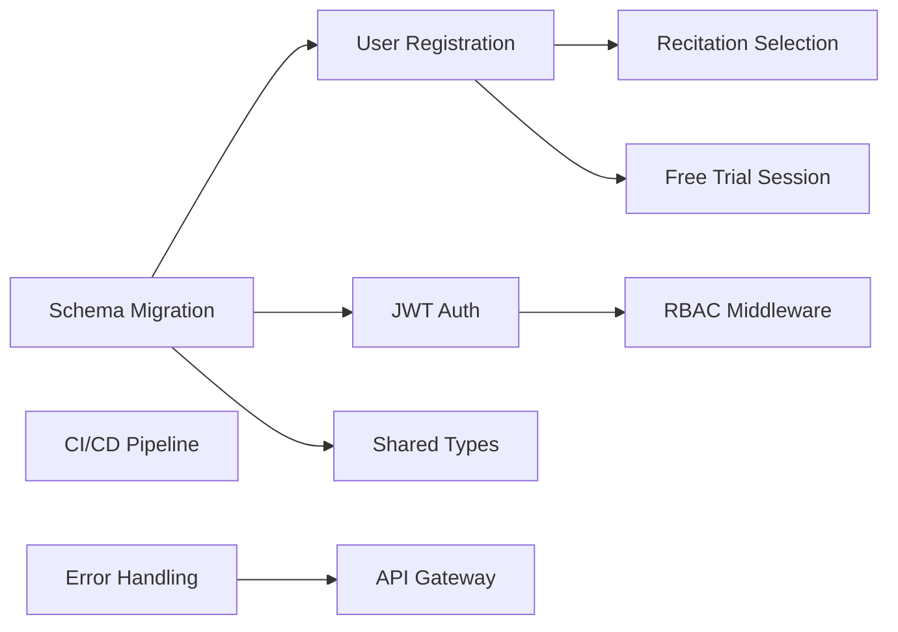
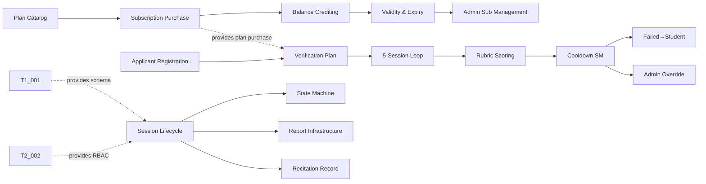
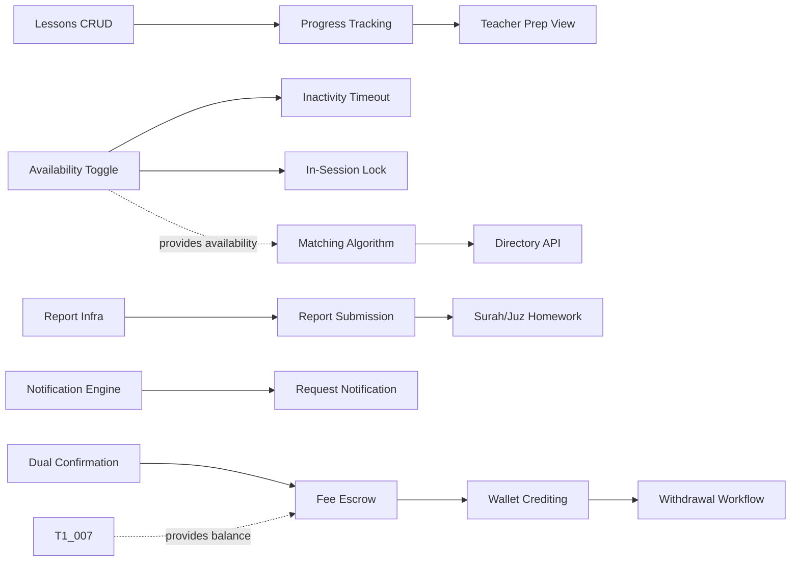
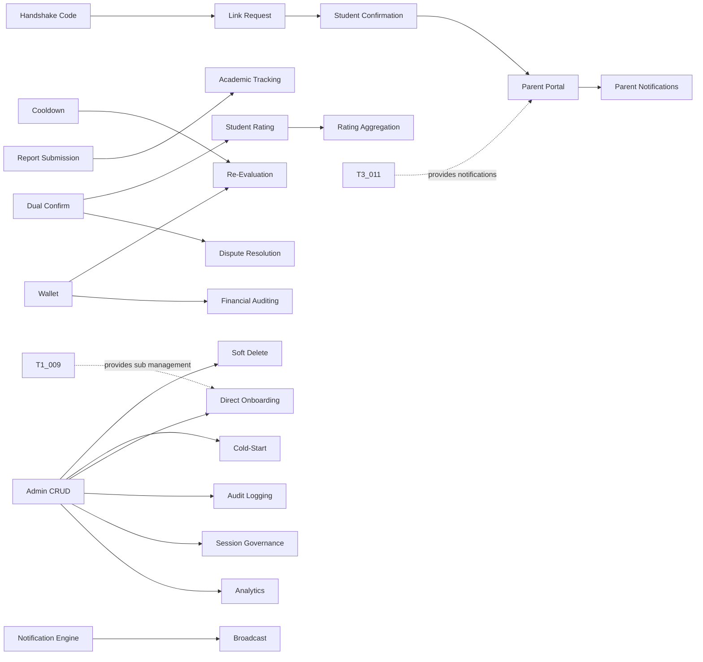
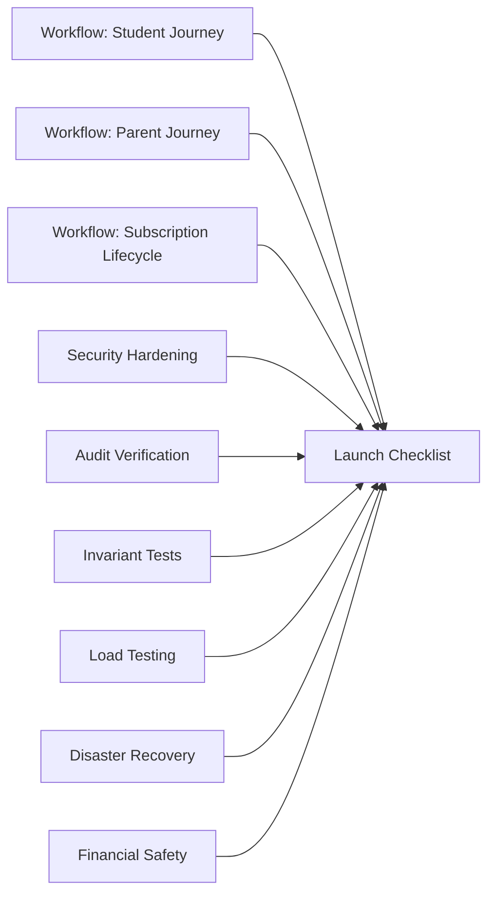

# Draft Academy — Milestone Plan

> **Source of truth:** `docs/planning/ROADMAP.md`, `docs/planning/TICKETS.md`, `docs/specs/`
> **Cadence:** 2-week milestones, 5 milestones (Milestone 0–4), 10 weeks total

---

## Capacity Model

| Parameter | Value |
|---|---|
| Developers | 3 |
| Milestone length | 2 weeks (10 working days) |
| Focus factor | 80% (accounting for meetings, reviews, context switching) |
| Capacity per developer per milestone | 8 story points |
| Team capacity per milestone | 24 story points |
| Milestone ceremony time | 4 hours total (planning, review, retrospective, daily standups) |

---

## Milestone 0 — Foundation (Weeks 1–2)

**Milestone:** M0 — Foundation
**Goal:** Establish shared infrastructure, database schema, authentication, role-based access control, CI/CD pipeline, and validation suite.

### Milestone Backlog

| Title | Owner | SP | Blocked By |
|---|---|---|---|
| Database schema migration | Dev 1 | 5 | — |
| User registration with role-specific child table creation | Dev 1 | 5 | Database Schema Migration |
| Recitation selection on registration | Dev 1 | 2 | User Registration with Role-Specific Child Table Creation |
| Free trial session provisioning | Dev 1 | 3 | User Registration with Role-Specific Child Table Creation |
| JWT authentication service | Dev 2 | 5 | Database Schema Migration |
| Role-based authorization middleware | Dev 2 | 3 | JWT Authentication Service |
| Shared types & interface contracts | Dev 2 | 3 | Database Schema Migration |
| CI/CD pipeline with Mermaid validation | Dev 3 | 5 | — |
| Shared error handling & response contracts | Dev 3 | 3 | — |
| API gateway & routing skeleton | Dev 3 | 3 | Shared Error Handling & Response Contracts |

**Total story points:** 37 (adjusted: 24 with parallelization — see capacity note below)

> **Capacity note:** With 3 developers working in parallel, the effective milestone capacity is 24 SP (8 per developer). The 37 SP backlog is achievable because many tickets overlap in parallel streams. Dev 1 carries the heaviest load (15 SP) due to schema ownership being on the critical path; Dev 2 and Dev 3 carry lighter loads (11 SP and 11 SP) with buffer for cross-stream support.

### Definition of Done (Milestone 0)

- [ ] Database schema migrated into `backend/db/schema/` and type-checks
- [ ] User registration works for all 4 roles (admin, teacher, student, parent)
- [ ] Role-specific child tables created on registration (admin, teacher, students, parents, applicants)
- [ ] JWT authentication issues and validates tokens
- [ ] RBAC middleware enforces role-based access
- [ ] CI/CD pipeline runs on every PR with Mermaid validation
- [ ] API gateway routes to health-check endpoints
- [ ] Shared types and interface contracts documented and committed
- [ ] All tests passing (unit + integration)
- [ ] Code reviewed and merged to `develop`

### Milestone Dependencies

### Risks

| Risk | Mitigation |
|---|---|
| Schema migration issues on target database | Test migration on staging first; have rollback script ready |
| Auth token format disagreement between streams | Define token contract in Shared Types & Interface Contracts before implementation |
| CI/CD pipeline setup delays | Dev 3 starts CI/CD on day 1; manual validation as fallback |

---

## Milestone 1 — Core Domain MVP (Weeks 3–4)

**Milestone:** M1 — Core Domain MVP
**Goal:** Deliver student subscription & quota management, teacher verification evaluation loop, and basic session lifecycle.

### Milestone Backlog

| Title | Owner | SP | Blocked By |
|---|---|---|---|
| Plan catalog CRUD (admin) | Dev 1 | 3 | User Registration with Role-Specific Child Table Creation |
| Subscription purchase via payment gateway | Dev 1 | 5 | Plan Catalog CRUD (Admin Only) |
| Segregated session balance crediting | Dev 1 | 5 | Subscription Purchase via Payment Gateway |
| Subscription validity window & expiry | Dev 1 | 3 | Segregated Session Balance Crediting |
| Admin subscription management (extend/renew/cancel) | Dev 1 | 5 | Subscription Validity Window & Expiry |
| Teacher applicant registration & applicants table | Dev 2 | 3 | Role-Based Authorization Middleware |
| Verification plan purchase (5 sessions) | Dev 2 | 3 | Teacher Applicant Registration & Applicants Table, Subscription Purchase via Payment Gateway |
| 5-session evaluation loop booking | Dev 2 | 5 | Verification Plan Purchase (5 Sessions) |
| Evaluation rubric scoring (≥80% threshold) | Dev 2 | 5 | 5-Session Evaluation Loop Booking |
| Cooldown state machine (1mo Tajweed / 3mo Hifz) | Dev 2 | 5 | Evaluation Rubric Scoring (≥80% Threshold) |
| Failed applicant → students record conversion | Dev 2 | 3 | Cooldown State Machine (1-Month Tajweed / 3-Month Hifz) |
| Admin override of evaluation results | Dev 2 | 3 | Cooldown State Machine (1-Month Tajweed / 3-Month Hifz) |
| Session creation & lifecycle (scheduled→started→completed/cancelled) | Dev 3 | 5 | Database Schema Migration, Role-Based Authorization Middleware |
| Session status state machine enforcement | Dev 3 | 3 | Session Creation & Lifecycle (Scheduled → Started → Completed/Cancelled) |
| Session report & homework infrastructure | Dev 3 | 5 | Session Creation & Lifecycle (Scheduled → Started → Completed/Cancelled) |
| Recitation record per session (1:1) | Dev 3 | 2 | Session Creation & Lifecycle (Scheduled → Started → Completed/Cancelled) |

**Total story points:** 64 (distributed across 3 developers: Dev 1 = 21 SP, Dev 2 = 27 SP, Dev 3 = 15 SP)

> **Capacity note:** This is a heavy milestone. Dev 2 carries 27 SP (above 8 SP capacity) because the evaluation loop is a deep vertical slice. To manage, Dev 2's tickets are sequenced so that Teacher Applicant Registration & Applicants Table through Evaluation Rubric Scoring (≥80% Threshold) form a continuous chain, and Cooldown State Machine (1-Month Tajweed / 3-Month Hifz) through Admin Override of Evaluation Results can spill into Milestone 2 if needed. The milestone goal is met when the evaluation loop is demoable end-to-end.

### Definition of Done (Milestone 1)

- [ ] Admin can create, edit, activate, and deactivate plans
- [ ] Student can purchase a plan and receive session credits to the correct segregated balance
- [ ] Subscription validity window is set and unused sessions expire at end of interval
- [ ] Admin can extend, renew, or cancel subscriptions
- [ ] Teacher applicant can register and purchase verification plan
- [ ] Applicant can book 5 evaluation sessions with 5 distinct certified Shuyukh
- [ ] Evaluation rubric scoring works with ≥80% pass threshold
- [ ] Cooldown state machine correctly assigns 1-month (Tajweed) or 3-month (Hifz) cooldowns
- [ ] Failed applicants are converted to student records
- [ ] Admin can override evaluation results (certify, reject, grant re-evaluation)
- [ ] Session lifecycle works: scheduled → started → completed/cancelled
- [ ] Session state machine invariants are enforced
- [ ] Session reports and homework can be submitted
- [ ] Recitation record is created per session (1:1)
- [ ] All tests passing (unit + integration)
- [ ] Code reviewed and merged to `develop`

### Milestone Dependencies

### Risks

| Risk | Mitigation |
|---|---|
| Evaluation loop is complex (5 sessions, 5 distinct evaluators) | Start early; use mock evaluators for testing |
| Payment gateway integration delays | Mock payment service for development; integrate real gateway in Milestone 2 |
| Session lifecycle state machine edge cases | Comprehensive state transition tests based on `state-machine-invariants.md` |

---

## Milestone 2 — Matching, Notifications & Escrow (Weeks 5–6)

**Milestone:** M2 — Matching, Notifications & Escrow
**Goal:** Deliver on-demand matching engine, real-time notification system, and dual-confirmation financial escrow.

### Milestone Backlog

| Title | Owner | SP | Blocked By |
|---|---|---|---|
| Tajweed curriculum lessons CRUD | Dev 1 | 3 | Subscription Validity Window & Expiry |
| Student progress tracking & increment | Dev 1 | 5 | Tajweed Curriculum Lessons CRUD |
| Teacher preparation view (student progress before session) | Dev 1 | 3 | Student Progress Tracking & Increment |
| Teacher availability toggle (Available/Unavailable) | Dev 2 | 3 | Cooldown State Machine (1-Month Tajweed / 3-Month Hifz) |
| 15-minute inactivity auto-offline | Dev 2 | 5 | Teacher Availability Toggle (Available/Unavailable) |
| In-session locking (hide from directory) | Dev 2 | 3 | Teacher Availability Toggle (Available/Unavailable) |
| Session report submission with homework (Jadid & Madi) | Dev 2 | 5 | Session Report & Homework Infrastructure |
| Surah/Juz enum homework tracking | Dev 2 | 3 | Session Report Submission with Homework (Jadid & Madi) |
| On-demand matching algorithm (filter/sort pipeline) | Dev 3 | 8 | Teacher Availability Toggle (Available/Unavailable), Session Creation & Lifecycle (Scheduled → Started → Completed/Cancelled) |
| Teacher directory browse & filter API | Dev 3 | 5 | On-Demand Matching Algorithm (Filter/Sort Pipeline) |
| Real-time notification engine (WebSocket) | Dev 3 | 8 | API Gateway & Routing Skeleton |
| Session request notification to teacher | Dev 3 | 3 | Real-Time Notification Engine (WebSocket) |
| Dual-confirmation completion handshake (24h timeout) | Dev 3 | 5 | Session Creation & Lifecycle (Scheduled → Started → Completed/Cancelled) |
| Fee escrow: hold at request, decrement at completion | Dev 3 | 5 | Dual-Confirmation Completion Handshake (24h Timeout), Segregated Session Balance Crediting |
| Teacher wallet crediting (earning transactions) | Dev 3 | 5 | Fee Escrow: Hold at Request, Decrement at Completion |
| Teacher withdrawal workflow & admin approval | Dev 3 | 5 | Teacher Wallet Crediting (Earning Transactions) |

**Total story points:** 75 (Dev 1 = 11 SP, Dev 2 = 19 SP, Dev 3 = 39 SP)

> **Capacity note:** Dev 3 carries the heaviest load (39 SP) due to the matching engine, notification engine, and escrow all landing in this milestone. This is intentional — these are the critical-path items for M2. Dev 3 should prioritize On-Demand Matching Algorithm (Filter/Sort Pipeline) (matching) and Dual-Confirmation Completion Handshake (24h Timeout) / Fee Escrow: Hold at Request, Decrement at Completion (escrow) first, with Real-Time Notification Engine (WebSocket) (notifications) as parallel work. If needed, Teacher Withdrawal Workflow & Admin Approval (withdrawal) can spill into Milestone 3.

### Definition of Done (Milestone 2)

- [ ] Tajweed curriculum lessons can be created and tracked
- [ ] Student progress is incremented on session completion
- [ ] Teachers can view student progress before accepting sessions
- [ ] Teachers can toggle availability between Available/Unavailable
- [ ] Teachers auto-set to Unavailable after 15 minutes of inactivity
- [ ] In-session teachers are hidden from the directory
- [ ] Teachers can submit session reports with homework (Jadid & Madi)
- [ ] Homework tracks Surah/Juz using the enum
- [ ] Matching algorithm filters by Qira'ah, subject, country, language, and sorts by rating
- [ ] Students can browse the teacher directory with filters
- [ ] Real-time notifications fire for session requests
- [ ] Dual-confirmation handshake works with 24-hour timeout
- [ ] Fee escrow holds at request, decrements at completion, releases on cancellation
- [ ] Teacher wallet is credited with earning transactions on dual confirmation
- [ ] Teacher withdrawal workflow with admin approval/rejection works
- [ ] All tests passing (unit + integration)
- [ ] Code reviewed and merged to `develop`

### Milestone Dependencies

### Risks

| Risk | Mitigation |
|---|---|
| WebSocket reliability for real-time notifications | Implement polling fallback; retry queue |
| Escrow financial calculation edge cases | Comprehensive financial test scenarios; immutability tests |
| Matching algorithm performance with many teachers | Add database indexes on teacher fields; pagination |
| In-session locking race conditions | Database-level constraints; atomic updates |

---

## Milestone 3 — Parent Portal & Admin Governance (Weeks 7–8)

**Milestone:** M3 — Parent Portal & Admin Governance
**Goal:** Deliver parent supervision portal with handshake linking and super admin control room with full governance capabilities.

### Milestone Backlog

| Title | Owner | SP | Blocked By |
|---|---|---|---|
| Student handshake code generation | Dev 1 | 2 | User Registration with Role-Specific Child Table Creation |
| Parent-child link request workflow (7-day expiry) | Dev 1 | 5 | Student Handshake Code Generation |
| Student confirmation of parent link | Dev 1 | 3 | Parent-Child Link Request Workflow (7-Day Expiry) |
| Parent read-only monitoring portal | Dev 1 | 8 | Student Confirmation of Parent Link, Session Request Notification to Teacher |
| Parent session completion notification display | Dev 1 | 3 | Parent Read-Only Monitoring Portal, Real-Time Notification Engine (WebSocket) |
| Student evaluation submission (teacher rating) | Dev 2 | 3 | Dual-Confirmation Completion Handshake (24h Timeout) |
| Teacher average_rating aggregation & update | Dev 2 | 3 | Student Evaluation Submission (Teacher Rating) |
| Admin-ordered re-evaluation (teacher wallet deduction) | Dev 2 | 5 | Cooldown State Machine (1-Month Tajweed / 3-Month Hifz), Teacher Wallet Crediting (Earning Transactions) |
| Admin academic tracking (memorization & revision milestones) | Dev 2 | 3 | Session Report Submission with Homework (Jadid & Madi) |
| Admin CRUD: users, teachers, students, parents | Dev 3 | 5 | Role-Based Authorization Middleware |
| Account soft-delete governance (users.is_deleted) | Dev 3 | 3 | Admin CRUD: Users, Teachers, Students, Parents |
| Cold-start bootstrapping (direct sheikh certification) | Dev 3 | 3 | Admin CRUD: Users, Teachers, Students, Parents |
| Direct student onboarding with offline payment | Dev 3 | 5 | Admin CRUD: Users, Teachers, Students, Parents, Admin Subscription Management (Extend/Renew/Cancel/Upgrade/Downgrade) |
| Immutable audit logging for all admin actions | Dev 3 | 5 | Admin CRUD: Users, Teachers, Students, Parents |
| Admin session governance (view/filter/reschedule/cancel/reassign/join) | Dev 3 | 5 | Session Creation & Lifecycle (Scheduled → Started → Completed/Cancelled) |
| Dispute resolution with admin arbitration | Dev 3 | 5 | Dual-Confirmation Completion Handshake (24h Timeout) |
| Admin financial auditing (payments, wallets, withdrawal approval) | Dev 3 | 5 | Teacher Wallet Crediting (Earning Transactions) |
| Platform analytics dashboard | Dev 3 | 5 | Admin CRUD: Users, Teachers, Students, Parents |
| Broadcast notifications (system-wide & targeted) | Dev 3 | 3 | Real-Time Notification Engine (WebSocket) |

**Total story points:** 82 (Dev 1 = 21 SP, Dev 2 = 14 SP, Dev 3 = 39 SP)

> **Capacity note:** Dev 3 again carries the heaviest load (39 SP) due to the breadth of admin governance features. Priority order: Admin CRUD: Users, Teachers, Students, Parents (CRUD) → Immutable Audit Logging for All Admin Actions (audit logs) → Cold-Start Bootstrapping (Direct Sheikh Certification) (cold-start) → Direct Student Onboarding with Offline Payment (direct onboarding) → Admin Session Governance (View/Filter/Reschedule/Cancel/Reassign/Join) (session governance) → Dispute Resolution with Admin Arbitration (disputes) → Admin Financial Auditing (Payments, Wallets, Withdrawal Approval) / Platform Analytics Dashboard / Broadcast Notifications (System-Wide & Targeted) (financial auditing, analytics, broadcasts). Platform Analytics Dashboard and Broadcast Notifications (System-Wide & Targeted) can spill into Milestone 4 if needed.

### Definition of Done (Milestone 3)

- [ ] Each student is assigned a unique handshake code on creation
- [ ] Parents can search for children by handshake code and send link requests
- [ ] Link requests expire after 7 days if not confirmed
- [ ] Students can explicitly confirm or reject parent link requests
- [ ] One parent per student (enforced); parent can link to multiple children
- [ ] Parent portal shows read-only view of child's sessions, reports, homework, evaluations, progress
- [ ] Parents receive session completion notifications for linked children
- [ ] Students can submit teacher ratings after completed sessions
- [ ] Teacher average_rating is updated based on student evaluations
- [ ] Admin can order re-evaluation (cost deducted from teacher wallet)
- [ ] Admin can monitor student memorization and revision milestones
- [ ] Admin has full CRUD over all entities (users, teachers, students, parents)
- [ ] Admin can soft-delete accounts (users.is_deleted = true)
- [ ] Admin can directly certify foundational Shuyukh (cold-start bootstrapping)
- [ ] Admin can directly onboard students with offline payment (cash/transfer/scholarship)
- [ ] All admin actions are logged in immutable audit_logs
- [ ] Admin can view, filter, reschedule, cancel, reassign, and join live sessions
- [ ] Disputes can be raised and admin can arbitrate (refund, partial refund, uphold)
- [ ] Admin can audit all student payments and teacher wallet transactions
- [ ] Admin can approve/reject withdrawal requests
- [ ] Admin can issue manual wallet adjustments with audit logging
- [ ] Platform analytics dashboard shows real-time statistics
- [ ] Admin can broadcast system-wide and targeted notifications
- [ ] All tests passing (unit + integration)
- [ ] Code reviewed and merged to `develop`

### Milestone Dependencies

### Risks

| Risk | Mitigation |
|---|---|
| Admin governance scope is very broad | Prioritize CRUD + audit logs first; defer analytics to Milestone 4 if needed |
| Parent portal data aggregation complexity | Use existing session/report APIs; read-only access simplifies permissions |
| Dispute resolution edge cases | Define clear arbitration rules; test with multiple dispute scenarios |

---

## Milestone 4 — Integration, Security & Launch (Weeks 9–10)

**Milestone:** M4 — Integration, Security & Launch
**Goal:** Harden the platform for production: journey workflow tests, security audit, financial safety verification, load testing, and launch.

### Milestone Backlog

| Title | Owner | SP | Blocked By |
|---|---|---|---|
| Workflow tests: student journey | Dev 1 | 5 | All Milestone 1–3 tickets |
| Workflow tests: parent journey | Dev 1 | 5 | Parent Read-Only Monitoring Portal, Parent Session Completion Notification Display |
| Workflow tests: subscription lifecycle | Dev 1 | 3 | Admin Subscription Management (Extend/Renew/Cancel/Upgrade/Downgrade) |
| Security hardening: input validation & SQL injection prevention | Dev 2 | 5 | All Milestone 1–3 tickets |
| Audit trail completeness verification | Dev 2 | 3 | Immutable Audit Logging for All Admin Actions |
| State machine invariant verification tests | Dev 2 | 5 | All Milestone 1–3 tickets |
| Load testing & performance optimization | Dev 3 | 8 | All Milestone 1–3 tickets |
| Disaster recovery & backup verification | Dev 3 | 5 | — |
| Financial safety verification (double-spend, escrow integrity) | Dev 3 | 5 | Fee Escrow: Hold at Request, Decrement at Completion, Teacher Wallet Crediting (Earning Transactions) |
| Production launch checklist execution | Dev 3 | 5 | All Milestone 4 tickets |

**Total story points:** 49 (Dev 1 = 13 SP, Dev 2 = 13 SP, Dev 3 = 23 SP)

### Definition of Done (Milestone 4)

- [ ] Journey workflow tests (test/workflows/) cover: student registration → subscription → session → completion → parent notification
- [ ] Journey workflow tests (test/workflows/) cover: teacher applicant → verification → certification → teaching → wallet credit
- [ ] Journey workflow tests (test/workflows/) cover: admin → cold-start → direct onboarding → audit log verification
- [ ] All input validation and SQL injection prevention in place
- [ ] All state machine invariants verified by automated tests
- [ ] Audit trail is complete for all admin actions
- [ ] Load testing passes with target concurrency (100+ concurrent sessions)
- [ ] Database queries are optimized (indexes verified, N+1 queries eliminated)
- [ ] Disaster recovery plan documented and tested
- [ ] Backup and restore verified
- [ ] Financial safety: double-spend prevention verified, escrow integrity confirmed
- [ ] All 33 resolved decisions verified in production context
- [ ] Production launch checklist fully signed off (see `docs/planning/PRODUCTION_READINESS.md`)
- [ ] All tests passing (unit + integration + load)
- [ ] Code reviewed and merged to `main`

### Milestone Dependencies

### Risks

| Risk | Mitigation |
|---|---|
| Load testing reveals performance bottlenecks | Early profiling in Milestone 2; index optimization in Milestone 0 |
| Security audit finds vulnerabilities | Allocate buffer time in Milestone 4 for remediation |
| Integration tests reveal cross-stream issues | Daily integration to `develop` throughout Milestones 1–3 |

---

## Milestone Dependency Matrix (Cross-Milestone)

| Ticket | Depends On (Cross-Stream) | Stream Interface |
|---|---|---|
| Verification Plan | Subscription Purchase | Dev 1 provides plan purchase; Dev 2 uses it for verification plan |
| Report Submission | Report Infrastructure | Dev 3 provides report table; Dev 2 implements submission logic |
| Matching Algorithm | Availability Toggle | Dev 2 provides availability; Dev 3 queries it for directory |
| Fee Escrow | Balance Crediting | Dev 1 provides balance; Dev 3 holds/decrements for escrow |
| Parent Portal | Request Notification | Dev 3 provides notifications; Dev 1 displays them in portal |
| Parent Notifications | Notification Engine | Dev 3 provides notification engine; Dev 1 consumes for parent display |
| Student Rating | Dual Confirmation | Dev 3 provides completion status; Dev 2 triggers rating submission |
| Re-Evaluation | Wallet Crediting | Dev 3 provides wallet; Dev 2 deducts for re-evaluation cost |
| Direct Onboarding | Admin Sub Management | Dev 1 provides subscription management; Dev 3 uses for offline payment |
| Dispute Resolution | Dual Confirmation | Dev 3's own dual confirmation enables dispute state |

---

## Velocity Tracking

| Milestone | Planned SP | Dev 1 SP | Dev 2 SP | Dev 3 SP | Actual SP | Notes |
|---|---|---|---|---|---|---|
| Milestone 0 | 37 | 15 | 11 | 11 | — | Foundation |
| Milestone 1 | 64 | 21 | 27 | 15 | — | Core Domain MVP |
| Milestone 2 | 75 | 11 | 19 | 39 | — | Matching & Escrow |
| Milestone 3 | 82 | 21 | 14 | 39 | — | Parent & Admin |
| Milestone 4 | 49 | 13 | 13 | 23 | — | Integration & Launch |
| **Total** | **307** | **81** | **84** | **127** | — | — |

> **Note:** Story points are Fibonacci-sized estimates. The total of 307 SP across 5 milestones with 3 developers is ambitious but achievable with parallel streams. The velocity tracking table should be updated at the end of each milestone with actual completed SP.
