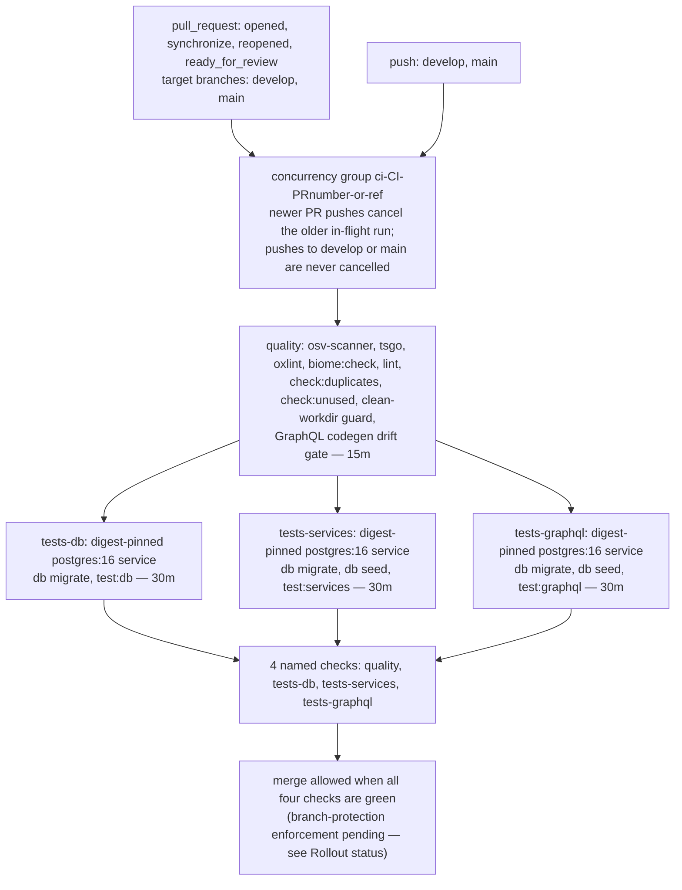

# CI Pipeline

Canonical reference for `.github/workflows/ci.yml` (the PR pipeline). Anyone editing the workflow MUST read this document first — the workflow header comment links back here, and this document links back to the workflow (bidirectional contract). Every step in CI invokes the same canonical commands a developer runs locally, so "passed locally" cannot diverge from "passed in CI".

## Why

- **Four named checks per PR.** `quality`, `tests-db`, `tests-services`, `tests-graphql` run on every pull request targeting `develop`/`main` — a red PR is traceable to its failing domain by check name alone.
- **Local truth equals CI truth.** No CI-only shell logic exists: each `run:` step calls the repo's own canonical commands (`bun tsgo`, `bun run test:db`, …) with the same env fixture values CI materializes.
- **Self-contained environment.** Zero `secrets.` references: the workflow carries its own fixture env inline (`ci-local-only-fixture` credentials, throwaway JWT/encryption fixtures) — nothing secret ever enters scope.
- **Cheap-first ordering.** The three database suites never start before `quality` is green — runner minutes are never burned on code that fails mechanical gates.

## Pattern

### Trigger model

| Event | Filter | Semantics |
|---|---|---|
| `pull_request` | branches `[develop, main]`; types `[opened, synchronize, reopened, ready_for_review]` | Runs on draft PRs too (no draft suppression — earliest feedback, cost bounded by cancellation). `ready_for_review` explicitly covers the draft→ready transition. |
| `push` | branches `[develop, main]` | Complete per-commit audit trail on the protected branches themselves; `cancel-in-progress` is false for push events, so merged history keeps one green run per commit. |

**`pull_request_target` is permanently banned**. This workflow executes PR-authored code; the `_target` variant would grant it a write-scoped checkout token and repository secrets in the fork's reach. Everything the pipeline needs comes from committed files and fixture values, so the elevated trigger buys nothing and risks everything.

### Job/stage map

| Job | Needs | Timeout | Purpose (canonical commands) |
|---|---|---|---|
| `quality` | — | 15 min | `bun tsgo` → `bun run oxlint` → `bun biome:check` → `bun run lint` → `bun run check:duplicates` → `bun run check:unused`, plus the osv-scanner dependency vulnerability scan, the clean-working-directory guard, and the GraphQL codegen drift gate |
| `tests-db` | `quality` | 30 min | ephemeral digest-pinned Postgres 16 service; inline `.env.test` materialization; `bun run db migrate`; `bun run test:db` (no seed — repository tests create their own data) |
| `tests-services` | `quality` | 30 min | ephemeral Postgres 16 service; `bun run db migrate`; `bun run db seed`; `bun run test:services` |
| `tests-graphql` | `quality` | 30 min | ephemeral Postgres 16 service; `bun run db migrate`; `bun run db seed`; `bun run test:graphql` (boots the dev/test server via `test/scripts/run-server-tests.ts`) |

DB suites never start before `quality` is green.

### Topology



## Rules

### Environment materialization

The `Setup environment files` step writes `.env.test` via a heredoc (the exact fixture values from the workflow-level `env:` block) and copies it to `.env` — Bun auto-loads the cwd `.env`, so every later step (including `bun run db migrate` and the codegen drift gate) resolves the same fixture values without `--env-file` ceremony. Nothing here reads developer-local state.

### Caching

Restore/save halves are separate steps with split keys; caches are never cleared.

| Step name (byte-exact) | Key | restore-keys prefix |
|---|---|---|
| Restore Bun install cache | `${{ runner.os }}-bun-${{ hashFiles('bun.lock') }}` | `${{ runner.os }}-bun-` |
| Restore ESLint caches (restored/saved only — never cleared) | `${{ runner.os }}-eslint-${{ github.run_id }}` | `${{ runner.os }}-eslint-` |
| Save Bun install cache (`if: always()`) | `${{ runner.os }}-bun-${{ hashFiles('bun.lock') }}-${{ github.run_id }}` | — |
| Save ESLint caches (restored/saved only — never cleared) (`if: always()`) | `${{ runner.os }}-eslint-${{ github.run_id }}` | — |

- **Append-only saves**: run-id suffixes make every save key unique-per-run; nothing is ever overwritten in-band. Save steps carry `if: always()` so red runs still warm later ones — correct-but-slower philosophy.
- **Prefix fallback semantics**: the exact Bun key pins the lockfile hash; the restore-keys prefix picks the most recent matching entry anyway — a stale restore can only degrade to slower, never wrong, because the tools re-validate their own inputs. The ESLint exact key contains a fresh `run_id` on purpose so it always misses exact and falls back to the prefix.
- **Never-clear policy**: the workflow contains ZERO deletion steps against cache paths. Cache hygiene = GitHub retention expiry only.
- **Native branch isolation**: caches saved during `pull_request` runs are scoped to the PR namespace — restorable by later runs of the SAME PR only. Fork/cache-poisoning surface stays closed by GitHub's scoping guarantee.

### Security posture

- **Token minimality**: top-level `permissions: contents: read` — nothing else granted; no job elevates.
- **Action pinning** — full-length commit SHAs, verified against upstream tags:

| Action / dependency | Pin | Version |
|---|---|---|
| `actions/checkout` | `fbc6f3992d24b796d5a048ff273f7fcc4a7b6c09` | v5.1.0 |
| `oven-sh/setup-bun` | `0c5077e51419868618aeaa5fe8019c62421857d6` | v2.2.0 |
| `actions/cache/restore` + `/save` | `0057852bfaa89a56745cba8c7296529d2fc39830` | v4.3.0 |
| `google/osv-scanner-action/osv-scanner-action` | `a345acffa64b0eaede81a3d9aae6141214d9c8fc` | v2.6.0 |
| `postgres` service image | `postgres:16@sha256:ca0bd484cb98bf4b24eb1010e73fb3fcbd6714d240fbc1a10eea5b7dbecb641d` (manifest-list digest, `postgres:16` tag 2026-10-07 patch level; tag kept in comment for humans) | 16 |

- **Fork isolation**: `pull_request` trigger only; zero `secrets.` references anywhere. The sole credentials in scope are the per-job ephemeral Postgres fixture values (`kottaby:ci-local-only-fixture@127.0.0.1:5432/kottaby_test`), destroyed with the VM — provably not secrets.
- **Injection defense**: PR-controlled values reach shells ONLY via GitHub expressions in `concurrency`/trigger configuration — zero `${{ github.event.* }}` interpolation inside any `run:` block.
- **Credential leakage defense**: all four checkouts declare `persist-credentials: false`.
- **Artifact policy**: none — nothing is uploaded. Debug path = manual re-run with logs; any future debug artifact must exclude `.env*`, caches, `.git/`, retention ≤ 7 days.

### GraphQL codegen drift gate

`bun run generate:gqlSchema && bun codegen && git diff --exit-code` runs at the tail of `quality`, after the clean-working-directory guard. The schema build resolves `DATABASE_URL` from the materialized `.env` but never opens a connection — the fixture value is inert.

### Local reproduction commands

Identical strings to the workflow `run:` blocks:

| # | Command (verbatim as in CI) | Job |
|---|---|---|
| 1 | `bun tsgo` | quality |
| 2 | `bun run oxlint` | quality |
| 3 | `bun biome:check` | quality |
| 4 | `bun run lint` | quality |
| 5 | `bun run check:duplicates` | quality |
| 6 | `bun run check:unused` | quality |
| 7 | `bun run generate:gqlSchema && bun codegen && git diff --exit-code` | quality (codegen drift gate) |
| 8 | `bun run db migrate` | tests-db / tests-services / tests-graphql |
| 9 | `bun run db seed` | tests-services / tests-graphql |
| 10 | `bun run test:db` | tests-db |
| 11 | `bun run test:services` | tests-services |
| 12 | `bun run test:graphql` | tests-graphql |

The three DB suites additionally require a reachable PostgreSQL at the `DATABASE_URL` from `.env.test` (CI provisions it as a service container; locally a developer's `kottaby_test` database serves the same role).

## What NOT to Do

- **NEVER introduce `pull_request_target`** (or any trigger beyond the two listed). PR-authored code runs read-only and secrets-free BY DESIGN.
- **NEVER unpin, tag-pin, or bump-without-verifying** any `uses:` ref. Full-length SHA + version comment, always. Treat the `postgres` service image the same way — the digest pin stays; a bump re-pins a NEW digest with a fresh tag-timestamp comment and a green verification run.
- **NEVER clear caches from the workflow** — no `rm`/delete/expiry steps against cache paths, ever; and keep the ESLint steps' names intact including `(restored/saved only — never cleared)` — the name IS the policy marker.
- **NEVER rename a job id casually.** The four job keys (`quality`, `tests-db`, `tests-services`, `tests-graphql`) must be copied BYTE-FOR-BYTE into any future branch-protection ruleset; a typo silently un-blocks merges. Rename = synchronous ruleset update (human admin step below).
- **NEVER interpolate event data into `run:` strings.** New PR-derived values go through step-level `env:`.
- **NEVER upload artifacts opportunistically**: policy is none; sanctioned debug path is documented above.
- **NEVER add a terminal aggregator job** (`ci-verdict` / `all-green` / `gate`) merely to simplify branch protection — an aggregate either still leaves every constituent needing individual required-status enforcement (else bypass gaps remain) or collapses attribution so a red PR can no longer be traced to its single failing domain at a glance.
- **Do not skip reading this file before editing `ci.yml`** — and keep this document's mermaid topology diagram syntactically valid (`bun run test/scripts/run-test.ts scripts/validation/validate-mermaid.test.ts` guards the validator itself).

## Rollout status — branch protection

NOT yet applied on this repository. Repository rulesets (the mechanism that makes the four checks merge-blocking) require a plan feature the private repository does not currently have — the REST API answers 403 until the plan allows it. Until a human admin applies a ruleset, the four checks are produced on every PR but merges are not machine-enforced.

When the plan allows, a repository ADMIN (Administration: write) applies the ruleset via `gh api --method POST repos/<owner>/<repo>/rulesets --input <payload>` with this required-status-checks contexts list (byte-copies of the `ci.yml` job ids, order preserved):

```json
"required_status_checks": [
  { "context": "quality",        "integration_id": 15368 },
  { "context": "tests-db",       "integration_id": 15368 },
  { "context": "tests-services", "integration_id": 15368 },
  { "context": "tests-graphql", "integration_id": 15368 }
]
```

Semantics to assert after creation: `enforcement: active`; `ref_name.include == ["refs/heads/develop", "refs/heads/main"]`; `bypass_actors: []` (nobody — admins included — merges around required checks); `strict_required_status_checks_policy: true` ("require branches to be up to date before merging"); the checks array equals the four context strings in order. Capture HTTP 201, the GET verification JSON, and a merge-block screenshot (`mergeStateStatus: BLOCKED`) as application evidence.

## Related Documents

- Ground-truth schema: `backend/db/schema/` (Drizzle — sole structural source of truth)
- Mermaid validator: [`scripts/validation/validate-mermaid.ts`](../../scripts/validation/validate-mermaid.ts)
- Launch-readiness gate (broader than CI): [`docs/quality/launch-gate.md`](./launch-gate.md)
- The pipeline itself: [`.github/workflows/ci.yml`](../../.github/workflows/ci.yml) (its header links back here)
- House sibling doc: [`docs/quality/linting-rules.md`](./linting-rules.md)
