# Session Creation & Lifecycle — Canonical Reference

**Domain:** Sessions (P2P `session` table — teacher × student)
**Status:** Implemented and verified (Scheduled → Started → Completed/Cancelled)
**Source of truth for:** the session state machine and its guarded-transition pattern, the four-phase creation transaction, the hold-as-debit ruling and its reconciliation with decision B.4, the trial-first debit ladder and same-lane refund, the idempotency claim-table design, the sessions-are-sensitive disclosure (oracle) ruling, and the consumer guidance for every downstream ticket that touches the lifecycle.

This document is the single canonical reference for the session lifecycle. Downstream consumers (enforcement, reports, notifications, confirmation/escrow, admin governance, ratings) MUST read it before touching `session`, the balance lanes, or the lifecycle mutations. The lifecycle is written **exactly once** — the guarded primitives live in `SessionRepository` and are composed by `SessionLifecycleService`; consumers extend them, never re-implement them.

---

## 1. Why

A booking is money in motion: one allowance unit leaves the student's balance the moment a session is requested, and it must come back exactly once if the session dies. The lifecycle therefore has to be race-proof (two concurrent bookings on a one-unit lane must produce exactly one session), oracle-safe (a hostile caller must learn nothing about other people's sessions), and idempotent (a network retry must never book twice or debit twice). Those properties are easy to get subtly wrong — every ruling in this document exists because a specific failure mode was either proven or ruled out during implementation. The worst failure mode for this domain is *copy-paste*: the plan-catalog surface shipped the **opposite** disclosure ruling for a domain that looks structurally identical (see §7). Read §7 before touching any read-or-write predicate here.

## 2. State Machine & the Guarded-Transition Pattern

### 2.1 States and transitions

| State | Meaning |
|---|---|
| `scheduled` | Created; fee held (`fee_held = true`); 24h confirmation deadline armed. |
| `started` | Live session (`started_at` set). |
| `completed` | Teacher marked complete (`ended_at`, `confirmed_by_teacher_at` set). The student's confirmation adds `confirmed_by_student_at`, releases the hold (`fee_held = false`) and credits the teacher's wallet exactly once (dual confirmation, implemented); a row left unconfirmed is swept to `cancelled` after the 24h window (§2.2). **Not terminal by itself** — it settles via the student's confirmation or the timeout sweep. |
| `cancelled` | Cancelled before start or during (`fee_held = false`, hold refunded). **Terminal.** |
| `disputed` | Producer surface confirmed (B.18): `openSessionDispute` — either participant, from `scheduled`/`started` **only** (pre-completion), escrow hold frozen until arbitration. A dispute attempt on a `completed` row is rejected with `SESSION_INVALID_TRANSITION`; the hop out of `disputed` is the admin resolution `resolveSessionDispute` (admin-arbitrated). Its writers are journey-verified: participants open from a live state exactly once; only admin arbitration exits it. |

```mermaid
stateDiagram-v2
    [*] --> scheduled: createSession (student; four-phase tx)
    scheduled --> started: startSession (owner teacher)
    scheduled --> cancelled: cancelSession (either participant)
    started --> completed: completeSession (owner teacher, certified)
    started --> cancelled: cancelSession (either participant)
    scheduled --> disputed: openSessionDispute (either participant, pre-completion only)
    started --> disputed: openSessionDispute (either participant, pre-completion only)
    completed --> completed: confirmSessionCompletion (student confirm — hold released + wallet credited)
    completed --> cancelled: sweepExpiredCompletedOnce (system 24h timeout)
    disputed --> cancelled: resolveSessionDispute (admin CANCEL, same-lane refund)
    disputed --> completed: resolveSessionDispute (admin COMPLETE, hold consumed)
    completed --> [*]: terminal (settled — hold consumed; ledger accounting depth = escrow accounting surface)
    cancelled --> [*]: terminal (hold already refunded)
```

### 2.2 The guarded-transition pattern (INV-S1/S2)

Every lifecycle mutation is **ONE** `UPDATE … WHERE <row identity> AND <owner/participant> AND <required pre-state> RETURNING *` — predicate evaluation and mutation share one statement under the row lock, so the TOCTOU window is zero by construction:

| Mutation | WHERE predicate (all fused) | SET |
|---|---|---|
| `startSessionOnce` | `id ∧ teacher_id = caller ∧ status = scheduled` | `started_at`, `updated_at` (from ONE captured `now`). `confirmation_deadline` is **never** in any SET clause (B.2 — written at creation, never re-armed). |
| `completeSessionOnce` | `id ∧ teacher_id = caller ∧ status = started ∧ EXISTS (SELECT 1 FROM teacher WHERE teacher.id = session.teacher_id AND teacher.is_approved = true)` | `status=completed`, `ended_at`, `confirmed_by_teacher_at`, `updated_at`. Certification is **fused into the statement** — a decertified teacher cannot complete, and there is no separate read to race against. |
| `cancelSessionOnce` | `id ∧ (student_id = caller ∨ teacher_id = caller) ∧ status ∈ {scheduled, started}` | `status=cancelled`, `fee_held=false`, `updated_at`. Keeps `started_at`; never writes `ended_at`. Terminal states are structurally unreachable in the predicate — a double cancel can never double-refund. |
| `sweepExpiredCompletedOnce` | *(system batch — no row identity, no participant leg)* `status = completed ∧ confirmed_by_student_at IS NULL ∧ confirmed_by_teacher_at < cutoff`, where `cutoff` = the ONE captured sweep instant − `SESSION_CONFIRMATION_WINDOW_MS` (24h; **strict `<`** — a stamp exactly at the cutoff is never swept) | `status=cancelled`, `fee_held=false`, `updated_at` (same captured `now`), `RETURNING *`. The completed-leg sibling of the scheduled-expiry sweep — both legs compose inside `sweepExpiredSessions` on ONE transaction, and the same-lane refund walk covers the UNION of both legs' returned rows (NULL `held_balance_lane` = nothing to refund). `confirmation_deadline` is never touched (B.2 — the window is sweep-time arithmetic on the recorded teacher stamp); `cancelled` is terminal, so a re-run matches zero rows. |

The batch sweeps are the deliberate exception to the probe ritual: a zero-row sweep is the honest idempotent answer (nothing is overdue), not an ambiguity to classify — there is no caller to oracle-protect.

A zero-row match is ambiguous (unknown id vs non-owner vs wrong state vs decertified), so the service classifies it with **one cold probe read** (`findTransitionProbe`: the 4-column projection `id, status, studentId, teacherId`) that runs only AFTER the guarded UPDATE already matched zero rows and **never feeds a write**:

- probe `null` → `SESSION_NOT_FOUND`;
- probe status ≠ the required pre-state → `SESSION_INVALID_TRANSITION`;
- probe `started` on a complete attempt → the fused certification `EXISTS` was the miss cause → `TEACHER_NOT_CERTIFIED`.

**Rules:** never branch a write off the probe; never add a second write path for a transition; never "helpfully" widen a participant predicate (admins get exactly the non-participant denial — the future admin surface is separately owned); never persist cancel `reason` here (validated ≤500 chars, then discarded — the status-history seam owns persistence).

**Notification side effects (implemented).** Two student-facing completion waves ride the transitions above. Each is emitted on the owning transaction as an unpublished delivery receipt and pushed through `NotificationEngine.publishReceipts` strictly AFTER the commit — a rolled-back flow never pushes a notification, and a caller-owned transaction leaves the publish to the caller (the outer-tx receipt surfaces through `completeSessionWithReceipt`). Copy is composed in the recipient's persisted locale:

| Producer transition | Wave kind · row type | Recipient | Idempotency key |
|---|---|---|---|
| `completeSession` — the owner teacher's completion stamp; fires only when the guarded UPDATE matches, never on a denied or idempotent repeat | `completion_prompt` · `session_completion` | student | `session-completion-prompt:{sessionId}` |
| `sweepExpiredSessions` completed leg — one notice per swept row; the scheduled-expiry leg stays notification-free | `completion_auto_cancelled` · `session_completion` | student | `session-completion-autocancel:{sessionId}` |

### 2.3 Invariant binding (state machine)

| Invariant | How this implementation holds it |
|---|---|
| **INV-S1** (no regression from `completed`) | Structural — `completed` appears in no transition's pre-state predicate; exhaustively matrix-tested. |
| **INV-S2** (`cancelled` terminal) | Same — double-cancel chaos-proofed; refund exactly once. |
| **INV-S3** (earning only on dual confirmation) | By absence: ZERO `teacher_transaction`/`wallet` writes exist in the lifecycle (grep-gated + journey count-delta oracles). |
| **INV-S4** (both parties NOT NULL) | Schema NOT NULL FKs + creation always writes both from server-side identity/lock. |
| **INV-S5** (certified at creation) | `SELECT … FOR UPDATE` on the `teacher` row inside the creation tx (§4) — and re-asserted fused into the complete UPDATE (§2.2). |
| **INV-S6** (in-session `is_online=false`) | **Landed**: `startSession` composes `TeacherRepository.setOnline(teacherId, false, tx)` onto the SAME transaction (in `session-lifecycle.service.ts`); the release composes through `releaseTeacherInSessionLock` (`session-lifecycle.transitions.ts`) into `completeSession`, `cancelSession`-from-`started`, and `resolveSessionDispute`-from-`started` (`started_at` classifies the pre-state — a pre-start cancel/arbitration releases nothing). The deliberately-offline restore ceiling (manual toggle) is the teacher-presence seam (ledger D2); the toggle's pre-write guard is `assertTeacherNotInActiveSession` (enforcement module). |
| **INV-S7** (report only on `completed`) | **Landed** (gate): `assertSessionCompletedForReport(sessionId, tx)` in `backend/services/classes/session-lifecycle.enforcement.ts` (re-exported via the services barrel) — the shared gate; denial = the canonical `SESSION_INVALID_TRANSITION` conflict, identical shape for unknown ids (no existence oracle). Full write surface **shipped** — `docs/sessions/session-report-homework.md` (write gate + governance re-check + one-report arbiter). |
| **INV-S8** (homework gated on report) | **Landed** (gate): `assertReportSubmittedForHomework(sessionId, tx)` in the same enforcement module, backed by the minimal `ReportRepository.existsReportForSession`; denial key `homeworkRequiresReport` (en/ar). Full co-creation surface **shipped** — same doc (atomic report+homework co-creation). |
| **INV-B1/B4/B8** | Trial-first guarded ladder; lanes never negative (CHECK + guarded `> 0` predicate); zero-balance block at booking (§5). |
| **INV-W3/W4** | No wallet/transaction writes — consistent by construction. |
| **INV-U2/U5** | Governance denial verified at the login/SSR boundary (the GraphQL context is NOT fail-closed) **plus** a service-layer re-check on `createSession`/`startSession`/`completeSession` — `cancelSession` is deliberately EXEMPT (a governed student may still release an in-flight hold; REQ-023 no-punishment clause). Historical rows are never mutated by governance flips. |
| **INV-TV1** | Booking an applicant (a `role=teacher` user with no `teacher` row) is impossible — the cert lock resolves `null` → `TEACHER_NOT_FOUND`. Nothing here mints certification. Teachers are **unconditionally FORBIDDEN** on `createSession` (the REQ-011 students-row carve-out was struck; its dedicated-authScope design is deferred — ledger D7). |

**Decision binding:** A.8 — every row is `session_type = student_session` (evaluation types unreachable through this surface); A.10 — `intent` is `hifz | tajweed` only, `evaluation` is rejected pre-DB with `VALIDATION`; B.2 — `confirmation_deadline = now + 24h` at creation, never re-armed (sweeper = the dual-confirmation timeout sweep); B.3 — fee comes from platform constants, never input; B.4 — implemented per the hold-as-debit ruling (§4); B.18 — `disputed`'s producer is the confirmed pre-completion dispute surface (`openSessionDispute`, either participant — §2.1); C.5 — zero `recitation` rows written (1:1 session→recitation lives in the recitation record).

### 2.4 Post-Confirmation Dispute Hop (consumed escrow — amendment)

The pre-completion rulings above (§2.1–§2.3) stay **byte-stable for held escrow** (`fee_held = true`): the participant-opened dispute from `scheduled`/`started`, the `resolveSessionDispute` `Cancel`/`Complete` outcomes, and the notification-silent posture all hold unchanged. One hop is added for **consumed escrow** (`fee_held = false`) — the post-confirmation recourse of decision B.18, owned by the dispute-arbitration surface (`docs/sessions/dispute-arbitration.md`, the canonical reference for both generations). The §2.1 sentence scoping dispute attempts away from `completed` rows therefore applies to **held** rows only:

- **`completed → disputed`** — student-only `openPostConfirmationDispute` on a dual-confirmed row: ONE guarded UPDATE fusing `id ∧ student_id = caller ∧ status = 'completed' ∧ confirmed_by_student_at IS NOT NULL ∧ fee_held = false`, setting `status = 'disputed'`, `dispute_reason`, `disputed_at`. Exactly-once (a concurrent duplicate submit is the state-conflict loser); non-participants — including the row's own teacher — stay oracle-collapsed behind `SESSION_NOT_FOUND`; zero audit rows (a participant action, mirroring the held generation); escrow and wallet untouched until arbitration.
- **`disputed → completed` (arbitration completion leg)** — the admin's `Refund | PartialRefund | Uphold` resolution completes a disputed consumed row through the SAME single arbitration write path that serves the held generation's `Cancel | Complete`: ONE guarded UPDATE fusing `id ∧ status = 'disputed' ∧ fee_held = false`, setting `status = 'completed'`, `resolution_note`, `resolved_at`. The completion leg fires FIRST inside the arbitration transaction — a concurrent-arbitration loser classifies as the state conflict with zero financial writes. The financial side effects, notification waves, and audit convention of that leg are the arbitration doc's contract, not this one's.

```mermaid
stateDiagram-v2
    completed --> disputed: openPostConfirmationDispute (student; consumed escrow)
    disputed --> completed: arbitration Refund / PartialRefund / Uphold (consumed escrow)
```



### 2.5 Evaluation rows (DEV2-006 — applicant-as-student participation note)

The teacher-applicant evaluation loop books through this SAME state machine: each
booking inserts a `session` row with `session_type='teacher_evaluation'`,
`intent='evaluation'`, and the applicant's `users.id` in `student_id` (the FK now
references `users.id` — see the schema note in
`docs/teachers/evaluation-loop-booking.md`). Evaluation rows are money-free by
construction: `fee=null`, `fee_held=false` from insert onward, `held_balance_lane=null`
— so the four-phase creation's debit-ladder phase never runs, and there is NO escrow
handoff anywhere in the lifecycle (nothing was ever held; completion consumes nothing;
cancel and the sweeps refund nothing). Everything else participates unchanged:
`cancelSessionOnce` frees the evaluator slot, the evaluator's start/complete run the
same guarded transitions and `is_online` lock, the confirmation-deadline and
completed-leg sweeps auto-cancel lapsed rows exactly like student sessions, and
`confirmStudentCompletionOnce` never matches (its `fee_held=true` predicate) — zero
wallet writes. The loop's own gates (5-credit ceiling, distinct evaluators, cycle
scoping, idempotency) live in the booking transaction, not here; the canonical
contract is `docs/teachers/evaluation-loop-booking.md`.

## 3. Four-Phase Creation Invariant (REQ-040)

`createSession` composes everything inside **one** `withTransaction(outerTx)` (outerTx → SAVEPOINT; undefined → new top-level transaction). The phase order is FIXED and never reordered:

- **Phase 0 — pre-DB (before any database work):** positive-safe-integer guards on `studentId`/`teacherId` (and on the target session id for `startSession`/`completeSession`/`cancelSession` — see §9b); idempotency key non-empty and ≤128 chars (`VALIDATION` if not — carried verbatim, never trimmed/coerced); intent ∈ {hifz, tajweed}; governance re-check on the acting user (`isDeleted ∨ isBlocked ∨ suspended` → `ForbiddenError`); ONE `now` instant captured for the whole flow → `confirmation_deadline = now + 86_400_000 ms` exactly.
- **Phase 1 — certification lock (INV-S5):** `SELECT id, is_approved FROM teacher WHERE id = $1 FOR UPDATE` (tx REQUIRED — a lock released at statement end protects nothing). `null` → `TEACHER_NOT_FOUND`; `is_approved !== true` (strict — the column is nullable, `null` counts as NOT certified) → `TEACHER_NOT_CERTIFIED`. The locked value IS the certification the insert commits against.
- **Phase 2 — trial-first guarded debit ladder (INV-B8):** see §5.
- **Phase 3 — idempotency claim insert:** see §6. Savepoint-bracketed so a duplicate key poisons only the savepoint and the transaction stays readable for the replay lookup.
- **Phase 4 — session insert + claim backfill:** `insertSession` maps every server-controlled column **field-by-field** (BOPLA — never a spread of caller input): participants from server identity/lock, `status=scheduled`, `sessionType=student_session`, intent, platform fee (decimal **string**), `fee_held=true`, `held_balance_lane` = the winning lane, `confirmation_deadline`. The claim's `session_id` is backfilled in the same tx — claim + session commit atomically.

Rollback is the only cleanup: any phase failure leaves zero writes (proven by a forced-insert-failure test — the idempotency key stays reusable afterwards).

## 4. Hold-as-Debit Ruling & the B.4 Reconciliation

**Ruling:** "hold" = a **guarded debit of one allowance unit at request time** (trial-first per INV-B8); dual confirmation (student confirm + 24h timeout sweep, implemented) flips `fee_held = false` and credits the wallet; cancellation re-increments the **SAME** lane exactly once. The `fee_held` boolean is the *marker*; the **`session.held_balance_lane` varchar column is the *provenance*** — it records which lane funded the hold (`trial | hifz | tajweed`), is NULL until a fee has ever been held, and once placed is **never rewritten or nulled** (release/consumption flips `fee_held` only; every refund reads the recorded lane).

This **supersedes `docs/planning/TEAM_ALLOCATION.md` Contract 1's older phrasing** ("held, not decremented"). Escrow-hold-at-request is only meaningful if the lane was debited at request; INV-B8 (booking decrements, trial-first) and this slice's acceptance criteria both require it. Decision B.4's escrow model is thereby *implemented* as debit-at-request + same-lane refund + the `fee_held` marker; the **wallet-side** release/credit landed with the dual-confirmation handshake (implemented); the escrow accounting depth stays with the escrow finalize surface. Pre-existing rows from before this lifecycle shipped carry `fee_held = false` and a NULL lane — cancelling them refunds nothing, which is exactly correct (no hold exists).

## 5. Trial-First Ladder & Same-Lane Refund

**Debit ladder (inside Phase 2, same tx):**

1. `UPDATE students SET balance_trial = balance_trial - 1, updated_at = now() WHERE id = $1 AND balance_trial > 0 RETURNING id` — matched ⇒ held lane is `trial`.
2. Else the same guarded statement on the intent lane (`balance_hifz` for Hifz, `balance_tajweed` for Tajweed) — matched ⇒ held lane is that lane.
3. Both match zero rows → `ValidationError("INSUFFICIENT_BALANCE")` (422) and the transaction rolls back leaving zero writes. The debit **precedes** the session insert so a failed insert can never strand a debit.

The lane column is resolved from a module-private frozen `{ HeldBalanceLane → column }` map keyed by enum members — a caller string can never name a column. `reviews` is deliberately not in the vocabulary (it never funds held fees). Each call removes exactly ONE unit; a trial grant may hold N units and drains unit by unit across bookings.

**Refund:** on a successful cancel, the guarded UPDATE's RETURNING row carries `held_balance_lane`; only when it is non-null does the service run the unguarded `+1` `incrementLane` to the **same** lane, in the same transaction. An unreadable provenance value fails closed (refusal rolls the whole cancellation back), so the row and the hold can never disagree. Double-cancel cannot double-refund because terminal states are structurally outside the cancel predicate.

## 6. Idempotency Claim Design

**Table:** `session_request_idempotency { id, idempotency_key varchar(128) UNIQUE NOT NULL, user_id NOT NULL (FK cascade), session_id NULL (FK set-null), created_at }`. The claim is a **durable DB-level key record** — it extends `docs/IDEMPOTENCY.md`'s class-instance booking mandate to session booking by intent consistency (that doc's Affected Operations list names the quota-era `class_instances`, not the P2P `session` table, and SHOULD eventually name session bookings explicitly).

**Flow:** the key arrives via the `X-Idempotency-Key` header, captured exactly once in `createGraphQLContext` as `ctx.idempotencyKey` and **propagation-only** (never re-derived, never trimmed, never authorization-relevant, never logged). Phase 3 inserts the claim `{ idempotencyKey, userId: actingStudentId }` inside a savepoint; a duplicate key raises PG `23505`, detected by a cycle-safe cause-chain walker (`code === "23505"` on the deepest cause — **never** branch off the message; Drizzle's wrapper embeds query params, including the key). A failed booking rolls its claim back with the transaction — the key is released and reusable (REQ-040-proven).

**Replay-throw ruling (load-bearing):** a replayed booking **THROWS `ConflictError("DUPLICATE_REQUEST")` (409) and NEVER returns the pre-existing session row** — the service's replay branch is typed `Promise<never>`. The throw is what makes replays free: the replayed attempt's own partial writes (its debit-ladder step) roll back with the transaction — zero new rows, no second allowance unit (four concurrent same-key bookings → exactly one session, one claim, one net debit, three `DUPLICATE_REQUEST` denials). The **success-equivalent experience is the client's** job: REQ-065 maps the 409 to the `duplicateBookingInfo` info notice. A key spent by a DIFFERENT caller is denied with the oracle-safe `SESSION_NOT_FOUND` — another user's claim is never surfaced. The 24h sweeper/expiry is deferred (claim rows are harmless; sweeper ownership is deferred — ledger D2).

## 7. Oracle Ruling — Contrast With Plans + Anti-Copy-Paste Warning

**Sessions are sensitive ⇒ collapse.** A session row reveals balances, counterparty identity, and lifecycle state — all private to its two participants. Therefore, on **every** read and mutation: a foreign id and a nonexistent id are **indistinguishable** — `sessionById` resolves to the identical `null` (no error), and transition denials for foreign/nonexistent/non-participant targets (including parents and admins) throw the byte-identical `NotFoundError("SESSION")` shape. Error text never contains the other party's identity, balances, or governance state. This is a deliberate inversion of the plan-catalog ruling and it applies to the *mutation* denials too, not just reads.

**Plans are public ⇒ `NOT_FOUND` for a nonexistent plan is fine.** The plan catalog is marketing data readable by anonymous visitors; distinguishing "doesn't exist" from "exists but inactive" leaks nothing there, so that ticket's stricter oracle posture is unnecessary for its domain.

> **ANTI-COPY-PASTE WARNING.** These two rulings are structurally symmetric and semantically opposite — this is exactly the pair that gets copied between tickets by accident. When adding any read or mutation over `session`: foreign ≡ nonexistent, always. Do NOT import the plan-catalog posture into the session domain (a distinguishable "session exists but you can't see it" is a disclosure bug), and do NOT import the session collapse into a genuinely public catalog (it needlessly destroys legitimate UX). The one documented exception here: on `createSession` the *teacher-target* entity keeps a distinguishable oracle (`TEACHER_NOT_FOUND` vs `TEACHER_NOT_CERTIFIED`) because teacher existence becomes public with the teacher directory — the denial is for the booking caller's legitimate UX. Sessions themselves stay fully collapsed.

## 8. `is_online` Deferral Note (D3)

`teacher.is_online` defaults `false` and NO surface to set it exists yet. Asserting availability in this slice would make ALL bookings impossible. The lifecycle therefore asserts **certification only** (INV-S5) and records the `is_online` assertion + teacher-directory wiring as deferred item **D3**. Consequence: the directory is not shipped in this slice either — no session-creation UI route exists (D4); `createSession` is exercised by tests/journeys and consumed by the future directory. When the directory lands, revisit the teacher-target oracle note in §7 if the public-data contract changes.

## 9. Battle-Tested Gotchas — What NOT to Repeat

Each of these was found or proven during this slice's review waves; all are load-bearing.

- **(a) Replay-throw, not replay-return.** The service must THROW `DUPLICATE_REQUEST` on a replayed key (§6). Returning the pre-existing row from the service would skip the rollback that cancels the replay's own debit-ladder writes — a second allowance unit silently burned on the retry path. The 409-to-info-notice mapping lives in the client (`mapGraphQLErrorByCode` → `duplicateBookingInfo`), never in the resolver/service.
- **(b) Session-id shape guards (REQ-054).** The GraphQL boundary parses `ID` shape-only (`Number(args.id)`), so every service entry point must guard the target id **pre-DB**: `assertPositiveSafeSessionId` at the top of `startSession`/`completeSession`/`cancelSession` (→ `VALIDATION`/422, before the governance probe — a garbage id never spends a read), and `getSessionById` short-circuits malformed ids to the same oracle-safe `null`. Without the guard, `"12abc"` reaches SQL as `NaN` → PG `22P02` → a masked 500 instead of the mandated `VALIDATION`-or-`null`.
- **(c) `FORBIDDEN` via the `ForbiddenError` class.** Governance/authorization denials throw `new ForbiddenError(t.forbidden)` (`extensions.code = "FORBIDDEN"` → 403 via the taxonomy) — not `ConflictError("FORBIDDEN", …)`, even though the wire is identical. The class is the semantic record; a Conflict class carrying an authorization denial misdescribes the code for every reader and future grep.
- **(d) Exhaustive Pothos enum mappers — no silent default.** The DB-string → TS-enum mappers (`toSessionStatus`/`toSessionType`/`toSessionIntent` in `session.pothos.ts`) take the canonical row-column literal unions as scrutinees, have one case per pgEnum member, NO `default`, and end with the `const exhaustive: never = …; throw` idiom. A future pgEnum member without a case fails `tsgo` with TS2322 — compile-guarded drift instead of a silent runtime `null`.
- **(e) Happy-DOM portal-input limitation (D8/D9) — verify in a real browser.** React 19 + Happy DOM do not deliver dispatched input events into the MUI Dialog portal (a controlled textarea's `onChange` never fires), and cache-surgery arms (`cache.modify` filter + `evict` + `gc()`) running under an active `useQuery` observer deterministically OOM bun (exit 137, even isolated). The affected component-suite branches are `test.skip` with FULL bodies intact (one-line flip to re-enable); the compensating control is the real-Chromium agent-browser loop, which verified both flows in the app's favor (4.2.BF/4.3.BF). Don't "fix" the app code for a runner-tier artifact, and don't re-triage the skips without reading the D8/D9 ledger rows.
- **(f) `FOR UPDATE` cannot block on uncommitted INSERTs (READ COMMITTED).** A locking read only serializes against **committed** rows — another transaction's uncommitted INSERT is simply invisible, so a "concurrency" test that locks a fixture created inside the same uncommitted transaction proves nothing about cross-connection contention. Concurrency tests must create the fixture in a COMMITTED transaction (tracked + hard-deleted in `afterAll`), park a holder on a gate (`Promise.withResolvers`), probe the waiter with `Promise.race` (blocked ⇒ pending after a window), then release via commit — and release idempotently in `finally` so an assertion failure can't deadlock the suite. Same-client `runInRollback` serialization is the honest shape for *predicate-semantics* chaos (the guarded `> 0` UPDATE), not for lock behavior.

## 10. Consumer Guidance

| Ticket | What it must (and must not) do with this slice |
|---|---|
| **INV-S6/S7/S8 enforcement, status history, dispute surface** | **LANDED** (this slice): the transition matrix + gates live in `session-lifecycle.enforcement.ts` (`isSessionTransitionAllowed`, `assertSessionCompletedForReport`, `assertReportSubmittedForHomework`, `assertTeacherNotInActiveSession`), the lock primitive is `TeacherRepository.setOnline`, the release primitive is `releaseTeacherInSessionLock` (`session-lifecycle.transitions.ts`). The full report/homework write surface has also shipped — `docs/sessions/session-report-homework.md`. The remaining `session_status_history` table is the ledger's D3 (owned by the escrow stream and the admin audit stream) — extend the guarded primitives, never duplicate or fork them. |
| **Reports** | **Implementation shipped** — `docs/sessions/session-report-homework.md` (plan of record `ai/plans/milestone_1_core_domain_mvp/session-report-homework-infrastructure/`), consuming the landed gates `assertSessionCompletedForReport` / `assertReportSubmittedForHomework` from `session-lifecycle.enforcement.ts` (participation checks stay its own, before the gate). Reports hang off `session_id` (C.4 removed the redundant teacher FK). One recitation per session (C.5) — write it via the recitation record's surface, never from the lifecycle (obligations: `docs/sessions/recitation-record.md` §8). |
| **Recitation record** | **DELIVERED.** The write-once, one-record-per-session recitation row (C.5). Write and read it ONLY through `RecitationRecordService` / the `sessionRecitation` surface per `docs/sessions/recitation-record.md` — import-by-reference: never a second writer, never a direct table read. |
| **Notifications** | Wire notifications at the document seams WITHOUT making the lifecycle flows depend on the notification engine. Zero `notifications` rows are written here (D1) — keep it that way; the emitters are owned downstream. |
| **Dual confirmation + 24h auto-cancel sweeper** | Student confirm flips `fee_held=false` and credits the wallet (same tx discipline as §4). The timeout sweeper **reuses this slice's same-lane refund primitive** (read `held_balance_lane` from the row, `incrementLane` the same lane, once). The deadline is never re-armed anywhere — B.2. |
| **Wallet credit / finalize** | Consume `fee_held` + `held_balance_lane` EXACTLY as defined (§4). Plan-linked pricing replaces the interim constant fees (`SESSION_FEE_*` in `shared/constants/session-fees.constants.ts` = `"25.00"` decimal strings, EGP) — a recorded forward contract; until then do not add per-plan fee inputs to the wire. |
| **Admin governance surface** | Ship the admin surface under its OWN authScopes; today admins get `FORBIDDEN` on role-gated ops and the oracle `SESSION_NOT_FOUND`/`null` like any non-participant — no bypass exists. Honors the REQ-030 sensitivity ruling (§7). |
| **Ratings** | Treat `confirmedByTeacherAt` + `status` as the rating-eligibility substrate — read-only consumption; do not add write surfaces to the lifecycle to support it. The rating write contract's canonical reference: [`docs/teachers/student-evaluation-submission.md`](../teachers/student-evaluation-submission.md). |

## 11. Rollout Summary

**Shipped:** `SessionLifecycleService` (`backend/services/classes/session-lifecycle.service.ts` — 7 public methods; the sole owner of the state machine), `SessionRepository` (guarded transitions + probe + participant reads), `TeacherRepository.lockForCertificationCheck` (FOR UPDATE lock), `StudentRepository.decrementLaneIfAvailable`/`incrementLane` (guarded ladder + refund), `SessionRequestIdempotencyRepository` (claim trio), schema deltas `session.held_balance_lane` + `session_request_idempotency` (push-only), the 7-operation GraphQL surface (3 queries + 4 mutations, participant-scoped, `$all` conjunctions where a role leg exists), the `HeldBalanceLane` enum + guard, the platform fee constants, i18n (7 flat error keys + the `sessions` UI namespace), and the `/student/sessions` + `/teacher/sessions` pages. Verification: 370-test battery across 20 files (0 fail, 12 known runner-tier skips per D8/D9), twice-green journey suites on real services, 100% statement/branch coverage on all new service/repo/helper code, and compile/lint baseline delta = 0.

## 12. Related Documents

- `docs/specs/state-machine-invariants.md` — the canonical invariant registry (INV-S\*, INV-B\*, INV-W\*, INV-U\*, INV-TV\*) this implementation binds to.
- `docs/specs/open-decisions-and-gaps.md` — decisions A.8/A.10/B.2/B.3/B.4/B.18/C.5 + the lifecycle implementation addendum (hold-as-debit, interim fees, `is_online` deferral, claim table + sweeper, sessions-are-sensitive ruling).
- `docs/IDEMPOTENCY.md` — the idempotency mandate this claim table extends to session booking; `docs/graphql/error-handling-contract.md` — the `DUPLICATE_REQUEST` → success-equivalent client mapping (REQ-065).
- `docs/graphql/domain-error-extensions-code.md` + `docs/graphql/api-gateway-and-routing.md` — the DomainError contract, taxonomy, and gateway registration rules the lifecycle surface consumes.
- `docs/auth/jwt-authentication-service.md` — the `authScopes` contract (`authenticated`/`role`/`$all`) and the 401-vs-403 split; governance fail-closure lives at the login/SSR boundary, not in the GraphQL context.
- `docs/backend/cross-stream-contracts.md` — `SessionRequestContract` (feeHeld literal, non-null fee/deadline, idempotency key) the creation insert statically conforms to.
- `docs/students/free-trial-provisioning.md` — the `balance_trial` lane + grant-once pattern the trial-first ladder builds on; `docs/teachers/applicant-lifecycle.md` — the INV-TV1 applicant context behind the unconditional teacher ban on `createSession`.
- `docs/planning/TEAM_ALLOCATION.md` — Contract 1 phrasing superseded by §4 (kept for history only).
- Plan of record: `ai/plans/milestone_1_core_domain_mvp/session-creation-lifecycle-scheduled-sta/` (specs REQ-080/081/082, outcomes, deferred-items ledger D1–D10).
- `docs/sessions/dispute-arbitration.md` — the canonical reference for dispute arbitration over both escrow generations: the §2.4 hop's owner (post-confirmation open, arbitration outcomes, financial reversal, waves, audit convention, case review).
