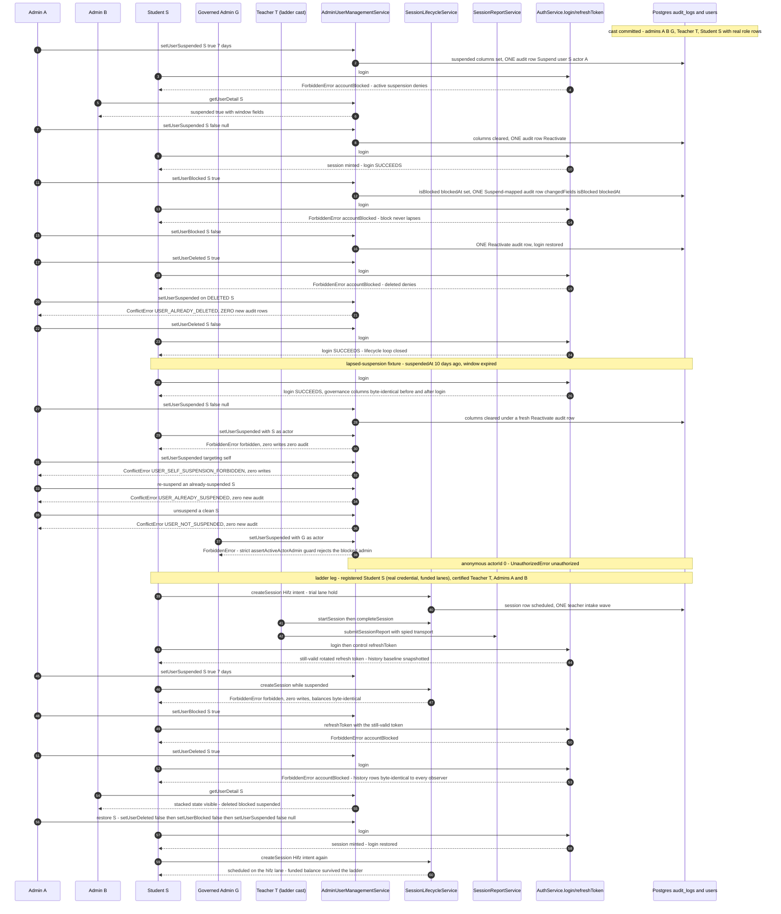
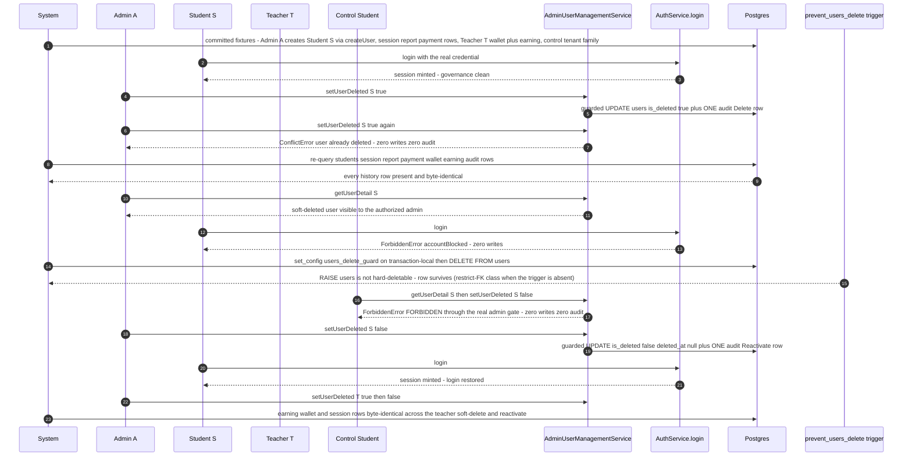
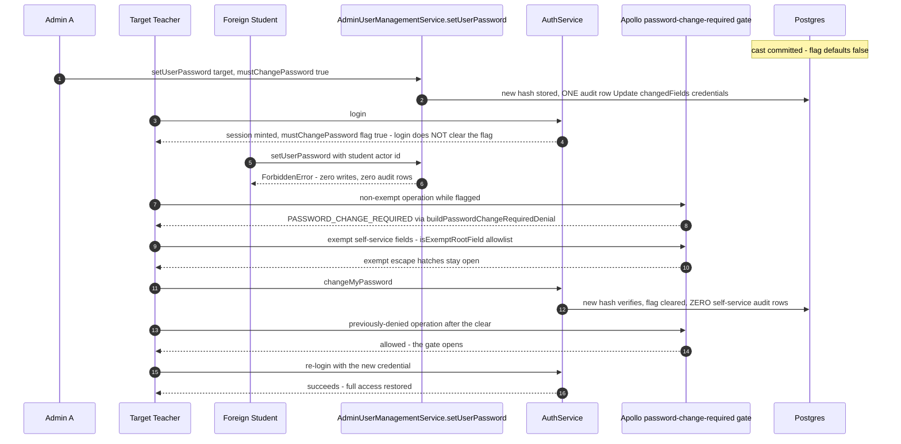
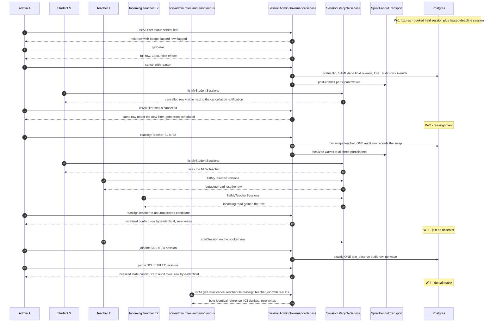
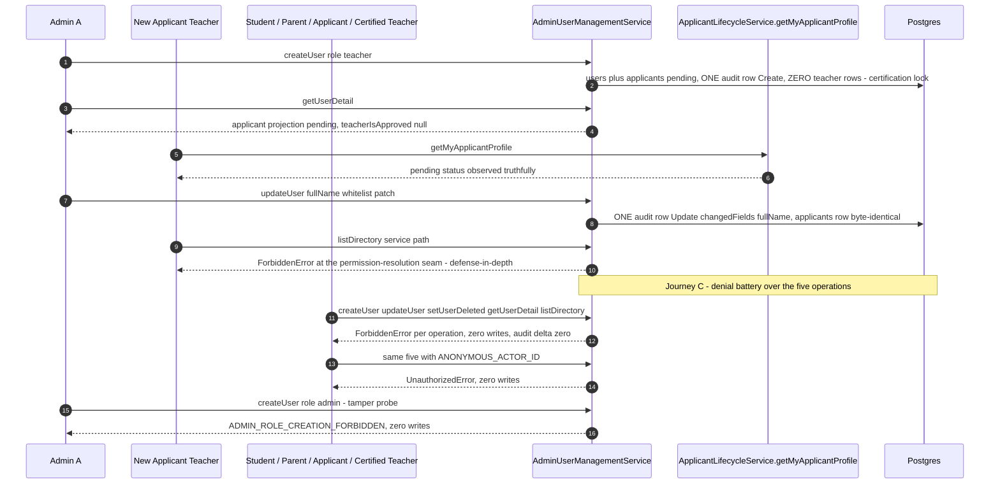
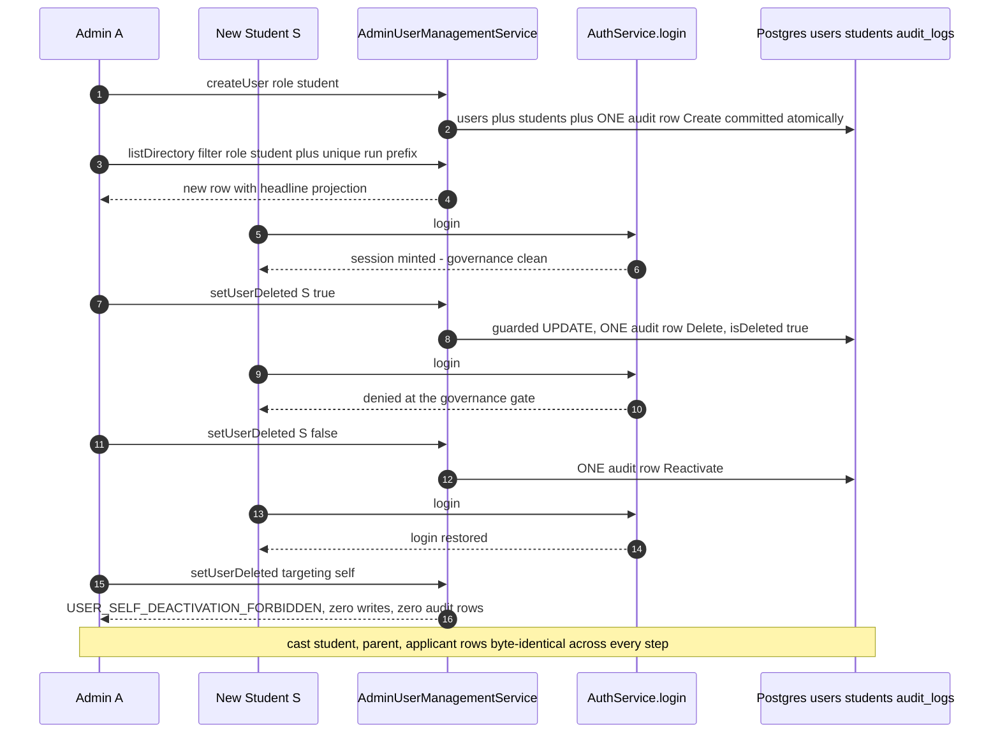
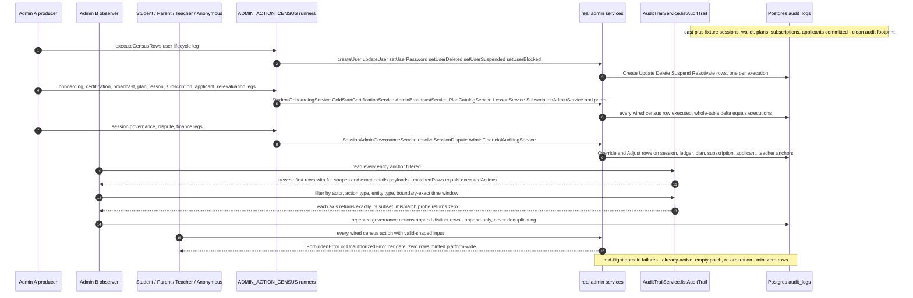
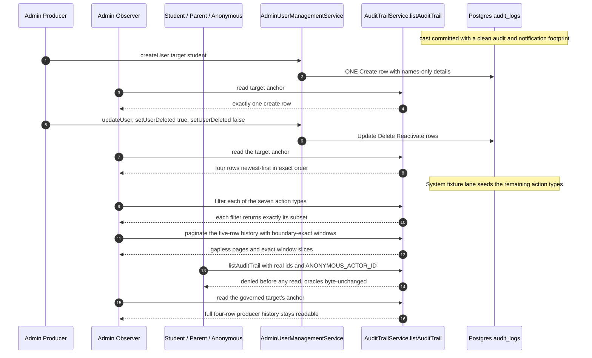
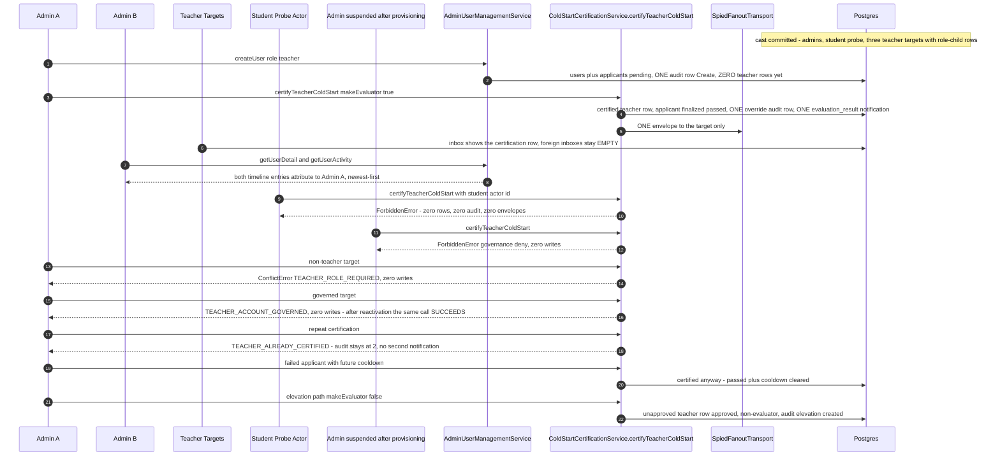
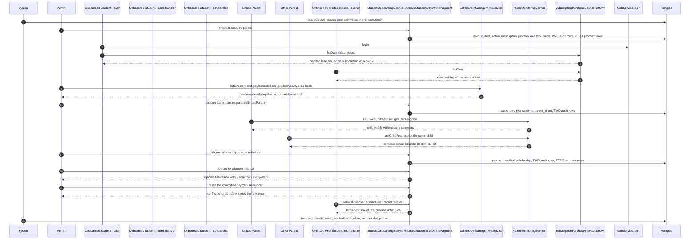

# Admin workflow journey diagrams

Mermaid diagrams for the admin-domain cross-actor journey suites in this directory, using the same actor names, service entry points, and statuses as the journey code.

## academic-tracking.journey.test.ts

Journey over the teacher-produced academic record: the teacher books, starts, completes, and reports two sessions (σ₁ graded in place via σ₂'s `previousGrades`), the admin reads the dashboard and drill-down as a pure observer, and every non-admin probe of both admin queries collapses into the identical constant FORBIDDEN (en and ar byte-uniform).

```mermaid
sequenceDiagram
  autonumber
  participant system as System
  participant teacherT as Teacher T
  participant studentS as Student S
  participant adminA as Admin A
  participant nonAdmins as Teacher / Student / Parent
  participant lifecycle as SessionLifecycleService
  participant report as SessionReportService.submitSessionReport
  participant tracking as AdminAcademicTrackingService
  participant db as Postgres
  participant spy as SpiedFanoutTransport

  system->>db: buildSessionJourneyCast plus sessions sigma1 sigma2 booked via createSession with idempotency keys K1 K2
  adminA->>tracking: getAcademicDashboard search prefix
  tracking-->>adminA: baseline - S listed with null academic fields

  teacherT->>lifecycle: startSession then completeSession for sigma1 and sigma2
  lifecycle->>db: status COMPLETED, confirm-prompt inbox row per session for Student S
  teacherT->>report: submitSessionReport sigma1 with jadid plus madi homework
  teacherT->>report: submitSessionReport sigma2 with homework plus previousGrades 55 and 88
  report->>db: home_work row per session; grades land on the PREVIOUS sigma1 row in place, sigma2 row stays ungraded
  report->>spy: one report-wave publish per submission targeting Student S only

  adminA->>tracking: getAcademicDashboard search prefix
  tracking-->>adminA: new Jadid and Madi positions from the newest GRADED row, 55/88 summaries, needsAttention lowGrade, honest stats deltas
  adminA->>tracking: getStudentAcademicDetail for Student S
  tracking-->>adminA: homework and report histories newest-first with grades, tracks, teacher identity
  Note over tracking,db: zero publishes, zero audit rows - the admin surface is a pure observer

  nonAdmins->>tracking: probe getAcademicDashboard and getStudentAcademicDetail with real actor ids
  tracking-->>nonAdmins: ForbiddenError FORBIDDEN, identical message per locale, zero data
```

## account-governance.journey.test.ts

Journey over the full governance lifecycle of Student S — suspend / unsuspend / block / unblock / soft-delete / reactivate — driven by Admin A, observed through Admin B's `getUserDetail` and Student S's real `AuthService.login` outcomes, with Teacher T held as the byte-identical cross-role control. The appended ladder leg runs the ordered student-governance sequence end to end: S books and builds a real history baseline (session + report + settled payment row), A suspends (booking denied, zero writes), A blocks (still-valid refresh token denied), A soft-deletes (history byte-identical to every observer, login denied), then A restores S and S books again on the funded lane.



## admin-delete-with-history.journey.test.ts

Journey over the governed-user deletion arc: the admin soft-deletes a student holding committed history (session, report, payment, and the teacher's wallet-adjacent earning row) and every historical row survives byte-identically while staying queryable by the authorized admin; a raw-SQL hard DELETE is blocked by the `prevent_users_delete` trigger with the guard re-armed transaction-locally (the restrict-FK failure class on push-provisioned databases), the soft-deleted student's login is denied at the governance gate, non-admin probes of the admin surface deny through the real gate, and reactivate restores login with the history untouched.



## admin-password-reset.journey.test.ts

Journey D over the forced-reset arc: the admin sets a temporary credential with the forced-reset flag on a certified-teacher target, the flagged target is fenced to the exempt self-service fields at the Apollo gate, replaces the credential via `changeMyPassword`, and regains full access while a foreign non-admin is denied the admin credential surface.



## admin-session-governance.journey.test.ts

Four journeys through the real `SessionAdminGovernanceService`: admin discovery → cancel with same-lane refund release and participant waves; teacher reassignment through the certification gate; audit-only join-as-observer; and the role-denial matrix where every non-admin role and the anonymous caller are denied all six governance operations with zero writes.



## admin-user-denials.journey.test.ts

Journey B: the admin creates a teacher-role identity whose applicants row stays pending (certification lock), the new applicant observes the pending profile truthfully, and the admin's whitelist update keeps the applicant row byte-identical. Journey C: anonymous and non-admin callers are denied all five user-management operations with zero audit rows, and admin-role-creation tampering fails with `ADMIN_ROLE_CREATION_FORBIDDEN`.



## admin-user-lifecycle.journey.test.ts

Journey A over one target student: the admin creates the user through the real service path, observes it in the directory, soft-deletes it with login denied at the governance gate, and reactivates it with login restored — each mutation minting exactly one audit row, with self-deactivation denied.



## audit-completeness.journey.test.ts

The census-driven completeness journey: a producer admin executes EVERY wired row of the machine-readable admin action census (`audit-completeness.catalog.ts`) through the real service paths across twelve legs, then a second admin reads every minted row back through `AuditTrailService.listAuditTrail` with a 1:1 no-missing no-phantom mapping, while non-admin and anonymous actors are denied every action and mint nothing.



## audit-trail.journey.test.ts

Journey over the global `audit_logs` read surface: an admin producer mints real audit rows through user-management mutations, a different admin observer reads them back through `AuditTrailService.listAuditTrail` (order, filters, pagination, time windows), non-admin and anonymous readers are denied before any read, and a governed target's history stays fully readable.



## cold-start-certification.journey.test.ts

Journey J-1 over direct admin certification of teacher-role users: Admin A provisions a teacher and certifies them cold-start (certified teacher row, finalized applicant, one override audit row, one notification, one spied envelope), Admin B and the target observe the committed state, and a battery of denial probes — student actor, suspended admin, non-teacher target, governed target, repeat certification, cooldown supersession, elevation — all fail side-effect-free.



## direct-student-onboarding.journey.test.ts

Journey over direct student onboarding with offline payment: one admin onboards three students — cash, bank transfer with a parent link, scholarship — through `StudentOnboardingService.onboardStudentWithOfflinePayment`, while the onboarded students, the linked parent, an unrelated parent, a peer student, and a teacher observe, read back, or are denied; the `student_payments` ledger is never touched.



## platform-analytics.journey.test.ts

Four journeys over the admin platform-analytics observation surface (`PlatformAnalyticsService.getPlatformAnalytics`): cold-platform honesty, full-cast metric deltas, freshness evolution across two bracketing reads, and the denial and purity matrix — the admin is a pure observer and every metric is a baseline-plus-fixture delta.

```mermaid
sequenceDiagram
  autonumber
  participant system as System
  participant admin as Admin Observer
  participants as Student / Teacher / Parent / Anonymous / Absent / Governed Admin
  participant analytics as PlatformAnalyticsService.getPlatformAnalytics
  participant db as Postgres

  Note over db: Journey A - cold platform
  system->>db: admin-only cast committed, baseline captured by direct counts
  admin->>analytics: getPlatformAnalytics
  analytics-->>admin: baseline plus 0 everywhere, 30 zero-filled trend buckets, rating averages honestly null

  Note over db: Journey B - full cast with paid subscription, EGP and USD payments, online and offline teachers, five sessions, withdrawal, report, evaluation, governed student
  admin->>analytics: getPlatformAnalytics
  analytics-->>admin: every metric at baseline plus its exact fixture delta, currencies never merge, governed student excluded from active counters
  participants->>analytics: student, teacher, parent probes
  analytics-->>participants: ForbiddenError every time, zero side effects

  Note over db: Journey C - freshness evolution
  system->>db: one committed EGP payment plus one completed session between reads
  admin->>analytics: first read then second read
  analytics-->>admin: second read exposes exactly plus one session and the exact amount, generatedAt strictly advances

  Note over db: Journey D - denial and purity matrix
  participants->>analytics: anonymous, absent actor, non-admin, governed admins
  analytics-->>participants: UnauthorizedError for anonymous, ForbiddenError for absent, non-admin, and governed - deleted before blocked before suspended precedence
  Note over analytics,db: every denial leaves tables byte-identical, zero audit and zero notification residue
```
