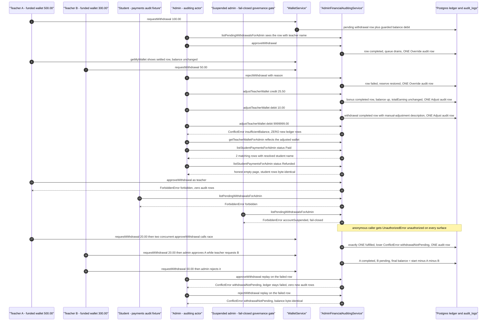
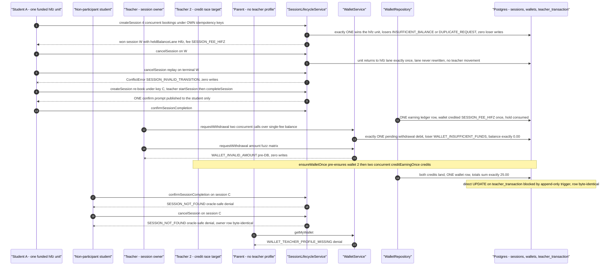
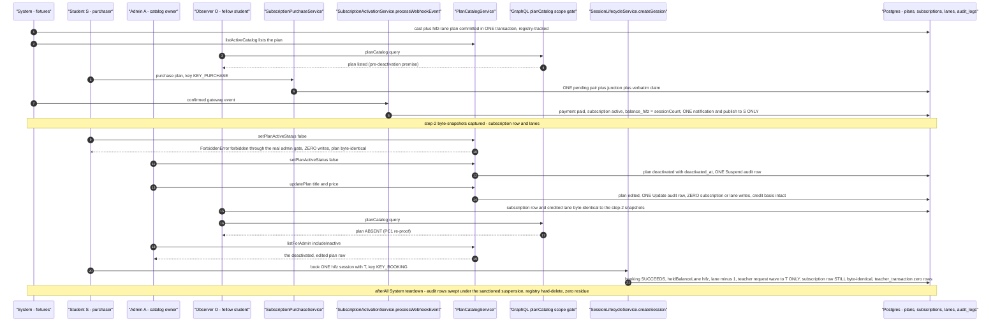
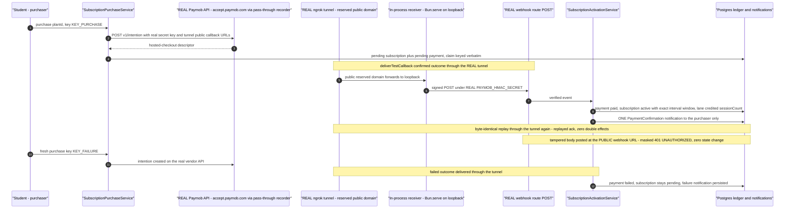
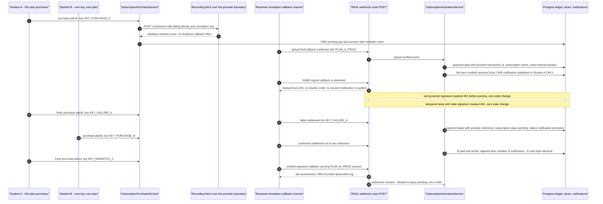
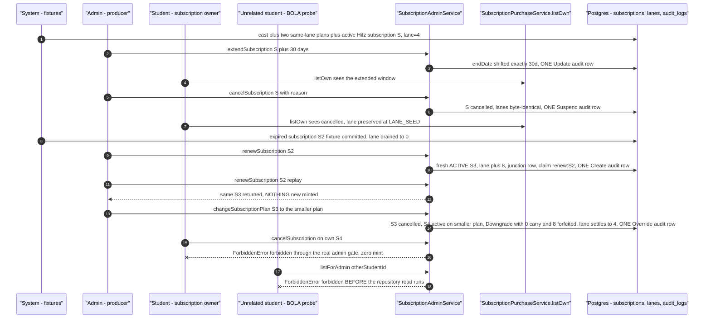
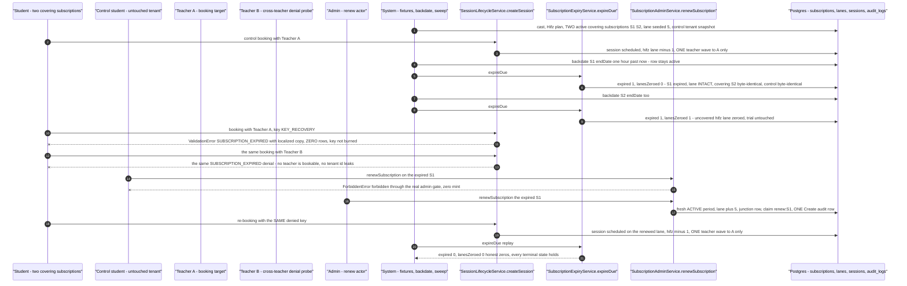
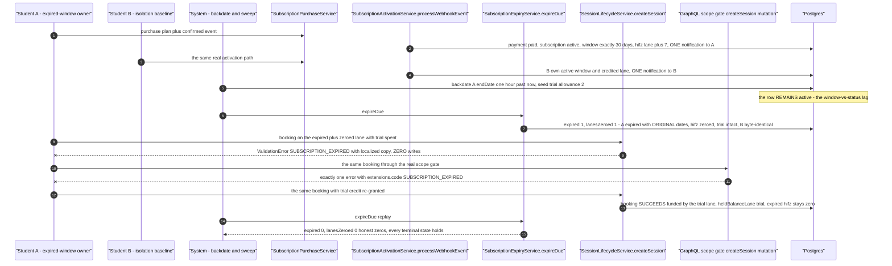
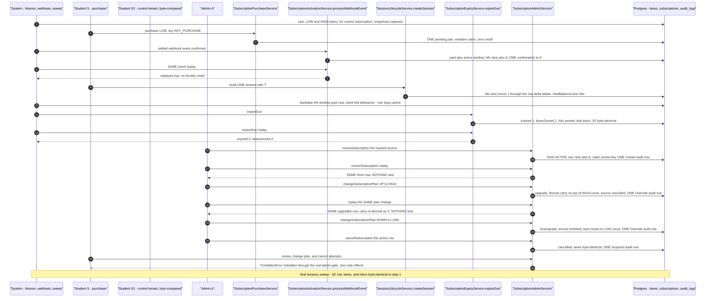

# Billing workflow journey diagrams

Mermaid diagrams for the cross-actor journey suites in this directory, using the same actor names, service entry points, and statuses as the journey code. The `paymob-live-tunnel` suite is env-gated (`PAYMOB_LIVE_TESTS=1` + live credentials + reserved ngrok domain) and skips outside that environment — its diagram documents the code path regardless.

## admin-financial-auditing.journey.test.ts

Journey across the two money ledgers through the real `WalletService` and `AdminFinancialAuditingService`: payout requests reserve their debit at request time, admin approve/reject settles the queue, manual adjustments credit/debit with exact audit rows, the payments audit filter scopes honestly, and the denial matrix plus concurrent double-settlement and settle-plus-new-request races prove exactly-once money movement with zero dispatches.



## financial-safety-verification.journey.test.ts

Adversarial money-safety journey through the real `SessionLifecycleService`, `WalletService`, and `WalletRepository`: a double-spend race over one escrow unit, cancel release back to the provenance lane, dual-confirm crediting, a withdrawal drain race, input fuzz, a wallet-first-earning race, an append-only trigger tamper probe, and oracle-safe denials.



## plan-catalog-invariance.journey.test.ts

Cross-actor catalog-mutation invariance journey through the real `SubscriptionPurchaseService`, `SubscriptionActivationService`, `PlanCatalogService`, and `SessionLifecycleService`: a student's confirmed purchase credits the plan's lane, an admin's deactivation plus title/price edit mutates the plans row ONLY (exactly two audit rows, zero dispatches), the subscription row and credited lane stay byte-identical while the public `planCatalog` query drops the plan and the admin surface still lists it, and a subsequent booking on the credited lane succeeds — with the admin gate honestly denying the student's own deactivation attempt first.



## paymob-live-tunnel.journey.test.ts

Env-gated live twin of the paymob purchase journey: nothing is mocked at the provider boundary and the settlement callback rides a REAL ngrok tunnel into the REAL webhook route under the operator's REAL sandbox credentials (`PAYMOB_LIVE_TESTS=1` plus live credentials plus reserved domain; the suite skips otherwise).



## paymob-purchase-journey.test.ts

Student purchases through the real Paymob provider branch with the vendor's HTTP boundary as the only mocked hop: the signed settlement callback traverses the resolved simulation channel into the REAL webhook receiver, activation credits the lane exactly once, replays and tampered deliveries are inert, and a mismatched-amount callback is quarantined.



## subscription-admin-lifecycle.journey.test.ts

One student's Hifz subscription travels the full admin-owned lifecycle through the real `SubscriptionAdminService`: extend, cancel, renew with idempotent replay, and a prorated plan change - each mutating step minting exactly one pinned audit row, every lane credit exact, and the whole journey emitting zero notifications by design.



## subscription-expiry-booking-denial.journey.test.ts

The two-covering-subscriptions lapse arc through the real sweep and booking services: a funded control booking proves the lane live, the sweep expires one subscription while the covering row keeps the lane intact, the covering row's own lapse zeroes the uncovered lane and denies booking against every teacher with a reusable idempotency key, and the admin renew re-credits the lane so the same previously-denied key books again - with an untouched control tenant byte-compared after every leg.



## subscription-expiry.journey.test.ts

The validity-window to expiry-sweep to booking-enforcement arc: two real purchase-activation legs, a backdated window that stays active until the sweep flips it with exact counts, the expired and zeroed lane denying booking at both the service and GraphQL wire layers while a seeded trial lane still funds a booking, and the replay sweep reporting honest zeros.



## subscription-full-lifecycle.journey.test.ts

The complete end-to-end subscription chain on one purchaser with an untouched control tenant byte-compared after every leg: purchase, gateway settlement with replay idempotency, a booked-session debit through the real ladder, the expiry sweep, admin renew with replay, an Upgrade plan change with floored carry, a Downgrade that forfeits the excess, admin cancel, and student BFLA denials - all with zero side effects on the sibling tenant.



## subscription-purchase.journey.test.ts

The purchase to gateway-settlement workflow on the mock provider: a pending pair with verbatim idempotency claim, duplicate-key and replay idempotency, activation crediting the plan's lane exactly once per outcome, the parent and anonymous denial probes through the real GraphQL scope gate, the oracle-safe spent-key replay, and the seeded Reviews-lane plus Tajweed-lane plans routing credits to their documented lanes.

```mermaid
sequenceDiagram
  autonumber
  participant studentA as "Student A - purchaser"
  participant studentB as "Student B - spent-key replay probe"
  participant parent as "Parent - scope-gate denial probe"
  participant emitter as "Emitter - confirmed and failed events"
  participant purchaseSvc as "SubscriptionPurchaseService"
  participant activation as "SubscriptionActivationService.processWebhookEvent"
  participant gql as "GraphQL scope gate purchaseSubscription"
  participant db as "Postgres - pending set, lanes, notifications"

  studentA->>purchaseSvc: purchase plan, key KEY_PURCHASE
  purchaseSvc->>db: ONE pending pair plus junction plus verbatim claim, mock checkout descriptor
  studentA->>purchaseSvc: same-key retry
  purchaseSvc--xstudentA: ConflictError DUPLICATE_REQUEST, zero second rows

  emitter->>activation: confirmed event on the gateway reference
  activation->>db: payment paid, subscription active, window exactly 30 days, hifz lane plus 7, ONE notification to A
  studentA->>purchaseSvc: listOwn shows the active row; Student B list stays empty
  emitter->>activation: SAME confirmed event replay
  activation-->>emitter: processed plus replayed, no second credit or notification

  studentA->>purchaseSvc: fresh-key purchase, then failed event
  activation->>db: payment failed, subscription stays pending, zero credit, ONE failure notification

  parent->>gql: purchaseSubscription through the real scope gate
  gql--xparent: FORBIDDEN, zero writes
  studentB->>purchaseSvc: purchase replaying A SPENT key
  purchaseSvc--xstudentB: NotFoundError PAYMENT_NOT_FOUND oracle-safe, no owner leak
  Note over gql: anonymous caller gets UNAUTHORIZED through the same scope gate
  Note over activation,db: uncorrelatable reference delivery - processed false, ONE bounded PAYMENT_REFERENCE_UNKNOWN log, zero mutation

  studentA->>purchaseSvc: purchase the seeded Reviews-lane plan, confirmed event
  activation->>db: balance_reviews credited sessionCount, hifz and tajweed byte-identical, ONE notification
  studentA->>purchaseSvc: purchase the Tajweed-lane plan, confirmed event
  activation->>db: balance_tajweed credited sessionCount, sibling lanes byte-identical, ONE notification
  emitter->>activation: tajweed confirmed event replay
  activation-->>emitter: replayed ack, no double credit, foreign actors untouched
```
