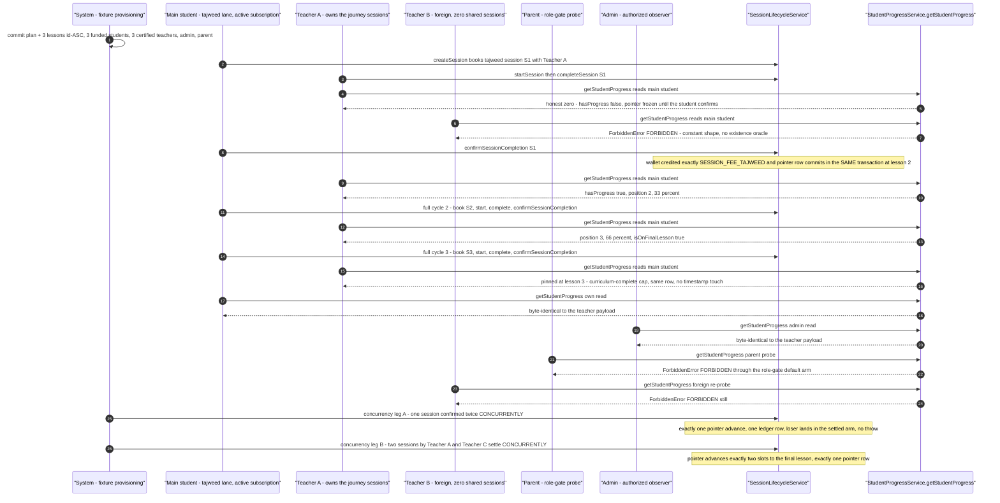

# Classes workflow journey diagrams

Mermaid diagrams for the cross-actor journey suites in this directory, using the same actor names, service entry points, and statuses as the journey code.

## session-report-cross-teacher.journey.test.ts

Journey over a student whose session history spans two teachers: T1 submits σ1's report with homework H1, T2 reads it through `listStudentHomeworkHistory`, then T2's σ2 submission grades T1's homework once via `previousGrades` while creating H2 — with symmetric visibility, constant `FORBIDDEN` denials, and a replay-safety bookend.

```mermaid
sequenceDiagram
  autonumber
  participant system as "System - fixture provisioning"
  participant t1 as "Teacher T1 - owns sigma1"
  participant t2 as "Teacher T2 - owns sigma2"
  participant ft as "Teacher Ft - foreign, zero sessions"
  participant student as "Student S - en locale"
  participant parent as "Parent P - ar locale, linked to S"
  participant lifecycle as "SessionLifecycleService"
  participant report as "SessionReportService"
  participant history as "listStudentHomeworkHistory"
  participant engine as "NotificationEngine via SpiedFanoutTransport"

  system->>lifecycle: createSession S books T1 then startSession + completeSession by T1
  system->>lifecycle: createSession S books T2 then startSession + completeSession by T2
  Note over system: both sessions Completed, feeHeld true, baseline zero rows

  t1->>report: submitSessionReport T1 on sigma1 with homework H1 jadid + madi
  report->>engine: report-ready wave publishes to S and P - 2 envelopes
  Note over report: H1 born ungraded; student wave en copy; parent wave ar copy

  t2->>history: listStudentHomeworkHistory T2 reads S
  history-->>t2: sees H1 authored by T1; envelope items totalCount page pageSize; read is silent

  t2->>report: submitSessionReport T2 on sigma2 with homework H2 and previousGrades for H1
  report->>engine: report-ready wave publishes to S and P - 2 envelopes
  Note over report: H1 graded exactly once with the submitted values; H2 born ungraded

  t1->>history: listStudentHomeworkHistory T1 reads S
  history-->>t1: sees BOTH rows; H2 newest-first items 0; H1 carries the grades in items 1

  ft->>history: listStudentHomeworkHistory Ft reads S
  history-->>ft: ForbiddenError FORBIDDEN; one bounded logDomainError; zero publishes

  student->>history: listStudentHomeworkHistory S reads S
  history-->>student: ForbiddenError FORBIDDEN byte-identical to the Ft denial

  t2->>report: submitSessionReport T2 replays sigma2
  report-->>t2: ConflictError SESSION_REPORT_ALREADY_EXISTS; zero new rows and publishes
```

## session-report-homework.journey.test.ts

Journey over the session report + homework write/read surface: submit gates, atomic co-creation of the report and homework rows, participant reads, the one-shot grading state machine, a forced mid-transaction rollback, and the wallet-purity bookend — all through the real `SessionReportService` and `SessionLifecycleService`.

```mermaid
sequenceDiagram
  autonumber
  participant ft as "Teacher Ft - foreign certified"
  participant student as "Student S - en locale, linked parent P"
  participant parent as "Parent P - ar locale"
  participant t as "Teacher T - owner, certified"
  participant prime as "Student S-prime - unlinked parent variant"
  participant lifecycle as "SessionLifecycleService"
  participant report as "SessionReportService"
  participant engine as "NotificationEngine via SpiedFanoutTransport"
  participant fault as "faultProbeTx - forced home_work insert failure"

  ft->>report: submitSessionReport Ft on sigma
  report-->>ft: NotFoundError SESSION_NOT_FOUND; identical for an absent session id
  student->>report: submitSessionReport S on sigma
  report-->>student: ForbiddenError FORBIDDEN
  t->>report: submitSessionReport T on sigma with hostile payload sweep
  report-->>t: ValidationError VALIDATION x8 pre-DB; zero rows anywhere

  t->>report: submitSessionReport T on sigma with homework jadid + madi
  report->>engine: report-ready wave publishes to S and P - 2 envelopes
  Note over report: report row + home_work row commit atomically; assignment born ungraded

  prime->>lifecycle: S-prime books, T starts + completes, T submits Madi-only homework
  report->>engine: student wave publishes to S-prime only - 1 envelope
  Note over report: INV-P1 gate - unlinked student means no parent leg

  t->>report: submitSessionReport T replays sigma
  report-->>t: ConflictError SESSION_REPORT_ALREADY_EXISTS; counts unchanged

  student->>report: getSessionReport + getSessionHomework S on sigma
  report-->>student: full rows, byte-identical to the direct DB read
  parent->>report: getSessionReport P on sigma
  report-->>parent: null - byte-identical to foreign teacher, admin, and absent-session reads

  t->>lifecycle: provisionCompletedSession sigma2 booked, started, completed
  t->>report: submitSessionReport T on sigma2 with homework + previousGrades for sigma
  Note over report: sigma homework graded once with stamps advanced; sigma2 assignment born ungraded

  t->>lifecycle: provisionCompletedSession sigma3 then submitSessionReport with previousGrades
  Note over report: sigma2 assignment graded - the newest-row Assigned to Graded transition
  t->>lifecycle: provisionCompletedSession sigma4 then submitSessionReport with previousGrades
  report-->>t: ConflictError CONFLICT homeworkAlreadyGraded - write-once held, sigma4 stays report-less

  t->>fault: submitSessionReport T on sigma4 inside faultProbeTx
  fault-->>t: raw failure AFTER the report insert; full unit rollback - zero rows, zero publishes

  t->>report: submitSessionReport T on sigma4 with far-vocabulary homework SurahAnNasr + Juz3
  report->>engine: report-ready wave publishes to S and P - 2 envelopes
  Note over report: post-rollback accept stores and reads back the full 144-member canon

  t->>report: absent-user caller then suspended-teacher governance probes
  report-->>t: ForbiddenError FORBIDDEN twice; after restore the replay reaches ConflictError SESSION_REPORT_ALREADY_EXISTS
  Note over t: final purity oracle - wallets, escrow lanes, holds, and audit rows byte-identical to baseline
```

## session-request-notifications.journey.test.ts

Journey over the shipped `SessionRequestNotificationService` emitters on the own-commit path: the teacher request wave, the student accept and decline outcome waves, the three preference waves, isolation invariance, and denial probes — with every wave addressed to exactly one recipient and replay suppressed by the claim cache.

```mermaid
sequenceDiagram
  autonumber
  participant system as "System - fixture provisioning"
  participant svc as "SessionRequestNotificationService"
  participant engine as "SpiedFanoutTransport + MapBackedClaimCache"
  participant t as "Teacher T - ar locale, Queue preference"
  participant student as "Student S - en locale"
  participant u as "Teacher U - Reject preference"
  participant v as "Teacher V - Queue preference"
  participant w as "Teacher W - OfferAlternatives preference"
  participant observers as "Observers X and Y - isolation cast"

  system->>system: commit cast + 5 session rows; every inbox empty, zero publishes

  svc->>engine: notifyTeacherOfSessionRequest on session ST
  engine-->>t: one Arabic SessionRequest row + one publish to T only
  svc->>engine: replay of notifyTeacherOfSessionRequest on session ST
  engine-->>t: held claim key returns the prior receipt; zero new rows or publishes

  svc->>engine: notifyStudentOfSessionAccepted on session ST
  engine-->>student: one English accepted row naming T; one publish to S only
  svc->>engine: notifyStudentOfSessionDeclined on session ST
  engine-->>student: a second DISTINCT declined row - append-only, never overwrite

  svc->>engine: notifyStudentOfSessionAutoRejected on session SU
  engine-->>student: one row naming U
  svc->>engine: notifyStudentOfSessionQueued on session SV
  engine-->>student: one row naming V
  svc->>engine: notifyStudentOfAlternativesOffered on session SW
  engine-->>student: one row naming W
  Note over engine: S inbox holds 5 rows; six distinct deterministic claim keys total

  observers->>engine: isolation invariance probe
  Note over observers: X, Y, U, V, W hold zero rows; every envelope addressed only to S or T

  svc->>engine: notifyTeacherOfSessionRequest on an absent session id
  engine-->>svc: NotFoundError SESSION_NOT_FOUND with one domain log; zero rows or publishes
  svc->>engine: hostile ids zero, negative, NaN across the outcome emitters
  engine-->>svc: ValidationError VALIDATION pre-DB, no log
  svc->>engine: notifyStudentOfSessionQueued on the corrupt-intent session row
  engine-->>svc: ValidationError SESSION_INTENT_CORRUPT with one domain log; zero rows or publishes
```

## tajweed-progress-increment.test.ts

Journey over the tajweed curriculum progress pointer: the real dual-confirmation arc (book → start → complete → student confirm) drives the per-plan pointer through lazy initialization, two advances, the curriculum-complete cap, gated reads for every authorized caller, constant `FORBIDDEN` denials, and two concurrency races — plus the exactly-once wallet credit riding the same commit.



## teacher-preparation-read.journey.test.ts

Journey over the preparation dialog's two gated reads: `StudentProgressService.getStudentProgress` and `listStudentHomeworkHistory` across a two-student, two-teacher cast — the honest zero for a first-session student, the positioned payload plus graded homework for a student with settled history, and constant `FORBIDDEN` denials for the foreign teacher.

```mermaid
sequenceDiagram
  autonumber
  participant system as "System - fixture provisioning"
  participant sa as "Student A - one settled prior session"
  participant sb as "Student B - first session only"
  participant t1 as "Teacher T1 - owns every booked session"
  participant t2 as "Teacher T2 - shares no session"
  participant lifecycle as "SessionLifecycleService"
  participant progress as "StudentProgressService.getStudentProgress"
  participant homework as "listStudentHomeworkHistory"

  system->>system: commit tajweed plan + 3 lessons id-ASC, students A and B with active subscriptions, teachers T1 and T2

  sa->>lifecycle: createSession book, startSession, completeSession, then student confirms
  Note over lifecycle: pointer advances to lesson 2; createTestHomeWork commits the graded assignment

  sb->>lifecycle: createSession books a scheduled tajweed session with T1

  t1->>progress: getStudentProgress T1 reads student B
  progress-->>t1: honest zero - hasProgress false, no fabricated lesson fields
  t1->>homework: listStudentHomeworkHistory T1 reads student B page 1 size 5
  homework-->>t1: empty first page - zero items, zero totalCount

  sa->>lifecycle: createSession books a scheduled session with T1
  t1->>progress: getStudentProgress T1 reads student A
  progress-->>t1: positioned payload - lesson 2 of 3, 33 percent
  t1->>homework: listStudentHomeworkHistory T1 reads student A page 1 size 5
  homework-->>t1: the graded prior homework row visible cross-session with both grades

  t2->>progress: getStudentProgress T2 reads A, B, and an absent student id
  progress-->>t2: ForbiddenError FORBIDDEN each time - constant shape, no existence oracle
  t2->>homework: listStudentHomeworkHistory T2 reads A, B, and an absent student id
  homework-->>t2: ForbiddenError FORBIDDEN each time
  t1->>progress: getStudentProgress T1 re-reads student A
  progress-->>t1: byte-identical to the payload captured before the denials
  Note over t1: persisted fan-out - confirm-prompt row for A, three teacher intake rows for T1, zero for T2 and B
```
