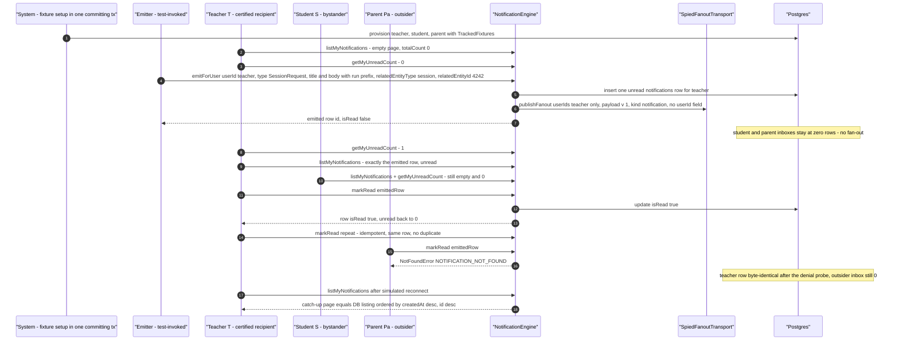
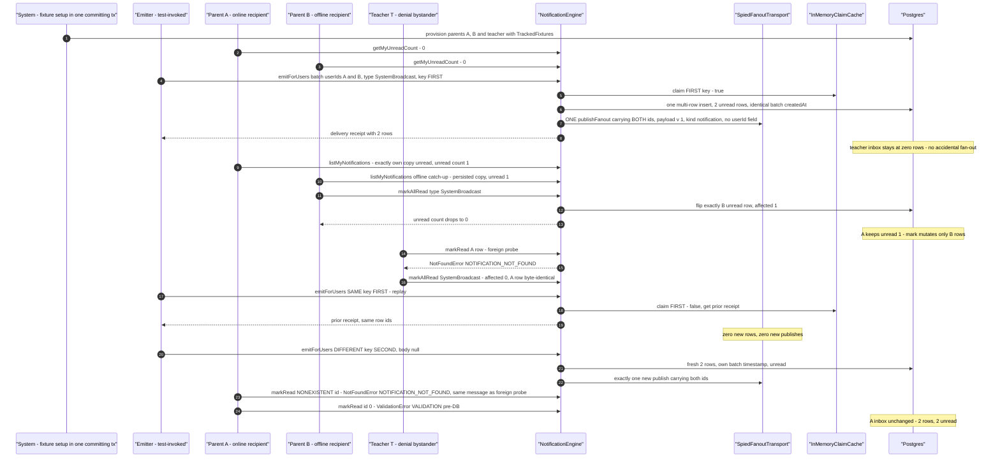
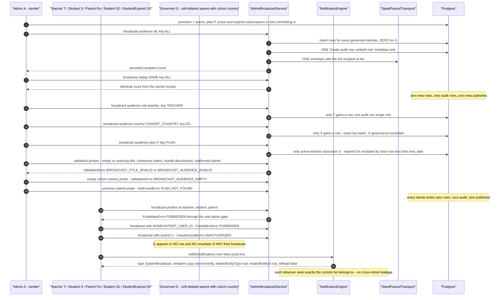
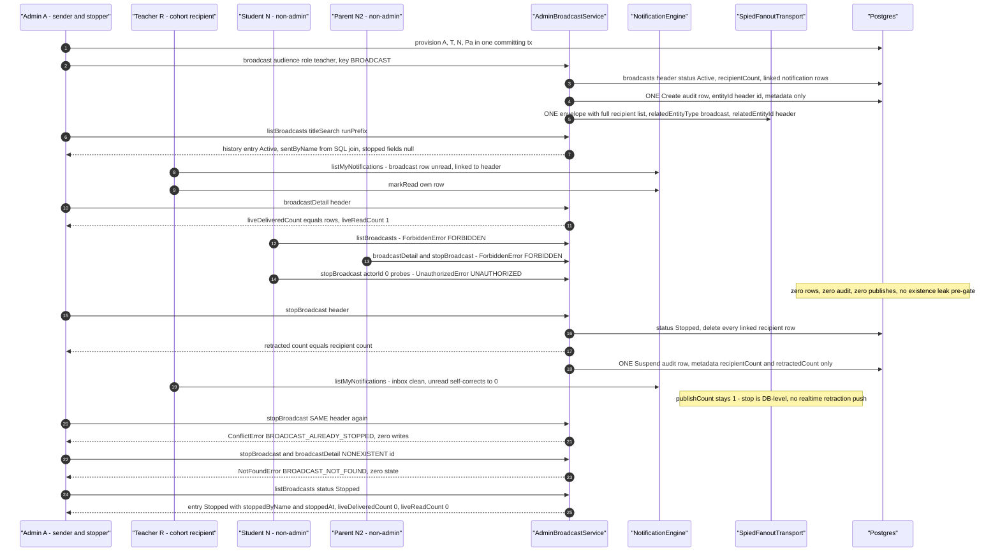
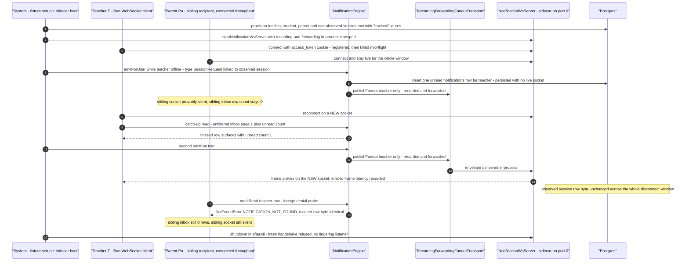

# Notifications workflow journey diagrams

Mermaid diagrams for the cross-actor journey suites in this directory, using the same actor names, service entry points, and statuses as the journey code.

## j1-targeted-single-recipient.test.ts

Journey J1: a test-invoked emitter persists one `session_request` notification for a certified teacher via `NotificationEngine.emitForUser`, only that teacher observes or mutates it, and a parent-outsider's mark probe fails oracle-safely with `NOTIFICATION_NOT_FOUND` while the owner's row stays byte-identical.

## j2-cohort-broadcast-offline-persistence.test.ts

Journey J2: `NotificationEngine.emitForUsers` fans one `system_broadcast` batch out to parents A and B in a single insert with one shared timestamp and ONE spied publish carrying both ids; offline parent B still finds the persisted row, and a same-key replay returns the prior receipt while a fresh key emits a new batch.

## admin-broadcast.journey.test.ts

Admin A composes broadcasts over every cohort kind through the real `AdminBroadcastService.broadcast` (all, role teacher, targeted country, plan P); a same-key replay is absorbed, validation, BFLA and anonymous denials change nothing, and the governed soft-deleted cast member appears in no cohort while every recipient observes the broadcast in his own inbox.

## broadcast-retraction.journey.test.ts

Admin A sends a teacher-cohort broadcast, observes it in history and detail, then stops it via `AdminBroadcastService.stopBroadcast` so every linked recipient row is retracted engine-mediated and the recipient's unread count self-corrects; non-admin and anonymous callers are denied with zero state, and the audit trail carries exactly one Create and one Suspend row.

## reconnect-catchup.journey.test.ts

Journey: the teacher's realtime socket is killed mid-flight; a notification emitted while offline is persisted with no frame, the reconnect catch-up read surfaces the missed row through the real inbox path with the correct unread count, a second emission delivers a live frame on the NEW socket with the emit-to-frame loopback latency recorded, the observed session row stays byte-unchanged across the whole disconnect window (the sidecar is push-only — session state lives in Postgres), and the connected sibling recipient provably receives nothing while a foreign mark-read probe fails oracle-safely.

