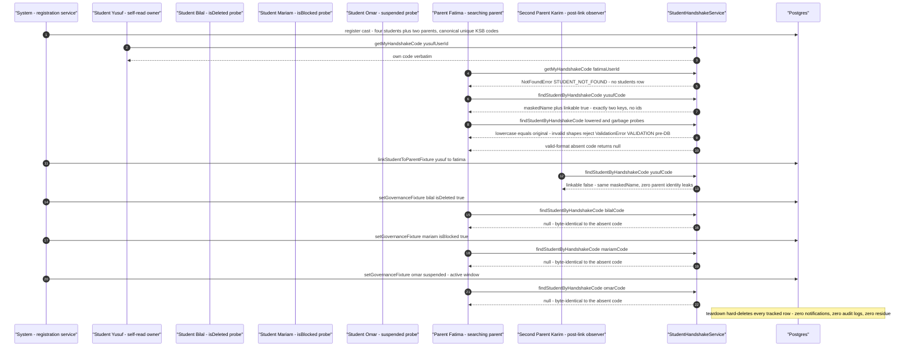
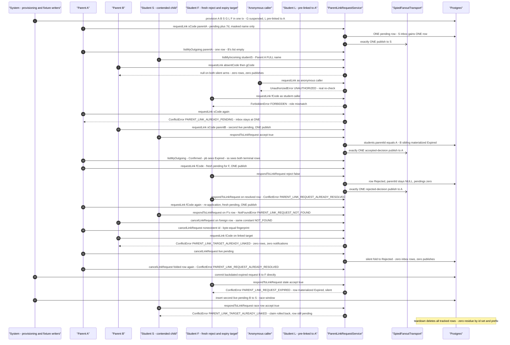
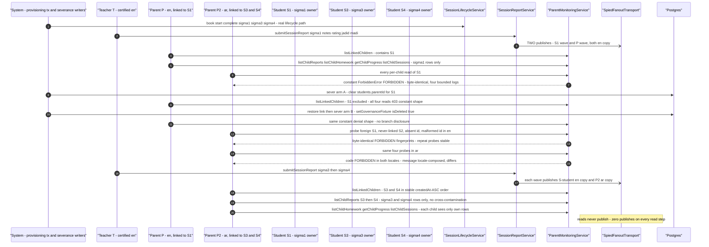
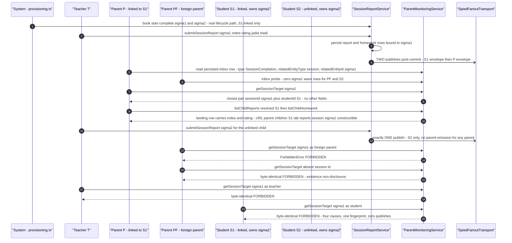
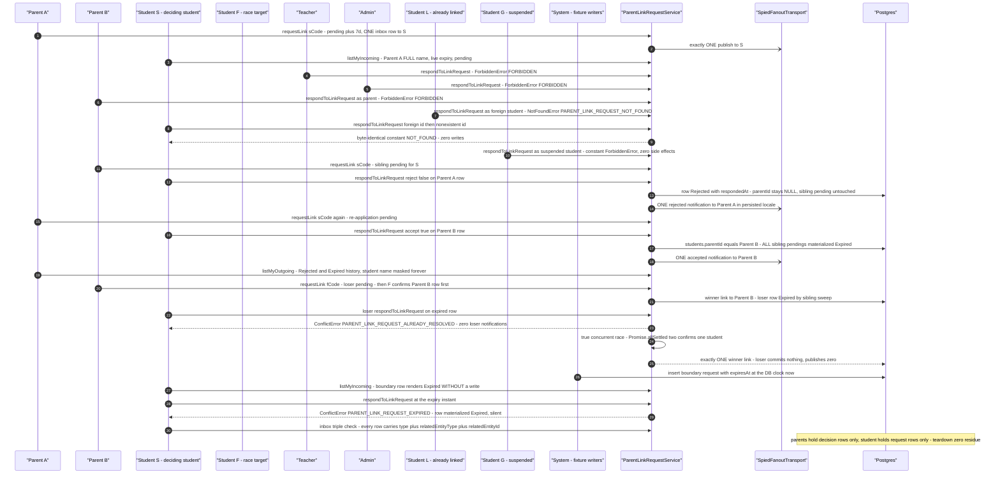

# Parents workflow journey diagrams

Mermaid diagrams for the cross-actor parent-domain journey suites in this directory, using the same actor names, service entry points, and statuses as the journey code.

## handshake-discovery.test.ts

Pure-read discovery journey (steps 1→8): students read their own handshake codes, parents resolve codes through `StudentHandshakeService.findStudentByHandshakeCode`, and governance flips (isDeleted / isBlocked / active suspension) collapse discovery to the same null as a nonexistent code. No notifications or audit rows may be attributable to any cast member.



## parent-full-journey.journey.test.ts

The consolidated arc (steps 1→17): registration → handshake discovery → link request/confirm → expiry leg → session booking/completion/report → all seven `ParentMonitoringService` surfaces → foreign-parent denials → read-only enforcement probes, with the fan-out transport spied at the injected `options.transport` seam.

```mermaid
sequenceDiagram
  autonumber
  participant system as "System - RegistrationService and provisioning tx"
  participant s1 as "Student S1 - P's linked child"
  participant s2 as "Student S2 - control tenant"
  participant p as "Parent P - winning parent"
  participant p2 as "Parent P2 - foreign parent"
  participant t as "Teacher T - certified"
  participant hs as "StudentHandshakeService"
  participant link as "ParentLinkRequestService"
  participant life as "SessionLifecycleService"
  participant report as "SessionReportService"
  participant monitor as "ParentMonitoringService"
  participant spy as "SpiedFanoutTransport"
  participant db as "Postgres"

  system->>db: register real users rows - P and S1 via RegistrationService
  system->>db: provision S2 P2 T plus S1 trial lane in one committed tx
  system->>db: book lifecycle provisioning committed
  s1->>hs: getMyHandshakeCode s1 - verbatim own code
  p->>hs: findStudentByHandshakeCode s1Code - linkable true, garbage rejects VALIDATION, absent code null
  p2->>link: requestLink s2Code parentP2 - pending plus 7d, ONE inbox row to S2, one publish
  p->>link: requestLink s1Code parentP - pending plus 7d, ONE inbox row to S1
  p2->>link: requestLink s1Code parentP2 - contention sibling, second pending
  s1->>link: listMyIncoming s1 - both parents visible, S2 rows never surface
  s1->>link: respondToLinkRequest reqPToS1 accept true
  link->>db: students.parentId equals P - sibling P2 to S1 materialized Expired
  link-)spy: exactly ONE acceptance publish to P
  p2->>link: requestLink s1Code again - ConflictError PARENT_LINK_TARGET_ALREADY_LINKED, zero rows, zero publishes
  system->>db: backdate the P2 to S2 request expiry into the past
  s2->>link: respondToLinkRequest stale accept true
  link-->>s2: DomainError PARENT_LINK_REQUEST_EXPIRED - row materialized Expired, no link written
  s1->>life: createSession book Teacher T intent Hifz with booking key
  life->>db: trial lane 1 to 0, status SCHEDULED
  t->>life: startSession then completeSession - STARTED then COMPLETED
  t->>report: submitSessionReport notes rating jadid madi
  report->>db: report and homework rows bound to the session
  report-)spy: exactly TWO publishes - one envelope to S1, one to P
  p->>monitor: listLinkedChildren - exactly S1
  p->>monitor: listChildSessions listChildReports listChildHomework - S1-scoped pages
  p->>monitor: getChildProgress - child S1 header
  p->>monitor: getSessionTarget sigma - closed pair sessionId plus studentId, landing URL constructible
  p->>monitor: listChildrenUpcomingSessions - exactly S1 block
  p2->>monitor: all five per-child reads of S1
  monitor-->>p2: constant ForbiddenError FORBIDDEN - byte-identical fingerprint, zero data
  p->>life: createSession as parent - ValidationError INSUFFICIENT_BALANCE
  p->>life: confirmSessionCompletion - NotFoundError SESSION_NOT_FOUND
  p->>report: submitSessionReport as parent - ForbiddenError FORBIDDEN
  p->>link: respondToLinkRequest as parent - ForbiddenError FORBIDDEN
  Note over db: zero new session, report, or notification rows - S1 rows byte-identical
```

## parent-link-request.journey.test.ts

Three journeys over `ParentLinkRequestService`: A (request → notify → confirm → sibling expiry), B (reject, withdraw, re-application, constant NOT_FOUND from both directions, already-linked conflict), and C (silent expiry plus the sequential race-loser emulation), all with the transport spied at the `options.transport` seam.



## parent-monitoring.journey.test.ts

The read-only portal spine (J1–J4): every read funnels through the `requireLinkedChild` gate; teacher report waves fan out in the recipient's persisted locale, severed links (cleared parentId and soft-delete) revoke access immediately with a constant denial shape, foreign/nonexistent/malformed probes are byte-identical in both en and ar, and multi-child reads never cross-contaminate.



## parent-session-completion-deep-link.journey.test.ts

The completion-notification deep link (steps 1→6): the teacher's report submission fans a session-pointer wave to the student and linked parent, `getSessionTarget` resolves the session id to the linked child pair, the reports read lands the URL, the unlinked child's wave fails closed, and every denial cause collapses to one constant ForbiddenError.



## student-confirmation-of-link.journey.test.ts

The decision legs (steps 1–11): request creation and self-scoped listing, cross-role and governed-student denials, the reject and confirm legs with sibling expiry, the winner/loser confirmation race (deterministic collapse plus the true concurrent cell), the expiry-instant boundary, and the notification deep-link triple contract — every publish spied, every denial byte-identical.


