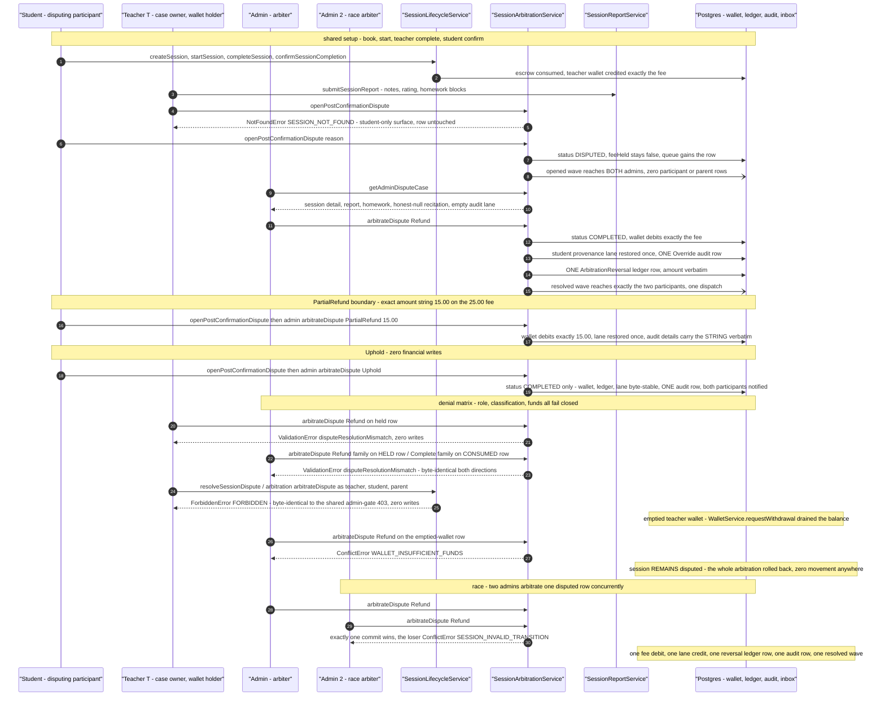
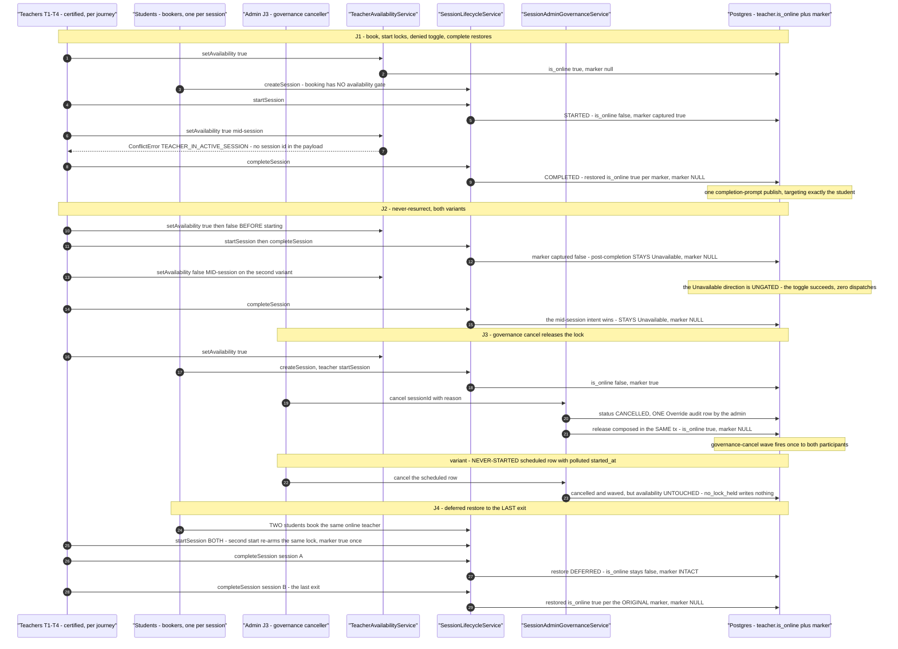

# Sessions workflow journey diagrams

Mermaid diagrams for the cross-actor journey suites in this directory, using the same actor names, service entry points, and statuses as the journey code.

## session-lifecycle.journey.test.ts

Journey J1: the canonical request → hold → start → complete arc through the real `SessionLifecycleService`, plus a cancel-with-refund bookend. Two students book the same certified teacher with per-run idempotency keys; trial-lane holds are consumed trial-first, cross-actor visibility is asserted in both directions, a replayed key dies as `DUPLICATE_REQUEST`, and completion dispatches exactly one confirm-prompt notification to the student while every other mutating step proves zero side effects by row-count deltas.

```mermaid
sequenceDiagram
  autonumber
  participant studentA as "Student A - funded booker (key K1)"
  participant studentB as "Student B - trial-only booker (key K2)"
  participant svc as "SessionLifecycleService"
  participant teacher as "Teacher T - certified session owner"
  participant db as "Postgres"
  participant others as "second teacher / parent / admin / applicant"
  participant notify as "NotificationEngine.publishReceipts spy"

  studentA->>svc: createSession book teacher T, intent Hifz, key K1
  svc->>db: insert session A status SCHEDULED, feeHeld true, lane TRIAL, deadline now plus 24h
  svc->>db: consume Student A trial lane 1 to 0 (trial BEFORE paid hifz)
  svc->>db: insert idempotency claim K1
  svc->>db: one session-request intake notification row for teacher T

  studentB->>svc: createSession book teacher T, intent Hifz, key K2
  svc->>db: insert session B SCHEDULED, HIS trial lane 1 to 0
  svc->>db: insert idempotency claim K2

  others->>svc: listMyTeacherSessions / listMyStudentSessions / getSessionById
  svc-->>others: teacher T sees both; each student sees own only; non-participants observe null or empty

  studentA->>svc: createSession replay key K1
  svc-->>studentA: ConflictError DUPLICATE_REQUEST
  Note over db: zero new rows, balances static, partial debit rolled back with the tx

  teacher->>svc: startSession session A
  svc->>db: status STARTED, startedAt stamped, deadline unchanged
  studentA->>svc: getSessionById session A
  svc-->>studentA: observes STARTED at second precision
  others->>svc: getSessionById session A
  svc-->>others: student B and parent still observe null

  teacher->>svc: completeSession session A
  svc->>db: status COMPLETED, endedAt, confirmedByTeacherAt; deadline unchanged
  svc->>db: one SessionCompletion notification row for Student A only
  svc-)notify: publishReceipts exactly once
  notify-->>studentA: confirm-prompt receipt targets Student A only
  Note over db: confirmedByStudentAt stays null; zero wallet, teacher-transaction, audit, and other-notification deltas

  studentB->>svc: cancelSession session B
  svc->>db: status CANCELLED, feeHeld false
  svc->>db: refund Student B trial lane 0 to 1 exactly once, same-lane provenance
  teacher->>svc: listMyTeacherSessions
  svc-->>teacher: session B CANCELLED, session A still COMPLETED

  teacher->>svc: cancelSession completed session A
  svc-->>teacher: DomainError SESSION_INVALID_TRANSITION
  Note over db: terminal row byte-identical, no lane moved, zero side-effect deltas
```

## session-lifecycle-denials.journey.test.ts

Journey J2: the hostile twin of the happy lifecycle — six denial legs through the real `SessionLifecycleService`, each proving the typed `DomainError` code plus translated message, zero writes, and oracle-safe indistinguishability from nonexistent ids. The zero-balance leg also proves a failed booking never burns its idempotency key (the same key succeeds once funded), and the governance leg shows admin/parent get no bypass (`FORBIDDEN` on create/start/complete, cancel exempt).

```mermaid
sequenceDiagram
  autonumber
  participant studentA as "Student A - funded caller"
  participant studentB as "Student B - zero-balance then funded caller"
  participant applicant as "Applicant - teacher role, no teacher row"
  participant adminParent as "Admin / Parent - no-bypass probes"
  participant svc as "SessionLifecycleService"
  participant db as "Postgres"

  Note over studentA,db: leg 1 - booking the applicant
  studentA->>svc: createSession teacherId applicant, intent Tajweed, key leg1
  svc-->>studentA: NotFoundError TEACHER_NOT_FOUND
  Note over db: caller lanes byte-untouched, no claim, no teacher row minted, zero notifications

  Note over studentB,db: leg 2 - zero balance then funded replay of the SAME key
  studentB->>svc: createSession teacher T, intent Hifz, key rollback
  svc-->>studentB: ValidationError INSUFFICIENT_BALANCE
  Note over db: zero writes in session, students, claim tables
  studentB->>db: fund balanceHifz 1 (committed fixture step)
  studentB->>svc: createSession replay SAME key rollback
  svc->>db: session SCHEDULED, feeHeld true, lane HIFZ, deadline now plus 24h, hifz 1 to 0
  svc->>db: claim committed with sessionId pointer
  svc-->>studentB: listMyStudentSessions shows exactly this one row

  Note over studentB,db: leg 3 - foreign cancel and read are indistinguishable from nonexistent
  studentA->>svc: createSession teacher T2, intent Hifz, key leg3
  svc->>db: session SCHEDULED, trial lane consumed trial-first
  studentB->>svc: cancelSession session A
  svc-->>studentB: NotFoundError SESSION_NOT_FOUND
  studentB->>svc: getSessionById session A
  svc-->>studentB: null
  studentB->>svc: cancelSession ghost id / getSessionById ghost id
  svc-->>studentB: SAME class, code, message - foreign equals nonexistent
  Note over db: owner row byte-identical, no refund fired, Student B own session intact

  Note over applicant,db: leg 4 - the applicant has NO session surface
  applicant->>svc: startSession / completeSession / cancelSession / getSessionById any id
  svc-->>applicant: SESSION_NOT_FOUND or null, identical to ghost-id pairing
  svc-->>applicant: listMyTeacherSessions honestly empty

  Note over studentA,db: leg 5 - intent evaluation is pre-DB VALIDATION
  studentA->>svc: createSession intent Evaluation (hostile overlay)
  svc-->>studentA: ValidationError VALIDATION invalidSessionIntent
  Note over db: zero writes, key unburned, no teacher_evaluation row producible

  Note over adminParent,db: leg 6 - admin and parent get no bypass
  adminParent->>svc: getSessionById / cancelSession / startSession / completeSession others sessions
  svc-->>adminParent: null or SESSION_NOT_FOUND; owner lists honestly empty
  adminParent->>db: isBlocked true - governed state
  adminParent->>svc: createSession / startSession / completeSession
  svc-->>adminParent: ForbiddenError FORBIDDEN - identical shape for admin and parent
  adminParent->>svc: cancelSession (EXEMPT from governance re-check)
  svc-->>adminParent: still SESSION_NOT_FOUND - participant predicate governs
  Note over db: keys unburned, rows byte-identical, zero audit and notification deltas
```

## session-dual-confirmation.journey.test.ts

The confirm-and-pay, timeout-and-refund, and confirm-vs-sweep arcs through the real `SessionLifecycleService`: after a teacher completion the student's `confirmSessionCompletion` releases escrow and credits the teacher wallet exactly the fee once, the sweeper `sweepExpiredSessions` cancels an expired completion with a same-lane refund and one auto-cancel notice (a re-sweep matches zero rows), and a concurrent confirm-vs-sweep race over one expired row produces exactly one financial outcome.

```mermaid
sequenceDiagram
  autonumber
  participant studentA as "Student A - confirm-and-pay booker (key A)"
  participant studentB as "Student B - timeout and race booker (keys B, R)"
  participant teacher as "Teacher T - certified owner"
  participant svc as "SessionLifecycleService"
  participant db as "Postgres"
  participant notify as "NotificationEngine.publishReceipts spy"

  Note over studentA,notify: confirm-and-pay arc
  studentA->>svc: createSession key A
  svc->>db: SCHEDULED, trial lane 1 to 0, feeHeld true, one teacher intake row
  teacher->>svc: startSession session A
  studentA->>svc: completeSession session A
  svc-->>studentA: DomainError SESSION_NOT_FOUND - completion is teacher-owned
  teacher->>svc: completeSession session A
  svc->>db: COMPLETED, endedAt, confirmedByTeacherAt; student stamp still null, feeHeld true
  svc->>db: exactly ONE SessionCompletion row for Student A
  svc-)notify: publishReceipts once, targeting Student A only
  studentA->>svc: confirmSessionCompletion session A
  svc->>db: confirmedByStudentAt stamped, feeHeld false
  svc->>db: teacher wallet ensured and credited EXACTLY the fee once
  svc->>db: ONE teacher_transaction Earning row, amount verbatim
  Note over db: no notifications, no refund - escrow became earnings, trial lane stays 0
  studentA->>svc: confirmSessionCompletion repeat
  svc-->>studentA: idempotent current row, zero financial writes
  teacher->>svc: confirmSessionCompletion
  svc-->>teacher: same idempotent no-op
  studentB->>svc: confirmSessionCompletion on session A
  svc-->>studentB: DomainError SESSION_NOT_FOUND, row byte-identical

  Note over studentB,notify: timeout-and-refund arc
  studentB->>svc: createSession key B
  svc->>db: SCHEDULED, trial lane 1 to 0
  Note over db: fixture fabricates expired completion - teacher stamp 1h past window
  studentB->>svc: sweepExpiredSessions (system sweep)
  svc->>db: session B CANCELLED, feeHeld false, deadline never re-armed
  svc->>db: refund trial 0 to 1 exactly once, same-lane provenance
  svc-)notify: publishReceipts once, one auto-cancel notice to Student B only
  studentB->>svc: sweepExpiredSessions re-run
  svc-->>studentB: cancelled 0, refunded 0, zero new notices

  Note over studentB,notify: confirm-vs-sweep race
  studentB->>svc: createSession key R, then fixture fabricates expired completion
  studentB->>svc: Promise.allSettled confirmSessionCompletion plus sweepExpiredSessions
  alt the confirmation won the row
    svc->>db: student stamp set, status COMPLETED
    svc->>db: wallet credited exactly the fee once, ONE Earning row, lane untouched, no notices
  else the sweep won the row
    svc-->>studentB: ConflictError SESSION_INVALID_TRANSITION on the confirm
    svc->>db: status CANCELLED, hifz lane refunded 0 to 1 once, zero credits, one auto-cancel notice
  end
  Note over db: never both, never neither - the row oracle partitions by the student stamp
```

## session-state-machine.journey.test.ts

Three enforcement arcs over the real `SessionLifecycleService`: the dispute → arbitration → refund → unlock walk (INV-S6 in-session lock lifted by the admin CANCEL resolution), the start/cancel/complete lock restore matrix, and the illegal-transition denial sweep — every off-matrix transition rejected with `SESSION_INVALID_TRANSITION` and zero database delta. A real-Postgres race tier proves two concurrent admin resolves of one disputed row commit exactly once.

```mermaid
stateDiagram-v2
  direction LR
  Scheduled --> Started: teacher startSession - lock takes teacher offline
  Started --> Completed: teacher completeSession - lock restored, one confirm prompt to student
  Started --> Cancelled: student cancelSession - lane refunded, lock restored
  Scheduled --> Cancelled: student cancelSession
  Started --> Disputed: student openSessionDispute - hold frozen, queue gains the row
  Disputed --> Cancelled: admin resolveSessionDispute CANCEL - refund to provenance lane, lock lifted
  Disputed --> Disputed: teacher startSession / duplicate openSessionDispute denied SESSION_INVALID_TRANSITION

  note right of Completed
    Denial sweep - all SESSION_INVALID_TRANSITION, zero writes:
    completed to startSession (terminal),
    cancelled to cancelSession (terminal),
    cancelled to startSession,
    cancelled to completeSession (terminal),
    cancelled to openSessionDispute (terminal),
    disputed to startSession (admin-only exit),
    scheduled to completeSession (never started).
    Admin repeat resolve also denied; refund fires exactly once.
  endnote
  note left of Started
    INV-S6 lock: startSession drives is_online false
    and captures the pre-lock marker; BOTH exits
    (cancelSession, completeSession) restore it.
    Race tier: two concurrent admin resolves -
    one fulfils with CANCELLED and one hifz-lane
    refund, the loser gets SESSION_INVALID_TRANSITION.
  endnote
```

## recitation-record.journey.test.ts

The write-once recitation record of one started session, walked across every actor that can and cannot touch it through the real `RecitationRecordService`: the owning teacher's `setSessionRecitation` creates exactly one row, the student participant reads it verbatim, and every hostile probe (repeat write, foreign student, foreign teacher, parent, suspended-governance teacher, concurrent double-submit) is a typed denial, a null collapse, or a one-winner race with zero side effects anywhere.

```mermaid
sequenceDiagram
  autonumber
  participant teacher as "Teacher T - owning teacher"
  participant student as "Student A - participant"
  participant foreign as "Student B / Teacher T2 / Parent - non-participants"
  participant svc as "RecitationRecordService"
  participant lifecycle as "SessionLifecycleService"
  participant db as "Postgres"

  Note over teacher,db: shared fixture - booked by Student A, started by Teacher T
  student->>lifecycle: createSession then teacher startSession - one started session

  teacher->>svc: setSessionRecitation RECITATION_INPUT
  svc->>db: exactly ONE recitation row, name and description verbatim
  Note over db: session row and student lanes untouched, zero notifications, audits, wallets, ledger rows

  student->>svc: getSessionRecitation
  svc-->>student: observes the stored record verbatim

  teacher->>svc: setSessionRecitation repeat with DIFFERENT payload
  svc-->>teacher: ConflictError RECITATION_ALREADY_EXISTS
  Note over db: original row byte-identical - write-once, never upsert

  foreign->>svc: getSessionRecitation session A
  svc-->>foreign: null - never learns the record exists
  foreign->>svc: getSessionRecitation ghost id
  svc-->>foreign: the same null

  foreign->>svc: setSessionRecitation session A and ghost id
  svc-->>foreign: NotFoundError SESSION_NOT_FOUND - byte-identical to the nonexistent-id denial
  Note over db: parent receives the same denial shape as the foreign teacher

  Note over foreign,db: governance flip - Teacher T2 suspended
  foreign->>svc: setSessionRecitation session A
  svc-->>foreign: ForbiddenError FORBIDDEN at the service re-check, pre-transaction

  Note over teacher,db: race - two concurrent owner writes on a fresh started session
  teacher->>svc: setSessionRecitation RACE_INPUT twice via Promise.allSettled
  svc-->>teacher: exactly one write wins; the loser ConflictError RECITATION_ALREADY_EXISTS
  svc-->>student: both participants read the SAME single stored record
  Note over db: exactly one committed row, session row untouched, zero effects everywhere
```

## post-confirmation-dispute.journey.test.ts

The consumed-escrow dispute generation: dual-confirmed sessions are disputed by their students through `SessionArbitrationService.openPostConfirmationDispute`, surface in the admin queue, and resolve via `arbitrateDispute` as Refund (wallet debits the fee, lane restored once, one override audit row, participants notified), PartialRefund (exactly the "15.00" amount string on the "25.00" fee), or Uphold (zero financial writes) — while the denial matrix proves role, classification, and funds all fail closed, and a two-admin race commits exactly one arbitration.



## in-session-lock-release.journey.test.ts

The in-session availability lock and its marker-gated release, end-to-end through the real `TeacherAvailabilityService`, `SessionLifecycleService`, and `SessionAdminGovernanceService`: `startSession` drives `is_online=false` and captures the `was_online_before_lock` marker, the Available-direction toggle is denied `TEACHER_IN_ACTIVE_SESSION` mid-session, both deliberate-Unavailable variants never resurrect, the admin governance cancel composes the release in its own transaction, and the deferred restore waits for the LAST started session to exit.



## concurrent-booking-load.journey.test.ts

The concurrency journey: 100 funded students book against a shared pool of five online certified hot teachers in ONE `Promise.allSettled` wave (plus one unfunded probe student riding the same wave), through the real `SessionLifecycleService` on the real test database. The outcome accounting is the core oracle — all 100 funded bookings created, zero rejections (with fully-funded fixtures a funded-leg rejection is itself a bug), zero unexplained outcomes and zero 40P01 deadlock aborts — alongside the escrow 1:1 oracle (trial-lane holds map to created sessions, balances never negative), the spied teacher-targeted notification dispatches, and the in-session lock observed by a second student's fixture-scoped browse probes after a hot teacher starts one shared session.

```mermaid
sequenceDiagram
  autonumber
  participant system as "System - fixture provisioning"
  participant students as "Students x100 - funded bookers (1 trial unit each)"
  participant probe as "Probe Student - unfunded"
  participant teachers as "Hot Teachers T1-T5 - online, certified"
  participant observer as "Observer Student - books T2, then browses"
  participant attacker as "Attacker Student - funded non-owner of the started session"
  participant svc as "SessionLifecycleService"
  participant matcher as "TeacherMatchingService"
  participant db as "Postgres"
  participant notify as "NotificationEngine.publishReceipts spy"

  system->>db: ONE committed beforeAll transaction - jrn_sessions_8hex prefix, TrackedFixtures registry
  system->>db: 101 users + students rows (100 funded, 1 zero-balance) + 5 teacher rows (online, approved, Hafs/Hifz)

  Note over students,db: the concurrent wave - one Promise.allSettled over 101 bookings
  students->>svc: createSession round-robin onto T1-T5, intent Hifz, unique keys
  svc->>db: per booking - teacher row FOR UPDATE, trial lane 1 to 0, claim, session SCHEDULED feeHeld
  svc->>db: teacher intake notification row per booking (persist-first)
  svc-)notify: publishReceipts after commit, one receipt per created session
  probe->>svc: createSession T1, intent Hifz, own key
  svc-->>probe: ValidationError INSUFFICIENT_BALANCE - translated message, zero rows
  Note over db: accounting - created 100, rejected 0 (a funded-leg rejection is itself a bug), zero unexplained, zero 40P01; holds 1:1 with sessions; student inboxes zero

  Note over observer,db: visibility probes - fixture-scoped (per-run unique teacher names), immune to shared-DB noise
  observer->>matcher: browse Hafs + Hifz BEFORE the start
  matcher-->>observer: all five fixture teachers visible (one per scoped probe)
  Note over teachers,db: the start transition is teacher-owned
  teachers->>svc: startSession one shared scheduled session (T1)
  svc->>db: status STARTED, startedAt; T1 is_online false - INV-S6
  observer->>matcher: browse Hafs + Hifz AFTER the start
  matcher-->>observer: T1 excluded - INV-A3, scoped probe empty; T2-T5 still visible
  Note over db: T1's other scheduled sessions untouched; replay start denied SESSION_INVALID_TRANSITION

  Note over attacker,db: abuse probes - cross-student denials through the real ownership checks
  attacker->>svc: getSessionById foreign session
  svc-->>attacker: null - foreign equals nonexistent
  attacker->>svc: cancelSession foreign session
  svc-->>attacker: NotFoundError SESSION_NOT_FOUND - owner row byte-identical
  system->>db: afterAll - tracked hard-delete (children first, users last), zero-residue re-probe
```

