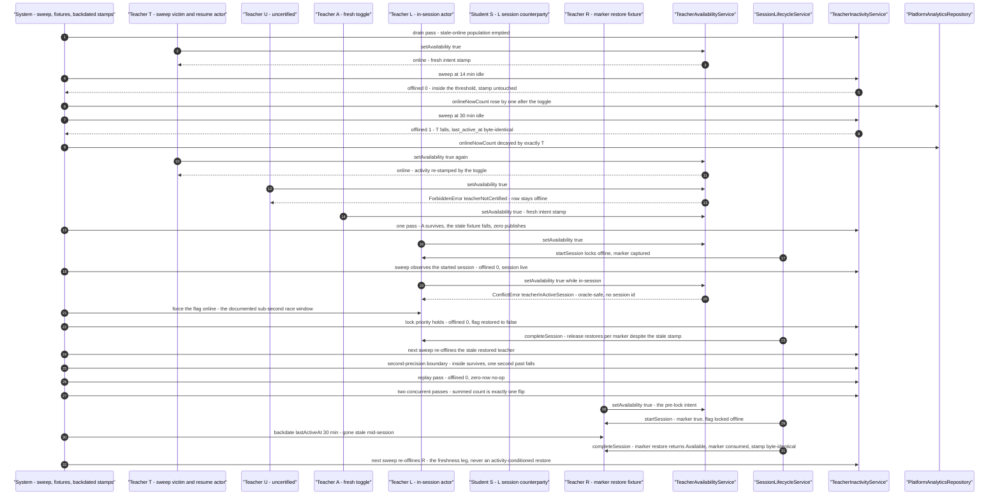

# Teachers workflow journey diagrams

Mermaid diagrams for the cross-actor journey suites in this directory, using the same actor names, service entry points, and statuses as the journey code.

## teacher-inactivity-auto-offline.journey.test.ts

The inactivity auto-offline sweep across the real cast (steps 1–11): idle teachers fall past the 15-minute staleness cutoff while fresh explicit-intent toggles survive the same pass, the started-session lock exempts its teacher from every sweep, the strict second-precision boundary decides who falls, overlapping passes collapse to one flip — and the marker-gated release at session conclusion restores the pre-lock Available intent with the next sweep re-offlining the gone-stale teacher (the restore is never activity-conditioned).

